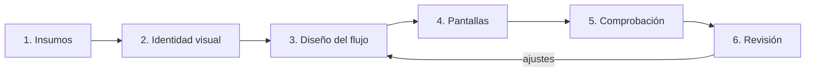

# Interfaz de DonaTrack — proceso de diseño

> UTN-FRBA — Diseño de Sistemas (2026) — Grupo 5
> **Versión 3 · 2026-11-06 (exploración A/B en boceto) · cliente liviano de E6**

Este es el punto de entrada para diseñar y construir la interfaz del cliente liviano. Lo usan las
personas del equipo y los agentes de IA. Las reglas técnicas del módulo están en
[`cliente-liviano/AGENTS.md`](../../cliente-liviano/AGENTS.md).

## Quién hace qué

| Quién | Hace |
|---|---|
| Usuario o diseñadora | Decide: elige entre opciones, aprueba el brief de identidad y cada flujo. |
| Agente | Propone, construye y comprueba. Pregunta solo lo que no puede resolver por su cuenta. |
| Revisor independiente | Revisa con ojos frescos al cerrar un flujo o una pantalla (skill `revision-ui`). |

## El proceso en 6 pasos



| Paso | Qué entra | Qué sale | Skill |
|---|---|---|---|
| 1. Insumos | Prototipo v2 de la diseñadora, bocetos de E1, mapa del sitio, requerimientos de E6 y el brief de tono del equipo | Contexto listo | — ([bocetos](bocetos-e1.md), [mapa](mapa-del-sitio.md), [tono](tono-y-comunicacion.md)) |
| 2. Identidad visual | Respuestas del usuario en 2 o 3 rondas cortas | `identidad/brief.md` y la paleta, tipografía y forma en `tokens.css` | `identidad-visual` |
| 3. Diseño del flujo | Un flujo (por ejemplo, confirmar recepción) | `flujos/<flujo>.md` con recorrido, estados, textos y revisión de usabilidad | `ux-flujo` |
| 4. Pantallas | El flujo aprobado | Vistas y componentes en `cliente-liviano/` | `vista-ui` |
| 5. Comprobación | Las vistas | Tests en verde y capturas en los 3 anchos | (dentro de `vista-ui`) |
| 6. Revisión | Flujo, vistas y capturas | Veredicto con hallazgos | `revision-ui` |

**Una sola identidad: Raíces.** El sitio tiene una identidad, con su [brief](identidad/brief.md),
sus plantillas en `cliente-liviano/src/main/resources/templates/` y sus hojas en `static/css/`
(`tokens.css`, `app.css` y una hoja por pantalla). En la maqueta, `/` es la portada y cada pantalla
se ve en `/<pantalla>`. Tiene el recorrido público, el del donante y el de la entidad, más el inicio
del admin ([mapa del sitio](mapa-del-sitio.md)). Las identidades anteriores se retiraron el
2026-11-03 ([ADR aceptado](../adr/cliente-liviano/20261103-una-sola-identidad-en-el-cliente-liviano.md));
sus documentos están en el [archivo histórico](historico/README.md), que no es guía para diseñar.
Desde el 2026-11-08 el sitio usa la piel y la composición de la variante K, "Huerta con abejas"
([brief](identidad/brief.md); [ADR `proposed`](../adr/cliente-liviano/20261110-piel-huerta-con-abejas-como-identidad-del-cliente-liviano.md),
pendiente de aceptación del grupo). Los SVG originales de sus ilustraciones están en
[`identidad/fuentes/`](identidad/fuentes/README.md).

**Rondas de ajustes del 2026-11-09.** Los pedidos por pantalla y las pruebas A/B/C de ese día, con
lo que se hizo en cada parte: [ronda de la mañana](plan-ronda-2026-11-09.md) y
[ronda de la tarde](plan-ronda-2026-11-09-tarde.md).

La voz, el tono de cada pantalla, los nombres de los estados y las cifras están en
[tono y comunicación](tono-y-comunicacion.md).

**Diseño creativo desde cero, sin estar presente.** Cuando el usuario quiere algo nuevo y creativo
(un rediseño, una pantalla o una identidad nueva), la skill `relevamiento-creativo` le pregunta por sus
referencias, el mensaje, las libertades y hasta dónde llegar, y deja un
[encargo creativo](encargos/README.md) aprobado. Después, `corrida-creativa` trabaja sola: varias
iteraciones que escalan (concepto de una pantalla, sistema y flujo completo), con conceptos
opuestos construidos en paralelo, críticos que no diluyen la audacia y el piso comprobado en cada
paso. Trabaja sobre el sitio en su propia rama y entrega la rama con su evidencia, la bitácora y
una página de antes y después; el usuario decide con el merge. Las reglas están en la [dirección de arte](direccion-de-arte.md) ("Libertad
creativa" y "Oficio").

**Comparaciones A/B.** Cuando una decisión de gusto o de forma tiene más de una buena respuesta
(una paleta, una tipografía, el orden de una pantalla), el agente arma dos variantes que difieren
solo en ese tema y el usuario elige. Skill `iteracion-ab`; temas posibles en el
[catálogo](temas-ab.md). Cada elección queda en la [bitácora](bitacora.md). Si se busca un aspecto
nuevo (exploración), las opciones se separan en un eje declarado y las vueltas van en boceto (solo
capturas a 1280 px); la comprobación del piso, la evidencia y la bitácora se hacen una vez, al
elegir.

Las skills están en `.agents/skills/<nombre>/SKILL.md`. Claude Code las encuentra mediante
`.claude/skills/<nombre>/SKILL.md`, que apunta a la versión de `.agents/`.

## Cómo se le pregunta al usuario

El proceso no debe cansar a quien decide. Reglas para el agente:

1. **Una decisión por pregunta**, con una opción recomendada y el motivo en una línea.
2. **Como máximo 3 preguntas por ronda.**
3. **Mostrar antes que explicar:** una imagen, un ejemplo o un texto de muestra.
4. **No preguntar lo que el agente puede decidir o comprobar por su cuenta**: contraste, tamaños o
   si algo entra en móvil.
5. **Palabras de todos los días.** En lo que ve el usuario no van "token", "WCAG", "breakpoint" ni
   "fragmento". Si un término es inevitable, va con una explicación de una línea (ver
   [glosario](#glosario)).
6. **El detalle técnico va a la bitácora y a los tests**, no a la conversación.
7. Al presentar un A/B: **2 o 3 líneas por variante** y la imagen comparativa. Nada más.

## Anchos de referencia

| Ancho | Representa |
|---|---|
| 360 px | Celular |
| 1280 px | Escritorio |
| 1920 px | Pantalla grande |

- Se diseña, se captura y se compara en estos tres anchos.
- Los define una sola constante de los tests: `AnchosDeReferencia`, en
  `cliente-liviano/src/test/java/`. Esta tabla la explica.
- Además, la comprobación automática revisa anchos intermedios (incluidos una tableta y el quiebre
  ancho, 1100 px, donde el menú pasa a columna) para que nada se desborde. No genera capturas para el usuario.
- En el celular, además de la página completa, captura la **primera pantalla (360 × 640)**: lo que
  se ve sin desplazar (`<página>-360x640.png`).
- Las herramientas para trabajar con las capturas (JPG de evidencia, comparar, recortar, lado a
  lado y la página de antes y después) están en [`scripts/visual/`](../../scripts/visual/README.md).
- Los puntos de quiebre del CSS se declaran una sola vez, en `tokens.css`.

## Listo para entregar

**Un flujo está listo cuando** su ficha (`flujos/<flujo>.md`, según la
[plantilla](plantillas/flujo.md)):

- [ ] no tiene huecos ni "a definir";
- [ ] recorre el camino feliz y los desvíos;
- [ ] lista cada estado de cada pantalla con su texto;
- [ ] sus textos pasan el [filtro de tono](tono-y-comunicacion.md#filtro-de-tono-7-preguntas);
- [ ] pasó la revisión de usabilidad (las 10 heurísticas);
- [ ] fue aprobada por el usuario.

**Una pantalla está lista cuando:**

- [ ] usa solo los colores, tipografías y espacios con nombre de `tokens.css`;
- [ ] muestra todos sus estados (vacío, cargando, éxito, error, sin permiso) con el texto del flujo;
- [ ] dice cada estado de una donación como es (lo pendiente, pendiente) y cada cifra con su
      período, su fuente y su fecha de actualización ([tono](tono-y-comunicacion.md));
- [ ] funciona sin JavaScript en lo esencial (ver, navegar y enviar formularios);
- [ ] pasa la comprobación automática en los 3 anchos: accesibilidad AA sin errores, nada
      desbordado y controles de al menos 48×48 px;
- [ ] tiene la revisión de `revision-ui` sin hallazgos bloqueantes.

## Cómo leer los bocetos de E1

`Read` no muestra PDFs de más de 10 páginas sin `pdftoppm`. Alcanza con partir el PDF en tramos
con `pypdf` y leer cada tramo:

```python
# Parte los bocetos en tramos de 6 páginas dentro de una carpeta temporal.
from pypdf import PdfReader, PdfWriter

origen = "docs/entregas/1/interfaz/DonaTrack-Bocetos.pdf"
destino = "<carpeta-temporal>"
paginas = PdfReader(origen).pages
for inicio in range(0, len(paginas), 6):
    tramo = PdfWriter()
    for pagina in paginas[inicio:inicio + 6]:
        tramo.add_page(pagina)
    tramo.write(f"{destino}/bocetos-{inicio + 1:02d}.pdf")
```

El resumen página por página está en [bocetos-e1.md](bocetos-e1.md).

## Del trabajo al entregable de la cátedra

Estos documentos son de trabajo. Para el entregable de E6 se pasan a un informe para personas:

- portada, índice, pie con número de página y epígrafes;
- **sin evidencia del repo**: ni rutas, ni clases, ni nombres de tests;
- cada decisión de la bitácora como recuadro: **Decisión / Alternativas / Por qué / Costo**, con
  las capturas A/B como figura;
- diagramas legibles impresos (texto de 7 pt o más).

## Cómo cambiar o extender el proceso

Cada regla vive en un solo archivo. Para cambiar algo, se edita ese archivo y nada más.

| Quiero… | Hago… |
|---|---|
| Diseñar un flujo nuevo | Copio [`plantillas/flujo.md`](plantillas/flujo.md) a `flujos/<flujo>.md` y uso la skill `ux-flujo` |
| Comparar un tema nuevo con A/B | Agrego una fila en [`temas-ab.md`](temas-ab.md) |
| Sumar una pantalla | Diseño su flujo con `ux-flujo` y la construyo con `vista-ui`: `templates/<pantalla>.html` y su hoja `static/css/<pantalla>.css` |
| Comprobar una página más | Agrego una línea en `cliente-liviano/src/test/resources/verificacion/paginas.txt` |
| Comprobar solo algunas páginas | Corro la verificación visual con `-Dverificacion.paginas=<ruta>,<ruta>` (sin tocar `paginas.txt`; en Git Bash, sin la barra inicial) |
| Diseñar algo nuevo y creativo sin estar presente | Uso `relevamiento-creativo` (preguntas y encargo) y después `corrida-creativa` (el workflow `.claude/workflows/corrida-creativa.js`) |
| Cambiar cómo se encarga o se critica el trabajo creativo | Edito las plantillas `encargo-constructor.md` o `encargo-critico.md`; el workflow las lee |
| Cambiar la identidad (colores, letras) | Edito solo la sección de valores base de `tokens.css` |
| Proponer una identidad nueva | La diseño en una rama propia, sobre el sitio (`relevamiento-creativo` y `corrida-creativa`); el merge la adopta |
| Cambiar los anchos de referencia | Edito la constante `AnchosDeReferencia` y la tabla de arriba |
| Cambiar una regla de diseño | Edito [dirección de arte](direccion-de-arte.md) o [patrones y textos](patrones-y-microcopy.md) |
| Cambiar la voz, el tono o los mensajes | Edito [tono y comunicación](tono-y-comunicacion.md), siempre a partir de una versión nueva del brief de tono del equipo (y guardo el PDF en `identidad/`) |
| Sumar una skill | Creo `.agents/skills/<nombre>/SKILL.md` y su adaptador `.claude/skills/<nombre>/SKILL.md` (copiar uno existente y cambiar nombre y descripción); la agrego a `docs/context-index.md` |

## Glosario

Los términos que el usuario puede llegar a ver, explicados en una línea:

- **Token:** un valor con nombre (por ejemplo, "color de acción principal") que usan todas las
  pantallas. Cambiarlo cambia todo el sitio.
- **Contraste AA:** diferencia mínima entre texto y fondo para que se lea bien (norma WCAG nivel AA).
- **Breakpoint o punto de quiebre:** el ancho a partir del cual la pantalla se reacomoda.
- **Estado vacío:** lo que se ve cuando todavía no hay datos.
- **Mejora progresiva:** la página funciona sin JavaScript; con JavaScript, funciona más cómoda.

## Archivos de esta carpeta

| Archivo | Para qué |
|---|---|
| [bocetos-e1.md](bocetos-e1.md) | Inventario de los bocetos de E1 |
| [mapa-del-sitio.md](mapa-del-sitio.md) | Pantallas, roles y niveles, y qué pantallas están dibujadas |
| [roadmap-vistas-enunciado.md](roadmap-vistas-enunciado.md) | Las vistas que pide el enunciado y faltan, con su matriz requerimiento → vista y las 7 fases para terminarlas |
| [direccion-de-arte.md](direccion-de-arte.md) | Cómo apuntar alto en lo gráfico sin perder el piso |
| [criterios-catedra-ux-ui.md](criterios-catedra-ux-ui.md) | Los criterios del material de UX/UI de la cátedra (2026): factores de la experiencia, patrones, arquitectura de la información, lenguaje visual, accesibilidad y las 10 heurísticas, como guía para diseñar y revisar |
| [identidad/brief.md](identidad/brief.md) y [identidad/referencias/](identidad/referencias/README.md) | La identidad del sitio (Raíces: raíces y semillas para empresas que donan): su brief y las referencias que trajo el usuario |
| [flujos/](flujos/) | Las fichas de flujo aprobadas. Los recorridos navegables: [público](flujos/raices-publico-navegable.md), [donante](flujos/raices-donante-navegable.md) y [entidad con el inicio del admin](flujos/raices-entidad-navegable.md) (aprobadas el 2026-11-03), el [resto del admin](flujos/raices-admin-navegable.md) (aprobada el 2026-11-07) y [Misiones e insignias](flujos/raices-misiones.md) (aprobada el 2026-11-07; con ella, Seguir entregas y Mi perfil de la entidad amplían sus fichas) y [Nosotros, las dos landings y Activar cuenta](flujos/raices-conocer-y-activar.md) (aprobada el 2026-11-07), [Llegó con un problema](flujos/raices-llego-con-un-problema.md) y [las páginas de error](flujos/raices-paginas-de-error.md) (aprobadas el 2026-11-07); las fichas del backlog R11, como [las pantallas de persona](flujos/r11-p0-persona.md) (en revisión), [el paginador del sitio](flujos/r11-p1-paginador.md) (en revisión) [la de importaciones del admin](flujos/r11-p1-importaciones.md) (en revisión) y [Asignar donaciones](flujos/r11-p1-asignaciones.md) (en revisión); los huecos de backend, en [flujos/raices-ab-huecos-backend.md](flujos/raices-ab-huecos-backend.md) |
| [historico/](historico/README.md) | Las identidades retiradas el 2026-11-03. No es guía para diseñar |
| [tono-y-comunicacion.md](tono-y-comunicacion.md) y [identidad/brief-tono-y-comunicacion-v1.0.pdf](identidad/brief-tono-y-comunicacion-v1.0.pdf) | Voz, tono por pantalla, estados, cifras, personas y el filtro de 7 preguntas, comunes a todo el sitio; el PDF es el brief del equipo del que sale |
| [patrones-y-microcopy.md](patrones-y-microcopy.md) | Componentes, estados, avisos y textos |
| [componentes.md](componentes.md) | Catálogo de capas CUBE y componentes: lo primero que se lee antes de construir o revisar una pantalla |
| [backlog-migracion-componentes.md](backlog-migracion-componentes.md) | Backlog obligatorio de migración a componentes y capas CUBE, con la línea de base y el tope de clases de un solo uso |
| [temas-ab.md](temas-ab.md) | Temas que se pueden comparar con A/B |
| [bitacora.md](bitacora.md) | Decisiones de diseño, con su porqué |
| [plantillas/](plantillas/) | Ficha de flujo, iteración A/B, brief de identidad y los tres encargos de una corrida creativa (el creativo, el del constructor y el del crítico) |
| [encargos/](encargos/README.md) | Los encargos creativos aprobados por el usuario: la entrada de cada corrida creativa |
| `identidad/`, `flujos/`, `evidencia/` | Lo que produce el proceso: el brief, las fichas de flujo y las capturas |
| [evidencia/raices-calida-concepto-donante-inicio/](evidencia/raices-calida-concepto-donante-inicio/) y [evidencia/raices-calida-sistema/](evidencia/raices-calida-sistema/) | Capturas en JPG de la corrida creativa de [Raíces cálida](encargos/raices-calida.md): los tres conceptos sobre el inicio del donante con su antes (iteración 1) y las rutas del sitio con el sistema aplicado (iteración 2); las decisiones, en la [bitácora](bitacora.md) |
