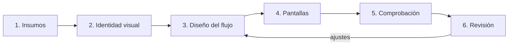

# Interfaz de DonaTrack — proceso de diseño

> UTN-FRBA — Diseño de Sistemas (2026) — Grupo 5
> **Versión 1 · 2026-10-30 · cliente liviano de E6**

Este es el punto de entrada para diseñar y construir la interfaz del cliente liviano. Lo usan las
personas del equipo y los agentes de IA. Las reglas técnicas del módulo están en
[`cliente-liviano/AGENTS.md`](../../cliente-liviano/AGENTS.md).

## Quién hace qué

| Quién | Hace |
|---|---|
| Usuario o diseñadora | Decide: elige entre opciones, aprueba el brief de identidad y cada flujo. |
| Agente | Propone, construye y comprueba. Pregunta solo lo que no puede resolver por su cuenta. |
| Revisor independiente | Revisa con ojos frescos al cerrar un flujo o una pantalla (skill `revision-ui`). |

## El proceso en 6 pasos



| Paso | Qué entra | Qué sale | Skill |
|---|---|---|---|
| 1. Insumos | Prototipo v2 de la diseñadora (punto de partida, ver [brief](identidad/brief.md)), bocetos de E1, mapa del sitio, requerimientos de E6 | Contexto listo | — ([bocetos](bocetos-e1.md), [mapa](mapa-del-sitio.md)) |
| 2. Identidad visual | Respuestas del usuario en 2 o 3 rondas cortas | `identidad/brief.md` y la paleta, tipografía y forma en `tokens.css` | `identidad-visual` |
| 3. Diseño del flujo | Un flujo (por ejemplo, confirmar recepción) | `flujos/<flujo>.md` con recorrido, estados, textos y revisión de usabilidad | `ux-flujo` |
| 4. Pantallas | El flujo aprobado | Vistas y componentes en `cliente-liviano/` | `vista-ui` |
| 5. Comprobación | Las vistas | Tests en verde y capturas en los 3 anchos | (dentro de `vista-ui`) |
| 6. Revisión | Flujo, vistas y capturas | Veredicto con hallazgos | `revision-ui` |

**Dos alternativas de identidad.** El sitio tiene dos identidades con las mismas pantallas,
componentes, datos y acciones, cada una con sus plantillas, sus hojas de estilo y su voz en títulos
y rótulos, para comparar qué mensaje transmite cada una
([ADR propuesto](../adr/cliente-liviano/20261030-dos-alternativas-de-identidad-visual-con-hojas-propias.md)):

| Alternativa | Mensaje | Brief | Plantillas y hojas de estilo | Cómo se ve |
|---|---|---|---|---|
| Glassmorphism | Profesional y seria | [brief.md](identidad/brief.md) | `templates/` y `static/css/tokens.css` y `app.css` | Por defecto |
| Cozy / Medieval | Cálida y de aventura | [brief-cozy-medieval.md](identidad/brief-cozy-medieval.md) | `templates/alternativas/cozy-medieval/` y `static/css/alternativas/cozy-medieval/` | `?alternativa=cozy-medieval` (perfil `maqueta`) |

Cada pantalla o componente nuevo se escribe y se estiliza dos veces, una por alternativa, con los
mismos datos y acciones (un test compara los dos juegos y deja pasar solo los títulos y rótulos de
la tabla de voz de cada alternativa). Cozy tiene además su propia
[estructura y navegación](estructura-cozy-medieval.md).

**Diseño creativo desde cero, sin estar presente.** Cuando el usuario quiere algo nuevo y creativo
(un rediseño, una pantalla o una alternativa), la skill `relevamiento-creativo` le pregunta por sus
referencias, el mensaje, las libertades y hasta dónde llegar, y deja un
[encargo creativo](encargos/README.md) aprobado. Después, `corrida-creativa` trabaja sola: varias
iteraciones que escalan (concepto de una pantalla, sistema y flujo completo), con conceptos
opuestos construidos en paralelo, críticos que no diluyen la audacia y el piso comprobado en cada
paso. Entrega una rama con su evidencia, la bitácora y una página de antes y después; el usuario
decide con el merge. Las reglas están en la [dirección de arte](direccion-de-arte.md) ("Libertad
creativa" y "Oficio").

**Comparaciones A/B.** Cuando una decisión de gusto o de forma tiene más de una buena respuesta
(una paleta, una tipografía, el orden de una pantalla), el agente arma dos variantes que difieren
solo en ese tema y el usuario elige. Skill `iteracion-ab`; temas posibles en el
[catálogo](temas-ab.md). Cada elección queda en la [bitácora](bitacora.md).

Las skills están en `.agents/skills/<nombre>/SKILL.md`. Claude Code las encuentra mediante
`.claude/skills/<nombre>/SKILL.md`, que apunta a la versión de `.agents/`.

## Cómo se le pregunta al usuario

El proceso no debe cansar a quien decide. Reglas para el agente:

1. **Una decisión por pregunta**, con una opción recomendada y el motivo en una línea.
2. **Como máximo 3 preguntas por ronda.**
3. **Mostrar antes que explicar:** una imagen, un ejemplo o un texto de muestra.
4. **No preguntar lo que el agente puede decidir o comprobar por su cuenta**: contraste, tamaños o
   si algo entra en móvil.
5. **Palabras de todos los días.** En lo que ve el usuario no van "token", "WCAG", "breakpoint" ni
   "fragmento". Si un término es inevitable, va con una explicación de una línea (ver
   [glosario](#glosario)).
6. **El detalle técnico va a la bitácora y a los tests**, no a la conversación.
7. Al presentar un A/B: **2 o 3 líneas por variante** y la imagen comparativa. Nada más.

## Anchos de referencia

| Ancho | Representa |
|---|---|
| 360 px | Celular |
| 1280 px | Escritorio |
| 1920 px | Pantalla grande |

- Se diseña, se captura y se compara en estos tres anchos.
- Los define una sola constante de los tests: `AnchosDeReferencia`, en
  `cliente-liviano/src/test/java/`. Esta tabla la explica.
- Además, la comprobación automática revisa anchos intermedios (incluida una tableta) para que
  nada se desborde. No genera capturas para el usuario.
- En el celular, además de la página completa, captura la **primera pantalla (360 × 640)**: lo que
  se ve sin desplazar (`<página>-360x640.png`).
- Las herramientas para trabajar con las capturas (JPG de evidencia, comparar, recortar, lado a
  lado y la página de antes y después) están en [`scripts/visual/`](../../scripts/visual/README.md).
- Los puntos de quiebre del CSS se declaran una sola vez, en `tokens.css`.

## Listo para entregar

**Un flujo está listo cuando** su ficha (`flujos/<flujo>.md`, según la
[plantilla](plantillas/flujo.md)):

- [ ] no tiene huecos ni "a definir";
- [ ] recorre el camino feliz y los desvíos;
- [ ] lista cada estado de cada pantalla con su texto;
- [ ] pasó la revisión de usabilidad (las 10 heurísticas);
- [ ] fue aprobada por el usuario.

**Una pantalla está lista cuando:**

- [ ] usa solo los colores, tipografías y espacios con nombre de `tokens.css`, y se ve bien en
      las dos alternativas de identidad;
- [ ] muestra todos sus estados (vacío, cargando, éxito, error, sin permiso) con el texto del flujo;
- [ ] funciona sin JavaScript en lo esencial (ver, navegar y enviar formularios);
- [ ] pasa la comprobación automática en los 3 anchos: accesibilidad AA sin errores, nada
      desbordado y controles de al menos 48×48 px;
- [ ] sus componentes nuevos están en el catálogo `/estilos`, con todos sus estados;
- [ ] tiene la revisión de `revision-ui` sin hallazgos bloqueantes.

## Cómo leer los bocetos de E1

`Read` no muestra PDFs de más de 10 páginas sin `pdftoppm`. Alcanza con partir el PDF en tramos
con `pypdf` y leer cada tramo:

```python
# Parte los bocetos en tramos de 6 páginas dentro de una carpeta temporal.
from pypdf import PdfReader, PdfWriter

origen = "docs/entregas/1/interfaz/DonaTrack-Bocetos.pdf"
destino = "<carpeta-temporal>"
paginas = PdfReader(origen).pages
for inicio in range(0, len(paginas), 6):
    tramo = PdfWriter()
    for pagina in paginas[inicio:inicio + 6]:
        tramo.add_page(pagina)
    tramo.write(f"{destino}/bocetos-{inicio + 1:02d}.pdf")
```

El resumen página por página está en [bocetos-e1.md](bocetos-e1.md).

## Del trabajo al entregable de la cátedra

Estos documentos son de trabajo. Para el entregable de E6 se pasan a un informe para personas:

- portada, índice, pie con número de página y epígrafes;
- **sin evidencia del repo**: ni rutas, ni clases, ni nombres de tests;
- cada decisión de la bitácora como recuadro: **Decisión / Alternativas / Por qué / Costo**, con
  las capturas A/B como figura;
- diagramas legibles impresos (texto de 7 pt o más).

## Cómo cambiar o extender el proceso

Cada regla vive en un solo archivo. Para cambiar algo, se edita ese archivo y nada más.

| Quiero… | Hago… |
|---|---|
| Diseñar un flujo nuevo | Copio [`plantillas/flujo.md`](plantillas/flujo.md) a `flujos/<flujo>.md` y uso la skill `ux-flujo` |
| Comparar un tema nuevo con A/B | Agrego una fila en [`temas-ab.md`](temas-ab.md) |
| Sumar un componente | Creo su archivo en `templates/fragmentos/` y lo agrego a `/estilos` (un test falla si falta) |
| Comprobar una página más | Agrego una línea en `cliente-liviano/src/test/resources/verificacion/paginas.txt` |
| Comprobar solo algunas páginas | Corro la verificación visual con `-Dverificacion.paginas=<ruta>,<ruta>` (sin tocar `paginas.txt`; en Git Bash, sin la barra inicial) |
| Diseñar algo nuevo y creativo sin estar presente | Uso `relevamiento-creativo` (preguntas y encargo) y después `corrida-creativa` (el workflow `.claude/workflows/corrida-creativa.js`) |
| Cambiar cómo se encarga o se critica el trabajo creativo | Edito las plantillas `encargo-constructor.md` o `encargo-critico.md`; el workflow las lee |
| Cambiar la identidad (colores, letras) | Edito solo la sección de valores base del `tokens.css` de esa alternativa |
| Sumar una alternativa de identidad | Creo su brief en `identidad/`, la carpeta `static/css/alternativas/<nombre>/` con su `tokens.css` y su `app.css`, el juego completo de plantillas en `templates/alternativas/<nombre>/` (una gemela por plantilla y fragmento; el test de reglas lo exige) y su tabla de voz en `src/test/resources/voz/<nombre>.txt`; la comprobación visual la recorre sola |
| Cambiar los anchos de referencia | Edito la constante `AnchosDeReferencia` y la tabla de arriba |
| Cambiar una regla de diseño | Edito [dirección de arte](direccion-de-arte.md) o [patrones y textos](patrones-y-microcopy.md) |
| Sumar una skill | Creo `.agents/skills/<nombre>/SKILL.md` y su adaptador `.claude/skills/<nombre>/SKILL.md` (copiar uno existente y cambiar nombre y descripción); la agrego a `docs/context-index.md` |

## Glosario

Los términos que el usuario puede llegar a ver, explicados en una línea:

- **Token:** un valor con nombre (por ejemplo, "color de acción principal") que usan todas las
  pantallas. Cambiarlo cambia todo el sitio.
- **Contraste AA:** diferencia mínima entre texto y fondo para que se lea bien (norma WCAG nivel AA).
- **Breakpoint o punto de quiebre:** el ancho a partir del cual la pantalla se reacomoda.
- **Estado vacío:** lo que se ve cuando todavía no hay datos.
- **Mejora progresiva:** la página funciona sin JavaScript; con JavaScript, funciona más cómoda.

## Archivos de esta carpeta

| Archivo | Para qué |
|---|---|
| [bocetos-e1.md](bocetos-e1.md) | Inventario de los bocetos de E1 |
| [mapa-del-sitio.md](mapa-del-sitio.md) | Pantallas, roles y niveles |
| [direccion-de-arte.md](direccion-de-arte.md) | Cómo apuntar alto en lo gráfico sin perder el piso |
| [estructura-cozy-medieval.md](estructura-cozy-medieval.md) | Estructura, navegación y momentos de la Alternativa Cozy / Medieval (segunda versión: la mesa del cartógrafo) |
| [flujo-completo-cozy-medieval.md](flujo-completo-cozy-medieval.md) | El flujo completo del sitio en Cozy: recorrido por rol, pantallas y decisiones del prototipo navegable (`/prototipo/<pantalla>` en la maqueta) |
| [identidad/referencias-cozy-medieval/](identidad/referencias-cozy-medieval/README.md) | Las 18 imágenes de referencia de Cozy que trajo el usuario, con qué se toma de cada una |
| [patrones-y-microcopy.md](patrones-y-microcopy.md) | Componentes, estados, avisos y textos |
| [temas-ab.md](temas-ab.md) | Temas que se pueden comparar con A/B |
| [bitacora.md](bitacora.md) | Decisiones de diseño, con su porqué |
| [plantillas/](plantillas/) | Ficha de flujo, iteración A/B, brief de identidad y los tres encargos de una corrida creativa (el creativo, el del constructor y el del crítico) |
| [encargos/](encargos/README.md) | Los encargos creativos aprobados por el usuario: la entrada de cada corrida creativa |
| `identidad/`, `flujos/`, `evidencia/` | Lo que produce el proceso: un brief por alternativa, las fichas de flujo y las capturas (las de Cozy / Medieval, en `evidencia/cozy-medieval/`) |
