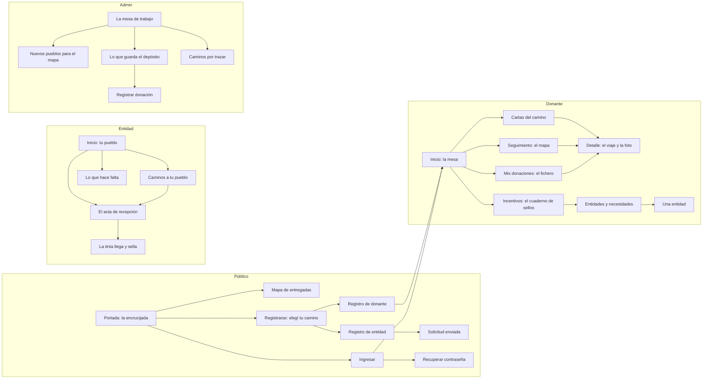

# El flujo completo del sitio en Cozy / Medieval (prototipo)

> UTN-FRBA — Diseño de Sistemas (2026) — Grupo 5
> **Estado:** propuesta del agente, sin aprobar · **Fecha:** 2026-10-31 · iteración 3 del rediseño
> de Cozy (ver la [bitácora](bitacora.md))
> **Base:** la [directiva de estructura](estructura-cozy-medieval.md) (segunda versión: la mesa del
> cartógrafo), el [brief](identidad/brief-cozy-medieval.md) y el [mapa del sitio](mapa-del-sitio.md).

El usuario pidió que la tercera iteración diseñe el flujo completo del sitio. Este documento lo
describe y el prototipo lo deja recorrer de punta a punta.

**Qué es y qué no es.** Es un prototipo de diseño: pantallas con datos de ejemplo escritos en la
plantilla, enlaces y formularios reales entre ellas, y el piso cumplido (contraste AA, toque de
48 px, nada desbordado entre 360 y 1920 px, lo esencial sin JavaScript). **No son pantallas del
sistema:** no tienen controller propio, ni datos de las APIs, ni gemela en Glassmorphism. Cada una
se construye de verdad, en las dos alternativas, cuando su flujo se diseñe con la skill `ux-flujo` y
el usuario lo apruebe. Este documento no reemplaza esas fichas: es el punto de partida.

## Cómo se recorre

Con el perfil `maqueta` (`mvn -pl cliente-liviano spring-boot:run -Dspring-boot.run.profiles=maqueta`),
en `http://localhost:8090/prototipo/<pantalla>`. Se empieza en
[`/prototipo/publico-portada`](http://localhost:8090/prototipo/publico-portada). Cada rol tiene su
menú (los cajones de la mesa): una sección que todavía no tiene pantalla muestra la tierra sin
explorar y vuelve al inicio del rol. En la maqueta, `/notificaciones`, `/perfil` y `/salir` del layout
privado también llevan al prototipo.

**Qué se comprueba solo.** La verificación visual (`cliente-liviano/src/test/resources/verificacion/paginas.txt`)
recorre una pantalla por sección. Los estados (vacíos, errores, avisos y resultados de cada
decisión) se comprobaron en una corrida aparte con todas las plantillas del prototipo (56 rutas,
2026-10-31, con el mismo piso y sin hallazgos); si
se cambia una de esas pantallas, hay que sumarla a esa lista o correrla aparte.

## El recorrido

## Las pantallas

| Pantalla (`/prototipo/…`) | La idea | Estados |
|---|---|---|
| `publico-portada` | **La encrucijada**: el título y "Donar ahora" sin desplazar en 360 px; tres caminos en lápiz que salen de la rosa (soy donante, sumar mi entidad, ver el mapa); lo que viajó este mes como fichas con la foto pegada; las cifras como leyenda de mapa | — |
| `publico-mapa` | **El mapa grabado**: cada entidad, un pueblo; cada entrega, su camino de tinta desde el depósito; al lado, la misma información en una lista; filtro por categoría | Sin resultados (`?categoria=higiene`) |
| `publico-ingresar` | **La libreta de viaje**: el paisaje a la izquierda y el formulario a la derecha | `publico-ingresar-error`; `publico-recuperar` y `publico-recuperar-enviado` |
| `publico-registro` | **Elegí tu camino**: dos caminos, con lo que se puede hacer y lo que se pide en cada uno | `publico-registro-donante`, `publico-registro-entidad`, `publico-registro-entidad-enviada` (el alfiler avanza un paso) |
| `donante-inicio` | **La mesa**: la nota del saludo, el mapa del viaje en curso, la carta, el libro de cuentas y el cuaderno de sellos | — |
| `donante-donaciones` | **El fichero**: una tarjeta guía por etapa (○ por salir, ┄▸ en camino, ┄╳┄ camino cortado, ◉ llegaron a destino) con su cantidad; las entregadas, plegadas; filtro por estado y categoría | Sin resultados; `donante-donaciones-vacio` |
| `donante-donaciones-detalle` | **El viaje de una donación**: el mapa grande y, si llegó, la foto pegada debajo del pueblo sellado; la etiqueta del envío y sus cartas | En camino, entregada (`?donacion=ropa`), con problema (`utiles`), por salir (`arroz`) |
| `donante-seguimiento` | **El mapa de las entregas en curso**: un camino por entrega, con su número y su signo; al lado, la hoja de ruta | `donante-seguimiento-vacio` |
| `donante-incentivos` | **El cuaderno de sellos**: la escala de rangos como una barra de mapa, la misión en curso con sus sellos y el estuche con las medallas | — |
| `donante-entidades` | **Los pueblos**: el mapa de la región con su nomenclador; cada pueblo, con lo que falta de cada necesidad | Sin resultados (`?categoria=higiene`) |
| `donante-entidades-detalle` | **Una entidad**: quiénes son, sus necesidades y cuánto falta, y "Donar para esta necesidad" | Otra entidad (`?pueblo=comedor`, `escuela` u `hogar`); el paso de qué y cuánto llevar (`?pueblo=…&necesidad=…`); `donante-entidades-anotada` (con el depósito y su horario) |
| `donante-cartas` | **La bandeja de cartas**: sobres cerrados ("Sin abrir") y abiertos ("Leída"), cada una lleva a su donación | `donante-cartas-vacio` |
| `entidad-inicio` | **Tu pueblo**: arriba, los talones de lo que llegó con "Confirmar recepción"; al lado, el pueblo con los caminos que le llegan | `entidad-inicio-vacio` |
| `entidad-seguimiento` | **Caminos a tu pueblo**: un libro de ruta por etapas, lo que espera confirmación primero | — |
| `entidad-seguimiento-confirmar` | **El acta de recepción** (`?entrega=lentejas` o `ropa`): qué llega y su último tramo, las fotos como pruebas, los bultos y el remito, y el botón en la línea de la firma | `entidad-seguimiento-confirmar-error` (errores arriba con enlaces y junto a cada campo) |
| `entidad-seguimiento-sellada` | **La tinta llega y sella**: el último tramo se entinta y cae el sello, una sola vez; el aviso, en texto | `entidad-seguimiento-sellada-lentejas` y `-ropa` (el sello cae una vez); con "reducir movimiento" o sin JavaScript, ya sellada |
| `entidad-necesidades` | **Lo que hace falta**: libro de registro y "Publicar otra necesidad" | `entidad-necesidades-publicada` |
| `admin-inicio` | **La mesa de trabajo**: lo que espera decisión primero (legajos con pestaña de latón y cantidad) y las cuentas al día | — |
| `admin-entidades` | **Entidades por aprobar** (bajada: "Nuevos pueblos para el mapa"): registro de solicitudes; el nombre abre lo que presentó; "Aprobar", o "Pedir documentación" si falta algo; "Rechazar" con el motivo en un plegable que anda sin JavaScript | `admin-entidades-{aprobada,pedida,rechazada}-<id>`, `admin-entidades-vacio` |
| `admin-donaciones` | **Lo que guarda el depósito**: registro con filtros; lo que vence pronto, con marca y texto | Sin resultados; `admin-donaciones-registrar`, `admin-donaciones-registrar-error` y `admin-donaciones-registrada` |
| `admin-asignaciones` | **Caminos por trazar**: qué va adónde y por qué; la ruta propuesta en lápiz se entinta al aceptarla | `admin-asignaciones-aceptada-<id>`, `admin-asignaciones-cambiada-<id>-<lugar>`, `admin-asignaciones-vacio` |

Sin pantalla todavía (muestran la tierra sin explorar): Donaciones recibidas (entidad), Donantes,
Camiones y Ranking (admin).

## Decisiones de diseño y su porqué

- **Un material, un significado, en todo el sitio.** La tinta es solo el camino de una entrega: los
  caminos de la encrucijada, los propuestos por el admin y el tramo que falta van en lápiz; se
  entintan cuando pasa algo real (la recepción confirmada, la asignación aceptada). El sello de latón
  es lo confirmado, el mismo en el cuaderno de misiones y en el acta. El rojo lacre, solo "con
  problema".
- **Cada mapa tiene su lista al lado, con los mismos datos** (RF-CL-06). Las posiciones en vivo se
  muestran como aproximadas y con hora.
- **Lo urgente primero.** La entidad ve arriba lo que espera su confirmación; el admin, lo que espera
  su decisión; las entregadas se pliegan porque ya no piden atención.
- **Ordenar por etapa del viaje**, no por fecha: responde la pregunta del donante, "¿dónde está?".
- **La foto va pegada al pueblo** porque es la prueba de que la donación llegó: el sello y la imagen,
  juntos. Antes de llegar, un hueco en lápiz anticipa que va a llegar.
- **El éxito es un paso del viaje, no un cartel**: al enviar la solicitud de una entidad, el alfiler
  avanza; al confirmar una recepción, la tinta llega y sella.
- **El admin trabaja sobre datos limpios.** La identidad va en el marco (tapas de cuero con su
  etiqueta) y en los títulos, nunca en las celdas; el registro pasa a tabla desde 1100 px.
- **Gamificación adulta.** Rangos, misiones y medallas como avance de un viaje (escala de mapa,
  sellos y un estuche), sin puntos ni colores de videojuego.
- **La entidad usa una mano.** La acción principal ocupa todo el ancho y está arriba en el celular.

## Desvíos que el prototipo ya muestra

- Filtros sin resultados: la tierra sin explorar, con "Sacar los filtros" o "Ver todos".
- Listas vacías (donaciones, cartas, seguimiento, entidades por aprobar, asignaciones): la tierra
  sin explorar con la acción posible.
- Errores de formulario: la lista arriba con enlaces y cada error junto a su campo.
- Camino cortado: el aviso con la nueva salida y la ╳ de lacre sobre el tramo.
- Documentación incompleta: "Pedir documentación" en lugar de "Aprobar".

## Lo que falta para que una pantalla sea real

- Su ficha de flujo aprobada (`flujos/<flujo>.md`), con sus textos definitivos.
- Su controller, su modelo de vista y sus datos desde las APIs.
- Su gemela en Glassmorphism, con los mismos datos y acciones.
- Piezas compartidas que el prototipo pidió: el diálogo con lugar para campos (el de rechazo con
  motivo), `campo` y `carga-fotos` con valor cargado y `required`, y los pendientes en latón en la
  navegación.
