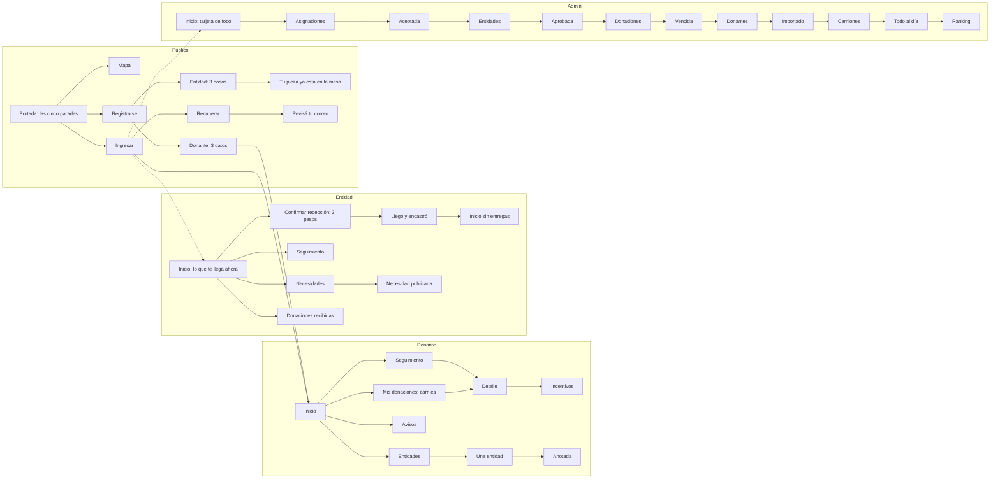

# El flujo completo del sitio en Encastre (prototipo)

> UTN-FRBA — Diseño de Sistemas (2026) — Grupo 5
> **Estado:** propuesta del agente, sin aprobar · **Fecha:** 2026-10-31 · iteración 3 de la corrida
> creativa de Encastre (ver la [bitácora](bitacora.md))
> **Base:** el [encargo](encargos/encastre.md), el [brief](identidad/brief-encastre.md) y el
> [mapa del sitio](mapa-del-sitio.md). El sistema (mesa, misión como rompecabezas, riel, controles)
> es el de la iteración 2.

La iteración 3 diseña el flujo completo del sitio con el idioma de Encastre: cada donación es una
pieza con su color, y el sitio dice qué te toca ahora. Este documento lo describe y el prototipo
lo deja recorrer de punta a punta.

**Qué es y qué no es.** Es un prototipo de diseño: pantallas con datos de ejemplo escritos en la
plantilla, enlaces y formularios reales entre ellas, y el piso cumplido (contraste AA, toque de
48 px, nada desbordado entre 360 y 1920 px, lo esencial sin JavaScript). **No son pantallas del
sistema:** no tienen controller propio, ni datos de las APIs, ni gemela en Glassmorphism. Cada una
se construye de verdad, en las alternativas que sigan vivas, cuando su flujo se diseñe con la skill
`ux-flujo` y el usuario lo apruebe. Este documento no reemplaza esas fichas: es el punto de partida.

## Cómo se recorre

Con el perfil `maqueta` (`mvn -pl cliente-liviano spring-boot:run -Dspring-boot.run.profiles=maqueta`),
en `http://localhost:8090/prototipo/encastre/<pantalla>`. Se empieza en
[`/prototipo/encastre/publico-portada`](http://localhost:8090/prototipo/encastre/publico-portada).
Cada rol tiene su riel; una sección sin pantalla muestra `sin-dibujar` y vuelve al inicio del rol.

**Qué se comprueba solo.** La verificación visual de la iteración recorrió 44 pantallas en 360,
1280 y 1920 px más la primera pantalla del celular (360 × 640), con el piso (axe AA, toque de 48 px,
desbordes) y `reporte.json` en `[]`. Se sumó aparte `admin-donaciones-vencida` (también sin
hallazgos). La lista de la verificación del repo (`verificacion/paginas.txt`) no incluye las rutas
de Encastre: se pasan con `-Dverificacion.alternativa=encastre -Dverificacion.paginas=…`.

## El código de color: una sola regla para todo el sitio

El color dice dónde está la donación, que es lo mismo que quién la tiene. Es la decisión de diseño
de esta iteración (matriz en la [bitácora](bitacora.md)).

| Dónde está la donación | Color |
|---|---|
| Con quien dona (anotada, todavía no la llevó) | sol |
| En el depósito (registrada, asignada, lista para salir) | lila |
| En camino | azul |
| En la entidad (entregada, llegó) | menta |
| Con problema, sin entregar | rosa |
| Lo de ahora | naranja, encima de lo anterior y nunca como etapa |

Lo que **falta** es siempre el hueco del sistema (tinta con borde crema a trazos); lo que **viene** es
una pieza llena azul, sin trazos; lo **puesto** es una pieza llena con tilde.

## El recorrido

## Las pantallas

Rutas bajo `/prototipo/encastre/`.

| Pantalla | La idea | Estados |
|---|---|---|
| `publico-portada` | **La portada que se arma sola**: titular y cifras, las cinco paradas encastradas con la pieza de su rol debajo (mismo color, mismo ancho), lo que llegó esta semana y el hueco "Falta tu pieza" | — |
| `publico-mapa` | El mapa en manzanas con la lista numerada al lado; en el celular, el plano antes del filtro | Sin resultados con salida a todas las categorías |
| `publico-ingresar` | Correo, contraseña y Entrar; debajo, las cuentas de ejemplo de la entidad y de la administración | `publico-ingresar-error` (banner con el foco, mensaje genérico, campos marcados) |
| `publico-recuperar` | Un solo dato | `publico-recuperar-enviado` ("Revisá tu correo" dice lo mismo exista o no el correo) |
| `publico-registro` | Elegir la pieza de donante o la de entidad | `publico-registro-donante` (tres datos numerados, Crear mi cuenta); `publico-registro-entidad` (tres pasos); `publico-registro-entidad-enviada` ("Tu pieza ya está en la mesa", revisión hasta el viernes 16) |
| `donante-inicio` | La misión como rompecabezas y la pieza que viaja; "Ver seguimiento", "Mis donaciones", "Ver incentivos" y "Ver el detalle" | — |
| `donante-avisos` | Los avisos, ahora con vía | — |
| `donante-donaciones` | Qué viaja ahora y el tablero de carriles; cada nombre lleva al detalle | `donante-donaciones-vacio` (lleva a Entidades) |
| `donante-donaciones-detalle` | La donación como pieza grande dentro de la pieza naranja, con su recorrido; sigue al seguimiento (en camino), a incentivos (llegó) o vuelve a la lista | `?donacion=<clave>`; clave desconocida: el hueco con la vuelta |
| `donante-seguimiento` | Las entregas activas | `donante-seguimiento-vacio` (lleva a Mis donaciones) |
| `donante-entidades` | Búsqueda y elección de una entidad | — |
| `donante-entidades-detalle` | Lo que le falta a la entidad; "Donar para esta necesidad" abre el paso corto | `?entidad=<clave>`; `donante-entidades-anotada` (envío con POST) |
| `donante-incentivos` | La misión, el rango y las insignias | — |
| `entidad-inicio` | La pieza naranja de lo que llega ahora (lentejas de Ana, 15 kg) y la cola en piezas grises | `entidad-inicio-vacio` |
| `entidad-seguimiento` | Mapa más lista, con el mismo botón de confirmar | — |
| `entidad-seguimiento-confirmar` | Foto, bultos y remito, de a un paso | `entidad-seguimiento-confirmar-error` (resumen con foco, pasos con error en crema, bultos conservados); `entidad-seguimiento-confirmada` (las piezas encastran en Legumbres secas) |
| `entidad-necesidades` | Las necesidades como filas de piezas de N unidades, con texto al lado | `entidad-necesidades-publicada` (la fila nueva entra en huecos) |
| `entidad-recibidas` | Donaciones recibidas; filtro por estado con `?estado=` (GET real) | Sin filas: el hueco con "Ver todas" |
| `admin-inicio` | La tarjeta de foco (leche que vence) con Resolver y Después, la cola al costado y la tira del turno | `admin-inicio-al-dia` ("Todo al día. Buen turno."); `?foco=<tarea>` |
| `admin-asignaciones` | La propuesta del algoritmo y la tabla de asignaciones | `admin-asignaciones-aceptada` (logro con tira 1 de 5 y "Lo que sigue") |
| `admin-entidades` | El pedido de Manos Unidas; Aprobar; Rechazar pide el motivo | `admin-entidades-aprobada` |
| `admin-donaciones` | La bandeja con franjas que filtran con `?ver=`; Marcar vencida; Registrar donación | `admin-donaciones-vencida`, `admin-donaciones-registrar`, `admin-donaciones-registrar-error` (conserva lo escrito y abre el alta del donante), `admin-donaciones-registrada` |
| `admin-donantes` | El padrón de la feria; Importar | `admin-donantes-importado` (resultado por fila y 12 errores) |
| `admin-camiones` | El camión del taller; pasarlo a disponible | — |
| `admin-ranking` | El podio como piezas desde los datos | — |

## Fichas por rol

### Público

**Recorrido.**

1. La portada se lee de arriba abajo: titular y cifras, las cinco paradas con el rol debajo de cada
   una, lo que llegó esta semana y el hueco "Falta tu pieza".
2. Registrarse: elegís entre la pieza de donante y la de entidad.
3. Donante: tres datos numerados y Crear mi cuenta, que lleva a su inicio. Entidad: tres pasos y
   Enviar la solicitud, que lleva a "Tu pieza ya está en la mesa", con la revisión hasta el viernes 16.
4. Ingresar: correo, contraseña y Entrar, que lleva al inicio de Ana. Debajo, las cuentas de
   ejemplo de la entidad y de la administración.

**Desvíos.**

- Ingresar con error: banner sobrio con el foco, mensaje genérico y campos marcados.
- Recuperar: un dato; "Revisá tu correo" dice lo mismo exista o no el correo.
- Mapa: el filtro por categoría puede dar vacío, con salida a todas las categorías.
- Cada estado tiene salida a ingresar, al mapa o a la portada.

**Decisiones.**

- El color dice quién tiene la donación (sol vos, lila depósito, menta entidad), no adorna.
- Los formularios son paradas numeradas: el mismo idioma que el viaje.
- La acción queda fija abajo en el celular, para que se vea en la primera pantalla.
- En el mapa, el plano va antes del filtro en el celular, para verlo primero.
- Un solo naranja: Registrarme. En los recorridos, el paso actual lleva `pieza-ahora`.

### Donante

**Recorrido.**

1. Llega a `donante-inicio` (desde `publico-ingresar` o `publico-registro-donante`): "Ver
   seguimiento", "Mis donaciones", "Ver incentivos" y "Ver el detalle".
2. En `donante-donaciones` ve qué viaja ahora y el tablero de carriles; cada nombre lleva a
   `donante-donaciones-detalle?donacion=<clave>`.
3. Desde el detalle va al seguimiento (si está en camino), a incentivos (si llegó) o vuelve a la lista.
4. En `donante-entidades` busca y elige una entidad. `donante-entidades-detalle?entidad=<clave>`
   muestra lo que le falta; "Donar para esta necesidad" abre el paso corto, que envía con POST a
   `donante-entidades-anotada`.
5. `donante-incentivos` muestra la misión, el rango y las insignias.

**Desvíos.** Si no hay donaciones, `donante-donaciones-vacio` lleva a Entidades. Si no hay entregas
activas, `donante-seguimiento-vacio` lleva a Mis donaciones. Una clave desconocida muestra el hueco
con la vuelta.

**Decisiones.**

- Una sola pieza naranja por pantalla. Por eso, en el detalle, la pieza grande y el recorrido van
  dentro de ella, y en camino la pieza es crema.
- La acción va antes del dibujo, para que se vea en 360 × 640.
- Fechas en un solo calendario: 7 donaciones, 2 en septiembre y 5 en octubre (+3), y la misión
  pide noviembre.

### Entidad

**Recorrido.**

1. Entrar como Comedor Barrio Ejemplo lleva a `entidad-inicio`. La pieza naranja muestra las
   lentejas de Ana, 15 kg.
2. "Confirmar recepción" lleva a `entidad-seguimiento-confirmar`: foto, bultos y remito, de a un paso.
3. El envío va a `entidad-seguimiento-confirmada`: las piezas encastran en Legumbres secas.
4. "Volver al inicio" lleva a `entidad-inicio-vacio`: hoy no llega nada más y la cola sigue.

**Desvíos.**

- Con un error se ve `entidad-seguimiento-confirmar-error`. Muestra el resumen con foco, los pasos
  con error en crema y los bultos ya escritos; se reenvía igual.
- "Ver seguimiento" lleva a `entidad-seguimiento` (mapa más lista), que tiene el mismo botón.
- En Necesidades, "Publicar necesidad" lleva a `entidad-necesidades-publicada`: la fila nueva entra
  en huecos.
- Donaciones recibidas filtra por estado con `?estado=` (GET real). Sin filas para ese estado,
  muestra el hueco con "Ver todas".

**Decisiones y su porqué.**

- La acción va abajo, pegada sobre el riel: la entidad usa el celular con una mano.
- Una sola pieza naranja por pantalla, la entrega de ahora; en los formularios, el botón.
- Las necesidades se dibujan como filas de piezas de N unidades, con texto al lado: así el "se
  nota" sale de las cifras.
- La cola de lo que viene después va en piezas grises: todavía sin color.

### Administración

**Recorrido.** Inicio (tarjeta de foco: leche que vence) → Resolver → Asignar donaciones (propuesta
del algoritmo) → Aceptar → `admin-asignaciones-aceptada` (logro con tira 1 de 5 y lo que sigue) →
Entidades (pedido de Manos Unidas) → Aprobar → `admin-entidades-aprobada` → Donaciones (yogur
vencido) → Marcar vencida → `admin-donaciones-vencida` → Donantes (padrón de la feria) → Importar →
`admin-donantes-importado` (resultado por fila y 12 errores) → Camiones (camión del taller) →
pasarlo a disponible → `admin-inicio-al-dia` → Ver el ranking.

**Desvíos.** "Después" pospone la tarea (con JavaScript rota sin recargar; sin JavaScript es un
enlace con forma de botón a `admin-inicio?foco=<siguiente>`). Donaciones → Registrar donación →
`admin-donaciones-registrada`; si el servidor no encuentra al donante, `admin-donaciones-registrar-error`
conserva lo escrito y abre el alta en el mismo paso. Cada franja filtra su bandeja con `?ver=`.
Rechazar una entidad pide el motivo.

**Decisiones.** El turno sale de datos que el sistema conoce (vencimientos, pedidos, días en el
taller), para no inventar funciones. El logro trae la próxima tarea para que nunca haya dos cosas por
hacer a la vez. El nombre llano es el título y la voz va de bajada, porque son pantallas de trabajo.
Se sumó la pantalla `admin-donaciones-vencida`, que es el logro de la tarea de RF-16.

## Lo que se corrigió al juntar las cuatro partes

- Un solo código de color (arriba) en vez de tres; la parada 4 de la portada pasa al azul de "en camino".
- "Falta" es el hueco del sistema en todo el sitio (cedió el admin); "viene" es una pieza llena azul.
- Datos iguales entre roles: la leche y el arroz de la portada ya no chocan con el admin y la
  entidad; la llegada de las lentejas es a las 16:30 y la última posición a las 16:20.
- El lugar para el riel fijo al llevar el foco (`scroll-padding-bottom`): era el único bloqueo.
- El tramo "en proceso" de la ancla pasa a lila; "Lo que ya armaste" es visible para el lector de
  pantalla y no salta de `h1` a `h3`; Donantes del admin tiene su ícono de persona.

## Pendiente

Pedidos al sistema que no bloquean y quedan para el cierre: estilo de `select`, casillas y
`textarea`; el fragmento `campo` sin `value`, `required` ni `autocomplete`; `aviso` y `banner` sin
`tabindex` ni `autofocus`; las container queries en `rem`; un token por categoría; el pie público
sin legales ni privacidad (RF-01); la campana y "Mi perfil", que llevan a Cozy. Además, una ficha de
datos del prototipo compartida (las lentejas se escriben en cada parte). Lo que se sigue
decidiendo con `ux-flujo` antes de construir cada pantalla real: los datos de las APIs, los estados
de error del servidor y la gemela en Glassmorphism.
