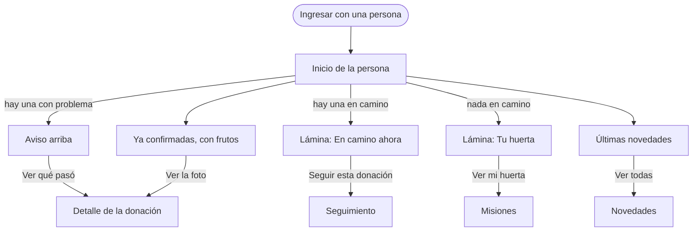

# Flujo: El inicio de la persona con la guía «Huerta y galpón» (don-inicio-persona)

> **Estado:** en revisión · **Fecha:** 2026-11-23 · **Aprobó:** pendiente (usuario)
> Ficha del lote `don-inicio-persona` de la ola DON del
> [backlog de la guía al código](../backlog-guia-al-codigo.md) (§5 y §12). La piden DA-08 y DA-03c
> y se escribe en sesión con el usuario (DA-19).
> Deriva del arquetipo A04 de la guía (`docs/interfaz/guia/partes/50-pantallas.html`, `#inicio-donante`,
> desde la línea 234), que dibuja solo a la empresa. Hereda de la ficha
> [de la persona](r11-p0-persona.md) (R11-06) quién es la persona, cómo se elige su versión (§4),
> el caso «sin tipo» y los estados de error y cargando. Esta ficha dice **qué cambia**. Donde las
> dos difieren, manda esta.

## 1. Para quién y para qué

| | |
|---|---|
| Quién | Una persona que dona de vez en cuando (en la maqueta, Martina Ruiz). Entra desde el celular, casi siempre después de llevar algo al depósito o cuando le llega una novedad |
| Tono | Panel del donante: cálido, agradecido, sin culpa por los meses sin donar ([tono](../tono-y-comunicacion.md#tono-según-la-pantalla)) |
| Qué quiere lograr | «Saber si lo que doné está bien, dónde va lo que está en camino y qué llegó» |
| Dispositivo principal | Celular primero |
| Requerimientos | Los de R11-06; RF-CL-07 (cada cifra con su fecha); RNF-CL-02 (sin JavaScript) |
| Datos que usa | `DonanteInicioPuerto.inicio(id)`, el mismo de la empresa (donaciones y avisos), y `anio(id)` si queda el almanaque (DON-P2). No cambia el puerto ni el adaptador `rest`: cambia qué pide `DonanteInicioController` para la persona. En la maqueta, `inicio(id)` necesita los datos de ejemplo de Martina |
| Guía | A04 (deriva). Piezas: aviso en la página (P13), lámina protagonista (P07), raíz de 5 pasos (P09), mapa (P24), frutos (P10), etiqueta de la entrega (P08), sello (P06) |

## 2. Dónde está en el sitio

Nivel 1, `/donante-inicio` con la cuenta de una persona (`templates/persona/donante-inicio.html`).
Menú de la persona: Inicio, Donaciones, Organizaciones, Misiones y Cómo donar (DA-03b; detalle en
la [ficha de Misiones](guia-don-misiones.md) §2).

## 3. Recorrido



## 4. Pantallas

```text
┌──────────────────────────────────────────────────────────────┐
│ Hola, Martina Ruiz                                           │
├─ aviso en la página (P13), solo si hay una con problema ─────┤
│ Ropa de abrigo, 12 prendas: no pudo llegar · Ver qué pasó    │
├─ lámina protagonista (P07): UNA de las dos ──────────────────┤
│ a) En camino ahora: Arroz, 5 kg, para Comedor Barrio Ejemplo │
│    [raíz de 5 pasos] [mapa]            [Seguir esta donación]│
│ b) Sin nada en camino: Tu huerta · Cada misión, una planta   │
│    [dibujo de la huerta]                        [Ver mi huerta]│
├──────────────────────────────────────────────────────────────┤
│ También en curso: filas con su sello y su paso (P06, P09)    │
│ Ya confirmadas: un fruto por entrega confirmada (P10) y la   │
│   etiqueta de cada una (P08)                                 │
│ [Tu huerta, tarjeta chica, solo en el caso a]                │
│ Tu año (DON-P2) · Últimas novedades (3) · Ver todas          │
└──────────────────────────────────────────────────────────────┘
```

**Qué cambia respecto de hoy (`persona/donante-inicio.html`):**

| Parte | Hoy | Con la guía |
|---|---|---|
| Arriba | Saludo, bajada del año y dos botones (Mis donaciones, Ver seguimiento) | El saludo de A04, sin botones: Seguimiento sale del menú (DA-03a) y se abre desde la donación |
| Problema | No se muestra en el inicio | El aviso en la página de A04, arriba de la lámina: se lee primero |
| Protagonista | La huerta, arriba de todo (R11-06) | **Una sola lámina:** la donación en camino, como A04, con la única acción llena; si no hay ninguna en camino, la huerta ocupa ese lugar con «Ver mi huerta» como acción llena (DON-P3) |
| La huerta con algo en camino | — | Tarjeta chica debajo, con «Ver mi huerta» secundaria |
| En curso y confirmadas | Dentro de «mes por mes» | «También en curso» y «Ya confirmadas» de A04, con frutos y etiquetas. Quién recibió: «Recibió: <la organización>» (HG-03) |
| El año | Almanaque de 12 meses, una planta por donación, y la lista mes por mes | Según DON-P2. En cualquier caso, la planta deja de ser una donación: en la guía la planta es una misión y el fruto, una entrega confirmada |
| Noticias | Al costado: el año en cifras y las últimas noticias | Las 3 últimas novedades, con «Ver todas» al buzón. El año en cifras sale: lo dice «Ya confirmadas» |
| Hora estimada | — | «En camino desde las 14:30», sin hora estimada (HG-02) |

Lo que no entra porque es solo de la empresa: el nombre de la razón social y «Ver las 6 en una
tabla» como acción del mes (la persona llega a sus donaciones por el menú).

## 5. Estados

| Estado | Qué se ve | Texto |
|---|---|---|
| Con algo en camino | Variante a | Los de A04 |
| Sin nada en camino | Variante b; «También en curso» y «Ya confirmadas» si tienen algo | — |
| Vacío (`?escenario=vacio`) | Saludo, la huerta como protagonista y el vacío de P19 | «Todavía no tenés donaciones.» · «Cuando lleves algo al depósito y lo registren, aparece acá.» · «Conocer las organizaciones» (los de hoy) |
| Con problema | El aviso arriba, en cualquiera de las dos variantes | «<Donación>: no pudo llegar.» · el motivo · «Todavía sin fecha de nueva salida» (HG-01) |
| Cargando, error | Los de hoy, con P19 y P13 | Sin cambios |
| Sin tipo | Sin la huerta ni Misiones (R11-06); la variante b no aplica y el vacío queda sin lámina | Sin cambios |

## 6. Textos

| Elemento | Texto | Nota |
|---|---|---|
| Saludo | «Hola, <nombre de la cuenta>» | El de hoy |
| Lámina a | «En camino ahora» · «<Donación>, para <organización>.» · «Seguir esta donación» | Los de A04 |
| Lámina b | «Tu huerta» · «Cada misión completa, una planta» · «Ver mi huerta» | Los de hoy |
| Confirmadas | «Ya confirmadas en <mes>» · «<N> entregas confirmadas del 1 al <día> de <mes>. Cada fruto es una.» | Los de A04 |
| Novedades | «Últimas novedades» · «Ver todas» | «Novedades», como el buzón |
| Fecha del dato | «Actualizado hoy, <día>, a las <hora>.» | RF-CL-07 |

Filtro de tono: sin racha ni meses vacíos marcados como falta; sin «¡doná de nuevo!».

## 7. Accesibilidad

La de R11-06, más la de A04: el aviso con `role="alert"` solo si llega con la página; la raíz con
su paso en texto («Paso 4 de 5»); los frutos decorativos, con la cuenta en texto; el mapa con su
lista; toda acción y todo enlace de 48 px.

## 8. Revisión de usabilidad

| # | Heurística | Cómo la cumple | Riesgo que queda |
|---|---|---|---|
| 1 | Visibilidad del estado | Problema primero, lo que viaja después, lo confirmado al final | — |
| 3 | Control y libertad | Cada fila lleva a su detalle; menú y Atrás | — |
| 4 | Consistencia | La misma pantalla que la empresa, con la huerta | La protagonista cambia según haya algo en camino |
| 8 | Diseño minimalista | Una lámina y una acción llena | — |
| 9 | Recuperarse de errores | El aviso dice qué pasó y adónde ir | Sin fecha de nueva salida (HG-01) |

Las demás heurísticas, como R11-06.

## 9. Decisiones y preguntas

- Decisiones del usuario que baja: DA-03a, DA-03c, DA-08, DA-13 y los textos de reemplazo de
  HG-01 a HG-03.
- Preguntas (ronda 5, ver la [§12 del backlog](../backlog-guia-al-codigo.md)):
  - **DON-P2 · El almanaque:** la usuaria lo aprobó el 2026-11-09 («las personas particulares no
    donan todos los días») y DA-03c no lo nombra. Recomendada: **se queda, chico**: los 12 meses en
    una fila, con el número de donaciones de cada mes y un fruto por entrega confirmada, debajo de
    «Ya confirmadas»; la lista mes por mes sale (la reemplazan «En curso» y «Ya confirmadas»). Otras:
    sacarlo (A04 tal cual) o dejarlo como hoy.
  - **DON-P3 · Sin nada en camino:** recomendada: la huerta pasa a ser la lámina protagonista, con
    «Ver mi huerta» como acción llena. Otra: la lámina queda vacía con «No tenés donaciones en
    camino ahora» y la huerta sigue como tarjeta chica.
