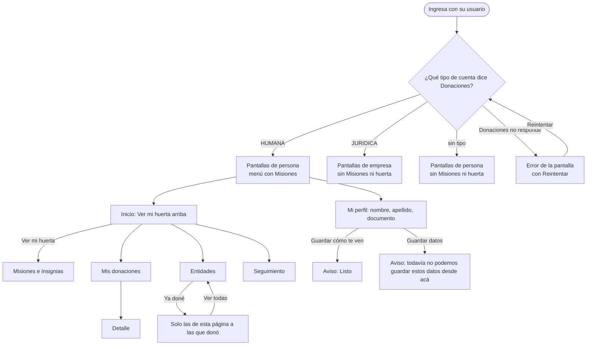

# Flujo: las personas ven sus pantallas de persona (R11-06, R11-09)

> **Estado:** en revisión · **Fecha:** 2026-11-11 · **Aprobó:** pendiente (usuario)
> Ficha de la skill `ux-flujo` para el lote `p0-persona` del
> [backlog de la revisión del 2026-11-11](../backlog-revision-2026-11-11.md) (P0, ruta STANDARD).
> Las decisiones del usuario de la sección 3 del backlog ("Pantallas de persona", "Ver mi huerta",
> "Cómo llega tu donación") ya están tomadas: esta ficha las baja a pantallas, no las reabre.
> Amplía, sin reemplazarlas, las fichas de [donante](raices-donante-navegable.md),
> [Mi perfil](raices-mi-perfil.md) y [Misiones](raices-misiones.md).

## 0. Qué pasa hoy (evidencia)

Leído en la rama de trabajo (`a564a8d41`). `[V]` es leído en el código; `[H]`, hipótesis.

| # | Hoy | Dónde |
|---|---|---|
| H1 | Las pantallas de `templates/persona/` solo se eligen en la maqueta: lo hace el interceptor `CuentaDeEjemplo` con `?cuenta=persona`. Con login real, los controllers devuelven siempre la plantilla de la empresa `[V]` | `maqueta/CuentaDeEjemplo.java:28-40`, `MaquetaConfig.java:49`, `web/DonanteInicioController.java`, `web/DonantePerfilController.java` |
| H2 | Las plantillas de `persona/` leen **solo datos de ejemplo** (`persona/datos-persona.html`: Martina Ruiz, 8 donaciones, "hoy" 15 de octubre). Elegirlas tal cual con login real mostraría datos falsos `[V]` | `persona/datos-persona.html`, `persona/donante-*.html` |
| H3 | El perfil de cualquier donante pide Razón social, Tipo (Empresa fijo) y CUIT `[V]` | `donante-perfil.html:102-125` |
| H4 | `DonantePerfilRest` trata como empresa a quien llega sin tipo (`p.tipo() == null`) `[V]` | `rest/DonantePerfilRest.java:52` |
| H5 | El inicio de la empresa ofrece "Ver mi huerta" (con `?cuenta=persona`) y las dos versiones del inicio terminan con "¿Qué planta sos vos?", que invita a crear una cuenta `[V]` | `donante-inicio.html:97-109,207`, `persona/donante-inicio.html:163-175,202`, `componentes/huerta.html:433` |
| H6 | El menú real del donante no tiene Misiones: solo la maqueta lo suma `[V]` | `web/Pantallas.java` (MENUS), `CuentaDeEjemplo.conMisiones` |
| H7 | "Cómo llega tu donación" muestra "Depósito Central Ejemplo, Calle Ejemplo 1234" en las dos versiones, con cualquier login. No hay un servicio que dé el depósito al donante `[V]` | `donante-entidades.html:147-157`, `persona/donante-entidades.html:158-168`, `rest/DonacionesApi.java` |
| H8 | Mis donaciones y Notificaciones dicen "tu empresa" a todos `[V]` | `donante-donaciones.html:32,36`, `donante-notificaciones.html:61-62` |
| H9 | El token no dice si la persona es humana o jurídica: lo sabe Donaciones (`GET /api/donantes/{id}` → `persona.tipo`, `HUMANA` o `JURIDICA`) `[V]` | `seguridad/UsuarioActual.java`, `rest/DonacionesApi.java:283,381` |

## 1. Para quién y para qué

| | |
|---|---|
| Quién | Una persona que dona por su cuenta y entra con su usuario real (en el seed, cualquier donante humano). Entra de vez en cuando, casi siempre desde el celular, después de llevar algo al depósito o cuando le llega un aviso. También, del otro lado, la persona de RSE de una empresa, que no tiene que ver nada de persona |
| Tono | Panel del donante: cálido, agradecido, participativo; reconoce el aporte y propone seguir, sin presionar ([tono según la pantalla](../tono-y-comunicacion.md#tono-según-la-pantalla)). En el perfil, pantalla de trabajo: claro y útil |
| Qué quiere lograr | "Entrar y ver lo mío como persona: mis donaciones, mi huerta y mis datos, no los de una empresa" |
| Dispositivo principal | Celular primero; también la computadora |
| Requerimientos | RF-05 (Mis donaciones), RF-06 (Entidades), RF-07 (Misiones: visible solo para el donante humano, oculto a la persona jurídica), RF-09 (Seguimiento), RF-CL-07 (toda cifra dice cuándo se actualizó), RNF-CL-02 (sin JavaScript, igual funciona) |
| Datos que usa | El tipo de la cuenta: `GET /api/donantes/{id}` (`persona.tipo`). Lo demás, los mismos puertos que ya usa la empresa: `miInicio` (`DonanteInicioPuerto`), `misDonaciones` (`DonacionesPuerto`), `misEntidades` (`DonanteEntidadesPuerto`), `miSeguimiento` (`DonanteSeguimientoPuerto`), `miPerfil` (`DonantePerfilPuerto`). Hueco: no hay un dato del depósito para el donante (H7) |
| Boceto de E1 | Págs. 16 a 18 (inicio del donante y misiones). El boceto no distingue persona de empresa: la distinción sale de RF-07 |

## 2. Dónde está en el sitio

Área privada del donante ([mapa del sitio](../mapa-del-sitio.md)), nivel 1 para las cinco secciones
y nivel 2 para Mi perfil (desde el menú de la cuenta):

```text
Inicio ─┬─ Mis donaciones ── Detalle (nivel 2)
        ├─ Entidades
        ├─ Misiones            ← solo persona (RF-07); hoy falta en el menú real (H6)
        ├─ Seguimiento
        └─ (cuenta) Mi perfil
```

El menú de la persona es el de la empresa con **Misiones antes de Seguimiento**, igual que en la
maqueta (`CuentaDeEjemplo.conMisiones`). La empresa no ve Misiones.

## 3. Recorrido



Desvíos considerados:

- **Sin sesión o sin persona en el token:** como hoy, a `/publico-ingresar`.
- **Sin tipo** (la persona llega sin `tipo`, o sin persona): pantallas de persona, sin Misiones en el
  menú y sin "Ver mi huerta", porque Misiones solo se abre si Donaciones confirma que es humana
  (`DonanteMisionesRest`). Nunca se la trata como empresa.
- **Donaciones no responde al pedir el tipo:** la pantalla muestra su estado de error de siempre
  ("No pudimos cargar tu inicio.", con Reintentar). No se adivina el tipo ni se guarda en la sesión.
- **Empresa que escribe `/donante-misiones`:** "Sin permiso", como hoy (ficha de Misiones).
- **Volver:** el atrás del navegador funciona en todo: son páginas comunes con su dirección.
- **Sin conexión:** el aviso del navegador; la pantalla anterior queda como estaba.

## 4. Pantallas

### Cómo se elige la versión (para el constructor)

- El tipo se pide **una vez por sesión** a Donaciones (`GET /api/donantes/{id}`) y queda en la sesión
  junto con el id de la persona. Si el id cambia (otro ingreso), se vuelve a pedir. Si falla, no se
  guarda nada y la pantalla muestra su error.
- Tres valores: **persona** (`HUMANA`), **empresa** (`JURIDICA`) y **sin tipo** (cualquier otro caso).
- Cada controller del donante pone `persona` en el modelo (hoy `Pantallas` lo deja en `false`) y,
  donde la persona tiene diseño propio, devuelve la plantilla de `persona/`:

| Pantalla | Persona y sin tipo | Empresa | Por qué |
|---|---|---|---|
| `donante-inicio` | `persona/donante-inicio`, leyendo `miInicio` | `donante-inicio` | El inicio de la persona tiene otro diseño (el año mes a mes) |
| `donante-perfil` y `-guardado` | `persona/donante-perfil`, leyendo `miPerfil` | `donante-perfil` | Otros campos (nombre, apellido, documento) |
| `donante-donaciones` | `donante-donaciones` con los textos de persona | igual, con los de empresa | Mismo diseño; solo cambian dos frases (H8) |
| `donante-donaciones-detalle` | `donante-donaciones-detalle` | igual | Ya es la misma pieza en las dos (la de persona solo envuelve la de empresa) |
| `donante-entidades` | `donante-entidades` con los textos de persona | igual | La versión común ya tiene "Ya doné" y los filtros nuevos; la de `persona/` es anterior |
| `donante-seguimiento` | `donante-seguimiento` | igual | Mismo diseño y mismos textos |
| `donante-notificaciones` | `donante-notificaciones` con los textos de persona | igual | La bandeja de `persona/` tiene avisos de ejemplo |

- Las plantillas de `persona/` que siguen leyendo `datos-persona` (donaciones, entidades,
  seguimiento, notificaciones, detalle) quedan **solo para la maqueta** (`?cuenta=persona`). Con
  login real no se eligen nunca.
- `persona/donante-inicio` y `persona/donante-perfil` dejan de leer `datos-persona` y leen
  `miInicio` y `miPerfil`, que tienen la misma forma (`DonanteDonacionVista` se hizo con los nombres
  de `viaje-datos`, los mismos de `datos-persona`).

### Inicio de la persona (`persona/donante-inicio`)

```text
┌─────────────────────────────────────────────────────┐
│ Inicio                                              │
│ Hola, <nombre de la cuenta>                         │
│ Gracias por donar. Este es tu <año>, mes a mes.     │
│ [Mis donaciones]  [Ver seguimiento]                 │
├─────────────────────────────────────────────────────┤
│ TU HUERTA                                           │  ← sube arriba de todo
│ Cada misión completa, una planta                    │
│ [dibujo de la huerta]          [Ver mi huerta]      │
├──────────────────────────────┬──────────────────────┤
│ TU AÑO · <año>, mes a mes    │ Tu <año> en cifras   │
│ Ene Feb … Dic (plantas)      │ Últimas noticias     │
│ Mes por mes: qué y a dónde   │  Ver todas (N sin    │
│                              │  leer)               │
└──────────────────────────────┴──────────────────────┘
   (sin "¿Qué planta sos vos?")
```

Cambios respecto de la versión de la maqueta, y por qué:

- **"Ver mi huerta" pasa arriba de todo**, debajo del saludo y antes del año (decisión del usuario).
  En el celular queda en la primera pantalla. Lleva a `/donante-misiones`, sin `?cuenta` ni
  `?variante` (con login real no existen).
- **Sin "¿Qué planta sos vos?"**: es la invitación a crear una cuenta de la portada; quien ya tiene
  cuenta no la necesita.
- **Sin "Tu próxima misión"**: con datos reales ese recuadro necesita Incentivos y el inicio no lo
  pide. La huerta, arriba, ya lleva a las misiones.
- **El año y los meses salen de la fecha de hoy**, no de un "octubre" fijo; el mes en que donó
  muestra sus plantas y el que no, neutro (sin marca de falta ni racha).
- **Sin tipo:** la misma pantalla sin el bloque de la huerta.
- **De cada mes, 3 y "Ver todas"** (reglas 1 y 2 del backlog, arreglos de la ronda 1): "Mes por
  mes" muestra las 3 donaciones más recientes de cada mes y "Ver todas las de octubre (7)", que lleva
  a Mis donaciones filtrada por ese mes (`/donante-donaciones?mes=2026-10`); si el mes tiene 3 o
  menos, el enlace dice "Ver las de octubre en Mis donaciones". El almanaque dibuja hasta 3 plantas
  y "+N" por las demás. "Donaste N veces", "N donaciones registradas" y las tres cifras son números
  que cuenta Donaciones (`X-Total-Count`), no el largo de una lista. La pantalla lee `miAnio`
  (`DonanteAnioVista`) y no la lista entera del inicio de la empresa.
- **Mis donaciones con `?mes=`:** dice "Estás viendo las registradas en octubre de 2026." con "Ver
  todas tus donaciones"; el filtro de estado y categoría conserva el mes. Un mes mal escrito se
  ignora. Las páginas de Mis donaciones son de `p1-donante-listas`, que tiene que conservar `mes`.

### Inicio de la empresa (`donante-inicio`)

- Se quita el bloque "Una huerta que crece con cada donación" con "Ver mi huerta" (H5): las empresas
  no tienen misiones (RF-07, decisión del usuario).
- Se quita "¿Qué planta sos vos?".
- Lo demás, igual (el rediseño del tablero es de otro lote).

### Mi perfil de la persona (`persona/donante-perfil`)

```text
┌─────────────────────────────────────────────────────┐
│ Mi perfil                                           │
│ <Nombre Apellido>                                   │
│ Persona donante · <correo>                          │
├─────────────────────────────────────────────────────┤
│ Cómo te ven las entidades                           │
│ (•) Mostrar mi nombre   Donó: <Nombre Apellido>     │
│ ( ) No mostrarlo        Donó: Donante <categoría>   │
│ [Guardar mi elección]                               │
├─────────────────────────────────────────────────────┤
│ Datos de tu cuenta                                  │
│ Nombre · Apellido                                   │
│ Documento (no se cambia desde acá; escribinos)      │
│ Dirección: calle, número, piso, CP, localidad, prov.│
├─────────────────────────────────────────────────────┤
│ Cómo te avisamos · Términos y privacidad            │
└─────────────────────────────────────────────────────┘
```

Cambios, y por qué:

- **Nunca Razón social, Tipo, Rubro, CUIT ni "Empresa"** (decisión del usuario). Nombre, Apellido y
  Documento (tipo y número, por ejemplo "DNI 12.345.678") salen de la persona de Donaciones.
- **Sin "Fecha de nacimiento"**: la maqueta la tenía, pero Donaciones no la guarda. No se piden datos
  que nadie guarda.
- **Lo que ve la entidad si se oculta el nombre:** "Donante <categoría>" ("Donante Sostenedor"), o
  "Donante" sin la categoría si Incentivos no responde. Es el texto de la ficha de
  [Mi perfil](raices-mi-perfil.md); la maqueta decía "Persona donante · Sostenedor".
- **Sin tipo:** el renglón de debajo del nombre dice "Donante · <correo>" (ni "Persona" ni
  "Empresa"), y el nombre es el de la persona; si no hay ni nombre ni apellido, "Tu cuenta".
- **La empresa no cambia:** sigue con Razón social, Tipo, Rubro y CUIT, solo si Donaciones dice
  `JURIDICA`.

### Entidades (versión común, con los textos de cada tipo)

- **"Ya doné"** ya está en la barra de filtros de la versión común (`componentes/filtros ::
  interruptor`). La persona, al pasar a esta versión, lo suma (decisión del usuario). También se suma
  a `persona/donante-entidades` de la maqueta, con el mismo componente, para que las dos digan lo
  mismo.
- **Qué filtra hoy:** como en la empresa, las entidades **de la página que se está viendo** a las
  que la cuenta ya donó. Que filtre sobre todo el listado, en el servidor, es del lote
  `p1-donante-listas`. Hasta entonces, el resultado lo dice: "En esta página, 2 entidades a las que ya
  donaste." Así no parece que son todas.
- El paginador conserva `ya=si` y la búsqueda.
- **"Cómo llega tu donación"** (R11-09): con login real, sin el depósito de ejemplo. Queda el texto
  de cómo funciona y, en lugar de la dirección, "¿No sabés dónde queda el depósito? Escribinos y te
  pasamos la dirección y el horario." con el enlace a Contacto. En la maqueta, los datos de ejemplo
  siguen. La franja con otro fondo es del lote `p2-entidades-donante`.

### Mis donaciones y Notificaciones

- Persona: "Lo que **donaste**" y "Todavía no tenés donaciones registradas." (los de la versión de
  persona de la maqueta). Empresa: como hoy.
- Notificaciones: "Cada aviso cuenta qué pasó con una de tus donaciones o con una necesidad nueva."
  para la persona; la empresa conserva "una donación de tu empresa".

## 5. Estados

| Pantalla | Estado | Qué se ve | Texto |
|---|---|---|---|
| Inicio persona | Con datos | Saludo, huerta, el año con plantas, cifras y noticias | "Gracias por donar. Este es tu 2026, mes a mes: qué donaste y a dónde llegó." |
| Inicio persona | Vacío (cuenta nueva) | Saludo, huerta, y en lugar del año una caja vacía | "Todavía no tenés donaciones." / "Cuando lleves algo al depósito y lo registren, aparece acá, en el mes en que donaste." |
| Inicio persona | Cargando | El texto y las cajas punteadas de siempre | "Cargando tu inicio…" |
| Inicio persona | Error del servidor | La caja de error de `datos-donante :: error` | "No pudimos cargar tu inicio." + Reintentar |
| Inicio persona | Sin tipo | Como "Con datos", sin el bloque de la huerta | — |
| Inicio persona | Mes con más de 3 | Las 3 más recientes y el enlace | "Ver todas las de octubre (7)" |
| Mis donaciones | Filtrada por mes | La frase arriba y el enlace | "Estás viendo las registradas en octubre de 2026." / "Ver todas tus donaciones" |
| Mis donaciones | Mes sin donaciones | Caja vacía | "No hay donaciones registradas en septiembre de 2026." |
| Inicio empresa | Con datos | El tablero de siempre, sin huerta ni "¿Qué planta sos vos?" | — |
| Perfil persona | Con datos | Nombre, renglón de cuenta, cómo te ven, datos, avisos, términos | "Persona donante · ana@correo-ejemplo.test" |
| Perfil persona | Datos que faltan | El campo vacío, sin texto de ejemplo adentro | (el campo, vacío) |
| Perfil persona | Éxito (cómo te ven) | Aviso arriba | "Listo. Las entidades ya no ven tu nombre: ven «Donante Sostenedor»." / "Listo. Las entidades ven tu nombre: «Ana Ejemplo»." |
| Perfil persona | Guardar datos (real) | Aviso arriba | "Todavía no podemos guardar estos datos desde acá. Si algo está mal, escribinos." |
| Perfil persona | Sin términos aceptados | La constancia | "Todavía no aceptaste los términos y la política de privacidad." |
| Perfil persona | Error del servidor | Banner | "No pudimos guardar tu elección." + escribinos |
| Perfil persona | Sin tipo | Como "Con datos" | "Donante · ana@correo-ejemplo.test" |
| Entidades | Con datos | Barra con búsqueda, Categoría y Ya doné; tarjetas; paginador | "46 entidades activas. Página 1 de 8." |
| Entidades | Ya doné, con resultados | Solo las de la página a las que donó | "En esta página, 2 entidades a las que ya donaste." |
| Entidades | Ya doné, sin resultados | Caja vacía con "Ver todas" | "En esta página no hay entidades a las que hayas donado." / "Probá en otra página o sacá el filtro." |
| Entidades | Vacío | Caja vacía | "Por ahora no hay entidades activas." |
| Entidades | Error del servidor | Caja de error | "No pudimos cargar las entidades." + Reintentar |
| Entidades | Cómo llega (real) | Texto sin dirección, con enlace | "¿No sabés dónde queda el depósito? Escribinos y te pasamos la dirección y el horario." |
| Mis donaciones | Vacío persona | Caja vacía | "Todavía no tenés donaciones registradas." |
| Misiones | Empresa | "Sin permiso" de siempre | (texto de la ficha de Misiones) |
| Cualquiera | Sin permiso / sin sesión | Va a ingresar | — |

## 6. Textos

| Elemento | Texto | Nota |
|---|---|---|
| Rótulo de la huerta | "Tu huerta" | Igual que hoy |
| Título de la huerta | "Cada misión completa, una planta" | Igual que hoy |
| Acción de la huerta | "Ver mi huerta" | Decisión del usuario; lleva a Misiones e insignias |
| Bajada del inicio | "Gracias por donar. Este es tu <año>, mes a mes: qué donaste y a dónde llegó." | El año sale de hoy |
| Cifras del año | "<N> donaciones registradas" · "Actualizado hoy, <día>, <hora>." | Cifra con período y fecha (RF-CL-07) |
| Renglón del perfil | "Persona donante · <correo>"; sin tipo, "Donante · <correo>" | Nunca "Empresa" en la persona |
| Documento | "Documento" + ayuda "No se cambia desde acá. Si está mal, escribinos." | La ayuda es la del CUIT de la empresa |
| Resultado Ya doné | "En esta página, <N> entidad(es) a la(s) que ya donaste." | Dice el alcance real del filtro |
| Cómo llega, sin depósito | "¿No sabés dónde queda el depósito? Escribinos y te pasamos la dirección y el horario." | Contacto con `volver=/donante-entidades` |
| Mis donaciones, título | Persona: "Lo que donaste" · Empresa: "Lo que donó tu empresa" | |

Filtro de tono (las 7 preguntas): lo pendiente se dice pendiente (el depósito "te lo pasamos", no se
inventa); las cifras llevan período ("tu 2026") y fecha de actualización; el mes sin donaciones no se
marca como falta (sin culpa); el filtro dice qué abarca (honesto sobre el alcance); "Ver mi huerta"
invita sin presionar.

## 7. Accesibilidad

- **Orden del foco en el inicio:** saludo → los dos botones del encabezado → "Ver mi huerta" → el año
  → cifras → noticias. Al subir la huerta, el foco también sube: el orden del código es el orden en
  pantalla (no se reordena con CSS).
- **Zonas:** encabezado con el menú, navegación (con Misiones solo para persona) y `main`. La huerta es
  una `section` con su `h2`; el dibujo lleva `alt="Ilustración de una huerta"` y el botón es un
  enlace con texto propio.
- **Avisos que se leen solos:** el resultado de la búsqueda y del filtro (`role="status"`), los
  avisos de guardado del perfil (`role="status"`) y el error (`role="alert"`), como hoy.
- **Ya doné:** el interruptor del componente común, con su `label`; funciona sin JavaScript (el
  formulario GET).
- **Perfil:** cada campo con su `label`; el documento, `readonly` con `aria-describedby` a su ayuda.
- **Sin mapa nuevo:** Seguimiento no cambia.

## 8. Revisión de usabilidad

| # | Heurística | Cómo la cumple | Riesgo que queda |
|---|---|---|---|
| 1 | Visibilidad del estado | Cada pantalla dice cuándo se actualizó; el filtro dice que abarca la página | Hasta `p1-donante-listas`, "Ya doné" no recorre todo el listado |
| 2 | Lenguaje del usuario | "Lo que donaste", "Documento", "Tu huerta"; sin "persona humana" ni "jurídica" | "Persona donante" en el perfil es un rótulo, no un nombre |
| 3 | Control y libertad | "Ver todas" saca los filtros; el atrás funciona; la huerta es un enlace, no un paso obligado | — |
| 4 | Consistencia | Una sola versión de Entidades, Mis donaciones, Seguimiento y Notificaciones para los dos tipos, con los mismos filtros y paginador | "Ver mi huerta" lleva a una pantalla que se llama "Misiones e insignias" |
| 5 | Prevención de errores | Una cuenta sin tipo nunca ve campos de empresa; el documento no se edita | — |
| 6 | Reconocer antes que recordar | La huerta arriba, a la vista; el menú muestra Misiones solo a quien la tiene | — |
| 7 | Flexibilidad | Búsqueda, Categoría y Ya doné combinables; direcciones que se pueden guardar | — |
| 8 | Diseño minimalista | Se quitan "¿Qué planta sos vos?", la huerta de la empresa, "Tu próxima misión" y la fecha de nacimiento | El inicio de la persona pierde la próxima misión de un vistazo |
| 9 | Recuperarse de errores | Si Donaciones no responde, la pantalla dice "No pudimos cargar…" con Reintentar; no se adivina el tipo | — |
| 10 | Ayuda | "Cómo llega tu donación" explica el camino y ofrece escribir para saber el depósito | Sin la dirección, la persona tiene que escribir |

Los 7 factores (Morville):

- **Útil:** la persona ve sus donaciones reales y su huerta, no las de una empresa ni las de ejemplo.
- **Usable:** las mismas pantallas y filtros que ya conoce; la huerta en la primera vista del celular.
- **Deseable:** conserva el año en plantas y la huerta, lo propio de la persona.
- **Valioso:** cumple RF-07 (Misiones solo para el humano) y saca un dato falso de la demo (R11-09).
- **Ubicable:** Misiones aparece en el menú de la persona, antes de Seguimiento.
- **Accesible:** orden del foco igual al visual; todo funciona sin JavaScript.
- **Creíble:** ningún dato de ejemplo con login real; el filtro dice lo que abarca.

Qué conviene probar con personas reales (la revisión heurística no reemplaza el test con usuarios):
si "Ver mi huerta" se entiende como la puerta a las misiones; si, sin la dirección del depósito, la
persona sabe qué hacer.

## 9. Decisiones y preguntas

Decisiones de esta ficha (propuesta del agente, con la regla de la corrida de no frenar; van a la
[bitácora](../bitacora.md) al construir):

1. **El tipo se pide a Donaciones una vez por sesión.** Descartado: pedirlo en cada pantalla (una
   llamada más por página) y sumarlo al token (cambia Keycloak, fuera del módulo).
2. **Sin tipo = persona sin huerta ni Misiones.** Cumple "no se trata como empresa" y RF-07 (Misiones
   solo si Donaciones confirma humana). Descartado: deducirlo de si hay razón social (sigue tratando
   como empresa a una cuenta sin tipo).
3. **Diseño propio de persona solo en Inicio y Mi perfil**; en las otras cinco, la versión común con
   los textos de cada tipo. Las de `persona/` con datos de ejemplo quedan para la maqueta. Descartado:
   cablear las siete plantillas de `persona/` a datos reales (duplica pantallas que solo cambian una
   frase, y la de Entidades es anterior a los filtros nuevos).
4. **"Ya doné" filtra la página, como la empresa, y lo dice.** El filtro de todo el listado es de
   `p1-donante-listas`. Descartado: ocultarlo hasta P1 (el usuario lo pidió ahora) y filtrar en el
   navegador sobre una lista completa (regla 1 del backlog).
5. **Sin la dirección del depósito con login real**, con el enlace a Contacto. El backlog lo permite
   ("o se saca la dirección hasta tenerlos"). Descartado: una dirección fija en la configuración (es
   un dato que nadie mantiene y vuelve a ser de ejemplo).
6. **Se quitan "Tu próxima misión" del inicio de la persona y "Fecha de nacimiento" del perfil**:
   con datos reales no hay de dónde sacarlos sin sumar servicios.
7. **El saludo usa el nombre de la cuenta** (`cuenta.nombre`), como la empresa. Que diga el nombre y
   no el rol es de `p1-nombres` (R11-44).

Archivos fuera de la zona del lote que el constructor va a necesitar (imprescindibles):

- `puertos/DonantePerfilPuerto.java` y `maqueta/DonantePerfilMaqueta.java`: un método para el tipo
  de la cuenta (la maqueta responde "empresa", como hoy; `CuentaDeEjemplo` sigue eligiendo la persona).
- `web/Pantallas.java`: el menú del donante con Misiones para la persona (H6).
- `templates/persona/donante-entidades.html` está en la zona; `componentes/filtros.html` no se toca.

Preguntas abiertas (para la próxima ronda, sin frenar la construcción):

1. ¿"Ver mi huerta" lleva a la pantalla de Misiones de hoy o se adopta la variante de la huerta
   (`misiones-b`) como la pantalla real? Recomendado: la de hoy en P0; la variante, en
   `p2-donante-detalles`.
2. ¿Se carga en algún lado el depósito real (nombre, dirección y horario) para mostrarlo? Recomendado:
   un dato de configuración del cliente cargado por el admin cuando exista; hasta entonces, el enlace
   a Contacto.
