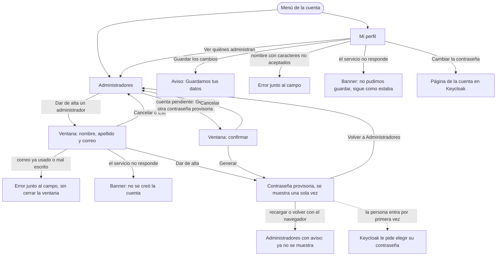

# Flujo: Cada administrador con su cuenta

> **Estado:** en revisión · **Fecha:** 2026-11-12 · **Aprobó:** pendiente (parada única de diseño de
> la oleada P1)
> Ficha de la skill `ux-flujo` para el lote `p1-admins` (R11-10) del
> [backlog de la revisión del 2026-11-11](../backlog-revision-2026-11-11.md#p1--se-ve-en-la-demo).
> La parte de servicios y el contrato están en la
> [spec del lote](../../specs/active/R11-p1-admins-spec.md).
> Pantallas nuevas: `admin-perfil` (Mi perfil) y `admin-administradores` (Administradores), con el
> alta de un administrador y la contraseña provisoria. La decisión del usuario ya está tomada
> (sección 3 del backlog, "Cuentas de administración"): cuenta y perfil por admin, un admin crea a
> otro, todo en la entrega 6. El registro de actividad es de otro lote (`p2-actividad`, R11-26).
> Orden si no entra entero: cuentas, autor real de cada acción, perfil.

## 1. Para quién y para qué

| | |
|---|---|
| Quién | Persona del equipo de operaciones de la organización que usa DonaTrack, en el escritorio de la oficina. Hoy todo el equipo comparte una sola cuenta "Administración" |
| Tono | Pantalla de trabajo: claro, útil, tranquilizador ([tono](../tono-y-comunicacion.md#tono-según-la-pantalla)) |
| Qué quiere lograr | "Quiero que cada compañera entre con su cuenta, y que se sepa quién aprobó cada cosa." |
| Dispositivo principal | Escritorio; tiene que andar en el celular (360 px) |
| Requerimientos | RF-AUTH-07 (solo un admin crea otro admin; el primero sale del *seed*), RF-AUTH-12 (cambiar la contraseña con la sesión iniciada), RNF-AUTH-09 (sin datos personales en el token), RNF-UI-01 a 06 |
| Datos que usa | Las cuentas del proveedor de ingreso (Keycloak), por la cuenta de servicio del sitio. Quién decidió una propuesta, de Donaciones. Detalle en la [spec](../../specs/active/R11-p1-admins-spec.md#4-contrato-antes-y-después) |
| Boceto de E1 | Sin boceto. Sigue el patrón de Mi perfil del donante ([ficha](raices-mi-perfil.md)) y el de los listados del admin ([ficha](raices-admin-navegable.md)) |

## 2. Dónde está en el sitio

Las dos pantallas se abren desde el **menú de la cuenta** (la foto de perfil del encabezado), no desde
el menú principal del admin, que queda con sus 7 secciones:

```text
Menú de la cuenta (admin): [nombre y apellido · Administración]
  Mi perfil            → /admin-perfil                 (nivel 2)
  Administradores      → /admin-administradores        (nivel 2)
     Dar de alta un administrador → ventana            (nivel 3; sin JavaScript, /admin-administradores-nuevo)
     Contraseña provisoria        → /admin-administradores-alta (nivel 3)
  Cambiar contraseña   → página de la cuenta en Keycloak (como hoy)
  Cerrar sesión
```

Mi perfil también lleva a Administradores ("Ver quiénes administran DonaTrack"). Al
[mapa del sitio](../mapa-del-sitio.md) se suman Mi perfil y Administradores del admin en el cierre
documental de la oleada: hoy el mapa dice que "la administración no tiene Mi perfil", y eso deja de
ser cierto.

## 3. Recorrido



Desvíos considerados: cancelar (botón y Esc en las ventanas), volver (el "atrás" del navegador vuelve
a la lista sin mostrar otra vez la contraseña), error de datos (junto al campo), error del servidor
(banner con código, nada queda a medias), sin conexión (lo resuelve el navegador: el formulario es
real), sin permiso (una cuenta que no es admin ve la página 403, como en el resto de `admin-*`),
contraseña perdida antes de pasarla (se genera otra mientras la cuenta no entró), la página pedida
más allá de la última (muestra la última, regla 3).

## 4. Pantallas

### 4.1 Mi perfil (`admin-perfil`)

```text
┌──────────────────────────────────────────────┐
│ Mi perfil                                    │
│ Tus datos de administración. Tu nombre es el │
│ que queda en lo que aprobás.                 │
│                                              │
│ Nombre    [Ana            ]                  │
│ Apellido  [Pérez          ]                  │
│ Correo    ana.perez@ejemplo.org              │
│           Es el correo con el que entrás.    │
│           No se cambia desde acá.            │
│ Cuenta creada el 12 de noviembre de 2026.    │
│                                              │
│ [Guardar los cambios]                        │
│                                              │
│ Contraseña                                   │
│ Cambiar la contraseña ↗                      │
│                                              │
│ Administración                               │
│ Ver quiénes administran DonaTrack →          │
└──────────────────────────────────────────────┘
```

- Respecto del perfil del donante: sin pestañas (son dos campos) y sin "Cómo te avisamos": el buzón
  de notificaciones del admin sigue siendo uno solo para toda la administración (ver §9).
- El correo no es un campo: es con el que se entra (el ingreso usa el correo como usuario) y
  cambiarlo cambia el ingreso. Queda fuera de este lote.

### 4.2 Administradores (`admin-administradores`)

```text
┌──────────────────────────────────────────────┐
│ Administradores                              │
│ Quienes pueden administrar DonaTrack. Cada   │
│ uno entra con su cuenta, y lo que aprueba    │
│ queda a su nombre.                           │
│                    [Dar de alta un administrador]
│ Son 3 cuentas de administración.             │
│ ┌──────────────────────────────────────────┐ │
│ │ Ana Pérez · Vos                          │ │
│ │ ana.perez@ejemplo.org                    │ │
│ │ Activa · creada el 12 de noviembre de 2026│ │
│ ├──────────────────────────────────────────┤ │
│ │ Bruno Díaz                               │ │
│ │ bruno.diaz@ejemplo.org                   │ │
│ │ Todavía no entró · creada el 12 de nov.  │ │
│ │ [Generar otra contraseña provisoria]     │ │
│ └──────────────────────────────────────────┘ │
│          « ‹ 1 2 › »                         │
└──────────────────────────────────────────────┘
```

- **Lista** de cuentas, 10 por página, pedida de a una al servicio y ordenada por correo, con el
  total como número ("Son 3 cuentas de administración."). Paginador de la regla 3; mientras
  `p1-paginador` no lo entregue, el provisorio de `templates/paginador.html`, con las mismas
  direcciones (`?pagina=N`).
- **Sin buscador:** son pocas cuentas, y un buscador sobre una página sola engañaría (regla 1). Si
  algún día hace falta, se suma con la búsqueda del servicio.
- En el escritorio, cada cuenta es una fila de tabla (Nombre, Correo, Estado, Creada); en 360 px,
  una tarjeta como la del esquema.
- Una cuenta sin nombre cargado (el admin del *seed*, hasta que complete Mi perfil) dice "Sin
  nombre cargado" en lugar del nombre.

### 4.3 Dar de alta un administrador (ventana)

```text
┌──────────────────────────────────────────────┐
│ Dar de alta un administrador            [×]  │
│ Va a poder hacer todo lo que hacés vos:      │
│ aprobar organizaciones y asignaciones,       │
│ registrar donaciones y dar de alta a otros.  │
│                                              │
│ Nombre    [               ]                  │
│ Apellido  [               ]                  │
│ Correo    [               ]                  │
│           Con este correo va a entrar.       │
│                                              │
│ Le damos una contraseña provisoria para su   │
│ primer ingreso. Ahí va a elegir la suya.     │
│                                              │
│ [Cancelar]        [Dar de alta]              │
└──────────────────────────────────────────────┘
```

- Formulario corto en una **ventana que bloquea el fondo** (regla 4). Sin JavaScript, el botón es un
  enlace real a `admin-administradores-nuevo`, la misma forma en una página aparte.
- Los errores de campo vuelven a la ventana abierta (con HTMX, el fragmento de la ventana; sin
  JavaScript, la página aparte) con lo escrito conservado.

### 4.4 Contraseña provisoria (`admin-administradores-alta`)

```text
┌──────────────────────────────────────────────┐
│ Diste de alta a Bruno Díaz                   │
│                                              │
│ Correo: bruno.diaz@ejemplo.org               │
│ Contraseña provisoria:                       │
│   ┌──────────────────────┐                   │
│   │ K7pQ-m4Rt-x9Wa-2Lse  │ [Copiar]          │
│   └──────────────────────┘                   │
│                                              │
│ Pasásela por un medio seguro: en persona o   │
│ por teléfono, no por un grupo de chat.       │
│ No la vamos a volver a mostrar.              │
│ Cuando entre por primera vez, DonaTrack le   │
│ va a pedir que elija su propia contraseña.   │
│                                              │
│ [Volver a Administradores]                   │
└──────────────────────────────────────────────┘
```

- Página aparte (no un aviso que se va solo), porque hay que leerla y anotarla con calma. Se ve una
  sola vez: viene del envío y no se guarda en ningún lado. Recargarla o volver con el navegador lleva
  a Administradores con un aviso.
- La misma pantalla sirve para "Generar otra contraseña provisoria", con el título "Nueva contraseña
  provisoria para Bruno Díaz".
- "Copiar" es una mejora con JavaScript; sin él, la contraseña se selecciona a mano.

### 4.5 Generar otra contraseña provisoria (ventana de confirmación)

Solo en las cuentas que todavía no entraron. Ventana que bloquea el fondo, porque reemplaza la
contraseña anterior y eso no se deshace:

```text
┌──────────────────────────────────────────────┐
│ ¿Generar otra contraseña para Bruno Díaz?    │
│ La que le diste antes deja de servir.        │
│ [Cancelar]     [Generar otra contraseña]     │
└──────────────────────────────────────────────┘
```

### 4.6 Lo que cambia en pantallas que ya existen

- **Detalle de una donación del admin:** "La aprobó …" y "la marcó …" dicen el nombre y apellido de
  quien lo hizo, no "SISTEMA" ni "Administración". Si la cuenta no tiene nombre cargado, el correo;
  si ya no existe, "una cuenta de administración". Lo aprobado antes de este cambio, que quedó como
  "SISTEMA", no dice quién lo aprobó (no se sabe, y no se inventa).
- **Menú de la cuenta del admin:** suma "Mi perfil" y "Administradores". El nombre en el saludo y en
  el menú es del lote `p1-nombres` (R11-44); este lote le deja de dónde sacarlo.

## 5. Estados

| Pantalla | Estado | Qué se ve | Texto |
|---|---|---|---|
| Mi perfil | Con datos | Formulario con nombre y apellido; correo y fecha de alta como texto | (los de §6) |
| Mi perfil | Sin nombre cargado | Campos vacíos y una pista arriba del formulario | "Todavía no cargaste tu nombre. Con él vamos a mostrar quién aprobó cada cosa." |
| Mi perfil | Cargando | El indicador del botón mientras guarda (`hx-indicator`) | "Guardando…" |
| Mi perfil | Éxito | Aviso breve en `#avisos` | "Listo. Guardamos tus datos." |
| Mi perfil | Error de datos | Error junto al campo | Vacío: "Escribí tu nombre." / "Escribí tu apellido." · Caracteres no aceptados: "El nombre no puede llevar signos como < > & o comillas." · Largo: "Usá hasta 255 letras." |
| Mi perfil | Error del servidor al cargar | Banner arriba, sin formulario | "No pudimos traer tus datos ahora. Es un problema nuestro. Probá de nuevo en unos minutos; si sigue, escribinos con este código." + código y enlace a Contacto |
| Mi perfil | Error del servidor al guardar | Banner arriba, el formulario con lo escrito | "No pudimos guardar tus datos. Siguen como estaban. Probá de nuevo en unos minutos; si sigue, escribinos con este código." + código |
| Mi perfil | Sin permiso | Página 403 del sitio | (la de [páginas de error](raices-paginas-de-error.md)) |
| Administradores | Con datos | Lista, total y paginador | "Son {n} cuentas de administración." (1: "Hay 1 cuenta de administración: la tuya.") |
| Administradores | Vacío | No puede pasar: quien la mira es admin. Si el servicio devuelve 0, se trata como error del servidor | — |
| Administradores | Cargando | Al cambiar de página, el indicador del paginador | "Cargando…" |
| Administradores | Éxito (volver de la contraseña) | Aviso breve | "Bruno Díaz ya puede entrar con su correo y la contraseña provisoria." |
| Administradores | Contraseña ya mostrada | Aviso breve al recargar o volver | "La contraseña provisoria se mostró una sola vez. Si no la anotaste, generá otra desde la cuenta." |
| Administradores | Error del servidor | Banner arriba, sin lista | "No pudimos traer las cuentas de administración ahora. Probá de nuevo en unos minutos; si sigue, escribinos con este código." + código |
| Administradores | Sin permiso | Página 403 | — |
| Alta (ventana) | Formulario | Tres campos vacíos | (los de §6) |
| Alta (ventana) | Cargando | Botón deshabilitado con indicador | "Dando de alta…" |
| Alta (ventana) | Error de datos | Error junto al campo, la ventana sigue abierta | Vacío: "Escribí el nombre." / "Escribí el apellido." / "Escribí el correo." · Correo mal escrito: "Revisá el correo: tiene que tener la forma nombre@organizacion.org." · Correo ya usado: "Ya hay una cuenta con este correo en DonaTrack. Usá otro correo para esta cuenta de administración." · Caracteres no aceptados: como en Mi perfil |
| Alta (ventana) | Error del servidor | Banner en la ventana | "No pudimos dar de alta la cuenta. No se creó nada. Probá de nuevo en unos minutos; si sigue, escribinos con este código." + código |
| Contraseña provisoria | Éxito | La pantalla de §4.4 | (los de §6) |
| Contraseña provisoria | Copiada | Texto chico junto al botón, leído por `aria-live` | "Copiada." |
| Otra contraseña (ventana) | Cuenta que ya entró | El botón no aparece. Si llega igual (dos pestañas), aviso | "Bruno Díaz ya eligió su contraseña: no hace falta otra. Si la olvidó, la recupera desde Ingresar." |
| Otra contraseña (ventana) | Error del servidor | Banner | "No pudimos generar otra contraseña. La anterior sigue sirviendo. Probá de nuevo en unos minutos." + código |

"La recupera desde Ingresar" depende de RF-AUTH-13 (recuperar por correo, D8 pendiente). Mientras no
exista, ese texto dice: "Si la olvidó, escribinos desde Contacto." (ver §9).

## 6. Textos

| Elemento | Texto | Nota |
|---|---|---|
| Título de Mi perfil | "Mi perfil" | Igual que en donante y organización |
| Bajada de Mi perfil | "Tus datos de administración. Tu nombre es el que queda en lo que aprobás." | Dice para qué se usa el dato (regla 10) |
| Campos | "Nombre", "Apellido" | Etiquetas visibles, obligatorios |
| Correo | "Correo" · "Es el correo con el que entrás. No se cambia desde acá." | Texto, no campo |
| Alta | "Cuenta creada el {d} de {mes} de {aaaa}." | Fecha en formato argentino |
| Acción principal de Mi perfil | "Guardar los cambios" | |
| Contraseña | "Contraseña" · "Cambiar la contraseña" | Lleva a la página de la cuenta en Keycloak, como el menú |
| Enlace a la lista | "Ver quiénes administran DonaTrack" | |
| Título de la lista | "Administradores" | En el menú de la cuenta, igual |
| Bajada de la lista | "Quienes pueden administrar DonaTrack. Cada uno entra con su cuenta, y lo que aprueba queda a su nombre." | |
| Total | "Son {n} cuentas de administración." | Total del servicio, no de la página (regla 14 de textos) |
| Marca de la propia | "Vos" | |
| Estados de la cuenta | "Activa" · "Todavía no entró" | "Todavía no entró": tiene la contraseña provisoria sin cambiar. Lo pendiente se dice pendiente |
| Fecha | "Creada el {d} de {mes} de {aaaa}" | |
| Sin nombre | "Sin nombre cargado" | |
| Acción principal de la lista | "Dar de alta un administrador" | |
| Título de la ventana | "Dar de alta un administrador" | La misma acción se llama igual |
| Bajada de la ventana | "Va a poder hacer todo lo que hacés vos: aprobar organizaciones y asignaciones, registrar donaciones y dar de alta a otros." | Previene un alta por error: dice el alcance real |
| Ayuda del correo | "Con este correo va a entrar." | |
| Ayuda de la contraseña | "Le damos una contraseña provisoria para su primer ingreso. Ahí va a elegir la suya." | |
| Botones de la ventana | "Cancelar" · "Dar de alta" | |
| Título de la contraseña | "Diste de alta a {nombre} {apellido}" · "Nueva contraseña provisoria para {nombre} {apellido}" | |
| Rótulos | "Correo:" · "Contraseña provisoria:" | |
| Instrucciones | "Pasásela por un medio seguro: en persona o por teléfono, no por un grupo de chat. No la vamos a volver a mostrar. Cuando entre por primera vez, DonaTrack le va a pedir que elija su propia contraseña." | |
| Copiar | "Copiar" · "Copiada." | |
| Salida | "Volver a Administradores" | |
| Otra contraseña | "Generar otra contraseña provisoria" · "¿Generar otra contraseña para {nombre}?" · "La que le diste antes deja de servir." · "Cancelar" · "Generar otra contraseña" | |
| Historial de una donación | "La aprobó {nombre} {apellido}." · "La marcó {nombre} {apellido}." | Sale de la cuenta que lo hizo |

Ayudas por flujo crítico ([lista](../patrones-y-microcopy.md#ayudas-por-flujo-crítico-rnf-ui-04)):

- [x] Cada campo tiene etiqueta visible.
- [x] El ejemplo de dato válido está donde se duda: el correo, en el error ("nombre@organizacion.org").
- [x] Pista de primer uso: la de Mi perfil sin nombre y la bajada de la ventana de alta.
- [x] Se explica para qué se piden los datos: el nombre queda en lo que se aprueba; el correo es el
  ingreso.
- [x] Cada acción tiene su texto de éxito y de error (§5).

Filtro de tono: los estados de la cuenta dicen lo que pasó ("Todavía no entró", no "Pendiente de
activación"); el total es del servicio y se dice así; no hay urgencia ni culpa en los errores; la
advertencia de la ventana dice el alcance real sin asustar. Sin cifras que necesiten período.

## 7. Accesibilidad

- Zonas: encabezado con el menú de la cuenta, navegación del admin, `main` con un solo `h1`.
- Mi perfil: orden del foco nombre → apellido → Guardar → Cambiar la contraseña → Ver quiénes
  administran. El correo es texto con su ayuda asociada (`aria-describedby` no hace falta: no es
  campo). Los errores, junto al campo con `aria-invalid` y `aria-describedby`, y el foco vuelve al
  primer campo con error.
- Lista: tabla con `th scope="col"` en el escritorio; en 360 px, lista de tarjetas con el nombre como
  encabezado de cada una. "Vos" es texto, no solo un color. El paginador es un `nav` con nombre
  ("Páginas de administradores").
- Ventanas: `<dialog class="dialogo">` con título como nombre accesible; al abrir, el foco va al
  primer campo; Esc y "Cancelar" cierran y el foco vuelve al botón que la abrió. Fondo inerte
  (regla 4). Sin JavaScript, la página aparte.
- Contraseña provisoria: en un bloque de texto con fuente monoespaciada y separadores cada 4
  caracteres para leerla en voz alta; el lector de pantalla la lee carácter por carácter
  (`aria-label` con los caracteres separados no hace falta si se usan los guiones). "Copiada." va a
  una región `aria-live="polite"`.
- Avisos de éxito, en la región `#avisos` del layout (`aria-live`).
- Sin mapa.

## 8. Revisión de usabilidad

| # | Heurística | Cómo la cumple | Riesgo que queda |
|---|---|---|---|
| 1 | Visibilidad del estado | Cada cuenta dice si ya entró; el total de cuentas está arriba; guardar y dar de alta tienen indicador y aviso | El estado "Activa" no dice cuándo entró por última vez (no se pide) |
| 2 | Lenguaje del usuario | "Dar de alta", "contraseña provisoria", "Todavía no entró": palabras de la oficina, sin "rol", "realm" ni "usuario" | "Provisoria" puede no entenderse de entrada: la ayuda de la ventana lo explica |
| 3 | Control y libertad | Cancelar y Esc en cada ventana; "atrás" del navegador vuelve a la lista; una contraseña perdida se reemplaza | No se puede quitar a un administrador desde el sitio (fuera de alcance, §9) |
| 4 | Consistencia | Mi perfil igual que el de donante y organización (título, Guardar, aviso "Listo."); el paginador común; ventanas de la regla 4; "Cambiar contraseña" lleva al mismo lugar que el menú | El admin no tiene pestañas en Mi perfil: son dos campos |
| 5 | Prevención de errores | La ventana dice el alcance de una cuenta de administración; correo validado antes de crear; confirmar antes de generar otra contraseña; el alta no deja una cuenta a medias si algo falla | Un correo bien escrito pero equivocado crea una cuenta que no entra: se ve como "Todavía no entró" |
| 6 | Reconocer antes que recordar | La contraseña se muestra con el correo al lado; "Vos" marca la propia; el menú de la cuenta tiene las dos pantallas | — |
| 7 | Flexibilidad | "Copiar" con JavaScript; sin él, seleccionar; la ventana tiene su página aparte | — |
| 8 | Diseño minimalista | Mi perfil con dos campos; la lista sin buscador ni filtros, porque son pocas cuentas | — |
| 9 | Recuperarse de errores | Errores junto al campo con cómo seguir; el error del servidor dice que no se creó nada o que sigue como estaba; contraseña perdida → generar otra | Si la persona ya entró y olvidó su contraseña, depende de recuperar por correo (RF-AUTH-13, pendiente) |
| 10 | Ayuda | Ayuda en el correo y en la contraseña; las instrucciones de la contraseña provisoria dicen cómo pasarla y qué pasa después | — |

Factores de Morville:

- **Útil:** cada persona entra con su cuenta y lo aprobado queda a su nombre, que es lo que pidió la
  revisión.
- **Usable:** dos pantallas desde el menú de la cuenta, un formulario de tres campos.
- **Deseable:** la misma piel de Mi perfil del resto del sitio; nada nuevo que aprender.
- **Valioso:** la organización sabe quién decidió cada asignación (y el registro de actividad,
  R11-26, se apoya en esto).
- **Ubicable:** en el menú de la cuenta, donde el resto de los roles tiene Mi perfil.
- **Accesible:** formularios con etiquetas, ventanas con foco y Esc, contraseña legible en voz alta.
- **Creíble:** no se inventa un autor para lo aprobado antes del cambio; la contraseña se muestra una
  sola vez y se explica por qué.

Conviene probar con personas reales: si se entiende "contraseña provisoria" y si la persona que la
recibe sabe qué hacer en su primer ingreso (la pantalla de Keycloak que pide elegir otra).

## 9. Decisiones y preguntas

Decisiones de este diseño (van a la [bitácora](../bitacora.md) en el cierre documental de la oleada):

1. **Mi perfil y Administradores van en el menú de la cuenta**, no en el menú principal del admin.
   Descartado: una octava sección en el menú, que ya tiene 7; dar de alta a otro admin es una tarea
   de vez en cuando.
2. **Contraseña provisoria generada por el sitio y mostrada una sola vez.** Al primer ingreso,
   Keycloak obliga a elegir otra. Descartado: invitación por correo (el envío de correos está
   pendiente, D8) y que quien da de alta invente la contraseña (suelen ser débiles y se reusan).
3. **El correo no se cambia desde Mi perfil:** es el usuario de ingreso. Queda fuera de alcance.
4. **Lista sin buscador**, de a 10 y con el total del servicio. Descartado: buscador, porque son
   pocas cuentas y la búsqueda sumaría trabajo en el servicio sin uso real.
5. **"Generar otra contraseña provisoria" solo mientras la cuenta no entró.** Si ya entró, la
   contraseña es suya y la recupera ella.
6. **Lo aprobado antes del cambio no dice quién lo aprobó.** Quedó como "SISTEMA" y no se puede saber.
   Descartado: atribuírselo al admin del *seed*.
7. **El buzón de notificaciones del admin sigue siendo uno solo para toda la administración.** Las
   notificaciones del admin llegan hoy a una persona fija de Donaciones; separarlas por cuenta es
   otro lote (las notificaciones del admin, sección 10 del backlog).

Preguntas abiertas (para la parada de aprobación de la oleada; cada una con la opción recomendada):

1. ¿Se puede quitar o desactivar a un administrador desde el sitio? **Recomendado: no en este lote**;
   va al backlog, y mientras tanto se hace desde la consola de Keycloak. Alternativa: un botón
   "Desactivar la cuenta", con confirmación, que impida quitarse a uno mismo y al último activo.
2. Mientras no exista recuperar la contraseña por correo (RF-AUTH-13), un admin que ya entró y la
   olvidó, ¿cómo vuelve? **Recomendado: lo resuelve otro admin desde la consola de Keycloak y el
   texto lo manda a Contacto.** Alternativa: permitir "Generar otra contraseña provisoria" también
   en cuentas que ya entraron.
