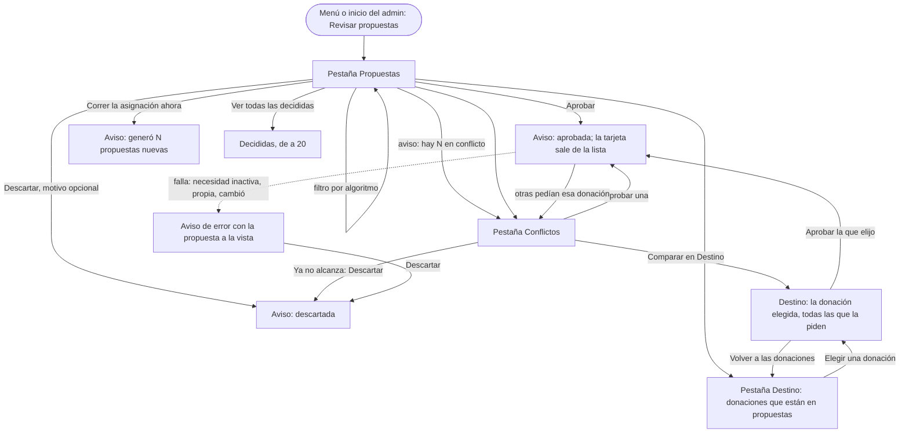

# Flujo: Asignar donaciones, con lo que propuso cada algoritmo (R11-24)

> **Estado:** en revisión · **Fecha:** 2026-11-12 · **Aprobó:** pendiente (usuario)
> Ficha de la skill `ux-flujo` para el lote `p1-asignaciones` del
> [backlog de la revisión del 2026-11-11](../backlog-revision-2026-11-11.md) (P1, ruta CONTRATO).
> Las decisiones del usuario de la sección 3 del backlog ("Asignaciones", "Variante de
> Asignaciones") ya están tomadas: esta ficha las baja a pantallas, no las reabre.
> **Reemplaza** la sección 4.7 de la [ficha del admin](raices-admin-navegable.md#47-admin-asignaciones)
> (allí queda un aviso que trae hasta acá) y lleva a la pantalla real la
> [variante C](../plan-ronda-2026-11-09-tarde.md) de la ronda del 2026-11-09. El contrato que
> necesita está en la [spec del lote](../../specs/active/R11-p1-asignaciones-spec.md).

## 0. Qué pasa hoy (evidencia)

Leído en `ebe332642`. `[V]` es leído en el código; `[H]`, hipótesis.

| # | Hoy | Dónde |
|---|---|---|
| H1 | Corren dos algoritmos ("Compatibilidad semántica" y "Prioridad a las menos atendidas"). Cada uno arma su lista de hasta 10 propuestas, en orden. Si los dos proponen para alguna misma necesidad, quedan solo esas, con las donaciones que eligió el segundo; si no coinciden en ninguna, quedan todas `[V]` | `GestorPropuestasDeAsignacion.java:26-84`, `AlgoritmoAsignacion.java:15-40` |
| H2 | La propuesta guardada no recuerda qué algoritmo la sugirió ni en qué puesto: la tabla `propuesta` no tiene esas columnas y la respuesta tampoco `[V]` | `V11__propuestas.sql`, `PropuestaDTO.java`, `Propuesta.java` |
| H3 | La pantalla real muestra las pendientes en una sola lista, sin el algoritmo, y las decididas plegadas al final `[V]` | `admin-asignaciones.html:84-158` |
| H4 | El cliente pide **todas** las propuestas (también las decididas) y **todas** las ejecuciones, y hace una llamada por necesidad para saber la organización y la unidad; al decidir, vuelve a pedir todas ([DTI-40](../../adr/DEUDA_TECNICA.md#dti-40), ítems 1 y 2) `[V]` | `rest/AdminOperacionRest.java:141-189,260-290` |
| H5 | Cada corrida vuelve a proponer el stock que ya está en otras propuestas pendientes: dos pendientes pueden pedir la misma donación, o cubrir la misma necesidad, y nada lo avisa `[V]` | `PropuestaDeAsignacionService.java:ejecutarAsignacion`, `demo/seeder/seeder/vivo.py:233-239` |
| H6 | Las variantes A, B y C dibujan rankings por donación con datos de ejemplo; la C suma "cantidades ponderadas" editables. Donaciones no tiene nada de eso: una propuesta se aprueba o se descarta tal como vino `[V]` | `variantes/asignaciones-*.html`, `variantes/comun/asignaciones-datos.html`, `static/js/asignaciones.js` |
| H7 | Las ejecuciones viven en memoria: después de reiniciar Donaciones, "Última asignación" dice que nunca corrió aunque haya propuestas `[V]` | `AsignacionesRepositoryEnMemoria.java` |

## 1. Para quién y para qué

| | |
|---|---|
| Quién | La persona de administración que, una o dos veces por día, revisa lo que propusieron los algoritmos y decide adónde va lo que hay en el depósito. Casi siempre en la computadora; a veces en el celular, para aprobar algo puntual |
| Tono | Pantalla de trabajo: claro, útil, tranquilizador. Instrucciones, estados y próximo paso; frases cortas, verbos concretos ([tono según la pantalla](../tono-y-comunicacion.md#tono-según-la-pantalla)) |
| Qué quiere lograr | "Ver qué propuso cada algoritmo, aprobar lo que no tiene problemas, resolver lo que choca y, si quiero, mirar adónde puede ir una donación en particular" |
| Dispositivo principal | Escritorio primero; también el celular |
| Requerimientos | RF-17 ("elegir la entidad final según los algoritmos": el admin ve el resultado de los algoritmos y aprueba una propuesta); RF-CL-07 (toda cifra que cambia dice cuándo se actualizó); RNF-CL-02 (sin JavaScript, igual funciona); RNF-UI-02 (nada a más de 3 niveles); regla 1 del backlog (nunca la lista completa) |
| Datos que usa | Donaciones: `GET /api/asignaciones/propuestas` (con página y filtros, y con el algoritmo, el puesto y la situación de cada una), `GET /api/asignaciones/propuestas/resumen`, `GET /api/asignaciones/donaciones`, `GET /api/asignaciones/ejecuciones?page=0&size=1`, `POST /api/asignaciones/ejecuciones`, `PUT /api/asignaciones/propuestas/{id}/estado`. Todo en la [spec](../../specs/active/R11-p1-asignaciones-spec.md) |
| Boceto de E1 | Sin boceto para esta pantalla. Punto de partida: la variante C de la ronda del 2026-11-09 |

## 2. Dónde está en el sitio

Inicio del admin → **Asignar donaciones** (nivel 1, en el menú) → pestaña (mismo nivel, cambia la
dirección: `?pestana=propuestas|conflictos|destino`) → en Destino, la donación elegida (nivel 2) →
Todas las decididas (nivel 2). Nada pasa del nivel 2. Ver el [mapa del sitio](../mapa-del-sitio.md).

## 3. Recorrido



Desvíos considerados:

- **Cancelar:** Descartar se pliega otra vez sin enviar; ninguna acción se hace sin un toque claro.
- **Volver:** el "atrás" del navegador vuelve a la pestaña y a la página anteriores (cada pestaña,
  filtro y página tiene su dirección).
- **Error de datos:** la aprobación que no se puede hacer (necesidad inactiva, donación de la propia
  organización, cambió mientras la mirabas) deja la propuesta pendiente y lo dice.
- **Error del servidor o sin conexión:** la página de falla con su código de soporte (pieza de
  `p0-esperas`); en la lista, el banner "No pudimos cargar las propuestas".
- **Sin permiso:** solo el rol de administración entra; cualquier otro rol va al 403 con el marco de
  su cuenta (R11-05).
- **Lo que choca:** aprobar una propuesta deja a otras sin stock: la pantalla las manda a
  Conflictos con "Ya no alcanza" y solo les ofrece Descartar.

## 4. Pantallas

Un solo diseño para las tres pestañas: **la tarjeta de propuesta**. En Propuestas aparece sola; en
Conflictos, con una franja arriba que dice con quién choca; en Destino, varias tarjetas de la misma
donación, una al lado de la otra para comparar. Mismo orden de bloques, mismos botones, mismo lugar.

### 4.1 La tarjeta de propuesta (componente común)

```text
┌─────────────────────────────────────────────────────────────────────┐
│ [solo en Conflictos] ⚠ Compite por Arroz · 25 kg (de Ana Ejemplo)   │
│   con 1 propuesta más: alcanza para una.   Comparar en Destino →    │
│ Comedor Barrio Ejemplo pide Arroz, 30 kg                            │
│ Sugerida por:  [Quienes menos recibieron · 1.º de 6]                │
│                [Parecido con lo pedido · 3.º de 10]                 │
│ La cubre: Arroz · 25 kg (de Ana Ejemplo)                            │
│ Cubre 25 de 30 kg; el resto sigue pendiente.                        │
│ Propuesta de hoy, 0:00                                              │
│ [Aprobar]   [Descartar ▾]                                           │
└─────────────────────────────────────────────────────────────────────┘
```

- **Sugerida por** es lo nuevo de R11-24: una pastilla por algoritmo, con su nombre llano y el
  puesto que le dio en esa corrida ("1.º de 6": la primera de las 6 que propuso). Si la sugirieron
  los dos, van las dos pastillas y, debajo, en letra chica: "Las donaciones son las que eligió
  Quienes menos recibieron." (H1). Una propuesta anterior a este cambio dice "Sin el dato del
  algoritmo: se generó antes de que lo guardáramos."
- Los nombres de los algoritmos, en lenguaje llano y con su ayuda (ver §6): "Parecido con lo
  pedido" y "Quienes menos recibieron". El nombre técnico no aparece en pantalla.
- **Aprobar** es el botón principal; **Descartar** abre el motivo (opcional) y "Descartar
  propuesta", como hoy.
- En una propuesta que **ya no alcanza** (alguna de sus donaciones ya no está o no le queda lo que
  pide), Aprobar no aparece: la franja dice "Ya no alcanza: Arroz · 25 kg quedó asignada a otra
  organización." y queda Descartar.

### 4.2 Pestaña Propuestas (la de entrada)

Escritorio (1280 px o más): dos columnas. A la izquierda, la lista; a la derecha, un panel fijo
con el estado de la asignación y la ayuda. En el celular, el panel pasa arriba, en una línea, y la
ayuda queda plegada.

```text
Administración
Asignar donaciones
┌ Propuestas · 8 ┬ Conflictos · 3 ┬ Destino ┐                  (pestañas, fijas al desplazarse)
│                                                    ┌ Estado de la asignación ──────────┐
│ Ver: (•) Todas  ( ) Parecido con lo pedido         │ Última asignación: hoy, 0:00 ·    │
│      ( ) Quienes menos recibieron  ( ) Las dos     │ generó 12 propuestas.             │
│                                                    │ [Correr la asignación ahora]      │
│ ⚠ Hay 3 propuestas en conflicto. Revisalas en      │ La próxima corre esta noche, 0:00 │
│   Conflictos antes de aprobar.                     │                                   │
│                                                    │ ¿Cómo eligen los algoritmos? ▾    │
│ [tarjeta]  [tarjeta]          (dos por fila ≥1280) │  Parecido con lo pedido: …        │
│ [tarjeta]  [tarjeta]                               │  Quienes menos recibieron: …      │
│                                                    └───────────────────────────────────┘
│ « ‹ 1 2 › »                                                                    
│
│ Decididas                                                                     
│  ✓ Aprobada · Fideos, 20 kg para Comedor Barrio Ejemplo                       
│  ✗ Descartada · Leche en polvo, 12 unidades para Merendero Ejemplo Sur        
│  ✓ Aprobada · Abrigos, 10 unidades para Hogar Ejemplo Norte                   
│  Ver todas las decididas →                                                    
```

- Muestra las pendientes **sin problemas** (todo lo que piden está en el depósito y nadie más lo
  pide), de a 10, con el paginador común (regla 3). El filtro "Ver" elige qué algoritmo: con un
  algoritmo elegido, la lista sale en el orden de ese algoritmo (su puesto), que es su ranking; con
  "Todas", por el mejor puesto. El filtro y la página quedan en la dirección.
- El aviso de conflictos aparece solo si hay alguno y lleva a la pestaña Conflictos.
- Decididas: las 3 más recientes y "Ver todas las decididas" (regla 2). La búsqueda en las
  decididas es del lote `p2-admin-bandeja` (R11-35): acá solo la lista paginada.
- Cambio respecto de la variante C: la C abría con "¿Qué querés hacer?" y un trámite por opción;
  las pestañas dejan ver la cuenta de cada tarea siempre y cambiar de una a otra sin volver al
  menú (lo pidió el usuario). "Aceptar las N sin conflictos" en lote queda afuera (§9).

### 4.3 Pestaña Conflictos

```text
┌ Propuestas · 8 ┬ Conflictos · 3 ┬ Destino ┐
Estas propuestas piden lo mismo que otras y no alcanza para todas, o ya no alcanza.
Elegí cuál aprobar; las demás, descartalas.

[tarjeta con franja: Compite por Arroz · 25 kg (de Ana Ejemplo) con 1 propuesta más…]
[tarjeta con franja: Compite por Arroz · 25 kg (de Ana Ejemplo) con 1 propuesta más…]
[tarjeta con franja: Cubre la misma necesidad que otra propuesta pendiente]
[tarjeta con franja: Ya no alcanza: … quedó asignada a otra organización]  (solo Descartar)
« ‹ 1 › »
```

- Tres tipos de choque, cada uno con su frase (§5): **comparten una donación** que no alcanza para
  las dos; **repiten la necesidad** (dos pendientes para la misma, de corridas distintas); **ya no
  alcanza** (otra aprobación se llevó el stock).
- Las que chocan por la misma donación salen juntas, una después de la otra (el servidor las ordena
  por la donación). "Comparar en Destino" abre esa donación con todas las que la piden.
- Sin la variante C: no hay "cantidades ponderadas" ni cantidades editables, porque Donaciones
  aprueba una propuesta tal como vino (H6).

### 4.4 Pestaña Destino

Paso 1, las donaciones que están en alguna propuesta pendiente:

```text
┌ Propuestas · 8 ┬ Conflictos · 3 ┬ Destino ┐
¿Adónde va cada donación? Elegí una para ver todas las propuestas que la piden.
Categoría: [Todas ▾]  [Filtrar]
 ▸ Arroz · 25 kg · de Ana Ejemplo · 7 días en el depósito       2 propuestas · no alcanza
 ▸ Abrigos · 10 unidades · de Ropa Ejemplo SA · 3 días           1 propuesta
« ‹ 1 2 3 › »
```

Paso 2, la donación elegida (`&donacion=<id>`):

```text
← Volver a las donaciones
Arroz · 25 kg, de Ana Ejemplo · en el depósito desde el 2 de noviembre
La piden 2 propuestas y alcanza para una.
[tarjeta Comedor Barrio Ejemplo]   [tarjeta Merendero Ejemplo Sur]     (lado a lado ≥1280)
```

- Las tarjetas son las mismas de las otras pestañas, con su "Sugerida por": comparar es mirar los
  puestos de cada algoritmo para esa donación.
- Destino no inventa destinos: solo ofrece las propuestas que existen. Elegir una organización que
  ningún algoritmo propuso no está en Donaciones (§9).

### 4.5 Todas las decididas (`?vista=decididas`)

Lista simple de las aprobadas y descartadas, de a 20, con el paginador. Cada una con su sello, qué
cubría y para qué organización. Sin buscador (lo suma `p2-admin-bandeja`).

## 5. Estados

| Pantalla | Estado | Qué se ve | Texto |
|---|---|---|---|
| Propuestas | Con datos | Tarjetas, filtro, paginador, panel | Título de la lista: "Propuestas sin problemas · 8" |
| Propuestas | Vacío, sin pendientes | El panel y el aviso | "No hay propuestas que esperen tu decisión." · "La próxima asignación corre esta noche, a las 0:00, o podés correrla ahora." |
| Propuestas | Vacío, todas en conflicto | El aviso con el enlace | "Las 3 propuestas pendientes tienen un conflicto. Revisalas en Conflictos." |
| Propuestas | Vacío por el filtro | El filtro y el aviso | "Quienes menos recibieron no sugirió ninguna de las propuestas pendientes." · "Ver todas" |
| Propuestas | Sin el dato del algoritmo | La tarjeta con la nota | "Sin el dato del algoritmo: se generó antes de que lo guardáramos." |
| Conflictos | Con datos | Tarjetas con su franja | "Estas propuestas piden lo mismo que otras y no alcanza para todas, o ya no alcanza. Elegí cuál aprobar; las demás, descartalas." |
| Conflictos | Vacío | El aviso | "No hay conflictos. Todas las propuestas pendientes se pueden aprobar." · "Ir a Propuestas" |
| Conflictos | Comparten donación | La franja | "Compite por Arroz · 25 kg (de Ana Ejemplo) con 1 propuesta más: alcanza para una." (con 2 o más: "con 2 propuestas más") |
| Conflictos | Misma necesidad | La franja | "Cubre la misma necesidad que otra propuesta pendiente. Si aprobás las dos, se asigna de más." |
| Conflictos | Ya no alcanza | La franja, sin Aprobar | "Ya no alcanza: Arroz · 25 kg quedó asignada a otra organización. Podés descartarla." (si no se sabe a quién: "Ya no alcanza: Arroz · 25 kg ya no está en el depósito.") |
| Destino | Con datos | Lista de donaciones | "¿Adónde va cada donación? Elegí una para ver todas las propuestas que la piden." |
| Destino | Vacío | El aviso | "Ninguna donación del depósito está en una propuesta pendiente. Corré la asignación para buscar destinos." |
| Destino | Donación elegida | Encabezado y tarjetas | "La piden 2 propuestas y alcanza para una." · con una: "La pide 1 propuesta." |
| Destino | Donación que ya no está | El aviso y volver | "Esa donación ya no está en ninguna propuesta pendiente." · "Volver a las donaciones" |
| Todas | Cargando | Esqueleto de tarjetas, `aria-busy` | "Cargando las propuestas…" |
| Todas | Error del servidor | Banner con código | "No pudimos cargar las propuestas." · "Es un problema nuestro: no cambió ninguna decisión. Probá de nuevo en unos minutos; si sigue, escribinos con este código." · "Volver a cargar" |
| Aprobar | Éxito | Aviso breve, la tarjeta sale | "Aprobaste la propuesta para Comedor Barrio Ejemplo. Las donaciones quedaron asignadas y salen del depósito cuando se arme la ruta." |
| Aprobar | Éxito que deja conflictos | El mismo aviso y una línea más | "1 propuesta que pedía la misma donación pasó a Conflictos." |
| Descartar | Éxito | Aviso breve | "Descartaste la propuesta para Merendero Ejemplo Sur. Las donaciones siguen en el depósito para otra asignación." |
| Aprobar | Error: necesidad inactiva | Banner y la tarjeta con Descartar | "No se pudo aprobar: la necesidad de Merendero Ejemplo Sur ya no está activa (la organización la dio de baja o ya se cumplió). No se asignó nada; podés descartar la propuesta." |
| Aprobar | Error: donación propia | Ídem | "No se pudo aprobar: una de las donaciones es de la misma organización que la pidió. No se asignó nada; podés descartar la propuesta." |
| Aprobar | Error: cambió | Banner y lista recargada | "Esta propuesta cambió mientras la mirabas. Volvimos a cargar la lista." |
| Correr | Corriendo | Botón deshabilitado | "Corriendo la asignación…" |
| Correr | Éxito | Aviso breve | "La asignación generó 12 propuestas nuevas." · una: "La asignación generó 1 propuesta nueva." · ninguna: "La asignación no encontró donaciones para ninguna necesidad nueva." |
| Panel | Nunca corrió | El panel | "Todavía no se corrió ninguna asignación." |
| Decididas | Vacío | El bloque | "Todavía no decidiste ninguna propuesta." |
| Todas | Sin permiso | 403 con el marco de la cuenta | El de [páginas de error](raices-paginas-de-error.md) |

## 6. Textos

| Elemento | Texto | Nota |
|---|---|---|
| Título | "Asignar donaciones" | Igual que hoy y que el menú |
| Pestañas | "Propuestas · 8" · "Conflictos · 3" · "Destino" | La cifra es el total del servidor (resumen), no la página |
| Bajada del panel | "Los algoritmos proponen qué donaciones del depósito cubren cada necesidad de las organizaciones. Vos aprobás o descartás cada propuesta." | Sale de la ficha de hoy, con "organizaciones" (decisión "Entidad beneficiaria") |
| Acción principal | "Aprobar" (en cada tarjeta) | Sin pregunta extra, como hoy |
| Acción secundaria | "Descartar" → "Motivo (opcional)" → "Descartar propuesta" | Como hoy |
| Correr | "Correr la asignación ahora" | Botón secundario del panel |
| Filtro | "Ver:" "Todas" · "Parecido con lo pedido" · "Quienes menos recibieron" · "Las dos" | Grupo de opciones con "Filtrar" sin JavaScript |
| Sugerida por | "Sugerida por" · "Parecido con lo pedido · 3.º de 10" | Puesto con su total |
| Ayuda: Parecido con lo pedido | "Busca, para cada necesidad, las donaciones de la misma subcategoría cuya descripción más se parece a lo pedido. Recorre las necesidades en el orden en que se publicaron." | Lo que hace `AlgoritmoCompatibilidadSemantica` |
| Ayuda: Quienes menos recibieron | "Empieza por las organizaciones que menos donaciones recibieron en los últimos 3 meses y les busca donaciones de la misma subcategoría." | Lo que hace `AlgoritmoPrioridadSubAtendidos` |
| Ayuda: el puesto | "El puesto es el orden en que el algoritmo armó sus propuestas en esa corrida: 1.º es la primera. Cada algoritmo propone hasta 10." | |
| Ayuda: las dos | "Si los dos algoritmos sugieren la misma necesidad, se queda esa propuesta, con las donaciones que eligió Quienes menos recibieron." | H1 |
| Volver | "← Volver a las donaciones" | Solo en Destino, paso 2 |
| Ver todas | "Ver todas las decididas" | Regla 2 |

Ayudas por flujo crítico ([patrones y textos](../patrones-y-microcopy.md#ayudas-por-flujo-crítico-rnf-ui-04)):
qué pasa al aprobar (el aviso lo dice), qué es un conflicto (la bajada de la pestaña) y cómo elige
cada algoritmo (el desplegable del panel).

Filtro de tono: los estados se dicen como son ("ya no alcanza", "no se asignó nada"); las cifras de
las pestañas son totales del momento y el panel dice cuándo fue la última asignación (RF-CL-07); el
puesto lleva su total ("3.º de 10") para que no parezca una nota; nada apura ni culpa: un conflicto
es un dato, no un error del admin.

## 7. Accesibilidad

- Zonas: el encabezado con el menú, `nav` de pestañas (`aria-label="Qué querés revisar"`), el
  contenido y el panel como `aside` ("Estado de la asignación").
- Pestañas como **enlaces** a direcciones reales con `aria-current="page"` en la elegida, no como
  `role="tablist"`: cada una es una página aparte del servidor y funciona sin JavaScript. Con
  `hx-boost`, cambiar de pestaña no mueve el desplazamiento (AGENTS del cliente).
- Orden del foco: pestañas → filtro → aviso de conflictos → tarjetas (en cada una, Aprobar y luego
  Descartar) → paginador → decididas → panel. En el celular el panel va primero en el código solo
  en su versión de una línea.
- Cada tarjeta es un `article` con su título ("Comedor Barrio Ejemplo pide Arroz, 30 kg"); los
  botones llevan `aria-label` con la organización ("Aprobar: propuesta para Comedor Barrio
  Ejemplo").
- Las pastillas de "Sugerida por" son texto, no solo color; el ícono de conflicto va con su frase.
- Los avisos de aprobar, descartar y correr van a la región `#avisos` (`aria-live`); el error de
  aprobación toma el foco (`role="alert"`).
- Toque mínimo de 44 px en el celular para Aprobar, Descartar y las pestañas.

## 8. Revisión de usabilidad

| # | Heurística | Cómo la cumple | Riesgo que queda |
|---|---|---|---|
| 1 | Visibilidad del estado | Las pestañas dicen cuántas hay en cada tarea; el panel, cuándo corrió la última asignación; cada aprobación avisa y dice si dejó conflictos | Las ejecuciones viven en memoria: tras un reinicio, el panel dice "nunca corrió" (H7) |
| 2 | Lenguaje del usuario | "Parecido con lo pedido" y "Quienes menos recibieron" en vez de los nombres técnicos; "ya no alcanza" en vez de "stock insuficiente"; "organización" | Hay que probar con alguien de operaciones si "puesto" se entiende sin la ayuda |
| 3 | Control y libertad | Descartar pide un segundo toque; cada pestaña, filtro y página tiene su dirección y el "atrás" funciona | Aprobar no se deshace (como hoy); el aviso dice qué pasó |
| 4 | Consistencia | Una sola tarjeta en las tres pestañas, mismos botones en el mismo lugar; el paginador común | — |
| 5 | Prevención de errores | Lo que choca no se mezcla con lo que no; la que ya no alcanza no ofrece Aprobar; el aviso de conflictos en Propuestas | El servidor todavía acepta aprobar una que ya no alcanza (otro cliente podría hacerlo): pregunta de §9 |
| 6 | Reconocer antes que recordar | "Sugerida por" en cada tarjeta; en Destino, las propuestas de una donación lado a lado | — |
| 7 | Flexibilidad | Filtro por algoritmo; tres caminos a la misma decisión (por propuesta, por conflicto, por donación) | Sin aprobar en lote ni buscador en las pendientes (§9) |
| 8 | Diseño minimalista | Lo que no necesita decisión (la ayuda, las decididas) queda plegado o resumido a 3; el panel junta el estado | La tarjeta con dos algoritmos crece: probarla a 360 px |
| 9 | Recuperarse de errores | Cada falla de aprobación dice por qué y deja Descartar a mano; la del servidor da el código de soporte | — |
| 10 | Ayuda | "¿Cómo eligen los algoritmos?" en el panel, con el porqué del puesto | — |

Siete factores (Morville):

- **Útil:** responde la pregunta de la revisión: qué propuso cada algoritmo y qué choca.
- **Usable:** una tarea por pestaña y una tarjeta para todo.
- **Deseable:** el ancho de escritorio se usa con dos columnas y el panel fijo, sin una lista
  angosta en el medio.
- **Valioso:** el admin decide con el criterio de cada algoritmo a la vista (RF-17).
- **Ubicable:** en el menú, como hoy; cada pestaña tiene su dirección para llegar directo.
- **Accesible:** pestañas como enlaces, avisos que se leen solos, foco en el error.
- **Creíble:** se dice cuándo un dato falta (propuestas viejas sin algoritmo) en vez de adivinarlo.

Qué probar con personas reales: si "puesto 3.º de 10" se lee como un ranking y no como una nota; si
quien entra por primera vez encuentra Conflictos antes de aprobar todo en Propuestas.

## 9. Decisiones y preguntas

Decisiones de esta ficha (agente, 2026-11-12; van a la [bitácora](../bitacora.md) al construir):

1. **Ficha propia** que reemplaza la §4.7 de la ficha del admin, como hizo `p0-persona`: la ficha
   del admin es compartida con otros lotes de esta corrida y reescribirla adentro chocaría al
   integrar. Allí queda un aviso que trae hasta acá.
2. **Pestañas como enlaces del servidor**, no como pestañas de JavaScript: funcionan sin
   JavaScript, cada una pagina en el servidor y el "atrás" funciona. Se descartó cargar las tres
   juntas y alternarlas con Alpine, porque obligaba a pedir tres listas por visita.
3. **Propuestas = las que se pueden aprobar sin problemas; Conflictos = las que chocan o ya no
   alcanzan; Destino = la misma información vista por donación.** Se descartó mostrar todas las
   pendientes en Propuestas con una marca, porque mezclaba lo que se aprueba de una con lo que hay
   que pensar.
4. **El puesto es el orden en la lista de cada algoritmo en esa corrida, con su total.** Es lo que
   el código ya calcula (H1); un puntaje numérico no existe para los dos algoritmos y no se inventa.
5. **Sin "cantidades ponderadas" ni cantidades editables** de la variante C: Donaciones no lo
   admite. Se descartó sumarlo porque cambia cómo se aprueba una propuesta (otro contrato y otra
   regla de negocio).
6. **Sin aprobar en lote** ("Aceptar las N sin conflictos" de la C): son N aprobaciones
   independientes, cada una con su falla posible, y el aviso de "4 de 5" necesita su propio diseño.
   Queda como mejora (pregunta 1).
7. **Destino solo ofrece propuestas existentes:** elegir una organización que ningún algoritmo
   propuso necesita un contrato nuevo. Fuera de alcance, como elegir qué algoritmo correr (R11-B05).
8. **Decididas, solo resumen y lista paginada:** la búsqueda, la fecha y el motivo son de
   `p2-admin-bandeja` (R11-35).
9. **Textos con "organización"**, según la decisión del usuario; el código y la API siguen diciendo
   entidad (lo cambia `p1-nombres` solo en lo visible).

Preguntas abiertas para el usuario (como máximo 3):

1. ¿Sumamos "Aprobar todas las de esta página" en Propuestas? Recomendada: **todavía no**; primero
   probar la pantalla nueva en la demo y, si la revisión de a una cansa, sumarla con su aviso de
   resultado parcial.
2. ¿Donaciones tiene que rechazar también la aprobación de una propuesta que ya no alcanza (hoy la
   pantalla solo esconde el botón)? Recomendada: **sí, en un lote corto después de este**, porque
   cambia la regla de aprobación y su error.
3. ¿Guardamos las ejecuciones en la base para que "Última asignación" no se pierda al reiniciar?
   Recomendada: **sí, en el backlog** (no lo pide R11-24 y es otra tabla).
