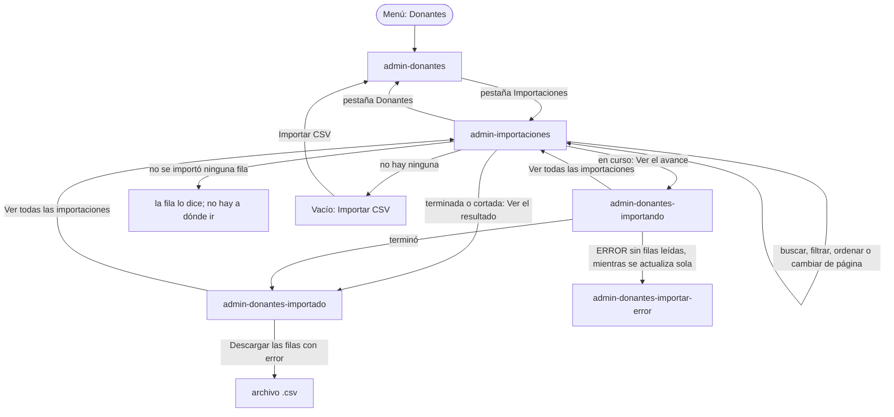

# Flujo: la pantalla de importaciones del admin (R11-20)

> **Estado:** aprobada · **Fecha:** 2026-11-12 · **Aprobó:** el usuario, 2026-11-12 (opciones recomendadas, aprobación automática pedida por él)
> Ficha de la skill `ux-flujo` para el lote `p1-importaciones` del
> [backlog de la revisión del 2026-11-11](../backlog-revision-2026-11-11.md) (P1, ruta CONTRATO).
> La decisión del usuario ("Avance de la importación", sección 3 del backlog: una vista de
> importaciones actuales e históricas, con búsqueda y filtros) ya está tomada: esta ficha la baja a
> pantallas, no la reabre. Va con su spec:
> [`R11-p1-importaciones-spec.md`](../../specs/active/R11-p1-importaciones-spec.md).
> Amplía, sin reemplazarla, la [ficha del admin](raices-admin-navegable.md): el avance y el
> resultado de una importación (R11-02) siguen como están ahí; esta ficha suma la lista de todas las
> importaciones, la descarga de las filas con error y los dos pendientes de P0 que se cierran con
> este lote ([DTI-40](../../adr/DEUDA_TECNICA.md#dti-40), ítem 7, y la descarga de
> [DTI-39](../../adr/DEUDA_TECNICA.md#dti-39)).

## 0. Qué pasa hoy (evidencia)

Leído en `ebe332642`. `[V]` es leído en el código; `[H]`, hipótesis.

| # | Hoy | Dónde |
|---|---|---|
| H1 | Donaciones no tiene un listado de importaciones: solo subir una, ver una por su id y sus filas con error `[V]` | `DonantesController.java:94-125` |
| H2 | La tabla `archivo` no guarda **cuándo** se subió ni cuándo terminó, ni el **nombre** con que se subió: `path` es una clave propia (`<uuid>.csv`) `[V]`. Sin eso no hay filtro por fecha ni búsqueda por nombre | `V2__catalogo_y_archivo.sql:27-32`, `V16`, `V21:30`, `ArchivoDonantesService.java:55` |
| H3 | El nombre que se ve en el avance lo guarda el cliente en la sesión y lo pasa por la dirección (`?nombre=`): otro admin, u otra sesión, ve la importación sin nombre `[V]` | `AdminDonantesController.java:47`, `AdminPersonasRest.java:296-330` |
| H4 | La franja "Se está importando…" de Donantes solo recuerda la última importación que subió **esa sesión** `[V]` | `AdminDonantesController.java:139-157` |
| H5 | Mientras el avance se actualiza solo, una importación que pasa a `ERROR` sin ninguna fila leída devuelve la página de error, que no tiene el bloque `#avance`: el bloque desaparece sin aviso `[V]` (DTI-40, ítem 7) | `AdminDonantesController.java:92-110` |
| H6 | "Descargar las filas con error" no se muestra fuera de la maqueta: no hay a dónde mandarlo `[V]` | [ficha del admin, R11-02](raices-admin-navegable.md#r11-02--el-avance-de-la-importación-en-vivo) |
| H7 | El gateway ya deja pasar todo `/api/donantes/**` a Donaciones, incluido un `GET /api/donantes/archivos` nuevo `[V]` | `RutasGateway.java:41` |

## 1. Para quién y para qué

| | |
|---|---|
| Quién | La persona de administración que cargó (o cargó otro admin) un CSV con miles de donantes y vuelve después, desde la computadora, a ver cómo terminó o a buscar una carga de días atrás |
| Tono | Pantalla de trabajo: claro, útil, tranquilizador ([tono](../tono-y-comunicacion.md#tono-según-la-pantalla)) |
| Qué quiere lograr | "Quiero ver qué archivos se importaron, cuáles siguen y cuáles tuvieron filas con error, y abrir el que me interesa." |
| Dispositivo principal | Escritorio; en el celular tiene que poder leerse y abrir una importación |
| Requerimientos | RF-20 (importar donantes por CSV con progreso y resultado por fila), RNF-UI-02 (nada a más de 3 niveles), RNF-UI-05 (cada acción con su mensaje), RNF-UI-06 (indicador si tarda), RF-CL-07 (toda cifra que cambia dice cuándo se leyó), RNF-CL-02 (sin JavaScript, igual funciona). Reglas generales 1, 2, 3 y 5 del backlog |
| Datos que usa | `GET /api/donantes/archivos` (nuevo, paginado, con búsqueda y filtros), `GET /api/donantes/archivos/{id}` y `GET /api/donantes/archivos/{id}/filas-con-error` (ya existen; suman campos opcionales). Detalle en la [spec](../../specs/active/R11-p1-importaciones-spec.md) |
| Boceto de E1 | Sin boceto: la vista es de la revisión del 2026-11-11 |

## 2. Dónde está en el sitio

Inicio del admin (nivel 1) → **Donantes** (nivel 2) → pestaña **Importaciones** (nivel 2, la misma
sección) → avance o resultado de una importación (nivel 3). Nada pasa de 3 niveles.

- Es una **pestaña de la sección Donantes**, no un ítem nuevo del menú: el menú del admin sigue con
  sus 7 entradas (navegación enfocada) y "Donantes" queda marcado en las dos pestañas. Arriba de la
  lista de Donantes y de la de Importaciones, la misma fila de pestañas: `Donantes · Importaciones`.
- Dirección: `/admin-importaciones`, con la búsqueda, los filtros y la página en la dirección
  (`?buscar=&estado=&subida=&orden=&pagina=`): el "atrás" del navegador vuelve a la vista anterior y
  la dirección se puede guardar o compartir (puerta delantera).
- Entradas: la pestaña; "Ver todas las importaciones" en el avance y en el resultado; y la franja de
  Donantes, que suma ese mismo enlace.
- En el [mapa del sitio](../mapa-del-sitio.md) entra en la fila "Donantes → importar CSV" (se
  actualiza al construir).

## 3. Recorrido



Desvíos considerados:

- **Cancelar o volver:** la lista no cambia nada; el "atrás" del navegador vuelve a la búsqueda o
  la página anterior.
- **Error de datos** (una dirección armada a mano con una fecha imposible o un estado que no
  existe): el cliente no la manda tal cual; ignora ese filtro y lo dice ("No entendimos la fecha
  pedida: te mostramos todas las fechas.").
- **Error del servidor o sin respuesta** de Donaciones: la página de falla de siempre, con su código
  de soporte (R11-04). Si es al cambiar de página con HTMX, la misma página de falla.
- **Sin permiso:** solo el admin entra (como Donantes); cualquier otra cuenta, la página 403.
- **Una importación que ya no existe** (dirección vieja del avance): vuelve a Importaciones con el
  aviso "No encontramos esa importación."
- **La importación terminó mientras se miraba la lista:** la lista no se actualiza sola; dice a qué
  hora leyó las cifras y ofrece "Actualizar". El avance de cada una sí se actualiza solo.
- **Descarga que falla a mitad de camino:** el archivo baja incompleto; la última línea lo dice
  (ver §6) y la tabla paginada sigue disponible.

## 4. Pantallas

Patrones conocidos ([criterios §4 y §5](../criterios-catedra-ux-ui.md#4-patrones-de-navegación)):
**pestañas** para dos vistas del mismo nivel (`.segmentos`), **lista** donde tocar un ítem lleva al
detalle, **filtros** con búsqueda en una barra (`.filtros-barra`, como Donantes), **paginado** para
recorrer mucho contenido (el paginador provisorio, que `p1-paginador` reemplaza sin cambiar las
direcciones) y **aviso breve** para el resultado de una acción. Ningún componente nuevo: todos están
en el [catálogo](../componentes.md).

### 4.1 `admin-importaciones` (nueva)

Escritorio:

```text
Donantes
[ Donantes | Importaciones ]                                   (pestañas; la elegida, marcada)

Importaciones de donantes                                                   [Importar CSV]
1 importación en curso. Ver solo las que están en curso
Cifras leídas el 12 de noviembre de 2026, 18:34. [Actualizar]

Buscar por nombre del archivo
[ donantes-octubre                         ] [Buscar]   (Estado ▾) (Subida ▾) (Ordenar ▾)
Coinciden 23 importaciones.

Archivo                    Subido                     Estado                        Filas                         
donantes-noviembre.csv     12 nov 2026, 18:20         Importando                    8.400 de 20.000     Ver el avance ›
donantes-octubre.csv       15 oct 2026, 18:02         Terminada con filas con error 20.000: 19.100 nuevos,  Ver el resultado ›
                                                                                    774 actualizados, 126 con error
padron-septiembre.csv      30 sep 2026, 09:12         Terminada                     3.200: 3.010 nuevos,   Ver el resultado ›
                                                                                    190 actualizados
prueba.csv                 29 sep 2026, 17:40         No se importó ninguna fila    —                   El archivo no se pudo leer.
padron-agosto.csv          31 ago 2026, 11:05         Se cortó en la fila 8.400     8.400 leídas: 7.950 nuevos, Ver el resultado ›
                                                                                    410 actualizados, 40 con error
...                                                                                 (20 por página)
                         ‹ Anterior    Página 1 de 2    Siguiente ›
```

Celular (360 px): la barra de filtros baja debajo de la búsqueda, como en Donantes; cada
importación es un ítem de lista apilado, entero como enlace (salvo la que no tiene a dónde ir):

```text
donantes-octubre.csv
Terminada con filas con error
15 oct 2026, 18:02 · 20.000 filas
19.100 nuevos · 774 actualizados · 126 con error
Ver el resultado ›
```

- **Columnas:** archivo (el nombre con que se subió), cuándo se subió (fecha y hora de Argentina),
  estado en palabras, filas (lo que se leyó y su desglose) y la acción. No hay columna "quién la
  subió": hoy Administración es una sola cuenta (R11-10); ver §9.
- **Estado en palabras**, con el mismo vocabulario que el avance y el resultado (ficha del admin):

  | Estado en Donaciones | Cómo se dice | A dónde lleva |
  |---|---|---|
  | `PENDIENTE` | Esperando para empezar | Ver el avance |
  | `PROCESANDO` | Importando | Ver el avance |
  | `PROCESADO` | Terminada | Ver el resultado |
  | `PROCESADO_CON_ERRORES` | Terminada con filas con error | Ver el resultado |
  | `ERROR`, con filas leídas | Se cortó en la fila N | Ver el resultado (la página de avance, cortada) |
  | `ERROR`, sin filas leídas | No se importó ninguna fila | Ningún enlace: la fila dice "El archivo no se pudo leer." |

- **Filtros** (pastillas de `.filtros`, cada una con su menú de radios):
  - **Estado:** Todos (por defecto) · En curso · Terminadas · Terminadas con filas con error · Se
    cortaron o no se importaron.
  - **Subida:** Cualquier fecha (por defecto) · Hoy · Últimos 7 días · Últimos 30 días · Este mes ·
    El mes anterior. Cada opción se traduce a un rango de fechas en la dirección
    (`?desde=AAAA-MM-DD&hasta=AAAA-MM-DD`); una dirección con otras fechas también se respeta y la
    pastilla dice "Del 1 al 15 de octubre". Elegir dos fechas a mano llega con el componente de
    filtros nuevo (R11-B04).
  - **Ordenar:** Más recientes primero (por defecto) · Más antiguas primero.
  - Con algún filtro o búsqueda, "Sacar los filtros" al lado de la cuenta.
- **"1 importación en curso"**: es un número que da Donaciones (no se cuenta la página). Con 0, la
  línea no se muestra. El enlace aplica el filtro "En curso".
- **"Cifras leídas el …"**: la lista muestra las cifras de cuando se pidió (RF-CL-07). No se
  actualiza sola: para eso está el avance de cada una. "Actualizar" vuelve a pedir la misma vista.
- **Importaciones viejas**, de antes de este lote, no tienen ni nombre ni fecha guardados: se dicen
  "Archivo sin nombre guardado" y "Sin fecha guardada", van al final en los dos órdenes y no entran
  en un filtro de fecha. No se inventa una fecha.
- **"Importar CSV"** lleva a Donantes con el bloque de importar abierto (`/admin-donantes#importar`),
  donde ya vive la subida: no se duplica el formulario.
- La barra de búsqueda y filtros queda fija al desplazarse (regla 5), como en los otros listados.

### 4.2 `admin-donantes` (cambio chico)

- Arriba, la fila de pestañas `Donantes · Importaciones`.
- La franja "Se está importando…" / "Terminó la importación de…" sigue como está (recuerda la que
  subió esta sesión hasta que el admin abre el resultado) y suma "Ver todas las importaciones". La
  franja para cualquier admin y el aviso al terminar llegan con la campanita (`p2-campanita`).

### 4.3 `admin-donantes-importando` y `admin-donantes-importado` (cambios chicos)

Lo demás, como en la [ficha del admin](raices-admin-navegable.md#r11-02--el-avance-de-la-importación-en-vivo).

- **Migas:** `Importaciones › donantes-octubre.csv` (antes, `Donantes › Importación`). "Importaciones"
  lleva a la lista.
- **El nombre del archivo** sale de Donaciones, no de la sesión: lo ve igual cualquier admin, desde
  cualquier entrada. Si la importación es vieja y no lo tiene, el título dice "Importación del
  archivo sin nombre guardado"; si llega `?nombre=` (direcciones viejas), se usa como respaldo.
- **La fecha:** "Subido el 15 de octubre de 2026, 18:02." debajo del título, en el avance y en el
  resultado (sale de Donaciones; sin fecha guardada, no se muestra). La hora en que terminó no se
  guarda en este lote (§9, decisión 3).
- **"Volver a Donantes"** pasa a ser dos enlaces: "Ver todas las importaciones" y "Volver a
  Donantes".
- **"Descargar las filas con error"** (solo si hubo filas con error) se muestra con datos reales:
  baja un `.csv` con todas las filas con error del archivo, una por renglón (Fila; Qué pasó;
  Código), con el mismo texto que la tabla. Se arma de a tandas mientras baja: ni el cliente ni el
  servicio cargan la lista entera.
- **Si pasa a `ERROR` sin ninguna fila leída mientras se actualiza sola** (H5): la página entera pasa
  a la de error de la importación (no solo el bloque), así se ve qué pasó y cómo seguir.

## 5. Estados

| Pantalla | Estado | Qué se ve | Texto |
|---|---|---|---|
| `admin-importaciones` | Con datos | Pestañas, título, cuenta en curso, barra de filtros, la cuenta, la lista y el paginador | "Importaciones de donantes" · "Coinciden 23 importaciones." · "Cifras leídas el 12 de noviembre de 2026, 18:34." |
| `admin-importaciones` | Con una en curso | La línea arriba de la barra | "1 importación en curso." (o "2 importaciones en curso.") · "Ver solo las que están en curso" |
| `admin-importaciones` | Vacío (nunca se importó nada) | El aviso y la acción, sin barra de filtros | "Todavía no se importó ningún archivo de donantes." · "Importá un CSV desde Donantes para cargar muchos donantes de una vez." · [Importar CSV] |
| `admin-importaciones` | Sin resultados (con búsqueda o filtros) | La barra con lo elegido y el aviso | "Ninguna importación coincide con la búsqueda y los filtros elegidos." · "Sacar los filtros" |
| `admin-importaciones` | Página fuera de rango (dirección vieja) | La última página que existe | Sin texto propio: se muestra la última página, como en Donantes |
| `admin-importaciones` | Cargando (filtrar o cambiar de página) | El indicador del formulario, la lista anterior a la vista | "Buscando importaciones…" |
| `admin-importaciones` | Filtro no entendido | Aviso breve arriba de la lista; la lista sin ese filtro | "No entendimos la fecha pedida: te mostramos todas las fechas." · "No entendimos el estado pedido: te mostramos todos." |
| `admin-importaciones` | Importación que no existe (vuelve desde el avance) | Aviso breve | "No encontramos esa importación." |
| `admin-importaciones` | Error del servidor | Página de falla con su código (R11-04) | La de siempre: "No pudimos mostrar esta página." y el código de soporte |
| `admin-importaciones` | Sin permiso | Página 403 | La de siempre |
| `admin-importaciones` (fila) | Sin nombre o sin fecha guardados | El texto en lugar del dato | "Archivo sin nombre guardado" · "Sin fecha guardada" |
| `admin-importaciones` (fila) | Esperando para empezar | Estado y enlace | "Esperando para empezar" · "Todavía no empezó a leer filas." · "Ver el avance" |
| `admin-importaciones` (fila) | Importando, sin el total todavía | Estado y lo leído | "Importando" · "500 filas leídas hasta ahora" · "Ver el avance" |
| `admin-importaciones` (fila) | Importando, con el total | Estado y lo leído | "Importando" · "8.400 de 20.000" · "Ver el avance" |
| `admin-importaciones` (fila) | Terminada | Estado y el desglose | "Terminada" · "3.200 filas: 3.010 nuevos y 190 actualizados" · "Ver el resultado" |
| `admin-importaciones` (fila) | Terminada con filas con error | Estado y el desglose | "Terminada con filas con error" · "20.000 filas: 19.100 nuevos, 774 actualizados y 126 con error" · "Ver el resultado" |
| `admin-importaciones` (fila) | Se cortó con filas leídas | Estado y lo leído | "Se cortó en la fila 8.400" · "8.400 filas leídas: 7.950 nuevos, 410 actualizados y 40 con error" · "Ver el resultado" |
| `admin-importaciones` (fila) | No se importó ninguna fila | Estado y el porqué, sin enlace | "No se importó ninguna fila" · "El archivo no se pudo leer." |
| `admin-donantes-importado` | Con filas con error | El botón de descarga al lado del título de la tabla | "Filas con error · 126" · [Descargar las filas con error] |
| `admin-donantes-importado` | Sin filas con error | Sin botón de descarga | "Todas las filas se importaron sin errores." (como hoy) |
| descarga `.csv` | Completa | El archivo | Encabezado "Fila;Qué pasó;Código" y una línea por fila |
| descarga `.csv` | Cortada a mitad de camino | El archivo, con una última línea que lo avisa | "No pudimos terminar la descarga: faltan filas. Volvé a descargarla o miralas en la tabla." |
| `admin-donantes-importando` | Pasa a `ERROR` sin filas mientras se actualiza sola | Toda la página pasa a la de error de la importación | La de siempre: "No se importó ninguna fila." y cómo seguir |

## 6. Textos

| Elemento | Texto | Nota |
|---|---|---|
| Pestañas | "Donantes" · "Importaciones" | `nav.segmentos` con `aria-label="Vistas de donantes"` |
| Título | "Importaciones de donantes" | `h1` |
| Acción principal | "Importar CSV" | Lleva a Donantes, con el bloque de importar abierto |
| Búsqueda | Rótulo "Buscar por nombre del archivo" · botón "Buscar" | Sin tildes ni mayúsculas, como las otras búsquedas |
| Cuenta | "Coinciden 23 importaciones." / "Coincide 1 importación." | El total de Donaciones, no lo que entra en la página |
| En curso | "1 importación en curso." · "Ver solo las que están en curso" | Solo si hay alguna |
| Cuándo se leyó | "Cifras leídas el 12 de noviembre de 2026, 18:34." · "Actualizar" | RF-CL-07 |
| Encabezados | "Archivo" · "Subido" · "Estado" · "Filas" | `th scope="col"`; en el celular no se ven |
| Acciones de la fila | "Ver el avance" · "Ver el resultado" | El nombre del archivo va en el texto para el lector: "Ver el resultado de donantes-octubre.csv" |
| Migas del avance y del resultado | "Importaciones › donantes-octubre.csv" | |
| Fecha en el avance y el resultado | "Subido el 15 de octubre de 2026, 18:02." | Solo si Donaciones la tiene |
| Enlaces de salida | "Ver todas las importaciones" · "Volver a Donantes" | |
| Descarga | "Descargar las filas con error" | Baja `filas-con-error-donantes-octubre.csv` |
| Indicador | "Buscando importaciones…" | RNF-UI-06 |
| Ayuda (debajo del título, plegada en "¿Qué muestra esta lista?") | "Acá están todos los archivos de donantes que se importaron, los que siguen importándose y los que no terminaron. Abrí uno para ver su avance o sus filas con error. Para seguir una importación en vivo, abrí su avance: esta lista no se actualiza sola." | Una sola ayuda, a pedido (divulgación progresiva) |

Filtro de tono (7 preguntas): lo pendiente se dice pendiente ("Esperando para empezar",
"Importando"); lo que falló se dice como pasó, sin culpa ("Se cortó en la fila 8.400", "El archivo
no se pudo leer."); las cifras van con su cuándo ("Cifras leídas el…", "Subido el…"); la cuenta dice
de qué es ("Coinciden 23 importaciones."); lo que no se sabe se dice ("Sin fecha guardada") en lugar
de inventarlo; lo que la lista no hace se dice como límite ("esta lista no se actualiza sola"). Sin
urgencia ni signos de exclamación. "Nuevos" y "actualizados" son los mismos términos del avance.

## 7. Accesibilidad

- Zonas: el encabezado y el menú del layout privado, `main#contenido` con la pantalla y el pie.
- Orden del foco: pestañas → "Importar CSV" → ayuda → "Ver solo las que están en curso" →
  "Actualizar" → búsqueda → filtros → "Sacar los filtros" → la lista (una acción por fila) →
  paginador.
- Las pestañas son enlaces reales; la elegida lleva `aria-current="page"`.
- La tabla del escritorio es una `table` con `caption` ("Importaciones de donantes, página 1 de 2")
  y `th scope`; en el celular, una lista (`ol`) con un ítem por importación. El estado va en texto,
  nunca solo en color.
- La cuenta ("Coinciden 23 importaciones.") vive en una región `aria-live="polite"`: al filtrar con
  HTMX, el lector la dice sin mover el foco.
- Los avisos breves van a `#avisos`, como en el resto del sitio.
- Las fechas van en `time` con `datetime`.
- Sin JavaScript: la barra se envía con "Buscar" y cada filtro con su "Mostrar resultados"; el
  paginador y las acciones son enlaces reales; la descarga es un enlace.

## 8. Revisión de usabilidad

| # | Heurística | Cómo la cumple | Riesgo que queda |
|---|---|---|---|
| 1 | Visibilidad del estado | Cada importación dice su estado en palabras y lo leído; arriba, cuántas siguen en curso y a qué hora se leyeron las cifras | La lista no se actualiza sola: una que terminó recién sigue diciendo "Importando" hasta "Actualizar". Se dice en la ayuda y al lado de la hora |
| 2 | Lenguaje del usuario | "Importando", "Terminada con filas con error", "Se cortó en la fila…", el nombre del archivo como lo subió | — |
| 3 | Control y libertad | Pestañas para ir y volver entre Donantes e Importaciones; "Sacar los filtros"; el "atrás" del navegador vuelve a la vista anterior | — |
| 4 | Consistencia | Misma barra de filtros, mismo paginador y mismas palabras que Donantes y que el avance | El paginador es el provisorio hasta `p1-paginador` |
| 5 | Prevención de errores | Los filtros son opciones, no campos libres; la fecha se elige de una lista | — |
| 6 | Reconocer antes que recordar | El nombre del archivo y la fecha de subida identifican cada carga; ya no hace falta haber subido el archivo en esta sesión para encontrarlo | Las importaciones viejas no tienen nombre ni fecha |
| 7 | Flexibilidad | Búsqueda por nombre, filtros combinables, orden, y la dirección con todo eso se puede guardar | Sin rango de fechas a mano hasta R11-B04 |
| 8 | Diseño minimalista | Cuatro columnas y una acción por fila; el desglose solo en las que leyeron filas; la ayuda plegada | — |
| 9 | Recuperarse de errores | "No se importó ninguna fila" dice por qué; "Se cortó" lleva al resultado, que dice cómo seguir; descarga cortada lo avisa en el propio archivo | — |
| 10 | Ayuda | "¿Qué muestra esta lista?" plegado, con qué es cada cosa y cómo seguir una en vivo | — |

Los 7 factores de Morville, una línea cada uno:

- **Útil:** responde "¿qué se importó, qué sigue y qué falló?" sin tener que acordarse del archivo.
- **Usable:** una lista con filtros y paginado, el mismo patrón que Donantes.
- **Deseable:** la identidad del resto del admin, sin piezas nuevas.
- **Valioso:** cierra la demo de RF-20: se ve el CSV de 20.000 filas en el historial con su resultado.
- **Ubicable:** pestaña dentro de Donantes, enlazada desde el avance, el resultado y la franja.
- **Accesible:** tabla con encabezados en el escritorio, lista en el celular, cuenta que se lee sola.
- **Creíble:** cifras que da Donaciones con su hora; lo que no se guardó se dice, no se inventa.

Conviene probar con personas reales: si "Importaciones" como pestaña de Donantes se encuentra sin
ayuda, y si se entiende que la lista no se actualiza sola mientras el avance sí.

## 9. Decisiones y preguntas

Decisiones del diseñador del lote (2026-11-12). Van a la [bitácora](../bitacora.md) al construir.

1. **Pestaña de Donantes, no ítem nuevo del menú.** Así el avance queda en el nivel 3 y el menú no
   crece. Descartado: un ítem "Importaciones" en el menú (suma un destino de primer nivel para algo
   que es parte de Donantes) y un nivel 3 debajo de Donantes (el avance quedaría en el 4).
2. **La dirección es `/admin-importaciones`**, la que pide el lote, aunque no empiece con
   `admin-donantes-`: `Pantallas` la tiene que marcar como parte de Donantes.
3. **Donaciones guarda el nombre del archivo y la fecha y hora de subida.** Sin eso no hay
   búsqueda ni filtro por fecha, y el nombre del avance dependía de la sesión. Las importaciones
   viejas se muestran sin nombre ni fecha, sin inventarlos. Descartado: poner la hora de la
   migración como fecha de las viejas (sería un dato falso) y guardar también la hora en que
   terminó (la escribe el importador, que es de otro lote, `p1-importador`, y la lista no la
   necesita).
4. **Fechas con opciones fijas** (hoy, 7 días, 30 días, este mes, el anterior), con el componente de
   filtros que ya existe. Elegir dos fechas a mano queda para R11-B04, que rediseña los filtros.
5. **La lista no se actualiza sola.** Muestra la hora de sus cifras y "Actualizar"; lo en vivo es el
   avance de cada una. Descartado: actualizar toda la lista cada pocos segundos (más pedidos para un
   caso que la página de avance ya resuelve).
6. **La descarga de las filas con error la arma el cliente**, pidiendo las filas de a 100 y
   escribiéndolas mientras baja, con el mismo texto de la tabla. Descartado: un endpoint de
   descarga en Donaciones (o el texto de los motivos quedaría en dos lugares, o el archivo diría los
   códigos internos).
7. **La franja de Donantes sigue con la memoria de la sesión** y suma el enlace. Que la vea
   cualquier admin, y el aviso al terminar, son de `p2-campanita`.
8. **Sin "quién la subió".** Administración es una sola cuenta hasta R11-10.

Preguntas abiertas para el usuario (una ronda):

1. Cuando existan las cuentas por admin (R11-10), ¿la lista suma una columna "Subió" con el nombre de
   quien cargó el archivo? → **Sí, en el lote que cierre R11-10 (recomendada)** · No hace falta.


## Aprobación del diseño p1-importaciones (2026-11-12)

Aprobado por el usuario de forma automática: pidió que, en P1 y P2, cada duda se resuelva con la opción recomendada por el diseñador, sin parada. Cada duda queda resuelta así:

1. Cuando existan las cuentas por admin (R11-10, lote p1-admins), ¿la lista suma una columna 'Subió' con el nombre de quien cargó el archivo? Recomiendo que sí, en el lote que cierre R11-10, sumando subido_por al archivo. **Resuelto: la opción recomendada.**
2. V22 puede chocar con otra migración de Donaciones de la misma tanda (p1-admins también toca Donaciones). Recomiendo que la renumere el integrador, como dice la regla de la corrida. **Resuelto: la opción recomendada.**
3. Una descarga con muchas filas con error (hasta 200 pedidos para 20.000) podría tardar. Recomiendo probarla en el cierre con el CSV del ensayo y, solo si no alcanza, pasar a un endpoint de descarga en Donaciones en otro lote. **Resuelto: la opción recomendada.**
4. El DER de Donaciones no tiene nombre_original ni subido_en en Archivo. Recomiendo decirlo en la descripción del PR y no editar el DER de la entrega, que es un registro histórico. **Resuelto: la opción recomendada.**
