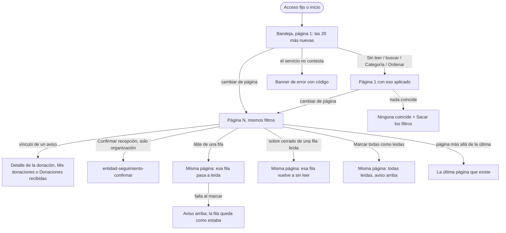

# Flujo: Notificaciones con páginas y estados claros (R11-14)

> **Estado:** en revisión · **Fecha:** 2026-11-12 · **Aprobó:** pendiente (usuario)
> Ficha de la skill `ux-flujo` para el lote `p1-notificaciones` del
> [backlog de la revisión del 2026-11-11](../backlog-revision-2026-11-11.md) (P1, ruta CONTRATO).
> La decisión del usuario "Notificaciones leídas" de la sección 3 del backlog ya está tomada: esta
> ficha la baja a pantallas, no la reabre. El contrato del servicio va en la
> [spec corta del lote](../../specs/active/R11-p1-notificaciones-spec.md).
> Actualiza, sin reemplazarlas, las secciones de Notificaciones de las fichas de
> [donante](raices-donante-navegable.md#donante-notificaciones-nivel-2) y
> [entidad](raices-entidad-navegable.md#43-entidad-notificaciones-y-entidad-notificaciones-leidas):
> lo que esta ficha dice sobre la bandeja (páginas, filtros, cómo se ve una fila leída o sin leer,
> sus vínculos y sus íconos) manda sobre lo que dicen ellas. Lo demás de esas fichas (quién, para
> qué, dónde está en el sitio, de dónde sale cada aviso) sigue igual.

## 0. Qué pasa hoy (evidencia)

Leído en `ebe332642`. `[V]` es leído en el código; `[H]`, hipótesis.

| # | Hoy | Dónde |
|---|---|---|
| H1 | Notificaciones devuelve **todas** las notificaciones de la persona, sin página ni tope `[V]` | `NotificacionService.java:250-262`, `NotificacionController.java:79-85` |
| H2 | Los dos adaptadores piden la bandeja completa y la ordenan en memoria; el del donante la vuelve a pedir entera **cada vez que marca una**, para ver si es suya `[V]` | `DonanteNotificacionesRest.java:55-78`, `EntidadNotificacionesRest.java:85-101` |
| H3 | La búsqueda, "Todas / Sin leer", Categoría, Ordenar y Agrupar los resuelve la plantilla del buzón sobre la lista completa `[V]` | `componentes/buzon.html:38-58` |
| H4 | "N sin leer" y el menú de Categoría ("solo las que tienen avisos") se calculan contando la lista completa `[V]` | `donante-notificaciones.html:47-53`, `EntidadNotificacionesRest.java:94-97` |
| H5 | Sin leer pone en negrita **todo el mensaje**, que es el vínculo; leída y sin leer tienen el mismo fondo (el de pasar el mouse es el único) `[V]` | `buzon.css:107-147`, `buzon.html:136-140` |
| H6 | "Marcar como leída" y "Marcar como no leída" usan el mismo ícono, el tilde `[V]` | `buzon.html:155-162` |
| H7 | La fila no tiene título: el mensaje entero es el vínculo `[V]` | `buzon.html:136-140` |
| H8 | El buzón también lo usa la bandeja del admin, con datos de ejemplo escritos en su plantilla `[V]`. Sus notificaciones reales son de otro lote (`p2-campanita`, R11-30) | `admin-notificaciones.html:95-96` |

## 1. Para quién y para qué

| | |
|---|---|
| Quién | El donante (persona o empresa) que entra a ver qué pasó con sus donaciones; la persona de la organización que espera entregas. Los dos, en el celular o en la computadora |
| Tono | Pantalla de trabajo: claro, útil, tranquilizador ([tono](../tono-y-comunicacion.md#tono-según-la-pantalla)) |
| Qué quiere lograr | "Ver de un vistazo qué es nuevo, abrir lo que me importa y que la bandeja no tarde aunque tenga cientos de avisos" |
| Dispositivo principal | Ambos |
| Requerimientos | RF-08 (notificaciones del donante), RF-13 (asignación y recepción generan notificación a la organización), RNF-UI-01 a 06, reglas generales 1 a 3 del backlog |
| Datos que usa | `GET /api/notificaciones/persona/{personaId}` **paginado y filtrado en el servidor** (spec del lote), `.../no-leidas/conteo`, `PATCH /api/notificaciones/{id}/leida` y `.../marcar-todas-leidas` |
| Boceto de E1 | Pág. 6 (notificaciones del donante, tabla Estado / Detalle / Fecha). La organización, sin boceto |

## 2. Dónde está en el sitio

Sin cambios: `donante-notificaciones` y `entidad-notificaciones` son nivel 2, a un toque desde el
acceso fijo de la cabecera y desde el inicio de cada rol ([mapa del sitio](../mapa-del-sitio.md)).
Las páginas no agregan niveles: son la misma pantalla con `?pagina=N`.

## 3. Recorrido



Desvíos considerados:

- **Volver:** las páginas y los filtros viven en la dirección (`?pagina=3&ver=sin-leer&tema=camino`):
  "atrás" del navegador vuelve a la página anterior con sus filtros. Al volver del detalle de una
  donación se llega a la misma página.
- **Página que ya no existe** (por ejemplo, `?pagina=9` cuando hay 3, o después de marcar en "Sin
  leer"): se muestra la última que existe, nunca una lista vacía (regla 3). Si no hay ninguna, el
  estado vacío que corresponda.
- **Marcar en "Sin leer":** la fila marcada se queda en su lugar, ya como leída, hasta que la
  persona cambia de página o de filtro. Así no salta la lista bajo el dedo. Al recargar, ya no está.
- **Cambió algo mientras se mira:** llega una notificación nueva entre la página 1 y la 2. Una fila
  puede verse repetida al pasar de página; no se pierde ninguna. Se acepta (ver Decisiones).
- **Error del servidor, sin conexión o espera vencida:** el banner de error con código, como hoy
  (R11-04).
- **Sin permiso:** sin cambios (redirige a ingresar; otro rol ve "Esta pantalla es para…").
- **Sin JavaScript:** todo funciona: la barra es un formulario `get`, el paginador son enlaces y
  marcar es un formulario `post` que vuelve a la misma dirección.

## 4. Pantallas

Una sola pantalla por rol, con la misma bandeja (el componente `buzon`). Cambia la bandeja; la
cabecera de cada pantalla (rótulo, título y bajada) sigue como en su ficha, salvo la cifra de sin
leer, que ahora sale del conteo del servicio.

**Patrón conocido:** bandeja de entrada de correo o de notificaciones (Material: Lists, con el
estado "sin leer" de Gmail o GitHub: punto, fondo y peso del título) y paginado con
números (Material: Data tables, paginación; [criterios](../criterios-catedra-ux-ui.md#4-patrones-de-navegación),
"Paginado o desplazamiento sin fin": paginado para mucho contenido).

### Bandeja, en la computadora

```text
┌───────────────────────────────────────────────────────────────────────────────┐
│ [Todas | Sin leer]   Buscar en las notificaciones [__________] [Buscar]       │
│ [Categoría ▾] [Ordenar: más nuevas primero ▾] [Agrupar: sin agrupar ▾]        │
├───────────────────────────────────────────────────────────────────────────────┤
│ ☐ Seleccionar todas                          [Marcar todas como leídas]       │
│                     Son las 4 sin leer de tu cuenta, también las de otras páginas.│
│     Mensaje                                  Asociada a          Hace cuánto   │
│▓● ☐ 🚚 **Donación en camino**                 Donaciones en camino hace 2 horas [✓]│
│▓       El camión salió a entregar tus lentejas a Comedor Barrio Ejemplo.        │
│▓       Ver la donación (subrayado, peso normal)                                 │
│     ☐ 📦 Donación recibida en el depósito    Depósito            ayer        [✉]│
│        Recibimos tu donación en el depósito. (texto apagado)                    │
│        Ver la donación                                                         │
│   …                                                                           │
├───────────────────────────────────────────────────────────────────────────────┤
│ Mostrando 1 a 20 de 57 notificaciones                                          │
│                  « ‹  1  2  3  ›  »                                            │
└───────────────────────────────────────────────────────────────────────────────┘
▓ = fondo suave de sin leer · ● = punto · [✓] = marcar como leída · [✉] = marcar como no leída
```

### Bandeja, en el celular (360 px)

```text
┌──────────────────────────────┐
│ [Todas | Sin leer]           │
│ Buscar… [______] [Buscar]    │
│ [Categoría ▾] [Ordenar ▾] …  │
├──────────────────────────────┤
│ [Marcar todas como leídas]   │
│ Son las 4 sin leer de tu     │
│ cuenta, también las de otras │
│ páginas.                     │
│▓● ☐ **Donación en camino** [✓]│
│▓    El camión salió a        │
│▓    entregar tus lentejas…   │
│▓    Ver la donación          │
│▓    🚚 Donaciones en camino · │
│▓    hace 2 horas             │
│  ☐ Donación recibida…     [✉]│
│     …                        │
├──────────────────────────────┤
│ 1 a 20 de 57                 │
│       ‹  1 de 3  ›           │
└──────────────────────────────┘
```

### Cada fila

| Parte | Sin leer | Leída |
|---|---|---|
| Fondo | Suave, un tinte del acento, distinto del de pasar el mouse o enfocar | El de la lámina (sin fondo propio) |
| Punto | Sí, al margen izquierdo | No |
| Título | En negrita | Peso normal, color de texto apagado |
| Mensaje | Peso normal, color de texto | Peso normal, color de texto apagado |
| Vínculo | Peso normal, subrayado, color de vínculo | Igual: peso normal, subrayado, color de vínculo |
| Categoría y hace cuánto | Texto chico apagado (como hoy) | Igual |
| Acción de la fila | Tilde: "Marcar como leída" | Sobre cerrado: "Marcar como no leída" |
| Para lectores de pantalla | "Sin leer: " antes del título | "Leída: " antes del título |

- **El estado no depende solo del color:** sin leer se distingue por cuatro señales, tres de ellas
  sin color (el punto, que es una forma; el peso del título; el texto para lectores) y además el
  fondo. Con los colores del sistema forzados (modo de alto contraste) quedan el punto (se dibuja con
  `forced-color-adjust` o un borde) y la negrita.
- **El título es nuevo** (H7): una frase corta que dice qué pasó, según el tipo de aviso (ver
  Textos). Es lo único en negrita. El mensaje queda debajo, entero, como texto. El vínculo es aparte
  y dice adónde lleva.
- **Vínculos:** el del aviso y "Sacar los filtros" van en peso normal y subrayados, en el color de
  vínculo, leídos o no. "Confirmar recepción" sigue siendo un botón principal chico (es una acción,
  no un vínculo).
- **Íconos de la acción:** el tilde para marcar como leída (como hoy) y un **sobre cerrado** para
  marcar como no leída: el sobre cerrado es "volver a tenerla por abrir". Los dos tienen su
  `title` y su texto para lectores. Donde hay puntero, aparecen al pasar o enfocar la fila (como hoy);
  en el celular, siempre visibles.
- **Contraste:** el texto apagado de las leídas, el título en negrita sobre el fondo suave y el
  vínculo sobre los dos fondos cumplen AA (4,5:1 para el texto, 3:1 para el punto y el ícono). Si el
  tono apagado actual no llega sobre la lámina, se oscurece en `buzon.css`, no se baja el contraste.

### Páginas y totales

- **20 por página**, de la más nueva a la más vieja (o al revés con "Ordenar"). El servicio resuelve
  la página, "Sin leer", la búsqueda y la categoría; el cliente no recibe nunca la lista completa
  (regla 1).
- **Paginador:** el componente `paginas` del lote `p1-paginador` (R11-11), debajo de la lista:
  `« ‹ 1 2 3 … 9 › »` en la computadora y `‹ 3 de 9 ›` en el celular, con los filtros en cada
  enlace. Con una sola página no se dibuja. Si al construir este lote el componente todavía no está
  integrado, se usa el provisorio `paginador :: paginador(p)` y se cambia al integrar (mismas
  direcciones).
- **Arriba del paginador,** "Mostrando 21 a 40 de 57 notificaciones." (en el celular, "21 a 40 de
  57"). Con filtros, "de 12 notificaciones con esos filtros."
- **Al cambiar de página,** el foco va al título de la lista (el `h2` del primer grupo o, sin
  agrupar, la etiqueta de la lista) y la página no salta al principio del sitio.
- **"N sin leer"** de la bajada y del botón sale del conteo del servicio
  (`.../no-leidas/conteo`), un número: no se cuenta la lista.
- **Categoría:** el menú muestra **siempre todas las categorías del rol**, no "solo las que tienen
  avisos" (eso exigía contar la lista completa, H4). Elegir una sin avisos da el estado "Ninguna
  coincide".
- **Agrupar por fecha** (Hoy, Ayer, Esta semana, Antes) agrupa dentro de la página. Si un grupo sigue
  en la página siguiente, esa página repite el título del grupo.

### Marcar

- **Tilde o sobre de una fila:** marca solo esa y vuelve a la misma dirección (misma página, mismos
  filtros). Con HTMX cambia solo esa fila.
- **"Seleccionar todas"** (con JavaScript) elige las sin leer **de esta página**. El botón pasa a
  "Marcar las N elegidas como leídas".
- **"Marcar todas como leídas"** sin nada elegido marca **todas las sin leer de la cuenta**, también
  las de otras páginas y las que el filtro no muestra. Por eso lleva debajo la nota "Son las N sin
  leer de tu cuenta, también las de otras páginas." Es reversible fila por fila (no lleva
  confirmación, como hoy).
- Quién es dueño de cada notificación lo controla Notificaciones (permiso `MARCAR_SU_NOTIFICACION`):
  el cliente deja de pedir la bandeja entera para comprobarlo (H2).

## 5. Estados

| Pantalla | Estado | Qué se ve | Texto |
|---|---|---|---|
| Bandeja | Con datos | La barra, la cabecera, hasta 20 filas, "Mostrando…" y el paginador | Ver Textos |
| Bandeja | Una sola página | Lo mismo sin el paginador; "Mostrando" con el total | "Mostrando 1 a 7 de 7 notificaciones." |
| Bandeja | Filtrada | La barra con lo elegido, el conteo y la página | "Coinciden 12 notificaciones." (`role="status"`) · "Sacar los filtros" |
| Bandeja | Ninguna coincide | La barra y el aviso | "Ninguna notificación coincide con lo que buscaste." · "Probá con otras palabras o sacá los filtros." · "Ver todas" |
| Bandeja | Sin leer, ninguna | La barra y el aviso | "No tenés notificaciones sin leer." · "Las que ya leíste siguen en Todas." · "Ver todas" |
| Bandeja | Vacío (cuenta sin avisos) | El aviso de cada ficha, sin barra ni paginador | Donante: "Todavía no tenés notificaciones." · Organización: "Todavía no tenés novedades." (los textos completos de sus fichas) |
| Bandeja | Página más allá de la última | La última página que existe, con el paginador en ella | Sin aviso: es la lista que hay |
| Bandeja | Cargando (cambio de página o de filtro) | La lista con `aria-busy="true"` y el indicador | "Cargando tus notificaciones…" (organización: "Cargando tus novedades…") |
| Bandeja | Todas leídas, en Todas | Las filas sin fondo ni punto; en la cabecera, sin el botón | "Todas leídas." |
| Marcar | Enviando | El botón o el ícono deshabilitado con el indicador | "Marcando…" |
| Marcar | Éxito, una | La fila cambia de estado; aviso en `#avisos` | "Listo: marcaste la notificación como leída." · "Listo: marcaste la notificación como no leída." |
| Marcar | Éxito, elegidas | Esas filas leídas; aviso | "Listo: marcaste 3 notificaciones como leídas." |
| Marcar | Éxito, todas | Las filas de la página leídas; aviso | "Listo: marcaste todas como leídas." |
| Marcar | Error | Aviso arriba; las filas como estaban | "No pudimos marcarlas como leídas. Siguen como estaban. Probá de nuevo." |
| Bandeja | Error del servidor | El banner de cada ficha | "No pudimos cargar tus notificaciones." (organización: "…tus novedades.") · cuerpo, código y "Volver a intentar" |
| Bandeja | Sin permiso | Sin cambios | Los de cada ficha |

## 6. Textos

| Elemento | Texto | Nota |
|---|---|---|
| Nota del botón | "Son las N sin leer de tu cuenta, también las de otras páginas." | Con N = 1: "Es la única sin leer de tu cuenta." |
| Botón con elegidas | "Marcar las N elegidas como leídas" | N = 1: "Marcar la elegida como leída" |
| Total | "Mostrando 21 a 40 de 57 notificaciones." · celular: "21 a 40 de 57" | Con filtros: "…de 12 notificaciones con esos filtros." |
| Nombre del paginador | "Páginas de notificaciones" | El `aria-label` del `<nav>` |
| Acción de fila, sin leer | `title` "Marcar como leída" · lectores: "Marcar como leída: <título>" | Ícono: tilde |
| Acción de fila, leída | `title` "Marcar como no leída" · lectores: "Marcar como no leída: <título>" | Ícono: sobre cerrado |
| Estado para lectores | "Sin leer: " · "Leída: " | Antes del título |
| Vínculo del donante | "Ver la donación" (con donación) · "Ver Mis donaciones" (sin donación) · "Ver Entidades" (aviso de una necesidad) | Lectores: se suma ": <título>, <hace cuánto>" para que cada vínculo sea único |
| Vínculo de la organización | "Ver en Donaciones recibidas" · con la entrega en la puerta, el botón "Confirmar recepción" (como hoy) | Igual |

**Títulos por tipo de aviso** (el adaptador los arma del tipo de evento; sin tipo, "Novedad"):

| Tipo | Donante | Organización |
|---|---|---|
| `DONACION_ASIGNADA` | Donación asignada | Nueva donación asignada |
| `DONACION_EN_CAMINO` | Donación en camino | Entrega en camino |
| `DONACION_RECIBIDA` | Donación entregada | Entrega recibida |
| `ENTREGA_FALLIDA` | La entrega tuvo un problema | La entrega tuvo un problema |
| `DONACION_VENCIDA` | Donación vencida | Donación vencida |
| `MISION_CUMPLIDA` | Misión cumplida | — |
| `SUBIO_CATEGORIA` | Subiste de categoría | — |
| `DONANTE_REGISTRADO` | Te damos la bienvenida | — |
| Otro o sin tipo | Novedad | Novedad |

En la maqueta, los avisos de ejemplo llevan su título escrito a mano con la misma tabla ("Recibida en
el depósito" para la de `deposito`, que hoy no tiene tipo propio en el servicio).

Filtro de tono: los títulos dicen qué pasó, sin signos de exclamación ni urgencia ("La entrega tuvo
un problema", no "¡Problema con tu entrega!"). Las cifras dicen de qué son ("de 57 notificaciones",
"de tu cuenta"). "Marcar todas" dice su alcance antes de tocarlo. Ningún texto culpa a la persona.

Ayudas por flujo crítico: no aplica; la bandeja no envía datos de una donación y todo lo que marca
se deshace fila por fila.

## 7. Accesibilidad

- Orden del foco: la barra (Todas / Sin leer, búsqueda, Categoría, Ordenar, Agrupar, Sacar los
  filtros), la cabecera (Seleccionar todas, Marcar), las filas (casilla, vínculo o botón, acción) y
  el paginador.
- Cada fila es un `li` dentro de una `ol`; el título es texto en `strong` solo si no se leyó (la
  negrita lleva significado), el estado va en texto para lectores.
- El paginador es un `<nav aria-label="Páginas de notificaciones">` con la página actual en
  `aria-current="page"`; el extremo que no sigue no es enlace.
- "Coinciden N", los avisos de marcar y "Cargando…" se anuncian en regiones `aria-live="polite"`.
- Áreas táctiles de 48 px (casilla y acción, como hoy). El fondo de sin leer no tapa el foco: el
  anillo de foco sigue visible sobre los dos fondos.
- Con `prefers-contrast: more` o colores forzados, el punto y la negrita alcanzan para distinguir.

## 8. Revisión de usabilidad

| # | Heurística | Cómo la cumple | Riesgo que queda |
|---|---|---|---|
| 1 | Visibilidad del estado | Sin leer con punto, fondo y título en negrita; "N sin leer" real de la cuenta; "Mostrando 21 a 40 de 57"; página actual marcada | Si llega un aviso mientras se mira, el número no cambia hasta recargar |
| 2 | Lenguaje del usuario | Títulos cortos que dicen qué pasó ("Donación en camino"); "de tu cuenta", "de otras páginas" | "Novedad" para los avisos sin tipo es genérico (avisos viejos, sin HB-09) |
| 3 | Control y libertad | Todo se deshace: el sobre cerrado vuelve a "sin leer"; filtros y páginas en la dirección, "atrás" funciona; "Sacar los filtros" | "Marcar todas" no tiene deshacer en bloque |
| 4 | Consistencia | El mismo buzón y el mismo paginador que el resto de los listados; vínculos subrayados como en todo el sitio | La bandeja del admin sigue con su lista de ejemplo hasta `p2-campanita` |
| 5 | Prevención de errores | La nota dice el alcance de "Marcar todas" antes de tocarlo; íconos distintos para leída y no leída (H6) | — |
| 6 | Reconocer antes que recordar | Cada vínculo dice adónde lleva; la categoría con ícono y texto | — |
| 7 | Flexibilidad | Búsqueda, categoría, orden, agrupar y selección múltiple; quien no los usa ve las 20 más nuevas | — |
| 8 | Diseño minimalista | Solo el título en negrita: el ojo va al título y no a todo el bloque (H5) | Título y categoría a veces dicen casi lo mismo ("Donación en camino" · "Donaciones en camino") |
| 9 | Recuperarse de errores | "Ninguna coincide" con "Sacar los filtros"; página inexistente lleva a la última; error con código | — |
| 10 | Ayuda | La nota de "Marcar todas"; bajada de cada ficha | — |

Factores de Morville:

| Factor | Cómo |
|---|---|
| Útil | Lo nuevo se ve primero y se abre a un toque |
| Usable | 20 por página, filtros que se mantienen, el mismo paginador del sitio |
| Deseable | La bandeja respira: una sola negrita por aviso |
| Valioso | La bandeja no se traba con cientos de avisos (la demo importa 20.000 donantes, R11-03) |
| Ubicable | Sin cambios: a un toque desde la cabecera |
| Accesible | Estado con forma, peso y texto, no solo color; AA en los dos fondos |
| Creíble | Las cifras son del servicio, no de contar lo que se trajo |

Conviene probar con personas: si "Marcar todas como leídas" con la nota se entiende como "todas las
de la cuenta"; si el sobre cerrado se lee como "marcar como no leída" sin el texto de ayuda.

## 9. Decisiones y preguntas

Decisiones de esta ficha (van a la [bitácora](../bitacora.md) al construir, con "propuesta del
agente"):

1. **Ficha nueva para la bandeja compartida,** con nota en las dos fichas navegables. Descartado:
   repetir lo mismo en las dos, que obligaba a mantenerlas iguales.
2. **Título por tipo de aviso, armado en el cliente.** La decisión pide "solo el título en negrita"
   y hoy no hay título (H7). Descartado: un campo `titulo` en Notificaciones (cambio de contrato y de
   los emisores para algo que es texto de pantalla) y tomar la primera frase del mensaje (corta mal).
   La campanita (`p2-campanita`, "título y hace cuánto") usa la misma tabla.
3. **El vínculo, separado del mensaje.** Con el mensaje como vínculo no se puede tener "título en
   negrita" y "vínculos en peso normal" a la vez. Es el mismo arreglo que ya usa la fila con
   "Confirmar recepción".
4. **20 por página,** el valor por defecto de los listados de P0.
5. **Categoría con todas las del rol,** no solo las que tienen avisos. Descartado: un conteo por
   categoría en el servicio (otro endpoint para un menú).
6. **"Marcar todas" marca toda la cuenta,** con la nota que lo dice. Descartado: marcar solo la
   página (el endpoint de "todas" ya existe y es lo que la persona espera al vaciar la bandeja) y un
   diálogo de confirmación (es reversible).
7. **En "Sin leer", la fila marcada se queda hasta cambiar de página,** para que la lista no salte.

Preguntas abiertas: ninguna que frene la construcción. Si el usuario quiere revisar algo, la
primera es la 2 (los títulos por tipo).
