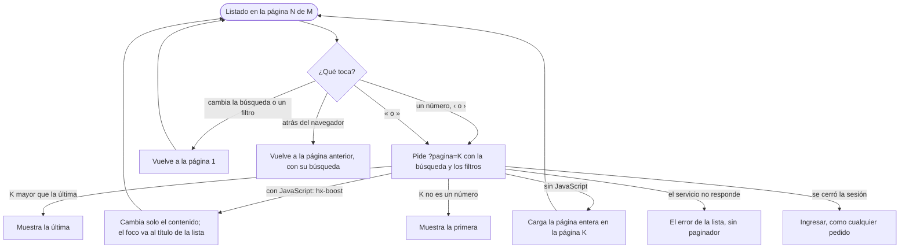

# Flujo: el paginador del sitio (R11-11)

> **Estado:** en revisión · **Fecha:** 2026-11-12 · **Aprobó:** pendiente (usuario)
> Ficha de la skill `ux-flujo` para el lote `p1-paginador` del
> [backlog de la revisión del 2026-11-11](../backlog-revision-2026-11-11.md) (P1, ruta STANDARD).
> Baja a pantalla la regla general 3 ("Un solo paginador", sección 2 del backlog) y la decisión de
> la sección 3 sobre el tablero de la empresa (boceto A, "paginador chico" por columna). Esas
> decisiones ya están tomadas: esta ficha no las reabre.
> No es una pantalla: es un **componente** del [catálogo](../componentes.md) que usan todos los
> listados completos. Se comprueba en `/estilos`.

## 0. Qué hay hoy (evidencia)

Leído en `ebe332642`. `[V]` es leído en el código; `[H]`, hipótesis.

| # | Hoy | Dónde |
|---|---|---|
| H1 | El admin usa el paginador provisorio: "‹ Anterior · Página N de M · Siguiente ›", con el extremo que no sigue apagado y sin enlace. Se dibuja solo con más de una página `[V]` | `templates/paginador.html`, `admin-donantes.html:211,335`, `admin-donaciones.html:168`, `admin-entidades.html:295` |
| H2 | Las direcciones las arma `web.Paginadores.de(...)`: la misma dirección con `?pagina=N` cambiado y la búsqueda, los filtros y el orden que había. Al llegar desde el paginador (`cambio`), el título de la lista recibe el foco con `autofocus` `[V]` | `web/Paginadores.java`, `vistas/Paginador.java`, `admin-donantes.html:151` |
| H3 | Una página pedida más allá de la última muestra la última; una que no se entiende, la primera `[V]` | `vistas/Tramo.java` (`de`, `pedida`) |
| H4 | Mis donaciones y Entidades del donante tienen su propio `nav.paginas` ("Página anterior · Página N de M · Página siguiente"), con estilos de la pantalla y la búsqueda armada a mano en la plantilla `[V]` | `donante-donaciones.html:123-132`, `donante-donaciones.css:20-31`, `donante-entidades.html:145-150`, `donante-entidades.css:135-140`, `persona/donante-entidades.html:155-160` |
| H5 | Las hojas de las pantallas van en una capa posterior a la de `bloques`: la regla `.paginas` de esas dos pantallas le gana a la del componente mientras exista `[H, por el orden de app.css]` | `static/css/app.css:14-44` |
| H6 | No existe `templates/componentes/paginas.html` ni `static/css/componentes/paginas.css`; `/estilos` no muestra ningún paginador `[V]` | `templates/estilos.html` |

## 1. Para quién y para qué

| | |
|---|---|
| Quién | Cualquiera que recorre un listado largo: la persona del admin que revisa 20.000 donantes después del CSV, desde la computadora; el donante que mira sus donaciones o busca una organización, casi siempre desde el celular; quien mira el tablero de la empresa |
| Tono | El de la pantalla que lo contiene. El paginador no habla: dice dónde estás y adónde podés ir, con números ([tono según la pantalla](../tono-y-comunicacion.md#tono-según-la-pantalla)) |
| Qué quiere lograr | "Ver la página que sigue, volver al principio o saltar al final sin perder lo que busqué" |
| Dispositivo principal | Ambos. En la computadora, la forma larga; en el celular, la corta |
| Requerimientos | Regla general 3 del backlog (y 1: la página se pide al servidor); RNF-CL-02 (sin JavaScript, igual funciona); RNF-UI-01 a 06 ([patrones y textos](../patrones-y-microcopy.md)); WCAG AA y controles de 48 × 48 px (`--medida-toque-minimo`, [`cliente-liviano/AGENTS.md`](../../../cliente-liviano/AGENTS.md)) |
| Datos que usa | Ninguno propio. Lo que ya da `Tramo` (página mostrada, cuántas hay) y la dirección del pedido. No pide nada a los servicios |
| Boceto de E1 | Sin boceto. El patrón sale de la regla 3 y del boceto A del tablero (sección 8 del backlog) |

**Patrón conocido que sigue:** paginado para recorrer mucho contenido
([criterios de la cátedra §4](../criterios-catedra-ux-ui.md#4-patrones-de-navegación), "Paginado o
desplazamiento sin fin"), en la forma de Material *Data tables* (paginación) que ya cita
[patrones y textos](../patrones-y-microcopy.md). El "atrás" del navegador tiene que funcionar
siempre (mismo §4, "Volver"): cada página es una dirección propia.

## 2. Dónde está en el sitio

No tiene lugar propio en el [mapa del sitio](../mapa-del-sitio.md): va **debajo de todo listado
completo**, centrado, después de la última fila y antes del pie de la sección. Con este lote entra
en:

- `/estilos`, sección Componentes, con sus muestras (sección 4).
- Las cuatro listas del admin que hoy usan el provisorio: Donantes, filas con error de la
  importación, Donaciones y Entidades. Las direcciones no cambian.

Lo usan después, en sus propios lotes y sin rediseñarlo: Mis donaciones y Entidades del donante
(R11-12, R11-13), Notificaciones (R11-14), la lista del mapa público (R11-19), el tablero de la
empresa (R11-25, forma corta en cada columna), la bandeja del admin (R11-34) y Seguir entregas y el
historial del ranking (R11-43).

## 3. Recorrido



Desvíos considerados:

- **Volver:** el "atrás" del navegador vuelve a la página anterior con su búsqueda, porque cada
  página es una dirección real (`hx-boost` empuja la dirección al historial).
- **Cancelar:** no aplica; no hay nada que confirmar ni que deshacer.
- **Dirección tocada a mano** (`?pagina=999`, `?pagina=abc`): la última o la primera, nunca una
  lista vacía ni un error (H3, regla 3 de patrones).
- **La lista cambió entre un pedido y otro** (se importaron donantes o se borró uno): la página K se
  arma con los datos del momento; si ahora hay menos páginas, se muestra la última. El paginador se
  vuelve a dibujar con el total nuevo.
- **Error del servidor o sin conexión:** la lista muestra su propio error (el de cada pantalla, con
  "Volver a intentar"); el paginador no se dibuja, porque no se sabe cuántas páginas hay.
- **Sin permiso o sesión vencida:** lo resuelve el marco de la sesión, igual que cualquier pedido.

## 4. Pantallas

### 4.1 Forma larga (desde 600 px de ancho, `37.5em`, el mismo corte de `navegacion.css`)

Siempre la primera y la última; la actual con su vecina de cada lado; el resto, un "…". Un "…" que
taparía una sola página se reemplaza por ese número: un "…" nunca esconde menos de dos páginas.
Así el ancho queda casi fijo (como máximo 7 casillas entre las flechas, contando los "…") y no salta al avanzar.

```text
Página 1 de 9:   [«] [‹]  (1)  2   3   …   9   [›] [»]        « y ‹ apagados, sin enlace
Página 2 de 9:    «   ‹    1  (2)  3   …   9    ›   »          (el ejemplo de la regla 3)
Página 5 de 9:    «   ‹    1   …   4  (5)  6   …   9    ›   »
Página 4 de 9:    «   ‹    1   2   3  (4)  5   …   9    ›   »  (entre 1 y 3 hay una sola: va el 2)
Página 9 de 9:    «   ‹    1   …   8  (9)   [›] [»]           › y » apagados, sin enlace
Página 2 de 3:    «   ‹    1  (2)  3    ›   »                  (pocas páginas: todas, sin "…")
Una sola página:  no se dibuja nada
```

`(N)` es la actual: resaltada con el color de acento del tema y sin enlace. Los números y las
flechas son botones de igual alto, de al menos 48 × 48 px, con el aire de `racimo`.

### 4.2 Forma corta (menos de 600 px, y en las columnas del tablero de la empresa)

```text
┌────────────────────────────┐
│      [‹]   3 de 9   [›]    │
└────────────────────────────┘
```

Sin « ni » ni números: dos flechas y el lugar. En la primera página, ‹ apagado; en la última, ›
apagado. Es la misma pieza con otra forma, no un segundo paginador: la elige el ancho de la
pantalla (por CSS, sin JavaScript) o el atributo `data-forma="corta"` para las columnas angostas
del boceto A, que la usan aunque la pantalla sea ancha.

### 4.3 Construcción

| Parte | Cómo |
|---|---|
| Fragmento | `componentes/paginas :: paginas(p)` en `templates/componentes/paginas.html`. `p` es el mismo `vistas.Paginador`, ampliado; `null` o una sola página no dibuja nada |
| Lo que trae `p` | Lo de hoy (`nombre`, `pagina`, `paginas`, `anterior`, `siguiente`, `cambio`) más `primera`, `ultima` (direcciones, o `null` cuando ya se está ahí) y `tramos`: la lista ordenada de lo que va entre las flechas, cada uno un número con su dirección (o sin ella si es la actual) o un hueco "…". La lista la arma `web.Paginadores.de(...)` con la regla de 4.1: la plantilla no calcula |
| Marcado | `<nav class="paginas" aria-label="Páginas de donantes">` con una lista `<ol>`; cada elemento, un `<a>` con `hx-boost="true"` o un `<span>` (actual y extremos apagados). La forma corta es un `<span>` "3 de 9" dentro de la misma lista |
| Cuál forma se ve | Las dos están en el marcado; la hoja oculta con `display: none` la que no corresponde (`@media (min-width: 37.5em)` y `[data-forma="corta"]`). Lo oculto con `display: none` tampoco lo leen los lectores de pantalla: cada persona oye una sola versión |
| Direcciones | Las de hoy: `?pagina=N` con la búsqueda, los filtros y el orden que había (H2). La página 1 lleva `?pagina=1` explícito, para que `cambio` mueva el foco igual que las demás |
| Hoja | `static/css/componentes/paginas.css`, capa `bloques`, importada desde `app.css`. Solo tokens; sin colores sueltos |
| Clases nuevas | Solo `paginas` y lo que cuelgue de ella, anotadas en [componentes.md](../componentes.md) para que el cerco (`InterfazFitnessTest`) las acepte |
| El provisorio | `templates/paginador.html` queda como un pase al componente (`paginador(p)` dibuja `paginas(p)`), así las cuatro listas del admin cambian sin tocar sus plantillas; se borra cuando ninguna lo nombre. Las clases de las pantallas del donante (H4, H5) las quita cada lote al adoptar el componente |

### 4.4 Muestras en `/estilos`

En la sección Componentes, un bloque "Páginas" con: página 1 de 9, página 5 de 9 y página 9 de 9
en la forma larga; página 3 de 9 con `data-forma="corta"`; y una línea que diga que con una sola
página no se dibuja. Datos de ejemplo fijos, sin pedir nada a los servicios. Los enlaces de la
muestra llevan a `/estilos?pagina=N#paginas`, para que se pueda tocar sin salir del catálogo.

## 5. Estados

| Pieza | Estado | Qué se ve | Texto (visible · lo que oye el lector) |
|---|---|---|---|
| Paginador | Varias páginas, en el medio | Forma larga o corta según el ancho | Larga: "« ‹ 1 … 4 5 6 … 9 › »". Corta: "‹ 5 de 9 ›" · nav "Páginas de donantes" |
| Paginador | En la primera | « y ‹ apagados, sin enlace ni foco; el 1 resaltado | Igual, con 1 actual |
| Paginador | En la última | › y » apagados, sin enlace ni foco | Igual, con la última actual |
| Paginador | Una sola página | No se dibuja | — |
| Paginador | Lista vacía (sin resultados) | No se dibuja; la lista muestra su vacío propio | El vacío de cada pantalla (por ejemplo, "Ningún donante coincide con la búsqueda.") |
| Paginador | Cargando (con JavaScript) | El indicador de la pantalla en la fila del título; el paginador queda como está hasta que llega la página nueva | Lo que ya diga el indicador de la pantalla (R11-07) |
| Paginador | Página cambiada | El contenido nuevo; el foco en el título de la lista | El lector anuncia el título ("Todos los donantes") |
| Paginador | Página pedida fuera de rango | La última (o la primera), con su paginador normal | Sin aviso: la página que se ve es real |
| Paginador | Error del servidor | No se dibuja; el error de la lista | El de cada pantalla |
| Paginador | Sin permiso | Lo resuelve la sesión | — |
| Botón actual | — | Resaltado, sin enlace | Visible "5" · "Página 5, página actual" (`aria-current="page"`) |
| Botón número | — | Botón secundario | Visible "6" · "Página 6" |
| Flecha « | — | Botón con el signo | Visible "«" · "Primera página" |
| Flecha ‹ | — | Botón con el signo | Visible "‹" · "Página anterior" |
| Flecha › | — | Botón con el signo | Visible "›" · "Página siguiente" |
| Flecha » | — | Botón con el signo | Visible "»" · "Última página" |
| Hueco | — | "…" sin borde | Visible "…" · no se lee (`aria-hidden="true"`): los números de cada lado ya dicen el salto |
| Lugar (corta) | — | "5 de 9" entre las flechas | Visible "5 de 9" · "Página 5 de 9" |

Con más de 999 páginas los números llevan punto de miles ("1.234"), como en el provisorio.

## 6. Textos

| Elemento | Texto | Nota |
|---|---|---|
| Nombre de la navegación | "Páginas de <lo que lista>": "Páginas de donantes", "Páginas de donaciones", "Páginas de entidades", "Páginas de filas con error" | Lo pone cada pantalla (ya existe en `Paginadores.de`). El cambio de "entidades" a "organizaciones" lo hace `p1-nombres` |
| Primera / última | "Primera página" · "Última página" | Solo para el lector; a la vista, « y » |
| Anterior / siguiente | "Página anterior" · "Página siguiente" | Solo para el lector; a la vista, ‹ y ›. Son los textos que ya usan las pantallas del donante |
| Número | "Página 6" | La actual suma "página actual" por `aria-current` |
| Lugar en el celular | "5 de 9" | A la vista, corto; para el lector, "Página 5 de 9" |
| Ayuda | Ninguna | Un paginador no necesita explicación; el total de resultados lo dice el título de cada lista, no el paginador |

Filtro de tono: el paginador no muestra estados ni cifras con período. "5 de 9" es posición, no un
dato del negocio: no lleva fecha. Sin urgencia ni culpa: nada de "¡Hay más resultados!".

## 7. Accesibilidad

- **Zona:** un `<nav>` con nombre propio dentro del contenido de la página; no compite con el menú
  del encabezado porque se llama distinto ("Páginas de …").
- **Orden del foco:** «, ‹, los números en orden, ›, ». Lo apagado, la actual y el "…" no reciben
  el foco (son `span`). En la forma corta: ‹ y ›.
- **Al cambiar de página:** con `hx-boost` el contenido cambia sin volver arriba; el foco va al
  título de la lista (`cambio`, H2), que el lector anuncia. Sin JavaScript, la página carga entera
  y el navegador empieza de arriba, como cualquier enlace.
- **Lo que se oye:** cada signo tiene su nombre ("Página anterior"); la actual, `aria-current`.
  El "…" no se lee. La forma que no se ve tampoco se lee (`display: none`).
- **Toque y contraste:** cada botón de al menos 48 × 48 px y con separación entre botones; foco
  visible del tema; la actual no se distingue solo por color (lleva además fondo lleno y peso), y
  lo apagado mantiene contraste AA de texto deshabilitado sobre el fondo.
- **Sin JavaScript:** todo es un enlace con dirección real; la forma la decide CSS.
- **Movimiento:** sin animación propia.

## 8. Revisión de usabilidad

| # | Heurística | Cómo la cumple | Riesgo que queda |
|---|---|---|---|
| 1 | Visibilidad del estado | La página actual resaltada y con `aria-current`; en el celular, "3 de 9" dice dónde estás y cuánto queda; el foco vuelve al título | Con `hx-boost`, la carga lenta no se nota en el paginador: depende del indicador de cada pantalla |
| 2 | Lenguaje del usuario | Números y flechas, el lenguaje de cualquier buscador; los nombres para el lector en español llano | « y » pueden no reconocerse a la primera: los acompaña el nombre accesible y su lugar en los extremos |
| 3 | Control y libertad | Se puede ir a la primera, a la última y a cualquier vecina; el "atrás" del navegador funciona | Saltar a una página exacta lejana (la 37 de 62) lleva varios toques: se descartó un campo "ir a la página" (sección 9) |
| 4 | Consistencia | Un solo paginador en todo el sitio, la misma pieza en el admin y en el donante; la forma corta del tablero es la misma pieza | Hasta que los lotes del donante lo adopten, conviven el nuevo y los dos provisorios de esas pantallas |
| 5 | Prevención de errores | Lo que no sigue no es un enlace; una dirección fuera de rango muestra la última, no un vacío | — |
| 6 | Reconocer antes que recordar | Primera y última siempre a la vista; conserva la búsqueda y los filtros, no hay que volver a escribirlos | En el celular no se ve el total de páginas como lista, pero "de 9" lo dice |
| 7 | Flexibilidad | « y » para recorrer rápido; los números para saltar; cada página tiene dirección y se puede guardar o compartir | — |
| 8 | Diseño minimalista | Como máximo 7 casillas entre las flechas; sin rótulos ni cifras que la lista ya dice; en el celular, solo tres piezas | — |
| 9 | Recuperarse de errores | Si el servicio falla, la lista muestra su error con "Volver a intentar" y la dirección conserva la página pedida | — |
| 10 | Ayuda | No la necesita; los nombres accesibles explican cada signo | — |

Los 7 factores (Morville):

- **Útil:** recorrer listados de miles de filas sin traerlas todas (regla 1).
- **Usable:** patrón conocido, botones grandes, la misma pieza en todos lados.
- **Deseable:** botones con la forma y el acento del tema, sin ruido.
- **Valioso:** hace posible la demo con 20.000 donantes sin que la pantalla se caiga.
- **Ubicable:** siempre debajo de la lista, centrado, en el mismo lugar.
- **Accesible:** nombres para cada signo, `aria-current`, foco al título, 48 px, sin JavaScript.
- **Creíble:** lo que dice ("de 9") sale del total del servidor, no de contar una página.

**Para probar con personas reales:** si quien entra desde el celular entiende "3 de 9" sin los
números, y si alguien del admin echa de menos escribir el número de página en listas de más de 50
páginas.

## 9. Decisiones y preguntas

Decisiones de este diseño (propuesta del agente, para la [bitácora](../bitacora.md) al construir):

1. **Ventana de números:** primera, última y la actual con una vecina de cada lado; un "…" nunca
   esconde una sola página. Descartado: dos vecinas por lado (hasta 9 números, no entra en 600 px)
   y ventana fija de 5 sin primera ni última (contradice la regla 3).
2. **Extremos apagados y visibles**, no ocultos: el paginador no cambia de ancho ni salta bajo el
   dedo. Es lo que ya hace el provisorio. Descartado: quitarlos en el extremo.
3. **Forma corta por ancho y por atributo** (`data-forma="corta"`): la misma pieza sirve al celular
   y a las columnas del boceto A. Descartado: un segundo componente "paginador chico".
4. **Las dos formas en el marcado y CSS elige**, para que funcione sin JavaScript. Descartado:
   elegir la forma en el servidor (no sabe el ancho) o con JavaScript (rompe RNF-CL-02).
5. **El cálculo de la ventana en Java** (`Paginadores.de` arma `tramos`), no en la plantilla: se
   prueba con pruebas unitarias y la plantilla solo recorre. Descartado: calcularla con Thymeleaf.
6. **El provisorio queda como pase al nuevo** en este lote, sin tocar las cuatro plantillas del
   admin; se borra cuando nadie lo nombre. Descartado: cambiar las cuatro inclusiones ahora (son
   archivos de otros lotes del admin que corren en la misma oleada).
7. **Sin campo "ir a la página"** ni selector de cuántas por página: no lo pide la regla 3 y suma
   un formulario. Descartado por ahora; se reabre si la prueba con personas lo pide.

Preguntas abiertas para el usuario: ninguna bloqueante. La decisión del paginador (regla 3) ya
está tomada.
