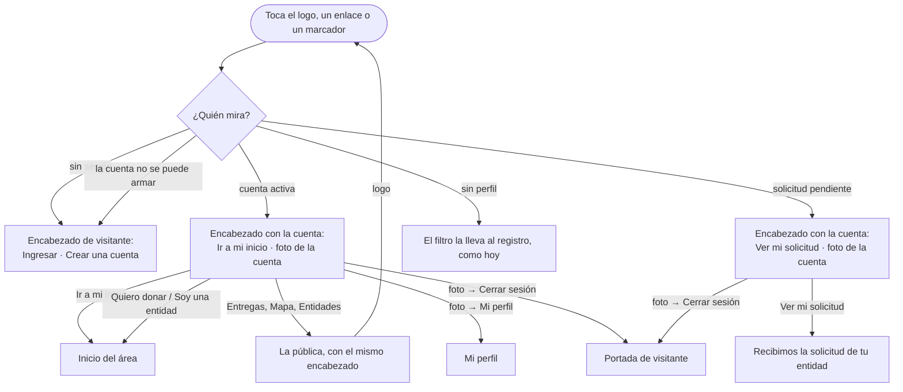

# Flujo: la portada con sesión y los rótulos de Bajo tierra (R11-15, R11-17)

> **Estado:** aprobada · **Fecha:** 2026-11-12 · **Aprobó:** el usuario, 2026-11-12 (opciones recomendadas, aprobación automática pedida por él)
> Ficha de la skill `ux-flujo` para el lote `p1-portada` del
> [backlog de la revisión del 2026-11-11](../backlog-revision-2026-11-11.md) (P1, ruta STANDARD).
> Las decisiones del usuario de la sección 3 del backlog ("Portada con sesión": la misma portada, con
> el encabezado de la cuenta y "Ir a mi inicio"; "Raíces que chocan": son los rótulos de Bajo tierra)
> y la regla general 6 ("Con sesión iniciada, siempre se ve la cuenta") ya están tomadas: esta ficha
> las baja a pantallas, no las reabre.
> Amplía, sin reemplazarlas, la [ficha pública](raices-publico-navegable.md) (los destinos de la
> navegación pública y lo que navega la cuenta pendiente, R11-08) y la de
> [páginas de error](raices-paginas-de-error.md) (el marco con sesión de errores y Contacto, R11-05).

## 0. Qué pasa hoy (evidencia)

Leído en la rama de trabajo (`ebe332642`). `[V]` es leído en el código; `[H]`, hipótesis sin medir.

| # | Hoy | Dónde |
|---|---|---|
| H1 | La portada tiene su propia cabecera y siempre pone la navegación de visitante: "Entregas confirmadas · Mapa · Entidades · Ingresar · Crear una cuenta", con o sin sesión `[V]` | `publico-portada.html:28-35`, `navegacion-publica.html:11-28` |
| H2 | El controller de la portada solo pide las cifras; no mira si hay sesión `[V]` | `web/PublicoPortadaController.java:23-28` |
| H3 | Las demás públicas (Entregas confirmadas, Mapa, Entidades, Nosotros, las dos landings, Legales) usan `layout-publico`, con la misma navegación de visitante `[V]` | `layout-publico.html:29-36` |
| H4 | El logo del área privada lleva a la portada (`/publico-portada`). Al llegar, quien entró ve "Ingresar / Crear una cuenta" y cree que se le cerró la sesión; la sesión sigue abierta (backlog, sección 6: "Si voy al home me salgo") `[V]` | `layout-privado.html:26-30` |
| H5 | El logo de la portada dice "DonaTrack, ir al inicio" y lleva a `/`; el de las demás públicas y el del área privada dicen "ir a la portada" `[V]` | `publico-portada.html:29`, `layout-publico.html:30-31`, `layout-privado.html:26-27` |
| H6 | Errores y Contacto ya muestran la cuenta con sesión: `Pantallas.conMarcoDeLaCuenta` arma el marco privado solo con lo que hay en la sesión, sin pedir nada a ningún servicio. `AreaDeLaSesion.activa` devuelve el área solo si la cuenta está **activa**; la cuenta pendiente queda con el marco de visitante `[V]` | `web/Pantallas.java:287-323`, `puertos/AreaDeLaSesion.java`, `seguridad/AreaDelToken.java:21-28` |
| H7 | La cuenta con la solicitud pendiente (`SOLICITUD_RECIBIDA`) puede recorrer la portada y lo público; lo demás la lleva a "Recibimos la solicitud de tu entidad" (`/publico-registro-entidad-enviada`). La cuenta sin perfil (`SIN_PERFIL`) no llega a la portada: el filtro la lleva al registro, que ya tiene "Cerrar sesión" `[V]` | `seguridad/EstadoDeCuenta.java:7-26`, `seguridad/PerfilPendiente.java:29-36`, `cerrar-sesion.html:2-3` |
| H8 | Con la cuenta activa, los botones de registro de la portada ("Quiero donar", "Soy una entidad", los de "¿Qué planta sos vos?" y el cierre) llevan al registro, que con sesión devuelve a `/inicio` y de ahí al inicio del área `[V]` | `componentes/huerta.html:90-95`, `web/AccesoController.java:70-79,120-124` |
| H9 | `/inicio` manda a cada cuenta al inicio de su área; con la cuenta pendiente, el filtro la lleva a "Recibimos la solicitud" `[V]` | `web/AccesoController.java:120-124`, `seguridad/PerfilPendiente.java:21` |
| H10 | Bajo tierra, desde 600 px: el dibujo a todo el ancho y cada rótulo encima, con `position: absolute` en un punto fijo del dibujo (`--medida-bajo-x` y `-y`, en %) y letra `max(0.875rem, 3.13cqi)`. Ningún rótulo tiene un ancho tope: los de entidad toman `min-content` (una palabra por renglón) y los de categoría y "Tu entidad" no cortan (`nowrap`) `[V]` | `huerta.css:806-856` |
| H11 | Como la letra y los puntos escalan juntos con el ancho, el choque depende sobre todo del largo del texto. Cuenta hecha a mano con Archivo en negrita (unos 0,58 em por letra): "Organizaciones" (centrado en 36,1 %, dos renglones desde 57,2 %) ocupa del 23 % al 49 % del ancho y baja hasta el 66 % del alto; "Hogares" empieza en el 48,6 % y en el 66,2 %: se tocan en la esquina. Con la letra de respaldo (Arial Narrow sin cargar Archivo, u otra) y el contorno de 0,12 em, se pisan `[H]` | `huerta.css:849-855` |
| H12 | "Tu entidad" lleva `min-height: 3rem` fijo (el área táctil del enlace), que no escala con el dibujo y se centra con `translate: -50% -50%`: en los anchos intermedios su caja crece en proporción `[V]`; que eso pise a "Escuelas" o a "Centros comunitarios" es `[H]` | `huerta.css:590-595,855` |
| H13 | Los rótulos se van a alargar: el lote `p1-nombres` (R11-45) cambia "entidad" por "Organización" en el texto visible. "Tu entidad" pasa a "Tu organización" (15 letras en lugar de 10) `[V]` en el backlog | `backlog-revision-2026-11-11.md`, R11-45 |

## 1. Para quién y para qué

| | |
|---|---|
| Quién | Quien ya entró con su cuenta (donante empresa o persona, organización, administración, o la organización que espera la aprobación) y toca el logo, o vuelve a la portada desde un enlace o un marcador. Para R11-17, además, cualquiera que mira la portada desde una tableta o una computadora chica |
| Tono | Portada y páginas públicas: profesional, seguro, directo ([tono según la pantalla](../tono-y-comunicacion.md#tono-según-la-pantalla)). El encabezado con la cuenta, como en el área privada: corto y sin festejo |
| Qué quiere lograr | "Mirar la portada sin que parezca que me echaron, y volver a lo mío con un toque" |
| Dispositivo principal | Los dos. La cuenta y "Mi inicio", en el celular; los rótulos de Bajo tierra, desde la tableta (en el celular la lista se apila y no choca) |
| Requerimientos | Regla general 6 del backlog R11 (con sesión, siempre se ve la cuenta). RNF-CL-02 (sin JavaScript, igual funciona: el menú de la cuenta es un `<details>`). RF-CL-08 no cambia. RNF-UI (accesibilidad AA: nada superpuesto, foco visible, área táctil de 48 px) |
| Datos que usa | Ninguno de negocio nuevo. La cuenta y el área **del token**, como errores y Contacto (`CuentasDelMenu`, `UsuarioActual`), sin llamar a ninguna API. Las cifras de la portada, como hoy (`PublicoPuerto.cifrasDePortada`) |
| Boceto de E1 | Sin boceto para la portada con sesión. Bajo tierra es el dibujo de la diseñadora (cuarta ronda, 2026-11-10, `Bajo tierra.svg`): esta ficha no cambia el dibujo, solo dónde van los rótulos |

## 2. Dónde está en el sitio

Nivel 1 de lo público ([mapa del sitio](../mapa-del-sitio.md)). Desde el área privada, el logo lleva
acá (ya es así y no cambia); desde acá, "Ir a mi inicio" devuelve al inicio del área.

```text
Área privada ── logo ──▶ Portada (con la cuenta) ──┬── Entregas confirmadas  (con la cuenta)
                                                   ├── Mapa                  (con la cuenta)
                                                   ├── Entidades             (con la cuenta)
                                                   ├── Ir a mi inicio ──▶ inicio del área
                                                   └── (cuenta) Mi perfil · Cambiar contraseña · Cerrar sesión
```

**Alcance del encabezado con la cuenta:** la portada **y todas las públicas que usan
`layout-publico`** (Entregas confirmadas, Mapa, Entidades, Nosotros, Para donantes, Para entidades,
Legales). Si solo la portada mostrara la cuenta, el primer clic en "Mapa" volvería a mostrar
"Ingresar / Crear una cuenta" y el problema de H4 seguiría a un paso de distancia.

**Lo que no cambia de marco:** las páginas de error y Contacto siguen con el marco privado del rol
(R11-05, `p0-errores`): ahí quien entró está a mitad de una tarea y necesita su menú. Lo público es el
sitio de todos: conserva su navegación y suma la cuenta.

## 3. Recorrido



Desvíos considerados:

- **Cerrar sesión desde la portada:** el mismo botón del menú de la cuenta (POST con CSRF, de #955).
  Vuelve a la portada, ya con el encabezado de visitante.
- **La sesión del cliente sigue abierta pero la de Keycloak venció:** el encabezado muestra la cuenta
  (lo dice el token guardado). "Ir a mi inicio" lleva a `/inicio`, que pide ingresar de nuevo si hace
  falta; nada se pierde.
- **La cuenta no se puede armar** (por ejemplo, el token no trae área): encabezado de visitante, como
  en errores y Contacto. La portada nunca falla por su encabezado.
- **Botones de registro con la cuenta activa** ("Quiero donar", "Soy una entidad", "¿Qué planta sos
  vos?", el cierre): no se tocan ("la misma portada"). Llevan al registro, que con sesión devuelve al
  inicio del área (H8). Ver la duda 1.
- **Escribir `/publico-ingresar` o `/publico-registro` con sesión:** como hoy, Keycloak o el registro
  la devuelven a `/inicio`.
- **Volver:** el atrás del navegador funciona en todo; son páginas comunes con su dirección.
- **Sin conexión:** el aviso del navegador; la pantalla anterior queda como estaba.
- **Sin JavaScript:** el menú de la cuenta abre y cierra igual (`<details>`). El cierre al tocar
  afuera lo trae `p1-menus` (R11-16) para todos los menús de la cuenta, también este.

## 4. Pantallas

### El encabezado público con la cuenta (portada y `layout-publico`)

**Computadora y tableta (desde 600 px), sin sesión — como hoy:**

```text
┌──────────────────────────────────────────────────────────────────────────────┐
│ [logo] DonaTrack   Entregas confirmadas   Mapa   Entidades      Ingresar  [Crear una cuenta] │
└──────────────────────────────────────────────────────────────────────────────┘
```

**Con la cuenta activa:**

```text
┌──────────────────────────────────────────────────────────────────────────────┐
│ [logo] DonaTrack   Entregas confirmadas   Mapa   Entidades      [Ir a mi inicio]  (foto) │
└──────────────────────────────────────────────────────────────────────────────┘
                                                       ┌───────────────────────┐
                                     al tocar la foto: │ Nombre de la cuenta   │
                                                       │ Rol                   │
                                                       │ ───────────────────── │
                                                       │ Mi perfil             │
                                                       │ Cambiar contraseña    │
                                                       │ [Cerrar sesión]       │
                                                       └───────────────────────┘
```

**Con la solicitud pendiente:** igual, con "Ver mi solicitud" en lugar de "Ir a mi inicio"; el menú
de la foto trae el nombre, "Solicitud en revisión", "Cambiar contraseña" y "Cerrar sesión" (sin Mi
perfil: todavía no lo tiene).

**Celular (menos de 600 px):** la barra de abajo se queda con 4 destinos (Entregas · Mapa ·
Entidades · Mi inicio, o Mi solicitud); la foto de la cuenta va arriba, a la derecha del logo, en la
cabecera, igual que en el área privada.

```text
┌──────────────────────────────┐
│ [logo] DonaTrack       (foto)│
├──────────────────────────────┤
│                              │
│        contenido             │
│                              │
├──────────────────────────────┤
│ Entregas  Mapa  Entidades  [Mi inicio] │
└──────────────────────────────┘
```

Reglas para el constructor:

- **Lo que cambia es solo el final de la navegación.** Entregas confirmadas, Mapa y Entidades siguen
  iguales y en el mismo lugar. "Ingresar" y "Crear una cuenta" se reemplazan por "Ir a mi inicio"
  (con el aspecto destacado que hoy tiene "Crear una cuenta") y la foto de la cuenta.
- **La pieza de la cuenta es la misma del área privada** (`<details class="navegacion-cuenta">`, con
  la planta como foto por defecto, el nombre, el rol, Mi perfil si el área lo tiene, Cambiar
  contraseña si hay consola y el botón de `cerrar-sesion :: boton`). Conviene sacarla a un fragmento
  compartido para no copiarla; si eso toca `layout-privado.html`, va en "fueraDeZona".
- **Sin campanita en lo público.** La cantidad sin leer se le pide a un servicio; el encabezado
  público, como el de errores, se arma solo con lo que ya hay en la sesión. Las notificaciones están a
  un toque: "Ir a mi inicio".
- **Sin sección marcada de más.** Con sesión, "Ir a mi inicio" nunca lleva `aria-current`: la
  portada y las públicas no son el inicio del área.
- **"Ir a mi inicio" apunta al inicio del área** (`Area.inicio()`: `/donante-inicio`,
  `/entidad-inicio` o `/admin-inicio`). Con la solicitud pendiente, "Ver mi solicitud" apunta a
  `/publico-registro-entidad-enviada`.
- **El nombre de la cuenta** es el que dé `CuentasDelMenu` (hoy, el rótulo del área; con R11-44,
  `p1-nombres`, el nombre de la persona o la razón social). Esta ficha no lo cambia.

**De dónde salen los datos (para el constructor):**

- Una sola pieza decide el encabezado público con sesión, hermana de `conMarcoDeLaCuenta` y con sus
  mismas reglas: solo lo que hay en la sesión, nunca un servicio, y si algo falla el modelo queda
  como estaba (encabezado de visitante). Deja en el modelo la cuenta (`cuenta`), Mi perfil
  (`perfil`), la salida (`inicio`, con su texto) y una marca de que hay sesión. Las plantillas
  eligen el final de la navegación por esa marca.
- La llaman el controller de la portada y las públicas que pasan por `Pantallas.mostrar` con
  `layout-publico` (todas salvo las de `CON_MARCO_DE_LA_CUENTA`, que siguen con el marco privado).
- Para la cuenta pendiente hace falta que el puerto de la sesión diga también "pendiente" (hoy
  `AreaDeLaSesion.activa` la deja afuera, H6). Lo mínimo: un método más en `AreaDeLaSesion`, con su
  versión del token (`EstadoDeCuenta.SOLICITUD_RECIBIDA`) y la de la maqueta.
- **Maqueta:** `?escenario=con-sesion` (con `&area=entidad` o `&area=admin`) en la portada y en las
  públicas muestra la cuenta, como ya pasa en Contacto; `?escenario=con-sesion-pendiente` muestra la
  cuenta pendiente. Los escenarios de las cifras (`vacio`, `error`, `lento`) siguen igual y sin
  sesión.

**El logo:** el de la portada pasa a decir "DonaTrack, ir a la portada", como el de las demás públicas
y el del área privada (H5). El del área privada sigue llevando a la portada, sin cambios.

### Bajo tierra (`huerta :: raices`)

El dibujo y su lista no cambian: los mismos tres grupos (Alimentos, Ropa, Muebles y útiles), las
mismas siete entidades y "Tu entidad". Cambia **cómo se coloca cada rótulo** desde 600 px:

1. **Cada rótulo tiene su franja.** Además del punto de anclaje, cada rótulo recibe un ancho tope
   (`max-inline-size`, en % del dibujo) y el texto corta en renglones adentro de esa franja. Las
   franjas de los rótulos que están a la misma altura no se cruzan; si un texto se alarga, crece hacia
   abajo o hacia arriba, hacia la tierra libre, nunca de costado hacia el vecino.
2. **Se corta por palabras.** Se saca el `nowrap` de las categorías y de "Tu entidad"; las entidades
   dejan de ser `min-content` (una palabra por renglón) y cortan donde termine su franja. Ninguna
   palabra se parte con guion.
3. **La letra crece con el dibujo, pero menos y con techo:** `clamp(0.875rem, 2.6cqi, 2rem)` en lugar
   de `max(0.875rem, 3.13cqi)`. A 600 px de pantalla queda cerca de 15 px; en el ancho máximo del
   dibujo (73 rem), 30 px. Ese margen es lo que da lugar a "Tu organización" y a textos más largos.
4. **El área táctil de "Tu entidad" no empuja:** los 48 px de alto del enlace se logran con relleno
   que no cambia dónde queda el texto (por ejemplo, un `::after` invisible o un relleno compensado),
   y el anclaje se calcula sobre el texto, no sobre la caja de 48 px.
5. **Dónde va cada uno (valores de partida, a medir).** La columna "Franja" es el ancho tope; "Crece
   hacia" dice de qué lado del punto va el texto si ocupa más de un renglón.

| Rótulo | Punto (x, y) | Se alinea | Franja | Crece hacia | Cambio respecto de hoy |
|---|---|---|---|---|---|
| Alimentos | 2,8 %, 27,7 % | izquierda | 26 % | abajo | ninguno |
| Ropa | 47,2 %, 39,1 % | derecha (termina en el punto) | 14 % | abajo | ninguno |
| Muebles y útiles | 66,5 %, 26,9 % | izquierda | 30 % | abajo | puede ir en dos renglones |
| Comedores | 9,5 %, 64,9 % | centro | 17 % | abajo | ninguno |
| Organizaciones religiosas | 34 %, 55 % | centro | 24 % (del 22 % al 46 %) | abajo | se corre un poco a la izquierda y arriba para dejar libre la esquina de "Hogares" |
| Merenderos | 23,7 %, 80,5 % | izquierda | 20 % | abajo | ninguno |
| Hogares | 48,6 %, 66,2 % | izquierda | 11 % | abajo | ninguno |
| Clubes | 57,9 %, 51,4 % | izquierda | 12 % | abajo | ninguno |
| Escuelas | 60,5 %, 81,3 % | centro | 14 % | abajo | ninguno |
| Centros comunitarios | 97,7 %, 74,5 % | derecha | 22 % | abajo | ninguno |
| Tu entidad (después, Tu organización) | 73,5 %, 95,7 % | centro | 30 % | arriba | crece hacia arriba: abajo está el borde de la tierra |

   Los porcentajes son los del dibujo (viewBox `60 14 1650 1146`). El constructor los ajusta con la
   medición del punto 6; si alguno se mueve más de 3 puntos, que el rótulo siga tocando su raíz.
6. **La regla se comprueba, no se mira a ojo.** Ver la sección 7, "Cómo se comprueba que no se pisan".

**En el celular (menos de 600 px)** la lista apilada sigue como está: ya corta en renglones y no
choca. Solo se comprueba con los textos largos.

**Descartado:** pasar los rótulos a `<text>` dentro del SVG (escala perfecto, pero no corta en
renglones y se pierde la lista real para los lectores de pantalla, que se eligió el 2026-11-10);
llevar los rótulos a los costados con líneas de llamada (cambia el dibujo de la diseñadora: sería un
rediseño, no una colocación); subir el punto de quiebre a 900 px para mostrar la lista apilada en las
tabletas (esconde el dibujo justo donde más se ve, y no arregla el choque, que depende del largo del
texto y no del ancho).

## 5. Estados

| Pantalla | Estado | Qué se ve | Texto |
|---|---|---|---|
| Encabezado público | Sin sesión | Como hoy | "Entregas confirmadas" · "Mapa" · "Entidades" · "Ingresar" · "Crear una cuenta" |
| | Con la cuenta activa (donante, organización) | Navegación pública, "Ir a mi inicio" destacado y la foto | "Ir a mi inicio" (en la barra del celular, "Mi inicio") · foto: "Cuenta de {nombre}" |
| | Con la cuenta activa (administración) | Igual; el menú de la foto sin Mi perfil | "Ir a mi inicio" · menú: {nombre}, {rol}, "Cambiar contraseña", "Cerrar sesión" |
| | Con la solicitud pendiente | Navegación pública, "Ver mi solicitud" destacado y la foto | "Ver mi solicitud" (en la barra, "Mi solicitud") · menú: {nombre}, "Solicitud en revisión", "Cambiar contraseña", "Cerrar sesión" |
| | La cuenta no se puede armar | Como sin sesión | (los de visitante) |
| | Menú de la cuenta abierto | La hoja del menú debajo de la foto, encima del contenido | Los del menú |
| | Después de Cerrar sesión | La portada de visitante | (los de visitante) |
| Portada | Con datos, vacío, cargando y error | Como hoy (`?escenario=vacio`, `error`, `lento`), con el encabezado que corresponda | Sin cambios ([ficha pública](raices-publico-navegable.md)) |
| Bajo tierra | Con el dibujo (desde 600 px) | El dibujo con cada rótulo en su franja; ninguno toca a otro | Sin cambios: "Alimentos", "Ropa", "Muebles y útiles", las siete entidades, "Tu entidad" |
| | Apilado (celular) | Tres raíces, una debajo de la otra | Sin cambios |
| | Textos más largos (después de `p1-nombres`) | Los mismos lugares; el rótulo largo usa más renglones adentro de su franja | "Tu organización" y lo que cambie R11-45 |
| | La letra Archivo todavía no cargó | La letra de respaldo, más ancha o más angosta, adentro de las mismas franjas | Sin cambios |

Bajo tierra no tiene estados de datos: es contenido fijo.

## 6. Textos

| Elemento | Texto | Nota |
|---|---|---|
| Salida al inicio, computadora | "Ir a mi inicio" | La decisión del usuario. El mismo verbo que "Ir a la portada" |
| Salida al inicio, barra del celular | "Mi inicio" | El nombre accesible sigue siendo "Ir a mi inicio" |
| Salida con la solicitud pendiente | "Ver mi solicitud" / "Mi solicitud" | Lleva a "Recibimos la solicitud de tu entidad". "Ir a mi inicio" prometería un inicio que todavía no hay |
| Rol en el menú, cuenta pendiente | "Solicitud en revisión" | Lo pendiente se dice pendiente; sin plazo (no lo hay: pregunta abierta 2 de la ficha pública) |
| Nombre accesible de la foto | "Cuenta de {nombre}" | El mismo del área privada |
| Nombre accesible del logo de la portada | "DonaTrack, ir a la portada" | Antes, "ir al inicio": con sesión, "inicio" ahora es el del área |
| Bajo tierra | Sin cambios | Los cambia `p1-nombres` (R11-45), no este lote |

Filtro de tono ([7 preguntas](../tono-y-comunicacion.md#filtro-de-tono-7-preguntas)): "Ir a mi
inicio" y "Ver mi solicitud" dicen adónde llevan, sin urgencia (3, 5); "Solicitud en revisión" es el
estado como es, sin plazo inventado (3, 7); nada culpa a quien tocó el logo (4). No hay cifras nuevas.

Ayudas por flujo crítico: este flujo no es crítico (no carga datos ni confirma nada); no suma ayudas.

## 7. Accesibilidad

- **Zonas:** sin cambios. `header` con la marca y `nav aria-label="Secciones"`; `main id="contenido"`;
  el pie. La foto de la cuenta queda dentro del `header`, después de la navegación, como en el área
  privada.
- **Orden del foco con sesión:** Saltar al contenido → logo → Entregas confirmadas → Mapa →
  Entidades → Ir a mi inicio → foto de la cuenta → (abierto) Mi perfil → Cambiar contraseña → Cerrar
  sesión → contenido. En el celular la foto está arriba y la barra abajo: el orden del código sigue
  siendo ese (logo, navegación, foto) y la barra se dibuja abajo, como hoy en el área privada.
- **Menú de la cuenta:** `<details>`/`<summary>` (abre con Enter y Espacio, sin JavaScript). El cierre
  con Esc y al tocar afuera, con `p1-menus`.
- **Áreas táctiles:** "Ir a mi inicio", la foto y cada opción del menú, de al menos 48 px.
- **Bajo tierra:** la lista real sigue siendo la que leen los lectores (`aria-label="Qué tipos de
  entidad reciben cada categoría"`); el dibujo sigue `aria-hidden`. El orden de lectura no cambia. El
  contorno de los rótulos (`-webkit-text-stroke`) mantiene el contraste AA sobre la tierra; la
  medición de abajo cuenta el contorno como parte del rótulo.
- **Con el texto agrandado** (zoom del navegador al 200 %): los rótulos siguen en sus franjas; si el
  dibujo queda por debajo de 600 px de pantalla, pasa a la lista apilada.

**Cómo se comprueba que no se pisan** (para el constructor y para `revision-ui`):

- En 600, 700, 768, 900, 1024, 1280, 1440 y 1920 px, con la letra Archivo cargada, se mide la caja de
  cada rótulo (`getBoundingClientRect`, con el contorno) y ninguna se cruza con otra. Cero
  intersecciones, sin tolerancia.
- Se repite con los textos largos: "Tu organización", y cada rótulo con un 40 % más de letras
  (inyectadas solo en la medición, no en la plantilla), y con la letra de respaldo (Archivo sin
  cargar).
- En 360 px, la lista apilada con los textos largos: nada se sale del ancho ni se tapa.
- Capturas en 360, 768, 1280 y 1920 px para la evidencia del lote.

## 8. Revisión de usabilidad

| # | Heurística | Cómo la cumple | Riesgo que queda |
|---|---|---|---|
| 1 | Visibilidad del estado | Con sesión, la foto de la cuenta y "Ir a mi inicio" dicen que se sigue adentro, en la portada y en cada pública; la cuenta pendiente ve "Solicitud en revisión" | Hasta R11-44, el menú dice el rol y no el nombre |
| 2 | Lenguaje del usuario | "Ir a mi inicio", "Ver mi solicitud", "Cerrar sesión": las palabras que ya usa el sitio | — |
| 3 | Control y libertad | Volver a lo propio con un toque desde cualquier pública; cerrar sesión desde la portada; el atrás funciona | Los botones de registro llevan al inicio del área sin avisar (duda 1) |
| 4 | Consistencia | La misma foto y el mismo menú que en el área privada; el logo dice "ir a la portada" en todas las páginas | Errores y Contacto usan el menú del rol y las públicas la navegación pública: es a propósito (sección 2), pero son dos encabezados con sesión |
| 5 | Prevención de errores | La cuenta pendiente no ve "Ir a mi inicio" (no tiene inicio); nadie con sesión ve "Ingresar" ni "Crear una cuenta" | — |
| 6 | Reconocer antes que recordar | La salida a lo propio está a la vista, en el lugar del botón destacado, sin abrir menús | — |
| 7 | Flexibilidad | "Ir a mi inicio" en el botón y, además, Mi perfil en el menú | — |
| 8 | Diseño minimalista | Se cambian dos elementos por dos; sin campanita en lo público | Sin la campanita, los avisos sin leer no se ven desde la portada |
| 9 | Recuperarse de errores | Si la cuenta no se puede armar, la portada sale igual con el encabezado de visitante | En ese caso raro, vuelve el problema de H4 |
| 10 | Ayuda | No hace falta ayuda nueva: los textos dicen adónde llevan | — |

Para Bajo tierra: nada superpuesto (lo que la cátedra evalúa en P1); consistencia con el dibujo de la
diseñadora (no se mueve ninguna raíz); y los rótulos se leen a cualquier ancho y con cualquier largo
de texto.

Los 7 factores (Morville):

- **Útil:** quien entró vuelve a lo suyo desde la portada sin buscar cómo.
- **Usable:** el patrón de siempre: la foto de la cuenta arriba a la derecha y la acción principal
  destacada ([criterios](../criterios-catedra-ux-ui.md), barra superior con la marca, la navegación y
  las acciones; en el celular, barra inferior con 4 destinos).
- **Deseable:** la portada sigue igual; solo se le suma la cuenta.
- **Valioso:** saca de la demo la sensación de "me salí" (backlog, sección 6) y los rótulos pisados,
  dos cosas que se ven en la primera pantalla.
- **Ubicable:** la salida al inicio, en el lugar del botón destacado de siempre.
- **Accesible:** sin JavaScript, con teclado, con 48 px de área táctil y con zoom al 200 %.
- **Creíble:** lo pendiente se dice pendiente; los rótulos no se pisan.

Qué conviene probar con personas reales (la revisión heurística no reemplaza el test con usuarios):
si alguien de una organización entiende "Ver mi solicitud" como el lugar donde mirar cómo va; si
quien dona, al tocar "Quiero donar" con la sesión abierta, entiende que lo llevó a su inicio.

## 9. Decisiones y preguntas

Decisiones tomadas en esta ficha (van a la [bitácora](../bitacora.md) cuando se construya el lote,
como pide la sección 10 del backlog):

1. **La cuenta se ve en todo lo público**, no solo en la portada (sección 2). Descartado: solo la
   portada, porque el problema reaparece al primer clic.
2. **Navegación pública más la cuenta**, no el marco privado del rol. Descartado: el marco privado
   como en errores, porque la decisión del usuario es "la misma portada" y lo público tiene sus
   propios destinos.
3. **La cuenta pendiente también se ve** (regla 6 y R11-08, que deja ese pendiente a este lote), con
   "Ver mi solicitud" en lugar de "Ir a mi inicio". Descartado: "Ir a mi inicio" para todos (llevaría
   igual a la solicitud, pero promete un inicio que no tiene).
4. **Sin campanita en lo público:** el encabezado no pide nada a ningún servicio, como el de errores.
5. **Los botones de registro de la portada no cambian** con sesión ("la misma portada"); hoy ya llevan
   al inicio del área.
6. **El logo de la portada dice "ir a la portada"** como el resto.
7. **Bajo tierra: franjas con ancho tope y letra con techo**, sin tocar el dibujo. Descartados: texto
   dentro del SVG, líneas de llamada y subir el punto de quiebre (sección 4).
8. **La cuenta sin perfil queda como hoy:** no llega a la portada y el registro ya tiene "Cerrar
   sesión".

**Archivos fuera de la zona del lote que el constructor va a necesitar** (imprescindibles; van en
"fueraDeZona" de la construcción): `web/Pantallas.java` (la pieza hermana de `conMarcoDeLaCuenta` y
su llamada desde `mostrar` para las públicas), `puertos/AreaDeLaSesion.java`,
`seguridad/AreaDelToken.java` y `maqueta/AreaDeLaSesionMaqueta.java` (la cuenta pendiente y
`?escenario=con-sesion` en las públicas) y, si la pieza de la cuenta pasa a un fragmento compartido,
`layout-privado.html`. Los estilos de la foto en la cabecera pública, si hacen falta, en
`publico-navegacion.css`.

Preguntas abiertas para el usuario (como máximo 3):

1. Con la sesión iniciada, ¿los botones "Quiero donar" y "Soy una entidad" de la portada se quedan
   como están? → "Sí, como están (Recomendada): la decisión fue 'la misma portada' y ya llevan a tu
   inicio" · "Cambiarlos por 'Ir a mi inicio' con sesión".


## Aprobación del diseño p1-portada (2026-11-12)

Aprobado por el usuario de forma automática: pidió que, en P1 y P2, cada duda se resuelva con la opción recomendada por el diseñador, sin parada. Cada duda queda resuelta así:

1. Con la sesión iniciada, ¿los botones 'Quiero donar', 'Soy una entidad', los de '¿Qué planta sos vos?' y los del cierre quedan como están? Recomiendo que sí: la decisión fue 'la misma portada' y ya llevan al inicio del área. La alternativa es cambiarlos por 'Ir a mi inicio', pero eso toca fragmentos de huerta.html que están fuera de la sección Bajo tierra. **Resuelto: la opción recomendada.**
2. No medí el choque de Bajo tierra en el navegador: el stack local no respondió desde la sandbox. La cuenta de H11 es a mano y la marqué como hipótesis. Recomiendo que el constructor tome primero la medición con getBoundingClientRect, en los anchos de la sección 7, y ajuste los valores de la tabla con ese dato. **Resuelto: la opción recomendada.**
3. El nombre de la cuenta en el menú público va a mostrar el rol ('Donante', 'Entidad') hasta que entre R11-44 (p1-nombres). Recomiendo no esperar a ese lote: este no cambia el nombre, solo lo muestra. **Resuelto: la opción recomendada.**
