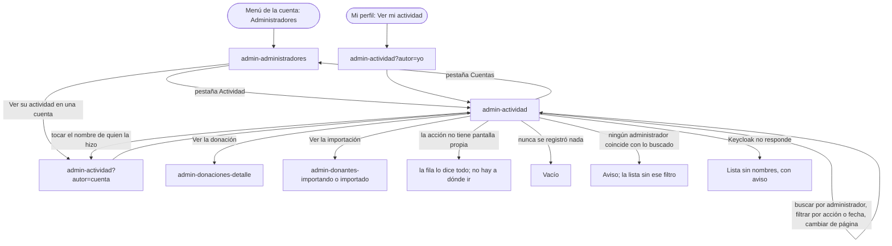

# Flujo: el registro de actividad de administración (R11-26)

> **Estado:** construida (lote `p2-actividad`, 2026-11-12) · antes aprobada · **Fecha:** 2026-11-12 · **Aprobó:** el usuario, 2026-11-12 (opciones recomendadas, aprobación automática pedida por él)
> Ficha de la skill `ux-flujo` para el lote `p2-actividad` del
> [backlog de la revisión del 2026-11-11](../backlog-revision-2026-11-11.md) (P2, tanda 1, ruta
> CONTRATO). La decisión del usuario ("Cuentas de administración", sección 3 del backlog: cuenta y
> perfil por admin, un admin crea otro **y registro de actividad**, todo en la entrega 6) ya está
> tomada: esta ficha la baja a pantallas, no la reabre. Va con su spec:
> [`R11-p2-actividad-spec.md`](../../specs/completed/R11-p2-actividad-spec.md), que define dónde se
> guarda la actividad y cómo se consulta.
> Depende de R11-10 (lote `p1-admins`, hecho): cada admin tiene su cuenta y el `sub` de su token
> identifica a quien hace cada acción ([ficha r11-p1-admins](r11-p1-admins.md),
> [ADR del autor de una propuesta](../../adr/donaciones-service/20261112-autor-de-la-decision-de-una-propuesta-desde-el-token.md)).

## 0. Qué pasa hoy (evidencia)

Leído en `e9331b3a2`. `[V]` es leído en el código; `[H]`, hipótesis.

| # | Hoy | Dónde |
|---|---|---|
| H1 | No hay ningún registro de lo que hace la administración: no hay tabla, endpoint ni pantalla `[V]` | `donaciones-service/src/main/resources/db/migration` (la última es `V24__sugerencias_de_propuesta.sql`), plantillas `admin-*.html` |
| H2 | Solo aprobar o descartar una propuesta guarda quién y cuándo (`decidida_por`, `fecha_decision`), con el `sub` del token `[V]` | `V22__propuesta_decidida_por.sql`, `PropuestaDeAsignacionController.java:105-106` |
| H3 | Marcar una donación como vencida guarda el autor en su historial, pero lo toma de la cabecera `X-Actor` que manda el sitio (con el `sub` de la sesión desde R11-10) `[V]` | `DonacionesIndependientesController.java:57-63`, `AdminDonacionesEnvios.java:55-62` |
| H4 | Las demás acciones del admin no guardan autor: registrar una donación, registrar un donante, importar un CSV, aprobar o registrar una organización, correr la asignación `[V]` (el ADR del autor lo deja para este lote) | `AdminDonacionesEnvios.java:84`, `AdminDonantesEnvioController.java:34,64`, `AdminEntidadesEnvioController.java:32,45`, `AdminAsignacionesEnvios.java:34` |
| H5 | Las llamadas del sitio a Donaciones van con el token de quien tiene la sesión: Donaciones puede leer el `sub` de cada acción `[V]` | `ClientesHttp.java:76-80`, `IntegracionConfig.java` (`donacionesComoUsuario`) |
| H6 | Dar de alta un administrador y generar otra contraseña provisoria pasan solo por Keycloak, con el token del servicio, no el del admin: ahí no queda quién lo hizo, salvo el atributo `altaPor` de la cuenta nueva `[V]` | `AdministradoresKeycloak.java:117-160`, `IntegracionConfig.java` (`keycloak` con `tokenDeServicio`) |
| H7 | Aprobar una organización y registrarla las dos llaman a `POST /api/entidades` con el mismo cuerpo (`juridicaId`): Donaciones no puede distinguirlas `[V]` | `SolicitudesDeEntidad.java:79`, `DonacionesRestComoUsuario.java:55-58`, `AdminPersonasRest.java:297-299` |
| H8 | Agregar, deshabilitar y volver a habilitar un camión van a Logística `[V]`, que no está en los módulos de este lote | `AdminCamionesEnvios.java:27-53` |
| H9 | Las cuentas de administración se leen de Keycloak de a una página, con el total como número; cada autor del historial de una donación se traduce a su nombre leyendo su cuenta `[V]` | `AdministradoresKeycloak.java:80-103`, `rest/AutoresDelHistorial.java` |

## 1. Para quién y para qué

| | |
|---|---|
| Quién | Una persona de administración, desde la computadora, que quiere saber quién aprobó una propuesta, quién subió un archivo o qué hizo el equipo esta semana; a veces, porque algo salió distinto de lo esperado y quiere entender qué pasó |
| Tono | Pantalla de trabajo: claro, útil, tranquilizador ([tono](../tono-y-comunicacion.md#tono-según-la-pantalla)). Es un registro: dice lo que pasó, sin juzgar a nadie |
| Qué quiere lograr | "Quiero ver quién hizo qué y cuándo, y encontrar rápido una acción: por persona, por tipo de acción o por fecha." |
| Dispositivo principal | Escritorio; en el celular tiene que poder leerse y filtrarse |
| Requerimientos | R11-26 (backlog P2), RI-SVC-04 (el autor sale del `sub` del token, no de `X-Actor`), RF-AUTH-07 (un admin crea otro: el alta queda registrada), RNF-AUTH-09 (el token no lleva datos personales), RNF-UI-02 (nada a más de 3 niveles), RNF-UI-05, RNF-UI-06, RF-CL-07 (toda cifra que cambia dice cuándo se leyó), RNF-CL-02 (sin JavaScript, igual funciona). Reglas generales 1, 2, 3 y 5 del backlog |
| Datos que usa | `GET /api/actividad` (nuevo, solo ADMIN, paginado, con filtros por quién, acción y fecha, total en `X-Total-Count`) y `POST /api/actividad` (nuevo, solo para anotar lo que se hace fuera de Donaciones). Los nombres de las cuentas, de Keycloak, como hoy. Detalle en la [spec](../../specs/completed/R11-p2-actividad-spec.md) |
| Boceto de E1 | Sin boceto: la pantalla es de la revisión del 2026-11-11 |

## 2. Dónde está en el sitio

Menú de la cuenta (la foto del encabezado) → **Administradores** (nivel 2) → pestaña **Actividad**
(nivel 2, la misma sección). Nada pasa de 3 niveles: la pantalla no tiene detalle propio; cada
acción lleva, cuando existe, a la pantalla de lo que tocó (una donación, una importación), que ya
está en el nivel 3 de su sección.

```text
Menú de la cuenta (admin): [nombre y apellido · Administración]
  Mi perfil            → /admin-perfil
  Administradores      → /admin-administradores        pestañas: [ Cuentas | Actividad ]
                         /admin-actividad              (la pestaña Actividad)
  Cambiar contraseña
  Cerrar sesión
```

- Es una **pestaña de Administradores**, no una entrada nueva del menú de la cuenta ni del menú
  principal: el menú del admin sigue con sus 7 secciones y el de la cuenta, con sus 4 entradas.
  Arriba de las dos vistas, la misma fila de pestañas: `Cuentas · Actividad` (como `Donantes ·
  Importaciones`).
- Dirección: `/admin-actividad`, con los filtros y la página en la dirección
  (`?buscar=&autor=&accion=&fecha=&desde=&hasta=&pagina=`): el "atrás" del navegador vuelve a la
  vista anterior y la dirección se puede guardar o compartir.
- Entradas: la pestaña; "Ver su actividad" en cada cuenta de Administradores (abre la pestaña
  filtrada por esa cuenta); y "Ver mi actividad" en Mi perfil del admin.
- En el [mapa del sitio](../mapa-del-sitio.md) entra como fila nueva, "Administradores →
  Actividad" (se actualiza al construir).

## 3. Recorrido



Desvíos considerados:

- **Cancelar o volver:** la pantalla no cambia nada; el "atrás" del navegador vuelve a la búsqueda
  o la página anterior. "Sacar los filtros" vuelve a toda la actividad.
- **Error de datos** (una dirección armada a mano con una fecha imposible, una acción que no existe
  o una cuenta que no es un identificador válido): el sitio no la manda tal cual; ignora ese filtro
  y lo dice ("No entendimos la fecha pedida: te mostramos todas las fechas.").
- **Ningún administrador coincide** con el nombre buscado: no se pide la lista a Donaciones con un
  filtro vacío (traería todo); se avisa y se muestra la lista sin ese filtro.
- **Demasiados administradores coinciden** (más de 20): se pide más precisión, sin culpa.
- **Keycloak no responde:** la lista se muestra igual, con "Una cuenta de administración" en lugar
  del nombre, y la búsqueda por administrador avisa que no está disponible. "Solo lo mío" y "Ver su
  actividad" siguen andando (no necesitan el nombre).
- **Error del servidor o sin respuesta** de Donaciones: la página de falla de siempre, con su código
  de soporte (R11-04). Si es al cambiar de página con HTMX, la misma página de falla.
- **Sin permiso:** solo el admin entra (como Administradores); cualquier otra cuenta, la página 403.
- **Una acción sobre algo que ya no existe** (una donación borrada, una cuenta dada de baja en la
  consola de Keycloak): la fila sigue, sin enlace, y dice lo que se sabe ("una cuenta de
  administración que ya no existe").
- **Algo que pasó mientras se miraba la lista:** la lista no se actualiza sola; dice a qué hora se
  leyó y ofrece "Actualizar".
- **Acciones hechas fuera del sitio** (en la consola de Keycloak) no aparecen: la ayuda lo dice.

## 4. Pantallas

Patrones conocidos ([criterios §4 y §5](../criterios-catedra-ux-ui.md#4-patrones-de-navegación)):
**pestañas** para dos vistas del mismo nivel (`.segmentos`), **lista** cronológica donde el ítem
lleva al detalle de lo que tocó, **filtros** con búsqueda en una barra (`.filtros-barra` y
`.filtros`, como Importaciones), **paginado** con el paginador único (`componentes/paginas ::
paginas`, regla 3) y **aviso breve** para lo que no se entendió. Ningún componente nuevo: todos
están en el [catálogo](../componentes.md).

### 4.1 `admin-actividad` (nueva)

Escritorio:

```text
Administradores
[ Cuentas | Actividad ]                                    (pestañas; la elegida, marcada)

Actividad de administración
Quién hizo qué y cuándo en el sitio. ¿Qué se registra? ▸
Leída el 12 de noviembre de 2026, 18:34. [Actualizar]

Buscar por administrador
[ bruno                                   ] [Buscar]   (Quién ▾) (Acción ▾) (Fecha ▾)
Mostrando 1 a 20 de 57 acciones.                                         Sacar los filtros

Cuándo               Quién                  Qué
12 nov 2026, 18:20   Ana Pérez (vos)        Aprobó la propuesta para Comedor Barrio Ejemplo.
12 nov 2026, 17:02   Bruno Díaz             Subió el archivo donantes-noviembre.csv     Ver la importación ›
                                            para importar.
12 nov 2026, 16:45   Bruno Díaz             Marcó una donación como vencida.             Ver la donación ›
12 nov 2026, 11:10   Ana Pérez (vos)        Dio de alta a Bruno Díaz como administrador.
11 nov 2026, 19:31   Una cuenta de          Corrió la asignación: 3 propuestas nuevas.
                     administración que
                     ya no existe
...                                                                        (20 por página)
                              « ‹ 1 2 3 › »
```

Celular (360 px): la barra de filtros baja debajo de la búsqueda, como en Importaciones; cada
acción es un ítem de lista apilado; el enlace "Ver…", si existe, va al final del ítem:

```text
12 nov 2026, 17:02 · Bruno Díaz
Subió el archivo donantes-noviembre.csv para importar.
Ver la importación ›
```

- **Columnas:** cuándo (fecha y hora de Argentina), quién (el nombre de la cuenta; "(vos)" si es
  la propia) y qué (una frase en pasado, con lo que tocó). Una cuarta columna sin título lleva el
  enlace cuando la acción tiene a dónde ir.
- **Quién:** el nombre y apellido de la cuenta; si no tiene nombre cargado, su correo; si la cuenta
  ya no existe, "Una cuenta de administración que ya no existe"; si Keycloak no responde, "Una
  cuenta de administración". El nombre es un enlace que filtra por esa cuenta ("Ver solo lo de Bruno
  Díaz", para el lector), así se reconoce en lugar de escribirlo.
- **Qué**, una frase por tipo de acción, con el mismo vocabulario de cada pantalla:

  | Acción | Cómo se dice | A dónde lleva |
  |---|---|---|
  | Aprobar una propuesta | Aprobó la propuesta para {organización}. | Sin enlace (Asignaciones no tiene detalle por propuesta) |
  | Descartar una propuesta | Descartó la propuesta para {organización}. | Sin enlace |
  | Correr la asignación | Corrió la asignación: {N} propuestas nuevas. · con 1: "1 propuesta nueva" · con 0: "ninguna propuesta nueva" | Sin enlace |
  | Registrar una donación | Registró una donación en el depósito. | Ver la donación |
  | Marcar vencida | Marcó una donación como vencida. | Ver la donación |
  | Registrar un donante | Registró a {razón social} como donante. · persona humana: "Registró a una persona donante." (su nombre no se guarda en el registro) | Sin enlace |
  | Importar un CSV | Subió el archivo {nombre} para importar. · sin nombre: "Subió un archivo de donantes para importar." | Ver la importación (al avance o al resultado, como en Importaciones) |
  | Aprobar una organización | Aprobó la solicitud de {organización}. | Sin enlace |
  | Registrar una organización | Registró a {organización}. | Sin enlace |
  | Dar de alta un administrador | Dio de alta a {nombre} como administrador. · cuenta que ya no existe: "Dio de alta una cuenta de administración que ya no existe." | Sin enlace (Administradores no tiene detalle por cuenta) |
  | Generar otra contraseña provisoria | Generó otra contraseña provisoria para {nombre}. | Sin enlace |
  | Agregar un camión | Agregó el camión {patente}. | Sin enlace |
  | Deshabilitar un camión | Deshabilitó el camión {patente}. | Sin enlace |
  | Volver a habilitar un camión | Volvió a habilitar el camión {patente}. | Sin enlace |

  {organización} y {razón social} son el nombre que tenía al hacerse la acción (el registro cuenta
  lo que pasó); {nombre} de una cuenta se lee al mostrar, como el autor. Nunca se muestra un
  identificador.
- **Filtros** (pastillas de `.filtros`, cada una con su menú de radios, y la búsqueda):
  - **Buscar por administrador:** nombre, apellido o correo de una cuenta de administración. Se
    busca en Keycloak (como mucho 20 cuentas) y la lista se pide filtrada por esas cuentas.
  - **Quién:** Todos (por defecto) · Solo lo mío. "Ver su actividad" y el nombre de una fila
    filtran por una cuenta; entonces la pastilla dice "De: Bruno Díaz".
  - **Acción:** Todas (por defecto) · Propuestas y asignación · Donaciones · Donantes e
    importaciones · Organizaciones · Cuentas de administración · Camiones.
  - **Fecha:** Cualquier fecha (por defecto) · Hoy · Últimos 7 días · Últimos 30 días · Este mes ·
    El mes anterior. Cada opción se traduce a un rango en la dirección
    (`?desde=AAAA-MM-DD&hasta=AAAA-MM-DD`); una dirección con otras fechas también se respeta y la
    pastilla dice "Del 1 al 15 de octubre". Elegir dos fechas a mano llega con el componente de
    filtros nuevo (R11-B04), igual que en Importaciones.
  - Con algún filtro o búsqueda, "Sacar los filtros" al lado de la cuenta.
- **Orden:** siempre de la más reciente a la más vieja. Es un registro: lo último es lo que se busca
  primero.
- **"Mostrando 1 a 20 de 57 acciones."**: el total lo da Donaciones (no se cuenta la página), con la
  regla de texto de una lista paginada.
- **"Leída el …"**: la lista muestra lo que había cuando se pidió (RF-CL-07); no se actualiza sola.
  "Actualizar" vuelve a pedir la misma vista.
- **Ayuda "¿Qué se registra?"** (plegada, debajo del título): qué acciones entran, que lo hecho en
  la consola de Keycloak no aparece y desde cuándo hay registro (§6).
- La barra de búsqueda y filtros queda fija al desplazarse (regla 5) cuando lo entregue
  `p2-armazon`; hasta entonces, como en Importaciones.

### 4.2 `admin-administradores` (cambio chico)

- Arriba, la fila de pestañas `Cuentas · Actividad`. El título de la pantalla sigue siendo
  "Administradores".
- En cada cuenta, el enlace "Ver su actividad" (en la propia, "Ver mi actividad"), que abre
  `/admin-actividad?autor=<cuenta>`.

### 4.3 `admin-perfil` (cambio chico)

- Al lado de "Ver quiénes administran DonaTrack", el enlace "Ver mi actividad"
  (`/admin-actividad?autor=yo`).

## 5. Estados

| Pantalla | Estado | Qué se ve | Texto |
|---|---|---|---|
| `admin-actividad` | Con datos | Pestañas, título, ayuda plegada, hora de lectura, barra de filtros, la cuenta, la lista y el paginador | "Actividad de administración" · "Mostrando 1 a 20 de 57 acciones." · "Leída el 12 de noviembre de 2026, 18:34." |
| `admin-actividad` | Una sola página | Sin paginador | "Mostrando 1 a 7 de 7 acciones." |
| `admin-actividad` | Vacío (nunca se registró nada) | El aviso, sin barra de filtros | "Todavía no hay actividad registrada." · "Acá vas a ver cada propuesta aprobada, cada archivo importado y cada cuenta dada de alta, con quién lo hizo y cuándo." |
| `admin-actividad` | Sin resultados (con búsqueda o filtros) | La barra con lo elegido y el aviso | "Ninguna acción coincide con los filtros elegidos." · "Sacar los filtros" |
| `admin-actividad` | Solo lo mío, sin acciones | La barra con "Solo lo mío" y el aviso | "Todavía no hay acciones tuyas registradas con estos filtros." · "Sacar los filtros" |
| `admin-actividad` | Ningún administrador coincide con lo buscado | Aviso breve arriba; la lista sin ese filtro | "Ninguna cuenta de administración coincide con «bruno». Te mostramos la actividad de todos." |
| `admin-actividad` | Demasiados coinciden (más de 20) | Aviso breve; la lista sin ese filtro | "Hay más de 20 cuentas de administración que coinciden con «a». Escribí más del nombre o el correo para encontrarla." |
| `admin-actividad` | Página fuera de rango (dirección vieja) | La última página que existe | Sin texto propio, como en las otras listas |
| `admin-actividad` | Cargando (filtrar o cambiar de página) | El indicador del formulario; la lista anterior a la vista | "Buscando actividad…" |
| `admin-actividad` | Filtro no entendido | Aviso breve arriba de la lista; la lista sin ese filtro | "No entendimos la fecha pedida: te mostramos todas las fechas." · "No entendimos la acción pedida: te mostramos todas." · "No entendimos la cuenta pedida: te mostramos la actividad de todos." |
| `admin-actividad` | Keycloak no responde | La lista con "Una cuenta de administración" en Quién; aviso breve arriba | "No pudimos traer los nombres de las cuentas: te mostramos la actividad sin ellos. La búsqueda por administrador no está disponible por ahora." |
| `admin-actividad` | Error del servidor | Página de falla con su código (R11-04) | La de siempre: "No pudimos mostrar esta página." y el código de soporte |
| `admin-actividad` | Sin permiso | Página 403 | La de siempre |
| `admin-actividad` (fila) | De la propia cuenta | El nombre con la marca | "Ana Pérez (vos)" |
| `admin-actividad` (fila) | Cuenta sin nombre cargado | El correo en lugar del nombre | "admin@ejemplo.org" |
| `admin-actividad` (fila) | Cuenta que ya no existe | El texto en lugar del nombre, sin enlace de filtro | "Una cuenta de administración que ya no existe" |
| `admin-actividad` (fila) | Acción sobre algo que ya no existe | La frase, sin enlace | La frase de la acción, como siempre |
| `admin-administradores` | Con la pestaña nueva | Pestañas y, en cada cuenta, el enlace | "Cuentas" · "Actividad" · "Ver su actividad" · "Ver mi actividad" |

No hay estado de éxito ni de error de datos propio: la pantalla solo lee. El sitio anota en el
registro, sin mostrar nada más, las acciones que no pasan por Donaciones (alta de un administrador,
otra contraseña, camiones); si esa anotación falla, la acción del admin ya está hecha y su aviso de
siempre no cambia (riesgo en la spec, §8).

## 6. Textos

| Elemento | Texto | Nota |
|---|---|---|
| Pestañas | "Cuentas" · "Actividad" | `nav.segmentos` con `aria-label="Vistas de administradores"` |
| Título | "Actividad de administración" | `h1` |
| Bajada | "Quién hizo qué y cuándo en el sitio." | Debajo del título |
| Ayuda (plegada en "¿Qué se registra?") | "Cada vez que alguien de administración aprueba o descarta una propuesta, corre la asignación, registra una donación o un donante, marca una donación como vencida, importa un archivo, aprueba o registra una organización, da de alta a otro administrador, genera otra contraseña provisoria o cambia un camión, queda acá con su nombre y la hora. Lo que se hace directo en la consola de Keycloak no aparece. El registro empezó con esta versión del sitio: de antes, solo están las propuestas aprobadas o descartadas." | Una sola ayuda, a pedido (divulgación progresiva). Dice el límite, no lo esconde |
| Búsqueda | Rótulo "Buscar por administrador" · ayuda del campo "Nombre, apellido o correo" · botón "Buscar" | Sin tildes ni mayúsculas, como las otras búsquedas |
| Pastilla Quién | "Quién" · "Todos" · "Solo lo mío" · con una cuenta: "De: Bruno Díaz" | |
| Pastilla Acción | "Acción" · "Todas" · "Propuestas y asignación" · "Donaciones" · "Donantes e importaciones" · "Organizaciones" · "Cuentas de administración" · "Camiones" | |
| Pastilla Fecha | "Fecha" · "Cualquier fecha" · "Hoy" · "Últimos 7 días" · "Últimos 30 días" · "Este mes" · "El mes anterior" · rango: "Del 1 al 15 de octubre" | Las mismas opciones que Importaciones |
| Cuenta | "Mostrando 1 a 20 de 57 acciones." / "Mostrando 1 a 1 de 1 acción." | El total de Donaciones |
| Cuándo se leyó | "Leída el 12 de noviembre de 2026, 18:34." · "Actualizar" | RF-CL-07 |
| Encabezados | "Cuándo" · "Quién" · "Qué" | `th scope="col"`; en el celular no se ven |
| Nombre como enlace | Visible: "Bruno Díaz" · para el lector: "Ver solo lo de Bruno Díaz" | |
| Enlaces de la fila | "Ver la donación" · "Ver la importación" | Para el lector, con lo que tocan: "Ver la importación de donantes-noviembre.csv" |
| Enlaces de entrada | "Ver su actividad" · "Ver mi actividad" | En Administradores y en Mi perfil |
| Indicador | "Buscando actividad…" | RNF-UI-06 |
| Quitar filtros | "Sacar los filtros" | Como en Importaciones |

Filtro de tono (7 preguntas): el registro dice lo que pasó, en pasado y con el nombre de quien lo
hizo, sin juzgar ("Marcó una donación como vencida.", no "Venció una donación por…"); lo que no se
sabe se dice ("Una cuenta de administración que ya no existe") en lugar de inventarlo; lo que el
registro no cubre se dice como límite (la consola de Keycloak, lo de antes de esta versión); la
cuenta dice de qué es ("57 acciones"), con su hora de lectura; las organizaciones se nombran por su
nombre ("la propuesta para Comedor Barrio Ejemplo") y se llaman Organización, nunca entidad. La
persona donante no se nombra en el registro: su nombre es un dato personal que este registro no
guarda. Sin urgencia ni signos de exclamación.

## 7. Accesibilidad

- Zonas: el encabezado y el menú del layout privado, `main#contenido` con la pantalla y el pie.
- Orden del foco: pestañas → ayuda → "Actualizar" → búsqueda → filtros → "Sacar los filtros" → la
  lista (en cada fila, el nombre y, si hay, el enlace "Ver…") → paginador.
- Las pestañas son enlaces reales; la elegida lleva `aria-current="page"`.
- La tabla del escritorio es una `table` con `caption` ("Actividad de administración, página 1 de
  3") y `th scope`; en el celular, una lista (`ol`) con un ítem por acción.
- La cuenta ("Mostrando 1 a 20 de 57 acciones.") vive en una región `aria-live="polite"` que no se
  reemplaza al filtrar con HTMX (lección de DTI-42, ítem 7): el lector la dice sin mover el foco.
- Los avisos breves van a `#avisos`, como en el resto del sitio.
- Las fechas van en `time` con `datetime`.
- Cada nombre y cada "Ver…" tiene un texto para el lector que dice a quién o a qué lleva.
- Sin JavaScript: la búsqueda se envía con "Buscar" y cada filtro con su "Mostrar resultados"; el
  paginador y los enlaces son enlaces reales.

## 8. Revisión de usabilidad

| # | Heurística | Cómo la cumple | Riesgo que queda |
|---|---|---|---|
| 1 | Visibilidad del estado | Cada fila dice cuándo, quién y qué; arriba, cuántas acciones coinciden y a qué hora se leyó | La lista no se actualiza sola: se dice al lado de la hora, con "Actualizar" |
| 2 | Lenguaje del usuario | Frases en pasado con las palabras de cada pantalla ("Aprobó la propuesta para…", "Subió el archivo…"); nombres, nunca identificadores | — |
| 3 | Control y libertad | Pestañas para ir y volver entre Cuentas y Actividad; "Sacar los filtros"; el "atrás" del navegador vuelve a la vista anterior | — |
| 4 | Consistencia | La misma barra de filtros, el mismo paginador y las mismas opciones de fecha que Importaciones; las pestañas como `Donantes · Importaciones` | — |
| 5 | Prevención de errores | Acción, quién y fecha son opciones, no campos libres; solo el nombre se escribe, y un nombre que no coincide no deja la lista vacía sin explicar | — |
| 6 | Reconocer antes que recordar | El nombre en cada fila filtra por esa persona; "Ver su actividad" desde su cuenta; "Solo lo mío" | Buscar a alguien por nombre requiere escribirlo; con pocas cuentas, los enlaces alcanzan |
| 7 | Flexibilidad | Filtros combinables y la dirección con todo eso se puede guardar o compartir | Sin rango de fechas a mano hasta R11-B04; sin orden inverso |
| 8 | Diseño minimalista | Tres columnas y, solo donde hay a dónde ir, un enlace; la ayuda plegada | — |
| 9 | Recuperarse de errores | Un filtro que no se entiende o un nombre que no coincide se avisan y se muestra la lista sin él; si Keycloak no responde, la lista se ve igual | — |
| 10 | Ayuda | "¿Qué se registra?" plegada, con qué entra, qué no y desde cuándo | — |

Los 7 factores de Morville, una línea cada uno:

- **Útil:** responde "¿quién hizo esto y cuándo?" sin preguntarle al resto del equipo.
- **Usable:** una lista con filtros y paginado, el mismo patrón que Importaciones.
- **Deseable:** la identidad del resto del admin, sin piezas nuevas.
- **Valioso:** cierra R11-10 y R11-26 en la demo: cada cuenta de administración deja su rastro.
- **Ubicable:** pestaña de Administradores, enlazada desde cada cuenta y desde Mi perfil.
- **Accesible:** tabla con encabezados en el escritorio, lista en el celular, cuenta que se lee sola.
- **Creíble:** el autor sale de la cuenta con que se entró (no de un dato que mande el sitio), con
  la hora del servicio; lo que no se registró se dice, no se inventa.

Conviene probar con personas reales: si "Actividad" se encuentra como pestaña de Administradores
(o se la busca en el menú principal), y si los grupos de "Acción" coinciden con cómo piensa el
equipo sus tareas.

## 9. Decisiones y preguntas

Decisiones del diseñador del lote (2026-11-12, agente, sin consulta: la corrida pide no frenar).
Van a la [bitácora](../bitacora.md) al construir.

1. **Pestaña de Administradores, no entrada nueva de un menú.** Es la sección de las cuentas: ver
   qué hizo cada una vive al lado de la lista de cuentas, y el menú no crece. Descartado: una
   entrada "Actividad" en el menú principal (suma un destino de primer nivel para una consulta
   ocasional) y en el menú de la cuenta (lo mezcla con lo propio de quien entró, cuando el registro
   es de todo el equipo).
2. **Sin pantalla de detalle por acción.** Cada fila dice todo en una frase; donde la acción tocó
   algo con pantalla propia (una donación, una importación), el enlace lleva ahí. Descartado: un
   detalle por acción (un nivel más para repetir lo que ya dice la fila).
3. **Quién se reconoce por enlaces y se busca por nombre en Keycloak.** El nombre de cada fila y
   "Ver su actividad" filtran por esa cuenta; "Solo lo mío" filtra por la propia; la búsqueda por
   nombre la resuelve Keycloak (como mucho 20 cuentas) y la lista se pide por esas cuentas.
   Descartado: un desplegable con todas las cuentas de administración (sería traer una lista
   completa, regla 1) y guardar el nombre del admin en cada fila (el nombre envejece y es un dato
   personal copiado, como ya descartó el ADR del autor).
4. **Acción en grupos, no en sus 14 tipos.** Los grupos siguen las secciones del menú del admin;
   un menú de 14 radios no se recorre. Descartado: un desplegable con los 14 tipos.
5. **Siempre de la más reciente a la más vieja, sin pastilla de orden.** Es un registro. Descartado:
   el orden inverso (nadie lo pidió y suma una pastilla).
6. **La organización y la razón social del donante, como eran al hacerse la acción; las cuentas, al
   mostrar.** El registro cuenta lo que pasó; el nombre de una cuenta es un dato personal que no se
   copia. La persona donante humana no se nombra en el registro.
7. **Lo de antes de este lote no se inventa.** Solo las propuestas aprobadas o descartadas tienen
   quién y cuándo guardados (V22): esas entran al registro; el resto empieza con esta versión, y la
   ayuda lo dice.

Preguntas abiertas para el usuario: ninguna de pantalla. Las del contrato están en la
[spec](../../specs/completed/R11-p2-actividad-spec.md#9-dudas), cada una con la opción recomendada.

## Aprobación del diseño p2-actividad (2026-11-12)

Aprobado por el usuario el 2026-11-12 con las opciones recomendadas: pidió aprobar en forma automática todas las opciones recomendadas de P1 y P2 para que la corrida termine sin su intervención.

1. Ruta en el gateway: RutasGateway no tiene /api/actividad y el gateway no es de este lote; el sitio llama a Donaciones directo. Recomiendo sumar la línea y su caso en RutasGatewayTest al integrar.
   **Resuelto: la opción recomendada.**
2. Camiones y cuentas: ¿entran al registro anotados por el sitio (POST /api/actividad)? Recomiendo que sí, con el catálogo cerrado y el autor del token. Aceptamos el riesgo de que, si falla la anotación, esa acción no quede registrada (se escribe un WARN con el traceId).
   **Resuelto: la opción recomendada.**
3. ¿Copiar las propuestas ya decididas en V25? Recomiendo que sí: son datos reales con autor y fecha.
   **Resuelto: la opción recomendada.**
4. ADR: recomiendo que el constructor lo escriba como proposed antes del código, como pide AGENTS.md §7.3, y no en el cierre como se hizo en P1.
   **Resuelto: la opción recomendada.**
5. [INFERRED] Sin verificar: que Keycloak 26 acepte search y q juntos en /users. Recomiendo que el constructor lo pruebe en el stack propio y, si no anda, filtre en dos pasos acotados a 21.
   **Resuelto: la opción recomendada.**
6. El seeder corre con una cuenta de admin, así que la demo va a mostrar muchas filas a su nombre. Recomiendo dejarlo así (es lo que pasó) y mostrar 'Solo lo mío' en la demo.
   **Resuelto: la opción recomendada.**
