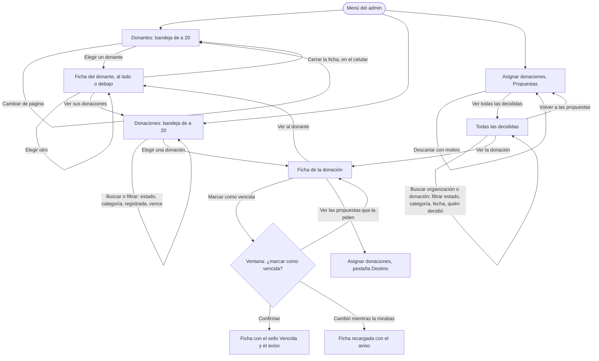

# Flujo: Donantes y Donaciones como bandeja, y la búsqueda de las asignaciones decididas (R11-34 y R11-35)

> **Estado:** aprobada · **Fecha:** 2026-11-12 · **Aprobó:** el usuario, 2026-11-12 (opciones recomendadas, aprobación automática pedida por él)
> Ficha de la skill `ux-flujo` para el lote `p2-admin-bandeja` del
> [backlog de la revisión del 2026-11-11](../backlog-revision-2026-11-11.md) (P2, tanda 2, ruta
> STANDARD). Las decisiones del usuario de la sección 3 del backlog ("Donantes y Donaciones
> (admin)", "Asignaciones aprobadas", "Filtros") ya están tomadas: esta ficha las baja a pantallas,
> no las reabre.
> **Reemplaza** la lista de la §4.1 (Donantes) y la §4.5 (Donaciones) de la
> [ficha del admin](raices-admin-navegable.md), y la §4.5 (Todas las decididas) de la
> [ficha de Asignar donaciones](r11-p1-asignaciones.md#45-todas-las-decididas-vistadecididas). En
> cada una queda un aviso que trae hasta acá. La importación (avance y resultado), el registro de
> donantes y de donaciones y las pestañas Propuestas / Conflictos / Destino no cambian.

## 0. Qué pasa hoy (evidencia)

Leído en `e9331b3a2`. `[V]` es leído en el código; `[H]`, hipótesis.

| # | Hoy | Dónde |
|---|---|---|
| H1 | Donantes es una tabla de a 20 (Nombre, Tipo, Qué dona, Documento, Alta, Estado) sin detalle: tocar un donante no lleva a ningún lado. No existe una pantalla de detalle del donante `[V]` | `admin-donantes.html:187-211` |
| H2 | Donaciones es una tabla de a 20 con un formulario de tres `select` (Estado, Vence, Ordenar) y "Aplicar"; otra familia de filtros que la de Donantes (pastillas de `.filtros`). El detalle es otra página (`admin-donaciones-detalle?donacion=`) y para volver hay que ir atrás `[V]` | `admin-donaciones.html:91-116,154-156,174-263` |
| H3 | Donaciones no filtra por vencimiento ni ordena por "vencen antes": "Vencen en los próximos 7 días" muestra las del depósito y dice cuántas vencen (`conVence` en false). El estado de R11-01 deja este filtro para este lote `[V]` | `rest/AdminOperacionDonaciones.java:73-81,103-106`, backlog §4, R11-01 |
| H4 | Donaciones ya resuelve en la base, en `/donaciones-independientes`: estado (repetible), categoría, subcategoría, donante, organización, fecha de registro (`desde`/`hasta`) y búsqueda en la descripción de los bienes (`q`). En `/api/donantes`: búsqueda (`q`), tipo, tipo jurídico, activo, categoría ("donó alguna vez algo de esa categoría") y orden (nuevos, antiguos, nombre); **no** filtra por fecha de alta `[V]` | `FiltroDonacionesIndependientes.java`, `CriterioDonacionesIndependientes.java`, `FiltroDonantes.java`, `OrdenDonantes.java` |
| H5 | Todas las decididas es una lista de a 20 con el sello, qué cubría y para quién. Sin buscador, sin fecha, sin quién decidió y sin motivo `[V]` | `admin-asignaciones.html:71-85,379-386` |
| H6 | El motivo del descarte **se escribe y se pierde**: el sitio lo manda como `justificacion` en el `PUT /estado`, Donaciones lo recibe en `ActualizarEstadoRequestDTO` y no lo guarda (`actualizarEstado` no lo pasa; `Propuesta.rechazar` no lo recibe; la tabla no tiene la columna) `[V]` | `rest/AdminOperacionAsignaciones.java:105-112`, `ActualizarEstadoRequestDTO.java`, `PropuestaDeAsignacionService.java:191-210`, `Propuesta.java:159-170` |
| H7 | La propuesta ya guarda quién la decidió (`decidida_por`, el `sub` del token) y cuándo (`fecha_decision`), desde `V22`; las decididas antes quedan en `NULL`. El sitio no lee esos dos campos `[V]` | `V22__propuesta_decidida_por.sql`, `PropuestaDTO.java:20-21`, `rest/DonacionesApi.java:556-562` |
| H8 | "Decididas más recientes" ordena por la fecha en que **se creó** la propuesta (`orden=reciente` es `fecha_creacion DESC`), no por cuándo se decidió: una propuesta vieja decidida hoy queda al fondo `[V]` | `rest/AdminOperacionAsignaciones.java:440-446`, `PropuestaRepositoryJpaAdapter.java:191-199` |
| H9 | El bloque `.maestro` (lista y ficha, Material: List-detail) ya existe y lo usa Entidades del admin: la ficha va dentro del renglón elegido; en el celular, debajo del renglón; desde 53,75 em, a la derecha. No queda fija al desplazarse `[V]` | `componentes/maestro.css`, `admin-entidades.html:189-215`, [`componentes.md`](../componentes.md) |
| H10 | Las cuentas de administración se leen de a 10 desde Keycloak (`DirectorioDeAdministradores`), y el nombre de un autor se traduce con `AutoresDelHistorial` `[V]` | `puertos/DirectorioDeAdministradores.java`, `rest/AutoresDelHistorial.java` |

## 1. Para quién y para qué

| | |
|---|---|
| Quién | La persona de administración, en la computadora de la oficina, que atiende una consulta ("¿la donación de Ana llegó?", "¿por qué no se asignó el arroz?") o revisa el depósito. A veces desde el celular, en el depósito, para buscar una donación puntual |
| Tono | Pantalla de trabajo: claro, útil, tranquilizador. Estados como son y el próximo paso ([tono según la pantalla](../tono-y-comunicacion.md#tono-según-la-pantalla)) |
| Qué quiere lograr | "Encontrar un donante o una donación, ver todo lo suyo sin perder la lista, y saber quién decidió cada asignación, cuándo y por qué se descartó" |
| Dispositivo principal | Escritorio primero; también el celular |
| Requerimientos | RF-15 (donantes y donaciones del depósito), RF-16 (marcar vencida, desde la ficha), RF-17 (las decididas, con su autor), RF-20 (Donantes convive con la importación), RF-CL-07 (las cifras dicen cuándo se leyeron), RNF-CL-02 (sin JavaScript funciona), RNF-UI-02 (máximo 3 niveles); reglas 1, 2, 3 y 5 del backlog |
| Datos que usa | Donaciones: `GET /api/donantes` y `GET /api/donantes/{id}`; `GET /donaciones-independientes` (lista, y las 3 últimas de un donante con `donanteId`, `size=3` y el total en `X-Total-Count`) y `GET /donaciones-independientes/{id}`; `GET /api/donaciones/resumen`; `GET /api/categorias`; `GET /api/asignaciones/propuestas` con los filtros nuevos (§9.1); `PUT /api/asignaciones/propuestas/{id}/estado`, que guarda el motivo (§9.1). Keycloak (por el sitio): `DirectorioDeAdministradores` para las opciones de "Decidió" y `AutoresDelHistorial` para el nombre |
| Boceto de E1 | Pág. 13 solo dibuja el menú. Sin boceto de estas listas. Punto de partida: Entidades del admin (`.maestro`) y Notificaciones (la bandeja) |

## 2. Dónde está en el sitio

- Inicio del admin → **Donantes** (nivel 1) → la ficha de un donante (`?donante=<id>`, nivel 2, en
  la misma página) → "Ver sus donaciones" lleva a Donaciones con ese donante (nivel 1, con filtro).
- Inicio del admin → **Donaciones** (nivel 1) → la ficha de una donación (`?donacion=<id>`, nivel 2,
  en la misma página) → Marcar como vencida (ventana, nivel 3).
  `admin-donaciones-detalle?donacion=<id>` sigue existiendo como puerta delantera (lo usan el
  inicio y Asignaciones): muestra la misma ficha sola, con "Volver a Donaciones".
- Inicio del admin → **Asignar donaciones** (nivel 1) → **Todas las decididas**
  (`?vista=decididas`, nivel 2), ahora con búsqueda y filtros.

Nada pasa del nivel 3. Las direcciones no cambian de nombre (las rutas siguen diciendo
`admin-donaciones`, `entidad`, etc.). Ver el [mapa del sitio](../mapa-del-sitio.md): la fila
"Donaciones → detalle y vencimiento" pasa a decir "ficha en la misma lista".

## 3. Recorrido



Desvíos considerados:

- **Volver:** toda ficha, filtro y página es una dirección real; el "atrás" del navegador vuelve
  al estado anterior (HTMX empuja la dirección).
- **Cancelar:** la ventana de marcar vencida tiene "Cancelar" con el foco de partida; en el
  celular, "Cerrar la ficha" vuelve a la lista en el renglón donde estaba.
- **Error de datos:** un `?donante=` o `?donacion=` que no existe o no es un identificador muestra
  la lista y, en el lugar de la ficha, el aviso de §5. Un filtro con un valor desconocido se ignora
  (como hoy): la pastilla queda en su valor de partida.
- **Error del servidor:** si falla la lista, el banner de siempre con código; si falla solo la
  ficha, la lista queda y la ficha dice que no se pudo cargar (fallo parcial).
- **El dato cambió:** marcar vencida una donación que cambió devuelve la ficha recargada con su
  aviso (409, como hoy).
- **Sin conexión o lento:** el indicador de carga del renglón elegido; sin JavaScript, la página
  recarga.
- **Sin permiso:** solo el admin entra (como hoy); otro rol ve la página 403.

## 4. Pantallas

Patrón conocido: **lista y detalle** (Material: List-detail), el mismo `.maestro` de Entidades del
admin, con **paginado** debajo de la lista y **búsqueda y filtros** arriba
([criterios de la cátedra §4 y §5](../criterios-catedra-ux-ui.md#4-patrones-de-navegación): "listas
para contenido estructurado vertical, donde tocar un ítem lleva al detalle"). Es una bandeja: la
lista no se va al abrir un elemento.

Reglas comunes de las dos bandejas:

- **La lista** es `ul.maestro`: un renglón por elemento, cada uno un enlace real a la misma lista
  con `?donante=` (o `?donacion=`) **más la búsqueda, los filtros, el orden y la página que había**.
  El elegido se marca como en Entidades (papel claro, sombra suave, indicador a la izquierda) y
  lleva `aria-current="true"`.
- **La ficha** va en la columna derecha desde 53,75 em y **queda fija al desplazarse**
  (`position: sticky`), con su propio desplazamiento si es más alta que la ventana
  (`max-height` del alto visible menos el encabezado fijo; `overflow-y: auto`). El tope sale de
  una variable (`--alto-encabezado-fijo`, 0 por defecto) que el lote `p2-armazon` (R11-33, tanda
  3) llena cuando fije el encabezado: así no se pisan.
- **En el celular la ficha no queda fija** (regla 5: "solo donde no ocupe demasiado"): va justo
  debajo del renglón elegido, como hoy en Entidades, y termina con "Cerrar la ficha" (enlace a la
  lista sin el elegido, con el ancla del renglón).
- **Elegido de partida:** sin `?donante=` (o `?donacion=`), la pantalla elige el primero de la
  página, como Entidades, para que la columna de la derecha no quede vacía. En el celular ese
  elegido de partida **no abre su ficha** (el renglón lleva `data-elegido="partida"` y la hoja
  oculta la ficha por debajo de 53,75 em): abrir la pantalla en el teléfono muestra la lista, no
  una ficha que nadie pidió.
- **Si el elegido no está en la página** (llega de un enlace: "Ver al donante", el inicio,
  Asignaciones), la ficha se muestra igual, en su columna; en el celular, antes del primer renglón.
  Ningún renglón queda marcado.
- **Con HTMX**, tocar un renglón pide la misma dirección (`hx-get`, `hx-push-url`) y cambia la
  lista y la ficha sin recargar ni mover la página; el foco va al título de la ficha. Sin
  JavaScript, el enlace recarga y el ancla lleva al renglón elegido.
- **Los filtros** son las pastillas de `componentes/filtros` dentro de `form.filtros-barra`, como
  Donantes e Importaciones (Donaciones deja sus tres `select` y "Aplicar"). Las fechas son
  períodos fijos ("Hoy", "Últimos 7 días", "Últimos 30 días", "Este mes", "El mes anterior")
  traducidos a `?desde=&hasta=`, como en Importaciones; elegir dos fechas a mano llega con el
  componente de filtros nuevo (R11-B04, backlog). Cambiar un filtro o buscar vuelve a la página 1
  y suelta el elegido. "Sacar los filtros" aparece con algún filtro elegido.
- **Solo se ofrece un filtro que Donaciones resuelve** (regla 1). Si un filtro de esta ficha
  todavía no está en el servicio, la pastilla no se dibuja.
- **El paginador** es `componentes/paginas` directo (`« ‹ 1 2 3 … 9 › »`; `‹ 3 de 9 ›` en el
  celular), no el pase provisorio. Conserva la búsqueda, los filtros y el orden; no lleva el
  elegido. Debajo de la lista, antes del paginador: "Mostrando 1 a 20 de 20.086 donantes."
- **Nunca se trae la lista entera:** la página de 20, la ficha por su id, las 3 últimas donaciones
  de un donante con su total como número, y las cifras de la cabecera del resumen.

### 4.1 `admin-donantes`

```text
┌────────────────────────────────────────────────────────────────────────────────────────┐
│ Donantes | Importaciones                                                               │
│ Administración                                                                         │
│ Donantes                                          [Registrar donante] [Importar CSV]   │
│ 20.086 donantes activos, al 12 de noviembre de 2026, 18:30.                            │
│ (franja de la importación en curso, si hay)                                            │
│                                                                                        │
│ Buscar por nombre o documento                                                          │
│ [Ana o 20.000.001            ] [Buscar]   (Tipo ▾) (Qué dona ▾) (Estado ▾) (Alta ▾)    │
│                                           (Más nuevos primero ▾)  Sacar los filtros    │
│ Coinciden 1.234 donantes.                                                              │
│ ┌──────────────────────────────────┐ ┌───────────────────────────────────────────────┐ │
│ │▌Ana Ejemplo            ● Activo  │ │ Ana Ejemplo                                   │ │
│ │ Persona · DNI 20.000.001         │ │ Persona · DNI 20.000.001                      │ │
│ │ Alta: 14 de octubre de 2026      │ │ ● Activo · alta el 14 de octubre de 2026      │ │
│ ├──────────────────────────────────┤ │                                               │ │
│ │ Distribuidora Ejemplo SA ●Activo │ │ Contacto                                      │ │
│ │ Empresa · CUIT 30-00000000-1     │ │   Correo   ana@ejemplo.test                   │ │
│ ├──────────────────────────────────┤ │   Teléfono 11 5555-0000                       │ │
│ │ Club Ejemplo      ○ Dado de baja │ │   Dirección Calle Ejemplo 123, CABA           │ │
│ │ ONG · CUIT 30-00000000-2         │ │ Pidió que su nombre no se muestre a las       │ │
│ │ …                                │ │ organizaciones.                               │ │
│ └──────────────────────────────────┘ │                                               │ │
│ Mostrando 1 a 20 de 1.234 donantes.  │ Sus donaciones · 12 registradas               │ │
│        « ‹ 1 2 3 … 62 › »            │   Arroz · 25 kg — En el depósito — 10 nov     │ │
│                                      │   Ropa · 3 bolsas — Entregada — 2 nov         │ │
│                                      │   Leche · 10 u — Asignada — 28 oct            │ │
│                                      │ [Ver sus 12 donaciones]                       │ │
│                                      └───────────────────────────────────────────────┘ │
│                                        (fija al desplazarse, desde 53,75 em)           │
└────────────────────────────────────────────────────────────────────────────────────────┘
```

- **Renglón:** el nombre (persona: nombre y apellido; jurídica: razón social), "Tipo · Documento"
  (Persona, o el tipo jurídico: Empresa, ONG, Institución, Gubernamental) y el estado como bolita
  y palabra (Activo · Dado de baja; "Sin activar su cuenta" solo donde la fuente lo da, como hoy).
  "Alta: …" solo si la fuente trae la fecha de alta.
- **Ficha**, por partes de `.maestro-ficha`:
  - `identidad`: el nombre como título, "Tipo · Documento" y el estado con la fecha de alta.
  - `contacto`: un `dl` con correo, teléfono (los medios de contacto que tenga) y dirección. Si
    pidió que no se muestre su nombre (`mostrarNombre` en false): "Pidió que su nombre no se
    muestre a las organizaciones." Lo ve solo administración: es el mismo dato que ya muestra el
    registro.
  - `donaciones`: "Sus donaciones · 12 registradas" (el total de Donaciones), las 3 más recientes
    (qué, estado, fecha de registro; cada una enlaza a su ficha en Donaciones) y "Ver sus 12
    donaciones" (regla 2), que lleva a Donaciones con el filtro de ese donante. Con 0: "Todavía no
    tiene donaciones registradas." y sin enlace.
  - Sin acciones de edición: el sitio no edita donantes hoy (fuera de alcance).
- **Filtros:** Tipo (Todos · Personas · Empresas · ONG · Instituciones · Gubernamentales), Qué
  dona (Todas las categorías · cada categoría del catálogo; "donó alguna vez algo de esa
  categoría"), Estado (Todos · Activos · Dados de baja), **Alta** (Cualquier fecha · los períodos
  fijos; solo si Donaciones filtra por fecha de alta, §9.1 y pregunta 1) y Ordenar (Más nuevos
  primero · Más antiguos primero · Por nombre).
- Lo de arriba de la lista (pestañas Donantes | Importaciones, cabecera, franja de la importación,
  bloque de importar) no cambia.

### 4.2 `admin-donaciones`

```text
┌────────────────────────────────────────────────────────────────────────────────────────┐
│ Administración                                                                         │
│ Donaciones                                                       [Registrar donación]  │
│ 7 en el depósito · 4 asignadas · 1 en camino · 9 entregas confirmadas en noviembre.    │
│ Al 12 de noviembre de 2026, 18:30.                                                     │
│                                                                                        │
│ Buscar por lo que se donó                                                              │
│ [leche                       ] [Buscar]  (Estado ▾) (Categoría ▾) (Registrada ▾)       │
│                                          (Vence ▾) (Registradas más recientes ▾)       │
│ De Ana Ejemplo  ✕ Quitar                 (solo si llegó desde la ficha de un donante)  │
│ Coinciden 3 donaciones.                                                                │
│ ┌──────────────────────────────────┐ ┌───────────────────────────────────────────────┐ │
│ │▌[ícono] Leche en polvo · 10 u    │ │ [ícono] Leche en polvo                        │ │
│ │ De Distribuidora Ejemplo SA      │ │ ● En el depósito                              │ │
│ │ Registrada el 10 de noviembre    │ │   Donó        Distribuidora Ejemplo SA ›      │ │
│ │ ● En el depósito · vence en 2 días│ │   Depósito    Depósito Central                │ │
│ ├──────────────────────────────────┤ │   Registrada  10 de noviembre de 2026          │ │
│ │ [ícono] Arroz · 25 kg            │ │ Bienes                                        │ │
│ │ De Ana Ejemplo                   │ │   Leche en polvo · 10 unidades · Nuevo ·      │ │
│ │ ● Asignada                       │ │   vence el 14 de noviembre, en 2 días         │ │
│ │ …                                │ │ Historial (últimos 3 de 5)                    │ │
│ └──────────────────────────────────┘ │   10 nov: llegó al Depósito Central. …        │ │
│ Mostrando 1 a 20 de 3 donaciones.    │   [Ver el historial completo]                 │ │
│        « ‹ 1 › »                     │ [Ver las propuestas que la piden]             │ │
│                                      │ [Marcar como vencida]                         │ │
│                                      └───────────────────────────────────────────────┘ │
└────────────────────────────────────────────────────────────────────────────────────────┘
```

- **Renglón:** el pictograma de la categoría (con el genérico de respaldo), "Qué · cantidad
  corta", "De <donante>" (el admin ve el nombre aunque el donante haya pedido ocultarlo a las
  organizaciones), "Registrada el …" y el estado como bolita y palabra; en el depósito y si vence en
  7 días, "· vence en 2 días" (la palabra, no solo el color).
- **Ficha**, por partes:
  - `identidad`: pictograma grande, qué es como título y el estado.
  - `resumen`: un `dl` con Donó (enlace a la ficha del donante en Donantes), Depósito, Registrada
    y, si está asignada, Organización.
  - `bienes`: cada bien con cantidad, estado del bien y vencimiento ("Sin fecha" si no vence). Con
    más de 3 bienes, los 3 primeros y "Ver los 5 bienes" (`details`, divulgación progresiva).
  - `historial`: los 3 cambios más recientes y "Ver el historial completo" (`details`). Cada
    cambio con su fecha y quién lo hizo, con el nombre de la cuenta (`AutoresDelHistorial`, como
    hoy).
  - `acciones`: en el depósito, "Ver las propuestas que la piden" (lleva a Asignar donaciones,
    pestaña Destino, con esa donación; si no está en ninguna, esa pantalla ya lo dice) y "Marcar
    como vencida" (la ventana de hoy, con el comportamiento que deje `p2-ventanas`, R11-32). Fuera
    del depósito, el texto de hoy: "Solo se puede marcar como vencida una donación que está en el
    depósito."
- **Filtros:** Estado (Todas · En el depósito · Asignada · En camino · Entregada · Vencida),
  Categoría (Todas las categorías · cada una del catálogo), Registrada (Cualquier fecha · los
  períodos fijos), **Vence** (Cuando sea · En los próximos 7 días; solo si Donaciones lo resuelve,
  §9.1) y Ordenar (Registradas más recientes · Registradas más antiguas · **Vencen antes**, este
  último con el mismo condicional). El filtro del donante no es una pastilla: llega desde la
  ficha del donante y se ve como "De Ana Ejemplo · Quitar" arriba de la cuenta.
- `?vence=pronto` (lo usa el inicio) sigue andando: es el filtro Vence en "En los próximos 7
  días" con Estado en "En el depósito" y el orden "Vencen antes". Mientras Donaciones no lo
  resuelva, se comporta como hoy (las del depósito y cuántas vencen), con el texto de límite.
- `admin-donaciones-detalle?donacion=` muestra la misma ficha sola, a todo el ancho, con la miga
  "Donaciones › Leche en polvo" y "Volver a Donaciones". `admin-donaciones-detalle-vencida`, igual
  con el aviso.

### 4.3 `admin-asignaciones?vista=decididas` — Todas las decididas

```text
┌────────────────────────────────────────────────────────────────────────────────────────┐
│ Asignar donaciones                                                                     │
│ [← Volver a las propuestas]                                                            │
│ Decididas · 57                                                                         │
│ Buscar por organización o donación                                                     │
│ [arroz                       ] [Buscar]  (Estado ▾) (Categoría ▾) (Decidida ▾)         │
│                                          (Decidió ▾) (Más recientes primero ▾)         │
│ Coinciden 4 propuestas decididas.                                                      │
│ ┌────────────────────────────────────────────────────────────────────────────────────┐ │
│ │ ✓ Aprobada · Arroz · 25 kg para Comedor Barrio Ejemplo                    Alimentos│ │
│ │   Aprobó Ana Pérez el 12 de noviembre de 2026, 10:15.                              │ │
│ │   La cubría: Arroz · 25 kg (de Ana Ejemplo) ›                                      │ │
│ ├────────────────────────────────────────────────────────────────────────────────────┤ │
│ │ ✕ Descartada · Arroz · 10 kg para Merendero Ejemplo Sur                   Alimentos│ │
│ │   Descartó Leo Gómez el 11 de noviembre de 2026, 17:40.                            │ │
│ │   Motivo: «El merendero cerró por vacaciones hasta diciembre.»                     │ │
│ ├────────────────────────────────────────────────────────────────────────────────────┤ │
│ │ ✓ Aprobada · Arroz · 5 kg para Escuela Ejemplo N.º 12                     Alimentos│ │
│ │   Se decidió antes de que guardáramos quién y cuándo.                              │ │
│ └────────────────────────────────────────────────────────────────────────────────────┘ │
│ Mostrando 1 a 4 de 4 propuestas decididas.                                             │
└────────────────────────────────────────────────────────────────────────────────────────┘
```

- Sigue siendo una lista simple (no una bandeja con ficha): cada renglón ya dice todo lo que hay
  de la decisión. Sin ficha fija.
- **Renglón:** el sello y la palabra (Aprobada · Descartada), qué pedía y para qué organización,
  la categoría como `.chip` (solo lectura), quién y cuándo ("Aprobó Ana Pérez el …" / "Descartó …";
  el nombre lo da `AutoresDelHistorial`; si la cuenta ya no existe o Keycloak no responde, "una
  cuenta de administración"), y lo que la cubría, con enlace a la ficha de cada donación en
  Donaciones. En las descartadas, "Motivo: «…»" o "Sin motivo anotado.".
- **Búsqueda** (`?buscar=`, sin tildes ni mayúsculas, en Donaciones): el nombre de la
  organización, lo que pedía la necesidad y la descripción de las donaciones que la cubrían.
- **Filtros:** Estado (Todas · Aprobadas · Descartadas), Categoría (la de la necesidad: Todas las
  categorías · cada una del catálogo), Decidida (Cualquier fecha · los períodos fijos, sobre la
  fecha de la decisión), Decidió (Cualquiera · Vos · cada cuenta de administración por su nombre ·
  "Antes de las cuentas") y Ordenar (Más recientes primero · Más antiguas primero, por la fecha de
  la decisión).
- **Decidió**: las opciones salen del directorio de cuentas, de a 10, pidiendo como máximo 3
  páginas (30 cuentas). Si hay más de 30, el menú ofrece solo Cualquiera, Vos y "Antes de las
  cuentas", y la ficha de la pantalla lo anota como límite. "Antes de las cuentas" junta las
  decididas sin autor guardado o a nombre de "SISTEMA".
- Con un período elegido, las decididas sin fecha guardada no aparecen: la cuenta lo dice (§5).
- **Las 3 decididas más recientes** de la pestaña Propuestas usan el mismo renglón, sin el
  motivo, y se ordenan por la fecha de la decisión (arregla H8). "Ver todas las decididas" no
  cambia.
- **Descartar** (en las tarjetas de Propuestas, Conflictos y Destino): el campo "Motivo
  (opcional)" suma la ayuda "Queda guardado con la propuesta. Lo ven solo las cuentas de
  administración." y un tope de 500 caracteres (`maxlength`). El aviso al descartar con motivo:
  "Descartaste la propuesta para Merendero Ejemplo Sur y guardamos el motivo. Las donaciones siguen
  en el depósito para otra asignación."

## 5. Estados

| Pantalla | Estado | Qué se ve | Texto |
|---|---|---|---|
| Donantes | Con datos | Cabecera, barra, lista, ficha, paginador | "Mostrando 1 a 20 de 20.086 donantes." |
| Donantes | Vacío | Cabecera, el bloque de importar abierto | "Todavía no hay donantes registrados." · "Registrá el primero o importá un archivo con muchos." (como hoy) |
| Donantes | Vacío por la búsqueda o los filtros | La barra y el aviso | "Ningún donante coincide con lo que buscaste." · "Probá con otra parte del nombre o del documento, o sacá los filtros." · "Ver todos" |
| Donantes | Cargando | Esqueleto de la lista y de la ficha, `aria-busy` | "Cargando los donantes…" |
| Donantes | Error del servidor | El banner con código | "No pudimos cargar los donantes." · "Es un problema nuestro. Probá de nuevo en unos minutos; si sigue, escribinos con este código." (como hoy) |
| Ficha del donante | Con datos | Identidad, contacto, sus donaciones | "Sus donaciones · 12 registradas" |
| Ficha del donante | Sin donaciones | La parte vacía | "Todavía no tiene donaciones registradas." |
| Ficha del donante | Sin medios de contacto | El `dl` con el dato faltante | "Sin correo ni teléfono cargados." |
| Ficha del donante | Dado de baja | El estado y su texto | "Dado de baja. Sus donaciones registradas se siguen viendo." |
| Ficha del donante | No existe | En el lugar de la ficha | "No encontramos ese donante. Puede que el enlace esté mal; elegí uno de la lista." |
| Ficha del donante | Error al cargarla | En el lugar de la ficha; la lista queda | "No pudimos cargar la ficha de este donante. La lista sigue a mano; probá elegirlo de nuevo." |
| Ficha del donante | Sus donaciones no cargaron | La parte, con el resto de la ficha | "No pudimos cargar sus donaciones." · "Ver sus donaciones" (lleva igual al filtro) |
| Donaciones | Con datos | Cabecera, barra, lista, ficha, paginador | "Mostrando 1 a 20 de 312 donaciones." |
| Donaciones | Vacío | La cabecera y el aviso | "Todavía no hay donaciones registradas." |
| Donaciones | Vacío por filtros | La barra y el aviso | "Ninguna donación coincide con lo que buscaste." · "Probá con otra palabra o sacá los filtros." · "Ver todas" |
| Donaciones | Vacío, vence pronto | El aviso | "Ninguna donación del depósito vence en los próximos 7 días." · "Ver todas" |
| Donaciones | Vence sin resolver en el servicio | Las del depósito y el límite | "Esta lista todavía no se puede filtrar por vencimiento: te mostramos todas las del depósito." + "5 donaciones del depósito vencen en los próximos 7 días; la primera, Leche en polvo, el 14 de noviembre." |
| Donaciones | Filtro de donante | La pastilla de texto | "De Ana Ejemplo · Quitar" |
| Donaciones | Cargando | Esqueleto, `aria-busy` | "Cargando las donaciones…" |
| Donaciones | Error del servidor | El banner con código | "No pudimos cargar las donaciones." (como hoy) |
| Ficha de la donación | Con datos | Identidad, resumen, bienes, historial, acciones | Títulos "Bienes" e "Historial (últimos 3 de 5)" |
| Ficha de la donación | Recién marcada vencida | El sello y el aviso breve | "La marcaste como vencida el 12 de noviembre de 2026, 18:35." |
| Ficha de la donación | Cambió mientras la mirabas | El banner | "Esta donación cambió mientras la mirabas: no la marcamos como vencida." · "Volvimos a cargar su estado." (como hoy) |
| Ficha de la donación | Fuera del depósito | Sin el botón | "Solo se puede marcar como vencida una donación que está en el depósito." |
| Ficha de la donación | No existe | En el lugar de la ficha | "No encontramos esa donación. Puede que el enlace esté mal; elegí una de la lista." |
| Ficha de la donación | Error al cargarla | En el lugar de la ficha; la lista queda | "No pudimos cargar la ficha de esta donación. La lista sigue a mano; probá elegirla de nuevo." |
| Decididas | Con datos | La barra, la lista, el paginador | "Mostrando 1 a 20 de 57 propuestas decididas." |
| Decididas | Vacío | El aviso | "Todavía no se decidió ninguna propuesta." (cambia "decidiste": ahora hay varias cuentas) |
| Decididas | Vacío por filtros | La barra y el aviso | "Ninguna propuesta decidida coincide con lo que buscaste." · "Sacar los filtros" |
| Decididas | Con período y decididas sin fecha | Debajo de la cuenta | "Las decididas antes del 12 de noviembre de 2026 no tienen fecha guardada y no entran en este período." (solo si hay alguna sin fecha; es un número de Donaciones) |
| Decididas | Sin autor ni fecha | En el renglón | "Se decidió antes de que guardáramos quién y cuándo." |
| Decididas | Autor que ya no existe | En el renglón | "Aprobó una cuenta de administración el …" |
| Decididas | Descartada sin motivo | En el renglón | "Sin motivo anotado." |
| Decididas | Cargando | Esqueleto, `aria-busy` | "Cargando las decididas…" |
| Decididas | Error del servidor | El banner con código | "No pudimos cargar las propuestas decididas." · "Es un problema nuestro. Probá de nuevo en unos minutos; si sigue, escribinos con este código." |
| Descartar | Motivo demasiado largo (sin JavaScript o forzado) | El campo con su error | "El motivo puede tener hasta 500 caracteres. Acortalo y volvé a descartar." |
| Todas | Sin permiso | La página 403 | (la de siempre) |

## 6. Textos

| Elemento | Texto | Nota |
|---|---|---|
| Búsqueda de Donantes | "Buscar por nombre o documento" · ejemplo "Por ejemplo: Ana o 20.000.001" | Como hoy |
| Búsqueda de Donaciones | "Buscar por lo que se donó" · ejemplo "Por ejemplo: leche o arroz" | Nuevo: `q` en la descripción de los bienes |
| Búsqueda de Decididas | "Buscar por organización o donación" · ejemplo "Por ejemplo: Comedor o arroz" | Nuevo |
| Cerrar la ficha (celular) | "Cerrar la ficha" | Enlace, vuelve al renglón |
| Ficha del donante | "Contacto", "Sus donaciones · 12 registradas", "Ver sus 12 donaciones" | Con 1: "Sus donaciones · 1 registrada", "Ver su donación" |
| Ficha de la donación | "Bienes", "Ver los 5 bienes", "Historial (últimos 3 de 5)", "Ver el historial completo", "Ver las propuestas que la piden", "Marcar como vencida" | Con 3 cambios o menos: "Historial", sin el enlace |
| Filtro del donante | "De Ana Ejemplo" · "Quitar" | `aria-label` del enlace: "Quitar el filtro del donante Ana Ejemplo" |
| Renglón decidido | "Aprobó <nombre> el <fecha>, <hora>." · "Descartó …" · "Motivo: «…»" · "Sin motivo anotado." | El verbo dice qué pasó y quién |
| Opción del filtro Decidió | "Vos" · "Antes de las cuentas" | "Vos" es la cuenta de la sesión |
| Ayuda del motivo | "Queda guardado con la propuesta. Lo ven solo las cuentas de administración." | Honesto sobre dónde queda y quién lo ve |
| Aviso al descartar con motivo | "Descartaste la propuesta para <organización> y guardamos el motivo. Las donaciones siguen en el depósito para otra asignación." | Sin motivo, el de hoy |
| Cuentas | "Coinciden 1.234 donantes." · "Mostrando 1 a 20 de 1.234 donantes." | Totales del servicio; separador de miles |

Ayudas por flujo crítico: estas pantallas no son un flujo crítico de
[patrones y textos](../patrones-y-microcopy.md#ayudas-por-flujo-crítico-rnf-ui-04); la ayuda es la
del motivo y el texto de la ventana de marcar vencida (sin cambios).

Filtro de tono: pasan las 7 preguntas. Lo pendiente se dice pendiente ("Asignada", nunca
"Entregada" antes de la confirmación); las cifras de la cabecera llevan su fecha ("Al 12 de
noviembre de 2026, 18:30.") y las del mes, su mes; las cuentas dicen de qué son y son el total del
servicio; lo que la plataforma no sabe se dice como límite ("Se decidió antes de que guardáramos
quién y cuándo.", "Esta lista todavía no se puede filtrar por vencimiento…"). Sin urgencia: "vence
en 2 días" es un dato, no una alarma. El motivo del descarte es texto del admin: se muestra entre
comillas, como suyo.

## 7. Accesibilidad

- **Orden del foco:** encabezado y menú → cabecera y acciones → búsqueda y filtros → la lista →
  la ficha → el paginador. En el código la ficha va dentro del renglón elegido (como `.maestro`),
  así el lector la oye después del elemento que la abrió; en pantalla ancha se ve a la derecha.
- **Zonas:** `header`, `nav`, `main`; la lista es una `section` con su `h2` ("Todos los
  donantes"); la ficha, una `section aria-labelledby` con su título (`h2` o `h3`, según el nivel).
- **Elegir:** el renglón elegido lleva `aria-current="true"`. Al elegir con HTMX, el foco va al
  título de la ficha (`tabindex="-1"`); al cambiar de página, al título de la lista (como hoy). No
  hace falta `aria-live` porque el foco se mueve.
- **La ficha fija** tiene su propio desplazamiento con teclado (es enfocable por su título y el
  contenido sigue el orden del código); nunca tapa la lista ni el paginador.
- **Estados** siempre en palabra además de la bolita; "vence en 2 días" en texto.
- **"Ver el historial completo" y "Ver los 5 bienes"** son `details`/`summary`: andan con teclado
  y sin JavaScript.
- **Motivo:** `label` visible, ayuda en `aria-describedby`, `maxlength="500"`; el error, con
  `aria-invalid` y el texto en la ayuda.
- **Táctil:** cada renglón mide al menos 48 px de alto; "Quitar" y "Cerrar la ficha", también.
- Sin mapa.

## 8. Revisión de usabilidad

| # | Heurística | Cómo la cumple | Riesgo que queda |
|---|---|---|---|
| 1 | Visibilidad del estado | El elegido marcado, la cuenta "Mostrando 1 a 20 de …", la fecha de las cifras, el estado en palabra en cada renglón y en la ficha; quién y cuándo en cada decidida | Con la ficha fija, que se note cuál renglón la abrió si se desplazó mucho: el renglón elegido no queda fijo |
| 2 | Lenguaje del usuario | "Organización", "Registrada", "Aprobó", "Descartó", "Motivo"; ningún nombre de estado del servicio (`EN_DEPOSITO`, `SISTEMA`) | "Antes de las cuentas" puede no entenderse sin contexto: probarlo |
| 3 | Control y libertad | Toda ficha, filtro y página es una dirección; "atrás" vuelve; "Cerrar la ficha" en el celular; "Sacar los filtros"; "Quitar" el donante; "Cancelar" en la ventana | Marcar vencida no se deshace (ya avisado en la ventana) |
| 4 | Consistencia | El mismo `.maestro` que Entidades, las mismas pastillas que Donantes e Importaciones, el mismo paginador y los mismos períodos de fecha que Importaciones | Donaciones cambia de `select` a pastillas: quien la usaba se encuentra otra barra |
| 5 | Prevención de errores | Solo filtros que el servicio resuelve; el motivo con tope; la ventana antes de marcar vencida; el autor sale del token, no de un campo | — |
| 6 | Reconocer antes que recordar | La ficha al lado de la lista: no hay que recordar a quién se estaba mirando; "Decidió" ofrece nombres, no correos ni códigos; la categoría como pastilla | Más de 30 cuentas dejan "Decidió" en tres opciones |
| 7 | Flexibilidad | Direcciones que se pueden guardar o compartir (`?donante=`, `?estado=`); del donante a sus donaciones y de una decidida a su donación sin pasar por el menú | No hay atajos de teclado para pasar al siguiente renglón: queda para después |
| 8 | Diseño minimalista | La tabla de 5 columnas pasa a renglones de 3 líneas; la ficha muestra 3 donaciones, 3 bienes y 3 cambios, el resto a pedido | La barra de Donaciones con 5 pastillas: en 360 px baja en dos renglones |
| 9 | Recuperarse de errores | Fallo parcial: si falla la ficha, la lista queda; si falla la lista, el banner con código; el enlace roto dice qué hacer | — |
| 10 | Ayuda | La ayuda del motivo dice dónde queda y quién lo ve; el texto de límite cuando un filtro no existe | — |

Los 7 factores de Morville:

- **Útil:** responde las consultas reales ("¿llegó la donación de Ana?", "¿por qué se descartó?")
  sin cambiar de pantalla.
- **Usable:** lista y detalle, un patrón que el admin ya usa en Organizaciones.
- **Deseable:** la misma mesa de trabajo sobria, con papel, sellos y pictogramas de categoría.
- **Valioso:** el motivo del descarte deja de perderse; cada decisión tiene autor y fecha.
- **Ubicable:** búsqueda y filtros en el servidor, enlaces cruzados donante ↔ donaciones ↔
  decididas.
- **Accesible:** orden del foco natural, estados en palabras, todo anda sin JavaScript.
- **Creíble:** las cuentas son totales del servicio con su fecha, y lo que no se sabe se dice.

**Conviene probar con personas reales:** si la ficha fija a la derecha se entiende como "lo que
elegí" después de desplazar mucho la lista; si "Antes de las cuentas" se entiende; si en el
celular conviene que el elegido de partida no se abra (o si se extraña).

## 9. Decisiones y preguntas

### 9.1 Lo que le pide a Donaciones

Cambios **aditivos** (AGENTS.md §8.2, *feature*): ningún campo cambia de nombre ni se quita; la
OpenAPI de Donaciones sube su versión menor.

1. **El motivo del descarte se guarda.** Migración nueva `V25` (la siguiente de Donaciones;
   si choca al integrar, la renumera el integrador): `ALTER TABLE propuesta ADD COLUMN
   motivo_descarte TEXT NULL`. `PUT /api/asignaciones/propuestas/{id}/estado` ya recibe
   `justificacion`: con `DESCARTADA`, se guarda recortada y vacía cuenta como nula; con
   `APROBADA`, se ignora (como hoy). Tope de 500 caracteres (`@Size`, 400 con el error de
   validación de siempre). El dominio la recibe como texto (`Propuesta.rechazar(actor, motivo)`),
   sin conocer DTOs. `PropuestaDTO` suma `motivoDescarte` (anulable). Las descartadas antes quedan
   en `NULL`.
2. **Búsqueda de decididas** en `GET /api/asignaciones/propuestas` (`FiltroPropuestas`, todos
   opcionales): `q` (sin tildes ni mayúsculas, con el `TextoBuscado` del servicio: el nombre de la
   organización de la necesidad, lo que pide la necesidad y la descripción de las donaciones de
   sus fragmentaciones), `categoriaId` (la de la necesidad), `decididaPor` (el `sub`; el valor
   `SISTEMA` junta `SISTEMA` y `NULL`), `decididaDesde` y `decididaHasta` (días inclusivos, en la
   hora de Buenos Aires, sobre `fecha_decision`; las que no tienen fecha no entran). Órdenes
   nuevos de `OrdenPropuestas`: `DECISION_RECIENTE` (`fecha_decision DESC NULLS LAST`, después
   `fecha_creacion DESC`, `id`) y `DECISION_ANTIGUA` (`fecha_decision ASC NULLS FIRST`, …). El
   total sigue en `X-Total-Count`. Índice para el orden y el período: `(estado, fecha_decision)`
   en la misma `V25`.
3. **Cuántas decididas no tienen fecha**, para el aviso de §5: un número, no una lista. La forma
   la elige el constructor (un campo más del `GET /api/asignaciones/propuestas/resumen` o un
   pedido con `size=1` y el total); la ficha solo pide que sea un número.
4. **Vencimiento en Donaciones** (pendiente de R11-01 que el backlog deja en este lote, ver
   pregunta 2): `GET /donaciones-independientes` suma `venceHasta` (fecha, inclusiva: "algún bien
   vence a más tardar ese día") y el orden `VENCE` (el vencimiento más próximo de sus bienes
   primero, las que no vencen al final). Con eso `conVence` pasa a true y vuelven el filtro y el
   orden "Vencen antes".
5. **Fecha de alta en Donantes** (pregunta 1): `GET /api/donantes` suma `altaDesde` y
   `altaHasta` sobre `fecha_alta`. Si no entra, la pastilla Alta no se dibuja.

El sitio, por su lado: `DonacionesApi.Propuesta` suma `decididaPor`, `fechaDecision` y
`motivoDescarte`; `decididas()` pide el orden por decisión.

### 9.2 Decisiones tomadas

1. **Bandeja = el `.maestro` de Entidades** (lista y detalle), no un componente nuevo. Descartado:
   una tabla con panel lateral (otra pieza para lo mismo) y la ficha en ventana (regla 4: la
   ventana es para confirmar o formularios cortos).
2. **La ficha queda fija solo desde 53,75 em**, con su propio desplazamiento; en el celular va
   debajo del renglón y no queda fija. Así se cumple "solo donde no ocupe demasiado en el celular".
   Descartado: fijarla en el celular como una hoja inferior (tapa la lista y pide JavaScript).
3. **El tope de la ficha fija sale de `--alto-encabezado-fijo`** (0 por defecto), que llenará
   `p2-armazon` (tanda 3) al fijar el encabezado. Descartado: medir el encabezado con JavaScript.
4. **Elegido de partida: el primero, como Entidades, pero sin abrir su ficha en el celular.**
   Descartado: la columna vacía con "Elegí un donante" (rompe la consistencia con Entidades) y
   abrirla también en el celular (empuja la lista hacia abajo sin que nadie lo pida).
5. **Donaciones pasa a las pastillas de `.filtros`** y deja los `select` con "Aplicar": una sola
   familia de filtros en el admin. El componente de filtros nuevo es R11-B04 (backlog): acá no se
   rediseña; las fechas van con los períodos fijos de Importaciones.
6. **El filtro "quién"** (decisión "Filtros" del usuario) es, en Donaciones, el donante, que llega
   desde su ficha como "De Ana Ejemplo · Quitar"; no hay un buscador de donantes dentro de la
   barra. El filtro por organización de Donaciones queda fuera: necesita elegir entre muchas
   organizaciones (otro buscador) y ninguna pantalla de este lote lleva a él.
7. **Todas las decididas sigue siendo una lista, sin ficha:** cada renglón ya dice todo.
8. **"Decidió" con nombres del directorio, hasta 30 cuentas.** Descartado: un pedido nuevo a
   Donaciones con los autores distintos (otro contrato para un dato que ya da Keycloak) y escribir
   el correo a mano (recordar en lugar de reconocer).
9. **El motivo se guarda solo al descartar.** Aprobar no pide motivo (no lo pide el enunciado ni
   el backlog). Tope de 500 caracteres: un motivo es una o dos frases; el tope evita un texto sin
   límite en una columna que lee toda la administración.
10. **"Todavía no se decidió ninguna propuesta."** en lugar de "decidiste": con varias cuentas,
    "vos" ya no es verdad.
11. **La ficha de la donación del detalle aparte se reusa** como fragmento: la puerta delantera
    (`admin-donaciones-detalle`) y la bandeja muestran lo mismo.
12. **Sin ADR nuevo.** Gate A no aplica: guardar el motivo implementa un campo que el contrato ya
    recibía (`justificacion`) y la búsqueda extiende el listado paginado de R11-24 con el mismo
    patrón (SQL nativo, total en cabecera, búsqueda sin tildes). Si el revisor ve una decisión
    nueva en el tope del motivo o en `SISTEMA`/`NULL` como un solo valor, se escribe un ADR
    `proposed`.
13. **Esta ficha es nueva y las anteriores llevan un aviso** que trae hasta acá, como hizo
    `p1-asignaciones` con la §4.7: así las fichas grandes no se reescriben y cada lote tiene su
    diseño en un lugar.
14. **"Organización" en todo texto**; rutas, clases y campos siguen diciendo entidad.

Al construir, la entrada de la [bitácora](../bitacora.md) anota 1, 2, 4 y 5 (los cambios de forma
respecto de la ficha del admin) y la fila del [mapa del sitio](../mapa-del-sitio.md) de
"Donaciones → detalle y vencimiento".

### 9.3 Preguntas abiertas para el usuario

1. **¿Sumamos el filtro por fecha de alta en Donantes?** Es un cambio chico en Donaciones (dos
   parámetros sobre una columna que ya existe), fuera de la lista de archivos del lote.
   Recomendada: **sí, sumarlo**; la decisión de filtros dice "rango de fechas siempre". Si no, la
   pastilla no se dibuja.
2. **¿El filtro y el orden por vencimiento de Donaciones van en este lote?** El estado de R11-01
   los deja acá, pero la lista de archivos del lote no los nombra. Recomendada: **sí**, porque el
   inicio ya lleva a "Vencen en los próximos 7 días" y hoy muestra un límite en su lugar.
3. **¿Se abre la ficha del primero en el celular, al entrar?** Recomendada: **no** (decisión 4):
   en el teléfono se entra a buscar, y la lista tiene que verse primero.

## Aprobación del diseño p2-admin-bandeja (2026-11-12)

Aprobado por el usuario el 2026-11-12 con las opciones recomendadas: pidió aprobar en forma automática todas las opciones recomendadas de P1 y P2 para que la corrida termine sin su intervención.

1. Filtro por fecha de alta en Donantes: hoy Donaciones no lo resuelve, y sumarlo (altaDesde/altaHasta sobre fecha_alta) cae fuera de los archivos del lote. Recomiendo sumarlo, porque la decisión del usuario sobre filtros pide un rango de fechas siempre. Si no se suma, la pastilla Alta no se dibuja.
   **Resuelto: la opción recomendada.**
2. Filtro y orden por vencimiento en Donaciones (venceHasta y el orden VENCE en /donaciones-independientes): el estado de R11-01 los deja para este lote, pero la lista de archivos del manifiesto no los nombra. Recomiendo hacerlos en este lote: el inicio ya lleva a 'Vencen en los próximos 7 días' y hoy en su lugar muestra un aviso de límite.
   **Resuelto: la opción recomendada.**
3. En el celular, ¿la ficha del primero se abre sola al entrar? Recomiendo que no: en el teléfono se entra a buscar y la lista tiene que verse primero. La ficha se abre solo cuando se toca un renglón.
   **Resuelto: la opción recomendada.**
4. Pendiente de verificar al construir: que el resumen de propuestas o un pedido con size=1 pueda dar como número cuántas decididas no tienen fecha (para el aviso del período). Recomiendo sumar ese campo al GET /api/asignaciones/propuestas/resumen.
   **Resuelto: la opción recomendada.**
5. Superposición con p2-ventanas (tanda 1): ese lote cambia el diálogo de 'Marcar como vencida' de admin-donaciones.html. Recomiendo que el constructor de este lote parta de lo que deje p2-ventanas y solo mueva el diálogo a la ficha, sin cambiar cómo se comporta.
   **Resuelto: la opción recomendada.**
