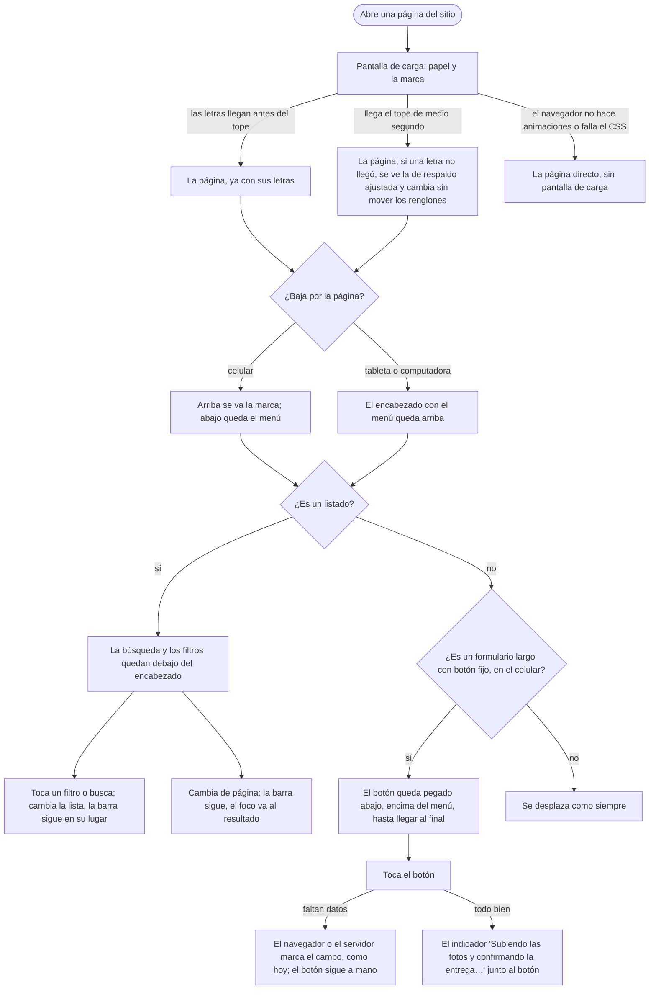

# Flujo: lo que queda fijo y la pantalla de carga (R11-33, R11-40)

> **Estado:** en revisión · **Fecha:** 2026-11-12 · **Aprobó:** falta la aprobación del usuario
> Ficha de la skill `ux-flujo` para el lote `p2-armazon` del
> [backlog de la revisión del 2026-11-11](../backlog-revision-2026-11-11.md) (P2, ruta STANDARD).
> Baja a pantalla la regla general 5 ("Qué queda fijo al desplazarse", sección 2 del backlog) y la
> decisión "Fuentes: pantalla de carga breve hasta que esté todo listo" (sección 3), con la condición
> de la sección 7, punto 4: se va sola por CSS, con un tope de tiempo, sin depender de JavaScript.
> Esas decisiones ya están tomadas: esta ficha no las reabre.
> No es una pantalla nueva: es el **armazón** de todas (encabezado, barra del menú, barra de
> búsqueda y filtros, botón principal) y la primera vista de cada página. Se comprueba en
> `publico-portada`, `donante-inicio`, `donante-entidades`, `admin-donantes` y
> `entidad-seguimiento-confirmar`.

## 0. Qué hay hoy (evidencia)

Leído en `e9331b3a2`. `[V]` es leído en el código; `[H]`, hipótesis sin medir.

| # | Hoy | Dónde |
|---|---|---|
| H1 | En el celular, el menú ya es una barra fija abajo (`position: fixed`, `z-index: 2`, celdas de 3,75 rem); desde 37,5 em pasa a `static` dentro de la cabecera `[V]` | `static/css/componentes/navegacion.css:10-16,38,228-234` |
| H2 | La cabecera privada (`header.armazon`) y la pública (`header.raices-cabecera`, también la de la portada) no quedan fijas: se van al bajar. Comparten el fondo de papel con el filete, estirado a los lados con `border-image` `[V]` | `static/css/app.css:111-132`, `static/css/privado.css:14-21,126-160`, `templates/layout-privado.html:25-103`, `templates/layout-publico.html:30-38`, `templates/publico-portada.html:26-35` |
| H3 | En la pantalla grande la cabecera de la administración ocupa dos filas: sus 7 secciones no entran en una `[V]` | `static/css/privado.css:166-172` (el comentario y `ul:not(:has(li:nth-child(6)))`) |
| H4 | La barra de búsqueda y filtros (`form.filtros-barra`) no queda fija. La usan Donantes, Organizaciones, Camiones, Ranking, Asignaciones e Importaciones del admin, Entidades del donante y la pública y la bandeja de notificaciones `[V]`. Otras listas usan el formulario anterior, `form.filtro`, con estilos de cada pantalla: Mis donaciones, Entidades de la persona, Recibidas, Donaciones públicas y el Mapa `[V]` | `static/css/componentes/filtros.css:13-17`, `admin-donantes.html:157`, `donante-entidades.html:65`, `persona/donante-entidades.html:82`, `entidad-recibidas.html:67`, `donante-donaciones.html:67`, `publico-donaciones.html:36`, `publico-mapa.html:60`, `componentes/buzon.html` |
| H5 | Los menús de las pastillas de filtros se abren por encima con `z-index: 4`; el menú de la cuenta, con `z-index: 5` dentro de la cabecera; las abejas de la portada llegan a `z-index: 4`; los avisos breves van fijos abajo a 5,5 rem con `z-index: 3` `[V]` | `filtros.css:154`, `navegacion.css:349`, `componentes/huerta.css:335-394`, `componentes/aviso.css:153-155` |
| H6 | Ya hay piezas que se quedan quietas al bajar, medidas desde el borde de arriba de la ventana: el índice del registro (`top: 0`), la etiqueta del acta en Confirmar recepción (`top: 1.5rem`), "Cómo sigue" del registro de organización (`top: 1.5rem`), el panel de Asignaciones, el mapa del público y el de Seguir entregas `[V]`. Con una cabecera fija, quedarían tapadas por ella `[H]` | `componentes/registro.css:97-99`, `entidad-seguimiento-confirmar.css:334-337`, `publico-registro.css:424-425`, `admin-secciones.css:165-166`, `componentes/mapa.css:299-300,310-311`, `entidad-seguimiento.css:54-55` |
| H7 | En Confirmar recepción, "Confirmar recepción" está al final del acta, dentro de `div.firma` con el nombre de quien recibe, el indicador de envío, la nota y "Llegó con un problema". En el celular hay que bajar hasta el final para verlo `[V]` | `templates/entidad-seguimiento-confirmar.html:261-280` |
| H8 | Las tres letras se cargan con `font-display: swap` desde `@font-face`, y `tokens.css` llega por `@import` desde `app.css`, que a su vez llega por `@import` desde la hoja de cada pantalla: el navegador descubre las letras tarde, dibuja con la de respaldo (`"Arial Narrow"`, `system-ui`) y salta al llegar la definitiva `[V]` (el orden) `[H]` (cuánto tarda) | `static/css/tokens.css:6-31,44-45`, `static/css/app.css:10`, `static/css/privado.css:7`, `static/css/publico-portada.css:5` |
| H9 | No hay ninguna precarga de letras (`rel="preload"`) en las plantillas `[V]` | `templates/interaccion.html` (`cargar`), los tres `<head>` |
| H10 | Las cerca de diseño: las media queries solo pueden usar `min-width` con los quiebres de `tokens.css`; los `@keyframes` y los tiempos viven solo en `movimiento.css` o `app.css`; las duraciones salen de tokens; toda clase de una plantilla está en el catálogo `[V]` | `src/test/java/grupo5/cliente/InterfazFitnessTest.java:96-100,154,295,395,410,307` |
| H11 | Entre páginas rige `@view-transition` (fundido corto) solo con "sin preferencia de movimiento"; HTMX cambia solo `main#contenido` sin volver a dibujar el `body` `[V]` | `static/css/app.css:314-331`, `templates/interaccion.html` |

## 1. Para quién y para qué

| | |
|---|---|
| Quién | Todos los roles. Sobre todo: la persona de la organización que confirma una entrega en la puerta, con el celular en una mano; la persona del admin que recorre 20.000 donantes en la computadora; quien dona y busca una organización en el celular; quien entra por primera vez a la portada |
| Tono | No habla: ordena. La pantalla de carga no tiene texto (ver sección 6); el resto conserva el texto de cada pantalla ([tono según la pantalla](../tono-y-comunicacion.md#tono-según-la-pantalla)) |
| Qué quiere lograr | "Bajar por la lista sin perder el menú ni la búsqueda", "tener a mano el botón para confirmar" y "que la página no salte cuando termina de cargar" |
| Dispositivo principal | Ambos. Lo fijo cambia según el ancho y el alto de la ventana (sección 4) |
| Requerimientos | Regla general 5 del backlog; RNF-CL-02 (mejora progresiva: lo esencial anda sin JavaScript); RNF-UI-06 (respuesta si la espera pasa de 300 ms); RNF-UI-01 a 03; WCAG 2.2 AA, en especial 2.4.11 (el foco no queda tapado), 1.4.10 (reflujo a 320 px) y 2.3.3 (reducir movimiento); controles de 48 × 48 px |
| Datos que usa | Ninguno. No pide nada a los servicios ni cambia controladores |
| Boceto de E1 | Sin boceto. Sale de la regla 5 y de los patrones de la cátedra |

**Patrones conocidos que sigue** ([criterios de la cátedra](../criterios-catedra-ux-ui.md)):

- **Barra superior** (*top app bar*, §4): la marca, la navegación y las acciones de la cuenta,
  siempre a la vista desde la tableta. En Material, *top app bar* fija al desplazarse.
- **Barra de navegación inferior** (§4): en el celular el menú ya está abajo y fijo, al alcance del
  pulgar (§5, "lo frecuente, al alcance del pulgar"). No cambia.
- **Barra de búsqueda fija** sobre una lista (Material *Search* y *Chips* de filtro arriba de los
  resultados): lo que se busca queda a la vista mientras se recorre lo encontrado (heurística 6).
- **Botón principal fijo abajo** en el celular, como el botón de acción de una hoja de pago o de
  un formulario largo (§5, "Botón de acción flotante: solo para la acción más importante de la
  pantalla"). Acá no flota sobre el contenido: es una franja pegada al borde de abajo, encima del
  menú, que vuelve a su lugar al llegar al final.
- **Pantalla de carga** (*splash* o *launch screen* de HIG y Material): breve, con la marca, sin
  texto ni barra de progreso, y que nunca bloquea.

## 2. Dónde está en el sitio

No tiene lugar propio en el [mapa del sitio](../mapa-del-sitio.md): es el marco común de
`layout-privado`, `layout-publico` y la portada, más dos piezas que usan las pantallas.

| Pieza | Dónde aparece | Dónde vive |
|---|---|---|
| Encabezado fijo | Todas las pantallas privadas y públicas, desde la tableta | `app.css` (`.raices-cabecera`, `.armazon`) y `navegacion.css` |
| Menú fijo abajo | Todas, en el celular (ya existe) | `navegacion.css` |
| Barra de búsqueda y filtros fija | Todo listado completo con `form.filtros-barra` o `form.filtro`, salvo el Mapa público (sección 9, decisión 6) | `filtros.css` |
| Botón principal fijo | Los formularios largos que lo piden con `data-fijo="celular"`. En este lote, solo Confirmar recepción | `app.css` (la utilidad) y la hoja de la pantalla |
| Pantalla de carga | La primera vista de cada página que se carga entera (no los cambios de HTMX) | `app.css` y `movimiento.css` (la animación), `tokens.css` (tiempos y letras de respaldo) |

## 3. Recorrido



Desvíos considerados:

- **Sin JavaScript:** todo lo de esta ficha es CSS. La pantalla de carga se va sola; lo fijo
  funciona igual. Los filtros siguen siendo un formulario GET que recarga la página.
- **El CSS no carga o el navegador no anima:** la pantalla de carga no aparece nunca (su estado
  de reposo es "oculta"; la animación solo la muestra). Lo fijo no se aplica y la página se
  desplaza entera, como hoy.
- **"Reducir movimiento":** la pantalla de carga se va de golpe en el mismo tope, sin fundido.
- **Ventana baja** (celular de costado, una computadora con la ventana achicada): si la ventana
  mide menos de 37,5 em de alto, nada queda fijo arriba; el menú del celular sigue abajo.
- **Celular chico** (menos de 45 em de alto, como 360 × 640): la barra de filtros no queda fija,
  porque taparía más de un tercio de la pantalla.
- **Letra al 200 %** en la computadora: pasa a la forma de la tableta; con 400 % (320 px), a la del
  celular, donde arriba no queda nada fijo. No hay desplazamiento horizontal.
- **Teclado:** al recorrer con Tab, lo que recibe el foco nunca queda debajo del encabezado, de la
  barra de filtros, del menú de abajo ni del botón fijo (sección 7).
- **Un enlace a una parte de la página** ("Saltar al contenido", `#fotos`): llega debajo del
  encabezado, no detrás.
- **Volver con Atrás:** la página que vuelve de la memoria del navegador no repite la pantalla de
  carga; HTMX tampoco la repite al cambiar de panel.
- **Imprimir:** sin pantalla de carga y sin nada fijo.

## 4. Pantallas

### 4.1 El encabezado fijo (desde la tableta)

```text
Computadora, 1280 × 800, donante
┌───────────────────────────────────────────────────────────────┐ ← fijo arriba
│ ◆ DonaTrack  Inicio Donaciones Seguimiento Organizaciones  🔔 ◯ │
├───────────────────────────────────────────────────────────────┤ filete
│ (la página se desplaza por debajo)                            │
```

- Desde 37,5 em de ancho **y** 37,5 em de alto, `header.armazon` y `header.raices-cabecera` quedan
  pegados arriba (`position: sticky; top: 0`), con el papel y el filete de hoy. No cambia su
  contenido, su orden ni su alto.
- En la tableta la cabecera privada tiene dos filas (marca y cuenta; el menú debajo) y en la
  administración también en la computadora (H3): queda fija entera. Es lo que pide la regla 5
  ("el encabezado con el menú").
- En el celular, arriba **no queda nada fijo**: la marca, la campanita y la cuenta se van al bajar
  y el menú, que es lo que nombra la regla, ya está fijo abajo (H1). Ver decisión 1.
- La portada usa la misma cabecera pública (`.raices-cabecera`): queda fija igual, sin tocar su
  plantilla. Las abejas pasan por debajo del encabezado.
- Una medida nueva, `--medida-cabecera-fija`, dice cuánto ocupa lo fijo de arriba: 0 en el
  celular y en ventanas bajas; el alto medido de la cabecera desde la tableta, con un valor
  propio para la administración (dos filas). El constructor la mide en 768, 1280 y 1920 px para
  cada rol y deja el valor redondeado hacia arriba.

### 4.2 La barra de búsqueda y filtros fija (en los listados)

```text
Computadora, admin-donantes
┌───────────────────────────────────────────────────────────────┐ encabezado fijo
├───────────────────────────────────────────────────────────────┤
│ Buscar por nombre o CUIT                                      │ ← fija debajo
│ [______________________] [Buscar]   (Tipo ▾) (Estado ▾) (Orden ▾)│   del encabezado
├───────────────────────────────────────────────────────────────┤ filete
│ 20.000 donantes. Página 3 de 1000.                            │
│ fila · fila · fila … (se desplazan por debajo)                │
│ « ‹ 1 2 3 … 1000 › »                                          │
└───────────────────────────────────────────────────────────────┘

Celular de 390 × 844, donante-entidades
┌─────────────────────────┐
│ Buscar por nombre       │ ← fija arriba (la marca ya se fue)
│ [____________] [Buscar] │
│ (Categoría ▾) (Ya doné) │
├─────────────────────────┤
│ tarjeta · tarjeta …     │
├─────────────────────────┤
│ Inicio Donac. Org. Perfil│ ← menú fijo abajo (ya existe)
└─────────────────────────┘
```

- `form.filtros-barra` y `form.filtro` quedan pegados debajo de lo fijo de arriba
  (`top: var(--medida-cabecera-fija)`), sobre papel, con el filete abajo y un poco de aire arriba y
  abajo para que no se peguen a las filas. Se quedan quietos solo mientras se recorre su listado:
  al terminar la sección que los contiene, se van con ella (lo da `sticky` dentro de su
  contenedor, sin JavaScript).
- Cuándo queda fija: desde la tableta, si la ventana mide al menos 37,5 em de alto; en el
  celular, si mide al menos 45 em de alto (los celulares de hoy, de 390 × 844 o 412 × 915; no los
  de 360 × 640). En el celular, la barra fija no ocupa más de un cuarto del alto de la ventana;
  si en una pantalla lo pasa, el constructor achica los espacios de la barra (no saca el rótulo).
- Los menús de las pastillas se siguen abriendo hacia abajo por encima de la lista. El menú de
  la cuenta sigue abriéndose por encima de la barra.
- Entre el encabezado y la barra nunca se ve la lista: si la medida del encabezado queda un poco
  más grande que el real, el papel de la barra cubre el hueco hacia arriba.
- El Mapa público no la fija (decisión 6). El resto de los listados con barra, sí, sin tocar sus
  plantillas.

### 4.3 El botón principal fijo (en el celular)

```text
Celular de 360 × 640, entidad-seguimiento-confirmar
┌─────────────────────────┐
│ Confirmar recepción     │
│ Etiqueta de la entrega  │
│ Fotos  [Agregar fotos]  │
│ Número de remito [____] │ (se desplaza)
├─────────────────────────┤
│ [  Confirmar recepción ]│ ← pegado abajo, encima del menú
├─────────────────────────┤
│ Inicio Recib. Necesid. … │ ← menú fijo abajo
└─────────────────────────┘
Al llegar al final del acta, el botón vuelve a su lugar, entre "Recibe …" y la nota.
```

- Una utilidad nueva en `app.css`: lo marcado con `data-fijo="celular"` queda pegado abajo en el
  celular (`position: sticky; bottom:` el alto del menú de abajo), sobre papel, con el filete
  arriba y el mismo ancho que el formulario. Desde la tableta no queda fijo: el botón está a la
  vista sin bajar tanto y la etiqueta del acta ya queda fija al costado.
- Va solo en formularios largos cuyo botón principal está al final. En este lote, solo
  Confirmar recepción: es el flujo que se hace con el celular en la puerta. En los inicios y en los
  listados el botón principal está arriba ("Registrar un donante", "Seguir entregas") y no se fija:
  un botón que flota sobre una lista tapa filas y el paginador (decisión 3).
- En Confirmar recepción se fija el botón junto con su indicador de envío ("Subiendo las fotos y
  confirmando la entrega…"): los dos van en una envoltura con `data-fijo="celular"`. Para que esa
  envoltura se quede quieta mientras se recorre todo el acta y no solo la firma, en el celular
  `div.firma` deja de armar su propia caja (`display: contents`); el orden en pantalla no cambia.
  Toca la plantilla y la hoja de la pantalla (fuera de los archivos del lote, sección 9).
- El texto del botón no cambia: "Confirmar recepción" o, con un problema, "Confirmar y contar el
  problema". Ocupa el ancho del formulario; en 360 px entra en un renglón.

### 4.4 La pantalla de carga

```text
Cualquier ancho
┌─────────────────────────┐
│                         │
│                         │
│           ◆             │ ← la marca (img/logo.svg), centrada, sin texto
│                         │
│                         │
└─────────────────────────┘
papel liso (--color-papel), toda la ventana
```

- Es un `body::before` de `app.css`: no agrega marcado, así que vale en la portada, en las
  páginas de error y en todas las demás sin tocar sus plantillas. Cubre toda la ventana, encima de
  todo, con el papel y la marca (`img/logo.svg`) centrada a 3 rem de ancho.
- **Su estado de reposo es oculta.** Una animación la muestra desde el primer dibujo y la
  apaga: opaca hasta los 0,3 s (`--p-espera-1`) y un fundido de 0,2 s (`--p-tiempo-1`), así que
  **a los 0,5 s ya no está, siempre**. Si el navegador no anima, no aparece. Con "reducir
  movimiento", se va de golpe a los 0,5 s.
- **Nunca bloquea:** no recibe toques ni clics (`pointer-events: none`) ni el foco, y los lectores
  de pantalla no la leen (no tiene texto). Lo que se toque en ese medio segundo llega a la página.
- No espera de verdad a las letras: CSS no puede saber cuándo llegaron sin JavaScript. Por eso
  van dos ayudas que hacen que en ese medio segundo casi siempre lleguen, y que si no llegan el
  cambio no mueva los renglones:
  1. **Precarga** de las dos letras de todas las páginas (Archivo y DM Sans, no la cursiva) en el
     `<head>`, con `rel="preload" as="font" type="font/woff2" crossorigin`, para que el navegador
     las pida apenas lee la página y no al final de la cadena de `@import` (H8).
  2. **Letras de respaldo ajustadas** en `tokens.css`: un `@font-face` para cada una que usa una
     letra local (Arial) con `size-adjust`, `ascent-override`, `descent-override` y
     `line-gap-override` calculados de las métricas de Archivo y de DM Sans, puestas en la pila
     justo después de la definitiva. Si la letra llega tarde, el texto cambia de forma pero los
     renglones casi no se mueven. `font-display: swap` se queda: el texto se ve siempre.
- Vuelve a aparecer en cada página que se carga entera (no al cambiar de panel con HTMX ni al
  volver con Atrás desde la memoria del navegador). Con las letras ya guardadas, es un parpadeo
  de papel de medio segundo (decisión 5 y duda 1).
- Las pruebas visuales (`-Pvisual`) y las capturas tienen que tomar la página sin la pantalla de
  carga: con las animaciones apagadas, Playwright la deja en su final (oculta); si no, esperan
  0,5 s.

## 5. Estados

| Pantalla o pieza | Estado | Qué se ve | Texto |
|---|---|---|---|
| Pantalla de carga | Cargando (0 a 0,3 s) | Papel y la marca | Ninguno |
| Pantalla de carga | Saliendo (0,3 a 0,5 s) | Se funde y aparece la página | Ninguno |
| Pantalla de carga | Terminada (desde 0,5 s) | La página | El de la página |
| Pantalla de carga | Sin animaciones o sin CSS | La página directo | El de la página |
| Pantalla de carga | Reducir movimiento | Papel y la marca hasta 0,5 s; después, la página de golpe | Ninguno |
| Pantalla de carga | La letra no llegó al tope | La página con la letra de respaldo ajustada; cambia sin mover los renglones | El de la página |
| Encabezado | Arriba de todo | Como hoy | Sin cambios |
| Encabezado | Desplazado (tableta y computadora) | Fijo arriba, con el filete | Sin cambios |
| Encabezado | Desplazado (celular o ventana baja) | Se va con la página; el menú sigue abajo | Sin cambios |
| Encabezado | Menú de la cuenta o campanita abiertos | El desplegable por encima de todo lo fijo | Sin cambios |
| Barra de filtros | Con resultados | Fija debajo del encabezado mientras se recorre la lista | El de cada pantalla ("20.000 donantes. Página 3 de 1000.") |
| Barra de filtros | Sin resultados | Fija; debajo, el aviso de "sin resultados" de la pantalla, sin cambios | El de cada pantalla |
| Barra de filtros | Cargando (HTMX) | Fija; el indicador de la pantalla, como hoy | El de cada pantalla |
| Barra de filtros | Error del servidor | No se dibuja (cada pantalla ya la oculta y muestra su aviso) | El de cada pantalla |
| Barra de filtros | Celular chico | Se desplaza con la página, como hoy | Sin cambios |
| Barra de filtros | Pastilla abierta | El menú de la pastilla por encima de la lista | Sin cambios |
| Botón fijo | Antes de llegar al final | Pegado abajo, encima del menú | "Confirmar recepción" o "Confirmar y contar el problema" |
| Botón fijo | Al llegar al final | En su lugar, entre "Recibe …" y la nota | Igual |
| Botón fijo | Enviando | Apagado, con el indicador al lado | "Subiendo las fotos y confirmando la entrega…" (el de hoy) |
| Botón fijo | Error de datos | La pantalla de error de hoy, con el botón fijo otra vez | El de `entidad-seguimiento-confirmar-error` |
| Botón fijo | Sin permiso | La página de error de siempre, sin botón | El de la página de error |

## 6. Textos

Este lote **no agrega ni cambia textos visibles**. La decisión es deliberada:

| Elemento | Texto | Nota |
|---|---|---|
| Pantalla de carga | Ninguno | Un texto se vería con la letra de respaldo justo cuando se quiere evitar eso, y en medio segundo no se alcanza a leer. La marca alcanza para decir dónde se está |
| Nombre accesible de la pantalla de carga | Ninguno | Es decoración: el lector de pantalla lee la página, que ya está debajo |
| Botón fijo | El de hoy | No cambia su texto ni su lugar en el orden de lectura |
| Barra de filtros | La de hoy | No cambia rótulos ni pastillas (su rediseño es de otro lote) |

Filtro de tono: no hay texto nuevo que pasar por las 7 preguntas. La pantalla de carga no
promete nada ("Cargando…" no aparece) y nunca dura más de medio segundo: no simula una espera que
no existe más allá de ese tope.

Ayudas por flujo crítico ([patrones y textos](../patrones-y-microcopy.md#ayudas-por-flujo-crítico-rnf-ui-04)):
Confirmar recepción conserva las suyas; el botón fijo no tapa la ayuda del remito ni la nota del
final, porque el foco y los enlaces internos dejan lugar abajo (sección 7).

## 7. Accesibilidad

- **El foco no queda tapado (WCAG 2.4.11):** `html` lleva `scroll-padding-top` igual a lo fijo de
  arriba (`--medida-cabecera-fija`) y, en las páginas con barra de filtros
  (`html:has(.filtros-barra, form.filtro)`), además el alto de la barra fija
  (`--medida-filtros-fijos`, medido como la cabecera). Abajo, `scroll-padding-bottom` igual al
  menú del celular (`--medida-menu-celular`, 3,75 rem) más el botón fijo cuando la página lo tiene
  (`html:has([data-fijo="celular"])`). Así Tab, "Saltar al contenido", `#fotos` y el foco que pone
  el paginador en el resultado llegan a la vista.
- **Orden del foco y de lectura:** no cambia. Lo fijo es solo visual; el encabezado sigue primero,
  la barra antes de la lista y el botón en su lugar del formulario.
- **Zonas:** las de hoy (`header`, `nav aria-label="Secciones"`, `main`, `form role="search"`). No
  se agregan zonas.
- **La pantalla de carga:** sin texto, sin foco, sin toques; no la anuncia nada. No parpadea
  (una sola salida, sin destellos: WCAG 2.3.1).
- **Reducir movimiento:** sin fundido; lo fijo no tiene animación.
- **Reflujo (1.4.10):** a 320 px no hay nada fijo arriba ni desplazamiento horizontal.
- **Alto contraste del sistema (`forced-colors`):** la pantalla de carga usa `Canvas` de fondo y
  los fijos, `Canvas` con el filete en `CanvasText`.
- **Capas:** una escala de `--capa-*` en `tokens.css` para que nada fijo quede debajo de otra
  cosa: contenido fijo de una pantalla (1), barra de filtros fija (6), menú del celular (7),
  encabezado fijo (8), pantalla de carga (20). Los desplegables nativos (`popover`, `dialog`) van
  en la capa superior del navegador, por encima de todo.
- **Controles:** el botón fijo mantiene 48 px de alto y el ancho del formulario.

## 8. Revisión de usabilidad

| # | Heurística | Cómo la cumple | Riesgo que queda |
|---|---|---|---|
| 1 | Visibilidad del estado | La sección actual del menú y lo que se buscó quedan a la vista mientras se baja; el indicador de envío viaja con el botón fijo | La pantalla de carga no muestra avance: se acepta porque nunca pasa de 0,5 s |
| 2 | Lenguaje del usuario | No hay texto nuevo; la marca dice "DonaTrack" sin palabras | Ninguno |
| 3 | Control y libertad | El menú y la cuenta siempre a mano para salir o cambiar de sección; la pantalla de carga no bloquea nada | Un toque en el primer medio segundo llega a una página que todavía no se ve |
| 4 | Consistencia | Mismo comportamiento en todas las pantallas del mismo tipo: todo listado con barra la fija; toda cabecera, igual | Las listas con `form.filtro` (estilos de cada pantalla) pueden verse un poco distintas fijas; el constructor las mira |
| 5 | Prevención de errores | El botón fijo está a mano en el celular | Se puede tocar "Confirmar" antes de cargar las fotos: el navegador marca lo obligatorio y el servidor responde con la pantalla de error de hoy |
| 6 | Reconocer antes que recordar | La búsqueda y los filtros elegidos se ven sin volver arriba | Ninguno |
| 7 | Flexibilidad | Quien usa el teclado no pierde el foco debajo de lo fijo; quien pide reducir movimiento no ve el fundido | Ninguno |
| 8 | Diseño minimalista | Nada nuevo en pantalla; en el celular solo lo imprescindible queda fijo (menú, y barra o botón según la pantalla) | En el celular, menú + barra de filtros llegan a un tercio del alto; por eso la barra no se fija en celulares chicos |
| 9 | Recuperarse de errores | Los errores de cada pantalla no cambian; si el CSS falla, todo se desplaza como hoy | Ninguno |
| 10 | Ayuda | Las ayudas de cada flujo siguen en su lugar y no quedan tapadas | Ninguno |

Los 7 factores de Morville:

- **Útil:** la búsqueda y el botón principal se usan sin volver a buscarlos.
- **Usable:** menos desplazamiento para filtrar o confirmar.
- **Deseable:** la página aparece entera y quieta, sin el salto de la letra.
- **Valioso:** con 20.000 donantes, el admin filtra sin perder la lista.
- **Ubicable:** el menú y la sección actual siempre a la vista.
- **Accesible:** foco nunca tapado, sin movimiento con "reducir movimiento", reflujo a 320 px.
- **Creíble:** la pantalla de carga no simula una espera: tiene tope y no promete nada.

Para probar con personas reales (la revisión heurística no lo reemplaza): si el parpadeo de
papel en cada página molesta después de la primera, si en el celular la barra de filtros fija se
siente como que "come" la lista, y si alguien toca "Confirmar recepción" antes de cargar las fotos
porque lo tiene a la vista.

## 9. Decisiones y preguntas

Decisiones de este diseño (propuesta del agente, para la [bitácora](../bitacora.md) al construir):

1. **En el celular, arriba no queda nada fijo.** El menú, que es lo que nombra la regla 5, ya
   está fijo abajo; la marca, la campanita y la cuenta se van al bajar. Descartado: fijar también
   la cabecera de arriba en el celular (sumada al menú de abajo y a la barra o al botón, se come
   más de un tercio de la pantalla) y esconderla al bajar y mostrarla al subir (necesita
   JavaScript o líneas de tiempo del scroll que no todos los navegadores tienen).
2. **Lo fijo de arriba solo con ventanas de al menos 37,5 em de alto** (y la barra en el celular,
   de 45 em). Descartado: fijarlo siempre (con el celular de costado taparía la mitad).
3. **El botón principal fijo, solo en formularios largos con la acción al final, y en este lote
   solo Confirmar recepción.** Descartado: un botón flotante en inicios y listados (tapa filas y
   el paginador; la acción ya está arriba) y aplicarlo ya a todos los formularios (toca plantillas
   de otros lotes; la utilidad queda lista para que cada lote la sume).
4. **La pantalla de carga es un `body::before` oculto en reposo y mostrado por una animación
   con tope de 0,5 s.** Descartado: un elemento en las plantillas (no llega a la portada sin
   tocarla), quitarla con JavaScript cuando lleguen las letras (rompe la condición del backlog) y
   un tope más largo (demora cada página).
5. **Se muestra en cada página que se carga entera.** CSS no distingue la primera visita de las
   siguientes, y el servidor tendría que guardar una marca por visitante. Descartado para este
   lote: mostrarla solo la primera vez (duda 1).
6. **El Mapa público no fija su filtro:** ya fija el mapa al costado en la computadora y en el
   celular lo que importa es el mapa. Descartado: fijarlo como los demás.
7. **Precarga y letras de respaldo ajustadas, además de la pantalla:** son las que de verdad
   quitan el salto. La pantalla de carga sola no lo arregla si la letra tarda más de medio
   segundo. Descartado: `font-display: optional` (la primera visita podría quedarse sin la letra
   de la identidad) y `block` (texto invisible hasta 3 s).
8. **Medidas fijas medidas, no calculadas:** `--medida-cabecera-fija` y `--medida-filtros-fijos`
   por ancho y por rol, redondeadas hacia arriba, con el papel de la barra tapando cualquier
   diferencia. Descartado: medir con JavaScript (rompe RNF-CL-02).

**Fuera de los archivos del lote** (imprescindible, para el constructor; cada uno es una línea o
un atributo):

- `templates/interaccion.html` (fragmento `cargar`): las dos precargas de letras. Es el único
  lugar que comparten los tres `<head>` (los dos layouts y la portada).
- `static/css/movimiento.css`: el `@keyframes` de la pantalla de carga (la cerca de diseño lo pide
  ahí o en `app.css`; va en `movimiento.css`, con las demás).
- Las piezas que ya se quedan quietas (H6) pasan de `top: 0`, `1rem`, `1.5rem` o `--espacio-4` a
  `calc(var(--medida-cabecera-fija) + …)`: `componentes/registro.css`,
  `entidad-seguimiento-confirmar.css`, `publico-registro.css`, `admin-secciones.css`,
  `componentes/mapa.css` y `entidad-seguimiento.css`. Sin esto, quedan tapadas por el encabezado.
- `templates/entidad-seguimiento-confirmar.html` y `entidad-seguimiento-confirmar.css`: la
  envoltura del botón y su indicador con `data-fijo="celular"` y `.firma` con `display: contents`
  en el celular.
- `docs/interfaz/componentes.md`: `data-fijo="celular"` y lo fijo de la cabecera y de la barra (la
  cerca de diseño rechaza lo que no está en el catálogo).

**Criterios para dar por construido** (además de los de `vista-ui`):

1. Sin JavaScript, en las cinco pantallas, la pantalla de carga no está a los 0,6 s.
2. Con la red lenta del navegador, la página no salta de forma visible al llegar la letra
   (desplazamiento acumulado de diseño menor a 0,05 en la portada y en `donante-inicio`).
3. A 768, 1280 y 1920 px, al bajar en `admin-donantes` y `donante-entidades`, no se ve la lista
   entre el encabezado y la barra, y nada queda debajo de nada.
4. Recorriendo con Tab una lista larga a 1280 px y Confirmar recepción a 360 px, el foco nunca
   queda tapado.
5. A 360 × 640, en Confirmar recepción, el botón queda pegado encima del menú y vuelve a su lugar
   al final; la barra de filtros de `donante-entidades` no queda fija. A 390 × 844, sí.
6. `InterfazFitnessTest` en verde, sin cambiar sus reglas.

Preguntas abiertas para el usuario: ninguna bloqueante. Las dudas que dejó el diseño, con su
opción recomendada, van en el reporte del lote.
