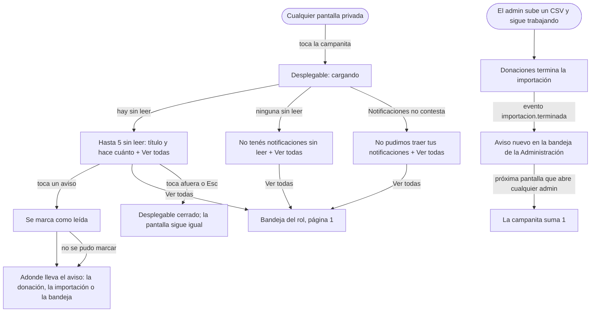

# Flujo: La campanita con desplegable y los avisos de la administración (R11-29, R11-30)

> **Estado:** en revisión · **Fecha:** 2026-11-12 · **Aprobó:** pendiente (parada de diseño de la oleada P2)
> Ficha de la skill `ux-flujo` para el lote `p2-campanita` del
> [backlog de la revisión del 2026-11-11](../backlog-revision-2026-11-11.md) (P2, ruta CONTRATO).
> Las decisiones del usuario "Campanita" y "Avance de la importación" de la sección 3 del backlog ya
> están tomadas: esta ficha las baja a pantallas, no las reabre. El contrato va en la
> [spec corta del lote](../../specs/active/R11-p2-campanita-spec.md).
> La campanita no es una pantalla: es una pieza de la cabecera del área privada
> (`layout-privado.html`), por eso tiene ficha propia. Lo que esta ficha dice de la bandeja del admin
> manda sobre la parte de Notificaciones de la [ficha del admin](raices-admin-navegable.md); cómo se
> ve cada fila de una bandeja sigue siendo lo de la [ficha de la bandeja](r11-p1-notificaciones.md).

## 0. Qué pasa hoy (evidencia)

Leído en `e9331b3a2`. `[V]` es leído en el código; `[H]`, hipótesis.

| # | Hoy | Dónde |
|---|---|---|
| H1 | La campanita es un enlace: lleva directo a la bandeja del rol, con el número de sin leer `[V]` | `layout-privado.html:61-83` |
| H2 | El admin ya tiene campanita, pero su número sale de la maqueta: fuera de ella, `AvisosRest` devuelve 0 porque la cuenta del admin no tiene persona en el token `[V]` | `layout-privado.html:84-99`, `rest/AvisosRest.java:35-43` |
| H3 | La bandeja del admin dibuja una lista de ejemplo escrita en su plantilla, con el buzón viejo que filtra en la página `[V]` | `admin-notificaciones.html:95-96` |
| H4 | Notificaciones ya guarda avisos para "la Administración": el de mensaje de contacto nuevo va a la persona fija `ID_ADMIN`, sembrada en el arranque `[V]` | `ContactoService.java:90-95`, `config/AdminConstantes.java`, `config/AdminSeeder.java` |
| H5 | Ese aviso de contacto se guarda sin tipo, así que en una bandeja se titularía "Novedad" `[V]` | `NotificacionService.java` (`notificarPersona`), ficha de la bandeja §6 |
| H6 | Cuando termina una importación, Donaciones guarda el estado del archivo y no avisa a nadie: no hay evento ni notificación `[V]` | `ImportadorService.java:87-120` |
| H7 | La bandeja por persona ya acepta `leida=false` y `size`, con el total en `X-Total-Count`: alcanza para pedir "las 5 últimas sin leer" sin cambiar el endpoint `[V]` | `dto/FiltroBandeja.java`, `INotificacionController.java:63-65` |
| H8 | El nombre del archivo importado se decidió no mandarlo a notificaciones ni a logs (puede traer datos personales) `[V]` | [spec de importaciones](../../specs/completed/R11-p1-importaciones-spec.md), riesgos |

## 1. Para quién y para qué

| | |
|---|---|
| Quién | El donante (persona o empresa) y la persona de la organización, en cualquier pantalla de su área; la persona de la administración que subió un CSV de 20.000 filas y siguió trabajando en otra pantalla, o otra persona de la administración que entra después |
| Tono | Pantalla de trabajo: claro, útil, tranquilizador ([tono](../tono-y-comunicacion.md#tono-según-la-pantalla)) |
| Qué quiere lograr | "Ver qué hay de nuevo sin dejar lo que estoy haciendo, y enterarme cuando termina la importación sin quedarme mirando el avance" |
| Dispositivo principal | Ambos. El admin, sobre todo la computadora |
| Requerimientos | RF-08 (notificaciones del donante), RF-13 (avisos a la organización), RF-20 (importación masiva), RNF-UI-01 a 06, reglas generales 1, 2 y 4 del backlog |
| Datos que usa | `GET /api/notificaciones/persona/{personaId}?leida=false&size=5` (existe), `.../no-leidas/conteo` (existe), `PATCH /api/notificaciones/{id}/leida` (existe), el evento nuevo `importacion.terminada.v1` de Donaciones (spec del lote) |
| Boceto de E1 | Sin boceto. La pág. 6 dibuja la bandeja, no la campanita |

## 2. Dónde está en el sitio

- **La campanita** está en la cabecera de todas las pantallas privadas de los tres roles, al lado de
  la foto de la cuenta, como hoy. No agrega niveles: el desplegable vive en la pantalla en la que se
  abre ([mapa del sitio](../mapa-del-sitio.md)).
- **"Ver todas"** lleva a la bandeja del rol: `donante-notificaciones`, `entidad-notificaciones` o
  `admin-notificaciones` (nivel 2, sin cambios).
- **La bandeja del admin** (`admin-notificaciones`) pasa de lista de ejemplo a datos reales: es la
  bandeja de **la Administración**, una sola para todas las cuentas de administración (ver
  Decisiones 1).
- Un aviso de importación lleva a la página de esa importación (`admin-donantes-importado?archivo=…`
  o `admin-donantes-importando?archivo=…`), que ya existe y es nivel 3 bajo Importaciones.

## 3. Recorrido



Desvíos considerados:

- **Cerrar sin elegir:** tocar afuera, Esc o volver a tocar la campanita cierra el desplegable; el
  foco vuelve a la campanita (regla general 4, "desplegable liviano"). No se marca nada.
- **Abrir de nuevo:** cada vez que se abre, se vuelve a pedir la lista: si llegó un aviso mientras
  tanto, aparece.
- **El aviso no tiene adónde llevar** (aviso viejo sin tipo, o el de mensaje de contacto, que no
  tiene pantalla en el sitio): tocarlo lo marca como leído y lleva a la bandeja, a la página 1.
- **Falla al marcar:** se va igual al destino; el aviso sigue sin leer y se puede marcar desde la
  bandeja. No se muestra error: la persona pidió ir a un lugar y llegó.
- **Notificaciones no contesta o se vence la espera:** el desplegable muestra el error y "Ver todas";
  la pantalla de abajo no se rompe. El número de la campanita, como hoy, queda sin mostrarse.
- **Más de 5 sin leer:** se ven las 5 más nuevas y la cifra total arriba ("5 de 12 sin leer").
- **Sin JavaScript:** la campanita abre igual (es un `<details>`), pero sin lista: muestra "Ver todas
  las notificaciones", que lleva a la bandeja. Lo esencial (llegar a los avisos) no depende del
  JavaScript.
- **Sin permiso o sin sesión:** sin cambios; la campanita solo se dibuja en el área privada.
- **La importación se corta:** el aviso dice que se cortó, con las filas que sí quedaron guardadas.
- **Dos admins:** los dos ven el mismo aviso; si uno lo abre, queda leído para los dos (Decisiones 1).

## 4. Pantallas

**Patrón conocido:** el panel de notificaciones de la barra superior (la campanita de GitHub,
Facebook o Gmail en la web): un menú que se despliega desde la barra superior, con los avisos como
lista corta y un vínculo a la bandeja completa. En los [criterios de la
cátedra](../criterios-catedra-ux-ui.md#4-patrones-de-navegación): barra superior con "las acciones de
esa pantalla" y, dentro del desplegable, una **lista** donde tocar un ítem lleva al detalle
([§5](../criterios-catedra-ux-ui.md#5-patrones-de-interacción)). Material: Menus. Es la regla general
2 del backlog ("resumen dentro de otra pantalla, unos pocos y Ver todas"), con 5 en lugar de 3 porque
así lo decidió el usuario para la campanita.

### Campanita abierta, en la computadora

```text
                                              ┌─────┐ ┌────┐
 … Inicio  Donaciones  Seguimiento  Más        │ 🔔 4│ │ 🌱 │
                                              └──┬──┘ └────┘
                    ┌──────────────────────────────┴──────────┐
                    │ Notificaciones           4 sin leer     │
                    ├─────────────────────────────────────────┤
                    │ ● **Donación en camino**                │
                    │   hace 2 horas                          │
                    │ ● **Donación entregada**                │
                    │   ayer                                  │
                    │ ● **Subiste de categoría**              │
                    │   hace 3 días                           │
                    │ ● **Misión cumplida**                   │
                    │   hace 2 semanas                        │
                    ├─────────────────────────────────────────┤
                    │ Ver todas las notificaciones            │
                    └─────────────────────────────────────────┘
```

- Ancho fijo de unos 22 rem, alineado a la derecha de la campanita, debajo de la cabecera y por
  encima del contenido (no lo empuja).
- Cada aviso es una fila entera tocable (48 px de alto como mínimo): el punto, el título en negrita
  y debajo "hace cuánto" en texto chico apagado. Sin mensaje, sin categoría, sin acciones: para eso
  está la bandeja.
- Con más de 5 sin leer, la cabecera del desplegable dice "5 de 12 sin leer".

### Campanita abierta, en el celular (360 px)

```text
┌──────────────────────────────┐
│ ☰ DonaTrack         🔔4  🌱  │
├──────────────────────────────┤
│ Notificaciones    4 sin leer │
│ ● **Donación en camino**     │
│   hace 2 horas               │
│ ● **Donación entregada**     │
│   ayer                       │
│ ● **Subiste de categoría**   │
│   hace 3 días                │
│ ● **Misión cumplida**        │
│   hace 2 semanas             │
│ Ver todas las notificaciones │
└──────────────────────────────┘
```

- El desplegable ocupa todo el ancho, con el margen lateral de 16 px, pegado debajo de la cabecera.
  No tapa la cabecera: la campanita sigue a la vista para cerrarlo.

### Admin: campanita y bandeja

```text
                    ┌─────────────────────────────────────────┐
                    │ Notificaciones           2 sin leer     │
                    ├─────────────────────────────────────────┤
                    │ ● **Terminó una importación**           │
                    │   hace 5 minutos                        │
                    │ ● **Nuevo mensaje de contacto**         │
                    │   ayer                                  │
                    ├─────────────────────────────────────────┤
                    │ Ver todas las notificaciones            │
                    └─────────────────────────────────────────┘
```

La bandeja del admin pasa a ser la misma bandeja paginada del donante y de la organización (ficha de
la bandeja): 20 por página, filtros en el servidor, sin leer con fondo suave, punto y título en
negrita. Cambia lo propio del admin:

- **Categorías del admin** (el menú "Categoría"): **Importaciones**, **Mensajes de contacto** y
  **Otras novedades** (las viejas sin tipo). Las categorías de ejemplo que hoy dibuja la plantilla
  (Donantes para confirmar, Entidades para aprobar, Donaciones por vencer, Problemas de logística,
  Asignaciones, Ranking) se sacan: ningún servicio genera esos avisos hoy y la bandeja no muestra
  categorías que nunca van a tener nada.
- **La cabecera** de la pantalla sigue como en la ficha del admin, con la cifra de sin leer real
  (sale del conteo de la Administración).
- **Una sola bandeja para todas las cuentas de administración.** La bajada lo dice (ver Textos).

## 5. Estados

| Pieza | Estado | Qué se ve | Texto |
|---|---|---|---|
| Campanita cerrada | Con sin leer | Campana y número | Lectores: "Notificaciones, 4 sin leer" (como hoy) |
| Campanita cerrada | Sin ninguna sin leer | Campana sola | Lectores: "Notificaciones" |
| Campanita cerrada | Notificaciones no contestó el conteo | Campana sola, sin número | Lectores: "Notificaciones" (como hoy: la cabecera no rompe la pantalla) |
| Desplegable | Cargando | La cabecera del desplegable y el indicador de carga, con `aria-busy="true"` | "Buscando tus notificaciones…" |
| Desplegable | Con sin leer (1 a 5) | La cabecera con la cifra, las filas y "Ver todas" | "Notificaciones" · "4 sin leer" (con 1: "1 sin leer") |
| Desplegable | Más de 5 sin leer | Las 5 más nuevas | "Notificaciones" · "5 de 12 sin leer" |
| Desplegable | Ninguna sin leer | Un texto y "Ver todas" | "No tenés notificaciones sin leer." · "Las que ya leíste siguen en la bandeja." |
| Desplegable | Error | Un texto y "Ver todas" | "No pudimos traer tus notificaciones." · "Probá de nuevo en un rato o abrí la bandeja." |
| Desplegable | Sin JavaScript | Solo el vínculo | "Ver todas las notificaciones" |
| Aviso del desplegable | Al tocarlo | Se va al destino (la página nueva muestra la campanita con un número menos) | Sin aviso: el cambio de pantalla ya cuenta lo que pasó |
| Bandeja del admin | Todos los de la ficha de la bandeja | Iguales | Los de la ficha de la bandeja, con "Todavía no hay notificaciones para la administración." como vacío |
| Bandeja del admin | Error del servidor | El banner de error con código | "No pudimos cargar las notificaciones de la administración." · "Volver a intentar" |
| Aviso de importación | Terminó sin errores | Fila de la bandeja y del desplegable | Título "Terminó una importación" · mensaje de la tabla de Textos |
| Aviso de importación | Terminó con filas con error | Igual | Título "Terminó una importación" · mensaje con las filas con error |
| Aviso de importación | Se cortó | Igual | Título "Una importación se cortó" · mensaje de la tabla de Textos |

En la organización, "tus notificaciones" se dice "tus novedades", como en su bandeja ("Buscando tus
novedades…", "No pudimos traer tus novedades."). En el admin, "las notificaciones de la
administración" ("No hay notificaciones sin leer para la administración.").

## 6. Textos

### El desplegable

| Elemento | Texto | Nota |
|---|---|---|
| Nombre de la campanita | `aria-label` "Notificaciones, 4 sin leer" · sin sin leer: "Notificaciones" | Como hoy |
| Título del desplegable | "Notificaciones" (organización: "Novedades") | `id` para `aria-labelledby` |
| Cifra | "4 sin leer" · con más de 5: "5 de 12 sin leer" | Es el total de la cuenta, del conteo del servicio; nunca el largo de la lista |
| Fila | Título del aviso (tabla de títulos de la ficha de la bandeja, más los del admin) y "hace cuánto" (el mismo cálculo del buzón: "recién", "hace 5 minutos", "ayer", "12 de septiembre") | Lectores: "Sin leer: <título>, <hace cuánto>" |
| Vínculo final | "Ver todas las notificaciones" (organización: "Ver todas las novedades") | Siempre presente, en todos los estados |

### Títulos nuevos (se suman a la tabla de la ficha de la bandeja)

| Tipo | Admin |
|---|---|
| `IMPORTACION_TERMINADA` | Terminó una importación |
| `IMPORTACION_CORTADA` | Una importación se cortó |
| `MENSAJE_CONTACTO` | Nuevo mensaje de contacto |
| Otro o sin tipo | Novedad |

### Mensajes de los avisos de importación

Los arma Notificaciones con las cifras del evento. **No llevan el nombre del archivo** (puede traer
datos personales, H8): llevan la fecha y hora de la subida, que alcanza para reconocerla, y el
vínculo lleva a la página donde está el nombre.

| Caso | Mensaje | Vínculo |
|---|---|---|
| Terminó sin errores | "La importación de donantes que se subió el 12/11 a las 18:30 terminó. Se leyeron 20.000 filas: 19.850 donantes nuevos y 150 actualizados. Todas las filas se importaron sin errores." | "Ver el resultado" → `admin-donantes-importado?archivo=<id>` |
| Terminó con errores | "La importación de donantes que se subió el 12/11 a las 18:30 terminó. Se leyeron 20.000 filas: 19.800 donantes nuevos, 150 actualizados y 50 con error." | "Ver el resultado y las filas con error" → `admin-donantes-importado?archivo=<id>` |
| Se cortó con filas guardadas | "La importación de donantes que se subió el 12/11 a las 18:30 se cortó después de leer 1.234 filas. Esas filas quedaron guardadas." | "Ver qué pasó" → la página que hoy elige `admin-importaciones` para una cortada con filas |
| Se cortó sin leer ninguna | "La importación de donantes que se subió el 12/11 a las 18:30 no se pudo leer. No se importó ninguna fila." | "Ver qué pasó" → `admin-donantes-importar-error` |
| Mensaje de contacto | Como hoy: "Nuevo mensaje de contacto Nº 12, sobre …" | Sin vínculo propio: no hay pantalla de mensajes en el sitio |

Las cifras usan punto de miles y dicen de qué son ("filas", "donantes nuevos"); los números son los
que da Donaciones, la pantalla no calcula ninguno ([cifras y datos](../tono-y-comunicacion.md#cifras-y-datos)).
La hora es la de Buenos Aires, como `subido_en`.

### Bajada de la bandeja del admin

"Los avisos de la administración. Son los mismos para todas las cuentas de administración: si
alguien abre uno, queda leído para todos."

Filtro de tono: los títulos dicen qué pasó, sin exclamaciones ("Una importación se cortó", no
"¡Error en la importación!"); lo cortado se dice cortado y dice qué sí quedó guardado; las cifras
dicen de qué son; ningún texto culpa a quien subió el archivo. "Se cortó" es la misma palabra que usa
la pantalla de avance.

Ayudas por flujo crítico: no aplica; la campanita no envía datos y lo único que cambia (leída) se
deshace desde la bandeja.

## 7. Accesibilidad

- **La campanita es un `<details>` con su `<summary>`**, como el menú de la cuenta (`cuenta-menu`):
  se abre con Enter o Espacio, anda sin JavaScript y lo cierran `paneles.js` (tocar afuera, Esc,
  perder el foco) igual que a la cuenta. El `summary` conserva el `aria-label` con la cifra.
- Al abrirse, el foco queda en la campanita; Tab entra a la primera fila. Esc cierra y devuelve el
  foco a la campanita.
- La lista es una `ol` de enlaces (o botones de formulario con aspecto de fila, ver la spec); la
  cifra y el estado de carga van en una región `aria-live="polite"` dentro del desplegable, para que
  "4 sin leer" o "No pudimos traer…" se anuncien al llegar.
- Cada fila dice su estado en texto para lectores ("Sin leer: …"); el punto es forma, no solo color.
- Áreas táctiles de 48 px: la campanita (como hoy) y cada fila.
- Contraste AA del título, el "hace cuánto" apagado y el vínculo sobre el fondo del desplegable, en
  claro y en oscuro; con colores forzados, el borde del desplegable y el punto siguen visibles.
- El desplegable no se va de la pantalla en 360 px (ancho completo con 16 px de margen) ni tapa la
  campanita.
- Con `prefers-reduced-motion`, se abre sin animación.

## 8. Revisión de usabilidad

| # | Heurística | Cómo la cumple | Riesgo que queda |
|---|---|---|---|
| 1 | Visibilidad del estado | El número en la campanita; "5 de 12 sin leer"; el admin se entera de que terminó la importación sin quedarse en el avance | El número no se actualiza solo: el aviso nuevo aparece al cambiar de pantalla o al abrir el desplegable |
| 2 | Lenguaje del usuario | "Terminó una importación", "se cortó", "filas", "donantes nuevos" | — |
| 3 | Control y libertad | Cerrar con afuera o Esc sin cambiar nada; lo marcado se desmarca en la bandeja | Tocar un aviso lo marca sin preguntar (es lo que hace la campanita de cualquier sitio) |
| 4 | Consistencia | El mismo desplegable que el menú de la cuenta; los mismos títulos y el mismo "hace cuánto" que la bandeja; el admin usa la misma bandeja que los otros roles | — |
| 5 | Prevención de errores | El vínculo final está siempre, también en error y sin JavaScript | — |
| 6 | Reconocer antes que recordar | El título dice qué pasó; el aviso de importación dice cuándo se subió | Sin el nombre del archivo, dos importaciones subidas casi a la vez se distinguen solo por la hora |
| 7 | Flexibilidad | Lo nuevo a un toque desde cualquier pantalla; la bandeja con filtros para el resto | — |
| 8 | Diseño minimalista | Solo título y hace cuánto; nada de acciones en el desplegable | — |
| 9 | Recuperarse de errores | Error del desplegable con "Ver todas"; falla al marcar no frena la navegación | — |
| 10 | Ayuda | La bajada de la bandeja del admin explica que es compartida | — |

Factores de Morville:

| Factor | Cómo |
|---|---|
| Útil | Lo nuevo sin salir de la pantalla; el admin se entera de que terminó la carga |
| Usable | Un toque para ver, uno para ir; se cierra como cualquier menú |
| Deseable | Un desplegable liviano y corto, sin la bandeja entera encima |
| Valioso | La importación de 20.000 filas en vivo se puede dejar corriendo: el aviso llega solo |
| Ubicable | En la cabecera de todas las pantallas privadas, en el mismo lugar |
| Accesible | `<details>` nativo, foco y Esc, estado en texto, 48 px |
| Creíble | Las cifras son del servicio; el aviso dice lo que pasó, también si se cortó |

Conviene probar con personas: si se entiende que tocar un aviso lo marca como leído; si dos personas
de la administración entienden que la bandeja es compartida al leer la bajada.

## 9. Decisiones y preguntas

Decisiones de esta ficha (propuesta del agente; van a la [bitácora](../bitacora.md) al construir):

1. **Una bandeja de la Administración, compartida por todas las cuentas de admin**, sobre la persona
   fija `ID_ADMIN` que Notificaciones ya usa para el aviso de contacto (H4). Descartado: una bandeja
   por cuenta de admin (las cuentas no tienen persona en Notificaciones; habría que copiarlas al
   crearlas y elegir a quién avisar, que es decidir otra cosa) y avisar solo a quien subió el archivo
   (Donaciones no guarda quién lo subió; además, en la demo cualquiera puede estar mirando).
2. **El desplegable se pide al abrirse, no en cada pantalla.** Cada pantalla ya pide el conteo; pedir
   también los 5 avisos sumaría una llamada por pantalla para algo que casi nunca se abre.
   Descartado: dibujarlo con la página (una llamada más siempre) y sondear cada tantos segundos.
3. **Tocar un aviso lo marca como leído y lleva a su destino.** Si no se marcara, las 5 del
   desplegable no cambiarían nunca salvo yendo a la bandeja. Descartado: un tilde por fila dentro del
   desplegable (más acciones en un panel que la decisión quiere corto).
4. **Sin "Marcar todas como leídas" en el desplegable.** La decisión pide título, hace cuánto y "Ver
   todas"; "Marcar todas" vive en la bandeja.
5. **El aviso de importación no lleva el nombre del archivo** (H8), lleva la fecha y la hora de la
   subida; el vínculo lleva a la página que lo muestra.
6. **También se avisa cuando la importación se corta**, con otro título. Un admin que dejó corriendo
   la carga necesita saber tanto que terminó como que no.
7. **El aviso de contacto pasa a tener tipo** (`MENSAJE_CONTACTO`), para que en la bandeja del admin
   no se titule "Novedad". Los avisos viejos de contacto siguen sin tipo (Otras novedades).
8. **Las categorías de ejemplo del admin se sacan** de la bandeja: solo quedan las que algún servicio
   genera hoy.

Preguntas abiertas: ninguna que frene la construcción. Las dudas para el usuario van en el reporte
del lote; la primera es la 1 (bandeja compartida).
