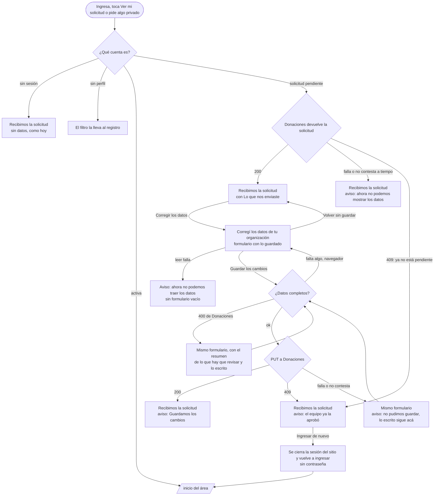

# Flujo: ver y corregir la solicitud mientras se espera (R11-41)

> **Estado:** aprobada · **Fecha:** 2026-11-12 · **Aprobó:** el usuario, 2026-11-12 (opciones recomendadas, aprobación automática pedida por él)
> Ficha de la skill `ux-flujo` para el lote `p2-pendiente-solicitud` del
> [backlog de la revisión del 2026-11-11](../backlog-revision-2026-11-11.md) (P2, ruta STANDARD,
> módulos `cliente-liviano` y `donaciones-service`).
> La decisión del usuario de la sección 3 del backlog ("Entidad sin aprobar: puede navegar lo
> público y, además, ver y corregir su solicitud") ya está tomada: esta ficha la baja a pantallas,
> no la reabre.
> Amplía, sin reemplazarla, la §4.7 de la [ficha pública](raices-publico-navegable.md) ("Solicitud
> enviada") y lo que dejó la [ficha de la portada con sesión](r11-p1-portada.md) para la cuenta
> pendiente ("Ver mi solicitud"). Suma los dos pendientes que la deuda le dejó a este lote: los
> tests y el espaciado de [DTI-41](../../adr/DEUDA_TECNICA.md#dti-41), ítem 4.

## 0. Qué pasa hoy (evidencia)

Leído en `e9331b3a2`. `[V]` es leído en el código; `[H]`, hipótesis sin medir.

| # | Hoy | Dónde |
|---|---|---|
| H1 | "Recibimos la solicitud de tu organización" muestra el sello, la bajada, "Mientras tanto, podés recorrer el sitio", "Cómo sigue" con el paso 2 y tres salidas. No muestra ningún dato de lo que se envió `[V]` | `templates/publico-registro-entidad-enviada.html:13-33` |
| H2 | El controller de esa pantalla solo marca si hay sesión (`sesionPendiente`); no lee nada de ningún servicio `[V]` | `web/AccesoController.java:111-118` |
| H3 | La cuenta pendiente (`SOLICITUD_RECIBIDA`) solo llega a la solicitud y a lo público listado a mano; cualquier otra ruta la devuelve a la solicitud `[V]` | `seguridad/EstadoDeCuenta.java:8-25` |
| H4 | Lo que se envía en el registro es una persona jurídica en Donaciones: razón social, "qué es" (el rubro), tipo jurídico, dirección de entrega y quien la representa (nombre y apellido, con el correo de la cuenta). La cuenta guarda `personaId` y `solicitudEntidad=pendiente`, sin rol ni plantilla de permisos `[V]` | `cuentas/Perfil.java:67-96`, `cuentas/PerfilService.java:27-37` |
| H5 | El rol `ENTIDAD` y la plantilla `RESPONSABLE_ENTIDAD` llegan recién cuando el equipo aprueba; ahí también se da de alta la entidad beneficiaria `[V]` | `cuentas/SolicitudesDeEntidad.java:73-83` |
| H6 | Donaciones no deja que la cuenta pendiente lea ni corrija su jurídica: `GET /api/personas` es solo del admin y no hay lectura de una persona por su id; `PUT /api/personas/{id}` pide rol `DONANTE` o `ENTIDAD`, el permiso `EDITAR_DATOS_ORGANIZACION` y que sea su id `[V]` | `donaciones-service/.../controllers/impl/PersonasController.java:30,49-63` |
| H7 | `PUT /api/personas/{id}` reemplaza la persona entera (documento, medios de contacto, dirección, representantes) con el mapper `[V]` | `donaciones-service/.../services/impl/PersonasService.java:89-108` |
| H8 | El token sin rol arma un `Miembro` con su `personaId`; `puedeOperarSobre(id)` es verdadero solo para ese id `[V]` | `common-lib/.../seguridad/Actores.java:24-28`, `common-lib/.../seguridad/Miembro.java:10-12` |
| H9 | El formulario del registro ya tiene un modo sin correo, contraseña ni salidas (`completarPerfil`) que conserva lo escrito si falla (`fallo`) `[V]` | `templates/publico-registro-entidad.html:24-184` |
| H10 | Guardar el perfil cierra la sesión del sitio y vuelve a ingresar sin pedir la contraseña (la de Keycloak sigue abierta), para que el token traiga lo nuevo `[V]` | `web/AccesoController.java:150-151` |
| H11 | El párrafo "Mientras tanto…" queda separado de la bajada por un hueco mayor que el ritmo de la pantalla; no hay captura con la sesión pendiente `[V]` en [DTI-41](../../adr/DEUDA_TECNICA.md#dti-41), ítem 4 | `publico-registro-entidad-enviada.html:22-25`, `static/css/publico-registro.css:349-367` |
| H12 | `PerfilPendienteTest` no prueba `/publico-entidades`, `/publico-donaciones`, `/publico-mapa` ni `/publico-contacto` `[V]` en DTI-41, ítem 4 | `src/test/.../seguridad/PerfilPendienteTest.java` |
| H13 | En "Recibimos la solicitud", "Ver mi solicitud" del encabezado apunta a la misma página y no lleva `aria-current` `[V]` en [DTI-42](../../adr/DEUDA_TECNICA.md#dti-42), ítem 1 | `templates/navegacion-publica.html:38-43` |

## 1. Para quién y para qué

| | |
|---|---|
| Quién | La persona que pidió sumar su organización (un merendero, un comedor, una escuela) y espera que el equipo la apruebe. Entra con su cuenta, ve "Recibimos la solicitud" y se pregunta si escribió bien la dirección o el nombre. Muchas veces desde el celular |
| Tono | Pantalla de trabajo: claro, útil, tranquilizador ([tono según la pantalla](../tono-y-comunicacion.md#tono-según-la-pantalla)). Si algo falla: honesto, responsable, sereno |
| Qué quiere lograr | "Ver lo que mandé y arreglarlo si me equivoqué, sin tener que escribirle a nadie ni empezar de nuevo" |
| Dispositivo principal | Los dos; el celular primero (es la cuenta que todavía no trabaja en el sitio y lo mira de pasada) |
| Requerimientos | RF-AUTH-06 (autorregistro de entidades con aprobación; la cuenta queda pendiente) con la ampliación R11-41. RNF-CL-02 (sin JavaScript, igual funciona: formulario común con POST). RNF-UI (AA, 48 px de área táctil). Regla general 4 del backlog: formulario largo, página aparte |
| Datos que usa | Nuevo en Donaciones (sección 4.3): `GET` y `PUT /api/personas/{id}/solicitud-entidad`, con el token de la cuenta. El correo, del token de la sesión |
| Boceto de E1 | Pág. 11, "Registro de entidad" (el formulario). Sin boceto para ver ni corregir la solicitud |

## 2. Dónde está en el sitio

La cuenta pendiente no tiene área privada: su "inicio" es "Recibimos la solicitud" (nivel 1 para
ella; [mapa del sitio](../mapa-del-sitio.md), fila "Recibimos la solicitud"). Corregir queda un
nivel abajo.

```text
Encabezado público ── Ver mi solicitud ──▶ Recibimos la solicitud (con "Lo que nos enviaste")
Ingreso / lo privado ── (filtro) ───────▶        │
                                                 ├── Corregir los datos ──▶ Corregí los datos de tu organización
                                                 │                            ├── Guardar los cambios ──▶ Recibimos la solicitud (aviso "Guardamos los cambios")
                                                 │                            └── Volver sin guardar ──▶ Recibimos la solicitud
                                                 ├── Ver las organizaciones y lo que piden
                                                 ├── Ir a la portada
                                                 └── Cerrar sesión
```

Rutas: `/publico-registro-entidad-enviada` (la de hoy) y `/publico-registro-entidad-corregir`
(nueva), las dos permitidas a `SOLICITUD_RECIBIDA`. El prefijo `publico-registro-entidad` sigue el
de las pantallas del registro; no se renombra nada por "Organización" (eso es solo texto, lote
`p1-nombres`).

## 3. Recorrido



Desvíos considerados:

- **Volver sin guardar:** enlace "Volver a la solicitud sin guardar" debajo del botón. No pregunta
  "¿seguro?": no se pierde nada guardado, solo lo que se escribió en ese momento (y el atrás del
  navegador hace lo mismo).
- **Guardar sin cambiar nada:** se guarda igual y muestra el mismo aviso. No vale la pena un estado
  propio para "no cambiaste nada".
- **Error de datos:** el navegador avisa antes de enviar (los mismos `required`, `pattern` y
  `data-falta` del registro). Si igual llega un 400 de Donaciones, vuelve el formulario con lo
  escrito y el resumen arriba con enlaces a cada campo.
- **Error del servidor o sin respuesta a tiempo:** al leer, la pantalla de la solicitud sale igual
  con un aviso en lugar del resumen, y no ofrece corregir (un formulario vacío invitaría a pisar los
  datos con blancos). Al guardar, vuelve el formulario con lo escrito y "No pudimos guardar los
  cambios". El tiempo de espera es el común del sitio (lote `p0-esperas`).
- **El equipo aprobó mientras tanto:** Donaciones contesta 409 a la lectura o al guardado (la
  jurídica ya es entidad beneficiaria). El token de la sesión todavía dice "pendiente" hasta volver
  a ingresar: la pantalla lo explica y ofrece "Ingresar de nuevo", que cierra la sesión del sitio y
  vuelve a ingresar sin pedir la contraseña, como al completar el perfil (H10). Los datos, desde ahí,
  se cambian en Mi perfil.
- **Dos pestañas abiertas:** gana la última que guarda. Es la misma regla que Mi perfil; no se
  avisa.
- **El correo:** no se corrige acá. Es el de la cuenta (Keycloak) y sirve para ingresar; se muestra
  fijo, con "Para cambiarlo, escribinos desde Contacto" (Contacto ya está permitido a la cuenta
  pendiente).
- **Sin permiso:** sin sesión, la solicitud sale como hoy y sin datos; Corregir manda a ingresar. La
  cuenta activa que escribe `/publico-registro-entidad-corregir` va a `/inicio` (como el registro).
  La cuenta sin perfil, al registro (el filtro). Otra cuenta no puede leer ni corregir una solicitud
  ajena: Donaciones compara el id con el `personaId` del token (sección 4.3).
- **Sin conexión:** el aviso del navegador; la pantalla anterior queda como estaba.
- **Sin JavaScript:** todo es HTML con un POST y una redirección; sin JavaScript se pierde solo el
  "Guardando los cambios…" del botón.

## 4. Pantallas

### 4.1 Recibimos la solicitud (`publico-registro-entidad-enviada`), con la cuenta pendiente

Patrón: **tarjeta** de un solo tema con su acción (criterios, §5), y **divulgación progresiva**
(§6, principio 3): primero el estado (el sello y "Cómo sigue"), después el detalle de lo enviado y
su acción. La lista de datos es la del registro, en el mismo orden y con los mismos títulos de
grupo: se reconoce lo que se escribió.

```text
┌───────────────────────────────────────────────────────────┐
│ (sello) SOLICITUD RECIBIDA                                │
│ Recibimos la solicitud de tu organización                 │
│ El equipo de DonaTrack la revisa antes de sumarla…        │
│ [aviso: Guardamos los cambios…]        (solo al volver)   │
│                                                           │
│ Cómo sigue   ✓1 ─── ②2 Estás acá ─── ○3                   │
│                                                           │
│ ┌ Lo que nos enviaste ──────────────────────────────────┐ │
│ │ Podés corregirlo mientras el equipo la revisa.        │ │
│ │ La organización                                       │ │
│ │   Nombre ........ Merendero Ejemplo Oeste             │ │
│ │   Qué es ........ Merendero                           │ │
│ │   Tipo .......... Asociación civil u ONG              │ │
│ │ Dirección de entrega                                  │ │
│ │   Calle Ejemplo 1234, Localidad Ejemplo,              │ │
│ │   Provincia Ejemplo · CP 1000                         │ │
│ │ Quién la representa                                   │ │
│ │   Nombre y apellido .. Rosa Ejemplo                   │ │
│ │   Correo ............. rosa@merendero-ejemplo.test    │ │
│ │   Es el de tu cuenta. Para cambiarlo, escribinos      │ │
│ │   desde Contacto.                                     │ │
│ │ [Corregir los datos]                                  │ │
│ └───────────────────────────────────────────────────────┘ │
│                                                           │
│ Mientras tanto, podés recorrer el sitio: la portada,      │
│ las organizaciones y lo que piden.                        │
│ [Ver las organizaciones y lo que piden] [Ir a la portada] │
│ [Cerrar sesión]                                           │
└───────────────────────────────────────────────────────────┘
```

Qué cambia respecto de hoy y por qué:

- **Suma "Lo que nos enviaste"**, una tarjeta con tres grupos (`h3` + lista de definiciones `dl`).
  En el celular, cada dato va en dos renglones (nombre del dato arriba, valor abajo); desde 600 px,
  en dos columnas. Nombres y direcciones largos cortan palabra (`overflow-wrap: anywhere`).
- **"Mientras tanto…" baja junto a las salidas**, que es lo que anuncia. Así deja de quedar suelto
  debajo de la bajada (H11, el espaciado de DTI-41): cada bloque toma el ritmo vertical de la
  pantalla (`--espacio-*` de `tokens.css`), sin márgenes propios.
- **Una sola acción principal**: "Ver las organizaciones y lo que piden" sigue como principal.
  "Corregir los datos" es secundario y vive dentro de la tarjeta, junto a lo que corrige.
- **Sin sesión** (quien llega a la dirección sin ingresar, y la maqueta sin escenario) la pantalla
  queda como hoy, sin la tarjeta: no se sabe de quién es la solicitud.
- "Ver mi solicitud" del encabezado, en esta pantalla, se marca como la actual (`aria-current="page"`,
  H13): ver la duda 2.

### 4.2 Corregí los datos de tu organización (`publico-registro-entidad-corregir`)

Patrón: **página aparte** para un formulario largo (regla general 4 del backlog), con los **campos
de texto** y las listas del registro (criterios, §5: que se note qué se pide y cómo corregir; elegir
de una lista antes que escribir) y **Volver** (§4). Es el mismo formulario del registro en un tercer
modo, así que lo que se aprendió al registrarse sirve igual.

```text
┌───────────────────────────────────────────────────────────┐
│ TU SOLICITUD                                              │
│ Corregí los datos de tu organización                      │
│ Cambiá lo que haga falta y guardá. El equipo revisa la    │
│ solicitud con los datos nuevos.                           │
│ ┌ índice ─────────────┐ ┌ formulario ──────────────────┐  │
│ │ La organización     │ │ [resumen de errores]         │  │
│ │ Dirección de entrega│ │ La organización              │  │
│ │ Quién la representa │ │  Nombre [Merendero Ej…]      │  │
│ │ Guardar             │ │  Qué es [Merendero ▾]        │  │
│ └─────────────────────┘ │  Tipo   [Asociación… ▾]      │  │
│                         │ Dirección de entrega         │  │
│                         │  Calle [..] Altura [..]      │  │
│                         │  Localidad [..] Provincia [..]│ │
│                         │  Código postal [..]          │  │
│                         │ Quién la representa          │  │
│                         │  Nombre y apellido [..]      │  │
│                         │  Correo de la cuenta:        │  │
│                         │  rosa@… (texto, no campo)    │  │
│                         │ [Guardar los cambios]        │  │
│                         │ Volver a la solicitud sin    │  │
│                         │ guardar                      │  │
│                         └──────────────────────────────┘  │
└───────────────────────────────────────────────────────────┘
```

Qué cambia respecto del formulario del registro (pág. 11 del boceto y §4.7 de la ficha pública) y
por qué:

- **Sin la elección del tipo de cuenta** (`componentes/registro :: tipos`), **sin correo, contraseña
  ni casilla de términos**: la cuenta ya existe y ya aceptó la versión vigente; pedirlo de nuevo
  sería trabajo de más.
- **Los campos vienen llenos** con lo que tiene Donaciones, no con lo que se escribió la primera
  vez: si el equipo ya cambió algo, se ve.
- **"Confirmar" pasa a "Guardar"** en el índice, sin "Cómo sigue" (ya se vio en la solicitud).
- **"Volver a la solicitud sin guardar"** como enlace debajo del botón: la salida está a la vista y
  no compite con la acción.
- Con la ventana angosta, el índice se pliega como en el registro.

### 4.3 Lo que hace falta en Donaciones

Un subrecurso de la persona, como `/api/personas/{id}/legales`, solo para la solicitud que espera:

| | `GET /api/personas/{id}/solicitud-entidad` | `PUT /api/personas/{id}/solicitud-entidad` |
|---|---|---|
| Quién | `isAuthenticated()` y `principal.puedeOperarSobre(#id)` (`Acceso.CON_SESION` y `SU_ID`): la cuenta cuyo `personaId` es ese id. El admin pasa siempre, como en el resto | Igual |
| Cuerpo | — | `razonSocial`, `rubro`, `tipoJuridico` (`ONG`, `INSTITUCION`, `GUBERNAMENTAL`), `direccion` (`calle`, `altura`, `codigoPostal`, `localidad`, `provincia`) y `representante` (`nombre`, `apellido`). Todos obligatorios, con las mismas validaciones que el alta |
| Respuesta | 200 con esos campos, más el correo del representante (solo lectura) | 200 con lo guardado |
| Cuándo contesta 409 | La persona no es una jurídica pendiente: ya es entidad beneficiaria, es donante o está anonimizada | Igual; no cambia nada |
| Otros | 403 si no es su id; 404 si no existe | Además, 400 con el detalle por campo |

- **Cambia solo esos campos.** El documento, los medios de contacto, el país y los demás
  representantes no se tocan. Por eso no se reusa `PUT /api/personas/{id}`, que reemplaza la
  persona entera (H7) y es de quien ya opera con `EDITAR_DATOS_ORGANIZACION` (H6).
- **"Pendiente" lo decide Donaciones con sus datos** (jurídica sin entidad beneficiaria y sin
  donante), no con el atributo de Keycloak: una empresa donante, que también opera sobre su jurídica,
  recibe 409 y no puede saltear su permiso por acá.
- Después de guardar, publica la sincronización de la persona que ya publica
  `actualizarPersona` (Notificaciones tiene el nombre nuevo), con el `traceId` de la llamada.
- Sin migración de base: no hay columnas nuevas. Sube la versión menor de
  `openapi-donaciones.yaml` (1.10.0 → 1.11.0): es un cambio aditivo.
- Del lado del cliente liviano, un puerto nuevo con el token de la cuenta (como
  `DonacionesComoUsuario`), su adaptador REST y uno de la maqueta con los datos de ejemplo del
  registro. El "tipo" de la pantalla se traduce con la misma tabla que Mi perfil de la entidad
  (`asociacion` ↔ `ONG`, `institucion` ↔ `INSTITUCION`, `organismo` ↔ `GUBERNAMENTAL`).

## 5. Estados

| Pantalla | Estado | Qué se ve | Texto |
|---|---|---|---|
| Recibimos la solicitud | Sin sesión | Como hoy, sin la tarjeta | Los de hoy |
| | Con datos (sesión pendiente) | La tarjeta "Lo que nos enviaste" con los tres grupos y "Corregir los datos" | Sección 6 |
| | Vacío | No existe: la solicitud siempre tiene datos. Si Donaciones devuelve algo que no es una jurídica, se trata como error del servidor | — |
| | Cargando | No hay espera visible: la pantalla se arma en el servidor con el tiempo de espera común | — |
| | Éxito (al volver de guardar) | Aviso de éxito arriba de "Cómo sigue", que se lee solo (`role="status"`) y la tarjeta con los datos nuevos | "Guardamos los cambios. El equipo revisa la solicitud con estos datos." |
| | Error del servidor (no se pudo leer) | En lugar de la tarjeta, un aviso sereno; sin "Corregir los datos" | "Ahora no podemos mostrarte los datos que enviaste. La solicitud sigue en revisión: no se perdió nada. Probá de nuevo en unos minutos." |
| | Ya aprobada (409) | En lugar de la tarjeta, un aviso de éxito con "Ingresar de nuevo" como botón principal | "El equipo ya aprobó tu solicitud. Ingresá de nuevo para entrar a tu organización; desde ahí, los datos se cambian en Mi perfil." · botón "Ingresar de nuevo" |
| Corregí los datos | Con datos | El formulario lleno con lo guardado | Sección 6 |
| | Guardando | El botón deshabilitado con "Guardando los cambios…" y `aria-busy` en el formulario | "Guardando los cambios…" |
| | Error de datos (navegador) | El aviso del campo, como en el registro | Los `data-falta` del registro (por ejemplo, "Falta la calle de la dirección de entrega.") |
| | Error de datos (400 de Donaciones) | El resumen arriba con un enlace por campo, el campo marcado y lo escrito | "Revisá estos datos antes de guardar" · un renglón por campo, con el texto del registro |
| | Error del servidor (al guardar) | Aviso arriba del formulario, con lo escrito | "No pudimos guardar los cambios. Es un problema nuestro: lo que escribiste sigue acá. Probá de nuevo en unos minutos." |
| | Error del servidor (al leer) | Sin formulario: el aviso y "Volver a la solicitud" | "Ahora no podemos traer los datos de tu solicitud. Probá de nuevo en unos minutos." |
| | Ya aprobada (409 al leer o al guardar) | Vuelve a "Recibimos la solicitud" en el estado "Ya aprobada" | Los de ese estado |
| | Sin permiso | Sin sesión: a ingresar. Cuenta activa: a su inicio. Sin perfil: al registro | — |

Escenarios de la maqueta, para la verificación y las capturas: en la solicitud, `con-sesion-pendiente`
(con la tarjeta), `corregida`, `sin-datos` y `aprobada`; en Corregir, sin escenario (lleno),
`error`, `fallo`, `sin-datos` y `lento`. Van a `verificacion/paginas.txt`.

## 6. Textos

| Elemento | Texto | Nota |
|---|---|---|
| Título de la tarjeta | "Lo que nos enviaste" | `h2`. Dice qué es, en las palabras de quien lo mandó |
| Bajada de la tarjeta | "Podés corregirlo mientras el equipo la revisa." | La decisión del usuario, dicha como posibilidad, sin urgencia |
| Grupos | "La organización" · "Dirección de entrega" · "Quién la representa" | Los mismos del registro |
| Datos | "Nombre" · "Qué es" · "Tipo" · la dirección en un renglón · "Nombre y apellido" · "Correo" | "Tipo" muestra la opción del registro ("Asociación civil u ONG"), no el código |
| Ayuda del correo | "Es el de tu cuenta. Para cambiarlo, escribinos desde Contacto." | "Contacto" es un enlace a `/publico-contacto` |
| Acción de la tarjeta | "Corregir los datos" | Botón secundario (es un enlace con forma de botón) |
| Rótulo de Corregir | "Tu solicitud" | |
| Título de Corregir | "Corregí los datos de tu organización" | |
| Bajada de Corregir | "Cambiá lo que haga falta y guardá. El equipo revisa la solicitud con los datos nuevos." | |
| Correo en Corregir | "Correo de la cuenta: {correo}. Para cambiarlo, escribinos desde Contacto." | Texto, no campo |
| Acción principal de Corregir | "Guardar los cambios" | Mientras envía: "Guardando los cambios…" |
| Salida de Corregir | "Volver a la solicitud sin guardar" | Enlace |
| Índice de Corregir | "La organización — Qué es y cómo se llama" · "Dirección de entrega — Adónde llega lo donado" · "Quién la representa — Tu nombre" · "Guardar — Los cambios" | Los del registro, salvo el último |
| Aviso de guardado | "Guardamos los cambios. El equipo revisa la solicitud con estos datos." | |
| Ya aprobada | "El equipo ya aprobó tu solicitud. Ingresá de nuevo para entrar a tu organización; desde ahí, los datos se cambian en Mi perfil." · "Ingresar de nuevo" | Buena noticia contada sin festejo: es una pantalla de trabajo |
| Sin datos | "Ahora no podemos mostrarte los datos que enviaste. La solicitud sigue en revisión: no se perdió nada. Probá de nuevo en unos minutos." | |

Ayudas por flujo crítico: este flujo no está en la lista de
[patrones y textos](../patrones-y-microcopy.md#ayudas-por-flujo-crítico-rnf-ui-04) (no carga
donaciones ni confirma entregas). Las ayudas de cada campo son las del registro, que ya están
probadas ("Como la conoce el barrio. Es público.", "En público mostramos solo el barrio, nunca la
dirección.").

Filtro de tono ([7 preguntas](../tono-y-comunicacion.md#filtro-de-tono-7-preguntas)): lo pendiente
se dice pendiente ("mientras el equipo la revisa", "sigue en revisión") y sin plazo inventado (3, 7);
el error es "un problema nuestro" y dice qué se conserva (3, 4); corregir se ofrece, no se exige, y
no se sugiere que la solicitud esté mal (4, 5); "Ingresá de nuevo" dice por qué hace falta (3). Las
palabras visibles usan "organización", como ya hace la pantalla. No hay cifras.

## 7. Accesibilidad

- **Zonas:** sin cambios. Encabezado público con la cuenta, `main id="contenido"`, pie.
- **Encabezados:** `h1` del título; en la solicitud, `h2` "Cómo sigue" y "Lo que nos enviaste", con
  `h3` por grupo. En Corregir, `legend` por grupo, como en el registro.
- **Lista de datos:** `dl` con `dt` y `dd`; la dirección completa en un solo `dd`, para que se lea de
  corrido.
- **Orden del foco en la solicitud:** saltar al contenido → encabezado → (aviso, si hay) → "Corregir
  los datos" → enlace a Contacto → "Ver las organizaciones y lo que piden" → "Ir a la portada" →
  "Cerrar sesión".
- **Avisos:** el de guardado, `role="status"`; el de error y el de "ya aprobada", `role="alert"` y
  foco al llegar (`tabindex="-1"`, como el resumen de errores del registro). El estado nunca va solo
  con color: el sello y el texto lo dicen.
- **Corregir:** los campos tienen `label`, ayuda en `aria-describedby`, `aria-invalid` y el error
  antes del campo, como en el registro; el resumen de errores enlaza a cada campo. El correo es
  texto, no un campo deshabilitado (un campo que no se puede tocar confunde a los lectores).
- **Áreas táctiles:** "Corregir los datos", "Guardar los cambios", "Volver a la solicitud sin
  guardar" e "Ingresar de nuevo", de al menos 48 px.
- **Con el texto agrandado** (zoom al 200 %) y a 360 px: la lista de datos pasa a un dato por
  renglón y ningún valor se sale del ancho.
- **Comprobación:** capturas en 360, 768, 1280 y 1920 px de la solicitud con datos, corregida, sin
  datos y aprobada, y de Corregir llena y con error; el piso de `verificacion` (contraste, foco,
  áreas táctiles, nada que se salga) en todas.

## 8. Revisión de usabilidad

| # | Heurística | Cómo la cumple | Riesgo que queda |
|---|---|---|---|
| 1 | Visibilidad del estado | El sello, "Cómo sigue" en el paso 2 y "sigue en revisión"; al guardar, "Guardamos los cambios" | No se muestra cuándo se corrigió por última vez (duda 3) |
| 2 | Lenguaje del usuario | Los mismos nombres del registro; "Lo que nos enviaste", "Corregir los datos" | — |
| 3 | Control y libertad | "Volver a la solicitud sin guardar" a la vista; el atrás funciona; corregir es opcional | — |
| 4 | Consistencia | El formulario es el del registro (mismos grupos, campos, ayudas y errores); el aviso de éxito y el de error, los del sitio | — |
| 5 | Prevención de errores | Sin formulario vacío si no se pudo leer; el correo no se puede tocar sin querer; validación antes de enviar; 409 si ya fue aprobada | Dos pestañas: gana la última que guarda |
| 6 | Reconocer antes que recordar | Los datos se ven en la solicitud, sin abrir nada; el formulario viene lleno | — |
| 7 | Flexibilidad | El índice salta a cada grupo; desde el encabezado, "Ver mi solicitud" lleva directo | No hay un "Corregir" por grupo (decisión 4) |
| 8 | Diseño minimalista | Una tarjeta con lo enviado y una sola acción; el resto de la pantalla no cambia | — |
| 9 | Recuperarse de errores | Los errores dicen qué pasó, qué se conserva y qué hacer; "ya aprobada" lleva a ingresar de nuevo | — |
| 10 | Ayuda | Las ayudas de los campos del registro; cómo cambiar el correo | — |

Los 7 factores (Morville):

- **Útil:** arreglar un error de la solicitud sin escribirle al equipo ni crear otra cuenta.
- **Usable:** patrones conocidos: la tarjeta con su acción y el formulario en página aparte, el mismo
  del registro.
- **Deseable:** la pantalla de espera deja de ser solo espera: muestra lo que la organización mandó.
- **Valioso:** el equipo revisa datos correctos (la dirección de entrega es la que usa Logística) y
  no tiene que rechazar por un error de tipeo.
- **Ubicable:** "Ver mi solicitud" en el encabezado y la tarjeta en la pantalla a la que lleva todo.
- **Accesible:** sin JavaScript, con teclado, con 48 px de área táctil y zoom al 200 %.
- **Creíble:** lo pendiente se dice pendiente, sin plazo inventado; lo que se ve es lo que tiene
  Donaciones, no una copia del formulario.

Qué conviene probar con personas reales (la revisión heurística no reemplaza el test con usuarios):
si quien espera encuentra sus datos sin buscar (¿mira la tarjeta o se va a las salidas?); si
"Corregir los datos" se entiende como "puedo cambiarlo yo" y no como "algo está mal"; y si alguien
intenta cambiar el correo ahí.

## 9. Decisiones y preguntas

Decisiones tomadas en esta ficha (van a la [bitácora](../bitacora.md) cuando se construya el lote):

1. **Ver en la misma pantalla de espera, corregir en página aparte.** Descartados: una pantalla
   "Mi solicitud" nueva (sería un tercer lugar para lo mismo; "Ver mi solicitud" ya lleva acá) y
   corregir en una ventana (regla 4: un formulario largo va en página aparte).
2. **Un subrecurso propio en Donaciones** (`/api/personas/{id}/solicitud-entidad`). Descartados:
   abrir `PUT /api/personas/{id}` a la cuenta sin rol (reemplaza la persona entera y daría a la
   cuenta pendiente lo mismo que a quien tiene `EDITAR_DATOS_ORGANIZACION`) y usar el token técnico
   del sitio (el sitio tendría que hacer de guardián de un dato de otro; con el token de la cuenta,
   Donaciones controla que sea su id).
3. **"Pendiente" lo decide Donaciones** con sus datos (jurídica sin entidad beneficiaria ni
   donante), no con el atributo de Keycloak. Descartado: leer `solicitudEntidad` del token en
   Donaciones (acopla el servicio al atributo de la cuenta y no cierra el paso a la empresa donante).
4. **Un solo "Corregir los datos"**, no uno por grupo. Descartado: tres enlaces "Corregir" (el patrón
   de "revisá tus respuestas"), porque son tres datos cortos y el formulario tiene índice; tres
   enlaces más compiten con la acción.
5. **El correo no se corrige acá**: es el de la cuenta y sirve para ingresar. Descartado: corregirlo
   en Keycloak desde esta pantalla (otra verificación del correo, fuera del alcance).
6. **Sin "¿seguro?" al volver sin guardar.** No se pierde nada guardado.
7. **"Mientras tanto…" baja junto a las salidas** y la pantalla toma el ritmo de `tokens.css`: salda
   el espaciado de DTI-41, ítem 4.
8. **Sin ADR**: es un endpoint dentro del patrón ya decidido (subrecurso de la persona, como
   `/legales`, con `SU_ID`), aditivo y sin cambio de persistencia (AGENTS.md §9.1, Gate A).
9. **Ficha propia** que amplía la §4.7 de la ficha pública, como hizo `p1-portada`; en la ficha
   pública queda una línea que remite acá.
10. **Tests que entran con el lote** (DTI-41, ítem 4): `PerfilPendienteTest` suma
    `/publico-entidades`, `/publico-donaciones`, `/publico-mapa`, `/publico-contacto` y las dos
    rutas de este flujo; en Donaciones, los casos 200, 400, 403 y 409 de los dos métodos, y que el
    `PUT` no toca los medios de contacto.

**Archivos que el constructor va a necesitar fuera de los nombrados en el lote** (van en
"fueraDeZona"): `seguridad/EstadoDeCuenta.java` (las rutas nuevas de la cuenta pendiente),
`templates/publico-registro-entidad.html` (el modo "corregir" del fragmento `hoja`),
`static/css/publico-registro.css` (la tarjeta y el espaciado), `verificacion/paginas.txt` y, en
Donaciones, `seguridad/Acceso.java` solo si suma una constante, el `ErrorCatalog` (el 409) y
`docs/arquitectura/contratos/openapi-donaciones.yaml`.

Preguntas abiertas para el usuario (como máximo 3):

1. ¿El equipo se entera de que una solicitud se corrigió? → "No en este lote (Recomendada): quien
   aprueba ya lee los datos al momento, así que ve lo corregido" · "Avisarle con una notificación"
   (suma un evento y un aviso nuevo en Notificaciones).
2. En "Recibimos la solicitud", ¿"Ver mi solicitud" del encabezado se marca como la página actual?
   → "Sí, en este lote (Recomendada): es un atributo en `navegacion-publica.html` y salda el resto de
   DTI-42, ítem 1" · "Dejarlo para otro lote".
3. ¿La tarjeta muestra la fecha de la última corrección? → "No (Recomendada): Donaciones no guarda
   esa fecha y sumarla pide una migración" · "Sí, con una columna nueva en la persona".

## Aprobación del diseño p2-pendiente-solicitud (2026-11-12)

Aprobado por el usuario el 2026-11-12 con las opciones recomendadas: pidió aprobar en forma automática todas las opciones recomendadas de P1 y P2 para que la corrida termine sin su intervención.

1. ¿El equipo se entera de que una solicitud se corrigió? Recomiendo que no en este lote: quien aprueba lee los datos en el momento y ya ve lo corregido. Avisarle con una notificación pediría un evento y un aviso nuevos en Notificaciones.
   **Resuelto: la opción recomendada.**
2. En 'Recibimos la solicitud', ¿'Ver mi solicitud' del encabezado se marca como la página actual (aria-current)? Recomiendo que sí, en este lote: es un atributo en navegacion-publica.html (fuera de los archivos del lote) y resuelve lo que falta de DTI-42, ítem 1.
   **Resuelto: la opción recomendada.**
3. ¿La tarjeta muestra la fecha de la última corrección? Recomiendo que no: Donaciones no guarda esa fecha y agregarla pediría una migración.
   **Resuelto: la opción recomendada.**
4. No corrí revision-ui ni pedí la aprobación del usuario (la corrida no frena a preguntar). Por eso la ficha queda 'en revisión'. Recomiendo pasarla por revision-ui en modo flujo antes de construir.
   **Resuelto: la opción recomendada.**
