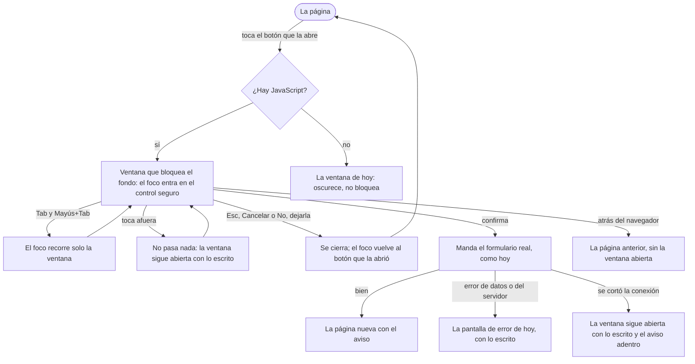
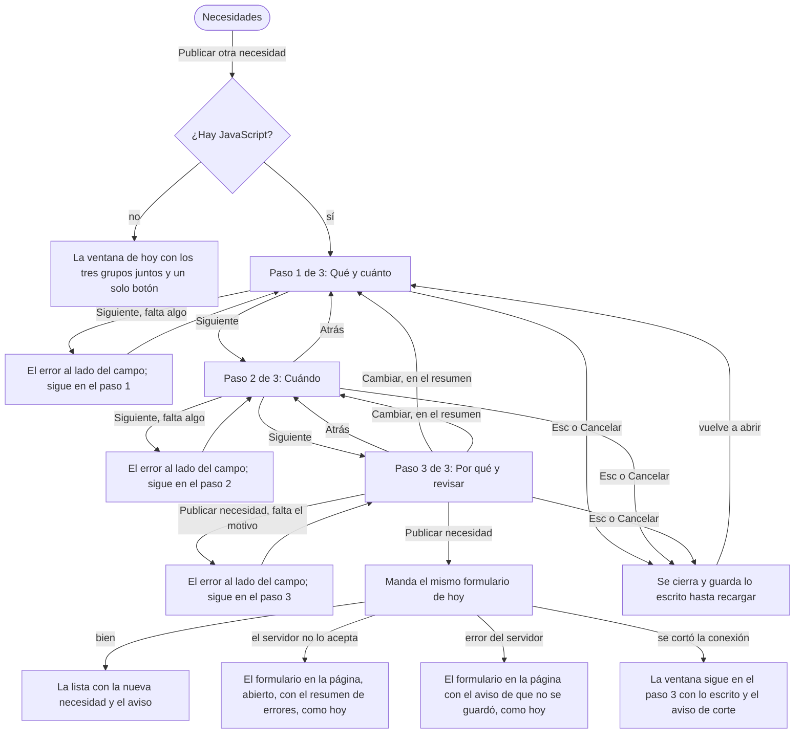

# Flujo: ventanas que bloquean el fondo y publicar en 3 pasos (R11-32 y R11-31)

> **Estado:** aprobada · **Fecha:** 2026-11-12 · **Aprobó:** el usuario, 2026-11-12 (opciones recomendadas, aprobación automática pedida por él)
> Ficha de la skill `ux-flujo` para el lote `p2-ventanas` del
> [backlog de la revisión del 2026-11-11](../backlog-revision-2026-11-11.md) (P2, ruta STANDARD).
> Baja a pantalla la regla general 4 ("Ventanas, tres niveles", sección 2 del backlog) y la decisión
> de la sección 3 "Publicar otra necesidad: ventana en 3 pasos: qué y cuánto / frecuencia y fecha /
> motivo y resumen". Esas decisiones ya están tomadas: esta ficha no las reabre.
> Son dos piezas: un **comportamiento del componente** `.dialogo` del [catálogo](../componentes.md)
> (R11-32), que vale en todas las ventanas de la regla 4, y **una ventana nueva** en
> `/entidad-necesidades` (R11-31). Para Publicar, esta ficha reemplaza lo que dice
> [Necesidades de la entidad](raices-necesidades.md) en "Publicar otra necesidad"; el resto de esa
> ficha sigue igual.
> Pantallas a comprobar: `entidad-necesidades`, `admin-camiones` y `admin-entidades` (y
> `admin-donaciones-detalle`, que tiene una ventana del mismo tipo).

## 0. Qué hay hoy (evidencia)

Leído en `e9331b3a2`. `[V]` es leído en el código; `[H]`, hipótesis a comprobar al construir.

| # | Hoy | Dónde |
|---|---|---|
| H1 | Toda ventana del sitio es un `<dialog class="dialogo" popover>` que se abre con un botón `popovertarget` y se cierra con otro `popovertargetaction="hide"`, con Esc o tocando afuera. Funciona sin JavaScript `[V]` | `static/css/componentes/dialogo.css:1-6`, `cliente-liviano/AGENTS.md:107-109` |
| H2 | El fondo se oscurece (`::backdrop` al 75 %) pero **no se bloquea**: con Tab se sale de la ventana al resto de la página, la página de atrás se desplaza y un toque afuera la cierra y pierde lo escrito `[V]` | `dialogo.css:36-50`; ADR [diálogo con `popover`](../../adr/cliente-liviano/20261104-dialogo-con-popover-y-fragmentos-solo-donde-hay-estructura-en-el-cliente-liviano.md) (`proposed`), opción P1 |
| H3 | Ventanas que son de la regla 4 (confirmar algo que no se deshace o formulario corto) `[V]`: dar de baja una necesidad; agregar camión y deshabilitar camión; pedir corrección y rechazar una organización; marcar una donación como vencida. También, fuera de este lote, dar de alta un administrador y generar otra contraseña provisoria | `entidad-necesidades.html:387-427`, `admin-camiones.html:113-118,371-395`, `admin-entidades.html:322-362`, `admin-donaciones.html:232-256`, `admin-administradores.html:50-53,79-84` |
| H4 | Ventanas que **no** son de la regla 4: la foto de una entrega (portada y datos públicos) y las piezas de la variante A de Misiones. Muestran algo grande y no piden nada `[V]` | `datos-publicos.html:25`, `componentes/huerta.html:384,402,420`, `variantes/misiones-a.html:75` |
| H5 | "Publicar otra necesidad" es un `<details>` que se despliega dentro de la página con los cinco datos juntos (qué, cuánto, si se repite, hasta cuándo y por qué) y un solo botón "Publicar necesidad". Se abre solo cuando no hay necesidades vigentes, con error de datos y con error al enviar `[V]` | `entidad-necesidades.html:432-522` |
| H6 | La fecha "Hasta cuándo" se ve siempre y no es obligatoria en el HTML: sin JavaScript no se puede pedir solo si es una sola vez. El servidor la exige en ese caso `[V]` | `entidad-necesidades.html:502-511`, [raices-necesidades §4](raices-necesidades.md) |
| H7 | No hay ningún `showModal()` en el sitio ni un manejo general del corte de conexión de HTMX `[V]` | `static/js/*.js` |
| H8 | Las ventanas de la ficha de un camión viven dentro de la parte que `hx-get` reemplaza al elegir otro camión: aparecen después de la carga de la página `[V]` | `admin-camiones.html:5-30` (comentario), `:371` |

## 1. Para quién y para qué

| | |
|---|---|
| Quién | La persona de la organización que publica lo que le hace falta, casi siempre desde la computadora y a veces desde el celular; la persona del admin que da de alta un camión, deshabilita otro, pide una corrección o rechaza una solicitud, desde la computadora |
| Tono | Pantalla de trabajo: claro, útil, tranquilizador ([tono según la pantalla](../tono-y-comunicacion.md#tono-según-la-pantalla)). Lo irreversible se dice como es, sin alarma |
| Qué quiere lograr | "Terminar lo que empecé en la ventana sin que un toque de más me la cierre ni se me mezcle con la página de atrás", y "publicar una necesidad sin un formulario largo de golpe" |
| Dispositivo principal | Ambos. Las ventanas, a 360, 1280 y 1920 px |
| Requerimientos | Regla general 4 del backlog; RF-10 (publicar, cambiar y dar de baja una necesidad); RF-18 (camiones), aprobación de organizaciones (RF-AUTH-06) y vencidas del admin, sin cambios de contenido; RNF-CL-02 (lo esencial anda sin JavaScript); RNF-UI-01 a 06 ([patrones y textos](../patrones-y-microcopy.md)); WCAG AA, foco visible y controles de 48 × 48 px |
| Datos que usa | Ninguno nuevo. Publicar manda lo mismo de hoy (`que`, `cuanto`, `repite`, `hasta`, `motivo`) a la misma dirección (`POST /entidad-necesidades-publicada`); el catálogo de "Qué hace falta" sale de la misma lista. No cambia ningún contrato ni ningún servicio |
| Boceto de E1 | Sin boceto para la ventana. El primer prototipo de Necesidades tenía el formulario plegado (H5) |

**Patrones conocidos que sigue:**

- **Ventana que interrumpe** ("Diálogos que interrumpen, solo para lo que no puede esperar",
  [criterios de la cátedra §5](../criterios-catedra-ux-ui.md#5-patrones-de-interacción)), en la
  forma de Material *Dialogs* (diálogo modal) y HIG *Alerts*, que ya cita el catálogo. El
  comportamiento del teclado es el de la pauta *Dialog (Modal)* del W3C: el foco entra, no sale con
  Tab, Esc cierra y el foco vuelve al botón que la abrió.
- **Proceso con pasos e indicador** ("Barra de progreso: procesos con pasos", mismo documento §4),
  en la forma de un asistente corto (*wizard*) de Material *Steppers*: un paso a la vista, "Paso N
  de 3", "Atrás" y "Siguiente", y un resumen para revisar antes de enviar.

## 2. Dónde está en el sitio

No cambia el [mapa del sitio](../mapa-del-sitio.md): ninguna ventana es una dirección propia.

- `/entidad-necesidades` (organización, nivel 1): el botón "Publicar otra necesidad", arriba de la
  lista, abre la ventana en 3 pasos; "Dar de baja" de cada necesidad abre su confirmación.
- `/admin-camiones` (admin, nivel 1): "Agregar camión" y "Deshabilitar" de la ficha del camión.
- `/admin-entidades` (admin, nivel 1): "Pedir corrección" y "Rechazar" de una solicitud pendiente.
- `/admin-donaciones-detalle` (admin, nivel 2): "Marcar como vencida".

## 3. Recorrido

Los textos de error por campo que se citan abajo son los de la ficha de
[Necesidades](raices-necesidades.md#5-estados); hoy la maqueta solo dibuja dos (cuánto y la fecha):
el constructor agrega los demás en el HTML, ocultos, para que el paso los muestre.

### 3.1 Cualquier ventana de la regla 4 (R11-32)



Desvíos considerados:

- **Cancelar:** Esc, "Cancelar" o "No, dejarla" cierran la ventana sin mandar nada. Lo escrito queda
  en la ventana hasta que se recarga la página: si se vuelve a abrir, sigue ahí.
- **Tocar afuera:** con JavaScript, no cierra. Es lo que distingue a la ventana que bloquea del
  desplegable liviano (regla 4): un toque de más no hace perder lo escrito ni confirma nada.
- **Volver:** el "atrás" del navegador lleva a la página anterior, como hoy. La ventana se cierra
  antes de que HTMX guarde la página en su historial, así al volver no aparece una ventana abierta
  pegada en la página.
- **Error de datos y error del servidor:** no cambian. El servidor responde con la pantalla de error
  de cada caso (por ejemplo, "Agregar camión" abierto debajo del encabezado con el resumen de lo que
  hay que revisar), fuera de la ventana y con lo escrito.
- **Sin conexión:** con JavaScript, si el envío no llega al servidor, la ventana queda abierta con lo
  escrito, el botón vuelve a estar disponible y adentro aparece el aviso de corte. El aviso va dentro
  de la ventana porque, con el fondo bloqueado, la región de avisos de la página no se lee ni se
  puede tocar. Sin JavaScript, la página de error del navegador, como hoy.
- **Sin permiso o sesión vencida:** lo resuelve el marco de la sesión, como cualquier envío.
- **La ventana llegó después de cargar la página** (la ficha de un camión que trae `hx-get`): se
  comporta igual, sin preparar nada al llegar (sección 4.3).

### 3.2 Publicar otra necesidad (R11-31)



Desvíos considerados:

- **Atrás:** vuelve al paso anterior sin revisar nada y sin borrar lo escrito. En el paso 1 no hay
  "Atrás" (no hay paso anterior): solo "Cancelar".
- **Cancelar:** en cualquier paso, cierra la ventana sin preguntar, porque no se pierde nada: lo
  escrito queda hasta recargar la página. Al volver a abrir, arranca en el paso 1 con todo lo que
  había, para que la persona revise desde el principio y el foco caiga siempre en el mismo lugar.
- **Enter en un campo:** en los pasos 1 y 2 hace lo mismo que "Siguiente"; nunca manda el
  formulario a medias. En el paso 3, Enter en el campo del motivo escribe un renglón nuevo (es un
  área de texto) y el envío es con el botón.
- **Error de datos antes de enviar:** "Siguiente" revisa solo los datos de ese paso y muestra el
  mismo texto de error que usa hoy el servidor, al lado del campo, con el foco en el primero que
  falta. No hay reglas nuevas: son las de hoy (H6 y [raices-necesidades §5](raices-necesidades.md)).
- **Error de datos del servidor:** el servidor sigue siendo quien decide. Si no acepta lo enviado,
  responde como hoy: el formulario **en la página** (no en la ventana), abierto, con el resumen de lo
  que hay que revisar arriba y lo escrito. Así funciona igual con y sin JavaScript, y es el mismo
  criterio que "Agregar camión".
- **Error del servidor:** como hoy: el formulario en la página con "No pudimos publicar tu
  necesidad." y lo escrito.
- **Sin necesidades vigentes:** no hay ventana. El formulario se ve en la página, abierto debajo del
  aviso de vacío, con el título "Publicar una necesidad", como hoy: es el contenido de la pantalla,
  no algo que se pone encima de ella. Se ve con sus tres grupos juntos (sección 4.5).
- **La organización no está activa:** como hoy: el aviso en lugar del botón, o arriba del formulario
  si llega al enviar (409), en la página.

## 4. Pantallas

### 4.1 Ventana que bloquea el fondo (todas las de la regla 4)

```text
┌───────────────────────────────────────────────┐  fondo oscurecido (75 %),
│░░░░░░░░░░░░░░░░░░░░░░░░░░░░░░░░░░░░░░░░░░░░░│  sin desplazarse y sin
│░░░░ ┌─────────────────────────────────┐ ░░░░░│  responder a toques ni a Tab
│░░░░ │ ¿Deshabilitar el camión         │ ░░░░░│
│░░░░ │ AC 456 EF?                      │ ░░░░░│
│░░░░ │ No se le van a asignar rutas    │ ░░░░░│
│░░░░ │ hasta que lo vuelvas a habilitar│ ░░░░░│
│░░░░ │ Motivo (opcional)               │ ░░░░░│
│░░░░ │ [                             ] │ ░░░░░│
│░░░░ │ [Deshabilitar] [(Cancelar)]     │ ░░░░░│  (…) = el foco al abrir
│░░░░ └─────────────────────────────────┘ ░░░░░│
└───────────────────────────────────────────────┘
```

Qué cambia respecto de hoy y por qué:

- **Se ve igual.** Mismo tamaño, borde, fundido y oscurecido (`dialogo.css`); `data-tono="quitar"`
  sigue marcando lo irreversible. No cambia ningún texto de estas ventanas.
- **El fondo deja de responder:** no se puede tocar, ni recorrer con Tab, ni desplazar. Es lo que
  pide la regla 4 y lo que falta hoy (H2).
- **Tocar afuera ya no cierra.** Esc, "Cancelar" y "No, dejarla" sí.
- **El foco entra donde entra hoy** (el control con `autofocus`: "No, dejarla", "Cancelar" o el campo
  obligatorio de "Pedir corrección") y vuelve al botón que la abrió.
- **En el celular,** la ventana ocupa el ancho menos 1 rem de cada lado; si es más alta que la
  pantalla, se desplaza por dentro (la página de atrás no).

Quedan como desplegable de hoy, porque no son de la regla 4 (H4): la foto de una entrega y las piezas
de la variante A de Misiones. Ahí tocar afuera sigue cerrando.

### 4.2 Publicar otra necesidad, con JavaScript (R11-31)

La ventana mide como "Agregar camión" (`min(36rem, 100% - 2rem)`). Arriba, el título y el
indicador; en el medio, un solo paso; abajo, los botones.

**Paso 1 de 3 · Qué y cuánto**

```text
┌──────────────────────────────────────────┐
│ Publicar otra necesidad                  │
│ ● Qué y cuánto ── ○ Cuándo ── ○ Por qué  │   indicador: 3 marcas, la actual llena
│ Paso 1 de 3: Qué y cuánto                │
│                                          │
│ Qué hace falta                           │
│ Si no está en la lista, elegí la más     │
│ parecida y contalo en por qué hace falta.│
│ [ Elegí una                          ▾ ] │
│                                          │
│ Cuánto                                   │
│ En la unidad que dice la lista, entre    │
│ paréntesis. Si se repite, cuánto en cada │
│ período.                                 │
│ [ Por ejemplo: 10                      ] │
│                                          │
│                  [Cancelar] [Siguiente]  │
└──────────────────────────────────────────┘
```

**Paso 2 de 3 · Cuándo**

```text
┌──────────────────────────────────────────┐
│ Publicar otra necesidad                  │
│ ✓ Qué y cuánto ── ● Cuándo ── ○ Por qué  │
│ Paso 2 de 3: Cuándo                      │
│                                          │
│ ¿Se repite?                              │
│ Si se repite, el primer período empieza  │
│ hoy y se renueva solo cada semana, cada  │
│ quincena (15 días) o cada mes.           │
│ (•) Una sola vez                         │
│ ( ) Cada semana                          │
│ ( ) Cada quincena                        │
│ ( ) Cada mes                             │
│                                          │
│ Hasta cuándo                             │
│ Solo si es una sola vez. Desde hoy,      │
│ 15 de octubre, en adelante.              │
│ [ dd/mm/aaaa                           ] │
│                                          │
│       [Atrás] [Cancelar] [Siguiente]     │
└──────────────────────────────────────────┘
```

**Paso 3 de 3 · Por qué y revisar**

```text
┌──────────────────────────────────────────┐
│ Publicar otra necesidad                  │
│ ✓ Qué y cuánto ── ✓ Cuándo ── ● Por qué  │
│ Paso 3 de 3: Por qué y revisar           │
│                                          │
│ Por qué hace falta                       │
│ Lo ven los donantes. Por ejemplo: para   │
│ el almuerzo de lunes a viernes.          │
│ [                                      ] │
│ [                                      ] │
│                                          │
│ Vas a publicar                           │
│ Qué hace falta   Fideos secos (kg)  Cambiar
│ Cuánto           30                 Cambiar
│ Cuándo           Cada semana. El    Cambiar
│                  primer período      │
│                  empieza hoy.        │
│                                          │
│ [Atrás] [Cancelar] [Publicar necesidad]  │
└──────────────────────────────────────────┘
```

Qué cambia respecto de hoy y por qué:

- **Tres pasos en lugar de cinco datos juntos,** con los grupos que decidió el usuario. Los campos,
  sus rótulos, sus ayudas y sus nombres son los de hoy: solo se reparten.
- **El nombre de los pasos, corto y en llano:** "Qué y cuánto", "Cuándo" y "Por qué y revisar". Son
  los grupos de la decisión ("frecuencia y fecha", "motivo y resumen") dichos con las palabras de la
  pantalla, que no usa "frecuencia" ni "motivo" en los rótulos, y entran en 360 px.
- **El indicador** son tres marcas con su nombre (hecho ✓, actual ●, por venir ○) y la frase "Paso N
  de 3: …" debajo. En 360 px las marcas pierden el nombre y queda la frase. Las marcas no son
  botones: para volver están "Atrás" y los "Cambiar" del resumen.
- **"Hasta cuándo" pasa a ser obligatoria solo si se elige "Una sola vez"** (en el paso 2, con
  JavaScript). Es la misma regla que ya aplica el servidor (H6), dicha antes. Con "se repite", el
  campo queda a la vista, opcional, con su ayuda, como hoy.
- **El resumen del paso 3** repite lo que escribió la persona, con un "Cambiar" que lleva a su paso.
  "Cuánto" se muestra como número, sin unidad: la unidad ya va en "Qué hace falta" (entre
  paréntesis, como la lista). Si se repite, "Cuándo" dice el período ("Cada semana. El primer
  período empieza hoy."); si es una sola vez, la fecha ("Una sola vez, hasta el 30 de octubre.").
- **Los botones,** de izquierda a derecha: "Atrás" (desde el paso 2), "Cancelar" y el principal a la
  derecha ("Siguiente" o "Publicar necesidad"). En 360 px se apilan con el principal arriba, al
  alcance del pulgar.
- **Altura:** cada paso entra en una pantalla de celular sin desplazar; si no entra (letra
  agrandada), se desplaza el contenido de la ventana y los botones van al final del paso.

### 4.3 Construcción

| Parte | Cómo |
|---|---|
| Qué ventanas bloquean | Las que llevan `data-bloquea` en su `<dialog class="dialogo" popover>`: las de H3 de este lote. La foto y las piezas de Misiones no lo llevan. Se marca en el marcado y no se adivina por el tono: hay ventanas de la regla 4 sin `data-tono="quitar"` ("Agregar camión", "Pedir corrección") |
| Sin JavaScript | El marcado de hoy: `popover`, el botón con `popovertarget` y el de cerrar con `popovertargetaction="hide"`. Es la versión de hoy (H1), sin cambios |
| Con JavaScript | En `static/js/interfaz.js`, un solo escucha de clics en el documento, registrado con `alpine:init`: si el botón tocado tiene `popovertarget` y su destino es una `.dialogo[data-bloquea]`, cancela la acción del navegador y en su lugar abre con `showModal()` (o cierra con `close()` si la acción es `hide`). No prepara cada ventana al cargar, así sirve también para las que llegan después con HTMX (H8). Guarda el botón que la abrió y le devuelve el foco al cerrarse (Safari no le da el foco a un botón al tocarlo) |
| Tocar afuera | Un `showModal()` no se cierra tocando el fondo; Esc lo cierra con el evento `cancel`. No hace falta nada más |
| Fondo quieto | En `dialogo.css`: la página no se desplaza mientras haya una ventana bloqueante abierta (`html:has(.dialogo:modal)`), sin que salte el ancho por la barra de desplazamiento |
| Estilos | Los de `:popover-open` valen también para `:modal` (grilla, opacidad, fundido de entrada con `@starting-style` y el `::backdrop`). Las ventanas altas, con alto tope (la pantalla menos 2 rem) y desplazamiento propio |
| Historial | Antes de que HTMX guarde la página en su historial (`htmx:beforeHistorySave`), se cierran las ventanas abiertas: si no, el atributo `open` quedaría guardado y al volver la ventana aparecería pegada en la página |
| Corte de conexión | Con `htmx:sendError` de un formulario que está dentro de una ventana abierta, se muestra el aviso de corte que esa ventana trae oculto (si lo trae). El texto viene en el HTML del servidor; el JavaScript solo lo muestra |
| Publicar: marcado | El fragmento `publicar(conError)` de `entidad-necesidades.html` tiene dos formas. **En la página** (con error de datos, con error al enviar o sin necesidades vigentes): el formulario de hoy, abierto, con sus grupos a la vista. **Si no:** el botón "Publicar otra necesidad" y la ventana `#publicar-ventana` (`data-bloquea`, `data-forma="pasos"`) con el mismo formulario. El formulario, en los dos casos, tiene tres `<fieldset class="paso">` con su título; el indicador y el resumen van ocultos hasta que el JavaScript tome el mando |
| Publicar: pasos | Un componente de Alpine, `pasos`, en el formulario de la ventana: muestra un paso a la vez, revisa el paso con la validación del navegador (`checkValidity`) y, si falta algo, muestra el texto de error que trae el HTML para ese campo y le pasa el foco; mueve el foco al título del paso nuevo; arma el resumen con `x-text` (lo que escribió la persona, nunca `x-html`); vuelve al paso 1 al abrirse. El envío es el `submit` de siempre, con `hx-boost`; el servidor vuelve a validar |
| Publicar: sin JavaScript | La ventana de hoy con los tres grupos uno debajo del otro, cada uno con su título ("Qué y cuánto", "Cuándo", "Por qué hace falta"), sin indicador, sin resumen y con un solo botón "Publicar necesidad". Se desplaza por dentro si no entra |
| Regla del módulo | `cliente-liviano/AGENTS.md`, regla de diálogos: pasa a decir que una ventana de la regla 4 lleva `data-bloquea` y, con JavaScript, se abre con `showModal()`; sin JavaScript queda el `popover` de hoy. El resto de las ventanas, `popover` |
| Lo que no se toca | Rutas, nombres de campos, controllers y contratos. `admin-administradores.html` y la muestra de `/estilos` no son de este lote (sección 9, dudas) |

### 4.4 La ventana en el celular (360 px)

```text
┌────────────────────────────┐
│ Publicar otra necesidad    │
│ ● ── ○ ── ○                │   marcas sin nombre
│ Paso 1 de 3: Qué y cuánto  │
│ Qué hace falta             │
│ […ayuda…]                  │
│ [ Elegí una            ▾ ] │
│ Cuánto                     │
│ […ayuda…]                  │
│ [ Por ejemplo: 10        ] │
│ [        Siguiente       ] │   el principal, arriba
│ [        Cancelar        ] │
└────────────────────────────┘
```

### 4.5 Publicar en la página (sin vigentes, o de vuelta con un error)

El formulario de hoy, abierto en la página, con los tres grupos a la vista y su título, y un solo
"Publicar necesidad". El error de datos y el error del servidor se ven como hoy (resumen arriba con
el foco y el error al lado de cada campo). Con JavaScript, "Hasta cuándo" también pasa a obligatoria
solo con "Una sola vez".

## 5. Estados

| Pantalla | Estado | Qué se ve | Texto |
|---|---|---|---|
| Ventana de la regla 4 | Abierta | El fondo oscurecido y quieto; el foco en el control seguro | El de cada ventana, sin cambios |
| Ventana de la regla 4 | Cargando | El botón de confirmar no se puede volver a tocar y el indicador de la ventana dice que se está guardando | El de hoy de cada una: "Guardando…" ("Aprobando…" donde ya lo dice) |
| Ventana de la regla 4 | Éxito | La página nueva, sin ventana, con el aviso que recibe el foco | El de hoy de cada una (por ejemplo, "Deshabilitaste el camión AC 456 EF. No se le van a asignar rutas hasta que lo vuelvas a habilitar.") |
| Ventana de la regla 4 | Error de datos | La pantalla de error de hoy, fuera de la ventana | Sin cambios |
| Ventana de la regla 4 | Error del servidor | La pantalla de error de hoy, fuera de la ventana | Sin cambios |
| Ventana de la regla 4 | Sin conexión (con JavaScript) | La ventana sigue abierta con lo escrito; arriba de los botones, un aviso de error; el botón de confirmar vuelve a estar disponible | "No sabemos si se guardó." · "Se cortó la conexión mientras se enviaba. Revisá la señal y, antes de probar de nuevo, recargá la página para ver cómo quedó." |
| Ventana de la regla 4 | Sin JavaScript | La ventana de hoy: oscurece, no bloquea; tocar afuera la cierra | Sin cambios |
| Ventana de la regla 4 | Sin permiso | Lo resuelve el marco de la sesión al enviar | Sin cambios |
| Publicar · paso 1 | Con datos | Qué y cuánto, con lo que haya escrito | "Paso 1 de 3: Qué y cuánto" |
| Publicar · paso 1 | Error de datos | El campo marcado, su texto de error y el foco en el primero que falta | "Elegí qué hace falta." · "Escribí cuánto, con números. Por ejemplo: 30." |
| Publicar · paso 2 | Con datos | Si se repite y hasta cuándo | "Paso 2 de 3: Cuándo" |
| Publicar · paso 2 | Error de datos | Ídem | "Elegí si se repite o es una sola vez." · "Si es una sola vez, elegí hasta cuándo, desde hoy, 15 de octubre, en adelante." (la fecha de hoy, del servidor) |
| Publicar · paso 3 | Con datos | El motivo y el resumen con sus "Cambiar" | "Paso 3 de 3: Por qué y revisar" · "Vas a publicar" |
| Publicar · paso 3 | Error de datos | Ídem | "Contá en pocas palabras por qué hace falta." |
| Publicar | Cargando | "Publicar necesidad" no se puede volver a tocar; "Atrás" y "Cancelar" tampoco, hasta que responda | "Guardando…", el indicador de hoy, dentro de la ventana junto al botón |
| Publicar | Éxito | La lista con la necesidad nueva, abierta y marcada como nueva, y el aviso con el foco | "Publicamos tu necesidad. Ya la ven los donantes y el catálogo público." (sin cambios) |
| Publicar | Error de datos del servidor | El formulario en la página, abierto, con el resumen arriba (con el foco) | Sin cambios: "Revisá dos cosas antes de publicar" (o una, o tres), con un enlace a cada campo |
| Publicar | Error del servidor | El formulario en la página con el aviso arriba y lo escrito | Sin cambios: "No pudimos publicar tu necesidad." · "Es un problema nuestro: no se guardó nada y los donantes no la ven todavía. Probá de nuevo en unos minutos; si sigue, escribinos con este código." |
| Publicar | Sin conexión (con JavaScript) | La ventana en el paso 3, con lo escrito y el aviso arriba de los botones | "No sabemos si se publicó." · "Se cortó la conexión mientras se enviaba. Revisá la señal y mirá la lista antes de publicarla de nuevo." (el de hoy) |
| Publicar | Vacío (sin vigentes) | Sin ventana: el formulario en la página, abierto, con sus tres grupos | "Publicar una necesidad" (sin cambios) |
| Publicar | Organización no activa | El aviso en lugar del botón; o arriba del formulario en la página si llega al enviar | Sin cambios: "Tu organización no está activa, así que no puede publicar necesidades." · "Escribinos para revisarlo." |
| Publicar | Sin JavaScript | La ventana de hoy con los tres grupos y un solo botón | Títulos de grupo: "Qué y cuánto" · "Cuándo" · "Por qué hace falta" |

## 6. Textos

| Elemento | Texto | Nota |
|---|---|---|
| Botón que abre | "Publicar otra necesidad" | Sin cambios. Es un botón (`data-tono="secundario"`), ya no un `summary` |
| Título de la ventana | "Publicar otra necesidad" | El mismo que el botón: se sabe qué se abrió |
| Indicador | "Paso 1 de 3: Qué y cuánto" · "Paso 2 de 3: Cuándo" · "Paso 3 de 3: Por qué y revisar" | Las marcas: "Qué y cuánto", "Cuándo", "Por qué" |
| Para el lector, en cada marca | "Hecho", "Paso actual", "Falta" | Texto oculto a la vista; no depende del ✓ ni del color |
| Siguiente | "Siguiente" | Principal en los pasos 1 y 2 |
| Atrás | "Atrás" | Secundario, desde el paso 2 |
| Cancelar | "Cancelar" | Secundario, en los tres pasos |
| Enviar | "Publicar necesidad" | Sin cambios; principal en el paso 3 |
| Título del resumen | "Vas a publicar" | |
| Filas del resumen | "Qué hace falta" · "Cuánto" · "Cuándo" | Los mismos nombres de los campos y del paso |
| "Cuándo", si se repite | "Cada semana. El primer período empieza hoy." (o "Cada quincena", "Cada mes") | Sale de la ayuda de hoy |
| "Cuándo", una sola vez | "Una sola vez, hasta el 30 de octubre." | La fecha elegida, con día y mes |
| Cambiar | "Cambiar" | Nombre para el lector: "Cambiar qué hace falta", "Cambiar cuánto", "Cambiar cuándo" |
| Títulos de grupo sin JavaScript | "Qué y cuánto" · "Cuándo" · "Por qué hace falta" | Sin "Paso N": sin JavaScript no hay pasos |
| Sin conexión, ventanas del admin | "No sabemos si se guardó." · "Se cortó la conexión mientras se enviaba. Revisá la señal y, antes de probar de nuevo, recargá la página para ver cómo quedó." | Nuevo: hoy no hay aviso de corte en estas ventanas (H7). Para dar de baja una necesidad, el que ya tiene esa ficha |

Ayudas por flujo crítico (de [patrones y textos](../patrones-y-microcopy.md#ayudas-por-flujo-crítico-rnf-ui-04)):
Publicar no es un flujo crítico nuevo; las ayudas de cada campo son las de hoy y van al lado del
campo, en su paso.

Filtro de tono: los textos nuevos son de orientación ("Paso 2 de 3"), de acción ("Siguiente",
"Atrás", "Cambiar") y el resumen, que repite lo que escribió la persona sin agregar nada. No hay
cifras nuevas ni plazos. El aviso de corte dice lo que se sabe ("No sabemos si se guardó") sin culpa
ni urgencia y da el próximo paso. Lo visible dice "organización", nunca "entidad".

## 7. Accesibilidad

- **Foco al abrir:** el control con `autofocus` de cada ventana (H3). En Publicar, el primer campo
  del paso 1 ("Qué hace falta").
- **Foco adentro:** con la ventana abierta, el resto de la página es inerte (lo da `showModal()`):
  Tab y Mayús+Tab recorren solo la ventana; el lector no lee el fondo.
- **Foco al cerrar:** vuelve al botón que la abrió.
- **Foco al cambiar de paso:** al título del paso nuevo (`tabindex="-1"`), que dice "Paso N de 3: …".
  El indicador no es una región que se lee sola: el título ya se anuncia al recibir el foco, y dos
  anuncios a la vez se pisan.
- **Error en un paso:** el campo con `aria-invalid="true"` y su texto en `aria-describedby`, como el
  error del servidor; el foco al primer campo que falta.
- **Rol y nombre:** la ventana se anuncia como diálogo con su título (`aria-labelledby`, ya está).
  Cada paso es un `fieldset` con su título.
- **Indicador:** una lista ordenada; la marca actual con `aria-current="step"`; el estado de cada
  marca con texto, no solo con el ✓ o el color.
- **Sin conexión:** el aviso dentro de la ventana con `role="alert"`, porque la región de avisos de
  la página queda inerte detrás.
- **Movimiento:** el fundido de siempre (`--movimiento-transicion-dialogo`); con "reducir
  movimiento", sin fundido. El cambio de paso no se anima.
- **Tamaños:** botones de al menos 48 × 48 px; contraste AA del oscurecido y del borde, los de hoy.
- **Sin JavaScript:** todo se puede hacer: la ventana de hoy y el formulario completo.

## 8. Revisión de usabilidad

| # | Heurística | Cómo la cumple | Riesgo que queda |
|---|---|---|---|
| 1 | Visibilidad del estado | "Paso N de 3" y las marcas dicen dónde está y cuánto falta; el fondo oscuro y quieto dice que la ventana manda; "Guardando…" al enviar | Sin JavaScript no hay pasos ni bloqueo: es la versión de hoy |
| 2 | Lenguaje del usuario | Los pasos se nombran con las palabras de los rótulos ("Qué y cuánto", "Cuándo", "Por qué") | "Cuándo" agrupa "¿Se repite?" y "Hasta cuándo": a probar si se entiende |
| 3 | Control y libertad | "Atrás", "Cambiar" desde el resumen, Esc y "Cancelar" sin perder lo escrito | Tocar afuera ya no cierra: quien lo espera tiene que usar Esc o "Cancelar" (está a la vista) |
| 4 | Consistencia | Todas las ventanas de la regla 4 se comportan igual; los campos y textos de Publicar son los de hoy; los botones, en el mismo orden que el resto del sitio | Las dos ventanas de Administradores no son de este lote y siguen sin bloquear hasta que se marquen (sección 9) |
| 5 | Prevención de errores | Revisa cada paso antes de seguir; Enter no manda a medias; tocar afuera no cierra ni confirma; el resumen antes de publicar | La revisión del paso no reemplaza a la del servidor, que sigue mandando |
| 6 | Reconocer antes que recordar | El resumen del paso 3 muestra todo lo elegido antes de publicar | — |
| 7 | Flexibilidad | Esc para salir, Enter para seguir, "Cambiar" para ir directo a un paso | Quien publica muchas seguidas hace tres pasos por cada una: se descartó un modo "todo junto" (sección 9) |
| 8 | Diseño minimalista | Dos o tres campos por paso en lugar de cinco juntos | — |
| 9 | Recuperarse de errores | El error al lado del campo con el mismo texto del servidor; sin conexión, la ventana queda con lo escrito | Si el servidor rechaza lo enviado, la persona sale de la ventana al formulario en la página: cambia el lugar, pero conserva lo escrito y el resumen de errores |
| 10 | Ayuda | Las ayudas de hoy, al lado de cada campo, en su paso | — |

Los 7 factores (Morville):

- **Útil:** publicar una necesidad con los mismos datos que pide el contrato, sin errores de último
  momento.
- **Usable:** un paso a la vez, con "Atrás" y resumen; ventanas que no se cierran por un toque de más.
- **Deseable:** se ve como el resto de las ventanas del sitio, sin piezas nuevas de estilo salvo el
  indicador.
- **Valioso:** menos publicaciones con errores y menos acciones del admin confirmadas o perdidas sin
  querer.
- **Ubicable:** el botón está donde estaba; cada ventana sale del botón que la nombra.
- **Accesible:** foco que entra, se queda y vuelve; fondo inerte para el lector; todo anda sin
  JavaScript.
- **Creíble:** el resumen repite exactamente lo que se manda; el servidor sigue siendo el que acepta.

**Para probar con personas reales:** si alguien de una organización entiende "Cuándo" como "si se
repite y hasta cuándo"; si quien publica varias seguidas extraña ver todo junto; y si en el admin
alguien intenta cerrar una ventana tocando afuera y no encuentra cómo.

## 9. Decisiones y preguntas

Decisiones de este diseño (propuesta del agente, para la [bitácora](../bitacora.md) al construir):

1. **Con JavaScript, `showModal()`; sin JavaScript, el `popover` de hoy,** en el mismo `<dialog>`. Es
   lo que pide el backlog (R11-32: "sin JavaScript degradan a la versión de hoy") y lo que ya
   permitía la regla del módulo para una ventana "que necesite el fondo inerte". Descartado: el
   plugin Focus de Alpine (una dependencia más para lo que el navegador ya hace; era la P3 del ADR
   del diálogo) y los comandos nuevos del navegador para abrir una ventana bloqueante sin JavaScript
   (`command="show-modal"`), porque todavía no andan en todos los navegadores de la demo y
   convivirían mal con `popovertarget` en el mismo botón.
2. **Un solo escucha de clics en el documento** en lugar de preparar cada ventana al cargar: sirve
   para las ventanas que llegan con HTMX (la ficha de un camión) sin `x-data` en la parte que HTMX
   reemplaza. Descartado: un componente de Alpine por ventana.
3. **Marca explícita `data-bloquea`** en cada ventana de la regla 4. Descartado: bloquear todas las
   `.dialogo` (la foto de una entrega es un desplegable de mirar) y deducirlo de `data-tono="quitar"`
   ("Agregar camión" y "Pedir corrección" no lo llevan).
4. **Tocar afuera no cierra** una ventana que bloquea; Esc y "Cancelar" sí. Es la diferencia de la
   regla 4 entre ventana y desplegable. Descartado: cerrar tocando afuera, que hoy hace perder lo
   escrito.
5. **El fondo no se desplaza** mientras haya una ventana que bloquea abierta. Descartado: dejarlo
   desplazar (el oscurecido se mueve y parece roto en el celular).
6. **Nombres de los pasos:** "Qué y cuánto", "Cuándo" y "Por qué y revisar". Descartado:
   "Frecuencia y fecha" y "Motivo y resumen" tal cual, porque la pantalla no usa esas palabras en los
   rótulos y no entran en 360 px junto a las otras dos.
7. **Revisar cada paso con los textos de error del servidor,** traídos en el HTML y mostrados como el
   error de campo de hoy. Descartado: los globos del navegador (otro idioma y otra forma según el
   navegador) y no revisar hasta el final (con los campos de los pasos ocultos, el navegador no puede
   mostrar dónde falta algo y el envío no sale, sin decir nada).
8. **"Hasta cuándo" obligatoria solo con "Una sola vez"**, con JavaScript. Es la regla que ya aplica
   el servidor (H6). Descartado: ocultar el campo cuando se repite (sin JavaScript tiene que verse
   igual, y así se ve parecido en los dos casos).
9. **Cancelar no pregunta y guarda lo escrito** hasta recargar; al volver a abrir, paso 1 con todo.
   Descartado: preguntar "¿Descartar lo escrito?" (una ventana sobre otra) y abrir en el último paso
   visto (el foco caería en lugares distintos cada vez).
10. **Los errores del servidor vuelven al formulario en la página,** como hoy y como "Agregar
    camión". Descartado: reabrir la ventana en el paso del error (pide JavaScript para la parte
    esencial y una lógica nueva en el servidor).
11. **Sin necesidades vigentes, sin ventana:** el formulario en la página, como hoy. Descartado:
    abrir la ventana sola al entrar (tapa el aviso de vacío y la pantalla).
12. **El aviso de corte va dentro de la ventana,** porque con el fondo inerte la región de avisos no
    se lee. Descartado: cerrar la ventana para mostrar el aviso (pierde lo escrito de la vista).
13. **Al guardar el historial de HTMX se cierran las ventanas,** para que el "atrás" no muestre una
    ventana pegada en la página.

Preguntas abiertas para el usuario: ninguna bloqueante. Las dudas para la construcción van en el
informe del lote:

- Las dos ventanas de Administradores (alta y otra contraseña provisoria) son de la regla 4 pero no
  son archivos de este lote: sumarles `data-bloquea` es una línea en cada una.
- La muestra de `/estilos` tendría que mostrar la ventana que bloquea y la ventana en pasos.
- El cambio de la regla del módulo (`cliente-liviano/AGENTS.md`) corrige el ADR
  [diálogo con `popover`](../../adr/cliente-liviano/20261104-dialogo-con-popover-y-fragmentos-solo-donde-hay-estructura-en-el-cliente-liviano.md)
  (`proposed`), como pide la sección 7 del backlog: necesita su nota.

## Aprobación del diseño p2-ventanas (2026-11-12)

Aprobado por el usuario el 2026-11-12 con las opciones recomendadas: pidió aprobar en forma automática todas las opciones recomendadas de P1 y P2 para que la corrida termine sin su intervención.

1. Las dos ventanas de Administradores (dar de alta y generar otra contraseña provisoria, en admin-administradores.html:50 y :81) entran en la regla 4 pero no son archivos de este lote. Recomiendo que el constructor les agregue data-bloquea (una línea en cada una) y lo anote como fueraDeZona; si no, quedan como deuda en DTI-42.
   **Resuelto: la opción recomendada.**
2. La muestra de /estilos (estilos.html:277) y la fila .dialogo de componentes.md tendrían que mostrar la ventana que bloquea y la ventana en pasos. Recomiendo actualizarlas en la misma tanda de construcción, porque el test de componentes del catálogo puede rechazar las clases nuevas (paso, pasos-indicador).
   **Resuelto: la opción recomendada.**
3. El cambio de la regla de diálogos de cliente-liviano/AGENTS.md corrige el ADR proposed del diálogo con popover, y la sección 7.5 del backlog pide su nota. Recomiendo que el constructor o el cierre escriban una nota de remisión o un ADR sucesor proposed, sin editar el texto del ADR original ni promoverlo.
   **Resuelto: la opción recomendada.**
4. Que showModal() funcione en un <dialog> que además tiene el atributo popover, y que preventDefault en el clic anule popovertarget, está marcado como hipótesis [H] en la ficha. Recomiendo comprobarlo en Chrome, Firefox y Safari con un test de navegador antes de cerrar el lote. Si falla, la alternativa es quitar el atributo popover al abrir y devolverlo al cerrar.
   **Resuelto: la opción recomendada.**
