# Flujo: El admin opera la plataforma, en Raíces navegable

> **Estado:** aprobado · **Fecha:** 2026-11-07 · **Aprobó:** usuario (2026-11-07), después de `revision-ui` PASS en la ronda 3
> Ficha de la skill `ux-flujo`, fase F1 del [roadmap de las vistas](../roadmap-vistas-enunciado.md).
> Es una sola ficha para todo el recorrido del admin, con importar CSV y asignar incluidos (decisión
> del usuario, 2026-11-07). El inicio del admin (`admin-inicio`) ya está en la ficha
> [`raices-entidad-navegable`](raices-entidad-navegable.md#44-admin-inicio) y no cambia acá; esta
> ficha dibuja las seis secciones del menú, a las que hoy el inicio lleva y caen en `sin-dibujar`.

## 1. Para quién y para qué

| | |
|---|---|
| Quién | Quien opera la plataforma en la ONG (en el ejemplo, Leo, de Administración). Trabaja desde la computadora del depósito o de la oficina: registra lo que entra, decide lo que espera su decisión y cuida que la red funcione |
| Tono | Pantalla de trabajo: claro, útil, tranquilizador. Instrucciones, estados y próximo paso; frases cortas, verbos concretos ([tono según la pantalla](../tono-y-comunicacion.md#tono-según-la-pantalla)) |
| Qué quiere lograr | "Registrar lo que llega, decidir lo pendiente y que nada se trabe" |
| Dispositivo principal | Escritorio. En el celular todo se puede usar, con las listas en tarjetas |
| Requerimientos | RF-15 (registrar donantes y donaciones en un mismo flujo), RF-16 (marcar vencidas), RF-17 (elegir la entidad final según los algoritmos), RF-18 (camiones: alta, cambio de estado y baja), RF-19 (ranking del último mes y meses anteriores), RF-20 (importar donantes por CSV de más de 10.000 filas, con progreso y resultado por fila), RF-21 (aprobar entidades pendientes), RNF-UI-02 (nada a más de 3 niveles), RNF-UI-05 (cada acción con su mensaje de éxito y de error), RF-CL-07 (toda cifra que cambia dice cuándo se actualizó), RNF-CL-02 (sin JavaScript, igual funciona) |
| Datos que usa | Donaciones: `POST /api/personas`, `POST /api/donantes`, `POST /api/donantes/archivos` y `GET /api/donantes/archivos/{id}`, `GET /api/donantes` y `GET /api/donantes/{id}`, `POST /api/entidades`, `GET /api/entidades`, `POST /api/donaciones`, `POST /api/donaciones/fotos`, `GET /api/donaciones` y `GET /api/donaciones/{id}`, `GET /donaciones-independientes?estado=`, `GET /donaciones-independientes/{id}`, `PATCH /donaciones-independientes/{id}/estado`, `POST` y `GET /api/asignaciones/ejecuciones`, `GET /api/asignaciones/propuestas`, `PUT /api/asignaciones/propuestas/{id}/estado`. Logística: `GET` y `POST /api/camiones`, `PATCH /api/camiones/{id}/estado`. Incentivos: `GET /api/incentivos/ranking/ultimo` y `.../historial`. Lo que falta, en [Huecos de backend](#huecos-de-backend). En la maqueta, datos sintéticos de esta ficha, coherentes con el inicio del admin |
| Boceto de E1 | Pág. 13 (inicio del admin: menú con Registrar donantes, Registrar donaciones, Donaciones, Camiones y Donantes, y saludo). Las demás secciones no tienen boceto |

## 2. Dónde está en el sitio

Rol Admin, desde `admin-inicio` (nivel 1) y el menú ([mapa del sitio](../mapa-del-sitio.md)):

| Sección (nivel 2) | Acciones (nivel 3) |
|---|---|
| `admin-donantes` | Registrar donante · Importar CSV (con su resultado en la misma pantalla) |
| `admin-entidades` | Revisar una solicitud (aprobar, pedir corrección o rechazar) · Registrar entidad |
| `admin-donaciones` | Registrar donación · Detalle de una donación, con "Marcar como vencida" |
| `admin-asignaciones` | Correr la asignación · Revisar una propuesta (aprobar o descartar) |
| `admin-camiones` | Agregar camión · Deshabilitar o volver a habilitar |
| `admin-ranking` | Elegir un mes anterior |

Nada pasa de 3 niveles. Registrar, importar, revisar y aprobar son acciones dentro de cada lista,
como dice el mapa del sitio; el detalle de una solicitud o de una propuesta se despliega en la
lista, como el detalle de Necesidades de la entidad.

## 3. Recorrido

```mermaid
flowchart TD
  inicio([admin-inicio]) --> don[admin-donantes]
  inicio -->|Revisar entidades| ent[admin-entidades]
  inicio -->|Ver las que vencen| dnc[admin-donaciones?vence=pronto]
  inicio -->|Revisar propuestas| asg[admin-asignaciones]
  inicio -->|Ver camiones| cam[admin-camiones]
  inicio --> rk[admin-ranking]

  don -->|Registrar donante| rdo[admin-donantes-registrar]
  rdo -->|datos válidos| rdok[admin-donantes-registrado]
  rdo -->|datos inválidos| rdoer[admin-donantes-registrar-error]
  rdok -->|Registrar su donación| rdn
  don -->|Importar CSV| imp[admin-donantes-importando]
  imp -->|terminó| impok[admin-donantes-importado]
  don -->|archivo no válido| imper[admin-donantes-importar-error]

  ent -->|Aprobar| ea[admin-entidades-aprobada]
  ent -->|Pedir corrección| ec[admin-entidades-correccion]
  ent -->|Rechazar| er[admin-entidades-rechazada]
  ent -->|Registrar entidad| ren[admin-entidades-registrar]
  ren -->|datos válidos| renok[admin-entidades-registrada]
  ren -->|empresa o sin dirección| rener[admin-entidades-registrar-error]

  dnc -->|Registrar donación| rdn[admin-donaciones-registrar]
  rdn -->|datos válidos| rdnok[admin-donaciones-registrada]
  rdn -->|donante inactivo o datos inválidos| rdner[admin-donaciones-registrar-error]
  dnc -->|una donación| det[admin-donaciones-detalle]
  det -->|Marcar como vencida, confirmar| detv[admin-donaciones-detalle-vencida]

  asg -->|Aprobar| aa[admin-asignaciones-aprobada]
  asg -->|Descartar| ad[admin-asignaciones-descartada]
  asg -->|la necesidad ya no está activa| aer[admin-asignaciones-error]

  cam -->|Agregar camión| cok[admin-camiones-agregado]
  cam -->|Deshabilitar| cdes[admin-camiones-deshabilitado]
  cam -->|Volver a habilitar| chab[admin-camiones-habilitado]
  cam -->|datos inválidos| caer[admin-camiones-agregar-error]
```



Desvíos considerados:

- **Cancelar o volver:** cada formulario tiene "Cancelar", que vuelve a su lista sin guardar. Cada
  aviso de éxito tiene "Volver a <la lista>".
- **Error de datos:** el formulario vuelve con lo cargado, un resumen arriba que lleva a cada campo
  y el error al lado del campo. No se pierde nada de lo escrito.
- **Error del servidor:** la lista o el formulario muestra el aviso común con el código de soporte
  (`traceId`) y "Volver a cargar"; un formulario conserva lo cargado.
- **Cambió mientras tanto:** si una propuesta no se puede aprobar (pedido inactivo o donación de
  la propia entidad), el aviso dice por qué y la propuesta queda a la vista con "Descartar" (§4.7).
  Si otra persona cambió la propuesta o la donación a la vez (409 de concurrencia), el aviso lo
  dice y la lista o el detalle se vuelven a cargar con el dato nuevo.
- **Sin conexión:** como en el resto del sitio, el navegador no llega; los formularios no tienen
  nada que se pierda porque nada se guarda hasta enviar.
- **Sin permiso:** si otro rol abre una dirección del admin, ve "Esta pantalla es para la
  administración." y "Ir a tu inicio" (el mismo desvío de la ficha de la entidad).

## 4. Pantallas

Todas usan el layout privado con el menú del admin, la cabecera con "Leo · Administración" y el
pie común. Las listas son tablas en pantalla grande y tarjetas en 360 px (lista adaptable de
[`componentes.md`](../componentes.md)). Sin audacia de más: es la mesa de trabajo de quien decide,
sobria como su inicio, con la tierra, el papel y los sellos de estado del sitio.

### 4.1 `admin-donantes`, con importar CSV

```text
Donantes
86 donantes activos, al 15 de octubre de 2026, 18:30.
[Registrar donante]

Importar donantes desde un archivo           (plegado; se abre con "Importar CSV")
  Un archivo CSV separado por comas, con una fila de encabezado. Hasta 50 MB.
  Columnas que se leen: NOMBRE, APELLIDO, TIPO_DOCUMENTO, DOCUMENTO, EMAIL, TELEFONO,
  FECHA_NACIMIENTO y TIPO_PERSONA (HUMANA o JURIDICA; para JURIDICA, RAZON_SOCIAL).
  Si el documento ya está, se actualizan sus datos; si no, se suma un donante nuevo.
  [Elegir archivo]  [Importar]

Buscar por nombre o documento [__________] [Buscar]
Nombre                     Tipo      Documento     Alta              Estado
Distribuidora Ejemplo SA   Empresa   CUIT ...      2 de marzo        Activo
Ana Ejemplo                Persona   DNI ...       14 de octubre     Activo
...
```

- `admin-donantes-importando`: el bloque de importar queda abierto con el archivo y su avance:
  "donantes-octubre.csv · 20.000 filas" · "Procesando: 8.400 de 20.000 filas." · "Podés seguir
  usando el sitio: el resultado queda acá cuando termine." La lista sigue debajo (RF-20: sin
  bloquear la pantalla). Con JavaScript, el avance se actualiza solo cada 5 s; sin JavaScript,
  "Ver el avance" vuelve a cargar la página.
- `admin-donantes-importado`: "Importación terminada el 15 de octubre de 2026, 18:42." ·
  "20.000 filas leídas: 19.100 donantes nuevos, 754 actualizados, 20 sin cambios porque el
  donante está dado de baja y 126 filas con error." · tabla
  de las filas con error (Fila, Qué pasó) con las primeras 20 y "Descargar las 126 filas con
  error". Los donantes nuevos reciben un correo para activar su cuenta (ver Preguntas abiertas,
  D12).
- `admin-donantes-importar-error`: el archivo no se aceptó (no es CSV, está vacío o pasa de 50
  MB); no se leyó ninguna fila.
- Respecto del boceto (pág. 13): "Donantes" y "Registrar donantes" eran dos entradas del menú;
  quedan en una sección con la acción adentro, y el CSV vive en la misma pantalla para no pasar de
  3 niveles ([bitácora, 2026-10-30](../bitacora.md)).

### 4.2 `admin-donantes-registrar`

```text
Donantes › Registrar donante
¿Quién dona?  (•) Una persona   ( ) Una organización
  Persona: Nombre*, Apellido*, Tipo y número de documento, Fecha de nacimiento, Género
  Organización: Razón social*, Tipo* (ONG, Empresa, Institución, Gubernamental), CUIT, Rubro
Contacto: Correo*, Teléfono
Dirección (opcional): Calle, Altura, Localidad, Provincia, País, Código postal
[Registrar donante]  Cancelar
```

- Sin JavaScript, elegir "Una organización" y tocar "Cambiar" recarga el formulario con sus
  campos; con Alpine, los campos cambian en el momento.
- El correo es obligatorio en la pantalla aunque el contrato lo deja opcional: por ahí le llega al
  donante el acceso a su cuenta (RF-15, D12).
- `admin-donantes-registrado`: "Registraste a Ana Ejemplo como donante." · "Le enviamos un correo
  a ana@ejemplo.org para que active su cuenta." · [Registrar su donación] (lleva a
  `admin-donaciones-registrar?donante=ana-ejemplo`, con el donante ya elegido: así se cumple
  "en un mismo flujo" de RF-15) · "Volver a Donantes".
- Si el documento ya es de un donante, no se duplica: "Ana Ejemplo ya era donante. No cambiamos
  nada." con los mismos dos enlaces. Hoy el backend no lo puede hacer: `POST /api/personas` no busca
  por documento y crearía otra persona (ver Huecos).

### 4.3 `admin-entidades`

```text
Entidades
Piden sumarse · 3                              Activas · 46
(pestañas; sin JavaScript, dos enlaces a ?vista=solicitudes y ?vista=activas)

Hogar Ejemplo Norte · Hogar · pidió sumarse el 9 de octubre      [Revisar]
  (desplegado) Razón social, CUIT, dirección, responsable, correo y la constancia de domicilio
  Le falta: nada.
  [Aprobar]  [Pedir corrección]  [Rechazar]
Merendero Ejemplo Este · Merendero · 12 de octubre · Le falta la constancia de domicilio  [Revisar]
Comedor Ejemplo Oeste · Comedor · 14 de octubre                  [Revisar]

[Registrar entidad]
```

- **Aprobar:** sin pregunta extra; es lo que más se hace, y si fue un error se da de baja la
  entidad (el correo de aprobación ya le llegó). Resultado
  `admin-entidades-aprobada`: "Aprobaste a Hogar Ejemplo Norte. Ya puede publicar sus pedidos y
  recibir donaciones." · "Le avisamos por correo."
- **Pedir corrección:** abre un campo obligatorio "Qué tiene que corregir" (ejemplo: "Falta la
  constancia de domicilio"). Resultado `admin-entidades-correccion`: "Le pedimos a Merendero
  Ejemplo Este que corrija su solicitud. Sigue en la lista hasta que la vuelva a enviar." La
  solicitud queda con el sello "Esperando corrección".
- **Rechazar:** abre un diálogo con un campo obligatorio "Motivo, que le llega a la entidad" y
  "Rechazar solicitud" / "Cancelar". Resultado `admin-entidades-rechazada`: "Rechazaste la
  solicitud de Comedor Ejemplo Oeste. Le enviamos el motivo por correo." Sale de la lista.
- La pestaña Activas es la lista de las 46 entidades activas, con búsqueda por nombre.

### 4.4 `admin-entidades-registrar`

```text
Entidades › Registrar entidad
La entidad tiene que ser una organización con dirección (no una empresa).
Razón social*, Tipo* (ONG, Institución, Gubernamental), CUIT, Dirección* (calle, altura,
localidad, provincia, país), Responsable y correo de contacto*
[Registrar entidad]  Cancelar
```

- `admin-entidades-registrada`: "Registraste a Escuela Ejemplo N.º 5. Queda activa: la registraste
  vos, no necesita aprobación." · "Le enviamos un correo a su responsable para que active su
  cuenta."
- `admin-entidades-registrar-error`: el `400` del contrato, dicho en el campo: "Una empresa no
  puede ser entidad beneficiaria: puede sumarse como donante." / "Falta la dirección: la usamos
  para planificar las entregas."

### 4.5 `admin-donaciones` y su detalle

```text
Donaciones
Estado: [Todas ▾]  [Vencen en los próximos 7 días]  [Filtrar]
7 en el depósito · 4 asignadas · 1 en camino · 9 entregas confirmadas en octubre
(al 15 de octubre de 2026, 18:30)
[Registrar donación]

Donación              Donante                   Registrada     Estado          Vence
Leche en polvo · 10 u Distribuidora Ejemplo SA  10 de octubre  En el depósito  17 de octubre, en 2 días
Arroz · 25 kg         Ana Ejemplo               11 de octubre  En el depósito  —
Fideos · 20 kg        Distribuidora Ejemplo SA  8 de octubre   Asignada        —
...
```

- `?vence=pronto` (desde el inicio): solo las que están en el depósito y vencen en 7 días, la más
  próxima primero, con el título "Vencen en los próximos 7 días".
- `admin-donaciones-detalle`: qué es (ítems con cantidad, estado del bien y vencimiento), quién la
  donó, el depósito y el historial de estados con fecha y quién lo hizo. Si está en el depósito:
  "Marcar como vencida".
- **Marcar como vencida:** diálogo "¿Marcar Leche en polvo como vencida?" · "Deja de estar
  disponible para asignar y no se puede deshacer. El sistema ya marca solas, cada madrugada, las
  que pasaron su fecha; usalo si se venció antes o se dañó." · campo "Motivo (opcional)" ·
  "Marcar como vencida" / "Cancelar". Resultado `admin-donaciones-detalle-vencida`: el sello
  "Vencida" y "La marcaste como vencida el 15 de octubre de 2026, 18:35."
- Una donación que no está en el depósito no tiene el botón: "Solo se puede marcar como vencida
  una donación que está en el depósito." (el contrato da transición inválida en los demás estados).

### 4.6 `admin-donaciones-registrar`

```text
Donaciones › Registrar donación
1. Quién dona   Buscar por nombre o documento [__________] [Buscar]
                ¿No está? Registrar donante (vuelve acá al terminar)
2. Qué llegó    Descripción* (ej.: "Caja de alimentos del supermercado Ejemplo")
                Bien 1: Qué es*, Cantidad*, Vence el, Estado (Nuevo, Usado, Desgastado), Foto
                [Sumar otro bien]
3. Dónde quedó  Depósito [Depósito Central ▾]   Fecha de recepción [15/10/2026]
[Registrar donación]  Cancelar
```

- Sin JavaScript, "Sumar otro bien" recarga el formulario con un bien más; con Alpine, se suma en
  el lugar.
- `admin-donaciones-registrada`: "Registraste la donación de Ana Ejemplo: Caja de alimentos, 3
  bienes. Quedó en el Depósito Central." · "Ver la donación" · "Registrar otra".
- `admin-donaciones-registrar-error`: los campos en error y, si el donante está inactivo (409
  `DONANTE_INACTIVO`): "Ana Ejemplo está dado de baja como donante: no se le pueden registrar
  donaciones. Si volvió, registralo de nuevo en Donantes."

### 4.7 `admin-asignaciones`

```text
Asignar donaciones
Última asignación: hoy, 0:00 · generó 2 propuestas.      [Correr la asignación ahora]
Los algoritmos proponen qué donaciones del depósito cubren cada pedido de las entidades.
Vos aprobás o descartás cada propuesta.

Propuestas que esperan tu decisión · 2
  Comedor Barrio Ejemplo pide Arroz, 25 kg · propuesta del 15 de octubre
    La cubre: Arroz · 25 kg (de Ana Ejemplo). Cubre el pedido completo.
    [Aprobar]  [Descartar]
  Merendero Ejemplo Sur pide Leche en polvo, 12 unidades · propuesta del 15 de octubre
    La cubre: Leche en polvo · 10 unidades. Cubre 10 de las 12 unidades; el resto sigue pendiente.
    [Aprobar]  [Descartar]

Decididas · 7   (plegado: aprobadas y descartadas, cada una con su sello)
```

- **Aprobar:** sin pregunta extra; el aviso dice qué pasa después. Resultado
  `admin-asignaciones-aprobada`: "Aprobaste la propuesta para Comedor Barrio Ejemplo. Las
  donaciones quedaron asignadas y salen del depósito cuando se arme la ruta."
- **Descartar:** abre un campo "Motivo (opcional)" y "Descartar propuesta". Resultado
  `admin-asignaciones-descartada`: "Descartaste la propuesta para Merendero Ejemplo Sur. Las
  donaciones siguen en el depósito para otra asignación." Hoy el backend recibe el motivo pero no
  lo guarda, ni la fecha de la decisión; por eso la lista de decididas muestra solo el sello (ver
  Huecos).
- `admin-asignaciones-error`: la aprobación es atómica; si falla, no se asigna nada y la propuesta
  sigue pendiente. El aviso dice por qué, con la propuesta a la vista y su "Descartar":
  - pedido inactivo (`NECESIDAD_INACTIVA`): "No se pudo aprobar: el pedido de Merendero Ejemplo Sur
    ya no está activo (la entidad lo dio de baja o ya se cumplió). No se asignó nada; podés
    descartar la propuesta.";
  - donación de la propia entidad (`DONACION_A_SI_MISMO`): "No se pudo aprobar: una de las
    donaciones es de la misma entidad que la pidió. No se asignó nada; podés descartar la
    propuesta.";
  - ya decidida o cambiada a la vez (transición inválida o concurrencia): "Esta propuesta cambió
    mientras la mirabas. Volvimos a cargar la lista." con la lista recargada.
- **Correr la asignación ahora:** botón que se deshabilita con "Corriendo la asignación…" y vuelve
  con "La asignación generó 2 propuestas nuevas." o "La asignación no encontró donaciones para
  ningún pedido nuevo."
- Respecto de RF-17 ("elegir la entidad final según los algoritmos"): la propuesta ya trae la
  entidad, por el pedido que cubre; el admin la aprueba o la descarta. El nombre del algoritmo y su
  puntaje no se muestran: el backend no los expone (ver Huecos).

### 4.8 `admin-camiones`

```text
Camiones
5 camiones: 1 en ruta · 3 disponibles · 1 deshabilitado (al 15 de octubre de 2026, 18:30)
[Agregar camión]   (plegado: Patente*, Capacidad en kg*, Volumen en m³*, Altura en m*)

Patente     Capacidad           Estado        
AB 123 CD   3.500 kg · 18 m³    En ruta       Vuelve a estar disponible cuando termina la ruta.
AC 456 EF   3.500 kg · 18 m³    Disponible    [Deshabilitar]
AD 789 GH   1.500 kg · 9 m³     Disponible    [Deshabilitar]
AE 012 IJ   1.500 kg · 9 m³     Disponible    [Deshabilitar]
AA 999 ZZ   1.500 kg · 9 m³     Deshabilitado [Volver a habilitar]  En el taller desde el 12 de octubre.
```

- **Deshabilitar** (es la baja del camión; se hace con `PATCH .../estado`, que acepta el motivo,
  y no con `DELETE`, que llega al mismo estado sin motivo): diálogo "¿Deshabilitar
  el camión AC 456 EF?" · "No se le van a asignar rutas hasta que lo vuelvas a habilitar." · campo
  "Motivo (opcional)" · "Deshabilitar" / "Cancelar". Resultado `admin-camiones-deshabilitado`: el
  sello "Deshabilitado", el motivo y "Volver a habilitar". Hoy `GET /api/camiones` no devuelve
  los deshabilitados, así que no se podrían volver a habilitar desde la lista (ver Huecos).
- El admin solo pasa un camión entre disponible y deshabilitado; "En ruta" lo pone la logística al
  armar la ruta (decisión del usuario, 2026-11-07), así que en ruta no tiene botón.
- `admin-camiones-agregado`: "Agregaste el camión AF 345 KL. Queda disponible para las próximas
  rutas."

### 4.9 `admin-ranking`

```text
Ranking de donantes
Septiembre de 2026  [Ver otro mes ▾ Agosto de 2026 …] [Ver]
Ordenado por la cantidad de misiones que cada donante completó en el mes. Calculado el 30 de septiembre de
2026, 23:59. El de octubre se calcula al cerrar el mes.

Puesto   Donante                    Misiones completadas
1        Ana Ejemplo                5
2        Juan Ejemplo               4
3        Distribuidora Ejemplo SA   3
...
```

- El criterio va arriba de la tabla: el tono pide no comparar donantes sin un criterio claro y
  comparable ([cifras y datos](../tono-y-comunicacion.md#cifras-y-datos)).
- El admin ve el nombre de cada donante: ocultar el nombre ([Mi perfil](raices-mi-perfil.md)) es
  de cara a las entidades, no a la administración.

## 5. Estados

| Pantalla | Estado | Qué se ve | Texto |
|---|---|---|---|
| Las seis listas | Con datos | La lista, sus cifras con fecha y sus acciones | Ver §4 |
| `admin-donantes` | Vacío | El aviso y las dos acciones | "Todavía no hay donantes registrados." · "Registrá el primero o importá un archivo con muchos." |
| `admin-entidades` | Vacío (piden sumarse) | El aviso; la pestaña Activas sigue | "Ninguna entidad pide sumarse por ahora." |
| `admin-donaciones` | Vacío | El aviso y "Registrar donación" | "Todavía no hay donaciones registradas." |
| `admin-donaciones?vence=pronto` | Vacío | El aviso y "Ver todas" | "Ninguna donación del depósito vence en los próximos 7 días." |
| `admin-asignaciones` | Vacío | La última asignación y el aviso | "No hay propuestas que esperen tu decisión. La próxima asignación corre esta noche, a las 0:00, o podés correrla ahora." |
| `admin-camiones` | Vacío | El aviso y "Agregar camión" | "Todavía no hay camiones. Agregá el primero para poder armar rutas." |
| `admin-ranking` | Vacío (el `204`) | El aviso | "Todavía no hay ningún ranking: se arma al cerrar el primer mes con misiones." |
| Las seis listas | Cargando | El título y el esqueleto de la lista | "Cargando <la lista>…" |
| `admin-donantes-importando` | Cargando (proceso largo) | El avance con números | "Procesando: 8.400 de 20.000 filas." |
| Los formularios | Éxito | El aviso con el próximo paso | Ver §4 |
| Las acciones de una fila | Éxito | Aviso breve arriba de la lista y la fila con su sello nuevo | Ver §4 |
| Los formularios | Error de datos | Resumen arriba con enlaces a cada campo, error al lado del campo, lo cargado conservado | "Revisá 2 datos para seguir." · por campo, qué falta y un ejemplo |
| `admin-donantes-importar-error` | Error de datos | El bloque de importar con el aviso | "No pudimos leer el archivo: tiene que ser un CSV de hasta 50 MB. No se importó ninguna fila." |
| `admin-asignaciones-error` | Cambió mientras tanto | El aviso y la propuesta con "Descartar"; con concurrencia, la lista recargada | Ver §4.7 |
| `admin-donaciones-detalle` | Cambió mientras tanto (409 de concurrencia al marcar vencida) | El aviso y el detalle recargado | "Esta donación cambió mientras la mirabas: no la marcamos como vencida. Volvimos a cargar su estado." |
| Todas | Error del servidor | El aviso común con el código | "No pudimos cargar <la lista>." / "No pudimos guardar: no cambió nada." · "Es un problema nuestro. Probá de nuevo en unos minutos; si sigue, escribinos con este código." · `a1b2c3d4e5f6` · "Volver a cargar" |
| Todas | Sin permiso | No se dibuja (ver Desvíos) | "Esta pantalla es para la administración." · "Ir a tu inicio" |

En la maqueta, cada estado se ve con `?escenario=vacio|lento|error`, como en el resto del sitio.

## 6. Textos

### Datos de maqueta

Coherentes con el inicio del admin (jueves 15 de octubre de 2026, 18:30; Leo, de Administración):
3 entidades piden sumarse (Hogar Ejemplo Norte, Merendero Ejemplo Este, al que le falta la
constancia de domicilio, y Comedor Ejemplo Oeste), 46 entidades activas, 86 donantes, 2 propuestas
(Arroz para Comedor Barrio Ejemplo y Leche en polvo para Merendero Ejemplo Sur), 1 camión en ruta, 3 disponibles y
1 deshabilitado (5 camiones), 9 entregas confirmadas en octubre. Donantes de ejemplo: Distribuidora Ejemplo SA (la
cuenta del donante), Ana Ejemplo y Juan Ejemplo (dos personas). Las filas con error del CSV:

| Fila | Qué pasó |
|---|---|
| 15 | Falta el apellido. |
| 202 | El correo ya es de otra persona, con otro documento. |
| 3.410 | Tiene 6 columnas y el encabezado tiene 8. |

Documentos, CUIT, correos y patentes son sintéticos (`ejemplo.org`, patentes con letras de prueba).

**Coherencia con el inicio que hay que arreglar en F3:** el inicio dice "4 donaciones vencen en
los próximos 7 días" y "3 en el depósito", pero solo pueden vencer las donaciones que están en el depósito. En
F3, el inicio pasa a "7 en el depósito" (y la red, a lo que dé la suma); esta ficha ya usa 7.

### Textos propios

| Elemento | Texto | Nota |
|---|---|---|
| Rótulos del menú | Inicio · Donantes · Entidades · Donaciones · Asignar donaciones · Camiones · Ranking | Los de `SitioController` |
| Acción principal de cada lista | "Registrar donante" · "Registrar entidad" · "Registrar donación" · "Correr la asignación ahora" · "Agregar camión" | Verbo concreto |
| Acciones de una fila | "Revisar" · "Aprobar" · "Pedir corrección" · "Rechazar" · "Descartar" · "Marcar como vencida" · "Deshabilitar" · "Volver a habilitar" | Nombre accesible con el objeto: "Aprobar: Hogar Ejemplo Norte" |
| Ayuda del CSV | "Un archivo CSV separado por comas, con una fila de encabezado. Hasta 50 MB." · columnas que se leen · "Si el documento ya está, se actualizan sus datos; si no, se suma un donante nuevo." | Las columnas salen del lector actual del backend |
| Ayuda de asignar | "Los algoritmos proponen qué donaciones del depósito cubren cada pedido de las entidades. Vos aprobás o descartás cada propuesta." | Explica RF-17 sin jerga |
| Criterio del ranking | "Ordenado por la cantidad de misiones que cada donante completó en el mes. Se arma al cerrar el mes." | Período y criterio, en palabras del admin (sin el nombre del servicio, decisión del usuario, 2026-11-07) |

Ayudas por flujo crítico ([patrones y textos](../patrones-y-microcopy.md#ayudas-por-flujo-crítico-rnf-ui-04)):

- [x] Etiqueta visible en cada campo; los obligatorios con "*" y la leyenda "* obligatorio".
- [x] Ejemplo de dato válido en la descripción de la donación, el CUIT y la patente.
- [x] Pista de primer uso: la ayuda del CSV y la de asignar.
- [x] Explicación de los datos sensibles: "Usamos el correo para que active su cuenta; no lo
      mostramos a las entidades."
- [x] Texto de éxito y de error en cada acción (§4 y §5).

Filtro de tono: las cifras llevan su fecha ("al 15 de octubre de 2026, 18:30"); lo pendiente se
dice pendiente ("Cubre 10 de las 12 unidades; el resto sigue pendiente", "Esperando corrección");
"Vencida" y "Rechazar" dicen lo que pasa, sin culpa; el ranking dice su criterio; ninguna acción
apura.

## 7. Accesibilidad

- Zonas: cabecera, navegación del admin (`nav` con `aria-current` en la sección), `main` con un
  `h1` por pantalla y un `h2` por bloque; pie.
- Las tablas tienen `caption`, encabezados con `scope` y, en 360 px, cada fila es una tarjeta que
  repite el rótulo de cada dato.
- Las pestañas de Entidades son enlaces con `aria-current`; con Alpine, el patrón de pestañas de
  `componentes.md`.
- Los diálogos de rechazar, marcar vencida y deshabilitar usan `<dialog>`: el foco entra en
  "Cancelar" (como pide el catálogo para `.dialogo` con tono quitar), Escape cancela y al cerrar el foco vuelve al botón que lo abrió. Sin JavaScript, el
  botón lleva a una pantalla de confirmación con el mismo texto.
- El avance del CSV y los avisos breves se leen solos (`role="status"`, `aria-live="polite"`); el
  error del servidor, con `role="alert"`.
- El resumen de errores de un formulario recibe el foco al volver, y cada enlace lleva a su campo.
- Las acciones de una fila nombran el objeto en su nombre accesible.

## 8. Revisión de usabilidad

| # | Heurística | Cómo la cumple | Riesgo que queda |
|---|---|---|---|
| 1 | Visibilidad del estado | Cada fila con su sello; las cifras con fecha; el CSV con avance en números; cada acción con su aviso | El avance del CSV depende de HB-14 |
| 2 | Lenguaje del usuario | "Piden sumarse", "Asignar donaciones", "Marcar como vencida"; sin `EN_DEPOSITO` ni "fragmentación" | "Propuesta" es palabra del sistema; la ayuda la explica |
| 3 | Control y libertad | "Cancelar" en cada formulario y diálogo; aprobar una entidad se deshace dando de baja; descartar deja las donaciones en el depósito | Marcar vencida no se deshace: el diálogo lo dice |
| 4 | Consistencia | Lista → acción → aviso, igual en las seis secciones y como Necesidades de la entidad; los mismos sellos de estado del sitio | — |
| 5 | Prevención de errores | Diálogo antes de lo que no se deshace o afecta a otros (rechazar, vencida, deshabilitar); "Marcar como vencida" solo en el depósito; "En ruta" sin botón; el donante no se duplica | Aprobar entidades y propuestas no pide confirmación, a propósito: es lo más frecuente. Que el donante no se duplique depende de un hueco nuevo del backend |
| 6 | Reconocer antes que recordar | Registrar donación busca el donante y ofrece registrarlo sin salir; el registro del donante lleva a su donación con el donante elegido | — |
| 7 | Flexibilidad | Filtros por estado y "vencen pronto", búsqueda en donantes y entidades; correr la asignación a mano además de la diaria | Sin acciones en lote (aprobar varias juntas) |
| 8 | Diseño minimalista | Cada lista muestra lo que hace falta para decidir; el detalle se despliega | La tabla de donaciones puede crecer: necesita paginar (HB-04) |
| 9 | Recuperarse de errores | Errores al lado del campo con ejemplo; el formulario conserva lo cargado; el 409 dice qué cambió y recarga; las filas con error del CSV se descargan para corregirlas | — |
| 10 | Ayuda | Ayudas del CSV y de asignar; el criterio del ranking a la vista | — |

Los 7 factores (Morville):

- **Útil:** cubre las siete tareas del admin del enunciado (RF-15 a RF-21).
- **Usable:** el mismo patrón en las seis secciones; nada a más de 3 niveles.
- **Deseable:** la mesa de trabajo sobria de Raíces, con sus sellos y su papel.
- **Valioso:** lo que espera una decisión llega del inicio con un enlace a su lista.
- **Ubicable:** el menú nombra las seis secciones como las nombra el inicio.
- **Accesible:** tablas con tarjeta en 360 px, diálogos con foco y avisos que se leen solos (§7).
- **Creíble:** cada cifra con su fecha y su fuente; el ranking dice su criterio.

Probar con personas reales: si "Pedir corrección" y "Rechazar" se distinguen sin explicación, y si
la lectura del resultado del CSV (nuevos, actualizados, sin cambios y con error) se entiende a la primera.

## 9. Decisiones y preguntas

Decisiones (bitácora, 2026-11-07):

- Una sola ficha para todo el admin, CSV y asignar incluidos (usuario).
- Ante una entidad que pide sumarse, el admin aprueba, pide corrección o rechaza; corrección y
  rechazo llevan un texto obligatorio que le llega a la entidad (usuario).
- Al descartar una propuesta, el motivo es opcional (usuario). El backend todavía no lo guarda (ver Huecos).
- En Camiones, el admin solo pasa entre disponible y deshabilitado; "En ruta" lo pone la logística
  (usuario). La baja del camión es deshabilitarlo, porque así la implementa el backend.
- El correo del donante es obligatorio en la pantalla de registro, porque es el canal de su acceso
  (agente, a partir de RF-15 y D12).
- El inicio pasa a "7 en el depósito" en F3, por coherencia con las 4 que vencen (agente).

Preguntas abiertas:

- **D12, cómo recibe su acceso un donante que registra el admin o que entra por el CSV:** está en
  consulta con la cátedra. La maqueta muestra "Le enviamos un correo para que active su cuenta",
  que lleva a la pantalla pública Activar cuenta (F6 del roadmap). Si la cátedra elige otra
  alternativa, cambian esos textos.

### Huecos de backend

Los que tienen HB están en [`requerimientos-e6.md` §8](../../requerimientos/requerimientos-e6.md).
Los marcados "nuevo" salieron de esta ficha: se suman a
[`raices-ab-huecos-backend`](raices-ab-huecos-backend.md) al construir la fase que los usa.

| Pantalla | Qué falta | Hueco |
|---|---|---|
| `admin-entidades` | El estado "pendiente de aprobación", el endpoint para aprobar y asignar el rol en el IdP. Pedir corrección y rechazar con motivo tampoco existen | HB-12, RI-AUTH-05 (pedir corrección y rechazar se suman a HB-12) |
| `admin-donantes-importando` e `-importado` | El avance y el resultado por fila: el backend ya los guarda y los sirve (contadores en `GET /api/donantes/archivos/{id}` y filas con error en `GET .../filas-con-error`, PR #956); falta conectarlos | HB-14 |
| `admin-donantes-registrado`, `-importado`, `admin-entidades-registrada` | El alta del usuario y el envío de su acceso | RF-AUTH-14, RF-AUTH-15, D12 |
| `admin-asignaciones` | La entidad del pedido, sin buscarla aparte (la propuesta trae la necesidad sin la entidad); el nombre del algoritmo y su puntaje no se exponen | Nuevo (F3) |
| `admin-asignaciones` | Guardar y devolver el motivo y la fecha de la decisión: el controlador recibe la justificación pero no la pasa, y la propuesta no la guarda | Nuevo (F3) |
| `admin-camiones` | Listar también los deshabilitados (`GET /api/camiones` usa solo los activos), para poder volver a habilitarlos, y devolver el motivo y la fecha del último cambio de estado (el `PATCH` recibe el motivo, pero `CamionResponseDTO` no lo trae) | Nuevo (F4) |
| `admin-donantes` | Buscar por nombre o documento y paginar: `GET /api/donantes` lista todos y solo filtra por `canal` (como HB-15 en entidades) | Nuevo (F2) |
| `admin-donantes-registrar` | No duplicar a una persona ya registrada: `POST /api/personas` no busca por documento (solo la importación lo hace) | Nuevo (F2) |
| `admin-donaciones` | Una sola lista con estado, donante, depósito y vencimiento: el estado de la ficha (en el depósito, asignada) viene de `GET /donaciones-independientes`, que trae solo `donacionOriginalId`; el donante, el depósito y el vencimiento, de `GET /api/donaciones`, cuyo estado es otro (`EstadoDonacion`). Hoy hay que unirlas por `donacionOriginalId` | Nuevo (F3) |
| `admin-donaciones?vence=pronto` | Filtrar por fecha de vencimiento | Nuevo (F3) |
| `admin-donaciones-registrar` | La lista de depósitos para elegir: el DTO recibe `nombreDeposito` y una dirección, sin catálogo | Nuevo (F3) |
| `admin-donaciones` | Paginar | HB-04 |
| `admin-donaciones-registrar` | El contrato dice `donanteId` y el código recibe `idDonante` | Divergencia contrato-código, a reportar en F3 |
