# Flujo: El admin opera la plataforma, en Raíces navegable

> **Estado:** aprobado · **Fecha:** 2026-11-07 · **Aprobó:** usuario (2026-11-07), después de `revision-ui` PASS en la ronda 3
> Ficha de la skill `ux-flujo`, fase F1 del [roadmap de las vistas](../roadmap-vistas-enunciado.md).
> Es una sola ficha para todo el recorrido del admin, con importar CSV y asignar incluidos (decisión
> del usuario, 2026-11-07). El inicio del admin (`admin-inicio`) ya está en la ficha
> [`raices-entidad-navegable`](raices-entidad-navegable.md#44-admin-inicio) y no cambia acá; esta
> ficha dibuja las seis secciones del menú, a las que hoy el inicio lleva y caen en `sin-dibujar`.
>
> **Cambio de la revisión del 2026-11-11 (lote `p0-admin-listados`, R11-01 y R11-02):**
> **en revisión** desde el 2026-11-11. Toca §1 (datos), §3 (recorrido de la importación), §4.1,
> §4.5, §4.6, la nueva §4.10 (de dónde salen las cifras), §5, §6, §7, §8 y §9. El resto de la
> ficha sigue aprobado. Sale del
> [backlog de la revisión](../backlog-revision-2026-11-11.md#p0--sin-esto-la-demo-falla): ninguna
> pantalla del admin pide una lista completa, y el avance de la importación se ve en vivo.
> Construido el 2026-11-11 (falta la aprobación del usuario); lo que queda sin paginar, en
> [DTI-39](../../adr/DEUDA_TECNICA.md#dti-39).

## Ajustes del usuario al aprobar R11 P0 (2026-11-11) — mandan sobre el resto

1. **Búsqueda sin tildes:** buscar "Gomez" encuentra "Gómez". Lo resuelve el servicio
   (spec `R11-p0-api-listados`, §0).
2. **Ninguna lista llega completa.** El servicio ya no devuelve todo cuando no se pide página: sin
   página manda las primeras 20. Por eso este lote migra **todos** los consumidores del cliente
   liviano de `/api/donantes`, `/api/personas`, `/donaciones-independientes`, `/api/donaciones` y
   `/api/entidades`, no solo las pantallas del admin: cada uno pide página (con el paginador
   provisorio "‹ Anterior · Página N de M · Siguiente ›") o, si es un resumen dentro de otra
   pantalla, 3 elementos y "Ver todas". Mis donaciones queda con el paginador provisorio hasta su
   rediseño en P1 (R11-13). Lo que toque fuera de los archivos del lote, en `fueraDeZona`.
3. **"Los últimos importados" se muestra:** sale del campo `ultimos` del avance de la importación
   (spec §0.3). Ya no se oculta.
4. Lo demás del diseño, aprobado como está.

## 1. Para quién y para qué

| | |
|---|---|
| Quién | Quien opera la plataforma en la ONG (en el ejemplo, Leo, de Administración). Trabaja desde la computadora del depósito o de la oficina: registra lo que entra, decide lo que espera su decisión y cuida que la red funcione |
| Tono | Pantalla de trabajo: claro, útil, tranquilizador. Instrucciones, estados y próximo paso; frases cortas, verbos concretos ([tono según la pantalla](../tono-y-comunicacion.md#tono-según-la-pantalla)) |
| Qué quiere lograr | "Registrar lo que llega, decidir lo pendiente y que nada se trabe" |
| Dispositivo principal | Escritorio. En el celular todo se puede usar, con las listas en tarjetas |
| Requerimientos | RF-15 (registrar donantes y donaciones en un mismo flujo), RF-16 (marcar vencidas), RF-17 (elegir la entidad final según los algoritmos), RF-18 (camiones: alta, cambio de estado y baja), RF-19 (ranking del último mes y meses anteriores), RF-20 (importar donantes por CSV de más de 10.000 filas, con progreso y resultado por fila), RF-21 (aprobar entidades pendientes), RNF-UI-02 (nada a más de 3 niveles), RNF-UI-05 (cada acción con su mensaje de éxito y de error), RF-CL-07 (toda cifra que cambia dice cuándo se actualizó), RNF-CL-02 (sin JavaScript, igual funciona) |
| Datos que usa | Donaciones: `POST /api/personas`, `POST /api/donantes`, `POST /api/donantes/archivos` y `GET /api/donantes/archivos/{id}`, `GET /api/donantes` y `GET /api/donantes/{id}`, `POST /api/entidades`, `GET /api/entidades`, `POST /api/donaciones`, `POST /api/donaciones/fotos`, `GET /api/donaciones` y `GET /api/donaciones/{id}`, `GET /donaciones-independientes?estado=`, `GET /donaciones-independientes/{id}`, `PATCH /donaciones-independientes/{id}/estado`, `POST` y `GET /api/asignaciones/ejecuciones`, `GET /api/asignaciones/propuestas`, `PUT /api/asignaciones/propuestas/{id}/estado`. Logística: `GET` y `POST /api/camiones`, `PATCH /api/camiones/{id}/estado`. Incentivos: `GET /api/incentivos/ranking/ultimo` y `.../historial`. Lo que falta, en [Huecos de backend](#huecos-de-backend). En la maqueta, datos sintéticos de esta ficha, coherentes con el inicio del admin. **Desde R11:** los listados de donantes y donaciones se piden de a una página, con la búsqueda, los filtros y el orden resueltos en Donaciones, y las cifras se piden como números (contrato del lote `p0-api-listados`; qué necesita cada pantalla, en [§9, R11](#lo-que-estas-pantallas-le-piden-a-donaciones-r11)) |
| Boceto de E1 | Pág. 13 (inicio del admin: menú con Registrar donantes, Registrar donaciones, Donaciones, Camiones y Donantes, y saludo). Las demás secciones no tienen boceto |

## 2. Dónde está en el sitio

Rol Admin, desde `admin-inicio` (nivel 1) y el menú ([mapa del sitio](../mapa-del-sitio.md)):

| Sección (nivel 2) | Acciones (nivel 3) |
|---|---|
| `admin-donantes` | Registrar donante · Importar CSV (con su resultado en la misma pantalla) |
| `admin-entidades` | Revisar una solicitud (aprobar, pedir corrección o rechazar) · Registrar entidad |
| `admin-donaciones` | Registrar donación · Detalle de una donación, con "Marcar como vencida" |
| `admin-asignaciones` | Correr la asignación · Revisar una propuesta (aprobar o descartar) |
| `admin-camiones` | Agregar camión · Deshabilitar o volver a habilitar |
| `admin-ranking` | Elegir un mes anterior |

Nada pasa de 3 niveles. Registrar, importar, revisar y aprobar son acciones dentro de cada lista,
como dice el mapa del sitio; el detalle de una solicitud o de una propuesta se despliega en la
lista, como el detalle de Necesidades de la entidad.

## 3. Recorrido

```mermaid
flowchart TD
  inicio([admin-inicio]) --> don[admin-donantes]
  inicio -->|Revisar entidades| ent[admin-entidades]
  inicio -->|Ver las que vencen| dnc[admin-donaciones?vence=pronto]
  inicio -->|Revisar propuestas| asg[admin-asignaciones]
  inicio -->|Ver camiones| cam[admin-camiones]
  inicio --> rk[admin-ranking]

  don -->|Registrar donante| rdo[admin-donantes-registrar]
  rdo -->|datos válidos| rdok[admin-donantes-registrado]
  rdo -->|datos inválidos| rdoer[admin-donantes-registrar-error]
  rdok -->|Registrar su donación| rdn
  don -->|Importar CSV| imp[admin-donantes-importando]
  imp -->|se actualiza sola| imp
  imp -->|terminó| impok[admin-donantes-importado]
  imp -->|se cortó a mitad de camino| impcor[admin-donantes-importando, cortada]
  imp -->|Volver a Donantes o cualquier menú| fuera([sigue trabajando])
  fuera -->|franja Ver el avance, en Donantes| imp
  impok -->|Anterior / Siguiente| impok
  don -->|archivo no válido| imper[admin-donantes-importar-error]
  don -->|Anterior / Siguiente, con la búsqueda y los filtros| don

  ent -->|Aprobar| ea[admin-entidades-aprobada]
  ent -->|Pedir corrección| ec[admin-entidades-correccion]
  ent -->|Rechazar| er[admin-entidades-rechazada]
  ent -->|Registrar entidad| ren[admin-entidades-registrar]
  ren -->|datos válidos| renok[admin-entidades-registrada]
  ren -->|empresa o sin dirección| rener[admin-entidades-registrar-error]

  dnc -->|Registrar donación| rdn[admin-donaciones-registrar]
  rdn -->|datos válidos| rdnok[admin-donaciones-registrada]
  rdn -->|donante inactivo o datos inválidos| rdner[admin-donaciones-registrar-error]
  dnc -->|una donación| det[admin-donaciones-detalle]
  det -->|Marcar como vencida, confirmar| detv[admin-donaciones-detalle-vencida]

  asg -->|Aprobar| aa[admin-asignaciones-aprobada]
  asg -->|Descartar| ad[admin-asignaciones-descartada]
  asg -->|la necesidad ya no está activa| aer[admin-asignaciones-error]

  cam -->|Agregar camión| cok[admin-camiones-agregado]
  cam -->|Deshabilitar| cdes[admin-camiones-deshabilitado]
  cam -->|Volver a habilitar| chab[admin-camiones-habilitado]
  cam -->|datos inválidos| caer[admin-camiones-agregar-error]
```



Desvíos considerados:

- **Cancelar o volver:** cada formulario tiene "Cancelar", que vuelve a su lista sin guardar. Cada
  aviso de éxito tiene "Volver a <la lista>".
- **Error de datos:** el formulario vuelve con lo cargado, un resumen arriba que lleva a cada campo
  y el error al lado del campo. No se pierde nada de lo escrito.
- **Error del servidor:** la lista o el formulario muestra el aviso común con el código de soporte
  (`traceId`) y "Volver a cargar"; un formulario conserva lo cargado.
- **Cambió mientras tanto:** si una propuesta no se puede aprobar (pedido inactivo o donación de
  la propia entidad), el aviso dice por qué y la propuesta queda a la vista con "Descartar" (§4.7).
  Si otra persona cambió la propuesta o la donación a la vez (409 de concurrencia), el aviso lo
  dice y la lista o el detalle se vuelven a cargar con el dato nuevo.
- **Sin conexión:** como en el resto del sitio, el navegador no llega; los formularios no tienen
  nada que se pierda porque nada se guarda hasta enviar.
- **Sin permiso:** si otro rol abre una dirección del admin, ve "Esta pantalla es para la
  administración." y "Ir a tu inicio" (el mismo desvío de la ficha de la entidad).

Desvíos que suma R11 (2026-11-11):

- **Salir de la importación y volver:** el avance no retiene al admin. Puede ir a cualquier
  sección; al volver a Donantes, una franja arriba dice cómo va la importación y lleva al avance.
  La dirección del avance también se puede guardar o recargar: lleva el archivo
  (`?archivo=<id>`), no depende de la pantalla anterior.
- **La importación se corta a mitad de camino** (Donaciones la deja en `ERROR` después de leer
  filas): no se dice "no se importó ninguna fila", porque las leídas quedaron guardadas. Se dice
  hasta dónde llegó y que se puede volver a subir el archivo (los que ya están se actualizan, no se
  duplican: es la regla de la ayuda del CSV).
- **El avance no se pudo actualizar** (una consulta falla mientras importa): quedan a la vista las
  últimas cifras con su hora, un aviso breve y el reintento sigue solo; la importación no se
  detiene por eso.
- **Página que no existe** (`?pagina=` mayor que la última, o no es un número): se muestra la
  última página que hay, o la primera si el valor no se entiende. Nunca una lista vacía con
  "Ningún donante coincide" cuando sí hay donantes.
- **Cambiar la búsqueda o un filtro:** vuelve a la página 1; cambiar de página conserva la búsqueda,
  los filtros y el orden (regla 3 del backlog).

## 4. Pantallas

Todas usan el layout privado con el menú del admin, la cabecera con "Leo · Administración" y el
pie común. Las listas son tablas en pantalla grande y tarjetas en 360 px (lista adaptable de
[`componentes.md`](../componentes.md)). Sin audacia de más: es la mesa de trabajo de quien decide,
sobria como su inicio, con la tierra, el papel y los sellos de estado del sitio.

### 4.1 `admin-donantes`, con importar CSV

```text
Donantes
86 donantes activos, al 15 de octubre de 2026, 18:30.
[Registrar donante]

Importar donantes desde un archivo           (plegado; se abre con "Importar CSV")
  Un archivo CSV separado por comas, con una fila de encabezado. Hasta 50 MB.
  Columnas que se leen: NOMBRE, APELLIDO, TIPO_DOCUMENTO, DOCUMENTO, EMAIL, TELEFONO,
  FECHA_NACIMIENTO y TIPO_PERSONA (HUMANA o JURIDICA; para JURIDICA, RAZON_SOCIAL).
  Si el documento ya está, se actualizan sus datos; si no, se suma un donante nuevo.
  [Elegir archivo]  [Importar]

Buscar por nombre o documento [__________] [Buscar]
Nombre                     Tipo      Documento     Alta              Estado
Distribuidora Ejemplo SA   Empresa   CUIT ...      2 de marzo        Activo
Ana Ejemplo                Persona   DNI ...       14 de octubre     Activo
...
                 ‹ Anterior    Página 1 de 1.000    Siguiente ›
```

- `admin-donantes-importando`: el bloque de importar queda abierto con el archivo y su avance:
  "donantes-octubre.csv · 20.000 filas" · "Procesando: 8.400 de 20.000 filas." · "Podés seguir
  usando el sitio: el resultado queda acá cuando termine." La lista sigue debajo (RF-20: sin
  bloquear la pantalla). Con JavaScript, el avance se actualiza solo cada 5 s; sin JavaScript,
  "Ver el avance" vuelve a cargar la página. **Reemplazado por R11-02, más abajo:** la página de
  avance ya no lleva la lista debajo, y la actualización sola, que la plantilla prometía pero no
  hacía, pasa a existir.
- `admin-donantes-importado`: "Importación terminada el 15 de octubre de 2026, 18:42." ·
  "20.000 filas leídas: 19.100 donantes nuevos, 754 actualizados, 20 sin cambios porque el
  donante está dado de baja y 126 filas con error." · tabla
  de las filas con error (Fila, Qué pasó) con las primeras 20 y "Descargar las 126 filas con
  error". Los donantes nuevos reciben un correo para activar su cuenta (ver Preguntas abiertas,
  D12). **Reemplazado por R11-02, más abajo:** las filas con error se recorren por páginas.
- `admin-donantes-importar-error`: el archivo no se aceptó (no es CSV, está vacío o pasa de 50
  MB); no se leyó ninguna fila.

#### R11-01 · La lista de donantes, de a una página

Patrón conocido: **paginado** para recorrer mucho contenido
([criterios de la cátedra §4](../criterios-catedra-ux-ui.md#4-patrones-de-navegación)), con la
búsqueda y los filtros arriba de la lista.

- **De a 20 donantes por página.** La pantalla pide a Donaciones solo la página que muestra, con la
  búsqueda, los filtros y el orden ya resueltos allá. Nunca la lista entera, ni para contar ni para
  ordenar.
- **La cifra de la cabecera es un número que da Donaciones**, no el largo de una lista: "20.086
  donantes activos, al 11 de noviembre de 2026, 18:30." Con separador de miles.
- **Cuántos coinciden** sale del total de la página que da Donaciones: "Coinciden 1.234 donantes."
  (sin "de la lista": ya no hay una lista traída entera).
- **Paginador provisorio** hasta que exista el componente `paginas` (R11-11, lote `p1-paginador`):
  "‹ Anterior", "Página 3 de 1.000" y "Siguiente ›", debajo de la tabla. Igual en el celular. En
  la primera página, "Anterior" se ve apagado y no es un enlace; en la última, lo mismo con
  "Siguiente". Con una sola página, no hay paginador. Los enlaces son direcciones reales
  (`?pagina=3` más la búsqueda, los filtros y el orden que había), así que funcionan sin
  JavaScript y el "atrás" del navegador vuelve a la página anterior. Cuando llegue R11-11, el
  paginador provisorio se cambia por el componente sin tocar las direcciones.
- **Filtros: solo los que Donaciones puede resolver.** Hoy Donaciones no guarda qué dona cada
  donante, si activó su cuenta ni su fecha de alta (lo dice el adaptador: quedan vacíos). Fuera de
  la maqueta, la pantalla muestra solo los filtros y las columnas que tienen dato: búsqueda por
  nombre o documento, tipo de donante (personas, empresas, organizaciones), estado (activos o dados
  de baja) y el orden que el contrato de `p0-api-listados` acepte. "Qué dona", "Sin activar su
  cuenta", la columna "Alta" y los órdenes por fecha se muestran solo si el contrato los trae. Un
  filtro que no filtra es peor que no tenerlo: promete algo que no pasa. La maqueta los conserva,
  porque tiene esos datos.
- **El componente de filtros no cambia acá:** su rediseño es otro lote. Solo cambia de dónde salen
  los resultados.
- **Si hay una importación en curso**, arriba de todo, debajo de la cabecera, una franja de aviso
  (no una ventana: no interrumpe) con el avance resumido y el enlace al avance; ver
  [R11-02](#r11-02--el-avance-de-la-importación-en-vivo).

```text
Donantes
20.086 donantes activos, al 11 de noviembre de 2026, 18:30.     [Registrar donante] [Importar CSV]

┌ Se está importando donantes-octubre.csv: 8.400 de 20.000 filas.   Ver el avance ┐

Todos los donantes
Buscar por nombre o documento [__________] [Buscar]   Tipo ▾  Estado ▾  Orden ▾
Coinciden 1.234 donantes.                       (solo con búsqueda o filtros)
Nombre                     Tipo      Documento        Estado
Distribuidora Ejemplo SA   Empresa   CUIT ...         Activo
...                                                    (20 por página)
                 ‹ Anterior    Página 3 de 62    Siguiente ›
```

#### R11-02 · El avance de la importación, en vivo

Patrones conocidos: **barra de progreso** para un proceso largo con un final, **aviso breve** que no
interrumpe para contar cómo va y **paginado** para las filas con error
([criterios §4 y §5](../criterios-catedra-ux-ui.md#5-patrones-de-interacción)). Es una página
aparte, como pide la regla 4 del backlog para los procesos largos, y vive dentro de Donantes (nivel
3): las direcciones `admin-donantes-importando` y `admin-donantes-importado` no cambian.

- **Sin la lista de donantes.** La página de avance muestra solo la importación. Era la lista
  debajo lo que la rompía con 20.000 donantes (backlog, §9).
- **Se actualiza sola.** Con JavaScript, el bloque del avance se vuelve a pedir cada 3 segundos
  mientras la importación sigue, y solo mientras la pestaña está a la vista. Cuando termina, deja
  de pedirse y queda el resultado. Donaciones guarda el avance cada 500 filas, así que las cifras
  suben de a saltos: es lo esperable y no se disimula. Sin JavaScript, el botón "Ver el avance"
  vuelve a cargar la página (como hasta ahora).
- **Cuatro cifras, siempre juntas:** filas leídas (de cuántas, si ya se sabe), donantes nuevos,
  actualizados y filas con error. Leídas = nuevos + actualizados + con error, como las da
  Donaciones; la pantalla no calcula ninguna por su cuenta.
- **La hora de la última actualización** al lado de las cifras ("Actualizado a las 18:34:12."):
  muestra que la página está viva y cumple RF-CL-07.
- **Los últimos importados:** los 5 últimos donantes que leyó el archivo, con su nombre y si fue
  nuevo o actualizado, para ver que lo importado es lo esperado. Sin documento ni correo: alcanza
  con el nombre para reconocerlo, y es menos dato personal en pantalla. Hoy Donaciones no los da
  (ver [Huecos](#huecos-de-backend)); mientras no los dé, el bloque no se muestra.
- **Se puede salir y volver.** "Volver a Donantes" y todo el menú siguen a mano; la importación
  sigue en Donaciones aunque nadie mire. El cliente recuerda, en la sesión del admin, la última
  importación que subió: así Donantes muestra la franja "Se está importando…" con el enlace al
  avance. Cuando termina, la franja pasa a "Terminó la importación de donantes-octubre.csv. Ver el
  resultado" hasta que el admin abre el resultado. La vista de todas las importaciones (R11-20) y
  la notificación al terminar llegan en P1 y reemplazan esta memoria de la sesión.
- **Al terminar:** el resumen con las cuatro cifras y, si hubo filas con error, su tabla de a 20
  por página (Fila, Qué pasó) con el mismo paginador provisorio. El total de páginas sale de las
  filas con error que da Donaciones. Sin filas con error: "Todas las filas se importaron sin
  errores."
- **Si Donaciones deja la importación en `ERROR`:** sin ninguna fila leída, es
  `admin-donantes-importar-error`, como hasta ahora ("No se importó ninguna fila."); con filas
  leídas, la página de avance muestra "La importación se cortó en la fila…" (§5), porque esas filas
  sí quedaron guardadas.
- **"Descargar las filas con error"** no se muestra fuera de la maqueta: hoy el botón manda a una
  dirección que el sistema no atiende. Las filas se recorren en la tabla paginada. La descarga
  queda en los huecos.
- **El comentario de la plantilla** `admin-donantes.html` que decía "el avance se actualiza solo
  cada 5 s con HTMX" se corrige: describe lo que hace la página de verdad (cada 3 s, solo mientras
  importa, y sin JavaScript con "Ver el avance").

```text
Donantes › Importación
Importando donantes-octubre.csv
[████████████░░░░░░░░░░░░░░]  8.400 de 20.000 filas
Donantes nuevos: 7.950 · Actualizados: 410 · Filas con error: 40
Actualizado a las 18:34:12. Se actualiza sola mientras importa.
Podés seguir usando el sitio. Para volver a este avance, entrá a Donantes.

Últimos importados
  Ana Ejemplo           Nuevo
  Juan Ejemplo          Actualizado
  ... (5)

[Volver a Donantes]          (sin JavaScript, además: [Ver el avance])
```

```text
Donantes › Importación
Importación terminada                                   (aviso breve, recibe el foco)
20.000 filas leídas: 19.100 donantes nuevos, 774 actualizados y 126 filas con error.
Los donantes nuevos reciben un correo para activar su cuenta.

Filas con error · 126
Fila     Qué pasó
15       Falta el apellido.
202      El correo ya es de otra persona, con otro documento.
...                                                   (20 por página)
                 ‹ Anterior    Página 1 de 7    Siguiente ›
[Volver a Donantes]
```
- Respecto del boceto (pág. 13): "Donantes" y "Registrar donantes" eran dos entradas del menú;
  quedan en una sección con la acción adentro, y el CSV vive en la misma pantalla para no pasar de
  3 niveles ([bitácora, 2026-10-30](../bitacora.md)).

### 4.2 `admin-donantes-registrar`

```text
Donantes › Registrar donante
¿Quién dona?  (•) Una persona   ( ) Una organización
  Persona: Nombre*, Apellido*, Tipo y número de documento, Fecha de nacimiento, Género
  Organización: Razón social*, Tipo* (ONG, Empresa, Institución, Gubernamental), CUIT, Rubro
Contacto: Correo*, Teléfono
Dirección (opcional): Calle, Altura, Localidad, Provincia, País, Código postal
[Registrar donante]  Cancelar
```

- Sin JavaScript, elegir "Una organización" y tocar "Cambiar" recarga el formulario con sus
  campos; con Alpine, los campos cambian en el momento.
- El correo es obligatorio en la pantalla aunque el contrato lo deja opcional: por ahí le llega al
  donante el acceso a su cuenta (RF-15, D12).
- `admin-donantes-registrado`: "Registraste a Ana Ejemplo como donante." · "Le enviamos un correo
  a ana@ejemplo.org para que active su cuenta." · [Registrar su donación] (lleva a
  `admin-donaciones-registrar?donante=ana-ejemplo`, con el donante ya elegido: así se cumple
  "en un mismo flujo" de RF-15) · "Volver a Donantes".
- Si el documento ya es de un donante, no se duplica: "Ana Ejemplo ya era donante. No cambiamos
  nada." con los mismos dos enlaces. Hoy el backend no lo puede hacer: `POST /api/personas` no busca
  por documento y crearía otra persona (ver Huecos).

### 4.3 `admin-entidades`

```text
Entidades
Piden sumarse · 3                              Activas · 46
(pestañas; sin JavaScript, dos enlaces a ?vista=solicitudes y ?vista=activas)

Hogar Ejemplo Norte · Hogar · pidió sumarse el 9 de octubre      [Revisar]
  (desplegado) Razón social, CUIT, dirección, responsable, correo y la constancia de domicilio
  Le falta: nada.
  [Aprobar]  [Pedir corrección]  [Rechazar]
Merendero Ejemplo Este · Merendero · 12 de octubre · Le falta la constancia de domicilio  [Revisar]
Comedor Ejemplo Oeste · Comedor · 14 de octubre                  [Revisar]

[Registrar entidad]
```

- **Aprobar:** sin pregunta extra; es lo que más se hace, y si fue un error se da de baja la
  entidad (el correo de aprobación ya le llegó). Resultado
  `admin-entidades-aprobada`: "Aprobaste a Hogar Ejemplo Norte. Ya puede publicar sus pedidos y
  recibir donaciones." · "Le avisamos por correo."
- **Pedir corrección:** abre un campo obligatorio "Qué tiene que corregir" (ejemplo: "Falta la
  constancia de domicilio"). Resultado `admin-entidades-correccion`: "Le pedimos a Merendero
  Ejemplo Este que corrija su solicitud. Sigue en la lista hasta que la vuelva a enviar." La
  solicitud queda con el sello "Esperando corrección".
- **Rechazar:** abre un diálogo con un campo obligatorio "Motivo, que le llega a la entidad" y
  "Rechazar solicitud" / "Cancelar". Resultado `admin-entidades-rechazada`: "Rechazaste la
  solicitud de Comedor Ejemplo Oeste. Le enviamos el motivo por correo." Sale de la lista.
- La pestaña Activas es la lista de las 46 entidades activas, con búsqueda por nombre.

### 4.4 `admin-entidades-registrar`

```text
Entidades › Registrar entidad
La entidad tiene que ser una organización con dirección (no una empresa).
Razón social*, Tipo* (ONG, Institución, Gubernamental), CUIT, Dirección* (calle, altura,
localidad, provincia, país), Responsable y correo de contacto*
[Registrar entidad]  Cancelar
```

- `admin-entidades-registrada`: "Registraste a Escuela Ejemplo N.º 5. Queda activa: la registraste
  vos, no necesita aprobación." · "Le enviamos un correo a su responsable para que active su
  cuenta."
- `admin-entidades-registrar-error`: el `400` del contrato, dicho en el campo: "Una empresa no
  puede ser entidad beneficiaria: puede sumarse como donante." / "Falta la dirección: la usamos
  para planificar las entregas."

### 4.5 `admin-donaciones` y su detalle

```text
Donaciones
Estado: [Todas ▾]  [Vencen en los próximos 7 días]  [Filtrar]
7 en el depósito · 4 asignadas · 1 en camino · 9 entregas confirmadas en octubre
(al 15 de octubre de 2026, 18:30)
[Registrar donación]

Donación              Donante                   Registrada     Estado          Vence
Leche en polvo · 10 u Distribuidora Ejemplo SA  10 de octubre  En el depósito  17 de octubre, en 2 días
Arroz · 25 kg         Ana Ejemplo               11 de octubre  En el depósito  —
Fideos · 20 kg        Distribuidora Ejemplo SA  8 de octubre   Asignada        —
...
```

- `?vence=pronto` (desde el inicio): solo las que están en el depósito y vencen en 7 días, la más
  próxima primero, con el título "Vencen en los próximos 7 días".
- `admin-donaciones-detalle`: qué es (ítems con cantidad, estado del bien y vencimiento), quién la
  donó, el depósito y el historial de estados con fecha y quién lo hizo. Si está en el depósito:
  "Marcar como vencida".
- **Marcar como vencida:** diálogo "¿Marcar Leche en polvo como vencida?" · "Deja de estar
  disponible para asignar y no se puede deshacer. El sistema ya marca solas, cada madrugada, las
  que pasaron su fecha; usalo si se venció antes o se dañó." · campo "Motivo (opcional)" ·
  "Marcar como vencida" / "Cancelar". Resultado `admin-donaciones-detalle-vencida`: el sello
  "Vencida" y "La marcaste como vencida el 15 de octubre de 2026, 18:35."
- Una donación que no está en el depósito no tiene el botón: "Solo se puede marcar como vencida
  una donación que está en el depósito." (el contrato da transición inválida en los demás estados).

#### R11-01 · Donaciones, de a una página

- **De a 20 por página**, con el mismo paginador provisorio de Donantes (§4.1) debajo de la tabla.
  El estado, "Vence en los próximos 7 días" y el orden los resuelve Donaciones; cambiar uno vuelve a
  la página 1 y cambiar de página los conserva.
- **Cada fila llega armada de Donaciones**: qué es, cantidad, quién donó, cuándo se registró, el
  estado, cuándo vence y, si está asignada, a qué entidad. Hoy la pantalla pide tres listas enteras
  (las donaciones, las originales y las entidades) y las cruza; con R11 pide una sola página.
- **Las cifras de la cabecera** ("7 en el depósito · 4 asignadas · 1 en camino · 9 entregas
  confirmadas en octubre. Al …") son números que da Donaciones, no el conteo de una lista. Con
  separador de miles.
- **El detalle** (`?donacion=<id>`) se pide por su identificador; ya no se busca dentro de la lista
  entera.
- "Ninguna donación tiene ese estado." sigue igual; con el filtro de vencimiento, el texto vacío de
  la tabla de estados.

### 4.6 `admin-donaciones-registrar`

```text
Donaciones › Registrar donación
1. Quién dona   Buscar por nombre o documento [__________] [Buscar]
                ¿No está? Registrar donante (vuelve acá al terminar)
2. Qué llegó    Descripción* (ej.: "Caja de alimentos del supermercado Ejemplo")
                Bien 1: Qué es*, Cantidad*, Vence el, Estado (Nuevo, Usado, Desgastado), Foto
                [Sumar otro bien]
3. Dónde quedó  Depósito [Depósito Central ▾]   Fecha de recepción [15/10/2026]
[Registrar donación]  Cancelar
```

- Sin JavaScript, "Sumar otro bien" recarga el formulario con un bien más; con Alpine, se suma en
  el lugar.
- `admin-donaciones-registrada`: "Registraste la donación de Ana Ejemplo: Caja de alimentos, 3
  bienes. Quedó en el Depósito Central." · "Ver la donación" · "Registrar otra".
- `admin-donaciones-registrar-error`: los campos en error y, si el donante está inactivo (409
  `DONANTE_INACTIVO`): "Ana Ejemplo está dado de baja como donante: no se le pueden registrar
  donaciones. Si volvió, registralo de nuevo en Donantes."
- **R11-01, "Quién dona":** la búsqueda la resuelve Donaciones (solo donantes activos) y trae como
  máximo 10 resultados. Es un buscador para elegir uno, no un listado: no lleva paginador. Si hay
  más de 10, debajo de los 10: "Hay 230 donantes que coinciden. Escribí más del nombre o el
  documento para encontrarlo." El donante ya elegido (`?donante=<id>`, cuando llega desde
  Registrar donante) se pide por su identificador, sin traer la lista.

### 4.7 `admin-asignaciones`

```text
Asignar donaciones
Última asignación: hoy, 0:00 · generó 2 propuestas.      [Correr la asignación ahora]
Los algoritmos proponen qué donaciones del depósito cubren cada pedido de las entidades.
Vos aprobás o descartás cada propuesta.

Propuestas que esperan tu decisión · 2
  Comedor Barrio Ejemplo pide Arroz, 25 kg · propuesta del 15 de octubre
    La cubre: Arroz · 25 kg (de Ana Ejemplo). Cubre el pedido completo.
    [Aprobar]  [Descartar]
  Merendero Ejemplo Sur pide Leche en polvo, 12 unidades · propuesta del 15 de octubre
    La cubre: Leche en polvo · 10 unidades. Cubre 10 de las 12 unidades; el resto sigue pendiente.
    [Aprobar]  [Descartar]

Decididas · 7   (plegado: aprobadas y descartadas, cada una con su sello)
```

- **Aprobar:** sin pregunta extra; el aviso dice qué pasa después. Resultado
  `admin-asignaciones-aprobada`: "Aprobaste la propuesta para Comedor Barrio Ejemplo. Las
  donaciones quedaron asignadas y salen del depósito cuando se arme la ruta."
- **Descartar:** abre un campo "Motivo (opcional)" y "Descartar propuesta". Resultado
  `admin-asignaciones-descartada`: "Descartaste la propuesta para Merendero Ejemplo Sur. Las
  donaciones siguen en el depósito para otra asignación." Hoy el backend recibe el motivo pero no
  lo guarda, ni la fecha de la decisión; por eso la lista de decididas muestra solo el sello (ver
  Huecos).
- `admin-asignaciones-error`: la aprobación es atómica; si falla, no se asigna nada y la propuesta
  sigue pendiente. El aviso dice por qué, con la propuesta a la vista y su "Descartar":
  - pedido inactivo (`NECESIDAD_INACTIVA`): "No se pudo aprobar: el pedido de Merendero Ejemplo Sur
    ya no está activo (la entidad lo dio de baja o ya se cumplió). No se asignó nada; podés
    descartar la propuesta.";
  - donación de la propia entidad (`DONACION_A_SI_MISMO`): "No se pudo aprobar: una de las
    donaciones es de la misma entidad que la pidió. No se asignó nada; podés descartar la
    propuesta.";
  - ya decidida o cambiada a la vez (transición inválida o concurrencia): "Esta propuesta cambió
    mientras la mirabas. Volvimos a cargar la lista." con la lista recargada.
- **Correr la asignación ahora:** botón que se deshabilita con "Corriendo la asignación…" y vuelve
  con "La asignación generó 2 propuestas nuevas." o "La asignación no encontró donaciones para
  ningún pedido nuevo."
- Respecto de RF-17 ("elegir la entidad final según los algoritmos"): la propuesta ya trae la
  entidad, por el pedido que cubre; el admin la aprueba o la descarta. El nombre del algoritmo y su
  puntaje no se muestran: el backend no los expone (ver Huecos).

### 4.8 `admin-camiones`

```text
Camiones
5 camiones: 1 en ruta · 3 disponibles · 1 deshabilitado (al 15 de octubre de 2026, 18:30)
[Agregar camión]   (plegado: Patente*, Capacidad en kg*, Volumen en m³*, Altura en m*)

Patente     Capacidad           Estado        
AB 123 CD   3.500 kg · 18 m³    En ruta       Vuelve a estar disponible cuando termina la ruta.
AC 456 EF   3.500 kg · 18 m³    Disponible    [Deshabilitar]
AD 789 GH   1.500 kg · 9 m³     Disponible    [Deshabilitar]
AE 012 IJ   1.500 kg · 9 m³     Disponible    [Deshabilitar]
AA 999 ZZ   1.500 kg · 9 m³     Deshabilitado [Volver a habilitar]  En el taller desde el 12 de octubre.
```

- **Deshabilitar** (es la baja del camión; se hace con `PATCH .../estado`, que acepta el motivo,
  y no con `DELETE`, que llega al mismo estado sin motivo): diálogo "¿Deshabilitar
  el camión AC 456 EF?" · "No se le van a asignar rutas hasta que lo vuelvas a habilitar." · campo
  "Motivo (opcional)" · "Deshabilitar" / "Cancelar". Resultado `admin-camiones-deshabilitado`: el
  sello "Deshabilitado", el motivo y "Volver a habilitar". Hoy `GET /api/camiones` no devuelve
  los deshabilitados, así que no se podrían volver a habilitar desde la lista (ver Huecos).
- El admin solo pasa un camión entre disponible y deshabilitado; "En ruta" lo pone la logística al
  armar la ruta (decisión del usuario, 2026-11-07), así que en ruta no tiene botón.
- `admin-camiones-agregado`: "Agregaste el camión AF 345 KL. Queda disponible para las próximas
  rutas."

### 4.9 `admin-ranking`

```text
Ranking de donantes
Septiembre de 2026  [Ver otro mes ▾ Agosto de 2026 …] [Ver]
Ordenado por la cantidad de misiones que cada donante completó en el mes. Calculado el 30 de septiembre de
2026, 23:59. El de octubre se calcula al cerrar el mes.

Puesto   Donante                    Misiones completadas
1        Ana Ejemplo                5
2        Juan Ejemplo               4
3        Distribuidora Ejemplo SA   3
...
```

- El criterio va arriba de la tabla: el tono pide no comparar donantes sin un criterio claro y
  comparable ([cifras y datos](../tono-y-comunicacion.md#cifras-y-datos)).
- El admin ve el nombre de cada donante: ocultar el nombre ([Mi perfil](raices-mi-perfil.md)) es
  de cara a las entidades, no a la administración.

### 4.10 De dónde salen las cifras (R11-01)

No cambia ningún dibujo: el inicio del admin sigue su ficha
([`raices-entidad-navegable` §4.4](raices-entidad-navegable.md#44-admin-inicio)) y su rediseño con
tarjetas y gráficos es R11-21, de P1. Cambia solo de dónde sale cada número, para que ninguna
pantalla pida una lista entera para contarla.

| Pantalla | Cifra | Hoy | Con R11 |
|---|---|---|---|
| `admin-inicio` | Donantes activos | La lista entera de donantes, contada | Un número de Donaciones |
| `admin-inicio` | En el depósito, asignadas, en camino, entregas del mes | La lista entera de donaciones, contada por estado | Números de Donaciones, por estado y del mes en curso |
| `admin-inicio` | Vencen en los próximos 7 días, y cuál vence primero | La lista entera de donaciones, filtrada en el cliente | Una página de una donación (la que vence primero) con su total |
| `admin-inicio` | Entidades activas | La lista entera de entidades, con sus necesidades | El total de la lista paginada de entidades |
| `admin-inicio` | Entidades que piden sumarse, con su nombre | Las solicitudes de Keycloak, cruzadas con todas las personas jurídicas | Las solicitudes de Keycloak, con el nombre que ya traen |
| `admin-entidades` | Datos de las que piden sumarse | Todas las personas jurídicas (con el CSV, miles de empresas donantes) | Solo las personas de esas solicitudes, por su identificador |
| `admin-donantes` | Donantes activos | La lista entera, contada | Un número de Donaciones |
| `admin-donaciones` | Cifras por estado | La lista entera, contada | Números de Donaciones |
| `publico-portada` | Entregas, entidades y donantes | Ya es un número (`/api/donaciones/contadores`) | Igual en el cliente; lo lento era el servicio, que lo arregla `p0-api-listados` |

Las cifras siguen llevando su fecha ("Al 11 de noviembre de 2026, 18:30.") y pasan a llevar
separador de miles. Si Donaciones no responde un número, el bloque muestra su error con el código,
con el aviso común de error y su código, y no un cero: un cero sería un dato falso.

## 5. Estados

| Pantalla | Estado | Qué se ve | Texto |
|---|---|---|---|
| Las seis listas | Con datos | La lista, sus cifras con fecha y sus acciones | Ver §4 |
| `admin-donantes` | Vacío | El aviso y las dos acciones | "Todavía no hay donantes registrados." · "Registrá el primero o importá un archivo con muchos." |
| `admin-entidades` | Vacío (piden sumarse) | El aviso; la pestaña Activas sigue | "Ninguna entidad pide sumarse por ahora." |
| `admin-donaciones` | Vacío | El aviso y "Registrar donación" | "Todavía no hay donaciones registradas." |
| `admin-donaciones?vence=pronto` | Vacío | El aviso y "Ver todas" | "Ninguna donación del depósito vence en los próximos 7 días." |
| `admin-asignaciones` | Vacío | La última asignación y el aviso | "No hay propuestas que esperen tu decisión. La próxima asignación corre esta noche, a las 0:00, o podés correrla ahora." |
| `admin-camiones` | Vacío | El aviso y "Agregar camión" | "Todavía no hay camiones. Agregá el primero para poder armar rutas." |
| `admin-ranking` | Vacío (el `204`) | El aviso | "Todavía no hay ningún ranking: se arma al cerrar el primer mes con misiones." |
| Las seis listas | Cargando | El título y el esqueleto de la lista | "Cargando <la lista>…" |
| `admin-donantes-importando` | Cargando (proceso largo) | El avance con números | "Procesando: 8.400 de 20.000 filas." |
| Los formularios | Éxito | El aviso con el próximo paso | Ver §4 |
| Las acciones de una fila | Éxito | Aviso breve arriba de la lista y la fila con su sello nuevo | Ver §4 |
| Los formularios | Error de datos | Resumen arriba con enlaces a cada campo, error al lado del campo, lo cargado conservado | "Revisá 2 datos para seguir." · por campo, qué falta y un ejemplo |
| `admin-donantes-importar-error` | Error de datos | El bloque de importar con el aviso | "No pudimos leer el archivo: tiene que ser un CSV de hasta 50 MB. No se importó ninguna fila." |
| `admin-asignaciones-error` | Cambió mientras tanto | El aviso y la propuesta con "Descartar"; con concurrencia, la lista recargada | Ver §4.7 |
| `admin-donaciones-detalle` | Cambió mientras tanto (409 de concurrencia al marcar vencida) | El aviso y el detalle recargado | "Esta donación cambió mientras la mirabas: no la marcamos como vencida. Volvimos a cargar su estado." |
| Todas | Error del servidor | El aviso común con el código | "No pudimos cargar <la lista>." / "No pudimos guardar: no cambió nada." · "Es un problema nuestro. Probá de nuevo en unos minutos; si sigue, escribinos con este código." · `a1b2c3d4e5f6` · "Volver a cargar" |
| Todas | Sin permiso | No se dibuja (ver Desvíos) | "Esta pantalla es para la administración." · "Ir a tu inicio" |

En la maqueta, cada estado se ve con `?escenario=vacio|lento|error`, como en el resto del sitio.

Estados que suma R11 (2026-11-11), cada uno con el patrón conocido que sigue:

| Pantalla | Estado | Qué se ve | Texto | Patrón |
|---|---|---|---|---|
| `admin-donantes`, `admin-donaciones` | Con datos, varias páginas | La página, y el paginador provisorio debajo | "‹ Anterior" · "Página 3 de 62" · "Siguiente ›" | Paginado |
| `admin-donantes`, `admin-donaciones` | Primera o última página | El extremo que no sigue, apagado y sin enlace | "‹ Anterior" (apagado) · "Página 1 de 62" | Paginado |
| `admin-donantes`, `admin-donaciones` | Una sola página | Sin paginador | — | Lista |
| `admin-donantes` | Con búsqueda o filtros, con resultados | El total de Donaciones arriba de la tabla | "Coincide 1 donante." · "Coinciden 1.234 donantes." | Lista con filtros |
| `admin-donantes` | Con búsqueda o filtros, sin resultados | El aviso y "Ver todos" | "Ningún donante coincide con lo que buscaste." · "Probá con otra parte del nombre o del documento, o sacá los filtros." (ya existe) | Lista con filtros |
| `admin-donantes`, `admin-donaciones` | Página que no existe | La última página que hay (o la primera, si el número no se entiende) | El paginador dice en cuál está: "Página 62 de 62" | Paginado |
| `admin-donantes`, `admin-donaciones` | Cargando otra página | La tabla anterior con `aria-busy` hasta que llega la nueva | "Cargando la página 4…" | Aviso breve |
| `admin-donantes` | Importación en curso | Franja de aviso arriba de la lista | "Se está importando donantes-octubre.csv: 8.400 de 20.000 filas." · "Ver el avance" | Aviso breve |
| `admin-donantes` | Importación terminada, sin abrir | Franja de aviso arriba de la lista | "Terminó la importación de donantes-octubre.csv." · "Ver el resultado" | Aviso breve |
| `admin-donantes-importando` | Esperando para empezar (`PENDIENTE`) | El nombre del archivo y la barra sin avance | "Recibimos donantes-octubre.csv. Todavía no empezó a importarse: esta página cambia sola cuando empiece." | Barra de progreso |
| `admin-donantes-importando` | Leyendo, sin el total todavía | La barra sin medida (indeterminada) y las cifras | "Leyendo el archivo: 500 filas por ahora." | Barra de progreso |
| `admin-donantes-importando` | Importando, con el total | La barra, las cuatro cifras, la hora y los últimos importados | "8.400 de 20.000 filas" · "Donantes nuevos: 7.950 · Actualizados: 410 · Filas con error: 40" · "Actualizado a las 18:34:12. Se actualiza sola mientras importa." | Barra de progreso |
| `admin-donantes-importando` | No se pudo actualizar el avance | Las últimas cifras con su hora y un aviso breve; se reintenta solo | "No pudimos actualizar el avance. Lo volvemos a intentar en unos segundos; la importación sigue." | Aviso breve |
| `admin-donantes-importando` | Se cortó a mitad de camino (`ERROR` con filas leídas) | Aviso de error, las cifras hasta donde llegó y la ayuda para seguir | "La importación se cortó en la fila 8.400." · "Las 8.400 filas leídas quedaron guardadas: 7.950 donantes nuevos, 410 actualizados y 40 filas con error. Las demás no se importaron." · "Podés volver a subir el archivo: los que ya están se actualizan, no se duplican." | Aviso de error |
| `admin-donantes-importado` | Terminada, con filas con error | El aviso, el resumen y la tabla de a 20 con su paginador | "Importación terminada." · "20.000 filas leídas: 19.100 donantes nuevos, 774 actualizados y 126 filas con error." · "Filas con error · 126" | Aviso breve + paginado |
| `admin-donantes-importado` | Terminada, sin filas con error | El aviso y el resumen | "Importación terminada." · "20.000 filas leídas: 19.874 donantes nuevos y 126 actualizados." · "Todas las filas se importaron sin errores." | Aviso breve |
| `admin-donantes-importado` | No se pudo cargar una página de filas con error | El resumen sigue; en lugar de la tabla, el error común con el código | "No pudimos cargar las filas con error." · el texto y el código de siempre · "Volver a cargar" | Aviso de error |
| `admin-donaciones-registrar` | Búsqueda con más de 10 | Los 10 primeros y la ayuda | "Hay 230 donantes que coinciden. Escribí más del nombre o el documento para encontrarlo." | Campo de búsqueda |
| `admin-inicio`, `admin-donantes`, `admin-donaciones` | Una cifra no llegó | El aviso común de error en ese bloque, nunca un cero | "No pudimos cargar estas cifras." · el texto y el código de siempre | Aviso de error |

## 6. Textos

### Datos de maqueta

Coherentes con el inicio del admin (jueves 15 de octubre de 2026, 18:30; Leo, de Administración):
3 entidades piden sumarse (Hogar Ejemplo Norte, Merendero Ejemplo Este, al que le falta la
constancia de domicilio, y Comedor Ejemplo Oeste), 46 entidades activas, 86 donantes, 2 propuestas
(Arroz para Comedor Barrio Ejemplo y Leche en polvo para Merendero Ejemplo Sur), 1 camión en ruta, 3 disponibles y
1 deshabilitado (5 camiones), 9 entregas confirmadas en octubre. Donantes de ejemplo: Distribuidora Ejemplo SA (la
cuenta del donante), Ana Ejemplo y Juan Ejemplo (dos personas). Las filas con error del CSV:

| Fila | Qué pasó |
|---|---|
| 15 | Falta el apellido. |
| 202 | El correo ya es de otra persona, con otro documento. |
| 3.410 | Tiene 6 columnas y el encabezado tiene 8. |

Documentos, CUIT, correos y patentes son sintéticos (`ejemplo.org`, patentes con letras de prueba).

**Coherencia con el inicio que hay que arreglar en F3:** el inicio dice "4 donaciones vencen en
los próximos 7 días" y "3 en el depósito", pero solo pueden vencer las donaciones que están en el depósito. En
F3, el inicio pasa a "7 en el depósito" (y la red, a lo que dé la suma); esta ficha ya usa 7.

### Textos propios

| Elemento | Texto | Nota |
|---|---|---|
| Rótulos del menú | Inicio · Donantes · Entidades · Donaciones · Asignar donaciones · Camiones · Ranking | Los de `SitioController` |
| Acción principal de cada lista | "Registrar donante" · "Registrar entidad" · "Registrar donación" · "Correr la asignación ahora" · "Agregar camión" | Verbo concreto |
| Acciones de una fila | "Revisar" · "Aprobar" · "Pedir corrección" · "Rechazar" · "Descartar" · "Marcar como vencida" · "Deshabilitar" · "Volver a habilitar" | Nombre accesible con el objeto: "Aprobar: Hogar Ejemplo Norte" |
| Ayuda del CSV | "Un archivo CSV separado por comas, con una fila de encabezado. Hasta 50 MB." · columnas que se leen · "Si el documento ya está, se actualizan sus datos; si no, se suma un donante nuevo." | Las columnas salen del lector actual del backend |
| Ayuda de asignar | "Los algoritmos proponen qué donaciones del depósito cubren cada pedido de las entidades. Vos aprobás o descartás cada propuesta." | Explica RF-17 sin jerga |
| Criterio del ranking | "Ordenado por la cantidad de misiones que cada donante completó en el mes. Se arma al cerrar el mes." | Período y criterio, en palabras del admin (sin el nombre del servicio, decisión del usuario, 2026-11-07) |

Ayudas por flujo crítico ([patrones y textos](../patrones-y-microcopy.md#ayudas-por-flujo-crítico-rnf-ui-04)):

- [x] Etiqueta visible en cada campo; los obligatorios con "*" y la leyenda "* obligatorio".
- [x] Ejemplo de dato válido en la descripción de la donación, el CUIT y la patente.
- [x] Pista de primer uso: la ayuda del CSV y la de asignar.
- [x] Explicación de los datos sensibles: "Usamos el correo para que active su cuenta; no lo
      mostramos a las entidades."
- [x] Texto de éxito y de error en cada acción (§4 y §5).

Filtro de tono: las cifras llevan su fecha ("al 15 de octubre de 2026, 18:30"); lo pendiente se
dice pendiente ("Cubre 10 de las 12 unidades; el resto sigue pendiente", "Esperando corrección");
"Vencida" y "Rechazar" dicen lo que pasa, sin culpa; el ranking dice su criterio; ninguna acción
apura.

### Textos de la conexión con las APIs

Pendiente de OK del usuario (corrida conexion-pantallas, 2026-11-10). Siguen
`docs/interfaz/tono-y-comunicacion.md`: lo pendiente se dice pendiente, sin culpa ni urgencia, y no se
promete lo que el sistema no hace. Solo aparecen fuera de la maqueta.

#### §4.1 `admin-donantes` (importar CSV)

| Dónde | Texto | Por qué |
|---|---|---|
| Aviso al subir el CSV | "Recibimos el archivo. Podés seguir usando el sitio mientras se importa." | El envío real deja un aviso del servidor (`Envios`) |
| Indicador del envío | "Subiendo el archivo…" | `hx-indicator` del formulario de importar |
| Avance sin el total (Donaciones no lo sabe hasta leer el padrón) | "Procesando: 8.400 filas." | `totalFilas` es null al empezar |
| Encabezado del bloque sin el total | "donantes-octubre.csv" (solo el nombre) | Ídem |
| Resultado sin fecha de fin | "Importación terminada." | Donaciones no guarda cuándo terminó |
| Resultado con lo que da Donaciones | "20.000 filas leídas: 19.100 donantes nuevos, 774 actualizados y 126 filas con error." | No hay "sin cambios porque está dado de baja": `procesadas = creadas + actualizadas + conError` |
| Nombre del archivo si no llegó | "El archivo" | El nombre viaja en la dirección; Donaciones solo guarda una clave |
| Cuántos coinciden con la búsqueda | "Coinciden 3 donantes de la lista." | Fuera de la maqueta no es "la lista de ejemplo". **R11 lo cambia** a "Coinciden 1.234 donantes.": el total es de Donaciones, no de una lista traída |

#### R11 · Listados de a una página y avance en vivo

Pasan el filtro de tono: cada cifra dice de qué es y de cuándo; lo que todavía no pasó se dice así
("Todavía no empezó a importarse"); lo que se cortó dice hasta dónde llegó y qué quedó guardado,
sin culpa y con el próximo paso; nada apura ("Podés seguir usando el sitio"). Todas las cifras con
separador de miles.

| Dónde | Texto | Por qué |
|---|---|---|
| Paginador provisorio | "‹ Anterior" · "Página 3 de 62" · "Siguiente ›" | Lo pide el lote hasta R11-11; "Página N de M" dice dónde se está y cuánto falta |
| Nombre del paginador (lectores) | "Páginas de donantes" · "Páginas de donaciones" · "Páginas de filas con error" | Distingue el paginador de cada lista |
| Cargando otra página | "Cargando la página 4…" | Respuesta a cada acción (RNF-UI-05) |
| Cabecera de Donantes | "20.086 donantes activos, al 11 de noviembre de 2026, 18:30." · singular: "1 donante activo, al …" | La de siempre, con separador de miles |
| Coinciden | "Coincide 1 donante." · "Coinciden 1.234 donantes." | Sin "de la lista" |
| Franja, importación en curso | "Se está importando donantes-octubre.csv: 8.400 de 20.000 filas." · enlace "Ver el avance" | Sin el total todavía: "Se está importando donantes-octubre.csv: 500 filas leídas." |
| Franja, terminada | "Terminó la importación de donantes-octubre.csv." · enlace "Ver el resultado" | Hasta que el admin lo abre |
| Título de la página de avance | "Importando donantes-octubre.csv" · al terminar, "Importación terminada" | Sin nombre de archivo: "Importando el archivo" |
| Miga | "Donantes › Importación" | Vuelve a Donantes |
| Esperando | "Recibimos donantes-octubre.csv. Todavía no empezó a importarse: esta página cambia sola cuando empiece." | Lo pendiente, pendiente; sin prometer un plazo |
| Leyendo sin total | "Leyendo el archivo: 500 filas por ahora." | `totalFilas` llega null al empezar |
| Avance | "8.400 de 20.000 filas" | Junto a la barra |
| Cuatro cifras | "Donantes nuevos: 7.950 · Actualizados: 410 · Filas con error: 40" | Las mismas palabras que el resultado final |
| Hora | "Actualizado a las 18:34:12. Se actualiza sola mientras importa." | Sin JavaScript: "Actualizado a las 18:34:12. Tocá «Ver el avance» para ver cómo sigue." |
| Seguir trabajando | "Podés seguir usando el sitio. Para volver a este avance, entrá a Donantes." | Dice cómo volver, no solo que se puede salir |
| Últimos importados | Título "Últimos importados" · por fila, el nombre y "Nuevo" o "Actualizado" | Sin documento ni correo |
| No se pudo actualizar | "No pudimos actualizar el avance. Lo volvemos a intentar en unos segundos; la importación sigue." | El reintento es el siguiente pedido, a los 3 s |
| Se cortó | "La importación se cortó en la fila 8.400." · "Las 8.400 filas leídas quedaron guardadas: 7.950 donantes nuevos, 410 actualizados y 40 filas con error. Las demás no se importaron." · "Podés volver a subir el archivo: los que ya están se actualizan, no se duplican." | Reemplaza, en este caso, a "No se importó ninguna fila", que sería falso |
| Terminada | "Importación terminada." · "20.000 filas leídas: 19.100 donantes nuevos, 774 actualizados y 126 filas con error." | Las de la conexión con las APIs, sin cambios |
| Filas con error | Título "Filas con error · 126" · columnas "Fila" y "Qué pasó" | De a 20 |
| Sin filas con error | "Todas las filas se importaron sin errores." | |
| Botón de salida | "Volver a Donantes" | En la página de avance, siempre |
| Registrar donación, más de 10 | "Hay 230 donantes que coinciden. Escribí más del nombre o el documento para encontrarlo." | Un buscador para elegir no se pagina |
| Una cifra no llegó | "No pudimos cargar estas cifras." · el texto y el código del aviso común | Nunca un cero en su lugar |

#### §4.2 `admin-donantes-registrar`

| Dónde | Texto | Por qué |
|---|---|---|
| Aviso al registrar (fuera de la maqueta) | "Registraste a Ana Ejemplo como donante." | Es la primera frase de `admin-donantes-registrado`; se deja afuera "Le enviamos un correo…" porque hoy el alta no manda ningún correo |
| Indicador del envío | "Registrando al donante…" | Ya está en la plantilla (estado lento); se reusa en `hx-indicator` |

#### §4.3 `admin-entidades`

| Dónde | Texto | Por qué |
|---|---|---|
| Aviso al aprobar | "Aprobaste a Hogar Ejemplo Norte. Ya puede publicar sus necesidades y recibir donaciones." | Sin "Le avisamos por correo.": aprobar asigna el rol en Keycloak y no manda correo |
| Indicador de Aprobar | "Aprobando…" | `hx-indicator` del formulario de Aprobar |
| Renglón de una pendiente sin fecha | "ONG · pidió sumarse" | Keycloak no da cuándo pidió sumarse |
| Sello sin fecha | "Pendiente de aprobación" · "Activa" · "Inactiva" | Donaciones no guarda la fecha de alta ni la de baja |
| Necesidad vigente en la ficha | "Pide 40 kg, hasta el 31 de diciembre" (o "Pide 40 kg" sin fecha límite) | No hay "lo recibido" de una necesidad: no se puede decir "Faltan" |
| Tipo si la entidad no cargó rubro | "ONG", "Institución", "Gubernamental" u "Organización" | El tipo de la ficha (Comedor, Hogar…) es el rubro libre de la persona jurídica |

#### §4.4 `admin-entidades-registrar`

| Dónde | Texto | Por qué |
|---|---|---|
| Aviso al registrar (fuera de la maqueta) | "Registraste a Escuela Ejemplo N.º 5. Queda activa: la registraste vos, no necesita aprobación." | Es la de `admin-entidades-registrada`, sin "Le enviamos un correo a su responsable…" (no se manda) |
| Indicador del envío | "Registrando la entidad…" | Ya está en la plantilla (estado lento) |

#### §4.1 (cifra de la cabecera)

| Dónde | Texto | Por qué |
|---|---|---|
| Un solo donante activo | "1 donante activo, al 10 de noviembre de 2026, 18:30." | Singular de la frase de la ficha |

#### 4.5 Donaciones y su detalle

| Dónde | Texto propuesto | Por qué |
|---|---|---|
| Columna "Vence", vence hoy | `17 de octubre, hoy` | La ficha solo tiene "en N días" |
| Columna "Vence", vence mañana | `17 de octubre, mañana` | Ídem |
| Cabecera, singulares | `1 asignada` · `1 entrega confirmada en noviembre` | La ficha solo tiene plurales |
| Historial, el registro | `10 de octubre: llegó al depósito de Av. Ejemplo 1234.` | Donaciones da la dirección del depósito, no su nombre, ni quién la registró |
| Historial, asignada | `14 de octubre: quedó asignada a Comedor Barrio Ejemplo. La aprobó <actor>.` | El actor sale del historial de Donaciones (sin actor, sin la segunda oración) |
| Historial, lista | `14 de octubre: quedó lista para entregar.` | Estado que la ficha no nombra |
| Historial, falló la entrega | `8 de octubre: la entrega no pudo llegar.` | Ídem |
| Historial, volvió | `9 de octubre: volvió al depósito.` | Ídem |
| Historial, vencida | `15 de octubre, 18:35: quedó vencida; la marcó <actor>. Dejó de estar disponible para asignar.` | Puede marcarla el sistema o otra persona, no siempre "vos" |
| Donante o estado del bien sin dato | `—` | Dato que Donaciones no trae |
| Aviso, 409 al marcar vencida | `Esta donación cambió mientras la mirabas: no la marcamos como vencida. Volvimos a cargar su estado.` | La ficha lo tiene como banner; fuera de la maqueta llega como aviso |

#### 4.6 Registrar donación

| Dónde | Texto propuesto | Por qué |
|---|---|---|
| Búsqueda, una | `1 donante coincide con la búsqueda.` | La ficha solo tiene "2 donantes coinciden" |
| Búsqueda, ninguna | `Ningún donante coincide con la búsqueda.` | Estado sin texto en la ficha |
| Aviso, registrada | `Registraste la donación: Caja de alimentos, 3 bienes. Quedó en el Depósito Central.` | La ficha nombra al donante y lleva a "Registrada"; fuera de la maqueta vuelve a Donaciones (el alta devuelve la original, no las independientes) |
| Aviso, cantidad que no es número | `La cantidad del bien 2 tiene que ser un número. Por ejemplo: 20.` | La ficha lo muestra junto al campo, con lo escrito; fuera de la maqueta vuelve al formulario con el donante elegido |
| Aviso, 409 donante de baja | `Ese donante está dado de baja: no se le pueden registrar donaciones. Si volvió, registralo de nuevo en Donantes.` | La ficha lo muestra en el resumen con el nombre |
| Indicador del envío | `Registrando la donación…` | Pieza de envío (hx-indicator) |

#### 4.7 Asignar donaciones

| Dónde | Texto propuesto | Por qué |
|---|---|---|
| Cabecera, nunca corrió | `Todavía no se corrió ninguna asignación.` | Estado sin texto en la ficha |
| Cabecera, singular | `Última asignación: hoy, 0:00 · generó 1 propuesta.` | La ficha solo tiene plurales |
| Aviso, corrida con una | `La asignación generó 1 propuesta nueva.` | Ídem |
| Propuesta, cubre una parte | `Cubre 10 de 12 unidades; el resto sigue pendiente.` | La ficha dice "de las 12 unidades"; con kg o litros "de las" no concuerda |
| "La cubre", varias donaciones | `Arroz · 25 kg (de Ana Ejemplo); Arroz · 5 kg` | Separador entre donaciones; sin "(de …)" si el donante ocultó su nombre |
| Aviso, 409 necesidad inactiva | `No se pudo aprobar: la necesidad ya no está activa (la entidad la dio de baja o ya se cumplió). No se asignó nada; podés descartar la propuesta.` | La ficha lo tiene como banner con el nombre de la entidad |
| Aviso, 409 donación propia | `No se pudo aprobar: una de las donaciones es de la misma entidad que la pidió. No se asignó nada; podés descartar la propuesta.` | Ídem |
| Aviso, 409 la propuesta cambió | `Esta propuesta cambió mientras la mirabas. Volvimos a cargar la lista.` | Ídem |
| Indicadores | `Guardando…` (aprobar y descartar) · `Corriendo la asignación…` | Pieza de envío |

#### 4.8 Camiones

| Dónde | Texto propuesto | Por qué |
|---|---|---|
| Tarjeta, "Ahora" en ruta | `En ruta` | Logística no da a dónde va ni el viaje |
| Tarjeta y ficha, disponible | `En el depósito` | Logística no da desde cuándo |
| Indicadores | `Guardando…` | Pieza de envío |

## 7. Accesibilidad

- Zonas: cabecera, navegación del admin (`nav` con `aria-current` en la sección), `main` con un
  `h1` por pantalla y un `h2` por bloque; pie.
- Las tablas tienen `caption`, encabezados con `scope` y, en 360 px, cada fila es una tarjeta que
  repite el rótulo de cada dato.
- Las pestañas de Entidades son enlaces con `aria-current`; con Alpine, el patrón de pestañas de
  `componentes.md`.
- Los diálogos de rechazar, marcar vencida y deshabilitar usan `<dialog>`: el foco entra en
  "Cancelar" (como pide el catálogo para `.dialogo` con tono quitar), Escape cancela y al cerrar el foco vuelve al botón que lo abrió. Sin JavaScript, el
  botón lleva a una pantalla de confirmación con el mismo texto.
- El avance del CSV y los avisos breves se leen solos (`role="status"`, `aria-live="polite"`); el
  error del servidor, con `role="alert"`.
- El resumen de errores de un formulario recibe el foco al volver, y cada enlace lleva a su campo.
- Las acciones de una fila nombran el objeto en su nombre accesible.

R11 (2026-11-11):

- **Paginador provisorio:** un `nav` con nombre ("Páginas de donantes"), "Página 3 de 62" como
  texto y `aria-current="page"` en él; el extremo que no sigue no es un enlace, para que no reciba
  el foco. Al cambiar de página con HTMX, el foco va al título de la lista y la tabla lleva
  `aria-busy` mientras carga.
- **El avance que se actualiza solo no se lee cada 3 segundos.** Las cifras van en una zona sin
  aviso automático; la barra es un `progress` con su valor y su máximo (sin máximo, indeterminada).
  Se leen solos, con `role="status"`, solo los cambios de etapa: empezó, terminó, se cortó o no se
  pudo actualizar. Así un lector de pantalla no repite números sin parar.
- **Al terminar,** el aviso "Importación terminada" recibe el foco una sola vez (como hoy), no en
  cada actualización.
- **La actualización sola se pausa** cuando la pestaña no está a la vista, y el bloque que se
  reemplaza no contiene el foco: reemplazarlo no saca al admin de donde estaba.
- **La franja de Donantes** es un aviso en el contenido, no una ventana: se lee en su orden y no
  atrapa el foco.

## 8. Revisión de usabilidad

| # | Heurística | Cómo la cumple | Riesgo que queda |
|---|---|---|---|
| 1 | Visibilidad del estado | Cada fila con su sello; las cifras con fecha; el CSV con avance en números; cada acción con su aviso | El avance del CSV depende de HB-14 |
| 2 | Lenguaje del usuario | "Piden sumarse", "Asignar donaciones", "Marcar como vencida"; sin `EN_DEPOSITO` ni "fragmentación" | "Propuesta" es palabra del sistema; la ayuda la explica |
| 3 | Control y libertad | "Cancelar" en cada formulario y diálogo; aprobar una entidad se deshace dando de baja; descartar deja las donaciones en el depósito | Marcar vencida no se deshace: el diálogo lo dice |
| 4 | Consistencia | Lista → acción → aviso, igual en las seis secciones y como Necesidades de la entidad; los mismos sellos de estado del sitio | — |
| 5 | Prevención de errores | Diálogo antes de lo que no se deshace o afecta a otros (rechazar, vencida, deshabilitar); "Marcar como vencida" solo en el depósito; "En ruta" sin botón; el donante no se duplica | Aprobar entidades y propuestas no pide confirmación, a propósito: es lo más frecuente. Que el donante no se duplique depende de un hueco nuevo del backend |
| 6 | Reconocer antes que recordar | Registrar donación busca el donante y ofrece registrarlo sin salir; el registro del donante lleva a su donación con el donante elegido | — |
| 7 | Flexibilidad | Filtros por estado y "vencen pronto", búsqueda en donantes y entidades; correr la asignación a mano además de la diaria | Sin acciones en lote (aprobar varias juntas) |
| 8 | Diseño minimalista | Cada lista muestra lo que hace falta para decidir; el detalle se despliega | La tabla de donaciones puede crecer: necesita paginar (HB-04) |
| 9 | Recuperarse de errores | Errores al lado del campo con ejemplo; el formulario conserva lo cargado; el 409 dice qué cambió y recarga; las filas con error del CSV se descargan para corregirlas | — |
| 10 | Ayuda | Ayudas del CSV y de asignar; el criterio del ranking a la vista | — |

Los 7 factores (Morville):

- **Útil:** cubre las siete tareas del admin del enunciado (RF-15 a RF-21).
- **Usable:** el mismo patrón en las seis secciones; nada a más de 3 niveles.
- **Deseable:** la mesa de trabajo sobria de Raíces, con sus sellos y su papel.
- **Valioso:** lo que espera una decisión llega del inicio con un enlace a su lista.
- **Ubicable:** el menú nombra las seis secciones como las nombra el inicio.
- **Accesible:** tablas con tarjeta en 360 px, diálogos con foco y avisos que se leen solos (§7).
- **Creíble:** cada cifra con su fecha y su fuente; el ranking dice su criterio.

Probar con personas reales: si "Pedir corrección" y "Rechazar" se distinguen sin explicación, y si
la lectura del resultado del CSV (nuevos, actualizados, sin cambios y con error) se entiende a la primera.

### Revisión de los cambios de R11 (2026-11-11)

| # | Heurística | Cómo la cumple | Riesgo que queda |
|---|---|---|---|
| 1 | Visibilidad del estado | El avance se actualiza solo, con cuatro cifras y la hora; la franja de Donantes dice cómo va sin entrar; el paginador dice "Página 3 de 62" | Las cifras suben de a 500 filas: puede parecer trabada entre un salto y otro. La hora que cambia muestra que la página está viva, aunque el número no cambie |
| 2 | Lenguaje del usuario | "Donantes nuevos", "Actualizados", "Filas con error", "Se cortó"; ningún `PROCESADO_CON_ERRORES` ni "polling" | "Fila" es palabra del archivo; quien sube un CSV la conoce |
| 3 | Control y libertad | Se puede salir del avance a cualquier sección y volver por la franja o por la dirección; "Volver a Donantes" siempre a mano; el "atrás" del navegador recorre las páginas | No se puede cancelar una importación en curso: Donaciones no lo permite (se anota en los huecos) |
| 4 | Consistencia | El mismo paginador en donantes, donaciones y filas con error; las mismas palabras en el avance y en el resultado | El paginador es provisorio: cambia de forma con R11-11, no de lugar ni de direcciones |
| 5 | Prevención de errores | Solo los filtros que filtran de verdad; nunca un cero en lugar de una cifra que no llegó; la página que no existe muestra la última | Se puede subir otro archivo mientras uno se importa; la franja muestra solo el último |
| 6 | Reconocer antes que recordar | La franja recuerda la importación en curso: no hay que guardar la dirección; los filtros quedan a la vista al cambiar de página | La memoria es de la sesión: otro admin, u otro navegador, no ve la franja hasta R11-20 |
| 7 | Flexibilidad | Búsqueda, filtros y orden en el servidor, sobre todos los donantes y no sobre una página | Sin saltar a una página por su número hasta R11-11 |
| 8 | Diseño minimalista | La página de avance muestra solo la importación; los últimos importados, solo nombre y resultado | — |
| 9 | Recuperarse de errores | La importación cortada dice hasta dónde llegó, qué quedó guardado y que se puede volver a subir sin duplicar; el avance que no se actualizó reintenta solo | La descarga de las filas con error no está; se recorren en la tabla |
| 10 | Ayuda | "Podés seguir usando el sitio. Para volver a este avance, entrá a Donantes."; la ayuda del buscador cuando hay más de 10 | — |

Los 7 factores, en lo que cambia:

- **Útil:** el admin puede importar 20.000 donantes en vivo, en la demo, sin que la pantalla se caiga.
- **Usable:** el avance se entiende sin tocar nada y no retiene al admin.
- **Deseable:** la barra que avanza y los nombres que van entrando hacen ver que el trabajo pasa.
- **Valioso:** lo que pide RF-20 (progreso y resultado por fila), con 20.000 filas.
- **Ubicable:** la importación sigue en Donantes, y la franja lleva de vuelta.
- **Accesible:** el avance no satura al lector de pantalla y el paginador tiene nombre (§7).
- **Creíble:** cada cifra es de Donaciones, con su hora; ningún filtro ni cero de mentira.

Probar con personas reales: si "Página 3 de 62" con solo Anterior y Siguiente alcanza para recorrer
donantes, o se extraña saltar a una página (lo resuelve R11-11); y si quien importa entiende que
puede irse y volver por la franja.

## 9. Decisiones y preguntas

Decisiones (bitácora, 2026-11-07):

- Una sola ficha para todo el admin, CSV y asignar incluidos (usuario).
- Ante una entidad que pide sumarse, el admin aprueba, pide corrección o rechaza; corrección y
  rechazo llevan un texto obligatorio que le llega a la entidad (usuario).
- Al descartar una propuesta, el motivo es opcional (usuario). El backend todavía no lo guarda (ver Huecos).
- En Camiones, el admin solo pasa entre disponible y deshabilitado; "En ruta" lo pone la logística
  (usuario). La baja del camión es deshabilitarlo, porque así la implementa el backend.
- El correo del donante es obligatorio en la pantalla de registro, porque es el canal de su acceso
  (agente, a partir de RF-15 y D12).
- El inicio pasa a "7 en el depósito" en F3, por coherencia con las 4 que vencen (agente).

Preguntas abiertas:

- **D12, cómo recibe su acceso un donante que registra el admin o que entra por el CSV:** está en
  consulta con la cátedra. La maqueta muestra "Le enviamos un correo para que active su cuenta",
  que lleva a la pantalla pública Activar cuenta (F6 del roadmap). Si la cátedra elige otra
  alternativa, cambian esos textos.

Decisiones de R11 (2026-11-11). Las del usuario salen de la
[sección 3 del backlog](../backlog-revision-2026-11-11.md#3-decisiones-de-la-ronda) y no se
reabren; las demás son del agente diseñador del lote:

- Rendimiento con arreglo de fondo: Donaciones pagina, busca y filtra; las cifras, como números
  (usuario).
- Avance en vivo, con los últimos importados, y se puede seguir trabajando (usuario). La vista de
  importaciones y las notificaciones del admin son de P1 (R11-20).
- La importación se actualiza cada 3 segundos y solo con la pestaña a la vista (agente). Se
  descartó 1 segundo, porque suma pedidos mientras Donaciones importa y el avance cambia cada 500
  filas igual, y 5 segundos, porque se siente trabado.
- El bloque del avance se vuelve a pedir a la misma dirección de la página y se queda solo con su
  parte (agente). Se descartó una dirección nueva solo para el bloque: sin la lista, la página es
  liviana, y así una sola dirección sirve con y sin JavaScript. Se descartó la recarga automática
  de toda la página sin JavaScript (`meta refresh`): interrumpe a los lectores de pantalla.
- Para "salir y volver", el cliente recuerda la última importación en la sesión del admin y
  Donantes muestra una franja (agente). Se descartó pedirle a Donaciones la lista de importaciones
  en curso: es la vista de R11-20, de P1.
- De a 20 por página en donantes, donaciones y filas con error (agente): entra en una pantalla de
  escritorio sin desplazarse mucho y coincide con las 20 filas con error que ya se mostraban.
- El paginador provisorio es "‹ Anterior · Página N de M · Siguiente ›", con direcciones reales
  (`?pagina=`), igual en el celular (lote). Al llegar R11-11 cambia el dibujo, no las direcciones.
- Fuera de la maqueta, solo los filtros y columnas que Donaciones resuelve (agente). Se descartó
  dejar "Qué dona" y "Sin activar su cuenta" sin dato: filtran nada y la pantalla mentiría.
- "Descargar las filas con error" no se muestra fuera de la maqueta hasta que exista (agente): hoy
  manda a una dirección que el sistema no atiende.
- La importación cortada a mitad de camino tiene su propio texto, distinto de "No se importó
  ninguna fila" (agente): Donaciones guarda las filas leídas antes de cortarse.
- Los últimos importados muestran nombre y resultado, sin documento (agente): menos dato personal
  en pantalla.
- El buscador de Registrar donación trae como máximo 10 y pide escribir más, sin paginar (agente):
  es para elegir uno.

### Lo que estas pantallas le piden a Donaciones (R11)

Lo define el contrato del lote `p0-api-listados`; si el contrato dice otra cosa, manda el contrato
y esta tabla se ajusta. Cada página trae sus filas y el total.

| Pantalla | Pedido | Con qué |
|---|---|---|
| `admin-donantes` | Una página de donantes | Página, tamaño (20), búsqueda por nombre o documento, tipo (persona, empresa, organización), estado (activo, baja) y orden; cada fila con el nombre, el tipo y el documento, sin una consulta de persona por donante |
| `admin-donantes`, `admin-inicio` | Cuántos donantes activos | Un número |
| `admin-donaciones` | Una página de donaciones | Página, tamaño (20), estado, "vence en los próximos 7 días" y orden (vence antes, registradas recientes o antiguas, por nombre, por donante); cada fila con qué es, cantidad, donante, fecha de registro, estado, vencimiento y entidad asignada |
| `admin-donaciones`, `admin-inicio` | Cuántas hay por estado y cuántas se entregaron en el mes | Números |
| `admin-donaciones-detalle` | Una donación con su historial | Su identificador (ya existe) |
| `admin-inicio` | La que vence primero y cuántas vencen en 7 días | Una página de tamaño 1, en el depósito, ordenada por vencimiento, con su total |
| `admin-inicio` | Cuántas entidades activas | El total de `GET /api/entidades` con tamaño 1 (ya pagina) |
| `admin-entidades` | Las personas de las solicitudes pendientes | Por sus identificadores, de una vez |
| `admin-donaciones-registrar` | Donantes activos que coinciden | Búsqueda, tamaño 10, con el total; y uno por su identificador |
| `admin-donantes-importando` | El avance | `GET /api/donantes/archivos/{id}` (ya existe) |
| `admin-donantes-importando` | Los últimos importados | Hueco nuevo, abajo |
| `admin-donantes-importado` | Filas con error, de a 20 | `GET .../filas-con-error?page=&size=` (ya existe); el total, del avance (`conError`) |
| `publico-portada` | Los contadores | `GET /api/donaciones/contadores` (ya existe; lo acelera `p0-api-listados`) |

Qué toca la construcción (lote `p0-admin-listados`, ruta STANDARD, solo `cliente-liviano`): los
adaptadores `AdminPersonas*` y `AdminOperacion*`, `DonacionesApi`, `AdminDonantes*Controller`, las
vistas de donantes y donaciones (pasan de la lista entera a una página con su total), las
plantillas `admin-donantes*.html` y `admin-donaciones.html`, y en `admin-inicio` solo de dónde
salen las cifras. La maqueta sigue con sus datos de ejemplo, de a una página. El texto "Hay 230
donantes que coinciden…" de Registrar donación vive en `admin-donaciones-registrar.html`, que no
está en la lista de archivos del lote: se toca solo esa línea y se avisa.

Lo que sigue pidiéndose entero después de R11, porque no es de Donantes ni de Donaciones y es
corto: las solicitudes pendientes de Keycloak, los camiones de Logística y las propuestas de
asignación del inicio (estas últimas, filtradas por pendientes en el cliente; se anota en los
huecos).

### Huecos de backend

Los que tienen HB están en [`requerimientos-e6.md` §8](../../requerimientos/requerimientos-e6.md).
Los marcados "nuevo" salieron de esta ficha: se suman a
[`raices-ab-huecos-backend`](raices-ab-huecos-backend.md) al construir la fase que los usa.

| Pantalla | Qué falta | Hueco |
|---|---|---|
| `admin-entidades` | El estado "pendiente de aprobación", el endpoint para aprobar y asignar el rol en el IdP. Pedir corrección y rechazar con motivo tampoco existen | HB-12, RI-AUTH-05 (pedir corrección y rechazar se suman a HB-12) |
| `admin-donantes-importando` e `-importado` | El avance y el resultado por fila: el backend ya los guarda y los sirve (contadores en `GET /api/donantes/archivos/{id}` y filas con error en `GET .../filas-con-error`, PR #956); falta conectarlos | HB-14 |
| `admin-donantes-registrado`, `-importado`, `admin-entidades-registrada` | El alta del usuario y el envío de su acceso | RF-AUTH-14, RF-AUTH-15, D12 |
| `admin-asignaciones` | La entidad del pedido, sin buscarla aparte (la propuesta trae la necesidad sin la entidad); el nombre del algoritmo y su puntaje no se exponen | Nuevo (F3) |
| `admin-asignaciones` | Guardar y devolver el motivo y la fecha de la decisión: el controlador recibe la justificación pero no la pasa, y la propuesta no la guarda | Nuevo (F3) |
| `admin-camiones` | Listar también los deshabilitados (`GET /api/camiones` usa solo los activos), para poder volver a habilitarlos, y devolver el motivo y la fecha del último cambio de estado (el `PATCH` recibe el motivo, pero `CamionResponseDTO` no lo trae) | Nuevo (F4) |
| `admin-donantes` | Buscar por nombre o documento y paginar: `GET /api/donantes` lista todos y solo filtra por `canal` (como HB-15 en entidades) | Nuevo (F2) |
| `admin-donantes-registrar` | No duplicar a una persona ya registrada: `POST /api/personas` no busca por documento (solo la importación lo hace) | Nuevo (F2) |
| `admin-donaciones` | Una sola lista con estado, donante, depósito y vencimiento: el estado de la ficha (en el depósito, asignada) viene de `GET /donaciones-independientes`, que trae solo `donacionOriginalId`; el donante, el depósito y el vencimiento, de `GET /api/donaciones`, cuyo estado es otro (`EstadoDonacion`). Hoy hay que unirlas por `donacionOriginalId` | Nuevo (F3) |
| `admin-donaciones?vence=pronto` | Filtrar por fecha de vencimiento | Nuevo (F3) |
| `admin-donaciones-registrar` | La lista de depósitos para elegir: el DTO recibe `nombreDeposito` y una dirección, sin catálogo | Nuevo (F3) |
| `admin-donaciones` | Paginar | HB-04 |
| `admin-donaciones-registrar` | El contrato dice `donanteId` y el código recibe `idDonante` | Divergencia contrato-código, a reportar en F3 |
| `admin-donantes`, `admin-donaciones`, `admin-inicio` | Paginar, buscar, filtrar y contar en el servidor (reemplaza a las filas "Nuevo (F2)" de Donantes, "Nuevo (F3)" de la lista única de Donaciones y del vencimiento, y a HB-04) | R11-01, lo resuelve `p0-api-listados` |
| `admin-donantes-importando` | Los últimos donantes que leyó el archivo (nombre y si fue nuevo o actualizado). Hoy `ArchivoOutputDTO` trae solo los contadores y el donante no guarda de qué archivo vino. Propuesta: un campo nuevo y opcional en el avance con los últimos 5, guardado con el avance cada 500 filas | Nuevo (R11-02) |
| `admin-donantes-importado` | Descargar las filas con error: el botón manda a `POST /admin-donantes-importado`, que el cliente no atiende | Nuevo (R11-02) |
| `admin-donantes-importando` | Cancelar una importación en curso: Donaciones no tiene cómo | Nuevo (R11-02), backlog |
| `admin-donantes` | Qué dona, si activó su cuenta y la fecha de alta de cada donante: Donaciones no los guarda; sin ellos no hay filtro ni orden por esos datos | Nuevo (R11-01) |
| `admin-inicio` | Pedir solo las propuestas pendientes (`GET /api/asignaciones/propuestas` trae todas y se filtran en el cliente) | Nuevo (R11-01), fuera de `p0-api-listados` |
