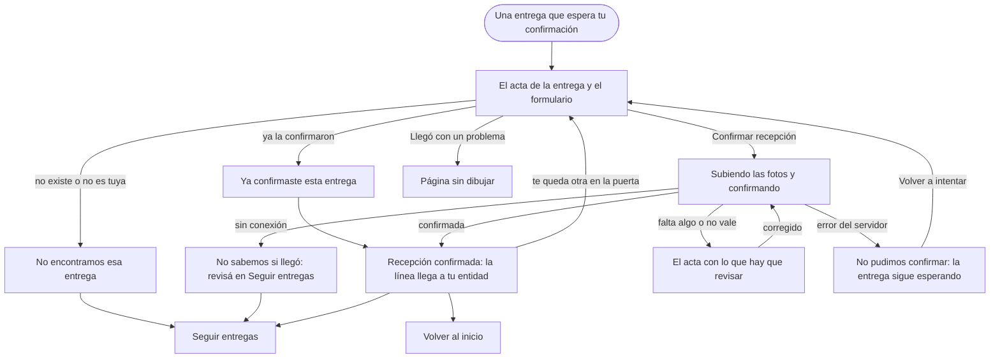

# Flujo: Confirmar recepción, en Raíces

> **Estado:** aprobado · **Fecha:** 2026-11-01 · **Aprobó:** usuario (2026-11-01, al ver la pantalla construida)
> Plantilla de la skill `ux-flujo`. Es la tercera pantalla de Raíces, la tercera alternativa en
> exploración, y la primera de la entidad. Vive en su prototipo propio
> ([ADR propuesto](../../adr/cliente-liviano/20261101-tercera-alternativa-raices-como-prototipo-propio.md)):
> `/prototipo/raices/entidad-seguimiento-confirmar`. Su par en Cozy es
> `templates/prototipo/cozy-medieval/entidad-seguimiento-confirmar.html`, con los mismos datos,
> los mismos campos y las mismas acciones.

## 1. Para quién y para qué

| | |
|---|---|
| Quién | La persona de la entidad que recibe el camión en la puerta (en el ejemplo, Marta, del Comedor Barrio Ejemplo). Tiene la entrega delante, el remito en la mano y el celular en la otra; a veces confirma más tarde, desde la computadora de la entidad |
| Tono | Pantalla de trabajo: claro, útil, tranquilizador; instrucciones, estado y próximo paso. Para los errores: honesto, responsable, sereno ([tono según la pantalla](../tono-y-comunicacion.md#tono-según-la-pantalla)). La entidad es activa: confirma ella misma |
| Qué quiere lograr | "Dejar asentado que la entrega llegó, con la foto, rápido y sin equivocarme de entrega" |
| Dispositivo principal | Celular primero; también la computadora |
| Requerimientos | RF-12 (confirmar recepción exige al menos una foto válida, D27; la entrega pasa a `ENTREGADA`). RF-08 (quien donó recibe la notificación de recepción) y RF-13 (la recepción también aparece en la bandeja de la entidad). RF-01 y RF-02 (la foto de una entrega confirmada puede mostrarse en la portada y en el mapa público, con ubicación aproximada). RF-14 (solo las entregas que la entidad debe recibir). RNF-PRIV-03 y 04 (fotos privadas y sin EXIF). RNF-UI-04 a 06 (ayudas del flujo crítico, éxito y error en cada acción, `hx-indicator`). RF-CL-04 (CSRF). RNF-CL-02 (sin JavaScript, igual funciona) |
| Datos que usa | `PATCH /api/entregas/{id}/estado` con `estado: ENTREGADA`, `actor` y `fotosRecepcion` (al menos una; 400 si falta la foto o la transición no vale; 404 si no existe). Huecos: HB-10 (subir la foto: `POST /api/entregas/{id}/fotos` multipart, hacia MinIO), HB-09 (la notificación de recepción), HB-13 (que solo la entidad destinataria confirme) y HB-16 (las entregas activas de una entidad en una llamada). La cantidad de bultos, el remito, la necesidad que cubre y quién donó **no están en el contrato** (ver Preguntas abiertas). En la maqueta, los datos de ejemplo de la pantalla de Cozy |
| Boceto de E1 | Página 28: "Entregas a confirmar", con fecha, hora, código y contenido; una zona para soltar archivos ("Adjuntar al menos 1 imagen"), la casilla "Disclaimer legal", "Reportar problema" y "Confirmar Entregas" |

## 2. Dónde está en el sitio

Inicio de la entidad → **Seguir entregas** (nivel 2, menú) → **Confirmar recepción** (nivel 3), una
entrega por vez ([mapa del sitio](../mapa-del-sitio.md): Entidad → Seguir entregas → Confirmar
recepción; es el flujo piloto). Se llega desde una entrega que espera confirmación en Inicio o en
Seguir entregas, y desde el aviso de "Te queda una en la puerta" al terminar otra.

Raíces todavía no tiene las otras pantallas de la entidad. El menú muestra sus cuatro secciones
(Inicio, Necesidades, Donaciones recibidas y Seguir entregas); las que faltan abren la página corta
de Raíces que dice que todavía no está dibujada y enlaza a la de Cozy (decisión del usuario,
2026-11-01, la misma de Seguir entregas). "Llegó con un problema" abre esa misma página, pero sin
enlace a Cozy, porque Cozy tampoco la tiene.

## 3. Recorrido



Desvíos considerados:

- **Cancelar o volver:** "Seguir entregas" arriba y el botón Atrás; nada se guarda hasta confirmar.
- **Error de datos:** sin foto, una foto de más de 5 MB o que no es una imagen, sin bultos o sin
  remito. El acta vuelve con un resumen arriba, con un enlace a cada campo, y el error al lado del
  campo; lo escrito se conserva. Las fotos hay que volver a elegirlas (el navegador no las guarda):
  se dice.
- **Error del servidor:** el servidor respondió que no guardó la confirmación. La entrega sigue
  esperando y nada cambió para quien donó; se dice eso, con el código y "Volver a intentar". Las
  fotos hay que volver a elegirlas.
- **Sin conexión o sin respuesta:** nadie sabe si la confirmación llegó al servidor. No se afirma
  nada: se pide revisar la señal y fijarse en Seguir entregas si ya aparece confirmada antes de
  repetirla. Este aviso lo da HTMX; sin JavaScript, el navegador muestra su propia página de error.
- **Doble envío o ya confirmada:** el botón dice "Confirmando…" mientras sube; un segundo toque no
  manda otra vez. Si igual llega una segunda vez (sin JavaScript, un reintento o una compañera que
  ya la confirmó), la pantalla dice "Ya confirmaste esta entrega", con quién y cuándo, y lleva a lo
  asentado: a la propia entidad se le puede mostrar.
- **Sin permiso:** una entrega que no existe o es de otra entidad se muestra como "No encontramos
  esa entrega" (no se dice de quién es: HB-13).
- **Llegó con un problema:** un enlace debajo del botón. El reporte se diseña aparte (decisión del
  usuario, 2026-11-01).

## 4. Pantallas

Dos pantallas, con la estructura privada de Raíces (menú de la entidad y cuenta). Esquema en el
celular, el dispositivo principal:

```text
┌──────────────────────────────┐
│ ← Seguir entregas            │
│ Confirmá lo que *llegó*      │
│ Lentejas secas, 15 kg.       │
│ Llegó hoy a las 18:20.       │
│ ┌──────────────────────────┐ │
│ │ ▣ Alimentos · 3 bultos   │ │  la etiqueta de la entrega
│ │ Para tu pedido: Lentejas │ │
│ │ secas, 40 kg, hasta el   │ │
│ │ 31 de octubre. Van 10.   │ │
│ │ Donó Distribuidora       │ │
│ │ Ejemplo SA               │ │
│ └──────────────────────────┘ │
│ El último tramo              │
│ (●)── Salió del depósito     │
│  │    Hoy, 14:30             │
│ (●)── Llegó a tu puerta      │
│  ┆    Hoy, 18:20             │
│ ( )── Tu confirmación        │
│       Falta: es este paso    │
│ Las pruebas                  │
│ [ Elegir o sacar fotos ]     │
│ Quién ve tus fotos           │
│ Lo que recibiste             │
│ Cantidad de bultos [   ]     │
│ Número de remito  [      ]   │
│ Recibe Marta, por …          │
│ [ Confirmar recepción ]      │
│ Llegó con un problema        │
├──────────────────────────────┤
│ barra del menú               │
└──────────────────────────────┘
```

- **La etiqueta de la entrega:** la categoría con su pictograma (el del cuaderno de la portada),
  cuánto y en cuántos bultos salió, la necesidad que cubre con cuánto va recibido, y quién donó
  (decisiones del usuario, 2026-11-01). Si dona una persona, no va su nombre: "Donó: Una persona"
  (propuesto: ver Preguntas abiertas).
- **El último tramo:** la raíz de esta entrega, de arriba abajo: los dos pasos cumplidos con el
  sello impreso y el de la confirmación hueco, porque todavía no pasó. Es la imagen de raíz de la
  pantalla.
- **Las pruebas:** las fotos primero, que es lo que pide RF-12; debajo, quién las ve: quien donó
  y, quizás, el mapa público.
- **Lo que recibiste:** la cantidad de bultos (vacía, para contarlos; los que salieron están en la
  etiqueta) y el número de remito, los mismos campos de Cozy.
- **El pie:** quién firma y cuándo, el botón, qué pasa al confirmar y el enlace al problema.
- **Recepción confirmada:** la misma raíz, ahora completa: la línea llega impresa hasta la
  estación de tu entidad, con su sello y la hora. Debajo, lo que quedó asentado (bultos, remito,
  quién y cuándo), cómo va la necesidad ("25 de 40 kg recibidos") y que le avisamos a quien donó. Después, la otra entrega que espera en la puerta, si hay, y las salidas.

En pantalla grande, dos columnas: la etiqueta y el último tramo a la izquierda, quietos mientras se
baja, y el formulario a la derecha (A/B 1).

Qué cambia respecto del boceto de E1, y por qué:

- **Una entrega por vez,** no "Confirmar Entregas" juntas: cada una tiene sus fotos y su remito, y
  un error en una no traba las otras (la nota del boceto lo advierte). Es lo mismo que hace Cozy.
- **Sin la casilla "Disclaimer legal":** el boceto no dice qué acepta. En su lugar, el texto dice
  qué pasa al confirmar y quién ve las fotos. Si hace falta un texto legal, se suma con los
  legales del sitio.
- **Sin el mapa:** esta pantalla no muestra el recorrido del camión, que ya llegó; lo muestra
  Seguir entregas (RF-14). Queda solo el último tramo, como raíz.
- **"Reportar problema" pasa a "Llegó con un problema",** un enlace y no un botón: la acción
  principal es confirmar.
- **Se suman** la necesidad que cubre y quién donó, que el boceto no tiene (usuario, 2026-11-01).

## 5. Estados

En la maqueta, `?entrega=lentejas` (de partida) o `ropa`, y `?escenario=lento`, `error`,
`sin-conexion`, `confirmada` y `vacio` (como las otras pantallas de Raíces). El error de datos es su propia pantalla,
`entidad-seguimiento-confirmar-error`, como en Cozy. Cada confirmación lleva a
`entidad-seguimiento-sellada-lentejas` o `-ropa`, los mismos nombres de Cozy.

| Pantalla | Estado | Qué se ve | Texto |
|---|---|---|---|
| Acta | Con datos | La etiqueta, el último tramo y el formulario | Ver Textos |
| Acta | Vacío | Una entrega que no existe o no es de la entidad: un aviso en lugar del acta | "No encontramos esa entrega" · "Puede que el enlace esté incompleto. Buscala en Seguir entregas." · "Volver a Seguir entregas" |
| Acta | Ya confirmada | Una entrega de la entidad que ya se confirmó: el título "Esta entrega ya está *confirmada*", y un aviso en lugar del formulario, con la raíz completa | "Ya confirmaste esta entrega" · "La confirmó Marta el 15 de octubre de 2026 a las 18:45." · "Ver lo que quedó asentado" · "Volver a Seguir entregas" |
| Acta | Cargando | Al enviar: el botón dice "Confirmando…" y no se puede volver a tocar; arriba, un aviso | "Subiendo las fotos y confirmando la entrega…" (en el sistema, en la región `#avisos`) |
| Acta | Éxito | La pantalla Recepción confirmada | Ver Textos |
| Acta | Error de datos | El acta con un resumen arriba (con foco), un enlace a cada campo y el error al lado del campo; lo escrito sigue. En la maqueta, dos errores: la foto pesada y el remito | Resumen: "Revisá dos cosas antes de confirmar" (o "una cosa", "tres cosas"). Por campo: "Falta al menos una foto de lo que llegó." · "lentejas-1.jpg pesa más de 5 MB. Probá con una más liviana." · "lentejas-1.pdf no es una foto. Elegí una JPG o PNG." · "Falta la cantidad de bultos. Contá las cajas o bolsas que recibiste." · "Falta el número de remito. Está arriba a la derecha del papel." Junto a las fotos, siempre: "Por seguridad, el navegador no guarda las fotos: volvé a elegirlas." |
| Acta | Error del servidor | Un aviso de error arriba del formulario, que sigue como estaba | "No pudimos confirmar la entrega." · "Es un problema nuestro: la entrega sigue esperando tu confirmación y quien donó no recibió ningún aviso. Volvé a elegir las fotos y probá de nuevo en unos minutos; si sigue, escribinos con este código." · el código (`a1b2c3d4e5f6`) · "Volver a intentar" |
| Acta | Sin conexión | Con JavaScript, un aviso arriba del formulario; sin JavaScript, la página de error del navegador | "No sabemos si la confirmación llegó." · "Se cortó la conexión mientras se enviaba. Revisá la señal y fijate en Seguir entregas si ya aparece confirmada antes de repetirla." · "Ir a Seguir entregas" |
| Acta | Sin permiso | Igual que Vacío: no se dice de quién es la entrega | — |
| Acta | Deshabilitado | No aplica: el botón no espera un paso previo; lo que falta lo dice el error de datos | — |
| Recepción confirmada | Con datos | La raíz completa, lo asentado, la necesidad, el aviso a quien donó y la siguiente entrega | Ver Textos |
| Recepción confirmada | Vacío | No queda otra entrega en la puerta: en lugar de la siguiente, una línea | "No te quedan entregas para confirmar." |
| Recepción confirmada | Cargando, error | No aplica: es la respuesta de la confirmación | — |
| Llegó con un problema | — | La página sin dibujar, sin enlace a Cozy, con la vuelta a la entrega | "Esta pantalla todavía no está dibujada en Raíces." · "Volver a la entrega" |

## 6. Textos

Los de la entrega salen de los datos de ejemplo de Cozy; la necesidad, de las necesidades
publicadas de Cozy (lentejas: 10 de 40 kg; ropa: 1 de 6 cajas). Los propios de esta pantalla:

| Elemento | Texto | Nota |
|---|---|---|
| Rótulo y vuelta | "Seguir entregas" (enlace) | El nombre del menú; la vuelta, arriba |
| Título | "Confirmá lo que *llegó*" | La entidad hace (tono). La parte en cursiva, con la segunda tinta, como los títulos de Raíces |
| Bajada | "Lentejas secas, 15 kg. Llegó hoy a las 18:20." | Qué entrega y cuándo llegó: no equivocarse de entrega |
| Etiqueta | "Alimentos · 3 bultos" · "Para tu pedido": "Lentejas secas, 40 kg, hasta el 31 de octubre. Van 10 kg recibidos." · "Donó": "Distribuidora Ejemplo SA" · "Desde": "Depósito Central" | Ropa: "Ropa · 2 bultos" · "Ropa de abrigo, 6 cajas, hasta el 15 de noviembre. Va 1 caja recibida." · "Donó": "Una persona". En el estado ya confirmada, sin la cifra recibida, que ya cambió |
| El último tramo | "Salió del Depósito Central" · "Hoy, 14:30" · "Llegó a tu puerta" · "Hoy, 18:20" · "Tu confirmación" · "Falta: es este paso" | Los de Cozy; lo pendiente se dice pendiente |
| Las pruebas | "Fotos de lo que llegó" · ayuda: "Al menos una, de la cámara o de la galería. JPG o PNG, hasta 5 MB cada una. Mostrá lo que llegó; no hace falta que salga nadie." | La ayuda de Cozy más la guía de fotos del tono común |
| Quién ve tus fotos | "Distribuidora Ejemplo SA va a ver tus fotos y la fecha de hoy. Una foto puede mostrarse en la portada y en el mapa público de entregas, con la ubicación aproximada. El remito no se publica." | Ropa: "Quien donó va a ver tus fotos…", igual. Dice para qué se usa la foto (usuario, 2026-11-01; RF-01, RF-02 y RNF-PRIV-01) |
| Lo que recibiste | "Cantidad de bultos" · "Contá las cajas o bolsas que recibiste." · "Número de remito" · "Está arriba a la derecha del papel." | Los de Cozy |
| Firma | "Recibe Marta, por Comedor Barrio Ejemplo, el 15 de octubre de 2026" | El de Cozy |
| Acción principal | "Confirmar recepción" · mientras envía, "Confirmando…" | El de Cozy |
| Qué pasa al confirmar | "Al confirmar, la entrega queda como entregada y quien donó recibe el aviso." | El de Cozy |
| Problema | "Llegó con un problema" (enlace) | Usuario, 2026-11-01 |
| Confirmada: título | "Recepción *confirmada*" | |
| Confirmada: bajada | "Confirmaste la recepción de Lentejas secas, 15 kg, hoy a las 18:45. Llegaron hoy a las 18:20." | Ropa: "… Ropa de abrigo, 2 cajas, hoy a las 18:50. Llegó ayer a las 17:10." El hecho, con sus dos horas; sin el efecto social (tono). En el celular, lo asentado y la siguiente van antes que la etiqueta |
| Confirmada: lo asentado | "Bultos" 3 · "Remito" 0001-00004521 · "Recibió" Marta, por Comedor Barrio Ejemplo · "Cuándo" 15 de octubre de 2026, 18:45 | Los de Cozy |
| Confirmada: la necesidad | "Tu pedido de lentejas secas: 25 de 40 kg recibidos, hasta el 31 de octubre." | Ropa: "Tu pedido de ropa de abrigo: 3 de 6 cajas recibidas, hasta el 15 de noviembre." Cifra con período |
| Confirmada: quien donó | "Le avisamos a Distribuidora Ejemplo SA, con tus fotos y la fecha." | Ropa: "Le avisamos a quien donó, con tus fotos y la fecha." No afirma que ya lo leyó (HB-09) |
| Confirmada: la siguiente | "Te queda una en la puerta" · "Ropa de abrigo, 2 cajas" · "Llegó ayer, 17:10" · "Confirmar recepción" | Los de Cozy. Sin ninguna: "No te quedan entregas para confirmar." |
| Confirmada: salidas | "Volver al inicio" · "Seguir entregas" | Los de Cozy |
| Cuenta | Marta · Comedor Barrio Ejemplo | La de Cozy |

Ayudas por flujo crítico (RNF-UI-04, confirmar recepción): qué foto sirve (al menos una, el tamaño
y el formato), dónde está el remito, qué pasa al confirmar, quién ve las fotos y que se confirma
una entrega por vez.

Filtro de tono:

- Lo pendiente se dice pendiente: "Tu confirmación · Falta: es este paso".
- Las cifras llevan período: "25 de 40 kg recibidos, hasta el 31 de octubre".
- El error del servidor dice qué no cambió (la entrega sigue esperando, quien donó no recibió
  nada) y el próximo paso, sin "lamentablemente".
- El éxito dice el hecho y lo que respalda la entrega (las fotos, la fecha), no su efecto ("tu
  comunidad come mejor" no va).
- Palabras que no van (brief de Raíces): "eco", "huella verde", "florecer", "regá", "cosechá" y
  "sostenible" puesto de adorno; tampoco "echó raíces" en un dato o un botón (la imagen de raíz, solo
  en el dibujo).

## 7. Accesibilidad

- Zonas: el enlace para saltar al contenido, la navegación de la entidad (`nav` con nombre), el
  contenido (`main`) con un `h1`; la etiqueta, el tramo y cada grupo del formulario con su `h2`.
- Orden del foco: saltar al contenido, la marca, el botón para plegar el menú, el menú, "Salir",
  "Seguir entregas", el campo de fotos, bultos, remito, "Confirmar recepción" y "Llegó con un
  problema".
- Cada campo con su `label` y su ayuda en `aria-describedby`; los obligatorios, `required` y
  marcados en texto.
- El error de datos: el resumen con `role="alert"` recibe el foco y enlaza a cada campo; cada
  campo con error lleva `aria-invalid` y su mensaje en `aria-describedby`.
- El último tramo es una lista ordenada (`ol`) con nombre; el paso que falta lleva
  `aria-current="step"`. El dibujo de la raíz es decorativo (`aria-hidden`): la lista dice lo
  mismo.
- El campo de fotos es el nativo (`input type="file"`, `accept="image/*"`, `multiple`): la cámara
  y la galería del celular sin JavaScript. Controles de al menos 48 × 48 px.
- Los avisos de envío y de confirmación se anuncian en la región `aria-live` del layout.
- Con "reducir movimiento", la raíz de la confirmación aparece completa, sin trazado.

## 8. Revisión de usabilidad

| # | Heurística | Cómo la cumple | Riesgo que queda |
|---|---|---|---|
| 1 | Visibilidad del estado | El último tramo dice qué pasó y qué falta; al enviar, "Confirmando…"; al terminar, la raíz completa y la hora | El progreso de subida de cada foto depende de HB-10 |
| 2 | Lenguaje del usuario | Bultos, remito, entrega, tu pedido; sin estados técnicos (`ENTREGADA`) | — |
| 3 | Control y libertad | Nada se guarda hasta confirmar; "Seguir entregas" y Atrás siempre | Una confirmación no se deshace desde acá (el contrato no lo permite) |
| 4 | Consistencia | Los mismos campos, textos y acciones de Cozy; los sellos de Seguir entregas | — |
| 5 | Prevención de errores | La bajada nombra la entrega y la hora; los bultos se cuentan (el campo llega vacío); una entrega por vez; el botón no envía dos veces y una segunda confirmación dice "Ya confirmaste esta entrega". Sin diálogo antes de confirmar, aunque el catálogo lo pide para lo irreversible: el acta misma es el paso de revisión (la persona eligió las fotos, contó los bultos y escribió el remito, y el texto dice qué pasa al confirmar), y un diálogo suma un toque en la puerta con el celular en la mano (agente, propuesto) | Si en la prueba con personas aparecen confirmaciones por error, se suma el diálogo |
| 6 | Reconocer antes que recordar | La etiqueta muestra qué es, para qué pedido y de quién; la ayuda dice dónde está el remito | — |
| 7 | Flexibilidad | Cámara o galería; desde el celular en la puerta o después desde la computadora | — |
| 8 | Diseño minimalista | Tres campos y un botón; la etiqueta solo con lo que ayuda a no equivocarse | La etiqueta suma tres datos que Cozy no tiene: se prueba que no demore la confirmación |
| 9 | Recuperarse de errores | El resumen con enlaces, lo escrito se conserva, se avisa que hay que volver a elegir las fotos; el error del servidor dice que nada cambió | — |
| 10 | Ayuda | Ayudas en cada campo y qué ve quien donó | — |

Los 7 factores de la experiencia ([criterios de la cátedra](../criterios-catedra-ux-ui.md),
sección 2):

| Factor | Cómo lo cumple |
|---|---|
| Útil | Confirma la entrega con las pruebas que pide RF-12, en una sola pantalla |
| Usable | Tres campos nativos, en el orden en que la persona los tiene a mano |
| Deseable | La raíz de la entrega que se completa al confirmar, con los sellos y la paleta Bosque |
| Valioso | La entidad ve qué pedido avanza; quien donó recibe la prueba |
| Ubicable | Desde Seguir entregas, Inicio y la confirmación anterior; la sección del menú se destaca |
| Accesible | Campos con nombre y ayuda, errores enlazados, tramo en lista; WCAG AA y Ley 26.653 |
| Creíble | Dice quién ve las fotos, también en lo público, y que el remito no se publica; cada dato con su fecha; el error dice qué no cambió y, sin conexión, no afirma lo que no sabe |

Qué conviene probar con personas reales (la revisión heurística no reemplaza al test con
usuarios): si alguien de una entidad, con el celular en una mano, encuentra el remito y saca la
foto sin ayuda, y si la etiqueta le ayuda a no confundir dos entregas que llegaron el mismo día.

## 9. Decisiones y preguntas

Decisiones tomadas:

- Una entrega por vez, como Cozy (ver qué cambia respecto del boceto).
- Los mismos campos, textos y acciones que Cozy; los mismos nombres de pantalla.
- Rondas de preguntas (usuario, 2026-11-01):
  - "Llegó con un problema", un enlace debajo del botón; el reporte se diseña aparte;
  - la etiqueta muestra el último tramo, la necesidad que cubre y quién donó, y la pantalla dice qué
    ve quien donó;
  - al confirmar, la persona siente que se cerró un ciclo: la raíz de la entrega llega a su
    entidad.
- Si dona una persona, la entidad no ve su nombre: "Donó: Una persona" (agente, propuesto, por
  privacidad).

Partes que se deciden con A/B, en este orden:

1. La composición del acta en pantalla grande. **Decidido (usuario, 2026-11-01):** dos columnas:
   la etiqueta y el último tramo a la izquierda, quietos mientras se baja, y el formulario a la
   derecha; en el celular, una columna (bitácora, "El acta en dos columnas en pantalla grande").
2. Cómo se eligen las fotos. **Decidido (usuario, 2026-11-01):** una zona de carga grande, un
   recuadro punteado con la cámara al centro, con el campo nativo (bitácora, "Las fotos, en una
   zona de carga grande").
3. Cómo se cierra el ciclo en Recepción confirmada. **Decidido (usuario, 2026-11-01):** la raíz
   completa, grande, arriba: del brote del depósito a la estación de tu entidad, que se traza una
   vez al confirmar (bitácora, "Recepción confirmada: la raíz completa llega a tu entidad").

Preguntas abiertas, para el equipo (no cambian el prototipo):

- El contrato no tiene la cantidad de bultos, el remito, la necesidad que cubre ni quién donó.
  Cozy ya usa los dos primeros. ¿Se suman al contrato (un hueco nuevo, como HB-xx) o salen de otra
  llamada?
- ¿Puede la entidad ver el nombre de la empresa que donó? Los requerimientos no lo dicen; la ficha
  lo muestra (usuario, 2026-11-01).
- ¿Y el de una persona que dona? Tampoco lo dicen; la ficha lo oculta ("Donó: Una persona"), por
  privacidad (agente, propuesto).
- Si la entrega llegó incompleta o dañada, ¿se confirma igual y se reporta, o no se confirma hasta
  resolverlo? El contrato tiene los estados `NO_RECIBIDA` y `REVISION`. Se define con el reporte del
  problema; hasta entonces, la pantalla no aconseja nada.
- "Escribinos con este código" (como en Seguir entregas y en Cozy) no dice dónde: el mapa del
  sitio no tiene una página de contacto. Se resuelve con los legales y el contacto del sitio.
- El menú de la entidad del prototipo no tiene Notificaciones (RF-13, va en la campana) ni Mi
  perfil (va en la cuenta), que el mapa del sitio pone en el nivel 2: el mismo patrón aprobado en
  Seguir entregas.
