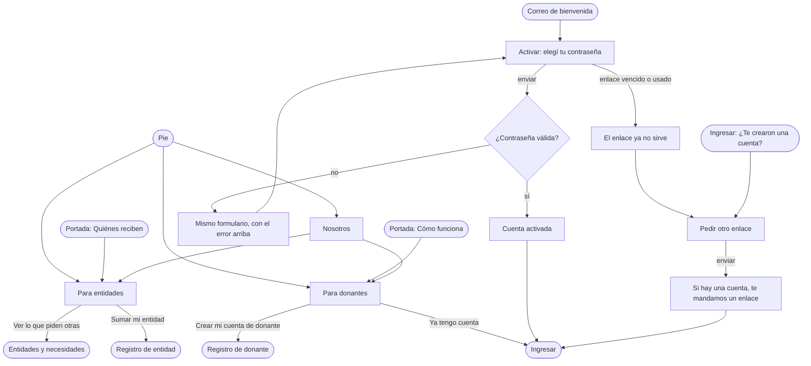

# Flujo: Conocer DonaTrack y activar la cuenta, en Raíces

> **Estado:** aprobado · **Fecha:** 2026-11-07 · **Aprobó:** usuario (2026-11-07)
> Plantilla de la skill `ux-flujo`. Fase F6 del
> [roadmap de las vistas del enunciado](../roadmap-vistas-enunciado.md): las cuatro pantallas
> públicas que faltan. Nosotros, Para donantes (la "Landing donante" del mapa), Para entidades (la
> "Landing beneficiario") y Activar cuenta. Una sola ficha, como pide el roadmap.

## 1. Para quién y para qué

| | |
|---|---|
| Quién | **Nosotros y las dos landings:** alguien sin cuenta que llegó a la portada y quiere saber quién está detrás y qué gana si se suma; una persona o empresa que piensa donar; quien representa a un comedor, una escuela o una parroquia. **Activar cuenta:** un donante que el admin registró en el depósito o que entró por el CSV, que recibe un correo y abre el enlace, casi siempre desde el celular |
| Tono | Páginas públicas e institucionales: profesional, seguro, directo. Qué resuelve, cómo funciona y para quién; sin exageraciones ni jerga de startup ([tono según la pantalla](../tono-y-comunicacion.md#tono-según-la-pantalla)). Activar cuenta: pantalla de trabajo, clara y tranquila |
| Qué quiere lograr | "Entender qué es esto y si me sirve antes de crear una cuenta" · "Entrar por primera vez con la cuenta que me hicieron" |
| Dispositivo principal | Ambos; Activar cuenta, celular primero |
| Requerimientos | RF-01 (la portada lleva a lo institucional) y la lista de pantallas públicas de [§6.2](../../requerimientos/requerimientos-e6.md). Activar cuenta: RF-AUTH-14 (alta de donantes del CSV y del depósito, D12 🎓), RF-AUTH-04 y RNF-AUTH-10 (la respuesta no revela si el correo tiene cuenta) |
| Datos que usa | Contadores de Nosotros: HB-02, `GET /api/donaciones/contadores` (rama `E6_HB02_contadores_publicos`). Activar cuenta: el mecanismo de D12, en consulta con la cátedra; con Keycloak (PR 927), el enlace sería una acción requerida de "elegir contraseña". En la maqueta, datos de ejemplo y formularios que van a su pantalla siguiente |
| Boceto de E1 | Nosotros: pág. 3. Las landings y Activar cuenta: sin boceto |

## 2. Dónde está en el sitio

Las cuatro son públicas, de nivel 2 (Activar cuenta, nivel 3, sale de un correo o de Ingresar).
Están en el [mapa del sitio](../mapa-del-sitio.md) como Nosotros, Landing donante, Landing
beneficiario y Activar cuenta.

| Pantalla | Dirección | Se llega desde |
|---|---|---|
| Nosotros | `/publico-nosotros` | El pie de todas las páginas |
| Para donantes | `/publico-para-donantes` | El pie y la lámina "Cómo funciona" de la portada ("Qué ganás si donás") |
| Para entidades | `/publico-para-entidades` | El pie y la sección "Quiénes reciben" de la portada ("Cómo se suma una entidad") |
| Activar cuenta | `/publico-activar` | El enlace del correo de bienvenida (D12) |
| Pedir otro enlace | `/publico-activar-pedir` | Activar cuenta con el enlace vencido o usado, e Ingresar ("¿Te crearon una cuenta?") |

El menú público no cambia (usuario, 2026-11-07): ya tiene cinco opciones en el celular. El pie
pasa de dos enlaces a cinco: Nosotros, Para donantes, Para entidades, Términos y privacidad, y
Contacto. En la barra de navegación, Nosotros y las landings no marcan una sección, como Contacto y
Términos; Activar cuenta y Pedir otro enlace marcan "Ingresar", como Recuperar contraseña.

## 3. Recorrido



Desvíos: volver (Atrás del navegador, la marca o el menú), error de datos (contraseña corta), error
del servidor y sin conexión al activar, y enlace vencido o ya usado. No hay "sin permiso": son
públicas. Una cuenta que ya está activa y abre el enlace otra vez cae en "ya usado": no se dice si
la cuenta existe (RNF-AUTH-10).

## 4. Pantallas

Las cuatro usan `layout-publico`, la cabecera, la navegación pública y el pie de las demás. La
audacia de Raíces sigue en la portada; estas son de lectura (las tres primeras) y de trabajo
(Activar).

### 4.1 Nosotros (`publico-nosotros`)

```text
┌─────────────────────────────────────────────┐
│ NOSOTROS (rótulo)                           │
│ Lo que donás, seguido hasta que llega       │
│ bajada: quiénes somos, en dos líneas        │
├─────────────────────────────────────────────┤
│ Cifras: 3 frutos, con período y fecha       │
├──────────────────────┬──────────────────────┤
│ Quiénes somos        │ lámina (brote y raíz)│
├──────────────────────┴──────────────────────┤
│ Cómo trabajamos: 3 puntos (seguir, cuidar   │
│ los datos, ver dónde llega)                 │
├─────────────────────────────────────────────┤
│ Lo que nos importa: 4 valores               │
├─────────────────────────────────────────────┤
│ Sumate: [Quiero donar] [Represento a una    │
│ entidad]  → las dos landings                │
└─────────────────────────────────────────────┘
```

Respecto del boceto (pág. 3): se conservan las cifras, "Quiénes somos" con imagen, "Nuestra
solución" y "Nuestros valores". Cambios:

- Las cifras llevan período y fecha, y dicen qué se cuenta (tono). "Beneficiarios activos" pasa a
  "Entidades en el mapa", como en la portada.
- "Nuestra solución" pasa a "Cómo trabajamos", con tres puntos cortos y sin "en tiempo real" (la
  posición se actualiza cada 30 s, D22) ni "asignado de manera automática" (el admin aprueba cada
  propuesta).
- "¡Unirse a la Comunidad!" pasa a dos salidas, una por público, hacia las landings.
- La imagen es una lámina de la familia de la portada (brote con raíz), no una foto: no hay fotos
  propias del equipo.

Texto en un ancho de lectura (unos 65 caracteres por línea), con los títulos en Fraunces, como
Legales. Las cifras reusan la rama de frutos de la portada (`.frutos`), con `data-cosecha="completa"`: las tres están cumplidas, así que ninguna va punteada como "en camino".

### 4.2 Para donantes (`publico-para-donantes`)

```text
┌─────────────────────────────────────────────┐
│ PARA DONANTES (rótulo)                      │
│ Doná y seguí tu donación hasta que llega    │
│ bajada · [Crear mi cuenta de donante]       │
│          Ya tengo cuenta: Ingresar          │
├─────────────────────────────────────────────┤
│ Qué podés donar: 3 categorías con su sello  │
│ (alimentos, ropa, muebles)                  │
├─────────────────────────────────────────────┤
│ Qué ves con tu cuenta: 4 puntos             │
│ (tus donaciones, por dónde va el camión,    │
│  quién la recibió, las entidades)           │
├─────────────────────────────────────────────┤
│ Una línea para la persona: misiones         │
├─────────────────────────────────────────────┤
│ Preguntas frecuentes (details): 4           │
├─────────────────────────────────────────────┤
│ [Crear mi cuenta de donante]                │
└─────────────────────────────────────────────┘
```

Sin boceto. Solo promete lo que el sitio ya muestra al donante: Mis donaciones, Seguimiento,
Entidades, Notificaciones y, para la persona, Misiones. Las categorías son las tres con sello en
el sitio. Las preguntas frecuentes usan `<details>` nativo.

### 4.3 Para entidades (`publico-para-entidades`)

```text
┌─────────────────────────────────────────────┐
│ PARA ENTIDADES (rótulo)                     │
│ Sumá tu entidad y recibí lo que necesita    │
│ bajada · [Sumar mi entidad]                 │
│          Ver lo que piden otras entidades   │
├─────────────────────────────────────────────┤
│ Cómo se suma: 3 pasos numerados             │
│ (completás los datos → lo revisamos →       │
│  publicás lo que necesitás)                 │
├─────────────────────────────────────────────┤
│ Qué hacés con tu cuenta: 3 puntos           │
│ (publicar necesidades, seguir entregas,     │
│  confirmar lo que llega con una foto)       │
├─────────────────────────────────────────────┤
│ Qué datos se muestran: lo público y lo que  │
│ no (sin contacto en el catálogo)            │
├─────────────────────────────────────────────┤
│ Preguntas frecuentes (details): 3           │
├─────────────────────────────────────────────┤
│ [Sumar mi entidad]                          │
└─────────────────────────────────────────────┘
```

Sin boceto. "Entidad" en lugar de "beneficiario", como en el resto del sitio (tono). La revisión de
la entidad es la aprobación del admin (RF-AUTH-06, RF-21); no se promete un plazo. "Qué datos se
muestran" sale de RF-22: el catálogo no muestra datos de contacto.

### 4.4 Activar cuenta (`publico-activar` y sus pantallas)

```text
┌─────────────────────────────────────────────┐
│ ACTIVAR CUENTA (rótulo)                     │
│ Elegí tu contraseña                         │
│ bajada: tu cuenta la creó el equipo de      │
│ DonaTrack con tu correo                     │
│                                             │
│ Correo        martina.ruiz@ejemplo.test     │
│               (solo lectura)                │
│ Contraseña    [            ] [Mostrar]      │
│   Al menos 8 caracteres.                    │
│ [Activar mi cuenta]                         │
│ ¿No pediste esta cuenta? Escribinos         │
└─────────────────────────────────────────────┘
```

Las piezas de Ingresar y Recuperar: la cabecera y el formulario en su lámina. Un solo campo de
contraseña con "Mostrar", como el registro de donante, en lugar de pedirla dos veces. El correo se
muestra, no se edita: viene en el enlace.

- **Cuenta activada** (`publico-activar-lista`): el sello de hecho de Contacto, el título "Tu
  cuenta está lista" y el botón "Ingresar".
- **Error de datos** (`publico-activar-error`): resumen arriba con enlace al campo.
- **Enlace vencido o usado** (`publico-activar?escenario=vencido`): en lugar del formulario, un
  aviso con "Pedir otro enlace".
- **Pedir otro enlace** (`publico-activar-pedir` y `publico-activar-pedido`): como Recuperar
  contraseña, un correo y "Mandame el enlace"; la respuesta es la misma haya o no cuenta.

## 5. Estados

| Pantalla | Estado | Qué se ve | Texto |
|---|---|---|---|
| Nosotros | Con datos | Las tres cifras con su período y la fecha | "Actualizado el 15 de octubre de 2026, 14:30." |
| Nosotros | Vacío (`?escenario=vacio`) | Sin cifras; el resto de la página igual | "Todavía no hay entregas confirmadas. Se cuentan cuando cada entidad confirma lo que recibe." |
| Nosotros | Cargando (`?escenario=lento`) | Aviso en el lugar de las cifras | "Cargando las cifras…" |
| Nosotros | Error del servidor (`?escenario=error`) | Aviso con "Volver a cargar"; el texto de la página sigue | "No pudimos cargar las cifras. Probá de nuevo en unos minutos." |
| Para donantes | Con datos | Página estática | — |
| Para entidades | Con datos | Página estática | — |
| Activar | Con datos | Formulario con el correo de la cuenta | — |
| Activar | Enviando | Botón "Activando…" desactivado | "Activando…" |
| Activar | Error de datos (`publico-activar-error`) | Resumen arriba, que recibe el foco; el campo con `aria-invalid` | "Revisá la contraseña" · "La contraseña es corta: tiene que tener al menos 8 caracteres." |
| Activar | Error del servidor (`?escenario=error`) | Aviso arriba con código; el formulario sigue | "No pudimos activar tu cuenta." (título) · "Es un problema nuestro. Probá de nuevo en unos minutos; si sigue, escribinos con este código." · "Código: a1b2c3d4e5f6" · "Escribinos" → Contacto con el código |
| Activar | Sin conexión (`?escenario=sin-conexion`) | Aviso arriba | "Se cortó la conexión." (título) · "No sabemos si tu cuenta quedó activada. Probá ingresar; si no podés, volvé a abrir el enlace del correo." |
| Activar | Enlace vencido o usado (`?escenario=vencido`) | El título pasa a "Activá tu cuenta"; aviso en lugar del formulario | "Este enlace ya no sirve." (título) · "Los enlaces sirven una sola vez y por tiempo limitado. Si ya activaste tu cuenta, ingresá con tu contraseña; si no, pedí otro enlace." · "Pedir otro enlace" · "Ir a Ingresar" |
| Activada | Éxito | Sello y botón | "Tu cuenta está lista." · "Ya podés ingresar con tu correo y la contraseña que elegiste." · "Ingresar" |
| Pedir otro enlace | Con datos | Formulario con el correo | — |
| Pedir otro enlace | Error del servidor (`?escenario=error`) | Aviso arriba con código; el correo sigue escrito | "No pudimos mandar el enlace." (título) · "Es un problema nuestro. Probá de nuevo en unos minutos; si sigue, escribinos con este código." · "Código: a1b2c3d4e5f6" |
| Pedir otro enlace | Sin conexión (`?escenario=sin-conexion`) | Aviso arriba | "Se cortó la conexión." (título) · "No sabemos si el enlace salió. Si en unos minutos no llega a tu bandeja, pedilo de nuevo." |
| Pedir otro enlace | Enviado (`publico-activar-pedido`) | Aviso en lugar del formulario | "Si hay una cuenta con ese correo, te mandamos un enlace." · "Revisá tu bandeja de entrada: el enlace sirve una sola vez y por tiempo limitado." · "Volver a Ingresar" |

Las tres páginas institucionales no tienen estado de error propio: son texto fijo. Solo las cifras
de Nosotros dependen de datos.

## 6. Textos

### 6.1 Nosotros

| Elemento | Texto | Nota |
|---|---|---|
| Rótulo y título | "Nosotros" · "Lo que donás, *seguido hasta que llega*" | |
| Bajada | "DonaTrack une a quienes donan con entidades de la comunidad y sigue cada donación desde el depósito hasta que la entidad confirma que llegó." | |
| Cifras | "Entregas confirmadas desde marzo de 2026: 1.284" · "Entidades en el mapa: 46" · "Donantes con al menos una donación desde marzo de 2026: 318" | Las dos primeras, iguales a la portada. Nota: "Se cuenta con la confirmación de cada entidad." |
| Quiénes somos | "Somos un equipo que diseña herramientas para que donar sea simple y se pueda ver. Nacimos para acortar la distancia entre quienes quieren ayudar y las organizaciones que necesitan recibir." · "Ordenamos lo que llega al depósito, lo asignamos a lo que cada entidad pidió y mostramos el recorrido de cada entrega." | Del boceto, más llano; sin "urgente" ni "inteligente" |
| Cómo trabajamos | "Seguimos cada donación: se registra lo que es, cuánto hay y cuándo vence, y se ve por dónde va hasta que la entidad la recibe." · "Cuidamos los datos: lo que se publica no muestra quién donó si esa persona lo prefiere, ni el contacto de las entidades." · "Mostramos dónde llega: el mapa enseña qué barrios recibieron donaciones, y el catálogo, lo que pide cada entidad." | Del boceto ("Trazabilidad", "Seguridad", "Impacto federal") |
| Lo que nos importa | "Transparencia: cada donación tiene un destino que se puede ver." · "Orden: el depósito, las asignaciones y los camiones trabajan con los mismos datos." · "Datos reales: cada asignación sale de lo que hay y de lo que cada entidad pidió." · "Compromiso: herramientas que facilitan el trabajo de quienes reciben." | Los cuatro valores del boceto |
| Salidas | "Sumate" · "Quiero donar" → Para donantes · "Represento a una entidad" → Para entidades | |

### 6.2 Para donantes

| Elemento | Texto | Nota |
|---|---|---|
| Rótulo y título | "Para donantes" · "Doná y seguí tu donación *hasta que llega*" | |
| Bajada | "Podés donar como persona o con tu empresa. Con tu cuenta ves dónde está cada donación y quién la recibió." | |
| Acción principal | "Crear mi cuenta de donante" · "¿Ya tenés cuenta? Ingresar" | |
| Qué podés donar | "Alimentos: envasados y sin vencer." · "Ropa: limpia y en buen estado." · "Muebles: que se puedan usar." | Sin lista de lo que no se acepta: no está en los requerimientos |
| Qué ves con tu cuenta | "Tus donaciones y en qué estado está cada una." · "Por dónde va el camión, con la hora de la última actualización." · "Qué entidad la recibió, cuando lo confirma." · "Las entidades del mapa y lo que piden." | |
| Personas y empresas | "Si donás como persona, también tenés misiones: metas para sumar donaciones con otras personas." | Misiones (F5). Nada propio de la empresa: el ranking lo ve solo el admin |
| Preguntas | "¿Cuesta algo? No." · "¿Dónde dejo lo que dono? En el depósito; el equipo lo registra y lo vas a ver en tu cuenta." · "¿Puedo donar sin que se vea mi nombre? Sí: lo elegís en tu perfil." · "¿Cómo sé que llegó? La entidad confirma la entrega con una foto y te avisamos." | La segunda: el donante entrega en el depósito (RF-15); ver Preguntas abiertas |

### 6.3 Para entidades

| Elemento | Texto | Nota |
|---|---|---|
| Rótulo y título | "Para entidades" · "Sumá tu entidad y recibí *lo que necesita*" | |
| Bajada | "Comedores, escuelas, parroquias y otras organizaciones de la comunidad publican lo que necesitan y reciben donaciones del depósito." | |
| Acción principal | "Sumar mi entidad" · "Ver lo que piden otras entidades" | |
| Cómo se suma | "1. Completás los datos de la entidad y de quien la representa." · "2. El equipo los revisa. Si falta algo, te escribimos." · "3. Con la entidad aprobada, publicás lo que necesitás." | Sin plazo |
| Qué hacés con tu cuenta | "Publicar lo que necesitás, por categoría y cantidad." · "Seguir las entregas que van hacia tu entidad." · "Confirmar lo que llega, con una foto." | |
| Qué datos se muestran | "Se muestran el nombre, el barrio y lo que la entidad necesita." · "No se muestran el teléfono, el correo ni la dirección exacta: solo los ve el equipo que organiza las entregas." | RF-22 y RF-14 |
| Preguntas | "¿Cuesta algo? No." · "¿Cuánto tarda la revisión? Depende de cuántas entidades estén en revisión; te avisamos por correo." · "¿Qué pasa si una entrega llega con un problema? Lo contás al confirmarla y el equipo lo revisa." | La segunda no da un plazo: no hay uno acordado |

### 6.4 Activar cuenta

| Elemento | Texto | Nota |
|---|---|---|
| Rótulo y título | "Activar cuenta" · "Elegí *tu contraseña*" | |
| Bajada | "El equipo de DonaTrack creó tu cuenta de donante con este correo. Elegí una contraseña para entrar." | Si D12 cambia, cambia este texto |
| Correo | "Correo" · ayuda "Viene en el enlace del correo; no se cambia." · "martina.ruiz@ejemplo.test" | Solo lectura |
| Contraseña | "Contraseña" · ayuda "Al menos 8 caracteres." · "Mostrar" | Como el registro |
| Acción principal | "Activar mi cuenta" | |
| Salida | "¿No pediste esta cuenta? Escribinos" → Contacto con `?volver=/publico-activar` | |
| Ingresar | "¿Te crearon una cuenta? Activala" → Pedir otro enlace | Línea nueva en Ingresar, junto a "¿Primera vez?" |
| Pedir otro enlace | Título "Pedí *otro enlace*" · bajada "Escribí el correo con el que te registraron y te mandamos un enlace para activar tu cuenta." · "Mandame el enlace" | |

### 6.5 Ayudas por flujo crítico (RNF-UI-04)

Activar cuenta es el único flujo con datos: ayuda en el campo ("Al menos 8 caracteres"), error
que dice cómo seguir, salida a Contacto y el aviso de enlace vencido con su remedio.

### 6.6 Filtro de tono

- Las cifras dicen qué se cuenta, desde cuándo y la fecha de corte.
- Ningún plazo prometido (revisión de entidades, respuesta del equipo): no hay uno acordado.
- Sin "en tiempo real", "automático", "urgente" ni "inteligente".
- "Entidad", no "beneficiario"; "doná", no "ayudá a los necesitados".
- El enlace vencido no culpa: "ya no sirve", con el remedio al lado.

## 7. Accesibilidad

- Saltar al contenido; un solo `h1` por pantalla; las secciones con `aria-labelledby`.
- Las láminas son decorativas (`aria-hidden`); las cifras van en `<dl>`, como en la portada.
- Las preguntas frecuentes, en `<details>`/`<summary>` nativos: se abren con el teclado y sin JS.
- Activar: `label` y ayuda en `aria-describedby`; "Mostrar" es un botón con `aria-pressed` y, sin
  JS, el campo queda oculto y el formulario funciona igual. El resumen de errores recibe el foco y
  enlaza al campo. Los avisos de error usan `role="alert"`; el de enviado y el de cargando,
  `role="status"`.
- El pie, una lista dentro de `nav aria-label="Legales y contacto"`, pasa a llamarse "Sobre
  DonaTrack" porque ya no tiene solo legales. Es el mismo pie en las páginas privadas: a propósito,
  porque Nosotros y las landings le sirven también a quien tiene cuenta (por ejemplo, para mandarle
  el enlace a una entidad conocida).

## 8. Revisión de usabilidad

| # | Heurística | Cómo la cumple | Riesgo que queda |
|---|---|---|---|
| 1 | Visibilidad del estado | Cifras con fecha; activar con enviando, error, vencido y activada | |
| 2 | Lenguaje del usuario | "Entidad", "doná", "elegí tu contraseña"; sin jerga técnica del boceto | |
| 3 | Control y libertad | Cada landing lleva a su registro y también a otra salida (Ingresar, catálogo) | |
| 4 | Consistencia | Mismas piezas que Legales (lectura) e Ingresar y Recuperar (activar) | |
| 5 | Prevención de errores | `minlength`, "Mostrar" para no equivocarse al escribir, el correo no se edita | |
| 6 | Reconocer antes que recordar | El correo de la cuenta se muestra en Activar | |
| 7 | Flexibilidad | Pedir otro enlace desde el aviso o desde Ingresar | Sin el correo a mano, la persona depende del depósito |
| 8 | Diseño minimalista | Landings cortas, con preguntas plegadas | Nosotros es largo: cuidar la jerarquía |
| 9 | Recuperarse de errores | Enlace vencido con remedio; error del servidor con código y Contacto | |
| 10 | Ayuda | Preguntas frecuentes en las landings; ayudas en Activar | |

Factores de Morville: útil (responde "qué es y qué gano" antes de registrarse), usable (una acción
principal por página), deseable (la familia de láminas de la portada), valioso (más registros con
la expectativa correcta), ubicable (pie y portada), accesible (AA, sin JS en lo esencial), creíble
(cifras con fecha, sin promesas de plazos). Probar con personas: si las landings se encuentran
desde el pie y si quien recibe el correo entiende que su cuenta ya existe.

## 9. Decisiones y preguntas

Decisiones (bitácora, 2026-11-07):

- Nosotros y las dos landings se enlazan desde el pie de todas las páginas y desde la portada
  ("Cómo funciona" → Para donantes; "Quiénes reciben" → Para entidades). El menú público no cambia
  (usuario).
- Activar cuenta sale del enlace del correo: elegir la contraseña, cuenta activada, y el desvío de
  enlace vencido o usado con "Pedir otro enlace", que también está en Ingresar (usuario).
- Nosotros lleva las tres cifras del boceto, con período y fecha (usuario). Las da
  `GET /api/donaciones/contadores` (HB-02).
- Una sola ficha para las cuatro pantallas, como el roadmap (agente).
- "Landing donante" y "Landing beneficiario" se llaman "Para donantes" y "Para entidades" en el
  sitio y en la dirección (agente, por el tono: el sitio no dice "beneficiario").
- Activar cuenta tiene 4 plantillas propias (formulario, error, activada y pedir con su enviado),
  más que la que cuenta el roadmap; el pedido de enlace copia el patrón de Recuperar (agente).
- Un solo campo de contraseña con "Mostrar", como el registro (agente).

Preguntas abiertas, para el equipo (no cambian el prototipo):

- **D12:** cómo recibe su acceso el donante del depósito o del CSV. La maqueta supone un correo con
  un enlace para elegir la contraseña. Si la cátedra elige otra alternativa, cambian la bajada de
  Activar y la línea de Ingresar.
- Dónde deja sus cosas un donante que se registra solo: la maqueta dice "en el depósito" (RF-15).
  Si hay retiro a domicilio u otros puntos, cambia esa pregunta frecuente.

### Huecos de backend

| Pantalla | Qué falta | Hueco |
|---|---|---|
| `publico-nosotros` | Contadores públicos agregados (entregas confirmadas, entidades activas, donantes con donaciones) | HB-02 |
| `publico-activar` | El envío del correo de bienvenida y la acción de elegir contraseña en el IdP | RF-AUTH-14, D12 🎓 |
