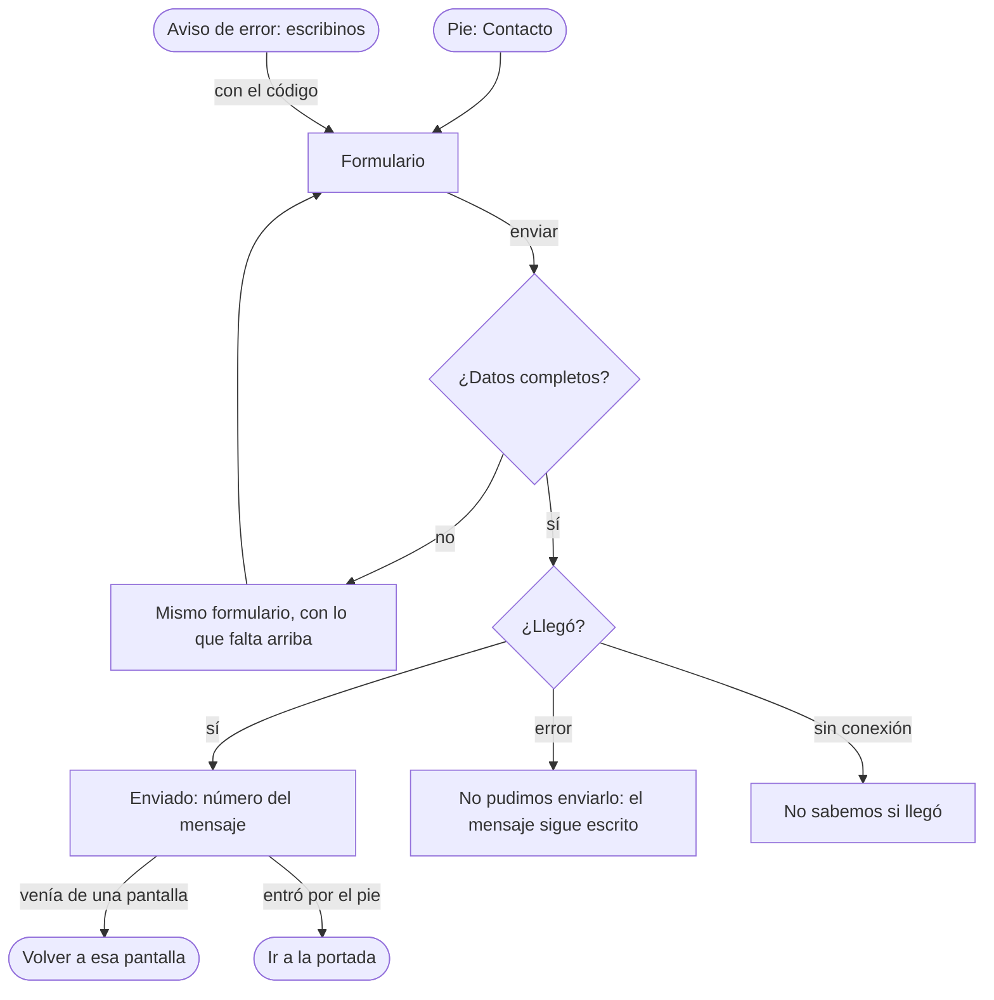

# Flujo: Contacto, en Raíces

> **Estado:** aprobado · **Fecha:** 2026-11-02 · **Aprobó:** usuario (2026-11-02), al ver las pantallas dibujadas
> Plantilla de la skill `ux-flujo`. Pantalla nueva del prototipo propio de Raíces
> ([ADR propuesto](../../adr/cliente-liviano/20261101-tercera-alternativa-raices-como-prototipo-propio.md)):
> `/prototipo/raices/publico-contacto`. Cozy no la tiene. Sale de la pregunta 17 del artifact de
> preguntas abiertas: el grupo empató y el usuario eligió un formulario dentro de DonaTrack
> (2026-11-02).

## 1. Para quién y para qué

| | |
|---|---|
| Quién | Cualquiera: la persona de una entidad o de una empresa donante a la que algo le falló ("escribinos con este código"), o alguien sin cuenta que tiene una duda. Llega desde el celular o la computadora |
| Tono | Demoras, problemas y errores: honesto, responsable, sereno. Sin optimismo vacío ([tono según la pantalla](../tono-y-comunicacion.md#tono-según-la-pantalla)) |
| Qué quiere lograr | "Contarle a alguien qué me pasó y saber que lo recibieron" |
| Dispositivo principal | Ambos |
| Requerimientos | Se cuelga de RF-01 (la portada lleva legales; HB-21). Ningún criterio de E6 pide un formulario: lo decidió el usuario el 2026-11-02 |
| Datos que usa | Ninguno todavía: HB-21 y [DTI-33](../../adr/DEUDA_TECNICA.md#dti-33) (endpoint y bandeja, sin dueño decidido). En la maqueta, el formulario va a `publico-contacto-enviado` |
| Boceto de E1 | Sin boceto |

## 2. Dónde está en el sitio

Público, nivel 2, desde el pie de todas las páginas de Raíces ("Contacto") y desde cada aviso de
error que dice "escribinos con este código". Ese enlace abre el formulario con el código ya escrito
(`?codigo=a1b2c3d4e5f6`). No está en el [mapa del sitio](../mapa-del-sitio.md): se suma en la
bitácora como pantalla de Raíces, junto a Legales y privacidad.

## 3. Recorrido



Desvíos: irse sin enviar (Atrás del navegador o el menú), error de datos, error del servidor y sin
conexión. No hay "sin permiso": la pantalla es pública. El enlace de cada aviso de error lleva la
pantalla de origen (`?volver=`); al enviar, el botón de salida vuelve a ella. Si se entró por el
pie, lleva a la portada. Solo se aceptan pantallas de `/prototipo/raices/`: otra dirección lleva a
la portada, para que el enlace no pueda mandar a otro sitio.

## 4. Pantallas

```text
┌─────────────────────────────────────────────┐
│ DonaTrack                                   │
│ CONTACTO (rótulo)                           │
│ Escribinos                                  │
│ Contanos qué pasó y te respondemos por      │
│ correo.                                     │
│                                             │
│ Sobre qué es        [Elegí uno        ▾]    │
│ Contanos qué pasó   [                  ]    │
│ Código del error    [a1b2c3d4e5f6]          │
│   (opcional; está en el aviso)              │
│ Tu correo           [                  ]    │
│   (sin sesión; con sesión: "Te respondemos  │
│    a contacto@distribuidora-ejemplo.test,   │
│    el correo de tu cuenta")                 │
│ [Enviar mensaje]                            │
├─────────────────────────────────────────────┤
│ Términos y privacidad · Contacto            │
└─────────────────────────────────────────────┘
```

Una columna, de ancho de lectura, sobre el papel, con la cabecera y el pie de la portada. La
audacia de Raíces queda en la portada: esta es una pantalla de trabajo.

**Enviado** (`publico-contacto-enviado`): un sello "Recibido" con el número del mensaje, qué pasa
ahora ("te respondemos por correo") y un botón para volver a la pantalla de origen o, si no hay,
"Ir a la portada".

## 5. Estados

| Pantalla | Estado | Qué se ve | Texto |
|---|---|---|---|
| Contacto | Sin código | El formulario vacío | — |
| Contacto | Con código (`?codigo=`) | El código ya escrito y el tema "Algo del sitio no anduvo" elegido | — |
| Contacto | Con sesión (`?escenario=con-sesion`) | Sin el campo del correo; una línea dice a qué correo se responde | "Te respondemos a contacto@distribuidora-ejemplo.test, el correo de tu cuenta." |
| Contacto | Enviando (`?escenario=lento`) | El botón dice "Enviando…" y queda desactivado | "Enviando…" |
| Contacto | Error de datos (`publico-contacto-error`) | Resumen arriba con enlaces a cada campo; cada campo con su error | "Revisá dos cosas antes de enviar" · "Falta contarnos qué pasó" · "El correo no parece completo: falta la @". Sin tema: "Elegí sobre qué es" |
| Contacto | Error del servidor (`?escenario=error`) | Aviso arriba, con su código y "Volver a intentar"; lo escrito sigue en el formulario | "No pudimos enviar tu mensaje. Es un problema nuestro: tu mensaje sigue acá. Probá de nuevo en unos minutos." · "Código: f6e5d4c3b2a1" |
| Contacto | Sin conexión (`?escenario=sin-conexion`) | Aviso arriba; lo escrito sigue en el formulario | "No sabemos si tu mensaje llegó." (título) · "Se cortó la conexión mientras se enviaba. Si no viste el número de tu mensaje, no sabemos si llegó: mandalo de nuevo." Sin JavaScript, el navegador muestra su propia página de error; con Atrás se vuelve al formulario |
| Enviado | Éxito | Sello, número y botón de salida | "Recibimos tu mensaje. Su número es 4821. Te respondemos por correo." · "Volver a Necesidades" (o la pantalla de origen) · "Ir a la portada" (sin origen) |

## 6. Textos

| Elemento | Texto | Nota |
|---|---|---|
| Rótulo y título | "Contacto" · "Escribinos" | |
| Bajada | "Contanos qué pasó y te respondemos por correo." | Sin plazo: no hay uno acordado. La misma en el boceto |
| Sobre qué es | "Una entrega" · "Una donación" · "Una necesidad de mi entidad" · "Mi cuenta" · "Algo del sitio no anduvo" · "Otra cosa" | Lista corta para ordenar la bandeja |
| Contanos qué pasó | Ayuda: "Si pasó en una entrega o una donación, decinos cuál." | Obligatorio |
| Código del error | Ayuda: "Opcional. Está en el aviso de error, debajo del mensaje." | Prellenado con `?codigo=` |
| Tu correo | Ayuda: "Para responderte. No lo usamos para otra cosa." | Solo sin sesión; obligatorio |
| Acción principal | "Enviar mensaje" | |
| Obligatorios | "Todos los datos son obligatorios, salvo el código." | |

Filtro de tono: no promete un plazo de respuesta que nadie fijó; el error del servidor dice que el
mensaje sigue escrito; sin conexión dice que no se sabe si llegó.

## 7. Accesibilidad

Saltar al contenido; un solo `h1`; cada campo con `label` y su ayuda en `aria-describedby`. El
resumen de errores recibe el foco y enlaza a cada campo, que lleva `aria-invalid`. El sello del
enviado no es la única señal: el texto dice "Recibimos tu mensaje". Los avisos de error usan
`role="alert"`; el de enviado, `role="status"`.

## 8. Revisión de usabilidad

| # | Heurística | Cómo la cumple | Riesgo que queda |
|---|---|---|---|
| 1 | Visibilidad del estado | Enviando, enviado con número, error y sin conexión, cada uno con su texto | Sin respuesta real, el número no lleva a ningún lado |
| 2 | Lenguaje del usuario | "Contanos qué pasó", temas en palabras de todos los días | |
| 3 | Control y libertad | Volver con Atrás; lo escrito no se pierde ante un error del servidor | |
| 4 | Consistencia | Mismo formulario y resumen de errores que Necesidades y Confirmar recepción | |
| 5 | Prevención de errores | Correo con `type="email"`; código prellenado desde el aviso | |
| 6 | Reconocer antes que recordar | El código llega escrito; no hay que copiarlo | |
| 7 | Flexibilidad | Con sesión no pide el correo | |
| 8 | Diseño minimalista | Cuatro campos, uno opcional | |
| 9 | Recuperarse de errores | Cada error dice qué falta y cómo seguir | |
| 10 | Ayuda | Ayudas cortas en cada campo | |

Factores de Morville: útil (cierra el "escribinos" que quedaba sin destino), usable (cuatro
campos), deseable (mismo papel y letra que el resto), valioso (ordena los pedidos de ayuda),
ubicable (pie y avisos), accesible (AA, sin JavaScript), creíble (número de mensaje). Probar con
personas: si los temas alcanzan y si se entiende qué es "código del error".

## 9. Decisiones y preguntas

Decisiones tomadas:

- Un formulario dentro de DonaTrack, no un correo ni un chat (usuario, 2026-11-02, pregunta 17).
- Lo puede usar cualquiera: sin sesión pide el correo; con sesión usa el de la cuenta (usuario,
  2026-11-02).
- Se llega desde el pie de todas las páginas y desde los avisos de error, con el código ya escrito
  (agente, propuesto; aprobado al elegir "Cualquiera").
- Sin plazo de respuesta en los textos: no hay uno acordado (agente, por el tono).

Preguntas abiertas, para el equipo (no cambian el prototipo):

- Qué servicio recibe los mensajes ([DTI-33](../../adr/DEUDA_TECNICA.md#dti-33)).
- Dónde los lee y los responde el administrador (DTI-33).
- Cómo se evita el abuso de un formulario público (límite de envíos).
