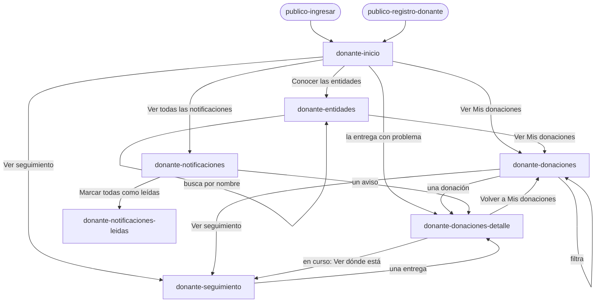
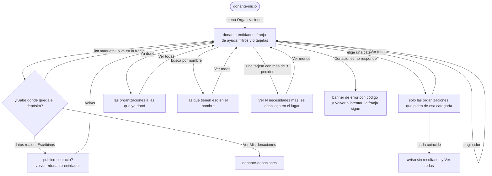

# Flujo: Donar y seguir, el recorrido del donante en Raíces

> **Estado:** aprobada: el usuario eligió el sitio A de la corrida A/B (2026-11-03), como
> preveía el plan · **Fecha:** 2026-11-02 · **Aprobó:** el usuario, 2026-11-03
> Plantilla de la skill `ux-flujo`. Ficha escrita para los dos sitios de la corrida A/B de
> Raíces; quedó A, en `/<pantalla>` (B se borró al elegir A, 2026-11-03)
> ([ADR aceptado](../../adr/cliente-liviano/20261103-una-sola-identidad-en-el-cliente-liviano.md)).
> Fija para quién es, el recorrido, los estados, los textos, los datos y las salidas. **No fija la
> composición ni la navegación visual:** eso lo decide cada sitio.
> Pantallas nuevas: `donante-inicio`, `donante-donaciones`, `donante-donaciones-detalle`,
> `donante-entidades` y `donante-notificaciones`. Ya aprobadas y enlazadas:
> [`donante-seguimiento`](raices-seguir-entregas.md) y [`donante-perfil`](raices-mi-perfil.md)
> (con `-guardado`).
>
> **Cambio de la revisión del 2026-11-11 (lote `p2-entidades-donante`, R11-27 y R11-28):** **en
> revisión** desde el 2026-11-12. La nueva [sección 10](#10-organizaciones-una-tarjeta-por-organización-y-la-franja-de-ayuda-r11-27-y-r11-28)
> rediseña `donante-entidades` (una tarjeta por organización y la franja de ayuda) y manda sobre lo
> que dicen de esa pantalla las secciones 4, 5, 6 y 8. El resto de la ficha sigue aprobado.

## 1. Para quién y para qué

| | |
|---|---|
| Quién | La persona de responsabilidad social de una empresa que dona (en el ejemplo, Distribuidora Ejemplo SA). Trabaja en la computadora de la oficina; a veces mira desde el celular, entre reuniones. Le rinde cuentas a su directorio: necesita saber qué donó la empresa, a quién llegó y qué lo prueba |
| Tono | Panel, avisos y seguimiento del donante: cálido, agradecido, participativo. La entrega con problema: honesto, responsable, sereno. Entidades: respetuoso, en contexto, digno ([tono según la pantalla](../tono-y-comunicacion.md#tono-según-la-pantalla)) |
| Qué quiere lograr | "Ver de un vistazo qué donó mi empresa, en qué estado está cada donación, qué está confirmado y a quién le llegó" |
| Dispositivo principal | Ambos; la computadora primero |
| Requerimientos | RF-05 (sus donaciones, con filtro por estado y categoría). RF-06 (entidades activas, paginadas, con búsqueda por nombre). RF-07 (sin Incentivos: la cuenta es una empresa). RF-08 (notificaciones de asignación y recepción; las de misión y ascenso no aplican a una empresa). RF-09 (seguimiento, ya aprobado). RF-CL-07 (lo que cambia dice cuándo se actualizó). RF-CL-08 (errores con código para soporte) |
| Datos que usa | `GET /donaciones-independientes?estado&subcategoriaId&donanteId` (RF-05), `GET /api/entidades` y `GET /api/necesidades` (RF-06), `GET /api/notificaciones/persona/{personaId}` y `PATCH .../marcar-todas-leidas` (RF-08), `GET /api/entregas/seguimiento/donaciones/{id}` (detalle). Huecos: HB-03, HB-08, HB-09, HB-15, HB-16, HB-18, HB-20 y los de la [lista de la corrida](#huecos-de-backend). En la maqueta, las siete donaciones de `templates/viaje-datos.html` (las mismas de Seguimiento), los estados de `SitioController` (`estados`, `pasos`) y `?escenario=` (los valores de `Escenario`) |
| Boceto de E1 | Págs. 15 (inicio), 16 (mis donaciones), 17 (beneficiarios) y 6 (notificaciones) |

## 2. Dónde está en el sitio

```text
publico-ingresar ──(cuenta de ejemplo de la empresa)──► donante-inicio (nivel 1)
donante-inicio
 ├─ Mis donaciones ─► donante-donaciones (2) ─► donante-donaciones-detalle?donacion=<clave> (3)
 ├─ Entidades ──────► donante-entidades (2)
 ├─ Seguimiento ────► donante-seguimiento (2, aprobada) ─► donante-donaciones-detalle (3)
 ├─ (acceso fijo) ──► donante-notificaciones (2) ─► donante-donaciones-detalle (3)
 └─ (cuenta) ───────► donante-perfil (2, aprobada)
```

- El menú del donante es el de `SitioController`: Inicio, Mis donaciones, Entidades y
  Seguimiento. Incentivos no está (RF-07).
- Notificaciones no es una sección del menú (como en el primer prototipo, donde va en la carta). Se llega desde el
  inicio ("Ver todas las notificaciones") y desde un acceso fijo en las pantallas del donante,
  con la cantidad sin leer. Va en `layout-privado`, en todas las pantallas del donante: la corrida A/B
  lo había dejado fuera de Seguimiento y Mi perfil, y el pulido del 2026-11-03 lo suma también ahí.
- Mi perfil y Salir siguen en la cuenta, como hoy. Salir lleva a `publico-portada`.
- Nada queda a más de 3 niveles (RNF-UI-02).

## 3. Recorrido



Camino feliz ("donar y seguir"): la empresa ingresa → ve en el inicio lo confirmado y lo que está en
curso → abre Mis donaciones → elige una → ve sus etapas, sus noticias y, si llegó, la foto → si está
en curso, pasa a Seguimiento para ver dónde va → vuelve. Por el costado: Entidades (a quién llegan
las donaciones y qué piden) y Notificaciones (qué pasó desde la última vez).

Desvíos considerados:

- **Volver:** el menú, el enlace "Volver a Mis donaciones" del detalle y el botón Atrás del
  navegador. Ninguna pantalla deja algo a medio hacer.
- **Filtro sin resultados** (Mis donaciones) y **búsqueda sin resultados** (Entidades): un aviso
  que dice qué pasó y "Sacar los filtros" o "Ver todas".
- **Donación que no existe** (`?donacion=` desconocida): "No encontramos esa donación" y la vuelta a
  Mis donaciones.
- **Error del servidor o sin conexión:** el banner de error, con el código para soporte y "Volver a
  intentar" (`?escenario=error`).
- **Tarda:** cada parte con su lugar reservado y "Cargando…" (`?escenario=lento`).
- **Cuenta nueva, sin donaciones:** el estado vacío explica cómo empieza (`?escenario=vacio`).
- **Entrega con problema:** se muestra como una más, en su lugar, con qué pasó y la nueva salida; el
  inicio la nombra aparte, sin alarma.
- **Sin permiso:** en el sistema, la sesión del donante solo trae sus donaciones; quien no inició
  sesión va a Ingresar; una entidad o un admin que abre estas direcciones ve "Esta pantalla es para
  quienes donan." y "Ir a tu inicio". En la maqueta no se dibuja: cada rol tiene su dirección.

## 4. Pantallas

Los esquemas dicen **qué hay** en cada pantalla, no dónde va: la composición, el orden visual, el
dibujo y la navegación son de cada sitio. Regla de Raíces para los dos: como mucho una imagen de
raíz o siembra por pantalla, en el título grande; nunca en botones, datos ni errores.

### donante-inicio (nivel 1)

> **Tablero (R11-25, 2026-11-12, aprobada):** el bloque "Donación por donación" pasa al boceto A,
> con tres columnas de a 3 donaciones y un paginador en cada una; el detalle, en la ficha
> [r11-p2-tablero](r11-p2-tablero.md).

```text
[Inicio]  Hola, Distribuidora Ejemplo SA
          bajada
[Lo que está confirmado]  2 entregas confirmadas · 2 entidades · 7 donaciones registradas
                          período y fuente · primera entrega confirmada
[Lo que ya dio fruto]     una planta por entrega confirmada: qué fue, a quién, cuándo → detalle
[En curso]                3 entregas en curso (1 en camino, 1 con problema, 1 pendiente) → Seguimiento
                          2 esperan destino → Mis donaciones
[La que se demoró]        Útiles escolares: qué pasó y la nueva salida → detalle
[Últimas noticias]        las 3 más nuevas → Ver todas las notificaciones (4 sin leer)
[Accesos]                 Conocer las entidades
```

- **Lo que está confirmado** usa el mismo nombre que las cifras de la portada. Separa resultado
  (entregas confirmadas, entidades que confirmaron) de actividad (donaciones registradas), como pide
  [cifras y datos](../tono-y-comunicacion.md#cifras-y-datos).
- **El juego se insinúa** (brief de Raíces): para la empresa, un hito de lo acumulado, dibujado con
  los datos y sin medallas. El dato: la primera entrega confirmada y cuántas van. La forma es de cada
  sitio.
- Qué cambia respecto del boceto (pág. 15): los tres anillos (meta mensual, ayuda respecto del mes
  anterior, necesidades satisfechas) se reemplazan por cifras con período y fuente. Una "meta
  mensual" no está en los requerimientos y "necesidades satisfechas" afirma un efecto que la
  plataforma no prueba. Las notificaciones pendientes del boceto quedan como "Últimas noticias".

### donante-donaciones (nivel 2)

```text
[Mis donaciones]  Lo que donó tu empresa
                  7 donaciones, de la más reciente a la primera. Actualizado …
[Filtro]          Estado [Todos ▾]  Categoría [Todas ▾]  [Filtrar]  (Sacar los filtros)
[Lista]           por donación: N.º · nombre (enlace al detalle) · categoría con ícono · cantidad
                  · para quién (o "Todavía sin destino") · donada el … · sello de estado + nota
[Pie]             Las que están en curso también se ven en Seguimiento. → Ver seguimiento
```

- El filtro es un formulario `get` real: estado (`pendiente`, `en-camino`, `entregada`,
  `con-problema`, los `tono` de `EstadoEntrega`) y categoría (`alimentos`, `ropa`, `escolares`,
  los valores de la ficha pública). Combinar los dos devuelve solo las que cumplen ambos (RF-05). Un
  valor desconocido no da error: se ignora y se muestran todas, con ese filtro en "Todos" o "Todas"
  (el mismo criterio de Donaciones recibidas de la entidad).
- El orden es por fecha, la más reciente primero (el N.º sigue ese orden, del 7 al 1). Agrupar por
  estado o no es decisión de cada sitio.
- Qué cambia respecto del boceto (pág. 16): la tabla de 5 columnas pasa a una lista de donaciones,
  porque en 360 px no entra (bocetos de E1); la columna "Detalle" pasa a ser el nombre como enlace.

### donante-donaciones-detalle (nivel 3)

`?donacion=<clave>`, con las claves de `viaje-datos`: `arroz`, `leche`, `lentejas`, `utiles`,
`zapatillas`, `ropa` y `fideos`. Sin parámetro, `lentejas` (la que va en camino), como en el primer prototipo. El
menú marca Mis donaciones.

```text
(Volver a Mis donaciones)
[Mis donaciones]  <nombre de la donación>
                  <cantidad> para <entidad>  |  <cantidad>, todavía sin destino
                  sello de estado + nota
[Aviso]           solo con problema: qué pasó, la última noticia y la nueva salida
[Etapas]          En depósito · Asignada · Lista para entregar · En camino · Entregada, con su fecha
[La foto]         entregada: la foto de la entidad con su pie | si no: qué falta y quién la sube
[Datos]           N.º · Qué · Cuánto · Categoría · Para · Donada · Entregada (si llegó) · Figura como
[Noticias]        las de esta donación, de la más nueva a la primera
[Acción]          en curso: Ver dónde está → donante-seguimiento
```

- "Figura como" dice qué nombre ve la entidad (HB-20) y enlaza a Mi perfil, donde se cambia
  ([ficha de Mi perfil](raices-mi-perfil.md)).
- Qué cambia respecto del boceto: E1 no dibujó el detalle (pág. 16 solo tiene la columna). Toma del
  primer prototipo los mismos datos y suma la foto como prueba de lo confirmado, el foco de Raíces.

### donante-entidades (nivel 2)

> **Actualización R11-27 y R11-28 (2026-11-12, aprobada):** una tarjeta por organización, de
> alto igual, con lo que pide adentro, y "Cómo llega tu donación" como franja de ayuda arriba de la
> lista. Lo que dice la [sección 10](#10-organizaciones-una-tarjeta-por-organización-y-la-franja-de-ayuda-r11-27-y-r11-28)
> manda sobre esta pantalla en las secciones 4, 5, 6 y 8; lo de abajo queda como estaba antes.

```text
[Entidades]   Quiénes reciben las donaciones
              Entidades activas y lo que piden hoy. …
[Búsqueda]    Buscar por nombre [__________] [Buscar]  (Ver todas)
[Lista]       por entidad: nombre · tipo y zona · lo que tu empresa ya donó ahí (sello + texto)
              · lo que pide: cada necesidad con cuánto recibió y cuánto falta
              · si no pide nada: "Hoy no pide nada."
[Paginado]    Página 1 de 8 · Página siguiente
[Cómo donar]  la llevás al depósito, la registran y la asignan · dirección y horario del depósito
              → Ver Mis donaciones
```

- Seis entidades por página (RF-06 pide paginado). La maqueta dibuja la página 1; `?pagina=2` en
  adelante muestra el aviso "En la maqueta solo está dibujada la primera página." con "Volver a la
  página 1", para no inventar 40 entidades.
- No hay detalle de la entidad en esta corrida: cada entrada dice todo lo que hay. El nombre no se
  enlaza a `donante-entidades-detalle` (caería en "sin dibujar" dentro del recorrido).
- Sin botón "Donar" por entidad o por necesidad: la entidad final la elige el admin con los
  algoritmos (RF-17) y la donación la registra el depósito (RF-15). Ver
  [preguntas abiertas](#9-decisiones-y-preguntas).
- Qué cambia respecto del boceto (pág. 17): el boceto muestra tarjetas por donación con sus
  entidades; eso ya lo dicen Mis donaciones y el detalle. Esta pantalla responde RF-06 (navegar
  entidades) y, de cada una, suma lo que la empresa ya donó ahí.

### donante-notificaciones (nivel 2)

> **Actualización R11-14 (2026-11-12, aprobada):** la bandeja va de a 20 por página, con los
> filtros resueltos en Notificaciones, y cambia cómo se ven las leídas y las sin leer, sus vínculos
> y el ícono de "Marcar como no leída". Lo que dice la
> [ficha del lote `p1-notificaciones`](r11-p1-notificaciones.md) sobre la bandeja manda sobre esta
> sección; el resto sigue igual.

```text
[Notificaciones]  Noticias de tus donaciones
                  4 sin leer. …                        [Marcar todas como leídas]
[Sin leer (4)]    por aviso: "Sin leer" · sello del estado de su donación · texto (enlace al
                  detalle) · fecha y hora · nombre y cantidad de la donación
[Leídas (13)]     lo mismo, con "Leída"
```

- De la más nueva a la más vieja. "Sin leer" y "Leída" se distinguen por el texto y por la forma,
  no solo por el color.
- "Marcar todas como leídas" es un formulario `post`. En la maqueta va a
  `donante-notificaciones-leidas` (la misma lista, todas leídas, con el aviso), como Mi perfil va a
  `donante-perfil-guardado`.
- Qué cambia respecto del boceto (pág. 6): la tabla Estado / Detalle / Fecha pasa a una lista
  (360 px); el filtro del boceto se reemplaza por los dos grupos, sin leer y leídas, que el contrato
  ya separa (`leida`).

## 5. Estados

En la maqueta, `?escenario=vacio`, `error` y `lento` en las cinco pantallas, como la portada y
Seguimiento de Raíces. El código para soporte es `a1b2c3d4e5f6` y su enlace va a
`publico-contacto?codigo=a1b2c3d4e5f6&volver=<pantalla>` ([ficha de Contacto](raices-contacto.md)).

| Pantalla | Estado | Qué se ve | Texto |
|---|---|---|---|
| Inicio | Con datos | Las cuatro partes del esquema | Ver Textos |
| Inicio | Vacío (cuenta nueva) | El saludo y un aviso en lugar de cifras, curso y noticias | "Todavía no hay donaciones de tu empresa." · "Cuando lleves tu primera donación al depósito y la registren, la vas a ver acá, con cada paso hasta que la entidad confirme la entrega." · "Conocer las entidades" |
| Inicio | Cargando | El saludo; cada parte con su lugar reservado, sin datos inventados | "Cargando tu inicio…" |
| Inicio | Error del servidor | El saludo y el banner de error | "No pudimos cargar tu inicio." · "Es un problema nuestro y no cambia el estado de tus donaciones. Probá de nuevo en unos minutos; si sigue, escribinos con este código." · `a1b2c3d4e5f6` · "Volver a intentar" |
| Inicio | Éxito / error de datos / deshabilitado | No aplica: no tiene acciones que cambien algo | — |
| Mis donaciones | Con datos | El filtro y las 7 donaciones | Ver Textos |
| Mis donaciones | Filtrado | El filtro con lo elegido, la cuenta y solo las que cumplen | "2 donaciones con esos filtros." · "Sacar los filtros" |
| Mis donaciones | Vacío con filtros | El filtro y el aviso | "No hay donaciones con esos filtros." · "Probá con otro estado o con otra categoría." · "Sacar los filtros" |
| Mis donaciones | Vacío (cuenta nueva) | El título y el aviso, sin filtro | "Tu empresa todavía no tiene donaciones registradas." · "Las registra el equipo del depósito cuando las recibe. Desde ese momento ves cada una acá, con su estado." · "Conocer las entidades" |
| Mis donaciones | Cargando | El título y el filtro; la lista con su lugar reservado | "Cargando tus donaciones…" |
| Mis donaciones | Error del servidor | El título y el banner | "No pudimos cargar tus donaciones." · el mismo cuerpo, código y "Volver a intentar" del inicio |
| Detalle | En depósito, sin destino (`arroz`, `zapatillas`) | Etapas con la primera actual; en el lugar de la foto, qué falta | "Todavía sin destino: espera una necesidad que le corresponda. Cuando se le asigne una entidad, vas a ver acá a cuál y cuándo sale." |
| Detalle | Asignada, espera el camión (`leche`) | Etapas; qué falta; "Ver dónde está" | "Falta confirmar la entrega: la confirma Merendero Ejemplo Sur con la foto." |
| Detalle | En camino (`lentejas`) | Etapas con "En camino" actual; qué falta; "Ver dónde está" | "Falta confirmar la entrega: la confirma Comedor Barrio Ejemplo con la foto." |
| Detalle | Con problema (`utiles`) | El aviso arriba; etapas; "Ver dónde está" | Aviso: "No pudo llegar a Escuela Ejemplo N.º 12." · "El camino estaba cortado. Sale de nuevo el 17 de octubre. Última noticia: 11 de octubre, 16:10." |
| Detalle | Entregada (`ropa`, `fideos`) | Etapas completas; la foto con su pie; sin "Ver dónde está" | "Merendero Ejemplo Sur confirmó la entrega el 9 de octubre y subió esta foto." (el mismo patrón de la portada) |
| Detalle | No encontrada | El aviso, sin datos | "No encontramos esa donación." · "Puede que el enlace esté incompleto. Buscala en Mis donaciones." · "Volver a Mis donaciones" |
| Detalle | Cargando | El nombre si se sabe; etapas, foto y datos con su lugar | "Cargando la donación…" |
| Detalle | Error del servidor | "Volver a Mis donaciones" y el banner | "No pudimos cargar esta donación." · cuerpo, código y "Volver a intentar" |
| Entidades | Con datos | La búsqueda, 6 entidades, el paginado y "Cómo donar" | Ver Textos |
| Entidades | Búsqueda sin resultados | La búsqueda con lo escrito y el aviso | "Ninguna entidad activa se llama así." · "Probá con otra parte del nombre." · "Ver todas" |
| Entidades | Página no dibujada (`?pagina=2` o más) | El paginado y el aviso | "En la maqueta solo está dibujada la primera página." · "Volver a la página 1" |
| Entidades | Vacío | La búsqueda no; el aviso y "Cómo donar" | "Por ahora no hay entidades activas." · "Cuando una entidad se sume y la aprueben, aparece acá con lo que pide." |
| Entidades | Cargando | El título y la búsqueda; la lista con su lugar | "Cargando las entidades…" |
| Entidades | Error del servidor | El título y el banner; "Cómo donar" sigue (es texto fijo) | "No pudimos cargar las entidades." · cuerpo, código y "Volver a intentar" |
| Notificaciones | Con datos | Los dos grupos y "Marcar todas como leídas" | Ver Textos |
| Notificaciones | Éxito (`donante-notificaciones-leidas`) | El aviso arriba, que toma el foco; un solo grupo, todas leídas; sin el botón | "Listo: marcaste todas como leídas." (`role="status"`) · bajada: "No tenés notificaciones sin leer." |
| Notificaciones | Vacío | El título y el aviso | "Todavía no tenés notificaciones." · "Te avisamos cuando se asigne una donación a una entidad, cuando salga el camión y cuando la entidad confirme la entrega." · "Ver Mis donaciones" |
| Notificaciones | Cargando | El título; los grupos con su lugar | "Cargando tus notificaciones…" |
| Notificaciones | Error del servidor | El título y el banner | "No pudimos cargar tus notificaciones." · cuerpo, código y "Volver a intentar" |
| Notificaciones | Error al marcar | El banner arriba, la lista como estaba | "No pudimos marcarlas como leídas. Siguen como estaban. Probá de nuevo." (en el sistema; en la maqueta no se dibuja) |
| Las cinco | Sin permiso | No se dibuja en la maqueta (ver Desvíos) | "Esta pantalla es para quienes donan." · "Ir a tu inicio" |

En el sistema, "Cargando…" y los errores se anuncian en la región `#avisos`; en la maqueta llegan
con la página y no son región viva (como en Seguimiento).

## 6. Textos

"Hoy" es el jueves 15 de octubre de 2026 y la última actualización, las 16:25 (los mismos de
Seguimiento). Toda la maqueta de Raíces es ese jueves, y cada rol lo mira a la hora de sus pantallas
ya aprobadas: lo público a las 14:30, el donante a las 16:25 y la entidad a las 18:30. Por eso las
lentejas de 15 kg van "en camino" acá (salieron a las 14:30) y en la ficha de la entidad ya están en
su puerta (llegaron a las 18:20): es la misma entrega, más tarde. Los nombres, cantidades, notas,
etapas y noticias de las donaciones salen de `viaje-datos`, la única fuente de lo que donó la
empresa (la ficha de la entidad toma de ahí lo que le llega de Distribuidora Ejemplo SA); acá van
los propios de cada pantalla. Dos textos de `viaje-datos` se muestran distinto, porque el archivo
venía del primer prototipo y no se toca: la categoría `cat-vestimenta` se muestra "Ropa" (como en las fichas
pública y de la entidad) y el destino "Escuela Ejemplo 12" se muestra "Escuela Ejemplo N.º 12"
(como en la portada). Las plantillas nuevas del donante lo escriben así.

### donante-inicio

| Elemento | Texto | Nota |
|---|---|---|
| Rótulo | Inicio | El nombre del menú |
| Título | Hola, Distribuidora Ejemplo SA | El saludo del boceto. Si lleva la imagen de raíz, es acá |
| Bajada | "Gracias por donar. Acá ves qué donó tu empresa, dónde está cada donación y qué ya confirmaron las entidades." | Reconoce el aporte sin adornarlo |
| Cifras: título | Lo que está confirmado | El nombre de las cifras de la portada |
| Cifras | "2 entregas confirmadas" · "2 entidades confirmaron lo que recibieron" · "7 donaciones registradas" | Fideos (Comedor Barrio Ejemplo) y ropa (Merendero Ejemplo Sur). La tercera es actividad, no resultado: va aparte o más chica |
| Cifras: alcance | "Desde el 1 de octubre de 2026, según las confirmaciones de las entidades. Actualizado hoy, 15 de octubre, 16:25." | Período, fuente y fecha |
| Hito | "Primera entrega confirmada: fideos secos, el 5 de octubre, en Comedor Barrio Ejemplo." | Lo acumulado, sin medalla ni "¡felicitaciones!" |
| Huerta: título | Lo que ya dio fruto | Ilustraciones de diseño, 2026-11-08 (usuario: "una planta por donación confirmada"). Sin entregas confirmadas, la parte no se muestra |
| Huerta: bajada | "Una planta por cada entrega que confirmó la entidad, desde el 1 de octubre de 2026." | Período; solo lo confirmado |
| Huerta: cada lámina | "Fideos secos" · "8 kg para Comedor Barrio Ejemplo" · "Entregada el 5 de octubre" · "Ver el detalle y la foto" | La planta sale de la categoría y es decorativa: el texto dice todo |
| En curso: título | En curso | — |
| En curso | "3 entregas en curso: 1 en camino, 1 con problema y 1 pendiente." · "Ver seguimiento" | Los mismos números que Seguimiento |
| Esperan destino | "2 donaciones esperan destino en el depósito." · "Ver Mis donaciones" | Arroz y zapatillas; lo pendiente se dice pendiente |
| La que se demoró | "Útiles escolares no pudo llegar a Escuela Ejemplo N.º 12: el camino estaba cortado. Sale de nuevo el 17 de octubre." · "Ver el detalle" (`?donacion=utiles`) | Qué pasó y el próximo paso, sin "lamentablemente". Nombre accesible del enlace: "Ver el detalle de Útiles escolares" |
| Noticias: título | Últimas noticias | — |
| Noticias | Las tres más nuevas de la lista de Notificaciones, con su fecha | "Hoy, 14:30", "Ayer, 17:00", "Ayer, 12:15", cada una con `datetime` |
| Noticias: enlace | "Ver todas las notificaciones (4 sin leer)" | — |
| Accesos | "Conocer las entidades" | "Ver seguimiento" está en En curso y "Ver Mis donaciones", en Esperan destino: no se repiten (pulido, 2026-11-03) |

### donante-donaciones

| Elemento | Texto | Nota |
|---|---|---|
| Rótulo | Mis donaciones | — |
| Título | Lo que donó tu empresa | — |
| Bajada | "7 donaciones, de la más reciente a la primera. Actualizado hoy, 15 de octubre, 16:25." | Con filtro: "2 donaciones con esos filtros." |
| Filtro | "Estado" (Todos · Pendiente · En camino · Entregada · Con problema) · "Categoría" (Todas · Alimentos · Ropa · Útiles escolares) · "Filtrar" · "Sacar los filtros" | Nombre accesible del formulario: "Filtrar donaciones". Los estados, con el texto de `EstadoEntrega` |
| Número | "N.º 7" | Para el lector: "Donación número 7" |
| Para quién | "Para Comedor Barrio Ejemplo" · "Todavía sin destino" | — |
| Para quién, entidad sin nombre (con datos reales) | "Para una entidad" (y en las noticias, "… a una necesidad de una entidad.") | Pendiente de OK del usuario (corrida conexion-pantallas, 2026-11-10). La donación tiene entidad, pero no está entre las públicas (dada de baja) o Donaciones no respondió esa lista: el donante no puede leer una entidad por id |
| Fecha | "Donada el 12 de octubre de 2026" | — |
| Estado y nota | El sello y la nota de `viaje-datos`; en las entregadas, "Entrega confirmada el 5 de octubre, con foto de la entidad" en lugar de "Llegó el 5 de octubre" | Lo confirmado dice qué lo respalda |
| Estado y nota con datos reales | En depósito: "En el depósito, espera destino" · Asignada: "Asignada, espera el camión" · Lista para entregar: "Lista para entregar, espera el camión" (las tres, sello Pendiente) · En camino: "Salió el 15 de octubre, 14:30" · Entregada: "Entrega confirmada el 5 de octubre" · No pudo llegar: "No pudo llegar el 11 de octubre" · Vencida: "Venció en el depósito el 1 de octubre" (las dos, sello Con problema) | Aprobadas por el usuario el 2026-11-07, al conectar la pantalla con Donaciones (`DonacionesRest`). La fecha es la del último cambio a ese estado. Sin "con foto de la entidad": el listado no dice si la entrega tiene foto |
| Pie | "Las que están en curso también se ven en Seguimiento, con dónde va el camión." · "Ver seguimiento" | — |

### donante-donaciones-detalle

| Elemento | Texto | Nota |
|---|---|---|
| Volver | Volver a Mis donaciones | — |
| Rótulo | Mis donaciones | La sección del menú |
| Título | El nombre de la donación ("Lentejas secas") | — |
| Bajada | "15 kg para Comedor Barrio Ejemplo" · "10 kg, todavía sin destino" | — |
| Etapas: título | Cada paso de esta donación | Nombre accesible de la lista: "Etapas de Lentejas secas" |
| Etapas | Las cinco de `pasos`, con su detalle ("12 de octubre", "Hoy, 14:30", "Pendiente", "11 de octubre: no pudo llegar", "Nueva salida: 17 de octubre") | Las mismas de Seguimiento |
| Foto: pie | "<Entidad> confirmó la entrega el <fecha> y subió esta foto." | Alt del dato: "Cajas con la ropa de abrigo junto a la puerta del merendero" |
| Foto: falta | "Falta confirmar la entrega: la confirma <entidad> con la foto." | La forma del tono común para lo pendiente |
| Datos: título | Los datos | — |
| Datos | "Donación" (N.º 5) · "Qué" · "Cuánto" · "Categoría" · "Para" · "Donada" · "Entregada" (si llegó) · "Figura como": "Distribuidora Ejemplo SA" con "Cambialo en Mi perfil" | "Figura como" es lo que ve la entidad (HB-20) |
| Noticias: título | Noticias de esta donación | "De la más nueva a la primera" |
| Acción | "Ver dónde está" → `donante-seguimiento` | Solo en curso (con destino y sin entregar) |
| Con datos reales | Noticias, una por cambio de estado: "Recibimos tu donación en el depósito." · "Asignamos tu donación a una necesidad de <entidad>." · "Tu donación quedó lista para entregar." · "El camión salió a entregar tu donación a <entidad>." · "<Entidad> confirmó que recibió tu donación y sumó una foto." (sin foto, "<Entidad> confirmó que recibió tu donación.") · "El camión no pudo llegar a <entidad>: <motivo>." · "Tu donación venció en el depósito." Aviso: "No pudo llegar a <entidad>." con "<Motivo>. Última noticia: 11 de octubre, 16:10.", o "Venció en el depósito.". Entregada sin foto (o con Logística sin responder): "<Entidad> confirmó la entrega el 5 de octubre.". Alt de la foto: "Foto de la entrega que subió <entidad>" Etapas: "11 de octubre: no pudo llegar" · "1 de octubre: venció" | Aprobados por el usuario el 2026-11-07, al conectar el detalle con Donaciones y Logística. Las noticias salen del historial de la donación (Notificaciones no dice a qué donación es cada aviso, HB-09); el motivo, de la justificación del cambio; la nueva salida no existe en la API. "Figura como" no se muestra hasta HB-20. Una donación de otro donante dice "No encontramos esa donación" |

### donante-entidades

> **R11-27 y R11-28 (2026-11-12, aprobada):** la bajada, la franja y los textos nuevos de la
> tarjeta están en la [sección 10.6](#106-textos); los estados, en la [10.5](#105-estados).

| Elemento | Texto | Nota |
|---|---|---|
| Rótulo | Entidades | — |
| Título | Quiénes reciben las donaciones | El mismo rótulo de la tierra en la portada |
| Bajada | "Entidades activas y lo que piden hoy. Cada una pide lo que necesita y confirma lo que recibe. Actualizado hoy, 15 de octubre, 16:25." | La entidad actúa: pide y confirma |
| Búsqueda | "Buscar por nombre" · "Buscar" · "Ver todas" | `type="search"`; nombre accesible del formulario: "Buscar entidades" |
| Cuenta | "46 entidades activas. Página 1 de 8." | El 46 es el de la portada |
| Tipo y zona | "Comedor comunitario en la zona oeste" | Del dato; sin hablar de carencias |
| Lo que ya donaste | "Tus fideos secos: entrega confirmada el 5 de octubre." · "Tus lentejas secas van en camino." | Con su sello; solo en las que recibieron algo de la empresa |
| Lo que pide | El mismo texto de cada pedido de la ficha pública: "Lentejas secas · Faltan 30 de 40 kg este mes · Se repite cada mes" · en uno de una sola vez: "Aceite de girasol · Faltan 20 litros · Hasta el 20 de octubre". Más de 3: "Ver los 5 pedidos" · "Ver menos" | Nombre accesible de la lista: "Lo que pide <entidad>". La barra, si hay, repite el texto |
| Sin necesidades | "Hoy no pide nada." | — |
| Paginado | "Página siguiente" · "Página anterior" | Nombre accesible: "Páginas de entidades" |
| Lo que pide, con datos reales | "Piden 40 kg · Hasta el 20 de octubre" · sin fecha: "Piden 20 unidades · Sin fecha de cierre" · sin unidad: "Piden 20" | Pendiente de OK del usuario (corrida conexion-pantallas, 2026-11-10). Lo recibido de cada necesidad no existe en la API (HB-18): no se dice cuánto falta y el renglón va sin barra ni porcentaje. Un pedido cuya categoría no es de las cuatro del sprite no se muestra en ningún grupo |
| Cuenta, una sola entidad | "1 entidad activa. Página 1 de 1." | Pendiente de OK del usuario (corrida conexion-pantallas, 2026-11-10) |
| Cómo donar: título | Cómo llega tu donación | — |
| Cómo donar | "Llevás la donación al depósito. Ahí la registran y la asignan a una necesidad abierta de una entidad. Desde que la registran, ves cada paso en Mis donaciones." · "Depósito Central Ejemplo · Calle Ejemplo 1234, Ciudad Ejemplo · Lunes a viernes de 9 a 17 h; sábados de 9 a 13 h" · "Ver Mis donaciones" | RF-15 y RF-17. Los datos del depósito, sintéticos (los del primer prototipo) |

Entidades de la maqueta (página 1). **Lo que pide cada una sale de una sola tabla:** la de
"Entidades con pedidos vigentes" de la [ficha pública](raices-publico-navegable.md#63-datos-de-maqueta),
con los mismos pedidos, cantidades, unidades y fechas (el porqué de cada pedido también, si el sitio
lo muestra). Acá se resume:

| Entidad | Tipo y zona | Lo que ya donó la empresa | Lo que pide (de la ficha pública) |
|---|---|---|---|
| Comedor Barrio Ejemplo | Comedor comunitario en la zona oeste | Fideos secos (entregada, 5 de octubre) · Lentejas secas (en camino) | Lentejas secas, faltan 30 de 40 kg este mes · Arroz, faltan 25 de 40 kg este mes · Aceite de girasol, faltan 20 litros · Leche en polvo, faltan 12 de 24 unidades · Ropa de abrigo, faltan 25 de 30 unidades |
| Escuela Ejemplo N.º 12 | Escuela primaria en la zona centro | Útiles escolares (con problema: sale de nuevo el 17 de octubre) | Sillas, faltan 14 de 20 unidades · Útiles escolares, faltan 4 cajas |
| Merendero Ejemplo Sur | Merendero en la zona sur | Ropa de abrigo (entregada, 9 de octubre) · Leche en polvo (pendiente) | Galletitas, faltan 10 de 20 kg este mes · Leche en polvo, faltan 20 unidades |
| Hogar Casa Ejemplo | Hogar de día para personas mayores en la zona norte | — | Frazadas, faltan 10 de 20 unidades |
| Club Ejemplo Norte | Club de barrio en la zona norte | — | Camisetas deportivas, faltan 15 unidades |
| Biblioteca Popular Ejemplo | Biblioteca popular en la zona centro | — | Sillas, faltan 4 de 8 unidades |

El orden es el de la portada y la ficha pública. Las seis de la página 1 tienen pedidos; "Hoy no
pide nada." queda para las entidades activas sin pedidos, que en la maqueta no se dibujan (están
en las páginas siguientes).

### donante-notificaciones

| Elemento | Texto | Nota |
|---|---|---|
| Rótulo | Notificaciones | — |
| Título | Noticias de tus donaciones | — |
| Bajada | "4 sin leer. Cada aviso cuenta qué pasó con una donación de tu empresa." | Sin "¡Tenés novedades!" |
| Acción | Marcar todas como leídas | — |
| Grupos | "Sin leer (4)" · "Leídas (13)" | — |
| Cada aviso | "Sin leer" o "Leída" · el sello del estado actual de su donación · el texto, enlace al detalle (`?donacion=<clave>`) · la fecha ("Hoy, 14:30", "Ayer, 17:00", "11 de octubre, 16:10") · "Lentejas secas, 15 kg" | — |
| Sin leer | Las cuatro del 14 y el 15 de octubre: lentejas salió (hoy, 14:30) · arroz recibido en el depósito (ayer, 17:00) · leche asignada a Merendero Ejemplo Sur (ayer, 12:15) · lentejas lista para entregar (ayer, 9:10) | — |
| Leídas | Las otras trece cartas de `viaje-datos`, de la más nueva a la más vieja | La de recepción dice "<Entidad> confirmó que recibió tu <donación> y sumó una foto." |
| Categoría "Otras novedades" (con datos reales) | "Otras novedades" | Pendiente de OK del usuario (corrida conexion-pantallas, 2026-11-10). Notificaciones no dice el tipo de aviso (HB-09): la categoría se deduce del texto, y un aviso que no es de ninguna (un ascenso, una misión) va acá. El menú de Categoría muestra solo las que tienen avisos |
| Mensaje de un aviso con datos reales | El texto que arma Notificaciones, enlace a Mis donaciones (o a Entidades, si es de una necesidad) | Pendiente de OK del usuario (corrida conexion-pantallas, 2026-11-10). Sin el id de la donación (HB-09) no se puede enlazar al detalle |
| Aviso al marcar (con datos reales) | "Listo: marcaste todas como leídas." · "Listo: marcaste la notificación como leída." · "Listo: marcaste la notificación como no leída." | Los mismos de `donante-notificaciones-leidas`, en la región de avisos |

Ayudas por flujo crítico: ninguna de estas pantallas envía datos de la donación; la única acción,
"Marcar todas como leídas", es reversible en el contrato (`PATCH /{id}/leida`). La ayuda está en las
bajadas (qué es cada cifra y cuándo se actualizó) y en "Cómo llega tu donación".

Filtro de tono:

- Lo pendiente se dice pendiente: "Falta confirmar la entrega: la confirma <entidad> con la foto";
  "Todavía sin destino"; "esperan destino en el depósito".
- Actividad no es impacto: "donaciones registradas" (actividad) y "entregas confirmadas"
  (resultado), separadas; nunca "familias ayudadas" ni "necesidades satisfechas".
- Las cifras llevan período, fuente y fecha de actualización.
- La entrega con problema dice qué pasó, cuándo se supo y la nueva salida, sin urgencia.
- Las entidades piden y confirman; ninguna se describe por una carencia.
- Sin rankings ni comparaciones entre entidades o donantes.
- Palabras que no van (brief de Raíces): "eco", "huella verde", "florecer", "regá", "cosechá" y
  "sostenible" puesto de adorno. Tampoco "donar ahora" ni signos de exclamación.

## 7. Accesibilidad

- Zonas: el enlace para saltar al contenido, la navegación del donante (`nav` con nombre), el
  contenido (`main`) con un solo `h1` y un `h2` por parte.
- La sección actual del menú lleva `aria-current="page"`; en el detalle, Mis donaciones.
- Orden del foco: saltar al contenido, la marca, el menú, el acceso a Notificaciones, la cuenta
  (Mi perfil, Salir), y después el contenido en el orden de lectura. En el detalle, "Volver a Mis
  donaciones" va antes del título en el código, como en el primer prototipo.
- Cifras: lista de definiciones (`dl`) con nombre ("Lo que está confirmado"); ningún número va
  solo. Si un sitio las dibuja, el dibujo es `aria-hidden` y el texto dice lo mismo.
- Estados: siempre texto y forma (el sello); el color solo acompaña. "Sin leer" y "Leída", en texto.
- Etapas: lista ordenada (`ol`) con nombre; la actual con `aria-current="step"`; cada detalle en
  texto.
- Filtros y búsqueda: `label` visible por campo; el resultado ("2 donaciones con esos filtros.") en
  una región `role="status"`, para que se lea después de filtrar.
- "Listo: marcaste todas como leídas." toma el foco al cargar y es `role="status"`.
- Errores: `role="alert"`; carga: `aria-busy` en la parte que espera.
- Barras de "lo que pide": `aria-hidden`, con el texto completo al lado.
- La foto lleva su `alt` del dato; con "reducir movimiento", nada se anima.
- Objetivos táctiles de 48 × 48 px ([piso](../direccion-de-arte.md#el-piso-no-se-negocia)); nada se
  corta ni desborda en 360 px.

## 8. Revisión de usabilidad

| # | Heurística | Cómo la cumple | Riesgo que queda |
|---|---|---|---|
| 1 | Visibilidad del estado | Cada donación con su sello, su nota y su etapa; cifras y listas con su fecha de actualización; "4 sin leer" | El estado de cada donación cruza Donaciones y Logística (HB-16); si no llega en una llamada, el inicio tarda |
| 2 | Lenguaje del usuario | Donación, depósito, entidad, en camino, entrega confirmada; sin códigos ni "persona jurídica" | — |
| 3 | Control y libertad | Solo consulta; menú, "Volver a Mis donaciones" y Atrás; "Sacar los filtros" y "Ver todas" | "Marcar todas como leídas" no se deshace en la maqueta (en el sistema, una por una) |
| 4 | Consistencia | Los datos, números y estados de Seguimiento; "Lo que está confirmado" y "Quiénes reciben las donaciones", como la portada; el mismo banner de error con código | Los nombres de las entidades de `viaje-datos` y los de la portada no coinciden del todo (ver Decisiones) |
| 5 | Prevención de errores | Filtros con opciones cerradas; un valor desconocido se ignora y muestra todas, no un error | — |
| 6 | Reconocer antes que recordar | El N.º y el nombre de cada donación iguales en todas las pantallas; cada aviso nombra su donación | — |
| 7 | Flexibilidad | Quien quiere el panorama se queda en el inicio; quien busca algo filtra o entra al detalle desde cualquier pantalla | Sin atajos de teclado propios |
| 8 | Diseño minimalista | Cada pantalla responde una pregunta: qué pasó (inicio), qué donamos (mis donaciones), qué pasó con esta (detalle), a quién (entidades), qué hay de nuevo (notificaciones) | El inicio tiene cuatro partes: cada sitio tiene que jerarquizarlas |
| 9 | Recuperarse de errores | El error dice que las donaciones no se afectan, da el código y "Volver a intentar"; la donación que no existe lleva a la lista | — |
| 10 | Ayuda | "Cómo llega tu donación" en Entidades; las bajadas dicen qué cuenta cada cifra | No hay página de ayuda propia |

Los 7 factores de la experiencia ([criterios de la cátedra](../criterios-catedra-ux-ui.md),
sección 2):

| Factor | Cómo lo cumple |
|---|---|
| Útil | Responde lo que la persona de RSE tiene que contar: qué se donó, a quién llegó y qué lo prueba |
| Usable | Listas con enlaces, filtros de opciones cerradas y estados con texto; nada que aprender |
| Deseable | La identidad de Raíces (paleta Huerta de noche, risografía, sellos) y un hito de lo acumulado dibujado con los datos |
| Valioso | La foto y la fecha de confirmación de cada entrega son la prueba que la empresa muestra |
| Ubicable | Cuatro secciones en el menú, Notificaciones a un toque desde todas las pantallas y nada a más de 3 niveles |
| Accesible | Estados con forma y texto, listas como alternativa a todo dibujo, foco ordenado; WCAG AA y Ley 26.653 |
| Creíble | Cada cifra con período, fuente y fecha; lo pendiente se dice pendiente; la entrega con problema se muestra tal cual |

Qué conviene probar con personas reales (la revisión heurística no reemplaza al test con
usuarios): si una persona de RSE distingue "donaciones registradas" de "entregas confirmadas" sin
ayuda, y si encuentra en menos de un minuto la foto de una entrega para mostrarla.

## 9. Decisiones y preguntas

Decisiones tomadas (agente, propuestas; aprobadas al elegir el sitio A, 2026-11-03):

- Ingresar con la cuenta de ejemplo de la empresa lleva a `donante-inicio` (plan de la corrida).
- Misiones e incentivos quedan fuera: la cuenta es una empresa (RF-07).
- Los datos son los de `viaje-datos`, los mismos de Seguimiento, para que todo el recorrido diga lo
  mismo. Las entidades suman las de la portada que no tienen donaciones de la empresa: Hogar Casa
  Ejemplo, Club Ejemplo Norte y Biblioteca Popular Ejemplo.
- Notificaciones no entra al menú; se llega desde el inicio y desde un acceso fijo que ubica cada
  sitio.
- Entidades sin detalle ni botón "Donar": la entidad la elige el admin (RF-17).
- Paginado de seis por página; la maqueta dibuja solo la página 1 y lo dice.
- "Marcar todas como leídas" va a `donante-notificaciones-leidas`, el patrón de
  `donante-perfil-guardado`.
- Los desvíos del boceto (los anillos del inicio, las tablas de las págs. 6 y 16, la pág. 17) van a
  la [bitácora](../bitacora.md) en el cierre de la corrida, junto con la elección de A o B.

Para la integración (no se resuelven acá):

- Nombre de la escuela: las tres fichas de la corrida usan "Escuela Ejemplo N.º 12", el de la
  portada. `viaje-datos` y Seguimiento (aprobada) siguen diciendo "Escuela
  Ejemplo 12": se igualan al integrar. Lo mismo con la categoría "Vestimenta" de `viaje-datos`,
  que las pantallas nuevas muestran "Ropa".
- La portada dice "Registrás lo que donás" y RF-15 dice que la registra el admin en el depósito.
  Esta ficha dice "Ahí la registran". Si el grupo decide otra cosa, cambia "Cómo llega tu donación".

Preguntas abiertas para el usuario (siguen abiertas después de elegir el sitio A, 2026-11-03):

1. "¿La empresa puede elegir a qué entidad o necesidad va lo que dona?" → "No: la elige el admin
   con los algoritmos (RF-17); Entidades solo informa (Recomendada)" · "Sí: un 'Donar' por necesidad,
   como en el primer prototipo (pide un requerimiento y un hueco nuevos)".

## 10. Organizaciones: una tarjeta por organización y la franja de ayuda (R11-27 y R11-28)

> **Estado:** aprobada · **Fecha:** 2026-11-12 · **Aprobó:** el usuario, 2026-11-12 (opciones recomendadas, aprobación automática pedida por él)
> Lote `p2-entidades-donante` del
> [backlog de la revisión del 2026-11-11](../backlog-revision-2026-11-11.md) (P2, ruta STANDARD).
> Las decisiones ya las tomó el usuario (sección 3 del backlog, filas "Entidades (donante)" y
> "Cómo llega tu donación"): esta sección no las reabre, las baja a la pantalla.
> **Manda sobre** lo que dicen de `donante-entidades` las secciones 4, 5, 6 y 8 de esta ficha. Lo
> que no se nombra acá (la búsqueda, "Ya doné", el paginador, los textos del resultado, el error y
> el vacío) sigue como está.
> Archivos del lote: `templates/donante-entidades.html`, `templates/persona/donante-entidades.html`
> y `static/css/donante-entidades.css`. No cambian el controller, la vista ni el puerto.

### 10.0 Qué hay hoy (evidencia)

Leído en `e9331b3a2`. `[V]` es leído en el código; `[H]`, hipótesis.

| # | Hoy | Dónde |
|---|---|---|
| E1 | La versión común agrupa **los pedidos** por categoría: un bloque por categoría con su ícono y, adentro, un renglón por pedido con el nombre de la organización. Una organización que pide de tres categorías aparece en tres renglones de tres bloques (es el "no entiendo la división" de la ronda) `[V]` | `templates/donante-entidades.html:112-166` |
| E2 | Además de las categorías hay tres casos de respaldo: el grupo "Otros pedidos" (pedidos sin categoría conocida), el grupo "Sin pedidos pendientes" y, con una categoría elegida, el renglón "Lo que pedía de <Categoría> ya está cubierto." `[V]` | `donante-entidades.html:132-136,140-165` |
| E3 | La categoría **ya es un filtro** (`?categoria=`, el menú del componente `filtros`), resuelto en Donaciones sobre todas las organizaciones activas (R11-12). Lo que falta es que la lista deje de agruparse por ella `[V]` | `donante-entidades.html:75-80`, `rest/DonanteEntidadesRest.java:62-69` |
| E4 | Lo que trae cada organización: `nombre`, `ya` (si la cuenta ya le donó) y `pide`; cada pedido trae `que`, `categoria` (puede ser nula), `cat` (el ícono), `falta`, `cuando`, `recibido` y `total`. Con datos reales `recibido` es nulo (HB-18) y no hay tipo ni zona (HB-08, HB-15) `[V]` | `vistas/DonanteEntidadesVista.java:44-60` |
| E5 | Las tarjetas de `.lista` de la persona no miden todas lo mismo: cada una mide lo que trae (`align-items: start` desde 53,75 em) `[V]` | `static/css/donante-entidades.css:151-157` |
| E6 | La versión de persona de la maqueta (`?cuenta=persona`) **ya dibuja una tarjeta por organización** (`.ejemplar`: nombre, tipo y zona, "Lo que ya donaste", hasta 3 pedidos y "Ver las N necesidades" plegable), pero no tiene el filtro de categoría `[V]` | `templates/persona/donante-entidades.html:82-93,127-165` |
| E7 | "Cómo llega tu donación" es una `.tarjeta.lamina` al final de la página, con el mismo papel y la misma sombra que los renglones: se confunde con un elemento más de la lista (R11-28) `[V]` | `donante-entidades.html:173-188`, `persona/donante-entidades.html:171-180` |
| E8 | Con login real ya no muestra el depósito de ejemplo: "¿No sabés dónde queda el depósito? Escribinos…" (R11-09). En la maqueta, el depósito de ejemplo `[V]` | `donante-entidades.html:177-185`, `web/DonanteEntidadesSinMaquetaTest.java:85-88` |
| E9 | El catálogo no tiene una "franja de ayuda": el `.banner` informativo es papel claro con sombra, como una tarjeta. Las plantillas no suman clases nuevas (`clases-heredadas.txt` solo baja): lo propio de la pantalla va con `data-v` `[V]` | `docs/interfaz/componentes.md` (`.banner`, `.tarjeta`, `.plegable`), `src/test/resources/verificacion/clases-heredadas.txt:1-2` |
| E10 | Los tests de la pantalla miran los grupos por categoría (`id="grupo-2"`, "Otros pedidos", "Sin pedidos pendientes"): cambian con este diseño, sin debilitar lo que comprueban `[V]` | `web/DonanteEntidadesControllerTest.java:182,191,205,233,251` |

### 10.1 Para quién y para qué

| | |
|---|---|
| Quién | Quien dona (la persona de RSE de la empresa, o la persona que dona, con sus textos) y quiere saber a quién le llega lo que lleva al depósito. Mira en la computadora; a veces en el celular |
| Tono | Organizaciones: respetuoso, en contexto, digno. La franja: pantalla de trabajo, clara y útil ([tono según la pantalla](../tono-y-comunicacion.md#tono-según-la-pantalla)) |
| Qué quiere lograr | "Ver cada organización una sola vez, con todo lo que pide, y entender cómo llega lo que dono" |
| Dispositivo principal | Ambos; la computadora primero |
| Requerimientos | RF-06 (organizaciones activas, paginadas, con búsqueda por nombre). RF-15 y RF-17 (la donación la registra el depósito y la asigna el admin: no hay "Donar" por organización). RF-CL-07 (la lista dice cuándo se actualizó). RNF-CL-02 (sin JavaScript, igual funciona) |
| Datos que usa | Los de hoy: `misEntidades` (`DonanteEntidadesPuerto`; con Donaciones, `GET /api/donantes/{id}/entidades` con `nombre`, `categoriaId`, `soloDonadas` y la página, de a 6). Nada nuevo: ninguna lista completa, el total como número (`X-Total-Count`). Huecos que siguen: HB-18 (lo recibido), HB-08 y HB-15 (tipo y zona), y no hay endpoint de depósitos (H7 de [r11-p0-persona](r11-p0-persona.md)) |
| Boceto de E1 | Pág. 17 (beneficiarios). Ya se había alejado (ver §4); este cambio vuelve a una tarjeta por organización, más cerca del boceto |

### 10.2 Dónde está en el sitio

Sin cambios: `donante-inicio` → menú **Organizaciones** → `donante-entidades` (nivel 2). Los
filtros y la página viajan en la dirección (`?nombre=&categoria=&ya=si&pagina=N`): el "atrás" del
navegador y un enlace compartido muestran lo mismo.

### 10.3 Recorrido



Desvíos considerados:

- **Cancelar o volver:** "Ver todas" saca la búsqueda y los filtros; el "atrás" del navegador
  vuelve al filtro anterior (todo va en la dirección).
- **Error de datos:** una categoría que no existe se ignora y se ven todas (como hoy); una página
  más allá de la última muestra la última (`Tramo`).
- **Error del servidor:** el banner de error con su código; la franja de ayuda sigue, porque es
  texto fijo.
- **Sin conexión o pedido lento:** "Cargando las organizaciones…" con el esqueleto; si la llamada
  pasa el límite de espera (R11-04), la página de falla con su código.
- **Sin permiso:** la pantalla es del área del donante; sin sesión lleva a Ingresar, y la cuenta
  con la solicitud pendiente, a "Recibimos la solicitud" (como hoy).
- **Sin JavaScript:** la búsqueda y los filtros son un formulario `GET`; el plegable es un
  `details` nativo. Todo funciona igual.

### 10.4 Pantalla

Orden de la página: **encabezado → franja de ayuda → búsqueda y filtros → resultado → tarjetas →
paginador.** La franja va arriba de la lista (decisión del usuario) y antes de los filtros, para
que los filtros queden pegados a lo que filtran.

Escritorio (1280 px, tres columnas; en 1920 px igual, porque el contenido no pasa de 82 rem):

```text
┌────────────────────────────────────────────────────────────────────────────────┐
│ ORGANIZACIONES                                                                 │
│ Quiénes reciben las donaciones                                                 │
│ Las organizaciones activas y lo que pide cada una. Actualizado hoy, 15 de …    │
│                                                                                │
│ ┃(i) Cómo llega tu donación                                  ← fondo agua,     │
│ ┃    Llevás la donación al depósito. Ahí la registran y la     filete verde a  │
│ ┃    asignan a una necesidad abierta de una organización…      la izquierda,   │
│ ┃    Depósito Central Ejemplo · Calle Ejemplo 1234 · L a V…    sin sombra      │
│ ┃    Ver Mis donaciones                                                        │
│                                                                                │
│ Buscar por nombre [____________][Buscar]   [Categoría ▾] [ ] Ya doné  Ver todas│
│ 46 organizaciones activas. Página 1 de 8.                                      │
│                                                                                │
│ ┌──────────────────────┐ ┌──────────────────────┐ ┌──────────────────────┐     │
│ │ Comedor Barrio       │ │ Escuela Ejemplo N.º12│ │ Merendero Ejemplo Sur│     │
│ │ Ejemplo              │ │ Ya le donaste        │ │ Ya le donaste        │     │
│ │ Ya le donaste        │ │                      │ │                      │     │
│ │ ▣ Lentejas secas     │ │ ▣ Sillas             │ │ ▣ Galletitas         │     │
│ │   Faltan 30 de 40 kg │ │   Faltan 14 de 20 …  │ │   Faltan 10 de 20 kg │     │
│ │   ▓▓▓░░░░░░  25 %    │ │   ▓▓▓░░░░░░  30 %    │ │   ▓▓▓▓▓░░░░  50 %    │     │
│ │ ▣ Arroz …            │ │ ▣ Útiles escolares   │ │ ▣ Leche en polvo     │     │
│ │ ▣ Aceite de girasol …│ │   Faltan 4 cajas     │ │   Faltan 20 unidades │     │
│ │                      │ │                      │ │                      │     │
│ │        (aire)        │ │        (aire)        │ │        (aire)        │     │
│ │ ──────────────────── │ │ ──────────────────── │ │ ──────────────────── │     │
│ │ Alimentos · Ropa     │ │ Muebles · Escolares  │ │ Alimentos            │     │
│ │ Ver 2 necesidades más│ │                      │ │                      │     │
│ └──────────────────────┘ └──────────────────────┘ └──────────────────────┘     │
│ ┌──────────────────────┐ ┌──────────────────────┐ ┌──────────────────────┐     │
│ │ Hogar Casa Ejemplo   │ │ Club Ejemplo Norte   │ │ Biblioteca Popular … │     │
│ │ …                    │ │ …                    │ │ …                    │     │
│ └──────────────────────┘ └──────────────────────┘ └──────────────────────┘     │
│                         « ‹ 1 2 3 … 8 › »                                      │
└────────────────────────────────────────────────────────────────────────────────┘
```

Celular (360 px, una columna):

```text
┌──────────────────────────────┐
│ ORGANIZACIONES               │
│ Quiénes reciben las …        │
│ Las organizaciones activas … │
│ ┃(i) Cómo llega tu donación  │
│ ┃ Llevás la donación al …    │
│ ┃ Escribinos y te pasamos …  │
│ ┃ Ver Mis donaciones         │
│ Buscar por nombre            │
│ [______________][Buscar]     │
│ [Categoría ▾] [ ] Ya doné    │
│ 46 organizaciones activas. … │
│ ┌──────────────────────────┐ │
│ │ Comedor Barrio Ejemplo   │ │
│ │ Ya le donaste            │ │
│ │ ▣ Lentejas secas …       │ │
│ │ ▣ Arroz …                │ │
│ │ ▣ Aceite de girasol …    │ │
│ │ ──────────────────────── │ │
│ │ Alimentos · Ropa         │ │
│ │ Ver 2 necesidades más    │ │
│ └──────────────────────────┘ │
│ … (una debajo de otra)       │
│        ‹ 1 de 8 ›            │
└──────────────────────────────┘
```

Los nombres y pedidos del dibujo son los de la maqueta (página 1); qué tarjeta lleva "Ya le donaste"
lo dicen los datos de cada versión.

**La tarjeta de una organización** (`li.tarjeta` con `data-v="organizacion"`, dentro de una
`ul.lista`):

1. **Cabeza:** el nombre (`h2`, corta palabras largas, R11-18) y, debajo, "Ya le donaste" si
   corresponde. Se conserva el marcado de hoy, `<span data-v="nombre">…</span><span
   data-v="ya-donaste">Ya le donaste</span>`, que ya cuida que no se pisen.
2. **Lo que pide:** una lista con **hasta 3 pedidos a la vista**. Cada uno con el ícono de su
   categoría (decorativo; el de respaldo, `cat-generico`, si no se sabe), qué pide en negrita, lo
   que falta y hasta cuándo, y la barra con su porcentaje solo si se sabe lo recibido (en la
   maqueta sí; con datos reales no, HB-18). Con una categoría elegida, sus pedidos de esa categoría
   van primero.
3. **Aire:** el espacio que sobra va acá, entre lo que pide y el pie. Así las cabezas quedan
   alineadas arriba y los pies alineados abajo en toda la fila.
4. **Pie:** sobre un filete fino, las categorías de lo que pide, en texto ("Alimentos · Ropa"; un
   pedido sin categoría suma "Otras") y, si pide más de 3 cosas, el plegable "Ver 2 necesidades
   más" / "Ver menos", que despliega el resto **en el lugar** (sin ir a otra página y sin
   JavaScript). Una organización sin pedidos no lleva pie.

**Mismo alto.** Desde dos columnas (a partir de 53,75 em), todas las tarjetas de la página miden lo
mismo: el alto de la más alta (filas de alto igual en la grilla). En una sola columna (celular),
cada una mide lo suyo: con una por fila el alto igual no se ve y solo agregaría aire. Mientras una
tarjeta está desplegada, las filas vuelven a medir cada una lo suyo (`:has(details[open])`), para
que abrir una no estire las seis; donde el navegador no entiende `:has`, crecen todas, sin romper
nada.

**Las que ya recibieron algo de la cuenta** siguen atenuadas como hoy (papel de la página, filete
en lugar de sombra, "Ya le donaste" en palabras): es la decisión de la ronda del 2026-11-09 (tarde)
y la sección 3 del backlog no la cambia.

**La franja de ayuda** (`aside` con `data-v="ayuda"`, R11-28):

- **Otro fondo:** `--color-agua` (verde agua, el único fondo claro que no usan las tarjetas, la
  página, los sellos ni "Ya le donaste"), con un filete de `--color-acento` a la izquierda y **sin
  sombra**: las tarjetas tienen sombra y la franja no, así no parece una más de la lista.
- **Ícono:** el círculo con la "i" de información (el mismo dibujo del componente `info`), grande y
  decorativo (`aria-hidden`), a la izquierda del título. No es un botón.
- **Ocupa todo el ancho del contenido** (no las 44 rem de la lámina de hoy), como una franja.
- **Contenido:** el título "Cómo llega tu donación", el texto de cómo funciona, el depósito (en la
  maqueta) o "Escribinos…" (con datos reales, R11-09) y "Ver Mis donaciones" como **enlace**, no
  como botón: es una ayuda y no compite con "Buscar".
- Sigue en todos los estados (con datos, vacío, error y cargando), porque es texto fijo.
- Los enlaces de la franja van en `--color-acento-hondo` (5,53 : 1 sobre el agua; el acento común
  da 4,43 : 1 y no llega a AA). El texto, en tinta (10,58 : 1).

**Las dos versiones dicen lo mismo.** La de persona de la maqueta (`persona/donante-entidades`)
pasa a la misma tarjeta, la misma franja y la misma barra de filtros, con **Categoría** sumada
(alimentos, ropa, muebles y escolares, las de la maqueta, que filtran sus datos de ejemplo; no
llama a ningún servicio). Su tarjeta deja "Tipo y zona" y el detalle de "Lo que ya donaste": con
datos reales no existen (HB-08, HB-15) y el detalle de lo donado está en Mis donaciones. Le queda
la marca "Ya le donaste", como a la común.

**Qué se va:** los bloques por categoría, sus títulos con ícono grande y los grupos "Otros pedidos"
y "Sin pedidos pendientes". Lo que decían pasa a cada tarjeta: el ícono en cada pedido, "Otras" en
el pie y "Hoy no pide nada." en la tarjeta.

**Qué cambia respecto del boceto (pág. 17) y de la ronda del 2026-11-09 (tarde):** la ronda había
elegido agrupar por categoría para comparar el avance de los pedidos; la revisión del 2026-11-11
mostró que una organización quedaba partida en varios renglones. Una tarjeta por organización
responde mejor a RF-06 (recorrer organizaciones) y la mirada por categoría queda en el filtro.

### 10.5 Estados

| Estado | Qué se ve | Texto | Patrón conocido |
|---|---|---|---|
| Con datos | Encabezado, franja, barra, resultado, 6 tarjetas y paginador | "46 organizaciones activas. Página 1 de 8." | Tarjetas en grilla (Material: Cards, [criterios §5](../criterios-catedra-ux-ui.md#5-patrones-de-interacción)) y paginado ([§4](../criterios-catedra-ux-ui.md#4-patrones-de-navegación)) |
| Con más de 3 pedidos, plegada | 3 pedidos; en el pie, "Ver 2 necesidades más" | "Ver 2 necesidades más" (con una: "Ver 1 necesidad más") | Divulgación progresiva ([criterios §6](../criterios-catedra-ux-ui.md#6-arquitectura-de-la-información), principio 3) con panel desplegable (Material: Expansion panel) |
| Con más de 3 pedidos, desplegada | Todos los pedidos; en el pie, "Ver menos" | "Ver menos" | Ídem |
| Organización sin pedidos | La cabeza y el texto; sin pie | "Hoy no pide nada." | Tarjeta |
| Categoría elegida | Solo las que piden de esa categoría; en cada una, sus pedidos de esa categoría primero | "5 organizaciones coinciden con lo que elegiste. Página 1 de 1." | Filtro de una lista ([criterios §6](../criterios-catedra-ux-ui.md#6-arquitectura-de-la-información), principio 6, clasificación múltiple) |
| Categoría elegida, ya cubierta en una | La tarjeta, con el aviso arriba de lo demás que pide | "Lo que pedía de Ropa ya está cubierto." | Ídem |
| Ya doné, con resultados | Las organizaciones a las que donó, de a 6 | "2 organizaciones coinciden con lo que elegiste. Página 1 de 1." | Ídem |
| Ya doné, sin resultados | La caja vacía con "Ver todas" | "Todavía no le donaste a ninguna organización." · "Cuando el depósito asigne una de tus donaciones, la organización aparece acá." | Estado vacío (`.vacio`) |
| Filtros sin resultados | La caja vacía con "Ver todas" | "Ninguna organización coincide con lo que elegiste." · "Probá con otra categoría o sacá los filtros." | Estado vacío |
| Búsqueda sin resultados | La caja vacía con "Ver todas" | "Ninguna organización activa se llama así." · "Probá con otra parte del nombre." | Estado vacío |
| Página no dibujada (maqueta, `?pagina=3` o más) | El aviso con "Volver a la página 1" | "En la maqueta solo están dibujadas las dos primeras páginas." | Estado vacío |
| Nombre muy largo (maqueta, página 2) | El nombre corta dentro de la tarjeta; la tarjeta no se ensancha | — | — |
| Vacío | La franja y la caja vacía; sin barra ni tarjetas | "Por ahora no hay organizaciones activas." · "Cuando una organización se sume y la aprueben, aparece acá con lo que pide." | Estado vacío |
| Cargando | La franja, la barra y dos esqueletos con la forma de una tarjeta | "Cargando las organizaciones…" | Esqueleto |
| Error del servidor | La franja y el banner de error con código y "Volver a intentar" | "No pudimos cargar las organizaciones." | Banner de error (Material: Banners) |
| Éxito | No aplica: la pantalla no envía nada | — | — |
| Sin permiso | No aplica en la pantalla (lo resuelve el área del donante, §10.3) | — | — |

La franja en cada estado: en la maqueta, con el depósito de ejemplo; con datos reales, con
"Escribinos".

### 10.6 Textos

| Elemento | Texto | Nota |
|---|---|---|
| Rótulo | Organizaciones | Como hoy (`p1-nombres`) |
| Título | Quiénes reciben las donaciones | Como hoy |
| Bajada | "Las organizaciones activas y lo que pide cada una. Actualizado hoy, 15 de octubre, 16:25." | Cambia: ya no dice "por categoría" ni "cuánto recibió cada necesidad" (con datos reales no se sabe, HB-18). La fecha es la de `misEntidades.actualizado`; en la persona, la de su maqueta |
| Franja: título | Cómo llega tu donación | Como hoy |
| Franja: texto | "Llevás la donación al depósito. Ahí la registran y la asignan a una necesidad abierta de una organización. Desde que la registran, ves cada paso en Mis donaciones." | Como hoy (RF-15 y RF-17) |
| Franja: depósito (maqueta) | "Depósito Central Ejemplo · Calle Ejemplo 1234, Ciudad Ejemplo · Lunes a viernes de 9 a 17 h; sábados de 9 a 13 h" | Como hoy, solo en la maqueta |
| Franja: depósito (datos reales) | "¿No sabés dónde queda el depósito? Escribinos y te pasamos la dirección y el horario." | Como hoy (R11-09); "Escribinos" lleva a Contacto con `volver=/donante-entidades` |
| Franja: enlace | Ver Mis donaciones | Pasa de botón a enlace |
| Lista: nombre accesible | "Organizaciones de esta página" | `aria-label` de la `ul` |
| Lo que pide: nombre accesible | "Lo que pide <organización>" | `aria-label` de la lista de pedidos |
| Pedido | "Lentejas secas" · "Faltan 30 de 40 kg este mes · Se repite cada mes" · barra "25 %" | Como hoy; con datos reales, "Piden 40 kg · Hasta el 20 de octubre", sin barra |
| Pie: categorías | "Alimentos · Ropa" · con un pedido sin categoría: "Alimentos · Otras" | Antes del texto, "Categorías:" en `solo-lectores` |
| Plegable | "Ver 2 necesidades más" · "Ver 1 necesidad más" · "Ver menos" | Suma " de <organización>" en `solo-lectores`, para que cada plegable se distinga en la lista de controles |
| Marca | Ya le donaste | Como hoy |
| Cubierto | "Lo que pedía de <Categoría> ya está cubierto." | Como hoy, dentro de la tarjeta |
| Sin pedidos | "Hoy no pide nada." | Como hoy, dentro de la tarjeta |

Los textos del resultado, de los vacíos y del error no cambian (están en la tabla de estados).

Filtro de tono (7 preguntas):

- La organización **pide** y **confirma**: ninguna se describe por una carencia; el pie dice de qué
  categorías pide, no "qué le falta".
- Lo que no se sabe no se inventa: con datos reales no hay barra ni porcentaje (HB-18), y la bajada
  ya no promete "cuánto recibió".
- Sin ranking ni orden por "más necesitada": el orden es el del servidor, como hoy.
- "Ya le donaste" es un dato, sin premio ni culpa; las demás no dicen "todavía no le donaste".
- La franja explica el camino real (depósito, registro, asignación) y no ofrece un "Donar" que no
  existe (RF-17).

### 10.7 Accesibilidad

- **Zonas:** el `h1` de la pantalla; la franja es un `aside` con nombre ("Cómo llega tu donación",
  por `aria-labelledby`); la búsqueda, `role="search"`; el paginador, su `nav`.
- **Orden del foco:** "Escribinos" (datos reales) → "Ver Mis donaciones" → búsqueda → Buscar →
  Categoría → Ya doné → Ver todas → en cada tarjeta, su plegable (si tiene) → el paginador. El
  orden del código es el visual.
- **Títulos:** un `h2` por tarjeta (el nombre de la organización) y el `h2` de la franja: con el
  lector de pantalla se salta de organización en organización.
- **El resultado** sigue en `role="status"` y recibe el foco al llegar desde el paginador.
- **Íconos decorativos:** el de la franja y el de cada pedido, `aria-hidden`; la categoría está en
  texto en el pie.
- **Plegable:** `details` y `summary` nativos (se abren con Enter o Espacio); el texto cambia de
  "Ver 2 necesidades más" a "Ver menos" sin JavaScript, como hoy en la persona.
- **Barras:** `progress` con su `aria-label` completo ("Lentejas secas para Comedor Barrio
  Ejemplo: recibió el 25 %"); el porcentaje visible repite el texto.
- **Contraste:** tinta sobre agua, 10,58 : 1; enlaces de la franja en acento hondo, 5,53 : 1; el
  filete de la franja (acento sobre agua, 4,43 : 1) pasa el 3 : 1 de lo que no es texto. "Ya le
  donaste", como hoy.
- **Toque:** el `summary` del plegable y los enlaces de la franja, 48 px de alto como mínimo.
- **Reducir movimiento:** nada se anima al desplegar.
- **360 px:** nada desborda; el nombre largo corta; la franja no lleva columnas.

### 10.8 Revisión de usabilidad

| # | Heurística | Cómo la cumple | Riesgo que queda |
|---|---|---|---|
| 1 | Visibilidad del estado | El resultado dice cuántas coinciden y en qué página; la bajada, cuándo se actualizó; "Ya le donaste" en cada tarjeta; el plegable dice cuántas necesidades más hay | — |
| 2 | Lenguaje del usuario | "Organización", "lo que pide", "Ver 2 necesidades más", "Cómo llega tu donación"; nada de "grupo" ni de categorías como estructura | En la pantalla conviven "pedido" (en el código) y "necesidad" (en lo que se ve): lo nuevo dice "necesidad" |
| 3 | Control y libertad | "Ver todas" saca todo; "Ver menos" vuelve a plegar; el "atrás" vuelve al filtro anterior | — |
| 4 | Consistencia | Una tarjeta por organización, como Organizaciones de la portada (plegable) y como la versión de persona; las dos versiones dicen lo mismo; la franja usa el ícono de información del sitio | La franja es una pieza de la pantalla y no del catálogo: si otra pantalla la necesita, conviene pasarla al catálogo |
| 5 | Prevención de errores | Categoría con opciones cerradas; un valor desconocido se ignora | — |
| 6 | Reconocer antes que recordar | Cada organización aparece una sola vez con todo lo suyo: no hay que recordar que estaba en otro bloque | Con una categoría elegida, lo que pide de otras sigue en la tarjeta, después, para no esconder nada |
| 7 | Flexibilidad | Quien quiere el panorama mira las tarjetas; quien busca algo filtra por categoría, por nombre o por "Ya doné" | — |
| 8 | Diseño minimalista | 3 pedidos a la vista y el resto a pedido; el aire va en el medio y no en los bordes | Con seis tarjetas de alto igual, una que pide poco queda con mucho aire en el medio |
| 9 | Recuperarse de errores | El error con código y "Volver a intentar"; los vacíos dicen qué probar y ofrecen "Ver todas" | — |
| 10 | Ayuda | La franja "Cómo llega tu donación", con otro fondo e ícono, arriba de la lista y en todos los estados | La "i" es el ícono del botón de información: alguien puede intentar tocarla (no hace nada) |

Los 7 factores de la experiencia:

| Factor | Cómo lo cumple |
|---|---|
| Útil | Responde de un vistazo a quién le llega lo donado y qué pide cada organización |
| Usable | Una tarjeta, una organización; filtros de opciones cerradas; el plegable se abre en el lugar |
| Deseable | La grilla pareja, con cabezas y pies alineados, y la franja en el verde agua de la paleta Huerta |
| Valioso | "Ya le donaste" muestra a la cuenta a quién ya ayudó, sin rankings |
| Ubicable | La franja arriba; la categoría, el nombre y "Ya doné" en la barra; nada cambia de lugar entre páginas |
| Accesible | Un `h2` por organización, íconos decorativos con el texto al lado, contraste AA y `details` nativo |
| Creíble | Sin barra donde no se sabe lo recibido; la fecha de actualización; el depósito real o "Escribinos", nunca uno de ejemplo con login real |

Qué conviene probar con personas reales (la revisión heurística no reemplaza al test con
usuarios): si alguien que dona encuentra en menos de un minuto qué organizaciones piden ropa, y si
lee la franja antes de buscar un botón "Donar".

### 10.9 Decisiones y preguntas

Decisiones tomadas (agente, dentro de lo que decidió el usuario):

- La franja va **arriba de los filtros**, no entre los filtros y la lista: así los filtros quedan
  pegados a lo que filtran.
- **Fondo agua** (`--color-agua`), sin sombra y con filete verde: es el único fondo claro de la
  paleta que no usan las tarjetas, la página, los sellos ni "Ya le donaste". Descartados: el fondo
  de "pendiente", que se confundiría con "Ya le donaste", y la tierra oscura de la portada, que pesa
  demasiado para una ayuda.
- **Ícono de la "i"** (el del componente `info`), decorativo. Descartado dibujar un ícono nuevo de
  camión o de caja: suma una pieza sin necesidad.
- La franja es propia de la pantalla (`data-v="ayuda"`), no una variante de `.banner`: el lote no
  toca componentes y las plantillas no suman clases. Si otra pantalla la pide, pasa al catálogo.
- **3 pedidos a la vista**, como el resumen de la regla general 2, y el resto en un plegable en el
  lugar. Descartado: una página de detalle de la organización, que no existe y no es de este lote.
- **Alto igual desde dos columnas**, el mismo para toda la página; en una columna, el natural. Al
  desplegar una, las filas se sueltan (`:has`). Descartado: alto igual también en el celular (solo
  agrega aire con una por fila).
- **Con una categoría elegida**, se ven todos los pedidos de la organización, con los de esa
  categoría primero. Descartado: esconder los demás, que vuelve a partir la organización.
- La versión de persona de la maqueta adopta la misma tarjeta y suma Categoría, para que las dos
  digan lo mismo; deja "Tipo y zona" y el detalle de "Lo que ya donaste", que con datos reales no
  existen.
- El cambio de grupos por categoría a una tarjeta por organización va a la
  [bitácora](../bitacora.md) al construir, con el lote.

Preguntas abiertas: ninguna. Lo que queda es el OK del usuario a esta sección.

## Huecos de backend

Datos que la maqueta inventa porque el backend no los da hoy. Van también a la lista de la
corrida ([raices-ab-huecos-backend.md](raices-ab-huecos-backend.md)), sin DTI ni ADR nuevos.

| Pantalla | Dato que falta | Por qué |
|---|---|---|
| donante-inicio | Resumen de la empresa: entregas confirmadas, entidades que confirmaron, donaciones registradas y desde cuándo | No hay un endpoint agregado; contarlo del listado de RF-05 obliga a cruzar cada donación con su entrega en Logística (HB-16) |
| donante-donaciones | Filtro por categoría | HB-03 |
| donante-donaciones, detalle | Fecha de cada etapa y nota del estado | El listado de Donaciones no trae las etapas; el historial está en Logística por entrega (`/api/entregas/{id}/historial`) y desde la donación solo se llega por el seguimiento (HB-16) |
| donante-donaciones-detalle | Foto y fecha de recepción | `SeguimientoEntregaResponseDTO` no trae fotos; están en el DTO de la entrega |
| donante-donaciones-detalle | "Figura como" (nombre visible) | HB-20 |
| donante-entidades | Búsqueda por nombre, paginado, solo activas, tipo y zona | HB-08 y HB-15 (hoy `GET /api/entidades` devuelve todo, con las dadas de baja) |
| donante-entidades | Lo que pide cada entidad, con cuánto recibió y cuánto falta | HB-18 |
| donante-entidades | Lo que la empresa ya donó a cada entidad | Al día (R11-12, `p1-donante-listas`, 2026-11-12): `GET /api/donantes/{id}/entidades` da `yaLeDono` y filtra con `soloDonadas`; la categoría, con `categoriaId`. Mis donaciones filtra también por subcategoría (`subcategoriaId`, RF-05) |
| donante-entidades | Dirección y horario del depósito | No hay endpoint de depósitos |
| donante-notificaciones | Tipo de evento e id de la donación en `NotificacionDTO` | Sin ellos no se pone el sello ni se enlaza al detalle (hoy trae solo `mensaje`) |
| donante-notificaciones | Avisos "recibida en el depósito" y "lista para entregar" | No están en `EventoNotificableDTO`; RF-08 pide asignación y recepción (HB-09) |

## Aprobación del diseño p2-entidades-donante (2026-11-12)

Aprobado por el usuario el 2026-11-12 con las opciones recomendadas: pidió aprobar en forma automática todas las opciones recomendadas de P1 y P2 para que la corrida termine sin su intervención.

1. Tests que cambian al construir: DonanteEntidadesControllerTest (líneas 182, 191, 205, 233 y 251) comprueba los grupos por categoría (id="grupo-2", 'Otros pedidos', 'Sin pedidos pendientes'). Esos archivos están fuera de los tres del lote. Recomiendo que el constructor los adapte al nuevo marcado, para que sigan comprobando lo mismo sin debilitarlos, y lo anote en fueraDeZona.
   **Resuelto: la opción recomendada.**
2. Si la persona deja de usar las clases .ejemplar*, quedan sin uso en clases-heredadas.txt. Recomiendo que el constructor las saque de esa lista, que solo puede bajar, en el mismo lote.
   **Resuelto: la opción recomendada.**
3. Riesgo: la 'i' de la franja es el mismo dibujo del botón de información y alguien puede intentar tocarla. Recomiendo dejarla así y probarlo en la demo; si confunde, se cambia por otro dibujo sin tocar el resto.
   **Resuelto: la opción recomendada.**
