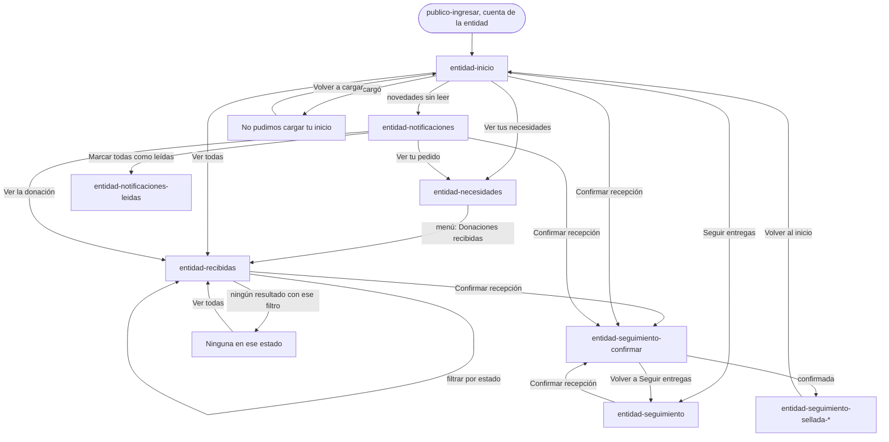
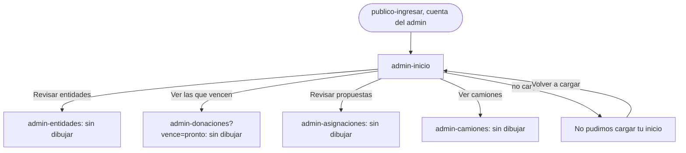
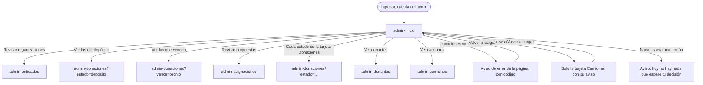
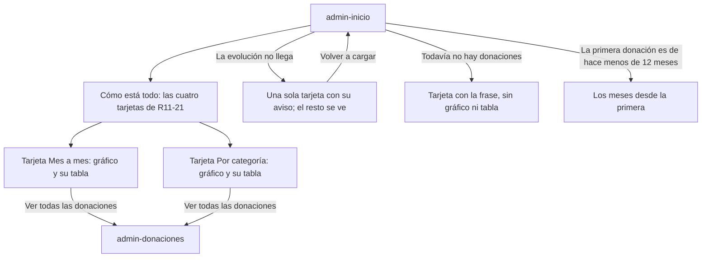

# Flujo: La entidad recibe, y el inicio del admin, en Raíces navegable

> **Estado:** aprobada: el usuario eligió el sitio A de la corrida A/B (2026-11-03), como
> preveía el plan · **Fecha:** 2026-11-02 · **Aprobó:** el usuario, 2026-11-03
> Plantilla de la skill `ux-flujo`. Ficha escrita para los dos sitios de la corrida A/B de Raíces:
> quedó A, en `/<pantalla>` (B se borró al elegir A, 2026-11-03)
> ([ADR aceptado](../../adr/cliente-liviano/20261103-una-sola-identidad-en-el-cliente-liviano.md)).
> Fija para quién es, el recorrido, los estados, los textos, los datos y las salidas. **No fija la
> composición ni la navegación visual:** eso lo decide cada sitio. Las dos pantallas de la entidad
> ya aprobadas ([Necesidades](raices-necesidades.md) y
> [Confirmar recepción](raices-confirmar-recepcion.md)) no cambian por esta ficha.

Pantallas nuevas de esta ficha: `entidad-inicio`, `entidad-recibidas`, `entidad-notificaciones`
(con su estado `entidad-notificaciones-leidas`) y `admin-inicio`.

> **Ampliada:** 2026-11-07, fase F5 del [roadmap de las vistas](../roadmap-vistas-enunciado.md):
> suma `entidad-seguimiento` (Seguir entregas, RF-14), que hasta hoy caía en `sin-dibujar`
> ([§4.5](#45-entidad-seguimiento)), aprobada por el usuario el 2026-11-07 (`revision-ui` PASS en la
> ronda 2). Mi perfil de la entidad va en
> [`raices-mi-perfil`](raices-mi-perfil.md#mi-perfil-de-la-entidad). Lo aprobado el 2026-11-03 no
> cambia; donde esta ficha decía "sin dibujar" para Seguir entregas, ahora remite a §4.5.

## 1. Para quién y para qué

| | |
|---|---|
| Quién | **Entidad:** la persona que organiza lo que recibe su entidad (en el ejemplo, Marta, del Comedor Barrio Ejemplo). Entra varias veces por día: desde el celular cuando llega un camión y desde la computadora de la entidad para revisar pedidos. **Admin:** quien opera la plataforma en la ONG (en el ejemplo, Leo, de Administración), desde la computadora, al empezar el día |
| Tono | Pantallas de trabajo: claro, útil, tranquilizador; estado y próximo paso. La entidad actúa: confirma, pide, revisa. Para demoras y errores: honesto, responsable, sereno ([tono según la pantalla](../tono-y-comunicacion.md#tono-según-la-pantalla)) |
| Qué quiere lograr | **Entidad:** "Ver qué llegó a mi puerta y confirmarlo, qué viene en camino y qué ya recibimos". **Admin:** "Saber qué espera mi decisión hoy y cómo está todo" |
| Dispositivo principal | Entidad: celular primero, también la computadora. Admin: computadora |
| Requerimientos | Entidad: RF-11 (listado de donaciones asignadas a la entidad, filtrable por estado), RF-13 (asignación y recepción generan notificación en la bandeja), RF-12 (confirmar recepción, se llega desde acá), RF-10 (sus necesidades), RF-14 (seguir entregas: el mapa de las entregas a recibir, con la dirección exacta de la entidad y el camión aproximado; §4.5, desde 2026-11-07). Admin: el inicio resume RF-16 (vencimientos), RF-17 (propuestas de asignación), RF-21 (entidades que piden sumarse) y RF-18 (camiones). RF-04 (cada rol llega a su inicio). RNF-UI-02 (nada a más de 3 niveles). RF-CL-07 (toda cifra que cambia dice cuándo se actualizó). RNF-CL-02 (sin JavaScript, igual funciona) |
| Datos que usa | Entidad: `GET /donaciones-independientes` (sin filtro por entidad: HB-04), el seguimiento de Logística por donación (HB-16) y `GET /api/entregas/seguimiento/beneficiarios/{id}` (Seguir entregas; la posición del camión, HB-05 y HB-06), `GET /api/necesidades?entidadId=`, `GET /api/notificaciones/persona/{personaId}` (con `leida`), `.../no-leidas/conteo`, `PATCH /api/notificaciones/{id}/leida` y `.../marcar-todas-leidas`. Admin: `GET /donaciones-independientes?estado=`, `GET /api/asignaciones/propuestas`, `GET /api/entidades`, `GET /api/camiones`. Los que faltan, en [Huecos de backend](#huecos-de-backend). En la maqueta, datos sintéticos de esta ficha, coherentes con los de Necesidades, Confirmar recepción y la portada de Raíces |
| Boceto de E1 | Pág. 24 (inicio de la entidad: saludo, métricas, notificaciones pendientes, "Entregas sin verificar >"). Pág. 27 (donaciones recibidas: tarjetas por donación con donante y fecha). Pág. 13 (inicio del admin: menú y saludo). Notificaciones de la entidad: sin boceto (la del donante, pág. 6, es una tabla Estado / Detalle / Fecha) |

## 2. Dónde está en el sitio

[Mapa del sitio](../mapa-del-sitio.md), rol Entidad:

| Pantalla | Nivel | Cómo se llega |
|---|:-:|---|
| `entidad-inicio` | 1 | Desde `publico-ingresar` (la maqueta entra con la cuenta de ejemplo de la entidad) y desde el menú |
| `entidad-necesidades` (aprobada) | 2 | Menú e Inicio |
| `entidad-recibidas` | 2 | Menú ("Donaciones recibidas") e Inicio |
| `entidad-seguimiento` | 2 | Menú, Inicio ("Seguir entregas"), Necesidades y la vuelta de Confirmar recepción. Dibujada desde el 2026-11-07 ([§4.5](#45-entidad-seguimiento)) |
| `entidad-seguimiento-confirmar` (aprobada) | 3 | Desde Inicio, Donaciones recibidas, Necesidades y Notificaciones, con `?entrega=lentejas` o `ropa` |
| `entidad-notificaciones` | 2 | Desde las pantallas privadas de la entidad (un acceso fijo en la cabecera de todas, también Necesidades y Confirmar recepción desde el pulido del 2026-11-03; no es una sección del menú, como en el primer prototipo) y desde Inicio |
| `entidad-perfil` | 2 | El enlace "Mi perfil" de la estructura privada. Dibujada desde el 2026-11-07 ([ficha de Mi perfil](raices-mi-perfil.md#mi-perfil-de-la-entidad)) |

Rol Admin: `admin-inicio` (nivel 1), desde `publico-ingresar` con la cuenta de ejemplo del admin.
Sus secciones (Donantes, Entidades, Donaciones, Asignar donaciones, Camiones y Ranking) caen en
`sin-dibujar`. Su menú tiene 7 secciones (pulido del 2026-11-03, usuario): en el celular, la barra
muestra Inicio, Donantes, Entidades, Donaciones y "+ Más", que abre una hoja desde abajo con las
7 en filas, Cerrar arriba y la página oscurecida detrás (anda sin JavaScript); "Más" queda marcado
si la sección actual es una de las 3 que no entran. Desde la tableta, el menú va entero en una fila
propia de la cabecera.

"Salir", en las dos, lleva a `publico-portada`.

## 3. Recorrido

Recorrido "recibir", que tiene que quedar navegable de punta a punta en A y en B:



Recorrido del admin (solo su inicio):



Desvíos considerados:

- **Volver:** el menú y el botón Atrás del navegador. Ninguna de estas pantallas deja algo a medio
  hacer, salvo "Marcar todas como leídas", que no borra nada: en el sistema, cada una puede volver a
  "sin leer" (`PATCH /api/notificaciones/{id}/leida?leida=false`); la maqueta no dibuja esa vuelta.
  Confirmar recepción vuelve a "Seguir entregas" (su ficha). Hasta el 2026-11-07 esa pantalla
  caía en `sin-dibujar`; desde F5 está dibujada (§4.5) y la vuelta sigue en el recorrido "recibir".
  Quien llegó desde Inicio, Donaciones recibidas o Notificaciones vuelve a Seguir entregas, no a su
  pantalla de origen (sección 8, heurística 3).
- **Error del servidor o sin conexión al cargar:** el estado de error de cada pantalla, con
  "Volver a cargar" y el código para escribirnos.
- **Error al marcar como leídas:** el aviso arriba de la bandeja; las notificaciones quedan como
  estaban.
- **Filtro sin resultados (Donaciones recibidas):** se dice que no hay ninguna en ese estado y se
  ofrece ver todas.
- **Entrega con problema:** se muestra como una más, con qué pasó y el próximo paso, sin alarma.
- **Sin permiso:** en el sistema, la sesión de la entidad solo trae lo suyo (HB-13) y quien no
  inició sesión va a Ingresar. Si otro rol abre una dirección de la entidad o del admin, ve "Esta
  pantalla es para <las entidades | la administración>." y "Ir a tu inicio". En la maqueta no se
  dibuja: cada rol tiene su propia dirección (como en Seguir entregas del donante).

## 4. Pantallas

Esquemas de contenido, no de composición: dicen qué partes hay y en qué orden de importancia. La
disposición, el dibujo y la navegación los elige cada sitio, con la identidad de Raíces
([brief](../identidad/brief.md)): como mucho una imagen de raíz por pantalla, en el título;
nunca en botones, datos ni errores.

### 4.1 `entidad-inicio`

```text
Inicio
Hola, Marta
Comedor Barrio Ejemplo · jueves 15 de octubre de 2026
[3 novedades sin leer → Notificaciones]

En tu puerta (lo primero que hay que hacer)
  Lentejas secas · 15 kg · llegó hoy, 18:20 · para tu pedido de lentejas secas
    [Confirmar recepción]
  Ropa de abrigo · 10 unidades · llegó ayer, 17:10 · para tu pedido de ropa de abrigo
    [Confirmar recepción]

Lo que viene
  Arroz · 20 kg · En camino · llega mañana
  Leche en polvo · 12 unidades · Por salir · sale el 17 de octubre
  Aceite de girasol · 10 litros · Con problema · te avisamos la nueva fecha
  Ver todas en Donaciones recibidas · Seguir entregas

Tus pedidos
  5 necesidades vigentes, cada una con cuánto llegó de cuánto
  Ver tus necesidades · Publicar otra necesidad

Lo recibido en octubre
  6 donaciones recibidas, confirmadas por tu entidad. Al 15 de octubre, 18:30.
  Ver las recibidas
```

- **Orden por lo que hay que hacer:** lo que espera confirmación primero (el atajo del boceto,
  "Entregas sin verificar >"), después lo que viene y después los pedidos.
- Cada entrega en la puerta abre su acta: `entidad-seguimiento-confirmar?entrega=lentejas` y
  `?entrega=ropa`.
- Respecto del boceto (pág. 24): las métricas pasan a cifras con su fecha y el atajo pasa a ser la
  primera parte, con un botón por entrega.

### 4.2 `entidad-recibidas`

```text
Donaciones recibidas
Lo asignado a tu entidad
Las donaciones asignadas al Comedor Barrio Ejemplo, de la que está en tu puerta a la que ya
recibiste. Al 15 de octubre de 2026, 18:30.

Filtro por estado: Todas (11) · Esperan tu confirmación (2) · En camino (1) · Por salir (1) ·
Con problema (1) · Recibidas en octubre (6)       [Filtrar]

Esperan tu confirmación (2)
  Lentejas secas · Alimentos · 15 kg
  Donó Distribuidora Ejemplo SA · Para tu pedido de lentejas secas
  Llegó a tu puerta hoy a las 18:20.               [Confirmar recepción]
  Ropa de abrigo · Ropa · 10 unidades …            [Confirmar recepción]
Con problema (1) · En camino (1) · Por salir (1)
  … cada una con su estado, su próximo paso y su pedido
Recibidas en octubre (6)
  Lentejas secas · 10 kg · Donó Almacén Ejemplo SRL · Confirmaste la recepción el 10 de octubre
  …
```

- **Es la lista de RF-11:** todas las donaciones asignadas a la entidad, agrupadas por estado, con
  el filtro por estado. El nombre del menú sigue siendo "Donaciones recibidas" (es el de E1); el
  título dice qué hay de verdad: lo asignado, llegue o no todavía.
- **El filtro funciona sin JavaScript:** un formulario `GET` con `?estado=` (`todas`,
  `en-tu-puerta`, `en-camino`, `por-salir`, `con-problema`, `recibidas`). En la maqueta, la
  plantilla lee el parámetro y muestra solo ese grupo. Con un filtro puesto, se dice cuál está
  puesto y se ofrece "Ver todas".
- **Cada donación:** qué es, su categoría (con su pictograma, el de la portada), cuánto, quién donó
  (nombre visible o su categoría en el ranking, como en Necesidades), el pedido que cubre (enlace a
  `entidad-necesidades?necesidad=<id>`), el estado en texto con su sello y el próximo paso. Las que
  esperan en la puerta llevan "Confirmar recepción"; la que tiene un problema, "Ver tu pedido".
- **Orden:** el de lo que hay que hacer (en la puerta, con problema, en camino, por salir) y al
  final las recibidas, de la más reciente a la más vieja.
- **Recibidas:** las del mes en curso. El rango de fechas queda para el sistema (HB-04); la
  maqueta lo dice en el nombre del grupo, "Recibidas en octubre".
- Respecto del boceto (pág. 27): se mantienen las tarjetas con donante y fecha; se suman el estado,
  el filtro (RF-11) y el pedido que cubre cada una.
- **Con los datos de Donaciones (2026-11-08):** la entidad llega por `?entidad=<id>` hasta el login.
  Las recibidas son las entregadas en el mes en curso, y el grupo lleva ese mes ("Recibidas en
  noviembre"). Lo que no llega se omite, sin inventarlo: el pedido que cubre (HB-17), "Ver tu
  pedido", el aviso de novedades (HB-09) y "Esperan tu confirmación", porque la que llegó a la puerta
  sigue en traslado (HB-22; resuelto el 2026-11-11, ver "Ajuste de HB-22" al final): va a "En camino", sin el botón. Por eso, desde la lista todavía no se
  llega a Confirmar recepción, que sigue con la maqueta (HB-10). Textos del próximo paso, aprobados
  por el usuario el 2026-11-08: "Asignada el 13 de octubre. Espera el camión." · "Lista para
  entregar desde el 13 de octubre. Espera el camión." · "Salió del depósito el 14 de octubre a las
  9:15." · "El camión no pudo llegar el 14 de octubre." · "Venció en el depósito el 14 de octubre."
  Quién donó va siempre con su nombre (razón social, o nombre y apellido): ocultarlo llega con
  HB-20. Si no llega, "Donó un donante". Salen "Sale del depósito el 17", "Llega mañana" y "Te
  avisamos la nueva fecha": el sistema todavía no sabe esas fechas.

### 4.3 `entidad-notificaciones` y `entidad-notificaciones-leidas`

> **Actualización R11-14 (2026-11-12, aprobada):** la bandeja va de a 20 por página, con los
> filtros resueltos en Notificaciones, y cambia cómo se ven las leídas y las sin leer, sus vínculos
> y el ícono de "Marcar como no leída". Lo que dice la
> [ficha del lote `p1-notificaciones`](r11-p1-notificaciones.md) sobre la bandeja manda sobre esta
> sección; el resto sigue igual.

```text
Notificaciones
Tus novedades
3 sin leer. Al 15 de octubre de 2026, 18:30.          [Marcar todas como leídas]

Sin leer
  [Llegó a tu puerta] Hoy, 18:20
  Lentejas secas, 15 kg, llegó a tu puerta. Confirmá la recepción con una foto.
  [Confirmar recepción]
  [En camino] Hoy, 9:15 …                               Ver la donación
  [Llegó a tu puerta] Ayer, 17:10 …                     [Confirmar recepción]
Leídas
  [Con problema] 14 de octubre, 16:40 …                 Ver tu pedido
  [Asignada] 13 de octubre, 10:05 …                     Ver la donación
  [Llegó a tu puerta] 10 de octubre, 11:05 · Confirmaste la recepción el 10 de octubre
```

- **Qué avisa:** RF-13 pide asignación y recepción; el contrato de Notificaciones también tiene "en
  camino" y "entrega fallida" para la entidad (`EventoDonacionEnCaminoDTO`,
  `EventoEntregaFallidaDTO`, con `personaBeneficiariaId`). Se muestran los cuatro. Que lleguen de
  verdad es HB-09.
- **"Llegó a tu puerta"** es la recepción de RF-13: el camión dejó la entrega. Si todavía espera,
  lleva "Confirmar recepción"; si ya se confirmó, dice cuándo, sin botón.
- **Cada notificación:** el tipo con su sello y en texto, la fecha y hora, qué pasó, el próximo
  paso y un enlace a lo que corresponde.
- **"Marcar todas como leídas"** es un formulario `POST` (CSRF en el sistema) que en la maqueta
  lleva a `entidad-notificaciones-leidas`: la misma bandeja, todas leídas, con el aviso arriba.
  Leer no confirma nada: las que esperan en la puerta conservan su botón.
- Respecto del boceto del donante (pág. 6): la tabla Estado / Detalle / Fecha no entra en 360 px;
  cada notificación es un bloque con los mismos tres datos.

### 4.4 `admin-inicio`

```text
Inicio
Hola, Leo
Jueves 15 de octubre de 2026
Hoy esperan tu decisión 3 entidades y 2 propuestas de asignación.
4 donaciones vencen en los próximos 7 días.

Lo que espera tu decisión
  Entidades · 3 piden sumarse
    Hogar Ejemplo Norte · Merendero Ejemplo Este · Comedor Ejemplo Oeste
    La más antigua llegó el 9 de octubre. A una le falta la constancia de domicilio.
    [Revisar entidades]
  Donaciones · 4 vencen en los próximos 7 días
    La primera, Leche en polvo, vence el 17 de octubre, en 2 días.
    [Ver las que vencen]
  Asignar donaciones · 2 propuestas
    Leche en polvo, 10 unidades, para Merendero Ejemplo Sur.
    Arroz, 25 kg, para Comedor Barrio Ejemplo.
    [Revisar propuestas]

Cómo está todo (al 15 de octubre de 2026, 18:30)
  Donaciones: 7 en el depósito · 4 asignadas · 1 en camino · 9 entregas confirmadas en octubre
  La red: 46 entidades activas · 86 donantes · 1 camión en ruta · 3 camiones libres
  Ver donaciones · Ver camiones
```

- Sin audacia de más: es la mesa de trabajo de quien decide (la del primer prototipo, sobria). Las cifras van
  sin gráficos y con su fecha.
  > **Cambia con R11-42 (2026-11-12, aprobada):** el inicio suma dos gráficos, mes a mes y por
  > categoría, cada uno con su tabla al lado. Ver
  > [R11-42 · Los últimos 12 meses, en gráficos](#r11-42--los-últimos-12-meses-en-gráficos). Decidió
  > el usuario en la ronda del 2026-11-11 ("Inicio del admin: … y, además, gráficos").
- Cada bloque de decisión lleva a su lista: `admin-entidades`, `admin-donaciones?vence=pronto` y
  `admin-asignaciones`; las cifras, a `admin-donaciones` y `admin-camiones`. Todas caen en
  `sin-dibujar`.
- Respecto del boceto (pág. 13): el boceto es un menú con saludo. Las 9 secciones quedaron en 6
  (mapa del sitio) y van en el menú; el inicio suma lo que espera una decisión, que el boceto no
  tiene.

#### R11-21 · El inicio del admin, por temas (aprobada 2026-11-12)

> **Estado:** aprobada · **Fecha:** 2026-11-12 · **Aprobó:** el usuario, 2026-11-12 (opciones recomendadas, aprobación automática pedida por él)
> Sale del [backlog de la revisión del 2026-11-11](../backlog-revision-2026-11-11.md) (R11-21, lote
> `p1-admin-inicio`, ruta STANDARD, solo `cliente-liviano`). **Manda sobre el esquema de arriba y
> sobre las filas `admin-inicio` de §5, §6 y §8**; lo demás de la ficha sigue aprobado. La decisión
> de la ronda ("Inicio del admin: tarjetas de cifras, pendientes arriba y, además, gráficos") ya
> está tomada: esta parte no la reabre. Los gráficos son R11-42 y no entran acá; las tarjetas dejan
> el lugar para sumarlos sin rearmar la pantalla.
>
> **Desde R11-42 (2026-11-12, aprobada):** lo que esta parte dice "sin gráficos" (§4, regla
> final; §8, heurística 8; §9, última decisión) lo reemplaza
> [R11-42 · Los últimos 12 meses, en gráficos](#r11-42--los-últimos-12-meses-en-gráficos). El resto
> de R11-21 sigue igual.

##### 1. Para quién y para qué

| | |
|---|---|
| Quién | La persona de Administración, en el escritorio, al empezar el día o entre una tarea y otra |
| Tono | Pantalla de trabajo: claro, útil, tranquilizador ([tono](../tono-y-comunicacion.md#tono-según-la-pantalla)) |
| Qué quiere lograr | "Ver de un vistazo qué me espera hoy y cómo está todo, sin contar nada a mano" |
| Dispositivo principal | Escritorio; en el celular se lee entera, una tarjeta debajo de la otra |
| Requerimientos | RF-16, RF-17, RF-18 y RF-21, resumidos (como hasta ahora). Regla general 1 (ninguna lista entera) y regla 2 (un resumen muestra 3 elementos y lleva a la lista completa) del backlog |
| Datos que usa | `GET /api/donaciones/resumen` (los 8 estados, las entregas del mes, lo que vence, los donantes activos y en total, las organizaciones activas y `propuestasPendientes`); las solicitudes pendientes de Keycloak (con su nombre); `GET /api/camiones` (la flota, ver Decisiones). **Deja de pedir** `GET /api/asignaciones/propuestas` |
| Boceto de E1 | Pág. 13 (menú con saludo). Sin cambio respecto de lo de arriba |

Qué cambia respecto de hoy (evidencia del backlog: `admin-inicio.html:82-123` y
`admin-inicio.css:106-175`):

- Las cifras de "Cómo está todo" eran dos registros planos de cuatro números, sin jerarquía y sin
  decir de qué período es cada uno. Pasan a **tarjetas por tema** (Donaciones por estado, Entregas,
  La red y Camiones), cada una con su título, su período y su salida a la lista.
- Las frases que arma el adaptador ("Hoy esperan tu decisión 1234 entidades…") llevaban el número
  crudo. Toda cifra, en la frase o en la tarjeta, va con separador de miles ("1.234").
- Lo que espera una acción sigue arriba y suma **"Donaciones sin asignar"** (las del depósito),
  que pide el backlog.
- Las propuestas se cuentan con el número del resumen, sin traer la lista (DTI-40, ítem 1).

##### 2. Dónde está en el sitio

Sin cambio: `admin-inicio`, nivel 1 del admin, primer ítem del menú ([mapa del
sitio](../mapa-del-sitio.md)). Cada tarjeta lleva a una pantalla de nivel 2 que ya existe.

##### 3. Recorrido



Desvíos considerados:

- **Volver:** cada salida es un enlace común; el "atrás" del navegador vuelve al inicio.
- **Error del servidor de Donaciones** (el resumen no llega): la página muestra el aviso de error
  con su código, como hoy. Ninguna tarjeta se dibuja con ceros: un cero sería un dato falso.
- **Error de Logística** (la flota no llega): solo la tarjeta Camiones muestra su aviso; el resto
  de la página se ve. Es un servicio aparte y no tiene por qué tapar lo demás.
- **Error de Keycloak** (las solicitudes no llegan): como hoy, la página entera muestra su error
  (la llamada vive en `AdminPersonasRest`, fuera de los archivos del lote).
- **Sin conexión o lento:** el estado Cargando de siempre (`?escenario=lento`).
- **Sin permiso:** sin cambio (ver Desvíos de la ficha).
- **Una lista vacía:** la tarjeta de lo que espera con 0 no se dibuja; si las tres dan 0, un solo
  aviso tranquilo en su lugar.

##### 4. Pantalla

Patrones conocidos que sigue ([criterios de la cátedra](../criterios-catedra-ux-ui.md)):

- **Tarjetas, un tema por tarjeta** (§5): cada tarjeta tiene un título, sus cifras y una sola
  salida principal.
- **Bandeja de pendientes arriba del panel de cifras:** lo que espera una acción va primero, donde
  la mirada empieza (el recorrido en F, §3), y el resumen de cifras debajo.
- **Divulgación progresiva** (§6, principio 3): el inicio da el número y como mucho 3 nombres; el
  detalle está en la lista, a un toque.
- **Resumen dentro de otra pantalla** (regla general 2 del backlog): 3 elementos y "Ver todas",
  que lleva a la lista completa y paginada.

Escritorio (1280 px y más), con los datos de la maqueta:

```text
Inicio
Hola, Leo
Jueves 15 de octubre de 2026
Hoy esperan tu decisión 3 organizaciones y 2 propuestas de asignación.
Hay 7 donaciones sin asignar en el depósito; 4 vencen en los próximos 7 días.

Lo que espera tu decisión
┌─ ORGANIZACIONES ────────┐ ┌─ DONACIONES SIN ASIGNAR ─┐ ┌─ PROPUESTAS DE ASIGNACIÓN ┐
│ 3 piden sumarse         │ │ 7 en el depósito          │ │ 2 esperan tu revisión     │
│ · Hogar Ejemplo Norte   │ │ 4 vencen en los próximos  │ │ Cada una dice qué         │
│ · Merendero Ejemplo Este│ │ 7 días. La primera, Leche │ │ donación va a qué         │
│ · Comedor Ejemplo Oeste │ │ en polvo, vence el 17 de  │ │ organización.             │
│                         │ │ octubre, en 2 días.       │ │                           │
│ [Revisar organizaciones]│ │ [Ver las que vencen]      │ │ [Revisar propuestas]      │
│                         │ │ Ver las 7 del depósito    │ │                           │
└─────────────────────────┘ └───────────────────────────┘ └───────────────────────────┘

Cómo está todo
Al 15 de octubre de 2026, 18:30.
┌─ DONACIONES, POR ESTADO (ahora) ──────────────────────┐ ┌─ ENTREGAS CONFIRMADAS ───┐
│     7  En el depósito, sin asignar          Ver ›     │ │     9  en octubre,        │
│     4  Asignadas, por salir                 Ver ›     │ │        del 1 al 15        │
│     1  En camino o en la puerta             Ver ›     │ │ 1.284  en total, desde la │
│     1  No se pudo entregar: se ve entre las asignadas │ │        primera registrada │
│     2  Vencidas en el depósito              Ver ›     │ │ Las confirma cada         │
│ Ver todas las donaciones                              │ │ organización con su foto. │
└───────────────────────────────────────────────────────┘ └───────────────────────────┘
┌─ LA RED (ahora) ──────────────────┐ ┌─ CAMIONES (ahora) ────────────────────────────┐
│    46  organizaciones activas     │ │     1  en ruta                                 │
│    86  donantes activos, de 92    │ │     3  libres                                  │
│        registrados                │ │ Ver camiones                                   │
│ Ver donantes                      │ │                                                │
└───────────────────────────────────┘ └────────────────────────────────────────────────┘
```

Celular (360 px): el mismo orden, una tarjeta debajo de la otra: las tres de lo que espera, después
Donaciones por estado, Entregas confirmadas, La red y Camiones. El botón de cada tarjeta, a todo el
ancho de la tarjeta.

Reglas de la pantalla:

- **Jerarquía de cada cifra:** el número grande, en la letra de cifras, alineado a la derecha de
  su columna para que las cifras de una tarjeta se lean en fila; el nombre al lado, en la letra de
  texto. El título de la tarjeta, como el rótulo de las etiquetas de herbario de hoy.
- **Separador de miles en todo número**, también en las frases que arma `AdminPersonasInicio`
  (la cabecera, "3 piden sumarse", "vencen en los próximos 7 días", "de 92 registrados"). Formato
  es-AR: punto para los miles.
- **Período en cada tarjeta:** "ahora" en las que cuentan cómo están las cosas en este momento
  (por estado, la red, camiones); el mes y sus días en las entregas del mes ("en octubre, del 1 al
  15"); "en total, desde la primera registrada" en el total. La fecha y hora de lectura va una vez,
  debajo de "Cómo está todo", y sale de `calculadoEn` del resumen.
- **Organizaciones:** el número es el de las solicitudes; los nombres, **como mucho 3**. Si hay
  más, debajo de la lista: "y 12 más". El botón lleva a la lista completa.
- **Donaciones sin asignar:** el número es el de `EN_DEPOSITO`. Si alguna vence en 7 días, la
  frase de lo que vence y el botón "Ver las que vencen" (principal); "Ver las 7 del depósito" como
  enlace. Si ninguna vence, el botón principal es "Ver las del depósito" y la frase dice "Ninguna
  vence en los próximos 7 días.".
- **Propuestas:** solo el número (`propuestasPendientes`), sin nombres, y "Revisar propuestas".
- **Donaciones por estado:** los 8 estados del contrato en 5 filas, con el mismo agrupado que la
  lista de Donaciones del admin, para que el número del inicio sea el que se ve al entrar:

  | Fila | Estados que suma | Enlace |
  |---|---|---|
  | En el depósito, sin asignar | `EN_DEPOSITO` | `admin-donaciones?estado=deposito` |
  | Asignadas, por salir | `ASIGNACION_REALIZADA` + `LISTA_PARA_ENTREGAR` | `?estado=asignada` |
  | En camino o en la puerta | `EN_TRASLADO` + `EN_PUERTA` | `?estado=camino` |
  | No se pudo entregar | `ENTREGA_FALLIDA` | Sin enlace propio: la lista la muestra entre las asignadas, y la fila lo dice |
  | Vencidas en el depósito | `VENCIDA` | `?estado=vencida` |

  `ENTREGADA` no va en esta tarjeta: es el total de la tarjeta Entregas confirmadas. Una fila en 0
  se muestra igual, con su 0 (es un dato que llegó, no uno que falta), sin el enlace "Ver ›".
- **La red:** organizaciones activas (`entidadesActivas`) y donantes activos, con el total de
  registrados al lado (`donantes.activos` y `donantes.total`).
- **Camiones:** en ruta y libres, contados sobre la flota como hasta ahora.
- Sin gráficos, sin porcentajes y sin comparar con el mes anterior: no hay dato para hacerlo bien
  todavía (R11-42).

##### 5. Estados

| Estado | Qué se ve | Texto |
|---|---|---|
| Con datos | La cabecera, las tarjetas de lo que espera con algo y las cuatro de cifras | Ver Textos |
| Vacío: nada espera una acción (`?escenario=vacio`) | La cabecera sin la frase de resumen, el aviso en lugar de las tres tarjetas de arriba y las cuatro de cifras | "Hoy no hay nada que espere tu decisión." · "Ninguna organización pide sumarse, no hay donaciones sin asignar en el depósito y no hay propuestas de asignación para revisar." |
| Vacío en una sola tarjeta de lo que espera | Esa tarjeta no se dibuja; las otras ocupan el lugar | — |
| Una fila de estado en 0 | La fila con su 0 y sin "Ver ›" | "0 Vencidas en el depósito" |
| Plataforma sin entregas todavía | La tarjeta con sus ceros y una frase | "Todavía no hay entregas confirmadas." · "Se cuentan cuando cada organización confirma lo que recibe, con su foto." |
| Cargando (`?escenario=lento`) | La cabecera y el lugar de cada tarjeta, sin números inventados | "Cargando tu inicio…" |
| Error de Donaciones (`?escenario=error`) | La cabecera y el aviso de error en lugar de todo lo demás, como hoy | "No pudimos cargar tu inicio." · "Es un problema nuestro: no cambió ninguna decisión. Probá de nuevo en unos minutos; si sigue, escribinos con este código." · "Código: a1b2c3d4e5f6" · "Volver a cargar" |
| Error de Logística (`?escenario=error-camiones`) | Todo con datos menos la tarjeta Camiones, que muestra su aviso | "No pudimos cargar los camiones." · "El resto de las cifras está al día. Probá de nuevo en unos minutos; si sigue, escribinos con este código." · "Código: a1b2c3d4e5f6" · "Volver a cargar" |
| Sin permiso | No se dibuja (ver Desvíos de la ficha) | "Esta pantalla es para la administración." · "Ir a tu inicio" |

##### 6. Textos

| Elemento | Texto | Nota |
|---|---|---|
| Cabecera, con todo | "Hoy esperan tu decisión 3 organizaciones y 2 propuestas de asignación." · "Hay 7 donaciones sin asignar en el depósito; 4 vencen en los próximos 7 días." | Con separador de miles |
| Cabecera, en singular | "Hoy espera tu decisión 1 organización." · "Hay 1 donación sin asignar en el depósito; vence en los próximos 7 días." · "Hay 7 donaciones sin asignar en el depósito; 1 vence en los próximos 7 días." | — |
| Cabecera, sin vencimientos | "Hay 7 donaciones sin asignar en el depósito." | — |
| Título de la sección de arriba | "Lo que espera tu decisión" | Sin cambio |
| Tarjeta 1 | "Organizaciones" · "3 piden sumarse" / "1 pide sumarse" · los nombres · "y 12 más" · "Revisar organizaciones" | Nombres como mucho 3 |
| Tarjeta 2 | "Donaciones sin asignar" · "7 en el depósito" · "4 vencen en los próximos 7 días. La primera, Leche en polvo, vence el 17 de octubre, en 2 días." · "Ver las que vencen" · "Ver las 7 del depósito" | Sin descripción: "La primera vence el 17 de octubre, en 2 días."; hoy: "…vence hoy." |
| Tarjeta 2, sin vencimientos | "Ninguna vence en los próximos 7 días." · "Ver las del depósito" | — |
| Tarjeta 3 | "Propuestas de asignación" · "2 esperan tu revisión" / "1 espera tu revisión" · "Cada una dice qué donación va a qué organización." · "Revisar propuestas" | La frase explica qué hay detrás del botón (§6, principio 4) |
| Título de la sección de cifras | "Cómo está todo" · "Al 15 de octubre de 2026, 18:30." | Sin cambio |
| Tarjeta Donaciones | "Donaciones, por estado" · "ahora" · las 5 filas · "Ver ›" (con nombre accesible "Ver las donaciones en el depósito", etc.) · "No se pudo entregar: se ve entre las asignadas" · "Ver todas las donaciones" | — |
| Tarjeta Entregas | "Entregas confirmadas" · "9 en octubre, del 1 al 15" · "1.284 en total, desde la primera registrada" · "Las confirma cada organización con su foto." | Resultado registrado, no impacto ([tono](../tono-y-comunicacion.md#cifras-y-datos)). El "del 1 al N" sale del día de `calculadoEn` |
| Tarjeta La red | "La red" · "ahora" · "46 organizaciones activas" · "86 donantes activos, de 92 registrados" · "Ver donantes" | — |
| Tarjeta Camiones | "Camiones" · "ahora" · "1 en ruta" · "3 libres" · "Ver camiones" | — |
| Con datos del seed | "20.412 donantes activos, de 20.530 registrados" | Ejemplo de formato con miles, no dato de maqueta |

Datos de maqueta: los de la ficha (jueves 15 de octubre de 2026, 18:30; Leo), con los nuevos
coherentes con el resto: 1 donación que no se pudo entregar (el aceite de girasol de la
entidad, §6), 2 vencidas, 1.284 entregas confirmadas en total y 92 donantes registrados.

Filtro de tono: lo pendiente dice pendiente ("esperan tu revisión", "sin asignar"); cada cifra
dice su período; "No se pudo entregar" dice qué pasó, sin culpa; sin urgencia (las que vencen se
dicen con su fecha, sin "¡urgente!"); entregas confirmadas como resultado registrado, no como
impacto.

**"Organización":** los textos nuevos ya dicen "organización" por la decisión de la ronda (§3 del
backlog). El código, las rutas y los campos siguen con "entidad"; el lote `p1-nombres` cambia el
resto del sitio y en esta pantalla no tiene nada que tocar.

##### 7. Accesibilidad

- Orden del foco: menú, la cabecera, las tarjetas de arriba de izquierda a derecha (cada una, su
  botón y su enlace), después las de cifras en el orden del esquema.
- Cada tarjeta es una `section` con su `h3` y `aria-labelledby`; las cifras, una lista de
  definiciones (`dt` el nombre, `dd` el número), como hoy. El número va primero a la vista, pero
  el lector lee "En el depósito, sin asignar: 7".
- Los "Ver ›" de cada fila llevan un nombre accesible completo ("Ver las donaciones en el
  depósito"), no solo "Ver".
- Mientras carga, cada sección con `aria-busy="true"` y el texto "Cargando tu inicio…" en
  `role="status"`. El error de la página y el de Camiones, con `role="alert"` y el foco no se mueve
  solo.
- Contraste AA en los números grandes y en los rótulos; el número no depende del color para
  entenderse. Objetivos de toque de 44 px en el celular.
- Las cifras de una tarjeta alineadas a la derecha usan números tabulares para que no bailen.

##### 8. Revisión de usabilidad

| # | Heurística | Cómo la cumple | Riesgo que queda |
|---|---|---|---|
| 1 | Visibilidad del estado | Cada tarjeta dice su período y la sección, la hora de lectura; lo que espera, con su cuenta en el título | Las cifras no se actualizan solas: hay que volver a cargar |
| 2 | Lenguaje del usuario | "Sin asignar", "esperan tu revisión", "no se pudo entregar": sin los nombres del enum | — |
| 3 | Control y libertad | Cada tarjeta es un enlace común; "atrás" vuelve al inicio | — |
| 4 | Consistencia | Las filas por estado suman como la lista de Donaciones y enlazan a su mismo filtro: el número del inicio es el que se ve al entrar | `ENTREGA_FALLIDA` no tiene filtro propio en la lista; la fila lo dice |
| 5 | Prevención de errores | El inicio no decide nada: solo lleva a donde se decide | — |
| 6 | Reconocer antes que recordar | Los nombres de las organizaciones y la primera que vence se ven sin entrar | Las propuestas no muestran nombres hasta que el servicio filtre por pendientes |
| 7 | Flexibilidad | Cada fila por estado es un atajo a su lista filtrada | — |
| 8 | Diseño minimalista | Tres tarjetas de lo que espera y cuatro de cifras, sin gráficos; las tarjetas en 0 no se dibujan | Con R11-42 suman gráficos: tienen que entrar en las tarjetas, no debajo de todo |
| 9 | Recuperarse de errores | Error de Donaciones: aviso con código y "Volver a cargar"; error de Logística: solo la tarjeta Camiones | El error de Keycloak sigue tapando toda la página |
| 10 | Ayuda | La frase de cada tarjeta de arriba explica qué hay detrás del botón; Entregas dice quién las confirma | — |

Los 7 factores:

- **Útil:** muestra lo que hay que hacer hoy antes que lo que ya pasó.
- **Usable:** un número por fila, con su nombre al lado y su salida.
- **Deseable:** sobria como la mesa de trabajo de hoy, con más orden.
- **Valioso:** el admin no cuenta nada a mano ni entra a cada lista para saber cuántas hay.
- **Ubicable:** cada cifra lleva a la lista que la explica.
- **Accesible:** lista de definiciones, nombres accesibles completos y AA.
- **Creíble:** cada cifra con su período y su hora; ningún cero en lugar de un dato que no llegó.

Para probar con personas reales: si "Donaciones sin asignar" se entiende como "las que hay que
asignar" o como "las que se olvidaron"; y si la persona de Administración busca primero las que
vencen o las del depósito.

##### 9. Decisiones y preguntas

Decisiones (agente, 2026-11-12; quedan a confirmar con el OK del usuario):

- **Donaciones sin asignar = las del depósito (`EN_DEPOSITO`).** Es el único estado en que una
  donación todavía no tiene destino. Se descartó contar también las vencidas (ya no se pueden
  asignar) y las que no se pudieron entregar (ya tienen destino y vuelven por otro camino).
- **Las propuestas, solo con su número.** El resumen ya trae `propuestasPendientes`; traer 3
  nombres sin la lista entera necesita que `GET /api/asignaciones/propuestas` filtre por estado y
  pagine, y eso es de Donaciones (fuera del módulo del lote). Se descartó seguir trayendo la lista
  entera para mostrar nombres (lo prohíbe la regla 1).
- **Los camiones siguen contándose sobre la flota.** DTI-40, ítem 1, deja el conteo por estado a
  `p2-listas-restantes`, que suma el número en Logística. La flota es corta; se descartó pedir un
  endpoint nuevo desde un lote de solo `cliente-liviano`.
- **5 filas para los 8 estados**, con el agrupado de la lista de Donaciones del admin. Se descartó
  mostrar los 8 por separado: "lista para entregar" y "en la puerta" son pasos internos que el
  admin no filtra por separado, y la cifra del inicio no coincidiría con la de la lista.
- **El error de Logística no tapa la página.** Se descartó el error de página entera para un
  servicio que solo alimenta una tarjeta.
- **"Organización" ya en esta pantalla**, aunque el cambio general sea de `p1-nombres` (tanda 3):
  la pantalla se reescribe ahora y escribirla dos veces no suma nada.
- **Sin gráficos** (R11-42), pero las tarjetas de cifras tienen lugar para sumar uno adentro.

Qué toca la construcción (solo `cliente-liviano`):

- `AdminInicioVista`: `Decisiones` suma las donaciones sin asignar y "cuántas más" organizaciones
  (los nombres, como mucho 3), y deja la lista de propuestas; `Cifras` pasa a las cuatro tarjetas
  (las 5 filas por estado con su enlace, las entregas del mes con sus días y en total, la red con
  activos y registrados, y los camiones, que pueden faltar si Logística no respondió).
- `AdminPersonasInicio`: deja de llamar a `donaciones.propuestas()`; arma las frases con separador
  de miles; agrupa los estados; atrapa la falla de Logística para la tarjeta Camiones; toma la hora
  de `calculadoEn`.
- `admin-inicio.html` y `admin-inicio.css`: las tarjetas, los estados nuevos
  (`?escenario=error-camiones`) y la jerarquía de cada cifra.
- **Fuera de los archivos del lote, imprescindible:** `maqueta/AdminPersonasMaqueta.java` (arma
  la misma vista con los datos de ejemplo de arriba) y los tests que construyen `AdminInicioVista`
  o miran sus textos (`AdminPersonasRestTest`, `AdminPersonasInicioEnPuertaTest`,
  `AdminInicioControllerTest`). Se tocan solo para la forma nueva de la vista, sin debilitar
  ninguna aserción.

Preguntas abiertas: ninguna que frene la construcción. Las dos que quedan para el usuario van en
el reporte del lote (nombres de las propuestas y si la fila "No se pudo entregar" merece su
filtro).

#### R11-42 · Los últimos 12 meses, en gráficos

> **Estado:** aprobada · **Fecha:** 2026-11-12 · **Aprobó:** el usuario, 2026-11-12 (opciones recomendadas, aprobación automática pedida por él)
> Sale del [backlog de la revisión del 2026-11-11](../backlog-revision-2026-11-11.md) (R11-42, lote
> `p2-admin-graficos`, P2, ruta CONTRATO, `donaciones-service` y `cliente-liviano`). La decisión de
> la ronda ("Inicio del admin: tarjetas de cifras, pendientes arriba y, además, gráficos (cambia el
> 'sin gráficos' de la ficha)", sección 3 del backlog) ya está tomada: esta parte la baja a la
> pantalla, no la reabre. **Cambia el "sin gráficos"** de §4.4 y de R11-21 (§4, §8 y §9): desde acá
> el inicio del admin tiene dos gráficos. Todo lo demás de R11-21 (lo que espera una acción, las
> cuatro tarjetas de cifras, sus estados y textos) sigue igual.

##### 1. Para quién y para qué

| | |
|---|---|
| Quién | La persona de Administración, en el escritorio, cuando quiere saber si la plataforma va creciendo y qué se dona más, no solo cómo está hoy |
| Tono | Pantalla de trabajo: claro, útil, tranquilizador ([tono](../tono-y-comunicacion.md#tono-según-la-pantalla)) |
| Qué quiere lograr | "Ver cómo vinieron los últimos meses y qué categorías se mueven, sin armar una planilla" |
| Dispositivo principal | Escritorio; en el celular se lee entero, el gráfico arriba y su tabla debajo |
| Requerimientos | RF-16 a RF-21, resumidos (como el resto del inicio). Regla general 1 del backlog: los números llegan contados por Donaciones, ninguna lista se trae para contarla |
| Datos que usa | **Nuevo:** `GET /api/donaciones/resumen/evolucion` (solo ADMIN), con los meses y las categorías ya contados en la base. El resto, sin cambio (`GET /api/donaciones/resumen`, Keycloak y la flota) |
| Boceto de E1 | Pág. 13 (menú con saludo): no tiene gráficos. Se suman por la decisión de la ronda |

Qué pasa hoy (evidencia): `admin-inicio.html:1-9` dice "Sin gráficos (R11-42): entran después
dentro de cada tarjeta"; `ResumenAdminDTO` (Donaciones) solo da cifras de ahora y del mes en curso
(`entregadasEnElMes`), ninguna serie; `admin-donaciones.html:95-110` filtra por estado, vencimiento
y orden, no por mes ni por categoría.

##### 2. Dónde está en el sitio

Sin cambio: `admin-inicio`, nivel 1 del admin. Los gráficos no llevan a ninguna pantalla nueva:
la salida de cada tarjeta es la lista de Donaciones que ya existe.

##### 3. Recorrido



Desvíos considerados:

- **Volver:** la única salida es un enlace común; el "atrás" del navegador vuelve al inicio.
- **La evolución no llega** (Donaciones responde el resumen pero no la evolución, o tarda más del
  límite): en lugar de las dos tarjetas, una sola con su aviso y su código, como la de Camiones. Las
  cifras de arriba se ven igual: son otra llamada.
- **Donaciones no responde nada:** el error de página entera de siempre (R11-21), sin gráficos.
- **Plataforma sin donaciones:** la tarjeta lo dice con una frase; no se dibuja un gráfico de ceros.
- **Plataforma nueva** (la primera donación es de hace menos de 12 meses): los meses empiezan en el
  de la primera; los anteriores no se dibujan con 0, porque antes no había plataforma.
- **El mes en curso:** se dibuja, pero marcado como incompleto ("del 1 al 15").
- **Sin conexión o lento:** el estado Cargando de siempre (`?escenario=lento`).
- **Sin permiso:** sin cambio (el endpoint es solo ADMIN, como el resumen).

##### 4. Pantalla

Patrones conocidos que sigue ([criterios de la cátedra](../criterios-catedra-ux-ui.md)):

- **Tarjetas, un tema por tarjeta** (§5): cada gráfico es una tarjeta más de "Cómo está todo", con
  su título, su período y su salida, como las cuatro de R11-21.
- **Columnas para el tiempo, barras para comparar categorías:** la convención más conocida de los
  gráficos de evolución (el tiempo corre de izquierda a derecha) y de comparación (la más larga
  arriba, el nombre al lado, sin tener que mirar una leyenda).
- **Tabla de datos al lado del gráfico:** el gráfico se mira, la tabla se lee. Es la alternativa en
  texto del gráfico (§9, POUR: perceptible) y el lugar del número exacto.
- **Divulgación progresiva** (§6, principio 3): el inicio da la forma y los totales; el detalle de
  cada donación sigue en la lista.
- **Color 60-30-10** (§8): neutro para lo registrado, el acento solo para las entregas confirmadas
  (el resultado); el color nunca es la única pista.

Lugar en la pantalla: dentro de "Cómo está todo", **después de las cuatro tarjetas** de R11-21. El
orden se lee de lo de ahora a lo que pasó: primero cómo está todo hoy (y lo que espera, más
arriba), después cómo vino. Cada gráfico es una tarjeta **a todo el ancho** de la grilla, con el
gráfico a la izquierda y su tabla a la derecha.

Escritorio (1024 px y más), con los datos de la maqueta (jueves 15 de octubre de 2026):

```text
Cómo está todo
Al 15 de octubre de 2026, 18:30.
[ Donaciones, por estado ] [ Entregas confirmadas ]       ← sin cambio (R11-21)
[ La red ]                 [ Camiones ]

┌─ MES A MES · de noviembre de 2025 a octubre de 2026 ─────────────────────────────────────────┐
│ En los últimos 12 meses se registraron 1.424 donaciones y se confirmaron 1.161 entregas.     │
│ El mes con más donaciones registradas fue agosto de 2026, con 165.                           │
│ ■ Registradas   ■ Entregas confirmadas                                                       │
│                                                     │ Mes            Registradas  Entregas   │
│ 200 ┤                                               │ Noviembre 2025          96        71   │
│     │                          ▐▌                   │ Diciembre 2025         132       104   │
│ 100 ┤   ▐▌        ▐▌ ▐▌ ▐▌ ▐▌ ▐▌▐▌ ▐▌               │ Enero 2026              88        90   │
│     │▐▌ ▐▌ ▐▌ ▐▌ ▐▌ ▐▌ ▐▌ ▐▌ ▐▌▐▌ ▐▌ ┆┆              │ …                                      │
│   0 ┼──────────────────────────────────────         │ Octubre 2026,           58         9   │
│      nov dic ene feb mar abr may jun jul ago sep oct│   del 1 al 15                          │
│          2026                                  ┆en │ Total                1.424     1.161   │
│                                                curso│                                        │
│ Una entrega cuenta en el mes en que la organización la confirmó: puede ser de una donación   │
│ registrada antes. Octubre todavía no terminó.                                                │
│ Ver todas las donaciones                                                                     │
└──────────────────────────────────────────────────────────────────────────────────────────────┘
┌─ POR CATEGORÍA · de noviembre de 2025 a octubre de 2026 ─────────────────────────────────────┐
│ Alimentos es la categoría con más donaciones registradas en estos 12 meses: 542 de 1.424.    │
│ ■ Registradas   ■ Entregas confirmadas                                                       │
│                                                     │ Categoría      Registradas  Entregas   │
│ (ícono) Alimentos        ██████████████ 542         │ Alimentos              542       461   │
│                          ████████████ 461           │ Ropa                   287       241   │
│ (ícono) Ropa             ███████ 287                │ Higiene                164       139   │
│                          ██████ 241                 │ Útiles escolares       131       102   │
│ (ícono) Higiene          ████ 164                   │ Blanquería              98        77   │
│ …                                                   │ Juguetes                86        64   │
│ (ícono) Electrodomésticos █ 45                      │ Muebles                 71        48   │
│                          █ 29                       │ Electrodomésticos       45        29   │
│                                                     │ Total                1.424     1.161   │
│ Ver todas las donaciones                                                                     │
└──────────────────────────────────────────────────────────────────────────────────────────────┘
```

Tableta (768 px): la misma tarjeta a todo el ancho, con la tabla **debajo** del gráfico.
Celular (360 px): el mismo orden; el gráfico de meses con las 12 columnas dobles en el ancho de la
tarjeta y los meses en tres letras (el año, debajo de enero); el de categorías con el nombre
encima de sus dos barras. La tabla debajo, con los números alineados a la derecha.

Reglas de la pantalla:

- **Los dos gráficos miran el mismo período:** los últimos 12 meses, contando el actual. El período
  va en la cabeza de cada tarjeta, como "ahora" en las otras ("de noviembre de 2025 a octubre de
  2026").
- **Dos series, siempre las mismas y en el mismo orden:** "Registradas" (donaciones que entraron
  en ese mes) y "Entregas confirmadas" (donaciones que la organización confirmó en ese mes). Es la
  distinción del tono entre actividad y resultado registrado; ninguna se llama "impacto". En cada
  par, la registrada a la izquierda (o arriba, en categorías) y la entrega al lado.
- **La unidad es la de toda la pantalla:** la donación como la lista de Donaciones del admin (la
  donación independiente, ya separada por subcategoría). Así el total del gráfico se puede comparar
  con las cifras de arriba.
- **El mes en curso**, con su columna en trazo punteado y "en curso" debajo; en la tabla, "Octubre
  2026, del 1 al 15". La frase de abajo lo dice: "Octubre todavía no terminó.".
- **La escala empieza en 0** y tiene tres líneas de guía (0, la mitad y el tope), con el tope
  redondeado hacia arriba a un número fácil (165 → 200). Sin porcentajes ni comparación con el año
  anterior.
- **Etiqueta directa en categorías:** cada barra lleva su número al final; no hace falta mirar el
  eje. En meses, los números exactos están en la tabla (12 pares de números arriba de las columnas
  no se leen).
- **Categorías:** todas las del catálogo, de la que más registró a la que menos, también las que
  dieron 0 (con su 0: es un dato que llegó). Si un día hay más de 8, las 8 primeras y una fila
  "Otras 3 categorías" con la suma. Cada una con su ícono de categoría (`cat-…`, o `cat-generico`).
- **La frase de arriba de cada gráfico** dice lo principal en palabras (los totales y el mes o la
  categoría que más registró): es lo que se lleva quien no mira el dibujo.
- **Sin enlaces por mes ni por categoría** todavía: la lista de Donaciones del admin no filtra por
  fecha ni por categoría (ver Preguntas). La salida es "Ver todas las donaciones".
- **Dibujado en el servidor**, como las barras de la flota (`componentes/flota :: barras`): un SVG
  armado con Thymeleaf a partir de las alturas que calcula el adaptador. Sin JavaScript y sin
  librería nueva; se ve igual sin red externa y al imprimir.

##### 5. Estados

| Estado | Qué se ve | Texto |
|---|---|---|
| Con datos | Las dos tarjetas, cada una con su frase, su leyenda, el gráfico, su tabla y la salida | Ver Textos |
| Cargando (`?escenario=lento`) | El lugar de las dos tarjetas, con su esqueleto, sin números inventados | El "Cargando tu inicio…" de la página (un solo aviso) |
| Plataforma nueva (`?escenario=evolucion-corta`) | Los meses desde el de la primera donación (por ejemplo, 4); las categorías, de ese mismo período | Cabeza: "de julio a octubre de 2026" · frase: "Desde julio de 2026, cuando se registró la primera donación, se registraron 312 donaciones y se confirmaron 198 entregas." |
| Todavía no hay donaciones (`?escenario=evolucion-vacia`) | Una sola tarjeta, sin gráfico ni tabla | "Mes a mes" · "Todavía no hay donaciones registradas." · "Los gráficos aparecen cuando se registre la primera." |
| Meses o categorías con 0 | La columna o la barra a ras del 0 y su 0 en la tabla | "Electrodomésticos · 0 · 0" |
| Entregas sin registradas en el período | Igual que con datos; la frase de abajo explica por qué pasa | "Una entrega cuenta en el mes en que la organización la confirmó: puede ser de una donación registrada antes." |
| La evolución no llega (`?escenario=error-evolucion`) | Una sola tarjeta "Los últimos 12 meses" con su aviso, en lugar de las dos; todo lo demás con datos | "No pudimos cargar los gráficos." · "Las cifras de arriba están al día. Probá de nuevo en unos minutos; si sigue, escribinos con este código." · "Código: a1b2c3d4e5f6" · "Volver a cargar" |
| Error de Donaciones en todo (`?escenario=error`) | El error de página de R11-21; los gráficos no se dibujan | Sin cambio |
| Sin permiso | No se dibuja (ver Desvíos de la ficha) | Sin cambio |

##### 6. Textos

| Elemento | Texto | Nota |
|---|---|---|
| Tarjeta 1, título y período | "Mes a mes" · "de noviembre de 2025 a octubre de 2026" | El período sale de `desde` y `hasta` |
| Tarjeta 1, frase | "En los últimos 12 meses se registraron 1.424 donaciones y se confirmaron 1.161 entregas. El mes con más donaciones registradas fue agosto de 2026, con 165." | Separador de miles; en singular, "se registró 1 donación" / "se confirmó 1 entrega" |
| Leyenda | "Registradas" · "Entregas confirmadas" | La misma en las dos tarjetas |
| Mes en curso | "en curso" (debajo de la columna) · "Octubre 2026, del 1 al 15" (en la tabla) | El día sale de `calculadoEn` |
| Tarjeta 1, nota | "Una entrega cuenta en el mes en que la organización la confirmó: puede ser de una donación registrada antes. Octubre todavía no terminó." | La segunda oración solo si el último mes es el actual |
| Tabla 1 | Título: "Donaciones registradas y entregas confirmadas, mes a mes" · columnas "Mes", "Registradas", "Entregas confirmadas" · última fila "Total" | El título es el `caption` (se ve chico, arriba de la tabla) |
| Tarjeta 2, título y período | "Por categoría" · "de noviembre de 2025 a octubre de 2026" | — |
| Tarjeta 2, frase | "Alimentos es la categoría con más donaciones registradas en estos 12 meses: 542 de 1.424." | Si empatan dos: "Alimentos y Ropa son las categorías con más donaciones registradas…" |
| Tabla 2 | Título: "Donaciones registradas y entregas confirmadas, por categoría" · columnas "Categoría", "Registradas", "Entregas confirmadas" · "Otras 3 categorías" (si hay más de 8) · "Total" | — |
| Salida | "Ver todas las donaciones" | En las dos tarjetas |
| Plataforma nueva | "de julio a octubre de 2026" · "Desde julio de 2026, cuando se registró la primera donación, se registraron 312 donaciones y se confirmaron 198 entregas." | No dice "en los últimos 12 meses" si no son 12 |
| Sin donaciones | "Todavía no hay donaciones registradas." · "Los gráficos aparecen cuando se registre la primera." | Un período sin datos no afirma más de lo que se sabe |
| Error | "No pudimos cargar los gráficos." · "Las cifras de arriba están al día. Probá de nuevo en unos minutos; si sigue, escribinos con este código." · "Código: …" · "Volver a cargar" | Mismo molde que el de Camiones |

Datos de maqueta (coherentes con R11-21: 9 entregas en octubre, del 1 al 15; 1.284 entregas en
total desde la primera, así que hubo entregas antes de noviembre de 2025):

| Mes | Registradas | Entregas confirmadas |
|---|---|---|
| Noviembre 2025 | 96 | 71 |
| Diciembre 2025 | 132 | 104 |
| Enero 2026 | 88 | 90 |
| Febrero 2026 | 74 | 66 |
| Marzo 2026 | 110 | 85 |
| Abril 2026 | 121 | 102 |
| Mayo 2026 | 138 | 117 |
| Junio 2026 | 152 | 128 |
| Julio 2026 | 147 | 131 |
| Agosto 2026 | 165 | 139 |
| Septiembre 2026 | 143 | 119 |
| Octubre 2026, del 1 al 15 | 58 | 9 |
| **Total** | **1.424** | **1.161** |

| Categoría | Registradas | Entregas confirmadas |
|---|---|---|
| Alimentos | 542 | 461 |
| Ropa | 287 | 241 |
| Higiene | 164 | 139 |
| Útiles escolares | 131 | 102 |
| Blanquería | 98 | 77 |
| Juguetes | 86 | 64 |
| Muebles | 71 | 48 |
| Electrodomésticos | 45 | 29 |
| **Total** | **1.424** | **1.161** |

Enero tiene más entregas que registradas a propósito: muestra el caso de la nota.

Filtro de tono: cada cifra con su período (en la cabeza de la tarjeta y en la frase); "registradas"
es actividad y "entregas confirmadas" es resultado registrado, ninguna se presenta como impacto; el
mes que no terminó se dice incompleto, para que su columna baja no parezca una caída; sin "récord",
"creció" ni flechas de suba o baja (no hay criterio para comparar); la plataforma nueva no muestra
meses en 0 de antes de existir. "Organización" en los textos nuevos, como el resto de R11-21.

##### 7. Accesibilidad

- Cada tarjeta es una `section` con su `h3` y `aria-labelledby`, como las de R11-21. Dentro, un
  `figure`: la frase es su `figcaption`; el SVG va con `aria-hidden="true"`, porque la tabla de al
  lado es su equivalente completo y leer los dos repetiría todo.
- La tabla es una `table` de verdad, con `caption`, `th scope="col"` en las columnas y `th
  scope="row"` en el mes o la categoría; "Total" en `tfoot`. Números tabulares alineados a la
  derecha.
- Orden del foco y de lectura: título, período, frase, (gráfico, que se salta), tabla, salida. El
  gráfico no tiene nada que se enfoque.
- Color: las dos series con contraste de al menos 3:1 entre sí y contra el fondo de la tarjeta
  (WCAG 1.4.11); además se distinguen por la posición en el par y por la leyenda en texto, y la
  tabla dice cada número. El mes en curso se marca con el trazo punteado y la palabra "en curso",
  no solo con un tono más claro.
- Sin animación al dibujar. Los rótulos del gráfico, en la letra de texto y al menos de 12 px
  (0,75 rem) en el celular; si no entran, se abrevian (tres letras), nunca se superponen.
- Error de la evolución: `role="alert"` en el aviso de la tarjeta, sin mover el foco; cargando:
  `aria-busy="true"` en las dos tarjetas, con el `role="status"` de la página.

##### 8. Revisión de usabilidad

| # | Heurística | Cómo la cumple | Riesgo que queda |
|---|---|---|---|
| 1 | Visibilidad del estado | Cada tarjeta dice su período; el mes en curso se marca incompleto; la hora de lectura es la de "Cómo está todo" | Los gráficos no se actualizan solos: hay que volver a cargar |
| 2 | Lenguaje del usuario | "Registradas", "entregas confirmadas", "mes a mes", "por categoría": sin nombres de estados ni de campos | — |
| 3 | Control y libertad | Solo se mira; la salida es un enlace común y "atrás" vuelve | — |
| 4 | Consistencia | Mismas dos series, mismo orden, misma leyenda y mismo período en los dos gráficos; la unidad es la de la lista de Donaciones; el aviso de error es el molde de Camiones | El total del gráfico (12 meses) no es el "en total" de Entregas (desde la primera): cada uno dice su período |
| 5 | Prevención de errores | No se decide nada; la escala empieza en 0 y el mes en curso se marca, para no leer una caída que no existe | — |
| 6 | Reconocer antes que recordar | La frase dice el total y lo que más pesa; las categorías llevan nombre e ícono al lado de la barra, sin leyenda que recordar | En meses, el número exacto está en la tabla, no sobre la columna |
| 7 | Flexibilidad | Quien quiere la forma mira el gráfico; quien quiere el número, la tabla | Sin elegir otro período ni saltar a la lista filtrada por mes o categoría (ver Preguntas) |
| 8 | Diseño minimalista | Dos gráficos, dos series, tres líneas de guía, sin porcentajes ni comparaciones; van al final de "Cómo está todo", sin desplazar lo que espera una acción | La pantalla se alarga: en el celular, dos tarjetas más con su tabla |
| 9 | Recuperarse de errores | Si la evolución no llega, solo su tarjeta muestra el aviso con código y "Volver a cargar"; el resto del inicio se ve | — |
| 10 | Ayuda | La nota explica por qué un mes puede tener más entregas que registradas y que el mes en curso no terminó | — |

Los 7 factores:

- **Útil:** responde "¿cómo venimos?" y "¿qué se dona más?", que las cifras de ahora no responden.
- **Usable:** la forma se ve de un vistazo y el número exacto está al lado.
- **Deseable:** sobrio, con los colores de la casa y el acento solo en lo que llegó.
- **Valioso:** el admin no arma una planilla para ver la evolución ni la reparte por categoría.
- **Ubicable:** en el inicio, dentro de "Cómo está todo", donde ya mira las cifras.
- **Accesible:** tabla de verdad como equivalente, contraste 3:1 entre series y nada solo con color.
- **Creíble:** contado en la base, con su período, el mes en curso marcado y sin meses en 0 de antes
  de la primera donación.

Para probar con personas reales: si la columna baja del mes en curso se lee como una caída aunque
diga "en curso"; y si la persona de Administración entiende sin ayuda que un mes puede tener más
entregas que registradas.

##### 9. Decisiones y preguntas

Decisiones (agente, 2026-11-12; quedan a confirmar con el OK del usuario):

- **Un endpoint aparte, `GET /api/donaciones/resumen/evolucion`,** y no campos nuevos en
  `/resumen`. Así una falla de las series no tapa las cifras de arriba (el mismo criterio que
  Camiones) y el resumen sigue siendo barato. Es un cambio **aditivo** del contrato de Donaciones
  (versión menor de `openapi-donaciones.yaml`); implementa una decisión ya tomada (cifras contadas
  en la base, R11-01), así que no lleva ADR nuevo (Gate A de AGENTS.md §9.1).
- **12 meses fijos, contando el actual**, sin elegir período. Se descartó un selector (más estados,
  más textos y una decisión que nadie pidió) y una ventana de 6 meses (no muestra un año de ciclo).
- **Dos series, registradas y entregas confirmadas**, en los dos gráficos. Se descartó una sola
  serie (no deja ver si lo que entra llega) y sumar "vencidas" (una tercera serie no se lee en 360
  px; las vencidas de ahora ya están en Donaciones por estado).
- **Pares de columnas, no una dentro de otra:** las entregas de un mes pueden ser de donaciones de
  meses anteriores y superar a las registradas (enero en la maqueta); anidarlas mentiría.
- **La unidad es la donación independiente**, la de la lista del admin y la del resumen. Se descartó
  contar las donaciones originales (una original se separa en varias, y el total no coincidiría con
  nada de la pantalla). Cada independiente tiene una sola subcategoría (los dos segmentadores
  agrupan por subcategoría), así que cuenta en una sola categoría y la suma de categorías da el
  total.
- **Los meses empiezan en el de la primera donación** si es de hace menos de 12 meses. Se descartó
  dibujar ceros antes: dirían "no se donó" cuando no había plataforma.
- **Todas las categorías, con su 0, y un tope de 8 más "Otras"**: el catálogo tiene 8 hoy; el tope
  respeta la regla 1 si crece. Se descartó mostrar solo las que tienen datos (esconde justo lo que
  no se mueve).
- **SVG armado en el servidor, sin librería:** sigue lo que ya hace la flota y no suma dependencias
  (AGENTS.md §6). Se descartó una librería de gráficos en JavaScript (dependencia nueva, no anda sin
  JavaScript y el sitio es mejora progresiva).
- **Al final de "Cómo está todo", a todo el ancho**, no intercalados entre las tarjetas de R11-21.
  La heurística 8 de R11-21 pedía que "entren en las tarjetas, no debajo de todo": entran como
  tarjetas de la misma grilla y sección, antes del pie; intercalarlos rompía el orden "ahora → cómo
  vino" y separaba La red de Camiones.
- **Tabla siempre visible**, no plegada: lo pide el lote ("al lado su tabla") y es el equivalente
  accesible. En el celular va debajo del gráfico.

Contrato nuevo (lo escribe la construcción en `openapi-donaciones.yaml`):

```text
GET /api/donaciones/resumen/evolucion        solo ADMIN, sin parámetros
200 EvolucionAdminDTO
  desde: "2025-11"            primer mes (AAAA-MM): hace 11 meses, o el de la primera donación si es posterior;
                              null si no hay ninguna
  hasta: "2026-10"            el mes en curso; null si no hay ninguna
  meses: [ { mes: "2025-11", registradas: 96, entregadas: 71 }, … ]
                              uno por mes de desde a hasta, todos presentes (0 si no hay); vacía sin donaciones
  categorias: [ { categoriaId, nombre: "Alimentos", registradas: 542, entregadas: 461 }, … ]
                              todas las del catálogo, de más a menos registradas (y por nombre), como mucho 8
  otras: { categorias: 3, registradas, entregadas } | null      la suma de las que pasan de 8
  calculadoEn: fecha y hora del cálculo
401 sin token · 403 no es admin
```

- **Registradas:** donaciones independientes con `fecha_registro` en el mes.
- **Entregadas:** donaciones independientes que pasaron a `ENTREGADA` en el mes, con la misma
  cuenta que `entregadasEnElMes` del resumen (historial de cambios de estado): el último mes de
  `meses` da el mismo número que la tarjeta Entregas confirmadas.
- **Por categoría:** lo mismo, sumado en todo el período, por la categoría de la subcategoría de los
  bienes de cada donación.
- Los meses salen del reloj del servicio (America/Argentina/Buenos_Aires), como el resumen. Todo
  se cuenta en la base con `GROUP BY` (cuatro consultas); ninguna lista se trae. Los índices que
  usa ya existen (`ix_donacion_independiente_fecha` y `ix_cambio_estado_di_timestamp`, de `V21`):
  **no hace falta migración**. Si la construcción mide que sí, va con el número siguiente al último
  de Donaciones (hoy `V25`).

Qué toca la construcción:

- **`donaciones-service`:** la consulta de las series (en el adaptador JPA de donaciones
  independientes y su puerto), un servicio que arma `EvolucionAdminDTO` con el reloj, el endpoint en
  `DonacionesController` / `IDonacionesController`, el contrato en `openapi-donaciones.yaml` y sus
  tests (el servicio con reloj fijo: ventana completa, plataforma nueva, sin donaciones, más de 8
  categorías; y el contrato).
- **`cliente-liviano`, archivos del lote:** `AdminPersonasInicio` pide la evolución, atrapa su
  falla como la de Logística y calcula las alturas, el tope redondeado, la frase y los textos de
  cada mes; `admin-inicio.html` dibuja las dos tarjetas con su SVG y su tabla, y los estados
  `error-evolucion`, `evolucion-corta` y `evolucion-vacia`; `admin-inicio.css`, la grilla
  gráfico-tabla y las series.
- **Fuera de los archivos del lote, imprescindible:** `DonacionesApi` (el método nuevo y su record),
  `vistas/AdminInicioVista` (un campo `evolucion` que puede faltar, como `camiones`),
  `maqueta/AdminPersonasMaqueta` (los datos de ejemplo de arriba) y los tests que construyen la
  vista (`AdminPersonasInicioTest`, `AdminPersonasInicioEnPuertaTest`, `AdminInicioControllerTest`,
  `AdminPersonasRestTest`), solo para la forma nueva y sin debilitar ninguna aserción.
- Verificación visual de `admin-inicio` a 360, 1280 y 1920 px, con la maqueta y sus escenarios
  nuevos.

Preguntas abiertas (no frenan la construcción; van en el reporte del lote con la opción
recomendada):

1. ¿Cada mes y cada categoría de la tabla llevan a la lista de Donaciones filtrada? Recomiendo que
   no en este lote: la lista no filtra por fecha ni por categoría; sumar esos filtros en
   `p2-admin-bandeja`, que ya toca la lista, y recién ahí los enlaces.
2. ¿El seed reparte las donaciones en varios meses? Si todas tienen la misma fecha de registro, el
   gráfico de meses se ve como una sola columna. Recomiendo comprobarlo en la verificación con el
   stack propio y, si pasa, anotarlo para el seeder, sin tocar el sistema.
3. ¿Hace falta elegir otro período (por ejemplo, el año anterior)? Recomiendo que no por ahora: 12
   meses fijos alcanzan para la demo y no suman estados.

### 4.5 `entidad-seguimiento`

Ampliación del 2026-11-07 (F5). Es la pantalla de RF-14: el mapa de las entregas que la entidad
tiene que recibir, solo las suyas, con su dirección exacta y el camión en una posición aproximada.
Es la hermana de Seguir entregas del donante ([su ficha](raices-seguir-entregas.md)), dada vuelta:
allá la red sale del depósito hacia las entidades; acá todas las líneas llegan a la puerta de la
entidad (decisión del usuario, 2026-11-07, contra una sola línea del depósito a la puerta).

```text
Seguir entregas
Lo que viene a tu puerta
Las entregas asignadas al Comedor Barrio Ejemplo, desde que salen del depósito hasta que confirmás
la recepción. Tu dirección es exacta; la del camión, aproximada. Al 15 de octubre de 2026, 18:30.
[3 novedades sin leer → Notificaciones]

┌ El dibujo ─────────────────────────────┐  Esperan tu confirmación 2
│ Tu puerta al centro, con el nombre y la │  Con problema    1
│ dirección. Una línea de subte por       │  En camino       1
│ entrega, que llega desde afuera; en     │  Pendientes      1
│ cada una, el sello de su estado donde   │
│ va: en la puerta, a mitad de camino, en │
│ el depósito o parada donde se cortó.    │
└─────────────────────────────────────────┘

Entrega por entrega
  1 Lentejas secas · Alimentos · 15 kg · Donó Distribuidora Ejemplo SA
    [Espera tu confirmación] Llegó a tu puerta hoy a las 18:20. Espera tu confirmación.
                                                                     [Confirmar recepción]
  2 Ropa de abrigo · Ropa · 10 unidades · Donó Donante Sostenedor
    [Espera tu confirmación] Llegó a tu puerta ayer a las 17:10. Espera tu confirmación.
                                                                     [Confirmar recepción]
  3 Aceite de girasol · Alimentos · 10 litros · Donó Almacén Ejemplo SRL
    [Con problema] El camión no pudo llegar el 14 de octubre. Te avisamos la nueva fecha.
    Última noticia: 14 de octubre, 16:40.                            Ver tu pedido
  4 Arroz · Alimentos · 20 kg · Donó Almacén Ejemplo SRL
    [En camino] Salió del depósito hoy a las 9:15. Llega mañana.
    El camión va por la mitad del camino. Posición aproximada, actualizada hoy a las 18:25.
  5 Leche en polvo · Alimentos · 12 unidades · Donó Lácteos Ejemplo SA
    [Pendiente] Asignada el 13 de octubre. Sale del depósito el 17 de octubre.

Las que ya recibiste, con su foto, están en Donaciones recibidas.   Ver las recibidas
```

- **Qué entra:** las asignadas a la entidad que todavía no confirmó: en la puerta, con problema, en
  camino y pendientes de salir. Las 5 de la [tabla de datos](#datos-de-maqueta), con los mismos
  textos y los mismos nombres de estado que Donaciones recibidas tal como está construida
  (`piezas-entidad`: "Espera tu confirmación", "Con problema", "En camino", "Pendiente"). En la
  tabla de datos y en Inicio, "En tu puerta" y "Por salir" son esos mismos estados: los nombres
  cambiaron al construir Donaciones recibidas, y esta sección usa los construidos. Las recibidas no entran: van a Donaciones recibidas.
- **Orden y número:** el de lo que hay que hacer, como en Donaciones recibidas (en la puerta, con
  problema, en camino, pendiente). El número de cada entrega es el mismo en la lista y en el dibujo.
- **El dibujo:** una red radial como la del donante, con la estación de la entidad al centro ("Tu
  puerta", el nombre y la dirección exacta, Calle Ejemplo 450). De ella salen 5 líneas de subte,
  una por entrega, con su número en la punta de afuera, donde está el depósito. En cada línea, el
  sello de su estado en su lugar: las dos de la puerta, junto al centro; el arroz con el camión a
  mitad de camino (posición aproximada); el aceite, con el sello de problema donde se cortó; la
  leche, en la punta del depósito. Lo recorrido va impreso y lo que falta, hueco, como en el
  donante. El dibujo es `aria-hidden`: la lista dice todo (RF-CL-06).
- **Las cifras**, como leyenda del dibujo (a la derecha en pantalla grande, debajo en el celular),
  igual que en el donante: cuántas hay en cada estado.
- **Cada entrega:** el número y el nombre, la categoría con su pictograma, cuánto, quién donó (nombre
  visible o su categoría, como en Donaciones recibidas), el estado con su sello y su próximo paso, la
  última noticia si la hay y la acción: "Confirmar recepción" (`?entrega=lentejas` o `ropa`) en las
  de la puerta; "Ver tu pedido" en la que tiene un problema. Al pasar o enfocar una entrega, su línea
  queda llena y las demás se apagan, como en el donante.
- **Arriba, el acceso a las novedades**, como en las otras pantallas de la entidad.
- **En el sistema, el mapa:** el mismo estilo sobre MapLibre (D21), con la dirección exacta de la
  entidad y el camión en su posición aproximada (RNF-PRIV-01/02, HB-06). En la maqueta, un dibujo
  SVG fijo de las 5 del ejemplo, como en el donante.

En el celular: el título, el dibujo más chico (con los números, sin los nombres), las cifras de a
dos y la lista. El menú, en la barra de abajo.

Respecto del boceto (pág. 28): el mapa con su recorrido se mantiene, como red; la lista "Entregas a
confirmar" pasa a ser la lista de todas las que vienen, y confirmar se hace en su propia pantalla, de
a una (Confirmar recepción, ya aprobada). Los botones "<Estado>" y "Reportar problema" no se dibujan:
el estado va en cada entrega, y lo que llega con un problema se informa desde Confirmar recepción
("Llegó con un problema", [su ficha](raices-confirmar-recepcion.md)), que es a donde lleva cada
entrega en la puerta. Va a la bitácora.

## 5. Estados

En la maqueta, con `?escenario=vacio`, `lento` y `error` en las cuatro pantallas (el mismo
parámetro de las otras de Raíces). En `entidad-recibidas`, además, `?estado=` para el filtro.

| Pantalla | Estado | Qué se ve | Texto |
|---|---|---|---|
| `entidad-inicio` | Con datos | Las cuatro partes del esquema | Ver Textos |
| `entidad-inicio` | Vacío (entidad recién aprobada) | El saludo; en lugar de las partes, un aviso con un solo paso | "Todavía no tenés donaciones asignadas." · "Empezá por publicar lo que necesita tu entidad: lo ven los donantes y el catálogo público. Cuando se te asigne una donación, aparece acá." · "Publicar una necesidad" (a `entidad-necesidades`) |
| `entidad-inicio` | Vacío parcial: nada en la puerta | La parte "En tu puerta" dice que no hay; el resto, igual | "No tenés entregas para confirmar." · "Cuando una entrega llegue a tu puerta, aparece acá para que confirmes la recepción." |
| `entidad-inicio` | Cargando | El saludo y el lugar de cada parte, sin datos inventados | "Cargando tu inicio…" (en el sistema, en la región `#avisos`) |
| `entidad-inicio` | Error del servidor | El saludo y el aviso en lugar de las partes | "No pudimos cargar tu inicio." · "Es un problema nuestro: no cambió nada en tus entregas ni en tus pedidos. Probá de nuevo en unos minutos; si sigue, escribinos con este código." · `a1b2c3d4e5f6` · "Volver a cargar" · "Escribinos" (a `publico-contacto?codigo=a1b2c3d4e5f6`) |
| `entidad-inicio` | Éxito, error de datos, deshabilitado | No aplica: no envía nada | — |
| `entidad-recibidas` | Con datos | El filtro y los grupos | Ver Textos |
| `entidad-recibidas` | Filtrada | Solo el grupo elegido; arriba, cuál está puesto | "Mostrando: En camino (1)." · "Ver todas" |
| `entidad-recibidas` | Filtro sin resultados | El filtro y el aviso | "No hay donaciones en ese estado." · "Probá con otro estado o mirá todas." · "Ver todas" |
| `entidad-recibidas` | Vacío | El título y el aviso; sin filtro | "Todavía no se asignaron donaciones a tu entidad." · "Se asignan a lo que pedís: publicá tus necesidades y aparecen acá cuando se asigne una." · "Ver tus necesidades" |
| `entidad-recibidas` | Cargando | El título, el filtro y el lugar de la lista | "Cargando tus donaciones…" |
| `entidad-recibidas` | Error del servidor | El título y el aviso en lugar de la lista | "No pudimos cargar tus donaciones." · "Es un problema nuestro: no cambió nada en tus entregas. Probá de nuevo en unos minutos; si sigue, escribinos con este código." · `a1b2c3d4e5f6` · "Volver a cargar" |
| `entidad-recibidas` | Éxito, error de datos | No aplica: el filtro no guarda nada y solo ofrece valores válidos (un valor desconocido muestra todas) | — |
| `entidad-notificaciones` | Con datos | Sin leer y leídas | Ver Textos |
| `entidad-notificaciones` | Vacío | El título y el aviso | "Todavía no tenés novedades." · "Te avisamos acá cuando se asigne una donación a tu entidad, cuando salga hacia vos, si tiene un problema y cuando llegue a tu puerta." |
| `entidad-notificaciones` | Nada sin leer | Solo "Leídas", sin el botón de marcar | "No tenés novedades sin leer." |
| `entidad-notificaciones` | Cargando | El título y el lugar de la lista | "Cargando tus novedades…" |
| `entidad-notificaciones` | Error del servidor | El título y el aviso | "No pudimos cargar tus novedades." · "Es un problema nuestro. Probá de nuevo en unos minutos; si sigue, escribinos con este código." · `a1b2c3d4e5f6` · "Volver a cargar" |
| `entidad-notificaciones` | Enviando | El botón deshabilitado con `hx-indicator` (se describe, no se dibuja) | "Marcando…" |
| `entidad-notificaciones-leidas` | Éxito | La bandeja, todas leídas, y el aviso con foco arriba | "Marcaste las 3 como leídas." · "Las entregas que esperan en tu puerta siguen esperando tu confirmación." |
| `entidad-notificaciones` | Error al marcar (se describe, no se dibuja) | El aviso arriba; todo sigue como estaba | "No pudimos marcarlas como leídas. Siguen como estaban; probá de nuevo." |
| `admin-inicio` | Con datos | El saludo, lo que espera decisión y las cifras | Ver Textos |
| `admin-inicio` | Vacío: nada espera decisión | El saludo, el aviso y las cifras | "Hoy no hay nada que espere tu decisión." · "Ninguna entidad pide sumarse, ninguna donación vence en los próximos 7 días y no hay propuestas de asignación." |
| `admin-inicio` | Cargando | El saludo y el lugar de cada parte | "Cargando tu inicio…" |
| `admin-inicio` | Error del servidor | El saludo y el aviso | "No pudimos cargar tu inicio." · "Es un problema nuestro: no cambió ninguna decisión. Probá de nuevo en unos minutos; si sigue, escribinos con este código." · `a1b2c3d4e5f6` · "Volver a cargar" |
| `entidad-seguimiento` | Con datos | El dibujo, las cifras y la lista | Ver Textos |
| `entidad-seguimiento` | Vacío (`?escenario=vacio`) | El título; en lugar del dibujo, las cifras y la lista, el aviso | "No tenés entregas por recibir." · "Cuando se asigne una donación a tu entidad, vas a ver acá por dónde viene y cuándo llega a tu puerta." · "Ver tus necesidades" (a `entidad-necesidades`) |
| `entidad-seguimiento` | Cargando (`?escenario=lento`) | El título; el dibujo y la lista con su lugar reservado | "Cargando tus entregas…" (`role="status"`) |
| `entidad-seguimiento` | Error del servidor (`?escenario=error`) | El título y el aviso en lugar del dibujo y la lista | "No pudimos cargar tus entregas." · "Es un problema nuestro: no cambió nada en tus entregas. Probá de nuevo en unos minutos; si sigue, escribinos con este código." · `a1b2c3d4e5f6` · "Volver a cargar" |
| `entidad-seguimiento` | Sin posición del camión (se describe, no se dibuja: depende de HB-05 y HB-06) | La entrega en camino, sin el camión en el dibujo; su línea queda hueca desde el depósito | "No tenemos la posición del camión. Salió del depósito hoy a las 9:15; llega mañana." |
| `entidad-seguimiento` | Posición vieja (se describe, no se dibuja) | El camión donde se lo vio por última vez, con la hora a la vista | "Última posición conocida: hoy a las 15:10, aproximada." (la hora dice que es vieja, sin alarma, como en el donante) |
| `entidad-seguimiento` | Éxito, error de datos, deshabilitado | No aplica: solo consulta; confirmar se hace en su pantalla | — |
| Las cinco | Sin permiso | No se dibuja (ver Desvíos) | "Esta pantalla es para las entidades." / "Esta pantalla es para la administración." · "Ir a tu inicio" |

## 6. Textos

### Datos de maqueta

Fecha de corte de toda la maqueta de la entidad: **jueves 15 de octubre de 2026, 18:30**. Toda la
maqueta de Raíces es ese mismo jueves; cada rol lo mira a una hora distinta, fijada por sus pantallas
ya aprobadas: lo público a las 14:30 (portada), el donante a las 16:25 ([Seguir
entregas](raices-seguir-entregas.md)) y la entidad a las 18:30, después de que llegaran las lentejas
a las 18:20 ([Confirmar recepción](raices-confirmar-recepcion.md)). Las lentejas de 15 kg son la
misma entrega en dos momentos: salen del depósito a las 14:30, el donante las ve en camino a las
16:25 y la entidad las tiene en la puerta a las 18:30. Sintéticos,
coherentes con [Necesidades](raices-necesidades.md), [Confirmar recepción](raices-confirmar-recepcion.md)
y la portada de Raíces. `SitioController` no trae datos de la entidad ni del admin
(sus entregas son de mayo y del catálogo): las plantillas escriben estos, como hacen las aprobadas.

Donaciones asignadas al Comedor Barrio Ejemplo (11):

| Clave | Qué | Categoría | Cuánto | Donó | Pedido (`?necesidad=`) | Estado | Próximo paso o fecha |
|---|---|---|---|---|---|---|---|
| `lentejas` | Lentejas secas | Alimentos | 15 kg | Distribuidora Ejemplo SA | `lentejas` | En tu puerta | "Llegó a tu puerta hoy a las 18:20. Espera tu confirmación." |
| `ropa` | Ropa de abrigo | Ropa | 10 unidades | Donante Sostenedor (nombre oculto) | `ropa` | En tu puerta | "Llegó a tu puerta ayer a las 17:10. Espera tu confirmación." |
| `arroz` | Arroz | Alimentos | 20 kg | Almacén Ejemplo SRL | `arroz` | En camino | "Salió del depósito hoy a las 9:15. Llega mañana." |
| `leche` | Leche en polvo | Alimentos | 12 unidades | Lácteos Ejemplo SA | `leche` | Por salir | "Asignada el 13 de octubre. Sale del depósito el 17 de octubre." |
| `aceite` | Aceite de girasol | Alimentos | 10 litros | Almacén Ejemplo SRL | `aceite` | Con problema | "El camión no pudo llegar el 14 de octubre. Te avisamos la nueva fecha." |
| — | Lentejas secas | Alimentos | 10 kg | Almacén Ejemplo SRL | `lentejas` | Recibida | "Confirmaste la recepción el 10 de octubre." |
| — | Arroz | Alimentos | 5 kg | Martina Ruiz | `arroz` | Recibida | "Confirmaste la recepción el 9 de octubre." |
| — | Ropa de abrigo | Ropa | 5 unidades | Donante Sostenedor | `ropa` | Recibida | "Confirmaste la recepción el 8 de octubre." |
| — | Leche en polvo | Alimentos | 12 unidades | Lácteos Ejemplo SA | `leche` | Recibida | "Confirmaste la recepción el 6 de octubre." |
| — | Fideos secos | Alimentos | 8 kg | Distribuidora Ejemplo SA | — (sin pedido vigente) | Recibida | "Confirmaste la recepción el 5 de octubre." (la de la portada) |
| — | Arroz | Alimentos | 10 kg | Almacén Ejemplo SRL | `arroz` | Recibida | "Confirmaste la recepción el 2 de octubre." |

Las cifras cierran con Necesidades: lentejas 10 de 40 kg, arroz 15 de 40 kg, ropa 5 de 30
unidades, leche 12 de 24 unidades, aceite 0 de 20 litros. Los fideos del 5 de octubre no cubren
ningún pedido vigente (el de fideos secos se publica en la maqueta de Necesidades): la tarjeta no
lleva la línea del pedido. **Coherencia con el grupo donante:** lo que donó Distribuidora Ejemplo SA
sale de una sola fuente, `viaje-datos.html` (la de Seguimiento y Mis
donaciones). Al Comedor Barrio Ejemplo le llegan dos de sus donaciones: las lentejas de 15 kg (en la
puerta) y los fideos de 8 kg (recibidos el 5 de octubre, su "primera entrega confirmada" en el
inicio del donante). Las demás de esta tabla son de otros donantes.

Pedidos vigentes en Inicio (de Necesidades): "Aceite de girasol · 0 de 20 litros · hasta el 20 de
octubre" · "Leche en polvo · 12 de 24 unidades · hasta el 25 de octubre" · "Lentejas secas · 10 de
40 kg · octubre, hasta el 31" · "Arroz · 15 de 40 kg · octubre, hasta el 31" · "Ropa de abrigo · 5
de 30 unidades · hasta el 15 de noviembre".

Notificaciones (3 sin leer, 3 leídas), de la más nueva a la más vieja:

| Tipo (sello) | Cuándo | Texto | Enlace | Leída |
|---|---|---|---|:-:|
| Llegó a tu puerta | Hoy, 18:20 | "Lentejas secas, 15 kg, llegó a tu puerta. Confirmá la recepción con una foto." | "Confirmar recepción" (`?entrega=lentejas`) | No |
| En camino | Hoy, 9:15 | "Arroz, 20 kg, salió del depósito. Llega mañana." | "Ver la donación" (`entidad-recibidas?estado=en-camino`) | No |
| Llegó a tu puerta | Ayer, 17:10 | "Ropa de abrigo, 10 unidades, llegó a tu puerta. Confirmá la recepción con una foto." | "Confirmar recepción" (`?entrega=ropa`) | No |
| Con problema | 14 de octubre, 16:40 | "Aceite de girasol, 10 litros: el camión no pudo llegar. Te avisamos la nueva fecha." | "Ver tu pedido" (`entidad-necesidades?necesidad=aceite`) | Sí |
| Asignada | 13 de octubre, 10:05 | "Se asignó a tu pedido de leche en polvo una donación de 12 unidades. Sale del depósito el 17 de octubre." | "Ver la donación" (`entidad-recibidas?estado=por-salir`) | Sí |
| Llegó a tu puerta | 10 de octubre, 11:05 | "Lentejas secas, 10 kg, llegó a tu puerta." · "Confirmaste la recepción el 10 de octubre." | "Ver la donación" (`entidad-recibidas?estado=recibidas`) | Sí |

Admin: los del primer prototipo del inicio del admin, con "latas" pasadas a "unidades" (la
unidad sale del catálogo, como en Necesidades), las entidades activas igualadas a la portada de
Raíces (46) y las entregas confirmadas de octubre igualadas a las de la ficha pública (9 entre el 1
y el 15 de octubre). Las tres entidades que piden sumarse no son ninguna de las activas de las
otras fichas. Ver el esquema 4.4.

### Textos propios

| Elemento | Texto | Nota |
|---|---|---|
| Rótulo (entidad-inicio) | Inicio | El nombre del menú |
| Saludo | "Hola, Marta" · "Comedor Barrio Ejemplo · jueves 15 de octubre de 2026" | La cuenta de ejemplo del controlador |
| Novedades | "3 novedades sin leer" (enlace a Notificaciones) | Sin rojo ni signo de exclamación: es un dato |
| En tu puerta | Título "En tu puerta" · "2 entregas esperan tu confirmación." · por entrega: "Lentejas secas · 15 kg" · "Llegó hoy, 18:20, desde el Depósito Central. Para tu pedido de lentejas secas." · "Confirmar recepción" (nombre accesible: "Confirmar recepción: lentejas secas") | El texto del primer prototipo y de Confirmar recepción |
| Lo que viene | Título "Lo que viene" · "3 entregas asignadas que todavía no llegaron." · una línea por entrega con su sello y su próximo paso · "Ver todas en Donaciones recibidas" · "Seguir entregas" | "Lo que viene", no "lo que llega": la del aceite no pudo llegar |
| Tus pedidos | Título "Tus pedidos" · "5 necesidades vigentes." · un renglón por pedido · "Ver tus necesidades" · "Publicar otra necesidad" (a `entidad-necesidades`) | Cifras con período ("octubre, hasta el 31") |
| Lo recibido | Título "Lo recibido en octubre" · "6 donaciones recibidas, confirmadas por tu entidad. Al 15 de octubre, 18:30." · "Ver las recibidas" (a `entidad-recibidas?estado=recibidas`) | Resultado registrado, con período y fuente; no dice nada del efecto |
| Rótulo (entidad-recibidas) | Donaciones recibidas | El nombre del menú |
| Título | Lo asignado a tu entidad | La única imagen de raíz posible va acá, si el sitio la pone |
| Bajada | "Las donaciones asignadas al Comedor Barrio Ejemplo, de la que está en tu puerta a la que ya recibiste. Al 15 de octubre de 2026, 18:30." | Dice el alcance y la fecha |
| Filtro | Rótulo "Estado" · "Todas (11)" · "Esperan tu confirmación (2)" · "En camino (1)" · "Por salir (1)" · "Con problema (1)" · "Recibidas en octubre (6)" · botón "Filtrar" | Con JavaScript puede filtrar al elegir; el botón queda para sin JavaScript |
| Grupos | "Esperan tu confirmación" · "Con problema" · "En camino" · "Por salir" · "Recibidas en octubre", cada uno con su cantidad | Los nombres del filtro |
| Cada donación | "Lentejas secas" · "Alimentos · 15 kg" · "Donó Distribuidora Ejemplo SA" · "Para tu pedido de lentejas secas" (enlace) · el estado y su próximo paso (tabla de datos) · "Confirmar recepción" o "Ver tu pedido" | Quien ocultó su nombre: su categoría ("Donante Sostenedor"); sin categoría, "Un donante" |
| Rótulo (entidad-notificaciones) | Notificaciones | — |
| Título | Tus novedades | — |
| Bajada | "3 sin leer. Al 15 de octubre de 2026, 18:30." | — |
| Grupos | "Sin leer" · "Leídas" | — |
| Sellos | "Asignada" · "En camino" · "Con problema" · "Llegó a tu puerta" | Texto y forma; el color acompaña |
| Acción | "Marcar todas como leídas" · enviando: "Marcando…" | — |
| Rótulo (entidad-seguimiento) | Seguir entregas | El nombre del menú |
| Título | Lo que viene a tu puerta | La única imagen de raíz posible ya está en el dibujo: el título va sin ella |
| Bajada | "Las entregas asignadas al Comedor Barrio Ejemplo, desde que salen del depósito hasta que confirmás la recepción. Tu dirección es exacta; la del camión, aproximada. Al 15 de octubre de 2026, 18:30." | El alcance, el límite del dato (RNF-PRIV) y la fecha |
| Cifras | Nombre accesible "Tus entregas, por estado" · "Esperan tu confirmación" · "Con problema" · "En camino" · "Pendientes", cada una con su número y su sello | La fecha es la de la bajada |
| En el dibujo | "Tu puerta" · "Comedor Barrio Ejemplo" · "Calle Ejemplo 450" · "Depósito" · el número de cada entrega | Decorativo (`aria-hidden`); la dirección también va en la bajada para el lector, como "tu dirección" |
| Título de la lista | Entrega por entrega | El del donante |
| Cada entrega | Los textos de la [tabla de datos](#datos-de-maqueta) · "Donó …" · "Última noticia: 14 de octubre, 16:40." (aceite) · "El camión va por la mitad del camino. Posición aproximada, actualizada hoy a las 18:25." (arroz) · "Confirmar recepción" (nombre accesible "Confirmar recepción: lentejas secas") · "Ver tu pedido" | La hora del camión, 18:25, es anterior al corte de las 18:30 |
| Pie | "Las que ya recibiste, con su foto, están en Donaciones recibidas." · "Ver las recibidas" (a `entidad-recibidas?estado=recibidas`) | — |
| Rótulo (admin-inicio) | Inicio | — |
| Saludo | "Hola, Leo" · "Jueves 15 de octubre de 2026" · "Hoy esperan tu decisión 3 entidades y 2 propuestas de asignación. 4 donaciones vencen en los próximos 7 días." | Estado y próximo paso; sin urgencia: el vencimiento es un dato con fecha |
| Lo que espera | Título "Lo que espera tu decisión" · "3 entidades piden sumarse" · "4 donaciones vencen en los próximos 7 días" · "2 propuestas de asignación" · con sus detalles del esquema · "Revisar entidades" · "Ver las que vencen" · "Revisar propuestas" | — |
| Cifras | Título "Cómo está todo" · "Al 15 de octubre de 2026, 18:30." · "7 en el depósito" · "4 asignadas" · "1 en camino" · "9 entregas confirmadas en octubre" · "46 entidades activas" · "86 donantes" · "1 camión en ruta" · "3 camiones libres" · "Ver donaciones" · "Ver camiones" | Actividad y resultado registrado, con período; sin comparar entidades |

Ayudas por flujo crítico: ninguna de estas pantallas es un flujo crítico (no envían datos, salvo
marcar como leídas). La ayuda es la bajada de cada una, que dice qué muestra y hasta cuándo.

Filtro de tono:

- Lo pendiente se dice pendiente: "Espera tu confirmación", "Por salir", "Llega mañana"; nunca
  "entregada" antes de la confirmación de la entidad.
- La entrega con problema dice qué pasó, cuándo y el próximo paso, sin "lamentablemente".
- Las cifras llevan período y fecha ("6 donaciones recibidas … Al 15 de octubre, 18:30"; "9
  entregas confirmadas en octubre"). Lo recibido es un resultado registrado, no impacto.
- La entidad hace: confirma, pide, revisa. Nada de "beneficiarios" ni de carencias.
- Palabras que no van (brief de Raíces): "eco", "huella verde", "florecer", "regá", "cosechá" y
  "sostenible" de adorno. La metáfora va, como mucho, en un título.

### Textos de la conexión con las APIs

Pendiente de OK del usuario (corrida conexion-pantallas, 2026-11-10). Siguen
`docs/interfaz/tono-y-comunicacion.md`: lo pendiente se dice pendiente, sin culpa ni urgencia, y no se
promete lo que el sistema no hace. Solo aparecen fuera de la maqueta.

#### Notificaciones, inicio y seguimiento

| Pantalla | Elemento | Texto | Nota |
|---|---|---|---|
| Notificaciones | Categoría, sin el tipo de evento | "Novedades" | `NotificacionDTO` no trae el tipo ni la donación (HB-09, fuera de alcance): todas van a esa categoría y llevan a Donaciones recibidas, sin el botón de confirmar |
| Notificaciones | Aviso al dejar una sin leer | "Dejaste la novedad sin leer." | En `#avisos`, al volver a la bandeja. Marcar como leídas usa el de la ficha: "Marcaste las novedades como leídas." |
| Inicio | Cuándo, en "Lo que viene" | "salió del depósito el 8 de noviembre" · "lista para entregar desde el 6 de noviembre" · "asignada el 3 de noviembre" · "no pudo llegar el 4 de noviembre" · "venció en el depósito el 7 de noviembre" | Reemplazan a "llega mañana" o "sale el 17 de octubre": Donaciones da desde cuándo está así, no cuándo llega |
| Seguir entregas | Última noticia | "Última noticia: 8 de noviembre, 18:25." | El formato ya está en la ficha; sale de `ultimaActualizacion` de Logística |

#### Inicio del admin (admin-inicio)

| Dónde | Texto | Por qué |
|---|---|---|
| Cabecera, en singular | "Hoy espera tu decisión 1 entidad." · "Hoy esperan tu decisión 1 entidad y 1 propuesta de asignación." · "1 donación vence en los próximos 7 días." | La frase de la ficha armada con las cuentas reales, con singular |
| Títulos de las tarjetas, en singular | "1 pide sumarse" · "1 vence en los próximos 7 días" · "1 propuesta" | Ídem |
| La primera que vence | "La primera, Leche en polvo, vence el 12 de noviembre, en 2 días." · "…, vence el 11 de noviembre, en 1 día." · "La primera, Leche en polvo, vence hoy." | La frase de la ficha con la fecha real |
| Una propuesta | "Arroz, 25." | La propuesta no trae la unidad ni la entidad (NecesidadResumen) |
| Sin nota de las entidades | (no se escribe "La más antigua llegó el …" ni "A una le falta …") | Keycloak no da cuándo llegó la solicitud y nadie guarda la constancia |
| La primera que vence, sin descripción | "La primera vence el 12 de noviembre, en 2 días." | La donación no trae descripción |
| Una propuesta sin descripción | "Una necesidad, 25." | La necesidad no trae descripción |

## 7. Accesibilidad

- Zonas en las cuatro: saltar al contenido, la navegación del rol (`nav` con nombre), `main` con un
  `h1` y una sección con `h2` por parte. La sección actual del menú lleva `aria-current="page"`.
- **Inicio de la entidad:** el foco recorre "3 novedades sin leer", los dos "Confirmar recepción"
  (con el nombre de la entrega en el nombre accesible), las salidas de "Lo que viene", las de
  "Tus pedidos" y "Ver las recibidas".
- **Donaciones recibidas:** el filtro es un `fieldset` con `legend` "Estado" y opciones con su
  cantidad en el texto; al filtrar, el foco va al título del grupo mostrado. Cada donación es un
  `article` con `h3`.
- **Notificaciones:** una lista (`ul`) por grupo; cada notificación dice su tipo en texto antes
  de la fecha. El aviso de "Marcaste las 3 como leídas" va en la región `aria-live` y recibe el
  foco.
- **Seguir entregas:** el dibujo es `aria-hidden` y no recibe foco; la lista es una `ol` con el
  número de cada entrega, que es el del dibujo. Las cifras son una lista de definiciones (`dl`) con
  nombre. El foco recorre las novedades, cada acción de la lista ("Confirmar recepción: lentejas
  secas", "Ver tu pedido") y "Ver las recibidas".
- **Admin:** cada bloque de decisión es una sección con su `h3` y su cantidad en el título; las
  cifras son listas de definiciones (`dl`) con nombre, nunca un número solo.
- Los estados llevan texto y forma (sello); el color solo acompaña. Cargando y error se anuncian en
  la región `aria-live`.
- Con "reducir movimiento", ningún dibujo se anima.

## 8. Revisión de usabilidad

| # | Heurística | Cómo la cumple | Riesgo que queda |
|---|---|---|---|
| 1 | Visibilidad del estado | Cada donación con su estado, su próximo paso y su fecha; cada pantalla dice hasta cuándo están los datos; las novedades sin leer, con su número | Las notificaciones de la entidad dependen de HB-09 |
| 2 | Lenguaje del usuario | "En tu puerta", "Lo que viene", "Por salir", "piden sumarse"; sin códigos ni nombres de estados del sistema | "Donaciones recibidas" (menú, E1) lista también las que no llegaron: el título lo aclara |
| 3 | Control y libertad | Solo consulta, salvo marcar como leídas, que no borra nada; menú y Atrás siempre | Confirmar recepción vuelve a Seguir entregas, no a la pantalla de origen. Desde el 2026-11-07 Seguir entregas está dibujada y la vuelta queda en el recorrido "recibir"; para el sistema, conviene igual que la vuelta lleve a la pantalla de origen |
| 4 | Consistencia | Los mismos sellos, estados, datos y "Confirmar recepción" que Necesidades y Confirmar recepción; el mismo error con código en todas | — |
| 5 | Prevención de errores | El filtro solo ofrece estados válidos; leer no confirma una entrega, y se dice | — |
| 6 | Reconocer antes que recordar | Inicio muestra lo que hay que hacer con su botón; cada notificación lleva a lo suyo | — |
| 7 | Flexibilidad | Tres caminos a Confirmar recepción (Inicio, Donaciones recibidas, Notificaciones) además de Necesidades | — |
| 8 | Diseño minimalista | Inicio: cuatro partes en orden de urgencia; admin: lo que espera decisión y pocas cifras, sin gráficos | Con muchas recibidas en un mes, la lista crece: el sistema necesita paginar o rango de fechas (HB-04) |
| 9 | Recuperarse de errores | Cada error dice que no cambió nada, ofrece volver a cargar y el código para escribirnos | — |
| 10 | Ayuda | La bajada de cada pantalla dice qué muestra y su fecha | — |

Los 7 factores de la experiencia ([criterios de la cátedra](../criterios-catedra-ux-ui.md),
sección 2):

| Factor | Cómo lo cumple |
|---|---|
| Útil | La entidad ve qué confirmar, qué viene y qué recibió; el admin, qué decidir hoy |
| Usable | Listas con estado en texto y un botón por acción; filtro sin JavaScript |
| Deseable | Los sellos, etiquetas y la paleta de Raíces; la composición la elige cada sitio |
| Valioso | La entidad deja asentado lo que recibió; quien opera ordena su día |
| Ubicable | Todo a nivel 1 o 2, Confirmar recepción a nivel 3 (RNF-UI-02) |
| Accesible | Estados con texto y forma, `fieldset` en el filtro, avisos en `aria-live`; WCAG AA y Ley 26.653 |
| Creíble | Cada cifra con fecha; lo pendiente, pendiente; lo recibido, respaldado por la confirmación de la entidad |

Qué conviene probar con personas reales: si alguien de una entidad entiende que "Donaciones
recibidas" también muestra lo que todavía no llegó, y si encuentra la bandeja de novedades sin que
esté en el menú.

## 9. Decisiones y preguntas

Decisiones tomadas (agente, en la corrida A/B; aprobadas al elegir el sitio A, 2026-11-03):

- "Donaciones recibidas" es la lista de RF-11: todo lo asignado, agrupado y filtrable por estado,
  con las recibidas del mes al final. El nombre del menú no cambia; el título dice el alcance.
- Inicio de la entidad ordenado por lo que hay que hacer: la puerta primero (el atajo del boceto).
- La recepción de RF-13 se muestra como "Llegó a tu puerta" (el evento `EventoDonacionRecibidaDTO`),
  con el botón para confirmar mientras espera. La bandeja suma "en camino" y "con problema", que
  el contrato ya trae para la entidad.
- Notificaciones no es una sección del menú (como en el primer prototipo); se llega desde las pantallas
  privadas y desde Inicio. La corrida A/B lo dejó fuera de las dos aprobadas (Necesidades y
  Confirmar recepción); el pulido del 2026-11-03 lo suma también ahí.
- El admin solo tiene inicio, con los datos del primer prototipo; sus secciones caen en `sin-dibujar`.
- Datos nuevos de maqueta: Almacén Ejemplo SRL como donante sintético de cuatro entregas (arroz en
  camino, aceite con problema, y lentejas y arroz recibidos), y la donación de fideos del 5 de
  octubre (de Distribuidora Ejemplo SA, la de la portada) sin pedido vigente.
- Los desvíos del boceto (secciones 4.1 a 4.4) van a la [bitácora](../bitacora.md) en el cierre de
  la corrida, junto con los de las otras fichas.

Decisiones de la ampliación del 2026-11-07 (F5):

- Seguir entregas de la entidad es la red radial del donante dada vuelta: la puerta de la entidad
  al centro y una línea por entrega (usuario, 2026-11-07, contra una sola línea del depósito a la
  puerta).
- Entran las asignadas que la entidad todavía no confirmó; las recibidas quedan en Donaciones
  recibidas (agente, del texto de RF-14: "entregas activas a recibir").
- La dirección de ejemplo del Comedor Barrio Ejemplo es Calle Ejemplo 450, Localidad Ejemplo
  (agente, sintética; la misma en Mi perfil).
- Sin "Reportar problema" ni botón de estado del boceto: el estado va en cada entrega y el problema
  se informa en Confirmar recepción ("Llegó con un problema") (agente).

Preguntas abiertas: ninguna para la corrida. La que queda para el equipo va en los huecos.

### Huecos de backend

También en la lista de la corrida ([raices-ab-huecos-backend.md](raices-ab-huecos-backend.md)). Sin DTI ni ADR nuevos.

- Entidad · `entidad-recibidas` · las donaciones asignadas a una entidad, con filtro por estado y
  rango de fechas · `GET /donaciones-independientes` no filtra por entidad asignada (HB-04).
- Entidad · `entidad-recibidas` e `entidad-inicio` · el estado de la entrega (en la puerta, en
  camino, con problema) de todas las de la entidad en una llamada · Logística lo da por donación
  (HB-16).
- Entidad · `entidad-recibidas` · el pedido que cubre cada donación · falta `necesidadId` en la
  donación (HB-17).
- Entidad · `entidad-recibidas` · el nombre visible de quien donó o su categoría · HB-20.
- Entidad · `entidad-notificaciones` · que asignación, en camino, entrega fallida y llegada generen
  notificación a la entidad · sin verificar (HB-09).
- Entidad · `entidad-notificaciones` · el id de la donación o la entrega en cada notificación, para
  enlazarla · los eventos traen solo `descripcion`.
- Entidad · `entidad-seguimiento` · todas las entregas activas de la entidad en una llamada ·
  `GET /api/entregas/seguimiento/beneficiarios/{id}` existe; que traiga también las por salir y las
  que esperan confirmación, sin verificar (HB-16).
- Entidad · `entidad-seguimiento` · la posición aproximada del camión · HB-05 y HB-06.
- Admin · `admin-inicio` · las entidades que piden sumarse · falta el estado pendiente de
  aprobación (HB-12).
- Admin · `admin-inicio` · las donaciones que vencen en los próximos días · `GET
  /donaciones-independientes` filtra por estado, subcategoría y donante, no por vencimiento.
- Admin · `admin-inicio` · las cifras de "Cómo está todo" (donaciones en depósito, asignadas y en
  camino, entregas confirmadas del mes, donantes, camiones en ruta y libres) · no hay un resumen
  agregado; contarlas obliga a traer las listas enteras de Donaciones, Logística y Usuarios en cada
  carga.

## Ajuste de HB-22: "Esperan tu confirmación" con datos reales (cierre E6, 2026-11-11)

Pendiente de OK del usuario (cierre E6, 2026-11-11). Donaciones replica el estado `EN_PUERTA` de la
entrega ([ADR del estado EN_PUERTA](../../adr/logistica-service/20261111-estado-en-puerta-de-la-entrega.md)): la donación que llegó a la puerta va a "Esperan tu confirmación" en Inicio, Donaciones
recibidas y Seguir entregas, con el botón "Confirmar recepción". Reemplaza la nota de 2026-11-08 que
la mandaba a "En camino". En Necesidades, su sello es "puerta". El pedido que cubre sigue sin llegar
(HB-17): en Inicio, la tarjeta dice solo cuándo llegó.

| Elemento | Texto | Nota |
|---|---|---|
| Paso (Recibidas, Seguir entregas, Necesidades) | "Llegó a tu puerta el 8 de noviembre a las 18:20. Espera tu confirmación." | La maqueta dice "hoy"/"ayer"; con datos, la fecha |
| Llegó (tarjeta de Inicio) | "Llegó el 8 de noviembre, 18:20." | Sin "desde el Depósito Central": el depósito no llega |
| Breve (Lo que viene) | "llegó a tu puerta el 8 de noviembre" | — |


## Aprobación del diseño p1-admin-inicio (2026-11-12)

Aprobado por el usuario de forma automática: pidió que, en P1 y P2, cada duda se resuelva con la opción recomendada por el diseñador, sin parada. Cada duda queda resuelta así:

1. ¿Mostrar hasta 3 propuestas con nombre? Recomiendo dejar solo el número en este lote. Si el usuario quiere los nombres, que p1-asignaciones agregue estado y tamaño de página a GET /api/asignaciones/propuestas, y recién ahí se suman 3 líneas a la tarjeta. **Resuelto: la opción recomendada.**
2. ¿La fila 'No se pudo entregar' merece un filtro propio en la lista de Donaciones (?estado=fallida)? Recomiendo sumarlo en p2-admin-bandeja, que ya toca esos filtros. Hasta entonces, la fila sin enlace y con la aclaración. **Resuelto: la opción recomendada.**
3. ¿'Donaciones sin asignar' se entiende como 'las que hay que asignar'? Recomiendo dejar ese nombre y anotarlo para probar con personas reales (ya figura en la ficha). La alternativa sería 'En el depósito, por asignar'. **Resuelto: la opción recomendada.**

## Aprobación del diseño p2-admin-graficos (2026-11-12)

Aprobado por el usuario el 2026-11-12 con las opciones recomendadas: pidió aprobar en forma automática todas las opciones recomendadas de P1 y P2 para que la corrida termine sin su intervención.

1. ¿Cada mes y cada categoría de la tabla deberían llevar a la lista de Donaciones filtrada? Recomiendo que no en este lote: hoy esa lista no filtra por fecha ni por categoría (admin-donaciones.html:95-110). Esos filtros se pueden sumar en p2-admin-bandeja, que ya trabaja sobre esa lista, y recién entonces poner los enlaces.
   **Resuelto: la opción recomendada.**
2. ¿El seed reparte las donaciones en varios meses? Si todas tienen la misma fecha de registro, el gráfico mes a mes muestra una sola columna. Recomiendo comprobarlo en la verificación con el stack propio. Si pasa, se anota para el lote del seeder y no se toca el sistema.
   **Resuelto: la opción recomendada.**
3. ¿Hace falta poder elegir otro período, por ejemplo el año anterior? Recomiendo que no por ahora: 12 meses fijos alcanzan para la demo y no suman estados ni textos.
   **Resuelto: la opción recomendada.**
4. Al integrar, el aumento de versión de openapi-donaciones.yaml (1.10.0 → 1.11.0) puede chocar con otros lotes de P2 que también cambian el contrato de Donaciones. Recomiendo que el integrador junte todo en una sola versión menor.
   **Resuelto: la opción recomendada.**
