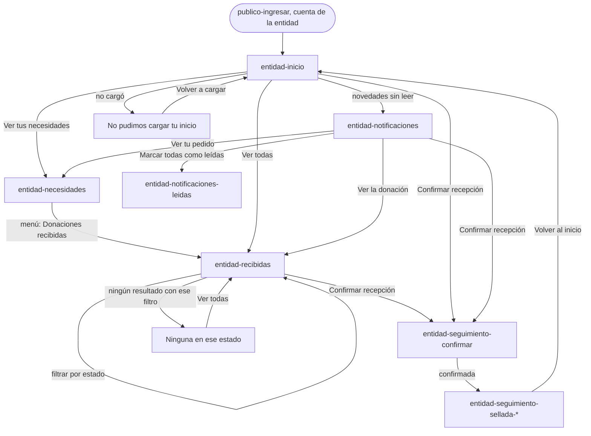
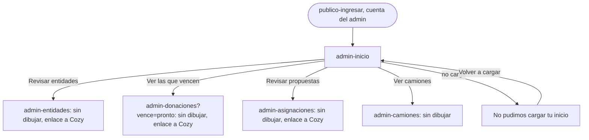

# Flujo: La entidad recibe, y el inicio del admin, en Raíces navegable

> **Estado:** aprobada: el usuario eligió el sitio A de la corrida A/B (2026-11-03), como
> preveía el plan · **Fecha:** 2026-11-02 · **Aprobó:** el usuario, 2026-11-03
> Plantilla de la skill `ux-flujo`. Ficha compartida por los dos sitios de la corrida A/B de Raíces:
> A en `/prototipo/raices/<pantalla>` y B en `/prototipo/raices-b/<pantalla>`
> ([ADR propuesto de Raíces](../../adr/cliente-liviano/20261101-tercera-alternativa-raices-como-prototipo-propio.md)).
> Fija para quién es, el recorrido, los estados, los textos, los datos y las salidas. **No fija la
> composición ni la navegación visual:** eso lo decide cada sitio. Las dos pantallas de la entidad
> ya aprobadas ([Necesidades](raices-necesidades.md) y
> [Confirmar recepción](raices-confirmar-recepcion.md)) no cambian por esta ficha.

Pantallas nuevas de esta ficha: `entidad-inicio`, `entidad-recibidas`, `entidad-notificaciones`
(con su estado `entidad-notificaciones-leidas`) y `admin-inicio`.

## 1. Para quién y para qué

| | |
|---|---|
| Quién | **Entidad:** la persona que organiza lo que recibe su entidad (en el ejemplo, Marta, del Comedor Barrio Ejemplo). Entra varias veces por día: desde el celular cuando llega un camión y desde la computadora de la entidad para revisar pedidos. **Admin:** quien opera la plataforma en la ONG (en el ejemplo, Leo, de Administración), desde la computadora, al empezar el día |
| Tono | Pantallas de trabajo: claro, útil, tranquilizador; estado y próximo paso. La entidad actúa: confirma, pide, revisa. Para demoras y errores: honesto, responsable, sereno ([tono según la pantalla](../tono-y-comunicacion.md#tono-según-la-pantalla)) |
| Qué quiere lograr | **Entidad:** "Ver qué llegó a mi puerta y confirmarlo, qué viene en camino y qué ya recibimos". **Admin:** "Saber qué espera mi decisión hoy y cómo está todo" |
| Dispositivo principal | Entidad: celular primero, también la computadora. Admin: computadora |
| Requerimientos | Entidad: RF-11 (listado de donaciones asignadas a la entidad, filtrable por estado), RF-13 (asignación y recepción generan notificación en la bandeja), RF-12 (confirmar recepción, se llega desde acá), RF-10 (sus necesidades), RF-14 (seguir entregas, sin dibujar). Admin: el inicio resume RF-16 (vencimientos), RF-17 (propuestas de asignación), RF-21 (entidades que piden sumarse) y RF-18 (camiones). RF-04 (cada rol llega a su inicio). RNF-UI-02 (nada a más de 3 niveles). RF-CL-07 (toda cifra que cambia dice cuándo se actualizó). RNF-CL-02 (sin JavaScript, igual funciona) |
| Datos que usa | Entidad: `GET /donaciones-independientes` (sin filtro por entidad: HB-04), el seguimiento de Logística por donación (HB-16), `GET /api/necesidades?entidadId=`, `GET /api/notificaciones/persona/{personaId}` (con `leida`), `.../no-leidas/conteo`, `PATCH /api/notificaciones/{id}/leida` y `.../marcar-todas-leidas`. Admin: `GET /donaciones-independientes?estado=`, `GET /api/asignaciones/propuestas`, `GET /api/entidades`, `GET /api/camiones`. Los que faltan, en [Huecos de backend](#huecos-de-backend). En la maqueta, datos sintéticos de esta ficha, coherentes con los de Necesidades, Confirmar recepción y la portada de Raíces |
| Boceto de E1 | Pág. 24 (inicio de la entidad: saludo, métricas, notificaciones pendientes, "Entregas sin verificar >"). Pág. 27 (donaciones recibidas: tarjetas por donación con donante y fecha). Pág. 13 (inicio del admin: menú y saludo). Notificaciones de la entidad: sin boceto (la del donante, pág. 6, es una tabla Estado / Detalle / Fecha) |

## 2. Dónde está en el sitio

[Mapa del sitio](../mapa-del-sitio.md), rol Entidad:

| Pantalla | Nivel | Cómo se llega |
|---|:-:|---|
| `entidad-inicio` | 1 | Desde `publico-ingresar` (la maqueta entra con la cuenta de ejemplo de la entidad) y desde el menú |
| `entidad-necesidades` (aprobada) | 2 | Menú e Inicio |
| `entidad-recibidas` | 2 | Menú ("Donaciones recibidas") e Inicio |
| `entidad-seguimiento` | 2 | Menú. **Sin dibujar** en esta corrida: cae en `sin-dibujar`, con el enlace a Cozy |
| `entidad-seguimiento-confirmar` (aprobada) | 3 | Desde Inicio, Donaciones recibidas, Necesidades y Notificaciones, con `?entrega=lentejas` o `ropa` |
| `entidad-notificaciones` | 2 | Desde las pantallas privadas de la entidad (dónde va el acceso lo decide cada sitio; no es una sección del menú, como en Cozy; en A no va en las aprobadas, Necesidades y Confirmar recepción) y desde Inicio |
| `entidad-perfil` | 2 | El enlace "Mi perfil" de la estructura privada. Sin dibujar para la entidad |

Rol Admin: `admin-inicio` (nivel 1), desde `publico-ingresar` con la cuenta de ejemplo del admin.
Sus secciones (Donantes, Entidades, Donaciones, Asignar donaciones, Camiones y Ranking) caen en
`sin-dibujar`; las que Cozy dibujó (`admin-entidades`, `admin-donaciones`, `admin-asignaciones`)
llevan su enlace a Cozy.

"Salir", en las dos, lleva a `publico-portada`.

## 3. Recorrido

Recorrido "recibir", que tiene que quedar navegable de punta a punta en A y en B:



Recorrido del admin (solo su inicio):



Desvíos considerados:

- **Volver:** el menú y el botón Atrás del navegador. Ninguna de estas pantallas deja algo a medio
  hacer, salvo "Marcar todas como leídas", que no borra nada: en el sistema, cada una puede volver a
  "sin leer" (`PATCH /api/notificaciones/{id}/leida?leida=false`); la maqueta no dibuja esa vuelta.
  Confirmar recepción vuelve a "Seguir entregas" (su ficha), que en esta corrida cae en
  `sin-dibujar`: quien llegó desde Inicio, Donaciones recibidas o Notificaciones y vuelve por ese
  enlace sale del recorrido; vuelve con el menú o con Atrás. Solo la salida después de confirmar
  ("Volver al inicio") sigue el recorrido. Es un riesgo anotado (sección 8, heurística 3).
- **Error del servidor o sin conexión al cargar:** el estado de error de cada pantalla, con
  "Volver a cargar" y el código para escribirnos.
- **Error al marcar como leídas:** el aviso arriba de la bandeja; las notificaciones quedan como
  estaban.
- **Filtro sin resultados (Donaciones recibidas):** se dice que no hay ninguna en ese estado y se
  ofrece ver todas.
- **Entrega con problema:** se muestra como una más, con qué pasó y el próximo paso, sin alarma.
- **Sin permiso:** en el sistema, la sesión de la entidad solo trae lo suyo (HB-13) y quien no
  inició sesión va a Ingresar. Si otro rol abre una dirección de la entidad o del admin, ve "Esta
  pantalla es para <las entidades | la administración>." y "Ir a tu inicio". En la maqueta no se
  dibuja: cada rol tiene su propia dirección (como en Seguir entregas del donante).

## 4. Pantallas

Esquemas de contenido, no de composición: dicen qué partes hay y en qué orden de importancia. La
disposición, el dibujo y la navegación los elige cada sitio, con la identidad de Raíces
([brief](../identidad/brief-raices.md)): como mucho una imagen de raíz por pantalla, en el título;
nunca en botones, datos ni errores.

### 4.1 `entidad-inicio`

```text
Inicio
Hola, Marta
Comedor Barrio Ejemplo · jueves 15 de octubre de 2026
[3 novedades sin leer → Notificaciones]

En tu puerta (lo primero que hay que hacer)
  Lentejas secas · 15 kg · llegó hoy, 18:20 · para tu pedido de lentejas secas
    [Confirmar recepción]
  Ropa de abrigo · 10 unidades · llegó ayer, 17:10 · para tu pedido de ropa de abrigo
    [Confirmar recepción]

Lo que viene
  Arroz · 20 kg · En camino · llega mañana
  Leche en polvo · 12 unidades · Por salir · sale el 17 de octubre
  Aceite de girasol · 10 litros · Con problema · te avisamos la nueva fecha
  Ver todas en Donaciones recibidas · Seguir entregas

Tus pedidos
  5 necesidades vigentes, cada una con cuánto llegó de cuánto
  Ver tus necesidades · Publicar otra necesidad

Lo recibido en octubre
  6 donaciones recibidas, confirmadas por tu entidad. Al 15 de octubre, 18:30.
  Ver las recibidas
```

- **Orden por lo que hay que hacer:** lo que espera confirmación primero (el atajo del boceto,
  "Entregas sin verificar >"), después lo que viene y después los pedidos.
- Cada entrega en la puerta abre su acta: `entidad-seguimiento-confirmar?entrega=lentejas` y
  `?entrega=ropa`.
- Respecto del boceto (pág. 24): las métricas pasan a cifras con su fecha y el atajo pasa a ser la
  primera parte, con un botón por entrega.

### 4.2 `entidad-recibidas`

```text
Donaciones recibidas
Lo asignado a tu entidad
Las donaciones asignadas al Comedor Barrio Ejemplo, de la que está en tu puerta a la que ya
recibiste. Al 15 de octubre de 2026, 18:30.

Filtro por estado: Todas (11) · Esperan tu confirmación (2) · En camino (1) · Por salir (1) ·
Con problema (1) · Recibidas en octubre (6)       [Filtrar]

Esperan tu confirmación (2)
  Lentejas secas · Alimentos · 15 kg
  Donó Distribuidora Ejemplo SA · Para tu pedido de lentejas secas
  Llegó a tu puerta hoy a las 18:20.               [Confirmar recepción]
  Ropa de abrigo · Ropa · 10 unidades …            [Confirmar recepción]
Con problema (1) · En camino (1) · Por salir (1)
  … cada una con su estado, su próximo paso y su pedido
Recibidas en octubre (6)
  Lentejas secas · 10 kg · Donó Almacén Ejemplo SRL · Confirmaste la recepción el 10 de octubre
  …
```

- **Es la lista de RF-11:** todas las donaciones asignadas a la entidad, agrupadas por estado, con
  el filtro por estado. El nombre del menú sigue siendo "Donaciones recibidas" (es el de E1); el
  título dice qué hay de verdad: lo asignado, llegue o no todavía.
- **El filtro funciona sin JavaScript:** un formulario `GET` con `?estado=` (`todas`,
  `en-tu-puerta`, `en-camino`, `por-salir`, `con-problema`, `recibidas`). En la maqueta, la
  plantilla lee el parámetro y muestra solo ese grupo. Con un filtro puesto, se dice cuál está
  puesto y se ofrece "Ver todas".
- **Cada donación:** qué es, su categoría (con su pictograma, el de la portada), cuánto, quién donó
  (nombre visible o su categoría en el ranking, como en Necesidades), el pedido que cubre (enlace a
  `entidad-necesidades?necesidad=<id>`), el estado en texto con su sello y el próximo paso. Las que
  esperan en la puerta llevan "Confirmar recepción"; la que tiene un problema, "Ver tu pedido".
- **Orden:** el de lo que hay que hacer (en la puerta, con problema, en camino, por salir) y al
  final las recibidas, de la más reciente a la más vieja.
- **Recibidas:** las del mes en curso. El rango de fechas queda para el sistema (HB-04); la
  maqueta lo dice en el nombre del grupo, "Recibidas en octubre".
- Respecto del boceto (pág. 27): se mantienen las tarjetas con donante y fecha; se suman el estado,
  el filtro (RF-11) y el pedido que cubre cada una.

### 4.3 `entidad-notificaciones` y `entidad-notificaciones-leidas`

```text
Notificaciones
Tus novedades
3 sin leer. Al 15 de octubre de 2026, 18:30.          [Marcar todas como leídas]

Sin leer
  [Llegó a tu puerta] Hoy, 18:20
  Lentejas secas, 15 kg, llegó a tu puerta. Confirmá la recepción con una foto.
  [Confirmar recepción]
  [En camino] Hoy, 9:15 …                               Ver la donación
  [Llegó a tu puerta] Ayer, 17:10 …                     [Confirmar recepción]
Leídas
  [Con problema] 14 de octubre, 16:40 …                 Ver tu pedido
  [Asignada] 13 de octubre, 10:05 …                     Ver la donación
  [Llegó a tu puerta] 10 de octubre, 11:05 · Confirmaste la recepción el 10 de octubre
```

- **Qué avisa:** RF-13 pide asignación y recepción; el contrato de Notificaciones también tiene "en
  camino" y "entrega fallida" para la entidad (`EventoDonacionEnCaminoDTO`,
  `EventoEntregaFallidaDTO`, con `personaBeneficiariaId`). Se muestran los cuatro. Que lleguen de
  verdad es HB-09.
- **"Llegó a tu puerta"** es la recepción de RF-13: el camión dejó la entrega. Si todavía espera,
  lleva "Confirmar recepción"; si ya se confirmó, dice cuándo, sin botón.
- **Cada notificación:** el tipo con su sello y en texto, la fecha y hora, qué pasó, el próximo
  paso y un enlace a lo que corresponde.
- **"Marcar todas como leídas"** es un formulario `POST` (CSRF en el sistema) que en la maqueta
  lleva a `entidad-notificaciones-leidas`: la misma bandeja, todas leídas, con el aviso arriba.
  Leer no confirma nada: las que esperan en la puerta conservan su botón.
- Respecto del boceto del donante (pág. 6): la tabla Estado / Detalle / Fecha no entra en 360 px;
  cada notificación es un bloque con los mismos tres datos.

### 4.4 `admin-inicio`

```text
Inicio
Hola, Leo
Jueves 15 de octubre de 2026
Hoy esperan tu decisión 3 entidades y 2 propuestas de asignación.
4 donaciones vencen en los próximos 7 días.

Lo que espera tu decisión
  Entidades · 3 piden sumarse
    Hogar Ejemplo Norte · Merendero Ejemplo Este · Comedor Ejemplo Oeste
    La más antigua llegó el 9 de octubre. A una le falta la constancia de domicilio.
    [Revisar entidades]
  Donaciones · 4 vencen en los próximos 7 días
    La primera, Leche en polvo, vence el 17 de octubre, en 2 días.
    [Ver las que vencen]
  Asignar donaciones · 2 propuestas
    Leche en polvo, 10 unidades, para Merendero Ejemplo Sur.
    Arroz, 25 kg, para Comedor Barrio Ejemplo.
    [Revisar propuestas]

Cómo está todo (al 15 de octubre de 2026, 18:30)
  Donaciones: 3 en el depósito · 4 asignadas · 1 en camino · 9 entregas confirmadas en octubre
  La red: 46 entidades activas · 86 donantes · 1 camión en ruta · 3 camiones libres
  Ver donaciones · Ver camiones
```

- Sin audacia de más: es la mesa de trabajo de quien decide (la de Cozy, sobria). Las cifras van
  sin gráficos y con su fecha.
- Cada bloque de decisión lleva a su lista: `admin-entidades`, `admin-donaciones?vence=pronto` y
  `admin-asignaciones`; las cifras, a `admin-donaciones` y `admin-camiones`. Todas caen en
  `sin-dibujar`.
- Respecto del boceto (pág. 13): el boceto es un menú con saludo. Las 9 secciones quedaron en 6
  (mapa del sitio) y van en el menú; el inicio suma lo que espera una decisión, que el boceto no
  tiene.

## 5. Estados

En la maqueta, con `?escenario=vacio`, `lento` y `error` en las cuatro pantallas (el mismo
parámetro de las otras de Raíces). En `entidad-recibidas`, además, `?estado=` para el filtro.

| Pantalla | Estado | Qué se ve | Texto |
|---|---|---|---|
| `entidad-inicio` | Con datos | Las cuatro partes del esquema | Ver Textos |
| `entidad-inicio` | Vacío (entidad recién aprobada) | El saludo; en lugar de las partes, un aviso con un solo paso | "Todavía no tenés donaciones asignadas." · "Empezá por publicar lo que necesita tu entidad: lo ven los donantes y el catálogo público. Cuando se te asigne una donación, aparece acá." · "Publicar una necesidad" (a `entidad-necesidades`) |
| `entidad-inicio` | Vacío parcial: nada en la puerta | La parte "En tu puerta" dice que no hay; el resto, igual | "No tenés entregas para confirmar." · "Cuando una entrega llegue a tu puerta, aparece acá para que confirmes la recepción." |
| `entidad-inicio` | Cargando | El saludo y el lugar de cada parte, sin datos inventados | "Cargando tu inicio…" (en el sistema, en la región `#avisos`) |
| `entidad-inicio` | Error del servidor | El saludo y el aviso en lugar de las partes | "No pudimos cargar tu inicio." · "Es un problema nuestro: no cambió nada en tus entregas ni en tus pedidos. Probá de nuevo en unos minutos; si sigue, escribinos con este código." · `a1b2c3d4e5f6` · "Volver a cargar" · "Escribinos" (a `publico-contacto?codigo=a1b2c3d4e5f6`) |
| `entidad-inicio` | Éxito, error de datos, deshabilitado | No aplica: no envía nada | — |
| `entidad-recibidas` | Con datos | El filtro y los grupos | Ver Textos |
| `entidad-recibidas` | Filtrada | Solo el grupo elegido; arriba, cuál está puesto | "Mostrando: En camino (1)." · "Ver todas" |
| `entidad-recibidas` | Filtro sin resultados | El filtro y el aviso | "No hay donaciones en ese estado." · "Probá con otro estado o mirá todas." · "Ver todas" |
| `entidad-recibidas` | Vacío | El título y el aviso; sin filtro | "Todavía no se asignaron donaciones a tu entidad." · "Se asignan a lo que pedís: publicá tus necesidades y aparecen acá cuando se asigne una." · "Ver tus necesidades" |
| `entidad-recibidas` | Cargando | El título, el filtro y el lugar de la lista | "Cargando tus donaciones…" |
| `entidad-recibidas` | Error del servidor | El título y el aviso en lugar de la lista | "No pudimos cargar tus donaciones." · "Es un problema nuestro: no cambió nada en tus entregas. Probá de nuevo en unos minutos; si sigue, escribinos con este código." · `a1b2c3d4e5f6` · "Volver a cargar" |
| `entidad-recibidas` | Éxito, error de datos | No aplica: el filtro no guarda nada y solo ofrece valores válidos (un valor desconocido muestra todas) | — |
| `entidad-notificaciones` | Con datos | Sin leer y leídas | Ver Textos |
| `entidad-notificaciones` | Vacío | El título y el aviso | "Todavía no tenés novedades." · "Te avisamos acá cuando se asigne una donación a tu entidad, cuando salga hacia vos, si tiene un problema y cuando llegue a tu puerta." |
| `entidad-notificaciones` | Nada sin leer | Solo "Leídas", sin el botón de marcar | "No tenés novedades sin leer." |
| `entidad-notificaciones` | Cargando | El título y el lugar de la lista | "Cargando tus novedades…" |
| `entidad-notificaciones` | Error del servidor | El título y el aviso | "No pudimos cargar tus novedades." · "Es un problema nuestro. Probá de nuevo en unos minutos; si sigue, escribinos con este código." · `a1b2c3d4e5f6` · "Volver a cargar" |
| `entidad-notificaciones` | Enviando | El botón deshabilitado con `hx-indicator` (se describe, no se dibuja) | "Marcando…" |
| `entidad-notificaciones-leidas` | Éxito | La bandeja, todas leídas, y el aviso con foco arriba | "Marcaste las 3 como leídas." · "Las entregas que esperan en tu puerta siguen esperando tu confirmación." |
| `entidad-notificaciones` | Error al marcar (se describe, no se dibuja) | El aviso arriba; todo sigue como estaba | "No pudimos marcarlas como leídas. Siguen como estaban; probá de nuevo." |
| `admin-inicio` | Con datos | El saludo, lo que espera decisión y las cifras | Ver Textos |
| `admin-inicio` | Vacío: nada espera decisión | El saludo, el aviso y las cifras | "Hoy no hay nada que espere tu decisión." · "Ninguna entidad pide sumarse, ninguna donación vence en los próximos 7 días y no hay propuestas de asignación." |
| `admin-inicio` | Cargando | El saludo y el lugar de cada parte | "Cargando tu inicio…" |
| `admin-inicio` | Error del servidor | El saludo y el aviso | "No pudimos cargar tu inicio." · "Es un problema nuestro: no cambió ninguna decisión. Probá de nuevo en unos minutos; si sigue, escribinos con este código." · `a1b2c3d4e5f6` · "Volver a cargar" |
| Las cuatro | Sin permiso | No se dibuja (ver Desvíos) | "Esta pantalla es para las entidades." / "Esta pantalla es para la administración." · "Ir a tu inicio" |

## 6. Textos

### Datos de maqueta

Fecha de corte de toda la maqueta de la entidad: **jueves 15 de octubre de 2026, 18:30**. Toda la
maqueta de Raíces es ese mismo jueves; cada rol lo mira a una hora distinta, fijada por sus pantallas
ya aprobadas: lo público a las 14:30 (portada), el donante a las 16:25 ([Seguir
entregas](raices-seguir-entregas.md)) y la entidad a las 18:30, después de que llegaran las lentejas
a las 18:20 ([Confirmar recepción](raices-confirmar-recepcion.md)). Las lentejas de 15 kg son la
misma entrega en dos momentos: salen del depósito a las 14:30, el donante las ve en camino a las
16:25 y la entidad las tiene en la puerta a las 18:30. Sintéticos,
coherentes con [Necesidades](raices-necesidades.md), [Confirmar recepción](raices-confirmar-recepcion.md)
y la portada de Raíces. `EstilosController.datosDeEjemplo` no trae datos de la entidad ni del admin
(sus entregas son de mayo y del catálogo): las plantillas escriben estos, como hacen las aprobadas.

Donaciones asignadas al Comedor Barrio Ejemplo (11):

| Clave | Qué | Categoría | Cuánto | Donó | Pedido (`?necesidad=`) | Estado | Próximo paso o fecha |
|---|---|---|---|---|---|---|---|
| `lentejas` | Lentejas secas | Alimentos | 15 kg | Distribuidora Ejemplo SA | `lentejas` | En tu puerta | "Llegó a tu puerta hoy a las 18:20. Espera tu confirmación." |
| `ropa` | Ropa de abrigo | Ropa | 10 unidades | Donante Sostenedor (nombre oculto) | `ropa` | En tu puerta | "Llegó a tu puerta ayer a las 17:10. Espera tu confirmación." |
| `arroz` | Arroz | Alimentos | 20 kg | Almacén Ejemplo SRL | `arroz` | En camino | "Salió del depósito hoy a las 9:15. Llega mañana." |
| `leche` | Leche en polvo | Alimentos | 12 unidades | Lácteos Ejemplo SA | `leche` | Por salir | "Asignada el 13 de octubre. Sale del depósito el 17 de octubre." |
| `aceite` | Aceite de girasol | Alimentos | 10 litros | Almacén Ejemplo SRL | `aceite` | Con problema | "El camión no pudo llegar el 14 de octubre. Te avisamos la nueva fecha." |
| — | Lentejas secas | Alimentos | 10 kg | Almacén Ejemplo SRL | `lentejas` | Recibida | "Confirmaste la recepción el 10 de octubre." |
| — | Arroz | Alimentos | 5 kg | Martina Ruiz | `arroz` | Recibida | "Confirmaste la recepción el 9 de octubre." |
| — | Ropa de abrigo | Ropa | 5 unidades | Donante Sostenedor | `ropa` | Recibida | "Confirmaste la recepción el 8 de octubre." |
| — | Leche en polvo | Alimentos | 12 unidades | Lácteos Ejemplo SA | `leche` | Recibida | "Confirmaste la recepción el 6 de octubre." |
| — | Fideos secos | Alimentos | 8 kg | Distribuidora Ejemplo SA | — (sin pedido vigente) | Recibida | "Confirmaste la recepción el 5 de octubre." (la de la portada) |
| — | Arroz | Alimentos | 10 kg | Almacén Ejemplo SRL | `arroz` | Recibida | "Confirmaste la recepción el 2 de octubre." |

Las cifras cierran con Necesidades: lentejas 10 de 40 kg, arroz 15 de 40 kg, ropa 5 de 30
unidades, leche 12 de 24 unidades, aceite 0 de 20 litros. Los fideos del 5 de octubre no cubren
ningún pedido vigente (el de fideos secos se publica en la maqueta de Necesidades): la tarjeta no
lleva la línea del pedido. **Coherencia con el grupo donante:** lo que donó Distribuidora Ejemplo SA
sale de una sola fuente, `prototipo/cozy-medieval/viaje-datos.html` (la de Seguimiento y Mis
donaciones). Al Comedor Barrio Ejemplo le llegan dos de sus donaciones: las lentejas de 15 kg (en la
puerta) y los fideos de 8 kg (recibidos el 5 de octubre, su "primera entrega confirmada" en el
inicio del donante). Las demás de esta tabla son de otros donantes.

Pedidos vigentes en Inicio (de Necesidades): "Aceite de girasol · 0 de 20 litros · hasta el 20 de
octubre" · "Leche en polvo · 12 de 24 unidades · hasta el 25 de octubre" · "Lentejas secas · 10 de
40 kg · octubre, hasta el 31" · "Arroz · 15 de 40 kg · octubre, hasta el 31" · "Ropa de abrigo · 5
de 30 unidades · hasta el 15 de noviembre".

Notificaciones (3 sin leer, 3 leídas), de la más nueva a la más vieja:

| Tipo (sello) | Cuándo | Texto | Enlace | Leída |
|---|---|---|---|:-:|
| Llegó a tu puerta | Hoy, 18:20 | "Lentejas secas, 15 kg, llegó a tu puerta. Confirmá la recepción con una foto." | "Confirmar recepción" (`?entrega=lentejas`) | No |
| En camino | Hoy, 9:15 | "Arroz, 20 kg, salió del depósito. Llega mañana." | "Ver la donación" (`entidad-recibidas?estado=en-camino`) | No |
| Llegó a tu puerta | Ayer, 17:10 | "Ropa de abrigo, 10 unidades, llegó a tu puerta. Confirmá la recepción con una foto." | "Confirmar recepción" (`?entrega=ropa`) | No |
| Con problema | 14 de octubre, 16:40 | "Aceite de girasol, 10 litros: el camión no pudo llegar. Te avisamos la nueva fecha." | "Ver tu pedido" (`entidad-necesidades?necesidad=aceite`) | Sí |
| Asignada | 13 de octubre, 10:05 | "Se asignó a tu pedido de leche en polvo una donación de 12 unidades. Sale del depósito el 17 de octubre." | "Ver la donación" (`entidad-recibidas?estado=por-salir`) | Sí |
| Llegó a tu puerta | 10 de octubre, 11:05 | "Lentejas secas, 10 kg, llegó a tu puerta." · "Confirmaste la recepción el 10 de octubre." | "Ver la donación" (`entidad-recibidas?estado=recibidas`) | Sí |

Admin: los de Cozy (`cozy-medieval/admin-inicio.html`), con "latas" pasadas a "unidades" (la
unidad sale del catálogo, como en Necesidades), las entidades activas igualadas a la portada de
Raíces (46) y las entregas confirmadas de octubre igualadas a las de la ficha pública (9 entre el 1
y el 15 de octubre). Las tres entidades que piden sumarse no son ninguna de las activas de las
otras fichas. Ver el esquema 4.4.

### Textos propios

| Elemento | Texto | Nota |
|---|---|---|
| Rótulo (entidad-inicio) | Inicio | El nombre del menú |
| Saludo | "Hola, Marta" · "Comedor Barrio Ejemplo · jueves 15 de octubre de 2026" | La cuenta de ejemplo del controlador |
| Novedades | "3 novedades sin leer" (enlace a Notificaciones) | Sin rojo ni signo de exclamación: es un dato |
| En tu puerta | Título "En tu puerta" · "2 entregas esperan tu confirmación." · por entrega: "Lentejas secas · 15 kg" · "Llegó hoy, 18:20, desde el Depósito Central. Para tu pedido de lentejas secas." · "Confirmar recepción" (nombre accesible: "Confirmar recepción: lentejas secas") | El texto de Cozy y de Confirmar recepción |
| Lo que viene | Título "Lo que viene" · "3 entregas asignadas que todavía no llegaron." · una línea por entrega con su sello y su próximo paso · "Ver todas en Donaciones recibidas" · "Seguir entregas" | "Lo que viene", no "lo que llega": la del aceite no pudo llegar |
| Tus pedidos | Título "Tus pedidos" · "5 necesidades vigentes." · un renglón por pedido · "Ver tus necesidades" · "Publicar otra necesidad" (a `entidad-necesidades`) | Cifras con período ("octubre, hasta el 31") |
| Lo recibido | Título "Lo recibido en octubre" · "6 donaciones recibidas, confirmadas por tu entidad. Al 15 de octubre, 18:30." · "Ver las recibidas" (a `entidad-recibidas?estado=recibidas`) | Resultado registrado, con período y fuente; no dice nada del efecto |
| Rótulo (entidad-recibidas) | Donaciones recibidas | El nombre del menú |
| Título | Lo asignado a tu entidad | La única imagen de raíz posible va acá, si el sitio la pone |
| Bajada | "Las donaciones asignadas al Comedor Barrio Ejemplo, de la que está en tu puerta a la que ya recibiste. Al 15 de octubre de 2026, 18:30." | Dice el alcance y la fecha |
| Filtro | Rótulo "Estado" · "Todas (11)" · "Esperan tu confirmación (2)" · "En camino (1)" · "Por salir (1)" · "Con problema (1)" · "Recibidas en octubre (6)" · botón "Filtrar" | Con JavaScript puede filtrar al elegir; el botón queda para sin JavaScript |
| Grupos | "Esperan tu confirmación" · "Con problema" · "En camino" · "Por salir" · "Recibidas en octubre", cada uno con su cantidad | Los nombres del filtro |
| Cada donación | "Lentejas secas" · "Alimentos · 15 kg" · "Donó Distribuidora Ejemplo SA" · "Para tu pedido de lentejas secas" (enlace) · el estado y su próximo paso (tabla de datos) · "Confirmar recepción" o "Ver tu pedido" | Quien ocultó su nombre: su categoría ("Donante Sostenedor"); sin categoría, "Un donante" |
| Rótulo (entidad-notificaciones) | Notificaciones | — |
| Título | Tus novedades | — |
| Bajada | "3 sin leer. Al 15 de octubre de 2026, 18:30." | — |
| Grupos | "Sin leer" · "Leídas" | — |
| Sellos | "Asignada" · "En camino" · "Con problema" · "Llegó a tu puerta" | Texto y forma; el color acompaña |
| Acción | "Marcar todas como leídas" · enviando: "Marcando…" | — |
| Rótulo (admin-inicio) | Inicio | — |
| Saludo | "Hola, Leo" · "Jueves 15 de octubre de 2026" · "Hoy esperan tu decisión 3 entidades y 2 propuestas de asignación. 4 donaciones vencen en los próximos 7 días." | Estado y próximo paso; sin urgencia: el vencimiento es un dato con fecha |
| Lo que espera | Título "Lo que espera tu decisión" · "3 entidades piden sumarse" · "4 donaciones vencen en los próximos 7 días" · "2 propuestas de asignación" · con sus detalles del esquema · "Revisar entidades" · "Ver las que vencen" · "Revisar propuestas" | — |
| Cifras | Título "Cómo está todo" · "Al 15 de octubre de 2026, 18:30." · "3 en el depósito" · "4 asignadas" · "1 en camino" · "9 entregas confirmadas en octubre" · "46 entidades activas" · "86 donantes" · "1 camión en ruta" · "3 camiones libres" · "Ver donaciones" · "Ver camiones" | Actividad y resultado registrado, con período; sin comparar entidades |

Ayudas por flujo crítico: ninguna de estas pantallas es un flujo crítico (no envían datos, salvo
marcar como leídas). La ayuda es la bajada de cada una, que dice qué muestra y hasta cuándo.

Filtro de tono:

- Lo pendiente se dice pendiente: "Espera tu confirmación", "Por salir", "Llega mañana"; nunca
  "entregada" antes de la confirmación de la entidad.
- La entrega con problema dice qué pasó, cuándo y el próximo paso, sin "lamentablemente".
- Las cifras llevan período y fecha ("6 donaciones recibidas … Al 15 de octubre, 18:30"; "9
  entregas confirmadas en octubre"). Lo recibido es un resultado registrado, no impacto.
- La entidad hace: confirma, pide, revisa. Nada de "beneficiarios" ni de carencias.
- Palabras que no van (brief de Raíces): "eco", "huella verde", "florecer", "regá", "cosechá" y
  "sostenible" de adorno. La metáfora va, como mucho, en un título.

## 7. Accesibilidad

- Zonas en las cuatro: saltar al contenido, la navegación del rol (`nav` con nombre), `main` con un
  `h1` y una sección con `h2` por parte. La sección actual del menú lleva `aria-current="page"`.
- **Inicio de la entidad:** el foco recorre "3 novedades sin leer", los dos "Confirmar recepción"
  (con el nombre de la entrega en el nombre accesible), las salidas de "Lo que viene", las de
  "Tus pedidos" y "Ver las recibidas".
- **Donaciones recibidas:** el filtro es un `fieldset` con `legend` "Estado" y opciones con su
  cantidad en el texto; al filtrar, el foco va al título del grupo mostrado. Cada donación es un
  `article` con `h3`.
- **Notificaciones:** una lista (`ul`) por grupo; cada notificación dice su tipo en texto antes
  de la fecha. El aviso de "Marcaste las 3 como leídas" va en la región `aria-live` y recibe el
  foco.
- **Admin:** cada bloque de decisión es una sección con su `h3` y su cantidad en el título; las
  cifras son listas de definiciones (`dl`) con nombre, nunca un número solo.
- Los estados llevan texto y forma (sello); el color solo acompaña. Cargando y error se anuncian en
  la región `aria-live`.
- Con "reducir movimiento", ningún dibujo se anima.

## 8. Revisión de usabilidad

| # | Heurística | Cómo la cumple | Riesgo que queda |
|---|---|---|---|
| 1 | Visibilidad del estado | Cada donación con su estado, su próximo paso y su fecha; cada pantalla dice hasta cuándo están los datos; las novedades sin leer, con su número | Las notificaciones de la entidad dependen de HB-09 |
| 2 | Lenguaje del usuario | "En tu puerta", "Lo que viene", "Por salir", "piden sumarse"; sin códigos ni nombres de estados del sistema | "Donaciones recibidas" (menú, E1) lista también las que no llegaron: el título lo aclara |
| 3 | Control y libertad | Solo consulta, salvo marcar como leídas, que no borra nada; menú y Atrás siempre | Confirmar recepción vuelve a Seguir entregas, no a la pantalla de origen; y Seguir entregas cae en `sin-dibujar` en esta corrida, así que esa vuelta saca del recorrido "recibir" a quien llegó desde Inicio, Donaciones recibidas o Notificaciones. Para el sistema, conviene que la vuelta lleve a la pantalla de origen |
| 4 | Consistencia | Los mismos sellos, estados, datos y "Confirmar recepción" que Necesidades y Confirmar recepción; el mismo error con código en todas | — |
| 5 | Prevención de errores | El filtro solo ofrece estados válidos; leer no confirma una entrega, y se dice | — |
| 6 | Reconocer antes que recordar | Inicio muestra lo que hay que hacer con su botón; cada notificación lleva a lo suyo | — |
| 7 | Flexibilidad | Tres caminos a Confirmar recepción (Inicio, Donaciones recibidas, Notificaciones) además de Necesidades | — |
| 8 | Diseño minimalista | Inicio: cuatro partes en orden de urgencia; admin: lo que espera decisión y pocas cifras, sin gráficos | Con muchas recibidas en un mes, la lista crece: el sistema necesita paginar o rango de fechas (HB-04) |
| 9 | Recuperarse de errores | Cada error dice que no cambió nada, ofrece volver a cargar y el código para escribirnos | — |
| 10 | Ayuda | La bajada de cada pantalla dice qué muestra y su fecha | — |

Los 7 factores de la experiencia ([criterios de la cátedra](../criterios-catedra-ux-ui.md),
sección 2):

| Factor | Cómo lo cumple |
|---|---|
| Útil | La entidad ve qué confirmar, qué viene y qué recibió; el admin, qué decidir hoy |
| Usable | Listas con estado en texto y un botón por acción; filtro sin JavaScript |
| Deseable | Los sellos, etiquetas y la paleta de Raíces; la composición la elige cada sitio |
| Valioso | La entidad deja asentado lo que recibió; quien opera ordena su día |
| Ubicable | Todo a nivel 1 o 2, Confirmar recepción a nivel 3 (RNF-UI-02) |
| Accesible | Estados con texto y forma, `fieldset` en el filtro, avisos en `aria-live`; WCAG AA y Ley 26.653 |
| Creíble | Cada cifra con fecha; lo pendiente, pendiente; lo recibido, respaldado por la confirmación de la entidad |

Qué conviene probar con personas reales: si alguien de una entidad entiende que "Donaciones
recibidas" también muestra lo que todavía no llegó, y si encuentra la bandeja de novedades sin que
esté en el menú.

## 9. Decisiones y preguntas

Decisiones tomadas (agente, en la corrida A/B; aprobadas al elegir el sitio A, 2026-11-03):

- "Donaciones recibidas" es la lista de RF-11: todo lo asignado, agrupado y filtrable por estado,
  con las recibidas del mes al final. El nombre del menú no cambia; el título dice el alcance.
- Inicio de la entidad ordenado por lo que hay que hacer: la puerta primero (el atajo del boceto).
- La recepción de RF-13 se muestra como "Llegó a tu puerta" (el evento `EventoDonacionRecibidaDTO`),
  con el botón para confirmar mientras espera. La bandeja suma "en camino" y "con problema", que
  el contrato ya trae para la entidad.
- Notificaciones no es una sección del menú (como en Cozy); se llega desde las pantallas
  privadas y desde Inicio. Dónde va el acceso lo decide cada sitio. En A no va en las dos
  aprobadas (Necesidades y Confirmar recepción), que A no toca; ahí se llega por el menú (Inicio).
- El admin solo tiene inicio, con los datos de Cozy; sus secciones caen en `sin-dibujar`.
- Datos nuevos de maqueta: Almacén Ejemplo SRL como donante sintético de cuatro entregas (arroz en
  camino, aceite con problema, y lentejas y arroz recibidos), y la donación de fideos del 5 de
  octubre (de Distribuidora Ejemplo SA, la de la portada) sin pedido vigente.
- Los desvíos del boceto (secciones 4.1 a 4.4) van a la [bitácora](../bitacora.md) en el cierre de
  la corrida, junto con los de las otras fichas.

Preguntas abiertas: ninguna para la corrida. La que queda para el equipo va en los huecos.

### Huecos de backend

También en la lista de la corrida ([raices-ab-huecos-backend.md](raices-ab-huecos-backend.md)). Sin DTI ni ADR nuevos.

- Entidad · `entidad-recibidas` · las donaciones asignadas a una entidad, con filtro por estado y
  rango de fechas · `GET /donaciones-independientes` no filtra por entidad asignada (HB-04).
- Entidad · `entidad-recibidas` e `entidad-inicio` · el estado de la entrega (en la puerta, en
  camino, con problema) de todas las de la entidad en una llamada · Logística lo da por donación
  (HB-16).
- Entidad · `entidad-recibidas` · el pedido que cubre cada donación · falta `necesidadId` en la
  donación (HB-17).
- Entidad · `entidad-recibidas` · el nombre visible de quien donó o su categoría · HB-20.
- Entidad · `entidad-notificaciones` · que asignación, en camino, entrega fallida y llegada generen
  notificación a la entidad · sin verificar (HB-09).
- Entidad · `entidad-notificaciones` · el id de la donación o la entrega en cada notificación, para
  enlazarla · los eventos traen solo `descripcion`.
- Admin · `admin-inicio` · las entidades que piden sumarse · falta el estado pendiente de
  aprobación (HB-12).
- Admin · `admin-inicio` · las donaciones que vencen en los próximos días · `GET
  /donaciones-independientes` filtra por estado, subcategoría y donante, no por vencimiento.
- Admin · `admin-inicio` · las cifras de "Cómo está todo" (donaciones en depósito, asignadas y en
  camino, entregas confirmadas del mes, donantes, camiones en ruta y libres) · no hay un resumen
  agregado; contarlas obliga a traer las listas enteras de Donaciones, Logística y Usuarios en cada
  carga.
