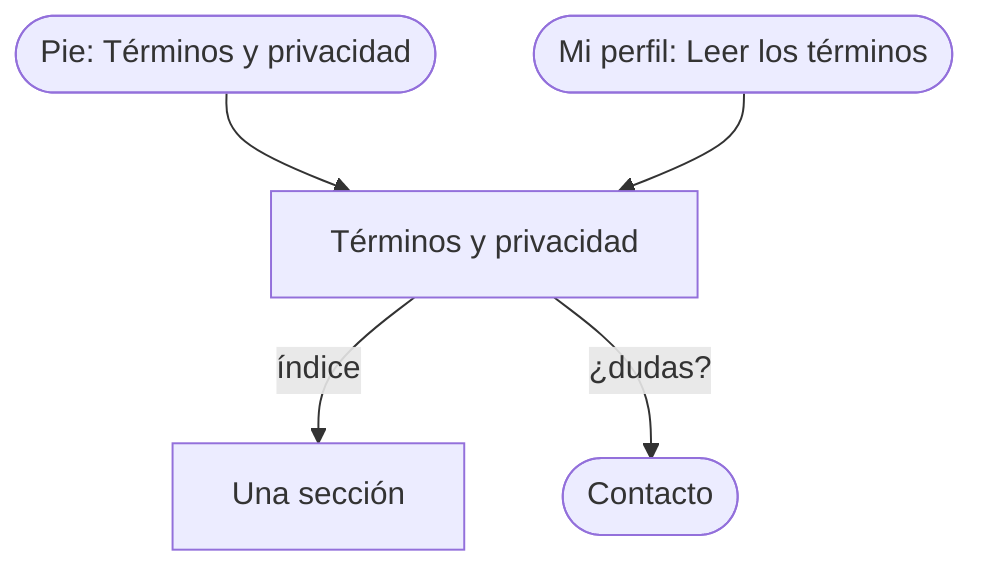

# Flujo: Términos y privacidad, y el pie del sitio, en Raíces

> **Estado:** aprobado · **Fecha:** 2026-11-02 · **Aprobó:** usuario (2026-11-02), al ver las pantallas dibujadas
> Plantilla de la skill `ux-flujo`. Pantalla nueva del prototipo propio de Raíces
> ([ADR propuesto](../../adr/cliente-liviano/20261101-tercera-alternativa-raices-como-prototipo-propio.md)):
> `/prototipo/raices/publico-legales`, y el pie que la enlaza desde todas las páginas. Sale de la
> pregunta 18 del artifact de preguntas abiertas: enlace en el pie y aceptación al registrarse, con
> constancia (usuario, 2026-11-02). Sofía Deane pidió sumarlos al menú de la portada y a los
> ajustes; el usuario los dejó como estaban: en el pie, al registrarse y en la constancia de Mi perfil
> (review de Sofía, 2026-11-02).

## 1. Para quién y para qué

| | |
|---|---|
| Quién | Quien está por registrarse y quiere saber qué pasa con sus datos; una empresa que necesita saber qué se publica de lo que dona; una entidad que sube fotos |
| Tono | Páginas públicas e institucionales: profesional, seguro, directo ([tono según la pantalla](../tono-y-comunicacion.md#tono-según-la-pantalla)) |
| Qué quiere lograr | "Saber qué se ve de mí y de lo que doné, y qué acepto al registrarme" |
| Dispositivo principal | Ambos |
| Requerimientos | RF-01 (la portada enlaza los legales). La constancia, del [ADR del nombre visible](../../adr/20261102-nombre-visible-del-donante-y-constancia-de-los-legales.md) (`proposed`) |
| Datos que usa | Ninguno: es texto. La versión y su fecha, fijas en la maqueta. HB-20 y [DTI-32](../../adr/DEUDA_TECNICA.md#dti-32) guardan la aceptación |
| Boceto de E1 | Sin boceto; el mapa del sitio la pone en el pie |

## 2. Dónde está en el sitio

Público, nivel 2 ([mapa del sitio](../mapa-del-sitio.md): Legales y privacidad), desde el pie de
todas las páginas de Raíces y desde Mi perfil.

**El pie** (decisión del usuario, 2026-11-02: un pie corto en todas): en la portada y en las
públicas, una línea con "Términos y privacidad · Contacto" y la firma del proyecto. En las privadas,
la misma línea al final del contenido; en el celular, encima de la barra del menú.

**La casilla del registro.** Raíces todavía no dibuja el registro (enlaza al de Cozy). Cuando lo
dibuje, el paso "Completar perfil" (RI-AUTH-02) lleva, antes del botón, una casilla obligatoria:
"Leí y acepto los términos y la política de privacidad (versión 1)", con los dos enlaces. Para un
donante, encima de la casilla: "Las entidades que reciben lo que donás ven tu nombre. Podés
ocultarlo cuando quieras en Mi perfil." (lo pide el ADR del nombre visible). Sin marcarla, el
error dice: "Para crear tu cuenta, aceptá los términos y la política de privacidad". Si la versión
cambia, al entrar se pide aceptar la nueva.

## 3. Recorrido



Sin desvíos de error: la página no pide datos.

## 4. Pantallas

```text
┌─────────────────────────────────────────────┐
│ LEGALES (rótulo)                            │
│ Términos y privacidad                       │
│ Versión 1, vigente desde el 1 de noviembre  │
│ de 2026.                                    │
│ [Texto de ejemplo del prototipo: el texto   │
│  final lo escribe el equipo.]               │
│ En esta página: Qué es DonaTrack · Tu       │
│ cuenta · Qué se ve de lo que donás · Fotos  │
│ de las entregas · Tus datos · Contacto      │
│ ── secciones, de ancho de lectura ──        │
├─────────────────────────────────────────────┤
│ Términos y privacidad · Contacto            │
└─────────────────────────────────────────────┘
```

Secciones: qué es DonaTrack; tu cuenta (qué aceptás al registrarte); qué se ve de lo que donás (el
nombre de quien dona, visible salvo que lo oculte en Mi perfil o en una donación; oculto, la
entidad ve su categoría en el ranking); fotos de las entregas (las sube la
entidad; pueden mostrarse en la portada y en el mapa con la ubicación aproximada; el remito no se
publica); tus datos (Ley 25.326: pedir verlos, corregirlos o borrarlos); contacto.

## 5. Estados

| Pantalla | Estado | Qué se ve | Texto |
|---|---|---|---|
| Legales | Con datos | El texto con su versión | — |
| Legales | Vacío, cargando, error | No aplican: es texto fijo del servidor | — |

## 6. Textos

| Elemento | Texto | Nota |
|---|---|---|
| Rótulo y título | "Legales" · "Términos y privacidad" | |
| Versión | "Versión 1, vigente desde el 1 de noviembre de 2026." | |
| Aviso de ejemplo | "Este es un texto de ejemplo del prototipo. El texto final lo escribe el equipo." | Para que nadie lo tome por el definitivo |
| Pie | "Términos y privacidad" · "Contacto" · "DonaTrack, UTN-FRBA, Diseño de Sistemas 2026" | |
| Casilla del registro | "Leí y acepto los términos y la política de privacidad (versión 1)" | Para cuando se dibuje el registro |
| Aviso del registro, solo donantes | "Las entidades que reciben lo que donás ven tu nombre. Podés ocultarlo cuando quieras en Mi perfil." | Encima de la casilla |

## 7. Accesibilidad

Un `h1` y un `h2` por sección; el índice es una `nav` con `aria-label="En esta página"`. El pie es
un `footer` con una `nav` "Legales y contacto". Largo de línea de lectura (unos 70 caracteres).

## 8. Revisión de usabilidad

| # | Heurística | Cómo la cumple | Riesgo que queda |
|---|---|---|---|
| 1 | Visibilidad del estado | Versión y fecha arriba | |
| 2 | Lenguaje del usuario | Títulos como preguntas de todos los días ("Qué se ve de lo que donás") | El texto legal final puede volver a la jerga |
| 3 | Control y libertad | Índice con enlaces a cada sección | |
| 4 | Consistencia | El mismo pie en todas las páginas | |
| 5 | Prevención de errores | — | |
| 6 | Reconocer antes que recordar | El índice arriba | |
| 7 | Flexibilidad | — | |
| 8 | Diseño minimalista | Solo texto, de ancho de lectura | |
| 9 | Recuperarse de errores | — | |
| 10 | Ayuda | Enlace a Contacto al final | |

Factores de Morville: útil (dice qué se publica), usable (índice), deseable (mismo papel y letra),
valioso (confianza de las empresas), ubicable (pie), accesible (AA), creíble (versión y fecha).

## 9. Decisiones y preguntas

Decisiones tomadas:

- Enlace en el pie y aceptación al registrarse, con constancia (usuario, 2026-11-02, pregunta 18).
- Un pie corto en todas las páginas, también en las privadas (usuario, 2026-11-02).
- Una sola página con términos y privacidad juntos, con índice (agente, propuesto: es una página
  de consulta y así se enlaza una sola vez).
- La casilla del registro queda descrita acá hasta que Raíces dibuje el registro (usuario,
  2026-11-02).

Preguntas abiertas, para el equipo (no cambian el prototipo):

- El texto final de los términos y la política de privacidad.
