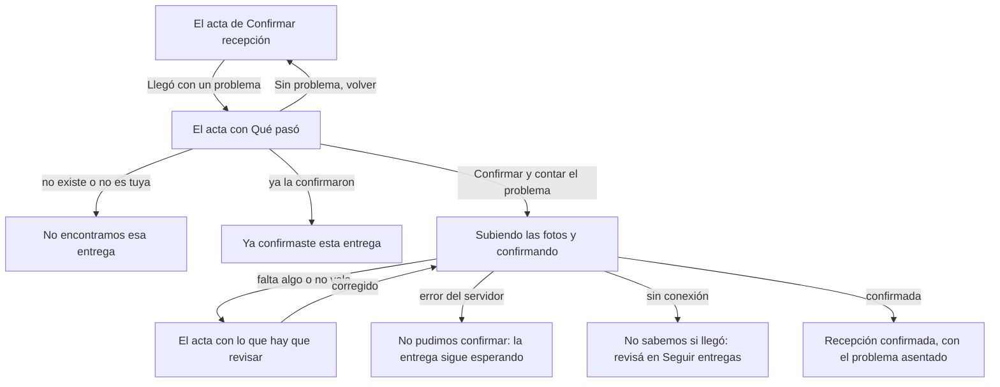

# Flujo: Llegó con un problema, en Raíces

> **Estado:** aprobado · **Fecha:** 2026-11-07 · **Aprobó:** usuario (2026-11-07)
> Plantilla de la skill `ux-flujo`. Amplía [Confirmar recepción](raices-confirmar-recepcion.md): es
> su desvío "Llegó con un problema", que hasta F7 abría la página sin dibujar
> ([roadmap de vistas](../roadmap-vistas-enunciado.md), F7). Pantalla: `/entidad-seguimiento-problema`.
> Lo que no se repite acá (la etiqueta, el último tramo, las fotos, el remito, la firma y sus
> estados) sigue como en la ficha de Confirmar recepción.

## 1. Para quién y para qué

| | |
|---|---|
| Quién | La misma persona de la entidad que recibe el camión (Marta, del Comedor Barrio Ejemplo), cuando la entrega llegó incompleta, dañada o con otra cosa rara |
| Tono | Pantalla de trabajo: claro y sereno. Un problema se cuenta sin culpa para nadie: ni la entidad ni quien donó hicieron algo mal por decirlo ([tono según la pantalla](../tono-y-comunicacion.md#tono-según-la-pantalla)) |
| Qué quiere lograr | "Dejar asentado que llegó, y también qué estuvo mal, en el mismo paso y sin tener que pelear con nadie" |
| Dispositivo principal | Celular primero; también la computadora |
| Requerimientos | RF-12 (se confirma con al menos una foto; la entrega queda `ENTREGADA`). RF-08 (quien donó recibe el aviso de recepción). RNF-PRIV-03 y 04 (fotos privadas y sin EXIF). RNF-UI-04 a 06. RF-CL-04 (CSRF). RNF-CL-02 (sin JavaScript, igual funciona) |
| Datos que usa | La misma confirmación, `PATCH /api/entregas/{id}/estado` con `estado: ENTREGADA`, las fotos y el remito, más el `reporte` opcional que suma el [ADR del contrato de entregas](../../adr/20261102-contrato-de-entregas-para-la-entidad-remito-reporte-y-datos-de-donaciones.md) (`proposed`): `motivo` (`INCOMPLETA`, `DANADA`, `OTRO`), `detalle` (texto) y `cantidadRecibida` (en la unidad de la donación). El reporte viaja en `entrega.exitosa`. Huecos: HB-17 (el reporte en el contrato, [DTI-29](../../adr/DEUDA_TECNICA.md#dti-29)), HB-10 (las fotos) y HB-13 (solo la entidad destinataria) |
| Boceto de E1 | Página 28: el botón "Reportar problema" de "Entregas a confirmar", sin pantalla propia en el boceto |

## 2. Dónde está en el sitio

Inicio de la entidad → **Seguir entregas** (nivel 2) → **Confirmar recepción** (nivel 3) →
**Llegó con un problema**, la misma acta con un grupo más: una variante del nivel 3, no un nivel
4. Se llega desde el enlace "Llegó con un
problema" que está debajo del botón del acta. La sección del menú que se destaca es Seguir
entregas.

## 3. Recorrido



Desvíos considerados:

- **Cancelar o volver:** "Seguir entregas" arriba, el botón Atrás y, debajo del botón, "No hubo
  problema: volver a la confirmación", que avisa que lo cargado no se guarda. Nada se guarda hasta
  confirmar.
- **Error de datos:** los de Confirmar recepción (fotos y remito) y los del grupo nuevo, en la
  tabla "Errores de Qué pasó" de §5. Mismo patrón: resumen arriba con un enlace a cada campo, el
  error al lado del campo, lo escrito se conserva y las fotos hay que volver a elegirlas.
- **Error del servidor y sin conexión:** como en Confirmar recepción. El problema no quedó
  asentado si la confirmación no quedó: se dice "ni el problema".
- **Ya confirmada o sin permiso:** como en Confirmar recepción. Un problema descubierto después de
  confirmar no se carga desde acá (ver preguntas abiertas).
- **No llegó nada:** no es este flujo. Es `NO_RECIBIDA`, que el ADR deja como estaba; la pantalla
  no lo ofrece (ver preguntas abiertas).

## 4. Pantallas

Una pantalla: el acta de Confirmar recepción, con el grupo "Qué pasó" entre las pruebas y lo que
recibiste. Esquema en el celular:

```text
┌──────────────────────────────┐
│ ← Seguir entregas            │
│ Contá qué *pasó*             │
│ Lentejas secas, 15 kg.       │
│ Llegó hoy a las 18:20.       │
│ [ la etiqueta ]              │
│ [ el último tramo ]          │
│ Las pruebas                  │
│ [ Elegir o sacar fotos ]     │
│ Quién ve tus fotos           │
│ Qué pasó                     │
│ ( ) Llegó menos              │
│ ( ) Llegó dañada             │
│ ( ) Otra cosa                │
│ Cuánto llegó   [   ] kg      │
│ Contanos más   [         ]   │
│ Quién ve lo que contás       │
│ Lo que recibiste             │
│ Número de remito  [      ]   │
│ Recibe Marta, por …          │
│ [ Confirmar y contar ]       │
│ No hubo problema: volver     │
├──────────────────────────────┤
│ barra del menú               │
└──────────────────────────────┘
```

- **Qué pasó:** tres opciones (radio, obligatorio). "Cuánto llegó" va siempre a la vista, con la
  unidad del catálogo al lado; la ayuda dice que se completa si llegó menos. Mostrarlo solo con
  "Llegó menos" necesitaría JavaScript para lo esencial: sin él, el campo igual está y el servidor
  lo valida. Es obligatorio con "Llegó menos"; con las otras dos opciones, si viene escrito, no se
  guarda. "Contanos más" es un área de texto, opcional salvo con "Otra cosa".
- **Quién ve lo que contás:** debajo del grupo, igual que "Quién ve tus fotos".
- **Las pruebas:** el mismo campo de fotos; la ayuda suma "Si se ve el daño, sacale una foto".
  "Quién ve tus fotos" cambia: con un problema, las fotos no se publican (usuario, 2026-11-07).
- **El pie:** el botón cambia a "Confirmar y contar el problema" y la nota dice que la entrega
  queda como entregada igual.
- **Recepción confirmada:** la misma pantalla de Confirmar recepción, con una fila más en lo
  asentado, "El problema", y sin la cifra de la necesidad (ver preguntas abiertas).

En pantalla grande, las dos filas de dos columnas del acta: el grupo "Qué pasó" va en la columna
de la izquierda, debajo de las pruebas, y lo que recibiste con el pie a la derecha.

Qué cambia respecto del boceto de E1, y por qué:

- **"Reportar problema" no es un formulario aparte:** se confirma y se reporta en un solo envío,
  como fija el ADR del contrato (I1). Una entrega con un faltante cuenta como recibida; sus fotos
  quedan privadas.
- **El motivo se elige, no se escribe:** tres opciones cubren el caso común y dejan el texto libre
  para lo raro.

## 5. Estados

En la maqueta, `?entrega=lentejas` (de partida) o `ropa`, y `?escenario=` `revisar`, `lento`,
`error`, `sin-conexion`, `confirmada` y `vacio`. La confirmación lleva a
`entidad-seguimiento-sellada-<clave>?problema=incompleta` (o `danada`, `otro`), que muestra la
fila "El problema".

| Pantalla | Estado | Qué se ve | Texto |
|---|---|---|---|
| Problema | Con datos | El acta con el grupo "Qué pasó" | Ver Textos |
| Problema | Vacío y sin permiso | Como Confirmar recepción | "No encontramos esa entrega" · "Puede que el enlace esté incompleto. Buscala en Seguir entregas." · "Volver a Seguir entregas" |
| Problema | Ya confirmada | Como Confirmar recepción | "Ya confirmaste esta entrega" · "La confirmó Marta el 15 de octubre de 2026 a las 18:45." · "Ver lo que quedó asentado" · "Volver a Seguir entregas" |
| Problema | Cargando | El botón dice "Confirmando…" y no se puede volver a tocar | "Subiendo las fotos y confirmando la entrega…" |
| Problema | Error de datos (`revisar`) | El resumen con foco y el error al lado de cada campo. En la maqueta, dos: la cantidad y el remito | Resumen: "Revisá dos cosas antes de confirmar". En la maqueta: "Escribí cuánto llegó, en kg." y "Falta el número de remito." Todos los mensajes, en la tabla de abajo; los de las fotos, los de Confirmar recepción |
| Problema | Error del servidor | Aviso arriba del formulario | "No pudimos confirmar la entrega." · "Es un problema nuestro: la entrega sigue esperando tu confirmación, el problema no quedó asentado y quien donó no recibió ningún aviso. Volvé a elegir las fotos y probá de nuevo en unos minutos; si sigue, escribinos con este código." · `a1b2c3d4e5f6` · "Volver a intentar" |
| Problema | Sin conexión | Como Confirmar recepción | "No sabemos si la confirmación llegó." · "Se cortó la conexión mientras se enviaba. Revisá la señal y fijate en Seguir entregas si ya aparece confirmada antes de repetirla." · "Ir a Seguir entregas" |
| Problema | Deshabilitado | No aplica: lo que falta lo dice el error de datos | — |
| Recepción confirmada | Con problema | Lo asentado suma "El problema"; sin la línea de la necesidad | Ver Textos |

Errores de Qué pasó (el servidor los valida todos; el navegador, los que puede con `required` y
`min`):

| Condición | Mensaje al lado del campo |
|---|---|
| Ninguna opción elegida | "Elegí qué pasó." |
| "Llegó menos" y la cantidad vacía | "Escribí cuánto llegó, en kg." (ropa: "en unidades") |
| La cantidad no es un número, o es cero o menos | "Escribí cuánto llegó, en kg: un número mayor que cero." |
| La cantidad es igual o mayor que lo que salió | "Salieron 15 kg: si llegó todo, elegí otra opción o volvé a la confirmación." |
| En unidades, la cantidad no es entera | "Escribí cuántas unidades llegaron, sin decimales." |
| "Otra cosa" sin detalle | "Contanos qué pasó: elegiste Otra cosa." |
| El detalle pasa los 500 caracteres | "El detalle puede tener hasta 500 caracteres." |

## 6. Textos

| Elemento | Texto | Nota |
|---|---|---|
| Rótulo y vuelta | "Seguir entregas" (enlace) | Como el acta |
| Título | "Contá qué *pasó*" | La entidad hace; cursiva con la segunda tinta |
| Bajada | "Lentejas secas, 15 kg. Llegó hoy a las 18:20." | La misma del acta |
| Grupo | "Qué pasó" | `legend` con su `h2` |
| Opciones | "Llegó menos de lo que salió" · "Llegó dañada o en mal estado" · "Otra cosa" | `INCOMPLETA`, `DANADA`, `OTRO`; sin nombres técnicos |
| Cuánto llegó | "Cuánto llegó" · unidad "kg" (ropa: "unidades") · ayuda: "Obligatorio si llegó menos: salieron 15 kg." | Ropa: "salieron 10 unidades" |
| Detalle | "Contanos más" · ayuda: "Opcional, salvo si elegiste Otra cosa. Hasta 500 caracteres." | |
| Quién ve lo que contás | "Distribuidora Ejemplo SA va a ver lo que contás junto con tus fotos, y el equipo de DonaTrack también. No se publica." | Ropa: "Quien donó va a ver…" (usuario, 2026-11-07) |
| Quién ve tus fotos | "Distribuidora Ejemplo SA y el equipo de DonaTrack van a ver tus fotos y la fecha de hoy. Como contás un problema, no se publican en la portada ni en el mapa. El remito tampoco se publica." | Reemplaza al de Confirmar recepción en esta pantalla (usuario, 2026-11-07). Ropa: "Quien donó y el equipo…" |
| Ayuda de las fotos | La de Confirmar recepción, más: "Si se ve el daño, sacale una foto." | |
| Obligatorios | "Son obligatorios las fotos, qué pasó y el remito; cuánto llegó, si llegó menos." | |
| Volver sin problema | "No hubo problema: volver a la confirmación" (enlace) · debajo: "Lo que cargaste acá no se guarda." | Debajo del botón; lleva al acta de la misma entrega |
| Acción principal | "Confirmar y contar el problema" · mientras envía, "Confirmando…" | |
| Nota del botón | "Al confirmar, la entrega queda como entregada, con el problema anotado, y quien donó recibe el aviso." | Dice que se confirma igual (ADR, I1) |
| Confirmada: el problema | "El problema": "Llegó menos: 12 de 15 kg." · "Llegó dañada." · "Otra cosa." y, si hay, el detalle debajo | En la maqueta, un detalle de ejemplo: "Dos bolsas rotas." |
| Confirmada: quien donó | "Le avisamos a Distribuidora Ejemplo SA, con tus fotos, la fecha y el problema." | Ropa: "Le avisamos a quien donó…" |

Ayudas por flujo crítico (RNF-UI-04): qué se elige en cada caso, cuándo va la cantidad, quién ve
el problema y que la entrega se confirma igual.

Filtro de tono:

- Sin culpa: "Llegó menos de lo que salió", no "faltante del donante".
- Lo que pasa se dice: "la entrega queda como entregada, con el problema anotado".
- El error del servidor dice qué no cambió, también el problema.
- Sin urgencia ni disculpas de adorno.

## 7. Accesibilidad

- Las del acta (zonas, orden del foco, `label`, `aria-describedby`, resumen con `role="alert"`).
- "Qué pasó" es un `fieldset` con `legend`; las opciones son radios nativos con `required` y
  controles de al menos 48 × 48 px.
- "Cuánto llegó": `input type="number"`; en kg o litros, `inputmode="decimal"` y `step="any"`; en
  unidades, `inputmode="numeric"` y `step="1"`. `min` mayor que cero; el tope (menos que lo que
  salió) lo valida el servidor. La unidad, en el `label` para el lector de pantalla y visible al
  lado.
- "Contanos más": `textarea` con `maxlength="500"`.
- Orden del foco: … las fotos, las opciones, la cantidad, el detalle, el remito, el botón y "No
  hubo problema".

## 8. Revisión de usabilidad

| # | Heurística | Cómo la cumple | Riesgo que queda |
|---|---|---|---|
| 1 | Visibilidad del estado | El tramo dice qué falta; la nota dice que queda entregada con el problema | — |
| 2 | Lenguaje del usuario | "Llegó menos", "Llegó dañada"; sin `INCOMPLETA` | — |
| 3 | Control y libertad | "No hubo problema: volver", debajo del botón y avisando que no guarda, y Atrás; nada se guarda hasta confirmar | Una vez confirmada, el problema no se corrige desde acá |
| 4 | Consistencia | La misma acta, los mismos campos y estados de Confirmar recepción | — |
| 5 | Prevención de errores | La ayuda dice cuánto salió; el servidor rechaza una cantidad igual o mayor; un solo envío | — |
| 6 | Reconocer antes que recordar | Las opciones y la etiqueta a la vista | — |
| 7 | Flexibilidad | Texto libre para lo que no entra en las opciones | — |
| 8 | Diseño minimalista | Un grupo más, con tres campos; la cantidad siempre visible | Con "Llegó dañada", el campo de cantidad sobra: se prueba si confunde |
| 9 | Recuperarse de errores | El resumen con enlaces; lo escrito se conserva | — |
| 10 | Ayuda | Ayuda en cada campo y quién ve lo que se cuenta | — |

| Factor | Cómo lo cumple |
|---|---|
| Útil | Confirma y deja escrito el problema en un paso |
| Usable | Radios nativos y dos campos, en la misma acta que ya conoce |
| Deseable | La misma acta de Raíces, sin tono de queja |
| Valioso | Quien donó y el equipo saben qué pasó; la entrega cuenta igual |
| Ubicable | Un enlace debajo del botón del acta |
| Accesible | `fieldset`, `label`, errores enlazados; WCAG AA |
| Creíble | Dice quién ve lo que se cuenta y las fotos, y que con un problema no se publican |

Qué conviene probar con personas reales: si alguien con una entrega incompleta encuentra el enlace
sin ayuda, y si entiende que la entrega queda confirmada igual.

## 9. Decisiones y preguntas

Decisiones (usuario, 2026-11-07):

- Entra en F7 del roadmap de vistas.
- La pantalla es el acta con el grupo "Qué pasó": un botón confirma y reporta a la vez.
- Se pide el motivo, la cantidad que llegó (si vino incompleta) y un detalle, obligatorio solo con
  "Otra cosa".
- Quien donó ve el motivo y el detalle junto con las fotos; el equipo de DonaTrack, todo.
- Las fotos de una entrega con problema no se publican en la portada ni en el mapa: las ven quien
  donó y el equipo. Se aparta de una consecuencia del [ADR del contrato](../../adr/20261102-contrato-de-entregas-para-la-entidad-remito-reporte-y-datos-de-donaciones.md)
  (`proposed`), que dice que la foto llega igual a la portada (ver preguntas abiertas).

Decisiones del agente (propuestas):

- "Cuánto llegó" siempre visible, para que lo esencial no dependa de JavaScript.
- Tope de 500 caracteres en el detalle.
- "Cuánto llegó" es obligatorio con "Llegó menos" y menor que lo que salió; con las otras
  opciones, no se guarda.
- Recepción confirmada con problema no muestra la cifra de la necesidad.

Preguntas abiertas, para el equipo (no cambian el prototipo):

- Qué hace Donaciones con una cantidad menor: si la necesidad suma lo que salió o lo que llegó
  (ADR del contrato, DTI-29). Hasta decidirlo, la pantalla no muestra la cifra.
- Cómo marca la entidad que no llegó nada (`NO_RECIBIDA`, con justificación): no tiene pantalla.
- Si un problema descubierto después de confirmar se puede sumar más tarde.
- Cómo se ve el problema asentado en Seguir entregas y en la bandeja (el sello `problema` de la
  entidad ya existe): hoy solo lo muestra Recepción confirmada.
- El ADR del contrato dice que la foto de una entrega con problema llega a la portada; el usuario
  decidió que no (2026-11-07). Se ajusta con un ADR sucesor o al implementar DTI-29.
