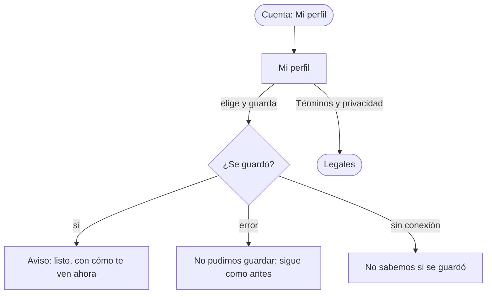
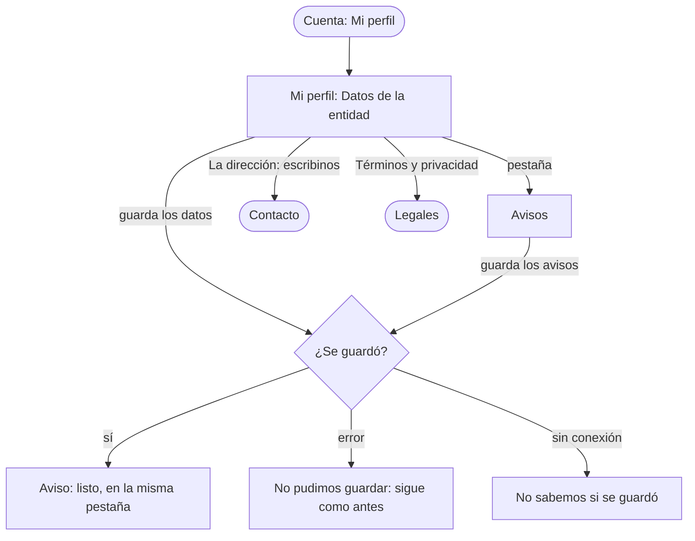

# Flujo: Mi perfil del donante (mínimo), en Raíces

> **Estado:** aprobado · **Fecha:** 2026-11-02 · **Aprobó:** usuario (2026-11-02), al ver las pantallas dibujadas
> **Ajustada:** 2026-11-02, con la review de Sofía Deane: con el nombre oculto, la entidad ve la
> categoría del ranking, y se puede ocultar también en una sola donación (bitácora, "La review de la
> diseñadora, decidida").
> **Ajustada:** 2026-11-04, con la nota de Nico ("faltan más campos"): suma "Datos de tu cuenta" y
> "Cómo te avisamos", y las tres secciones van en pestañas (A/B `layout:perfil`, usuario; bitácora,
> "Mi perfil con pestañas"). Las secciones nuevas son maqueta: no guardan hasta el perfil real (RI-AUTH-02, HB-11); ver los [huecos de backend](raices-ab-huecos-backend.md).
> **Ampliada:** 2026-11-07 (F5 del roadmap de las vistas), con
> [Mi perfil de la entidad](#mi-perfil-de-la-entidad), aprobada por el usuario el 2026-11-07 (`revision-ui` PASS en la ronda 2).
> Plantilla de la skill `ux-flujo`. Pantalla nueva de Raíces, en el sitio
> ([ADR aceptado](../../adr/cliente-liviano/20261103-una-sola-identidad-en-el-cliente-liviano.md)):
> `/donante-perfil`, que hasta hoy abría "todavía no está dibujada". Es un perfil
> **mínimo**: solo lo que pidieron las decisiones del 2026-11-02 (preguntas 15, 16 y 18). Editar los
> datos de la cuenta (RI-AUTH-02) queda para cuando se dibuje el perfil completo.

## 1. Para quién y para qué

| | |
|---|---|
| Quién | La persona de responsabilidad social de una empresa que dona (Distribuidora Ejemplo SA), o una persona que dona. Entra pocas veces, desde la computadora |
| Tono | Pantallas de trabajo: claro, útil, tranquilizador ([tono según la pantalla](../tono-y-comunicacion.md#tono-según-la-pantalla)) |
| Qué quiere lograr | "Decidir si las entidades ven mi nombre cuando reciben lo que doné" |
| Dispositivo principal | Computadora, con el celular como segundo |
| Requerimientos | RI-AUTH-02 (perfil). La preferencia y la constancia de los legales, del [ADR del nombre visible](../../adr/20261102-nombre-visible-del-donante-y-constancia-de-los-legales.md) (`proposed`) |
| Datos que usa | Ninguno todavía: HB-20 y [DTI-32](../../adr/DEUDA_TECNICA.md#dti-32) (`PATCH /api/donantes/{id}/preferencias`, `GET /api/personas/me` con la aceptación). En la maqueta, el formulario va a `donante-perfil-guardado` |
| Boceto de E1 | Página 14, menú de usuario: "Mi perfil" |

## 2. Dónde está en el sitio

Donante → cuenta (arriba, junto al nombre) → **Mi perfil**, nivel 2
([mapa del sitio](../mapa-del-sitio.md): Mi perfil). No está en el menú de secciones: el menú no
marca ninguna. La cuenta de la cabecera suma el enlace "Mi perfil", junto a "Salir"; en el
celular, la cuenta sigue en la cabecera, arriba, y el menú de secciones abajo.

## 3. Recorrido



Desvíos: no guardar (se va con el menú y no cambia nada), error del servidor y sin conexión.

## 4. Pantallas

```text
┌─────────────────────────────────────────────────┐
│ MI PERFIL (rótulo)                              │
│ Distribuidora Ejemplo SA                        │
│ Empresa donante · contacto@distribuidora-…      │
│                                                 │
│ ┌ Cómo te ven las entidades ──────────────────┐ │
│ │ Cuando una entidad recibe lo que donaste,   │ │
│ │ ve quién donó.                              │ │
│ │ (•) Mostrar mi nombre                       │ │
│ │     Donó: Distribuidora Ejemplo SA          │ │
│ │ ( ) No mostrarlo                            │ │
│ │     Donó: Empresa donante · Sostenedor      │ │
│ │ Sin tu nombre, la entidad ve tu categoría   │ │
│ │ como donante. Vale para todas tus           │ │
│ │ donaciones, también las que ya llegaron.    │ │
│ │ Los avisos que la entidad ya recibió no     │ │
│ │ cambian.                                    │ │
│ │ [Guardar mi elección]                       │ │
│ └─────────────────────────────────────────────┘ │
│                                                 │
│ Términos y privacidad                           │
│ Aceptaste la versión 1 el 1 de noviembre de 2026│
│ Leer los términos y la política de privacidad → │
├─────────────────────────────────────────────────┤
│ Términos y privacidad · Contacto                │
└─────────────────────────────────────────────────┘
```

Desde el 2026-11-04, arriba de la lámina van tres pestañas: **Cómo te ven** (lo de arriba),
**Datos de la cuenta** y **Avisos**. Se ve una sección por vez, la primera al entrar; cada pestaña
es un enlace a su sección (`#como-te-ven`, `#datos`, `#como-te-avisamos`; `#avisos` es la región de avisos del layout), anda sin JavaScript y con "atrás",
y al guardar vuelve a la misma. Términos y privacidad queda siempre debajo.

```text
 [Cómo te ven] [Datos de la cuenta] [Avisos]
┌ Datos de tu cuenta ───────────────────────────┐
│ Razón social · Tipo · Rubro (opcional)         │
│ CUIT (fijo; "si está mal, escribinos")         │
│ Dirección: calle, número, piso y depto, código │
│ postal, localidad, provincia                   │
│ [Guardar los datos]                            │
└────────────────────────────────────────────────┘
┌ Cómo te avisamos ─────────────────────────────┐
│ Correo · WhatsApp (opcional) · Teléfono (opc.) │
│ Por dónde: correo / WhatsApp / mensaje de texto│
│ Qué: todo / solo cuando la entidad confirma    │
│ [Guardar los avisos]                           │
└────────────────────────────────────────────────┘
```

Los campos son los de la persona jurídica y sus medios de contacto en donaciones-service
(`JuridicaInputDTO`, `DireccionInputDTO`, `MedioDeContactoInputDTO`, con un medio predeterminado).

Cada opción lleva debajo cómo la ve la entidad, con la etiqueta "Donó" igual a la de Confirmar
recepción. Funciona sin JavaScript: dos opciones y un botón Guardar (usuario, 2026-11-02, contra un
interruptor que guarda solo).

## 5. Estados

| Pantalla | Estado | Qué se ve | Texto |
|---|---|---|---|
| Mi perfil | Con datos | Lo elegido marcado | — |
| Mi perfil | Oculto (`?escenario=oculto`) | "No mostrarlo" marcado | — |
| Mi perfil | Guardando (`?escenario=lento`) | El botón dice "Guardando…" y queda desactivado | "Guardando…" |
| Guardado (`donante-perfil-guardado`) | Éxito, al ocultarlo | Aviso arriba, con "No mostrarlo" marcado | "Listo. Las entidades ya no ven tu nombre: ven «Empresa donante · Sostenedor»." (una persona: «Donante Sostenedor»; la categoría es la del ranking de Incentivos) |
| Guardado (`donante-perfil-guardado?mostrar=si`) | Éxito, al mostrarlo | Aviso arriba, con "Mostrar mi nombre" marcado | "Listo. Las entidades ven tu nombre: «Distribuidora Ejemplo SA»." |
| Mi perfil | Error del servidor (`?escenario=error`) | Aviso arriba | "No pudimos guardar tu elección. Es un problema nuestro: sigue como estaba. Probá de nuevo en unos minutos; si sigue, escribinos con este código." + código y enlace a Contacto |
| Mi perfil | Sin conexión (`?escenario=sin-conexion`) | Aviso arriba | "Se cortó la conexión mientras se guardaba. Recargá la página para ver qué quedó elegido." |
| Mi perfil | Cargando | No aplica en la maqueta: la página llega armada del servidor | — |
| Guardado (`donante-perfil-guardado?seccion=datos#datos`) | Éxito, datos | Aviso arriba, en la pestaña Datos | "Listo. Guardamos los datos de tu cuenta." |
| Guardado (`donante-perfil-guardado?seccion=avisos#como-te-avisamos`) | Éxito, avisos | Aviso arriba, en la pestaña Avisos | "Listo. Guardamos cómo te avisamos." |

## 6. Textos

| Elemento | Texto | Nota |
|---|---|---|
| Rótulo y título | "Mi perfil" · el nombre de la cuenta | |
| Grupo | "Cómo te ven las entidades" | `fieldset` + `legend` |
| Bajada del grupo | "Cuando una entidad recibe lo que donaste, ve quién donó." | |
| Opciones | "Mostrar mi nombre" · "No mostrarlo" | Con su ejemplo debajo |
| Nota | "Sin tu nombre, la entidad ve tu categoría como donante. Vale para todas tus donaciones, también las que ya llegaron. Los avisos que la entidad ya recibió no cambian." | Sale del ADR: el nombre se calcula al leer |
| Acción principal | "Guardar mi elección" | |
| Pestañas | "Cómo te ven" · "Datos de la cuenta" · "Avisos" | `nav` "Secciones de tu perfil" |
| Datos | "Datos de tu cuenta" · "Todos los datos son obligatorios, salvo los que dicen «opcional»." · "Razón social", "Tipo", "Rubro (opcional)", "CUIT" ("No se cambia desde acá. Si está mal, escribinos."), "Dirección": "Calle", "Número (opcional)", "Piso y departamento (opcional)", "Código postal (opcional)", "Localidad", "Provincia" · "Guardar los datos" | Tipo: Empresa, ONG, Institución, Organismo del Estado |
| Avisos | "Cómo te avisamos" · "Te avisamos cuando tu donación se asigna a una entidad, cuando sale y cuando la entidad confirma la entrega con la foto. Los avisos también quedan en Notificaciones." · "Correo", "WhatsApp (opcional)", "Teléfono (opcional)" · "Por dónde te avisamos": "Por correo", "Por WhatsApp", "Por mensaje de texto al teléfono" · "Qué te avisamos": "Todo: cuando se asigna, cuando sale y cuando llega", "Solo cuando la entidad confirma que llegó" · "Guardar los avisos" | |
| Legales | "Aceptaste la versión 1 el 1 de noviembre de 2026." · "Leer los términos y la política de privacidad" | La constancia, a la vista; la versión 1 rige desde ese día |

Persona en vez de empresa: "Donante Sostenedor" (con su categoría), el mismo texto que ve la
entidad en Confirmar recepción y en Necesidades.

### Textos de la conexión con las APIs

Pendiente de OK del usuario (corrida conexion-pantallas, 2026-11-10). Siguen
`docs/interfaz/tono-y-comunicacion.md`: lo pendiente se dice pendiente, sin culpa ni urgencia, y no se
promete lo que el sistema no hace. Solo aparecen fuera de la maqueta.

#### Donante

| Dónde | Texto | Cuándo |
|---|---|---|
| Aviso en `#avisos` al enviar "Datos de la cuenta" o "Cómo te avisamos" fuera de la maqueta | "Todavía no podemos guardar estos datos desde acá. Si algo está mal, escribinos." | No hay operación en Donaciones que guarde esos datos sin pisar los representantes y los medios de la persona, ni modelo de preferencias de avisos |
| Constancia de Términos y privacidad, sin versión aceptada | "Todavía no aceptaste los términos y la política de privacidad." | `GET /api/personas/{id}/legales` sin `versionAceptada` |
| Lo que ve la entidad si el nombre está oculto y no responde Incentivos | "Empresa donante" (persona: "Donante"), sin la categoría | Incentivos caído o sin perfil del donante |

#### Entidad

| Elemento | Texto | Nota |
|---|---|---|
| Aviso al guardar (todavía no guarda) | "Todavía no podemos guardar estos cambios desde acá: siguen como estaban. Si necesitás cambiar algo, escribinos desde Contacto." | Fuera de la maqueta, en `#avisos`. Guardar queda pendiente (ver el reporte) |
| Constancia sin aceptar | "Todavía no aceptaste los términos y la política de privacidad." | Cuando `GET /api/personas/{id}/legales` no trae versión aceptada |

## 7. Accesibilidad

Un solo `h1`. Las opciones son un `fieldset` con `legend`; el ejemplo de cada opción va en su
`label`, para que se lea con ella. El aviso de guardado usa `role="status"` y recibe el foco; el
de error, `role="alert"`.

Pestañas (2026-11-04): son enlaces dentro de un `nav` "Secciones de tu perfil"; la abierta se marca
con fondo y subrayado. Sin JavaScript no se puede anunciar cuál está abierta (`aria-current`): el
lector de pantalla llega al título de la sección. Queda aceptado como límite de la técnica.

## 8. Revisión de usabilidad

| # | Heurística | Cómo la cumple | Riesgo que queda |
|---|---|---|---|
| 1 | Visibilidad del estado | Lo elegido, marcado; aviso al guardar con cómo queda | |
| 2 | Lenguaje del usuario | "Cómo te ven las entidades", "No mostrarlo" | |
| 3 | Control y libertad | Se cambia cuantas veces se quiera | |
| 4 | Consistencia | "Donó: …" igual que en Confirmar recepción | |
| 5 | Prevención de errores | El ejemplo muestra el efecto antes de guardar | |
| 6 | Reconocer antes que recordar | El ejemplo, debajo de cada opción | |
| 7 | Flexibilidad | — | |
| 8 | Diseño minimalista | Una sola decisión y la constancia | |
| 9 | Recuperarse de errores | Error y sin conexión dicen qué quedó | |
| 10 | Ayuda | La nota dice a qué donaciones alcanza | |

Factores de Morville: útil (el control que pidió el grupo), usable (una decisión), deseable
(etiqueta de herbario como las de Necesidades), valioso (privacidad sin perder transparencia),
ubicable (cuenta de la cabecera), accesible (AA, sin JavaScript), creíble (muestra la constancia de
los legales). Probar con personas: si se entiende que alcanza a las donaciones pasadas.

## 9. Decisiones y preguntas

Decisiones tomadas:

- El nombre de quien donó se ve, sea empresa o persona, y cada donante puede ocultarlo desde su
  perfil (usuario, 2026-11-02, preguntas 15 y 16).
- Perfil mínimo con esta opción y la constancia de los legales; el resto del perfil, después
  (usuario, 2026-11-02).
- Dos opciones con su ejemplo y un botón Guardar (usuario, 2026-11-02).
- Vale también para las donaciones pasadas (agente, del ADR).
- Por defecto, el nombre se ve. Sofía votó ocultarlo por defecto; el usuario mantuvo visibles la
  empresa y la persona (review de Sofía, 2026-11-02).
- Con el nombre oculto, la entidad ve la categoría del donante en el ranking de Incentivos:
  "Donante Sostenedor" o "Empresa donante · Sostenedor" (usuario, 2026-11-02, a propuesta de
  Sofía; antes, "Una persona que prefiere no mostrar su nombre").
- **Esta vez, sin mi nombre:** al registrar una donación, una casilla la oculta aunque el perfil
  muestre el nombre. Solo oculta: no muestra lo que el perfil oculta. Se dibuja con la pantalla de
  registrar una donación, que Raíces todavía no tiene (usuario, 2026-11-02).
- Sofía pidió los legales también en los ajustes: Mi perfil ya muestra la constancia y el enlace,
  y queda así (usuario, 2026-11-02).
- Datos de la cuenta y avisos, como maqueta con datos de ejemplo; en pestañas, una sección por vez
  (usuario, 2026-11-04, contra una columna y dos columnas; nota de Nico).
- Si la categoría no llega (Incentivos no responde o el donante no tiene una), la entidad ve «Un
  donante» o «Una empresa donante», y la pantalla no falla (usuario, 2026-11-02, por la revisión).

Preguntas abiertas, para el equipo (no cambian el prototipo):

- La entidad también tiene Mi perfil (mapa del sitio), pero su nombre es público por RF-06: no
  lleva esta opción. **Resuelta el 2026-11-07:** se dibuja en la sección siguiente, sin "Cómo te
  ven".

## Mi perfil de la entidad

> Ampliación del 2026-11-07, fase F5 del [roadmap de las vistas](../roadmap-vistas-enunciado.md):
> `/entidad-perfil` (y su estado `entidad-perfil-guardado`), que hasta hoy caía en `sin-dibujar`.
> Sigue la forma del perfil del donante (decisión del usuario, 2026-11-07): pestañas con los datos
> y los avisos, y la constancia de los legales debajo. Sin "Cómo te ven": el nombre de la entidad es
> público (RF-06, RF-22). Lo de arriba, del donante, no cambia.

### 1. Para quién y para qué

| | |
|---|---|
| Quién | La persona que organiza lo que recibe la entidad (en el ejemplo, Marta, del Comedor Barrio Ejemplo). Entra pocas veces: al empezar, o cuando cambia quién la representa o por dónde quiere los avisos |
| Tono | Pantallas de trabajo: claro, útil, tranquilizador |
| Qué quiere lograr | "Tener al día los datos de mi entidad y elegir cómo me avisan" |
| Dispositivo principal | La computadora de la entidad, también el celular |
| Requerimientos | RI-AUTH-02 (perfil). RNF-UI-05 (cada acción con su mensaje de éxito y de error). RNF-CL-02 (sin JavaScript, igual funciona) |
| Datos que usa | Los del registro de la entidad (`publico-registro-entidad`: nombre, qué es, tipo de organización, dirección de entrega y quién la representa) y los medios de contacto (`MedioDeContactoInputDTO`). Editarlos: HB-11, como en el donante. En la maqueta, el formulario va a `entidad-perfil-guardado` |
| Boceto de E1 | Página 14, menú de usuario: "Mi perfil" |

### 2. Dónde está en el sitio

Entidad → cuenta (arriba, junto al nombre) → **Mi perfil**, nivel 2. No está en el menú de
secciones, como en el donante.

### 3. Recorrido



Desvíos: no guardar (se va con el menú y no cambia nada), error del servidor y sin conexión, como
en el donante.

### 4. Pantallas

```text
MI PERFIL (rótulo)
Comedor Barrio Ejemplo
Comedor · Marta, comedor@ejemplo.org

 [Datos de la entidad] [Avisos]
┌ Datos de la entidad ──────────────────────────┐
│ Nombre de la entidad · Qué es · Tipo de        │
│ organización                                   │
│ Dirección de entrega (fija):                   │
│   Calle Ejemplo 450, Localidad Ejemplo,        │
│   Buenos Aires. "No se cambia desde acá…"      │
│ Quién la representa: nombre y apellido, correo │
│ [Guardar los datos]                            │
└────────────────────────────────────────────────┘
┌ Cómo te avisamos ─────────────────────────────┐
│ Correo · WhatsApp (opcional) · Teléfono (opc.) │
│ Por dónde: correo / WhatsApp / mensaje de texto│
│ Qué: todo / solo cuando llega a tu puerta      │
│ [Guardar los avisos]                           │
└────────────────────────────────────────────────┘

Términos y privacidad
Aceptaste la versión 1 el 1 de noviembre de 2026
Leer los términos y la política de privacidad →
```

- **Las mismas piezas que el perfil del donante:** las pestañas (enlaces a `#datos` y
  `#como-te-avisamos`, sin JavaScript y con "atrás"), los campos y la constancia. La primera
  pestaña es Datos de la entidad.
- **La dirección de entrega no se cambia desde acá.** Es a donde van los camiones, y la
  administración la revisó con la constancia de domicilio al aprobar la entidad (RF-21, con la
  constancia de la [ficha del admin](raices-admin-navegable.md)). Se muestra
  fija, con el enlace a Contacto, como el CUIT del donante.
- **Avisos:** los de la bandeja de la entidad: asignación y llegada a la puerta (RF-13), y salida y
  problema, que la bandeja aprobada suma del contrato de Notificaciones.

### 5. Estados

| Pantalla | Estado | Qué se ve | Texto |
|---|---|---|---|
| Mi perfil | Con datos | La pestaña Datos de la entidad, con los datos de ejemplo | — |
| Mi perfil | Guardando (`?escenario=lento`) | El botón dice "Guardando…" y queda desactivado | "Guardando…" |
| Guardado (`entidad-perfil-guardado?seccion=datos#datos`) | Éxito, datos | Aviso arriba, en la pestaña Datos | "Listo. Guardamos los datos de tu entidad." |
| Guardado (`entidad-perfil-guardado?seccion=avisos#como-te-avisamos`) | Éxito, avisos | Aviso arriba, en la pestaña Avisos | "Listo. Guardamos cómo te avisamos." |
| Mi perfil | Error del servidor (`?escenario=error`) | Aviso arriba | "No pudimos guardar los cambios. Es un problema nuestro: siguen como estaban. Probá de nuevo en unos minutos; si sigue, escribinos con este código." + código y enlace a Contacto |
| Mi perfil | Sin conexión (`?escenario=sin-conexion`) | Aviso arriba | "Se cortó la conexión mientras se guardaba. Recargá la página para ver qué quedó guardado." |
| Mi perfil | Error de datos | Un campo obligatorio vacío: el navegador lo marca (`required`) y no envía. En el sistema, el error por campo de `.campo-error`. Se describe, no se dibuja | El texto de cada campo, el del registro de la entidad |
| Mi perfil | Cargando | No aplica en la maqueta: la página llega armada del servidor | — |

### 6. Textos

| Elemento | Texto | Nota |
|---|---|---|
| Rótulo y título | "Mi perfil" · "Comedor Barrio Ejemplo" | — |
| Debajo del título | "Comedor · Marta, comedor@ejemplo.org" | Qué es y quién la representa |
| Pestañas | "Datos de la entidad" · "Avisos" | `nav` "Secciones de tu perfil" |
| Datos | "Datos de la entidad" · "Todos los datos son obligatorios, salvo los que dicen «opcional»." · "Nombre de la entidad" · "Qué es" (Merendero, Comedor, Escuela, Hogar, Club, Biblioteca, Otra) · "Tipo de organización" (los tres del registro) · "Dirección de entrega": "Calle Ejemplo 450, Localidad Ejemplo, Buenos Aires" y "No se cambia desde acá: es a donde van los camiones. Para cambiarla, escribinos y la revisamos como cuando sumaste tu entidad." · "Quién la representa": "Nombre y apellido", "Correo electrónico" · "Guardar los datos" | Las etiquetas del registro de la entidad |
| Avisos | "Cómo te avisamos" · "Te avisamos cuando se asigna una donación a tu entidad, cuando sale hacia vos, si tiene un problema y cuando llega a tu puerta. Los avisos también quedan en Notificaciones." · "Correo", "WhatsApp (opcional)", "Teléfono (opcional)" · "Por dónde te avisamos": "Por correo", "Por WhatsApp", "Por mensaje de texto al teléfono" · "Qué te avisamos": "Todo: cuando se asigna, cuando sale, si tiene un problema y cuando llega", "Solo cuando llega a tu puerta" · "Guardar los avisos" | Los de la bandeja aprobada: RF-13 más salida y problema |
| Legales | "Aceptaste la versión 1 el 1 de noviembre de 2026." · "Leer los términos y la política de privacidad" | Igual que el donante |
| Cuenta | Marta · Comedor Barrio Ejemplo | La de la entidad |

### 7. Accesibilidad

Como el perfil del donante: un solo `h1`, las pestañas en un `nav` con nombre, cada grupo de
opciones en un `fieldset` con `legend`, el aviso de guardado con `role="status"` y foco, el de
error con `role="alert"`. La dirección fija es texto, no un campo desactivado: se lee entera y no
parece un error.

### 8. Revisión de usabilidad

| # | Heurística | Cómo la cumple | Riesgo que queda |
|---|---|---|---|
| 1 | Visibilidad del estado | Aviso al guardar, en la misma pestaña | — |
| 2 | Lenguaje del usuario | Las etiquetas del registro de la entidad | — |
| 3 | Control y libertad | Se cambia cuantas veces se quiera; la dirección, por Contacto | Cambiar la dirección no es inmediato |
| 4 | Consistencia | Las mismas pestañas, campos y constancia que el donante | — |
| 5 | Prevención de errores | La dirección no se cambia por error: va por Contacto | — |
| 6 | Reconocer antes que recordar | Lo guardado se ve en los campos | — |
| 7 | Flexibilidad | — | — |
| 8 | Diseño minimalista | Dos pestañas y la constancia | — |
| 9 | Recuperarse de errores | Error y sin conexión dicen qué quedó | — |
| 10 | Ayuda | La nota de la dirección dice por qué no se cambia acá | — |

Factores de Morville: útil (los datos y los avisos al día), usable (dos pestañas), deseable (las
láminas de Raíces), valioso (los camiones van a la dirección revisada), ubicable (la cuenta de la
cabecera), accesible (AA, sin JavaScript), creíble (muestra la constancia de los legales). Probar
con personas: si se entiende por qué la dirección va por Contacto y el nombre no, aunque los dos
los revisó la administración al aprobar la entidad.

### 9. Decisiones y preguntas

- Como el perfil del donante, con Datos de la entidad y Avisos en pestañas, y sin "Cómo te ven"
  (usuario, 2026-11-07).
- La dirección de entrega se muestra fija y se cambia por Contacto, porque la administración la
  revisa al aprobar la entidad (RF-21; la constancia sale de la ficha del admin) (agente,
  propuesto).
- Los datos de ejemplo son sintéticos: Calle Ejemplo 450 y comedor@ejemplo.org (agente).

Preguntas abiertas, para el equipo: si cambiar la dirección de entrega vuelve a pedir la constancia
de domicilio (RF-21 no lo dice).
