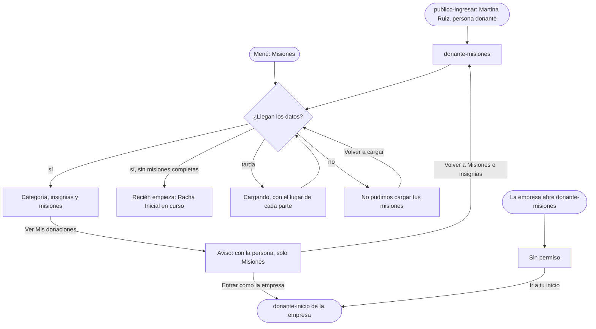

# Flujo: Misiones e insignias de la persona que dona, en Raíces

> **Estado:** aprobado · **Fecha:** 2026-11-07 · **Aprobó:** usuario (2026-11-07), después de `revision-ui` PASS en la ronda 2
> Ficha de la skill `ux-flujo`, fase F5 del [roadmap de las vistas](../roadmap-vistas-enunciado.md).
> Pantalla nueva: `/donante-misiones`. RF-07 la muestra solo a quien dona como persona, y la cuenta
> de ejemplo del donante es una empresa: la maqueta suma una segunda cuenta de ejemplo, una persona
> (decisión 2 del roadmap, usuario, 2026-11-07).

## 1. Para quién y para qué

| | |
|---|---|
| Quién | Una persona que dona por su cuenta (en el ejemplo, Martina Ruiz). Entra de vez en cuando, casi siempre desde el celular, después de donar o cuando le llega el aviso de una misión |
| Tono | Panel del donante: cálido, agradecido, participativo; reconoce el aporte y propone seguir, sin presionar ([tono según la pantalla](../tono-y-comunicacion.md#tono-según-la-pantalla)). Con la regla del [juego](../tono-y-comunicacion.md#juego-y-celebración-extensión): celebra hechos confirmados, no presiona y no compara personas |
| Qué quiere lograr | "Ver qué misiones completé, cuánto me falta en la que tengo en curso y qué viene después" |
| Dispositivo principal | Celular primero, también la computadora |
| Requerimientos | RF-07 (visible solo para el donante humano; muestra las misiones con su progreso y las insignias obtenidas; se oculta a la persona jurídica). RF-CL-07 (toda cifra que cambia dice cuándo se actualizó). RNF-CL-02 (sin JavaScript, igual funciona) |
| Datos que usa | `GET /api/incentivos/donantes/{id}` (`DonantePerfilDTO`: categoría, misiones completadas, insignias ganadas), `GET /api/incentivos/donantes/{id}/misiones` (`MisionDTO`: nombre, descripción, categoría, progreso, objetivo, porcentaje, completada y su fecha, insignia), `GET /api/incentivos/donantes/{id}/insignias` (`InsigniaDTO`) y `.../ascensos` (`CambioCategoriaDTO`: desde cuándo está en su categoría). Las 6 misiones son las de `MisionFactory` en incentivos-service. En la maqueta, los datos de ejemplo de esta ficha |
| Boceto de E1 | Pág. 18: las insignias obtenidas, ilustradas en color, y las misiones con su progreso en una torta. Págs. 20 a 22: el detalle de una misión, con una torta "Pendiente / Objetivo" |

## 2. Dónde está en el sitio

Donante persona → **Misiones e insignias** (nivel 2), desde el menú
([mapa del sitio](../mapa-del-sitio.md): Donante → Misiones e insignias).

| Pantalla | Nivel | Cómo se llega |
|---|:-:|---|
| `donante-misiones` | 2 | Menú de la persona ("Misiones", entre Entidades y Seguimiento, como en §6.2 de los requerimientos) y "Cuentas de ejemplo" del ingreso |

**La segunda cuenta de ejemplo** (solo en la maqueta):

- "Cuentas de ejemplo", en `publico-ingresar`, suma una cuarta: "Martina Ruiz, persona donante",
  que entra a `/donante-misiones?cuenta=persona`. La de la empresa entra a
  `/donante-inicio?cuenta=empresa`. La cuenta elegida queda para las pantallas que siguen.
- Con la persona, la cabecera dice "Martina Ruiz · Persona donante" y el menú suma Misiones: Inicio,
  Mis donaciones, Entidades, Misiones y Seguimiento. Son 5: en el celular entran en la barra, sin
  "Más".
- Las otras pantallas del donante están dibujadas para la empresa ("tu empresa", sus donaciones).
  Con la persona, esas secciones, Notificaciones y Mi perfil muestran un aviso corto, con el menú,
  en lugar de los datos de la empresa (decisión del usuario, 2026-11-07).
- Con la empresa, el menú no tiene Misiones (RF-07). Si la empresa abre `/donante-misiones`, ve el
  estado "Sin permiso" de esta ficha.

## 3. Recorrido



Desvíos considerados:

- **Volver:** el menú y Atrás. La pantalla es de consulta: no deja nada a medio hacer.
- **Error del servidor o sin conexión:** el error de la pantalla, con "Volver a cargar" y el código
  para escribirnos.
- **Incentivos no responde, pero el resto sí:** en el sistema, el resto del sitio sigue andando;
  esta pantalla muestra su error.
- **Sin permiso:** la empresa no tiene misiones (RF-07). En el sistema, el menú no la muestra y la
  dirección responde "Sin permiso"; en la maqueta, la empresa ve ese estado si escribe la dirección.
- **Persona en la categoría más alta** (Transformador, con todo completo): se dice que completó
  todas, sin "lo que viene". Se describe; no se dibuja.

## 4. Pantallas

```text
Misiones
Tus misiones e insignias
Gracias por donar, Martina. Sos donante Sostenedor desde el 2 de septiembre de 2026.
Completaste 2 de las 6 misiones. Al 15 de octubre de 2026, 16:25.

Tus insignias (2 de 6)
  [Racha Inicial]  3 de agosto de 2026
  [Explorador]     2 de septiembre de 2026
  ( ) ( ) ( ) ( )  las 4 que faltan, en contorno, con su nombre

Colaborador · completa
  ✓ Racha Inicial · 3 meses seguidos donando · Completa el 3 de agosto de 2026
  ✓ Explorador · Donaciones en 3 categorías distintas · Completa el 2 de septiembre de 2026

Sostenedor · tu categoría
  Gran Aporte · Una donación con al menos 50 bienes · en curso
    [██░░░░░░░░] 12 de 50 bienes · tu donación más grande desde el 2 de septiembre
  Constancia · 6 meses seguidos donando · en espera
    Empieza a contar cuando completes Gran Aporte.
  Las misiones avanzan de a una, en orden. Al completar las 2, pasás a Transformador.

Transformador · se abre después
  Impacto Real · 10 donaciones recibidas, confirmadas por la entidad
  Diversidad Solidaria · Donaciones en 8 categorías distintas
  Se abren cuando completes las misiones de Sostenedor.

Las misiones cuentan tus donaciones: las que entregás en el depósito y, en Impacto Real, las que
la entidad confirmó. Ver Mis donaciones
```

- **Orden:** el camino entero, de la primera categoría a la última: lo hecho arriba, lo que tiene
  abierto en el medio (lo que más le importa, con el progreso) y lo que viene al final (decisión del
  usuario, 2026-11-07: se ven las 6, las de la categoría siguiente cerradas).
- **Cada misión:** su nombre, qué pide (la descripción de Incentivos, en palabras llanas), y según
  cómo esté: completa con su fecha y su insignia; en curso con una barra de progreso y la cuenta en
  texto ("12 de 50 bienes"); en espera, sin barra, con "Empieza a contar cuando completes <la
  anterior>"; cerrada, sin progreso, con "se abre después".
- **Una misión a la vez:** Incentivos evalúa solo la misión en curso, la de número más bajo sin
  completar de la categoría actual (`DonanteIncentivos.getMisionActiva`); las demás de la categoría
  esperan. El progreso de la de Gran Aporte cuenta desde que quedó en curso (el ascenso).
- **Insignias:** arriba, las obtenidas con su nombre y su fecha. Las que faltan, en contorno y con su
  nombre, para que se vea qué hay para ganar sin que parezca una falta.
- **Categoría:** la actual, con desde cuándo (el último ascenso). Lo que hace falta para la siguiente
  sale de la regla de Incentivos: completar todas las misiones de la categoría.

En el celular, una columna: la categoría, las insignias en una fila que baja de renglón y las
misiones de cada categoría como tarjetas. En la computadora, las insignias a lo ancho y las
misiones de cada categoría en dos columnas.

Qué cambia respecto del boceto de E1, y por qué:

- **La torta pasa a una barra con la cuenta en texto.** Una torta chica no deja leer cuánto falta, y
  la barra es la misma pieza de progreso del resto del sitio. Va a la bitácora.
- **Sin detalle de misión (págs. 20 a 22).** Cada misión dice en su tarjeta lo que mostraba el
  detalle (objetivo, progreso y lo que falta): un nivel menos (RNF-UI-02) y nada que abrir.
- **Insignias en la identidad de Raíces.** El boceto las ilustra en verde agua, rojo y lima; acá
  son pictogramas impresos con la paleta del sitio, como los de las categorías de la portada. Una
  sola pieza en color no entra en una identidad impresa de dos tintas.
- **Se suman las categorías y lo que viene**, que el boceto no tiene.

## 5. Estados

En la maqueta, `?escenario=vacio`, `lento` y `error`, como las otras pantallas de Raíces.

| Pantalla | Estado | Qué se ve | Texto |
|---|---|---|---|
| `donante-misiones` | Con datos | Categoría, insignias y misiones | Ver Textos |
| `donante-misiones` | Vacío: recién empieza (`?escenario=vacio`) | La categoría Colaborador; ninguna insignia obtenida (las 6 en contorno); Racha Inicial en curso en 0, Explorador en espera; las demás, cerradas | Bajada: "Gracias por sumarte, Martina. Sos donante Colaborador. Todavía no completaste ninguna misión." · insignias: "Todavía no tenés insignias. Cada misión completa te da una." · Racha Inicial: "0 de 3 meses" · Explorador: "Empieza a contar cuando completes Racha Inicial." |
| `donante-misiones` | Racha cortada (se describe, no se dibuja) | La misión de racha en curso vuelve a 0 (`MisionRacha.verificarVigencia`) | "La cuenta volvió a empezar: 0 de 6 meses. Cuenta desde el próximo mes en que dones." Sin culpa ni "perdiste" |
| `donante-misiones` | Sin el progreso (se describe, no se dibuja) | Si Incentivos trae las misiones sin su progreso: las de la categoría, sin barra | "No pudimos traer el progreso. Lo completado sigue igual." |
| `donante-misiones` | Cargando (`?escenario=lento`) | El título y el lugar de cada parte, sin datos inventados | "Cargando tus misiones…" (`role="status"`) |
| `donante-misiones` | Error del servidor (`?escenario=error`) | El título y el aviso en lugar de las partes | "No pudimos cargar tus misiones." · "Es un problema nuestro: tus misiones y tus insignias siguen como estaban. Probá de nuevo en unos minutos; si sigue, escribinos con este código." · `a1b2c3d4e5f6` · "Volver a cargar" · "Escribinos" (a `publico-contacto?codigo=a1b2c3d4e5f6`) |
| `donante-misiones` | Sin permiso (la empresa) | El título "Misiones e insignias" y el aviso | "Misiones e insignias es para quienes donan como persona." · "Las organizaciones donan sin misiones: lo que donaron se ve en Mis donaciones." · "Ir a tu inicio" |
| `donante-misiones` | Todas completas | Se describe; no se dibuja | Bajada: "Sos donante Transformador y completaste las 6 misiones." · sin el bloque de lo que viene |
| `donante-misiones` | Éxito, error de datos, deshabilitado | No aplica: no envía nada | — |
| Las otras del donante, con la persona | Aviso de la maqueta | El rótulo de la sección, con el menú de la persona, y el aviso | "Con la cuenta de una persona, la maqueta solo muestra Misiones e insignias." · "Las demás pantallas del donante están dibujadas para la cuenta de ejemplo de la empresa." · "Ir a Misiones e insignias" · "Entrar como la empresa" |

## 6. Textos

### Datos de maqueta

Fecha de corte: **jueves 15 de octubre de 2026, 16:25**, la hora del donante en toda la maqueta
([Seguir entregas](raices-seguir-entregas.md)). Martina Ruiz es la persona que donó 5 kg de arroz al
Comedor Barrio Ejemplo, recibidos el 9 de octubre ([ficha de la entidad](raices-entidad-navegable.md#datos-de-maqueta)).

| # | Misión | Categoría | Qué pide | Estado | Progreso o fecha | Insignia |
|---|---|---|---|---|---|---|
| 1 | Racha Inicial | Colaborador | 3 meses seguidos donando | Completa | 3 de agosto de 2026 | Racha Inicial |
| 2 | Explorador | Colaborador | Donaciones en 3 categorías distintas | Completa | 2 de septiembre de 2026 | Explorador |
| 3 | Gran Aporte | Sostenedor | Una donación con al menos 50 bienes | En curso | 12 de 50 bienes (la más grande desde el 2 de septiembre) | Gran Aporte |
| 4 | Constancia | Sostenedor | 6 meses seguidos donando | En espera | — (empieza al completar Gran Aporte) | Constancia |
| 5 | Impacto Real | Transformador | 10 donaciones recibidas, confirmadas por la entidad | Cerrada | — | Impacto Real |
| 6 | Diversidad Solidaria | Transformador | Donaciones en 8 categorías distintas | Cerrada | — | Diversidad Solidaria |

Ascenso a Sostenedor: 2 de septiembre de 2026, al completar Explorador. Los nombres de las misiones,
de las insignias y lo que piden son los de `MisionFactory`, con "consecutivos" pasado a "seguidos" y
"confirmadas recibidas" a "recibidas, confirmadas por la entidad".

### Textos propios

| Elemento | Texto | Nota |
|---|---|---|
| Rótulo y menú | "Misiones e insignias" (en la barra del celular, "Misiones") | El nombre de §6.2 |
| Título | "Tus misiones e insignias" | La única imagen de raíz posible va acá, si la pantalla la pone |
| Bajada | "Gracias por donar, Martina. Sos donante Sostenedor desde el 2 de septiembre de 2026. Completaste 2 de las 6 misiones. Al 15 de octubre de 2026, 16:25." | Reconoce, dice dónde está y la fecha del dato |
| Insignias | Título "Tus insignias" · "2 de 6" · cada obtenida: su nombre y "3 de agosto de 2026" · cada una que falta: su nombre y "Todavía no" | Nombre accesible de la lista: "Tus insignias" |
| Categorías | "Colaborador · completa" · "Sostenedor · tu categoría" · "Transformador · se abre después" | Cada una, un `h2` |
| Misión completa | "Completa el 3 de agosto de 2026" con el sello `hecho` | — |
| Misión en curso | "En curso" · "12 de 50 bienes" · "Tu donación más grande desde el 2 de septiembre." | La cuenta en texto, además de la barra |
| Misión en espera | "En espera" · "Empieza a contar cuando completes Gran Aporte." | Sin barra: todavía no cuenta |
| Al pie de la categoría actual | "Las misiones avanzan de a una, en orden. Al completar las 2, pasás a Transformador." | La regla de Incentivos, dicha una vez |
| Misión cerrada | "Se abre cuando completes las misiones de Sostenedor." (al pie del grupo) | Sin candado ni gris de "prohibido": está más adelante |
| Pie | "Las misiones cuentan tus donaciones: las que entregás en el depósito y, en Impacto Real, las que la entidad confirmó." · "Ver Mis donaciones" | La donación la registra el depósito; Impacto Real cuenta las confirmadas. Con la persona, Mis donaciones abre el aviso de la maqueta |
| Cuenta | "Martina Ruiz · Persona donante" | Sintética |
| Cuentas de ejemplo (ingreso) | "Martina Ruiz, persona donante" (inicial "M") | En segundo lugar, justo debajo de la empresa y antes de la entidad: las dos cuentas de donante, juntas |

Ayudas por flujo crítico: no es un flujo crítico (no envía nada). La ayuda es el pie de la categoría
actual, que dice cómo se pasa a la siguiente.

Filtro de tono:

- Reconoce lo hecho sin comparar con otras personas: ni puesto en el ranking ni "superaste a".
- Lo que falta se dice como cuenta ("12 de 50 bienes"), sin urgencia: nada de "¡te falta poco!",
  "no pierdas tu racha" ni fechas límite.
- Las misiones cerradas están "más adelante", no "bloqueadas".
- "Transformador" es el nombre de la categoría en Incentivos, no un adjetivo de la pantalla: lo
  explican sus dos misiones, a la vista.
- Las cifras llevan fecha ("Al 15 de octubre de 2026, 16:25").
- Palabras que no van (brief de Raíces): "eco", "huella verde", "florecer", "regá", "cosechá" y
  "sostenible" de adorno. "Insignia" y "misión" son los nombres de RF-07: se mantienen.

## 7. Accesibilidad

- Zonas: saltar al contenido, la navegación del donante (`nav` con nombre, "Misiones" con
  `aria-current="page"`), `main` con un `h1`, un `h2` para las insignias y uno por categoría.
- Cada misión es un `article` con `h3`. La barra de progreso es un `<progress>` nativo con su
  `max` y su valor, y con nombre accesible ("Gran Aporte: 12 de 50 bienes"); la cuenta también va
  en texto, a la vista.
- Las insignias son una lista (`ul`); cada una dice en texto su nombre y si se obtuvo ("Obtenida el
  3 de agosto de 2026" o "Todavía no"). El pictograma es decorativo (`aria-hidden`).
- El estado de cada misión va en palabras ("Completa", "En curso", "En espera", "Se abre después") con su forma;
  el color solo acompaña.
- Cargando y error, con `role="status"` y `role="alert"`.
- Con "reducir movimiento", nada se anima.

## 8. Revisión de usabilidad

| # | Heurística | Cómo la cumple | Riesgo que queda |
|---|---|---|---|
| 1 | Visibilidad del estado | La categoría, cuántas misiones completó, el progreso de la que está en curso y la fecha del dato | El progreso llega de Incentivos; si se actualiza al confirmar una entrega o al registrar una donación lo decide el backend |
| 2 | Lenguaje del usuario | "Meses seguidos", "bienes", "se abre después"; sin "racha" sola ni códigos | "Bienes" es la palabra de Incentivos: conviene probar si se entiende como "cosas donadas" |
| 3 | Control y libertad | Solo consulta; menú y Atrás | — |
| 4 | Consistencia | La barra de progreso, los sellos y las tarjetas del resto del sitio | — |
| 5 | Prevención de errores | No hay acciones | — |
| 6 | Reconocer antes que recordar | Cada misión dice qué pide y cuánto falta, sin abrir un detalle | — |
| 7 | Flexibilidad | Quien quiere el panorama mira las insignias; quien quiere el detalle, las misiones | — |
| 8 | Diseño minimalista | Una sola pregunta: qué hice y qué me falta. Sin ranking ni comparaciones | — |
| 9 | Recuperarse de errores | El error dice que nada cambió y ofrece volver a cargar | — |
| 10 | Ayuda | El pie de la categoría dice cómo se pasa a la siguiente | — |

Los 7 factores de la experiencia ([criterios de la cátedra](../criterios-catedra-ux-ui.md),
sección 2):

| Factor | Cómo lo cumple |
|---|---|
| Útil | Responde qué completó y cuánto le falta en la misión en curso |
| Usable | Tarjetas con la cuenta en texto; nada que abrir |
| Deseable | Las insignias como pictogramas impresos de Raíces; el reconocimiento en la bajada |
| Valioso | La persona ve su constancia reconocida, sin competir con otras |
| Ubicable | Un destino del menú, solo para quien dona como persona |
| Accesible | `progress` nativo con nombre, estados en palabras; WCAG AA y Ley 26.653 |
| Creíble | Las reglas y los nombres son los de Incentivos; las cifras, con fecha |

Qué conviene probar con personas reales: si se entiende "bienes" y si las misiones cerradas se leen
como "más adelante" y no como algo que falta.

## 9. Decisiones y preguntas

Decisiones tomadas:

- Una segunda cuenta de ejemplo, una persona, con el menú que suma Misiones; la empresa sigue igual
  (usuario, 2026-11-07, decisión 2 del roadmap).
- Se ven las 6 misiones: las hechas, las de su categoría con el progreso y las de la siguiente
  cerradas (usuario, 2026-11-07).
- Con la persona, las otras pantallas del donante muestran un aviso con dos salidas, sin tocar las
  pantallas aprobadas de la empresa (usuario, 2026-11-07).
- La persona es Martina Ruiz, la donante del arroz de 5 kg del Comedor Barrio Ejemplo (agente,
  coherencia con la ficha de la entidad).
- La torta del boceto pasa a una barra con la cuenta en texto, y el detalle de misión se integra en
  la tarjeta (agente, propuesto; bitácora).

Preguntas abiertas, para el equipo (no cambian el prototipo):

- Incentivos deja ocultar una insignia del perfil público
  (`PUT .../insignias/{nombre}/visibilidad`), pero ninguna pantalla muestra insignias a otras
  personas. La opción se dibuja cuando exista ese lugar.
- Las notificaciones de misión completa y de ascenso (RF-08) son de la persona: la bandeja de la
  maqueta es la de la empresa y no las tiene.

### Huecos de backend

- Donante · `donante-misiones` · desde cuándo está en su categoría · `.../ascensos` lo da, pero el
  perfil (`DonantePerfilDTO`) no: son dos llamadas.
- Donante · `donante-misiones` · qué cuenta como "bien" en Gran Aporte y qué donación fue la más
  grande · `MisionDTO` trae solo `progresoActual`.
- Donante · `donante-misiones` · cuál es la misión en curso · `MisionDTO` no lo dice; la pantalla
  la deduce del orden en que llega la lista (el de `MisionFactory`), porque el número de misión no
  viene en el DTO: conviene que lo traiga, o que traiga la marca de en curso.
- Donante · `donante-misiones` · la fecha del ascenso puede no coincidir con la de la misión que lo
  produjo: `CambioCategoria` guarda la fecha de proceso y `fechaCompletada`, la del evento.
