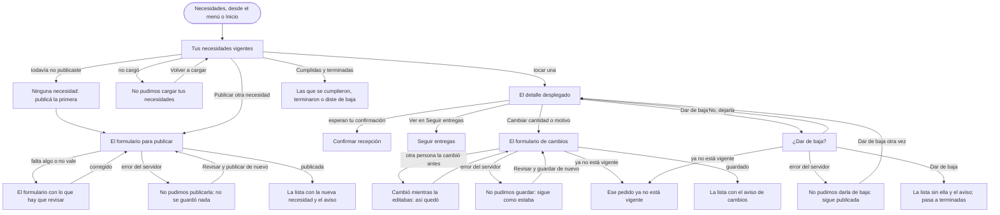

# Flujo: Necesidades de la entidad, en Raíces

> **Estado:** aprobado · **Fecha:** 2026-11-01 · **Aprobó:** usuario (2026-11-01, al ver la pantalla construida)
> Orden: el contenido lo decidió el usuario en dos rondas de preguntas antes de redactar la ficha
> (2026-11-01); la aprobación llega al ver la pantalla dibujada, como en las anteriores.
> **Ajustada:** 2026-11-02, con la review de Sofía Deane (resumen sin el total repetido, detalle en
> datos y gráfico, cartel del cambio de cantidad y categoría del ranking con el nombre oculto;
> bitácora, "La review de la diseñadora, decidida").
> Plantilla de la skill `ux-flujo`. Es la cuarta pantalla de Raíces y la segunda de la entidad, en el sitio
> ([ADR propuesto](../../adr/cliente-liviano/20261103-una-sola-identidad-en-el-cliente-liviano.md)):
> `/entidad-necesidades`. Parte de los datos del primer prototipo de esta pantalla y le suma lo
> que pide RF-10 (editar y dar de baja) y el contenido que eligió el usuario.

## 1. Para quién y para qué

| | |
|---|---|
| Quién | La persona de la entidad que organiza lo que hace falta (en el ejemplo, Marta, del Comedor Barrio Ejemplo). Lo hace con tiempo, casi siempre desde la computadora de la entidad, a veces desde el celular al revisar la despensa |
| Tono | Pantalla de trabajo: claro, útil, tranquilizador; estado y próximo paso ([tono según la pantalla](../tono-y-comunicacion.md#tono-según-la-pantalla)). La entidad pide lo que necesita: su necesidad cuenta y nadie la apura |
| Qué quiere lograr | "Pedir lo que nos hace falta, ver cuánto llegó y qué viene en camino, y cambiarlo cuando cambia" |
| Dispositivo principal | Los dos: la computadora para publicar y revisar; el celular para mirar cómo va |
| Requerimientos | RF-10 (alta, edición y baja de necesidades propias; no ve ni edita las de otras entidades). RF-22 y D26 (las necesidades vigentes se ven en el catálogo público, sin datos de contacto). RF-12 y RF-14 (las entregas que llegan y las que vienen en camino). RNF-UI-04 a 06 (ayudas, éxito y error en cada acción, `hx-indicator`). RF-CL-04 (CSRF). RNF-CL-02 (sin JavaScript, igual funciona) |
| Datos que usa | `GET /api/necesidades?entidadId=` (las activas), `POST /api/necesidades` (409 si la entidad está dada de baja), `PUT /api/necesidades/{id}` (400 datos inválidos, 404, 409 si otra persona la guardó antes: bloqueo optimista), `DELETE /api/necesidades/{id}` (204, 404). El modelo (`NecesidadDTO`): tipo (recurrente o extraordinaria), subcategoría (de la lista del catálogo), cantidad, descripción (obligatoria), si está satisfecha, inicio y fin. En una recurrente, el largo del período sale de las dos fechas (`Period.between`) y se renueva solo; una extraordinaria empieza hoy y no guarda fecha de fin. Lo editable es la cantidad y la descripción. "Satisfecha" cuenta lo **asignado**, no lo recibido: lo recibido de la pantalla no sale de ese campo. **No están en el contrato:** la unidad de la cantidad, la fecha límite de una extraordinaria, la historia de cada período con lo que llegó, las entregas por necesidad, quién donó, las necesidades cumplidas o terminadas y la versión para detectar que otra persona la cambió (ver Preguntas abiertas). Huecos: HB-13 (solo las propias), HB-16 (las entregas de la entidad en una llamada). En la maqueta, los datos de ejemplo de la pantalla del primer prototipo |
| Boceto de E1 | Página 26: tabla Necesidad / Recurrencia / Motivo / Estado / Detalle y un botón "+". Páginas 29 y 30: el detalle se despliega en la misma fila con una línea de tiempo de períodos de colores (rojo, amarillo, verde) y el período actual hueco; cada período muestra sus fechas. Página 31: la leyenda de los colores |

## 2. Dónde está en el sitio

Inicio de la entidad → **Necesidades** (nivel 2, menú) → el detalle de una necesidad, desplegado en
la misma lista (el nivel 3 del [mapa del sitio](../mapa-del-sitio.md): Entidad → Necesidades →
Detalle de necesidad). Se llega desde el menú, desde Inicio y con `?necesidad=<id>`, que abre
esa necesidad (para enlazarla desde otras pantallas, como "Para tu pedido" de Confirmar
recepción; en la maqueta, el id es un nombre corto: `lentejas`, `ropa`).

Las otras pantallas de la entidad que faltan en Raíces (Inicio y Donaciones recibidas) siguen
abriendo la página sin dibujar. Seguir entregas de la entidad tampoco está
dibujada en Raíces: "Ver en Seguir entregas" lleva a esa página.

## 3. Recorrido



Desvíos considerados:

- **Cancelar o volver:** los formularios de publicar y de cambiar están plegados; cerrarlos no
  guarda nada. En la confirmación de baja, "No, dejarla" vuelve al detalle.
- **Error de datos al publicar o al cambiar:** el formulario vuelve abierto con un resumen arriba
  (con foco y un enlace a cada campo) y el error al lado del campo; lo escrito se conserva.
- **Error del servidor:** no se publicó, no se cambió o no se dio de baja nada; se dice eso, con el
  código y un enlace para revisar y enviar de nuevo. Lo escrito se conserva.
- **Sin conexión o sin respuesta:** no se afirma nada; se pide revisar la señal y mirar la lista
  antes de repetir (con JavaScript; sin él, la página de error del navegador).
- **Doble envío:** el botón dice "Publicando…", "Guardando…" o "Dando de baja…" mientras envía y
  no se puede volver a tocar.
- **Conflicto al cambiar (409):** otra persona de la entidad la cambió antes. Se muestra cómo quedó
  y se pide volver a cambiarla; lo escrito se conserva en el formulario para copiarlo. Hoy el
  contrato solo lo detecta si las dos guardan al mismo tiempo (ver Preguntas abiertas).
- **Ya no está vigente (404 al cambiar o dar de baja):** otra persona la dio de baja o terminó. Se
  dice eso y se lleva a Cumplidas y terminadas; lo escrito en el formulario se pierde (ya no hay
  pedido que cambiar).
- **Sin permiso:** una necesidad que no existe o es de otra entidad no se abre: la lista se muestra
  como siempre, con un aviso "No encontramos esa necesidad" (HB-13; no se dice de quién es).
- **Entidad dada de baja:** si se sabe al cargar la página, el aviso va en lugar del formulario de
  publicar, antes de escribir nada; si llega recién al enviar (409), arriba del formulario. "Tu
  entidad no está activa, así que no puede publicar necesidades. Escribinos para revisarlo." (con
  el enlace a Contacto; ver
  Preguntas abiertas: el canal de contacto).

## 4. Pantallas

Una pantalla, con la estructura privada de Raíces (menú de la entidad y cuenta): la lista, con el
detalle que se despliega y los formularios plegados. Esquema en el celular:

```text
┌──────────────────────────────┐
│ Necesidades                  │  rótulo
│ Lo que *hace falta*          │
│ Tus pedidos vigentes. Los    │
│ ven los donantes y el        │
│ catálogo público.            │
│ ┌──────────────────────────┐ │
│ │ Al 15 de octubre de 2026 │ │  el registro de cifras
│ │ 5 vigentes · 2 esperan   │ │
│ │ tu confirmación · 2 en   │ │
│ │ camino o por salir · 1   │ │
│ │ con un problema          │ │
│ └──────────────────────────┘ │
│ [ + Publicar otra necesidad ]│
│ ┌──────────────────────────┐ │
│ │ ▣ Aceite de girasol      │ │  una necesidad, plegada
│ │ Hasta el 20 de octubre   │ │
│ │ (faltan 5 días)          │ │
│ │ 0 de 20 litros recibidos │ │
│ │ ▁▁▁▁▁▁▁▁▁▁▁▁▁▁▁▁▁▁▁▁▁▁▁▁ │ │
│ └──────────────────────────┘ │
│ ▸ Leche en polvo …           │  plegada, en su orden
│ ┌──────────────────────────┐ │
│ │ ▣ Lentejas secas    ⟳ mes│ │  desplegada
│ │ Octubre, hasta el 31     │ │
│ │ 10 de 40 kg recibidos    │ │
│ │ ███▁▁▁▁▁▁▁▁▁▁▁▁▁▁▁▁▁▁▁▁▁ │ │
│ │ Por qué: para el almuerzo│ │
│ │ de lunes a viernes.      │ │
│ │ Entregas para este pedido│ │
│ │ · 15 kg en tu puerta     │ │
│ │   [Confirmar recepción]  │ │
│ │ Quién donó               │ │
│ │ · Distribuidora Ejemplo  │ │
│ │   SA, 10 kg, 10 de oct.  │ │
│ │ Cada mes                 │ │
│ │ Octubre  ┆██▒▒▒▒▒▒▒▒▒┆   │ │
│ │          10 de 40 · En   │ │
│ │          curso           │ │
│ │ Sept.    ███████████     │ │
│ │          40 de 40 · Llegó│ │
│ │          todo            │ │
│ │ Agosto   ██████▁▁▁▁▁     │ │
│ │          22 de 40 · …    │ │
│ │ Julio    ▁▁▁▁▁▁▁▁▁▁▁     │ │
│ │          0 de 40 · …     │ │
│ │ [Cambiar cantidad o      │ │
│ │  motivo]  [Dar de baja]  │ │
│ └──────────────────────────┘ │
│ …                            │
│ ▸ Cumplidas y terminadas (3) │
├──────────────────────────────┤
│ barra del menú               │
└──────────────────────────────┘
```

- **El registro de cifras:** como en Seguir entregas, con doble filete y la fecha. Cuántas
  necesidades vigentes hay, cuántas entregas esperan la confirmación (con el enlace a la primera),
  cuántas vienen en camino o por salir y cuántas tienen un problema (con el enlace a su pedido),
  separadas como en el registro de Seguir entregas.
- **Publicar otra necesidad:** un formulario plegado, como en el primer prototipo, con los datos que pide el
  contrato: qué hace falta (de la lista del catálogo, agrupada por categoría), cuánto (con la
  unidad), si se repite (una sola vez, cada semana, cada quincena o cada mes), hasta cuándo (solo si es una sola
  vez) y por qué hace falta (la descripción, obligatoria). Si se repite, la fecha no se pide: el
  primer período dura una semana o un mes desde hoy y la pantalla lo dice. El campo de la fecha se
  ve siempre, no obligatorio y con la ayuda "Solo si es una sola vez" (sin JavaScript no se puede
  ocultar según la opción elegida); el servidor la exige solo si es una sola vez. Publicar la suma a la
  lista con un aviso.
- **Plegada (el resumen):** el pictograma de su categoría (los del cuaderno de la portada), qué
  hace falta y si se repite; hasta cuándo ("Octubre, hasta el 31",
  con cuántos días faltan), y cuánto llegó de cuánto, con su barra ("10 de 40 kg recibidos"; "0 de
  20 litros recibidos" si no llegó nada). Cuánto pide va una sola vez, en la barra (review de
  Sofía, 2026-11-02; antes, "40 kg por mes · octubre" arriba, repetido en la barra).
- **Desplegada (el detalle):**
  - **Cartel del cambio de cantidad** (solo si se cambió en el período en curso, y hasta que
    termina): "Cambiada hoy" en el resumen y, arriba del detalle, "Hoy pasó de 40 a 45 kg por mes.
    Vale desde octubre: lo que ya llegó cuenta." Los días siguientes, con la fecha: "Cambiada el
    15/10" y "El 15 de octubre pasó de 40 a 45 kg por mes. Vale desde octubre: lo que ya llegó
    cuenta." Lo ve quien administra la necesidad (review de Sofía, 2026-11-02).
  - **Por qué hace falta:** el motivo (la descripción).
  - **Entregas para este pedido:** las entregas asignadas que todavía no se confirmaron, cada una
    en su estado (en tu puerta, en camino, por salir, con un problema) y con su próximo paso; las
    que esperan en la puerta, con el botón "Confirmar recepción". Al pie, "Ver en Seguir entregas".
  - **Quién donó:** lo recibido, por quien donó, con cuánto y cuándo. Se ve el nombre de la
    empresa o la persona; si lo ocultó en su perfil, su categoría en el ranking: "Donante
    Sostenedor" (o "Empresa donante · Sostenedor") (review de Sofía, 2026-11-02; antes, "Una
    persona que prefiere no mostrar su nombre" y, al principio, "Una persona"). Si la categoría no
    llega, "Un donante" (o "Una empresa donante"); se ve con `?escenario=sin-categoria`.
  - **Cada período** (solo las que se repiten): la historia, del período en curso hacia atrás, cada
    uno con sus fechas, lo que llegó y el estado en texto: "Llegó todo", "Llegó una parte", "No
    llegó nada" y "En curso". Una barra que se llena acompaña cada uno, punteada la del período en
    curso; nunca va sola. A la vista, los cuatro últimos; los anteriores, en "Ver los anteriores"
    (plegado). En pantalla grande, las barras suben de abajo arriba, una al lado de la otra, a la
    derecha de las partes, como un gráfico: el más viejo a la izquierda y el período en curso al
    final, con la base común (review de Sofía y su revisión, 2026-11-02).
  - **Acciones:** "Cambiar cantidad o motivo" (un formulario plegado con lo que deja cambiar el
    contrato) y "Dar de baja" (con su confirmación).
- **Cumplidas y terminadas:** plegada al pie, con cuántas hay. Cada una dice cómo terminó y cuándo:
  cumplida, terminó con una parte o la diste de baja.

En pantalla grande, la disposición de la lista y el lugar del formulario de publicar se deciden con
A/B (sección 9).

Qué cambia respecto del boceto de E1, y por qué:

- **"Estado" y "Activo" salen de la fila:** la lista ya es de las vigentes; las otras van aparte,
  en Cumplidas y terminadas (usuario, 2026-11-01). En su lugar, cómo va: lo recibido con período.
- **Los colores de los períodos van con texto y forma** ("Llegó todo", "Llegó una parte", "No llegó
  nada"), sin rojo: el boceto anota que el color solo no alcanza, y el rojo de "no llegó nada"
  culpa (tono). La leyenda de la página 31 ya no hace falta: cada período dice lo suyo.
- **Cada período dice cuánto llegó,** no solo su color, y sus fechas a la vista (el boceto las
  muestra al pasar el mouse, que no existe en el celular).
- **El botón "+" pasa a "Publicar otra necesidad",** con texto, como el primer prototipo.
- **"Recurrencia" pasa a "¿Se repite?",** con "Una sola vez", "Cada semana", "Cada quincena" y "Cada mes", y la
  fecha solo para la que es una sola vez: el contrato saca el largo del período de las fechas y dos
  respuestas que se contradicen ("cada semana" y una fecha a un mes) no deberían poder darse.
- **Se suman** lo que viene en camino, quién donó y el motivo en el detalle (usuario, 2026-11-01), y
  editar y dar de baja, que pide RF-10.
- **El detalle se despliega en la lista,** como el boceto (usuario, 2026-11-01), y no en una página
  propia como dice el mapa del sitio: no se pierde de vista el resto.

## 5. Estados

En la maqueta: `?necesidad=lentejas` (u otra) abre esa necesidad; `?escenario=vacio`, `lento`
(cargando), `error`, `error-publicar`, `error-cambiar`, `error-baja`, `sin-conexion`,
`conflicto`, `ya-no-vigente`, `entidad-inactiva` (la variante al cargar; la del 409 al enviar se
describe, no se dibuja) y `no-existe`. `error-cambiar` y `error-baja` son los del servidor;
`sin-conexion` muestra el de publicar (los de cambiar y dar de baja tienen el mismo aviso, con su
texto). El error de datos al publicar es su propia pantalla, `entidad-necesidades-publicar-error`,
como en el primer prototipo, y el de cambiar se ve con `?escenario=cambiar-datos`; cada acción lleva a
`entidad-necesidades-publicada`, `-cambiada` o `-baja`. Los estados de envío ("Publicando…",
"Guardando…", "Dando de baja…") se describen y no se dibujan: son el botón deshabilitado con
`hx-indicator`, como en Confirmar recepción.

| Pantalla | Estado | Qué se ve | Texto |
|---|---|---|---|
| Lista | Con datos | El registro, publicar plegado, las cinco necesidades vigentes y las terminadas plegadas | Ver Textos |
| Lista | Vacío | Sin necesidades vigentes: un aviso con el formulario de publicar abierto debajo, que dice "Publicar una necesidad"; sin registro de cifras | "No tenés necesidades vigentes." · "Publicá lo que le hace falta a tu entidad: lo ven los donantes y el catálogo público." Si hay terminadas, siguen al pie |
| Lista | Cargando | Con HTMX al volver a cargar: la lista queda y arriba, un aviso; sin JavaScript, la página entera | "Cargando tus necesidades…" |
| Lista | Error | No cargó: un aviso en lugar de la lista; publicar sigue disponible | "No pudimos cargar tus necesidades." · "Es un problema nuestro: no cambió nada en tus pedidos. Probá de nuevo en unos minutos; si sigue, escribinos con este código." · el código (`a1b2c3d4e5f6`) · "Volver a cargar" |
| Lista | Sin permiso | `?necesidad=` de otra entidad o que no existe: la lista como siempre y arriba, un aviso | "No encontramos esa necesidad." · "Puede que el enlace esté incompleto o que ya no esté vigente. Fijate en la lista o en Cumplidas y terminadas." |
| Publicar | Cargando | El botón dice "Publicando…" y no se puede volver a tocar | "Publicando tu necesidad…" (en la región `#avisos`) |
| Publicar | Éxito | La lista con la nueva necesidad en su lugar (por fecha), abierta y marcada como nueva, y el aviso con foco | "Publicamos tu necesidad. Ya la ven los donantes y el catálogo público." |
| Publicar | Error de datos | El formulario abierto, con el resumen arriba (con foco) y el error al lado de cada campo; lo escrito sigue. En la maqueta, dos errores: cuánto y la fecha | Resumen: "Revisá dos cosas antes de publicar" (o "una cosa", "tres cosas"), con un enlace a cada campo: "Falta cuánto" · "La fecha es anterior a hoy". Por campo: "Elegí qué hace falta." · "Escribí cuánto, con números. Por ejemplo: 30." · "Elegí si se repite o es una sola vez." · "Si es una sola vez, elegí hasta cuándo, desde hoy, 15 de octubre, en adelante." · "Contá en pocas palabras por qué hace falta." |
| Publicar | Error del servidor | Un aviso arriba del formulario, que sigue abierto como estaba | "No pudimos publicar tu necesidad." · "Es un problema nuestro: no se guardó nada y los donantes no la ven todavía. Probá de nuevo en unos minutos; si sigue, escribinos con este código." · el código · "Revisar y publicar de nuevo" (lleva al primer campo) |
| Publicar | Entidad dada de baja | Si se sabe al cargar, el aviso en lugar del formulario; si llega al enviar (409), arriba del formulario | "Tu entidad no está activa, así que no puede publicar necesidades." · "Escribinos para revisarlo." ("Escribinos" lleva a Contacto) |
| Publicar | Sin conexión | Con JavaScript, un aviso arriba; sin él, la página de error del navegador | "No sabemos si se publicó." · "Se cortó la conexión mientras se enviaba. Revisá la señal y mirá la lista antes de publicarla de nuevo." |
| Detalle | Con datos | Por qué, las entregas para este pedido, quién donó, los períodos (si se repite) y las acciones | Ver Textos |
| Detalle | Vacíos parciales | Sin entregas pendientes o sin nada recibido: la parte dice que no hay, no desaparece | "No hay entregas pendientes para este pedido." · "Todavía no llegó nada." |
| Detalle | Sin categoría | Quien donó ocultó su nombre y la categoría no llegó (`?escenario=sin-categoria`) | "Un donante · 5 unidades · 8 de octubre" (o "Una empresa donante") |
| Cambiar | Éxito | La lista con la necesidad abierta y el aviso con foco; en la necesidad, la marca y el cartel del cambio | "Guardamos los cambios de Lentejas secas." · "Cambiada hoy" · "Hoy pasó de 40 a 45 kg por mes. Vale desde octubre: lo que ya llegó cuenta." · "10 de 45 kg recibidos" |
| Cambiar | Error de datos | El formulario abierto, con el resumen arriba (con foco) y el error al lado del campo; lo escrito sigue | Resumen: "Revisá una cosa antes de guardar" (o "dos cosas"), con el enlace "Falta cuánto". Por campo: "Escribí cuánto, en kg. Por ejemplo: 40." (la unidad de esa necesidad) · "Contá en pocas palabras por qué hace falta." |
| Cambiar | Error del servidor | Un aviso arriba del formulario, que sigue abierto con lo escrito | "No pudimos guardar los cambios." · "Es un problema nuestro: el pedido sigue como estaba. Probá de nuevo en unos minutos; si sigue, escribinos con este código." · el código · "Revisar y guardar de nuevo" (lleva al primer campo) |
| Cambiar | Conflicto | La necesidad como quedó, el formulario abierto con lo que escribiste y un aviso arriba | "Otra persona de tu entidad cambió este pedido mientras lo editabas." · "Ahora pide 45 kg por mes. Revisalo y, si hace falta, guardá tus cambios de nuevo." (en la maqueta; en el sistema, lo que cambió) |
| Cambiar | Cargando | El botón dice "Guardando…" y no se puede volver a tocar | "Guardando los cambios…" |
| Cambiar | Sin conexión | Con JavaScript, un aviso arriba; sin él, la página de error del navegador | "No sabemos si se guardaron los cambios." · "Se cortó la conexión mientras se enviaban. Revisá la señal y abrí el pedido antes de guardarlos de nuevo." |
| Cambiar, baja | Ya no está vigente (404) | La lista sin ese pedido y un aviso arriba con el enlace a las terminadas | "Aceite de girasol ya no está vigente." · "Puede que otra persona de tu entidad lo haya dado de baja o que haya terminado. Fijate en Cumplidas y terminadas." |
| Baja | Confirmación | El diálogo de confirmación, con foco en "No, dejarla" | "¿Dar de baja Aceite de girasol?" · "Deja de verse para los donantes y en el catálogo público. Lo que ya recibiste queda asentado." · si tiene una entrega en la puerta: "Tiene 1 entrega en tu puerta que espera tu confirmación: confirmala antes de darla de baja."; según si salió (usuario, 2026-11-02): "1 entrega ya salió del depósito: llega igual y queda asentado lo que recibas." · "1 entrega todavía no salió: vuelve al depósito y se asigna a otra entidad que la necesite." · si una entrega no pudo llegar (el camión volvió con ella): "1 entrega no pudo llegar: vuelve al depósito y se asigna a otra entidad que la necesite." (y sus plurales) · "Dar de baja" · "No, dejarla" |
| Baja | Cargando | El botón del diálogo dice "Dando de baja…" y no se puede volver a tocar | "Dando de baja tu necesidad…" |
| Baja | Éxito | La lista sin ella, el aviso con foco; pasa a Cumplidas y terminadas, que cuenta una más | "Diste de baja Aceite de girasol. Ya no la ven los donantes. La entrega que no pudo llegar vuelve al depósito para otra entidad." (la última frase, solo si tenía una entrega que no llegó) · en las terminadas: "Aceite de girasol · 20 litros · La diste de baja hoy, sin nada recibido." (con "ya no está vigente", "Se dio de baja hoy, sin nada recibido.") |
| Baja | Error del servidor | El aviso arriba y la necesidad abierta, que sigue vigente; se reintenta con su "Dar de baja" | "No pudimos dar de baja tu necesidad." · "Es un problema nuestro: sigue publicada. Probá de nuevo en unos minutos; si sigue, escribinos con este código." · el código |
| Baja | Sin conexión | Con JavaScript, un aviso arriba; sin él, la página de error del navegador | "No sabemos si se dio de baja." · "Se cortó la conexión mientras se enviaba. Revisá la señal y mirá si sigue en la lista antes de repetirlo." |
| Cualquiera | Deshabilitado | No aplica: ningún botón espera un paso previo | — |

## 6. Textos

Los datos de partida salen de las necesidades del primer prototipo (al 15 de octubre de 2026) y de las entregas de
su Seguir entregas y su Confirmar recepción. Lo nuevo (si se repite, los períodos, el motivo, quién
donó, las terminadas) es de ejemplo, sintético.

| Elemento | Texto | Nota |
|---|---|---|
| Rótulo | "Necesidades" | El nombre del menú |
| Título | "Lo que *hace falta*" | El del primer prototipo. La parte en cursiva, con la segunda tinta |
| Bajada | "Tus pedidos vigentes. Los ven los donantes y el catálogo público, sin tus datos de contacto." | Dice quién los ve (RF-22, D26) |
| Registro | "Al 15 de octubre de 2026" · "5 necesidades vigentes" · "2 entregas esperan tu confirmación" · "2 en camino o por salir" · "1 con un problema" | Cifras con fecha. "2 entregas esperan…" enlaza a Confirmar recepción de las lentejas; "1 con un problema", al aceite (`?necesidad=aceite`) |
| Publicar | "Publicar otra necesidad" · campos: "Qué hace falta" (una lista agrupada por categoría: Alimentos, Ropa, Muebles; ayuda: "Si no está en la lista, elegí la más parecida y contalo en por qué hace falta.") · "Cuánto" (número; ayuda: "En la unidad que dice la lista, entre paréntesis. Si se repite, cuánto en cada período."; la lista dice la unidad de cada opción: "Fideos secos (kg)", "Aceite de girasol (litros)", "Ropa de abrigo (unidades)") · "¿Se repite?" ("Una sola vez", "Cada semana", "Cada quincena", "Cada mes"; ayuda: "Si se repite, el primer período empieza hoy y se renueva solo cada semana, cada quincena (15 días) o cada mes.") · "Hasta cuándo" ("Solo si es una sola vez. Desde hoy, 15 de octubre, en adelante.") · "Por qué hace falta" ("Lo ven los donantes. Por ejemplo: para el almuerzo de lunes a viernes.") · botón "Publicar necesidad" | Los del primer prototipo, con la lista del catálogo en lugar del texto libre, más "¿Se repite?" y el motivo. Arriba: "Todos los datos son obligatorios; la fecha, solo si es una sola vez." |
| Aceite de girasol | "Hasta el 20 de octubre" · "faltan 5 días" · "Una sola vez" · "0 de 20 litros recibidos" · por qué: "Para cocinar el almuerzo." · entregas: "10 litros · El camión no pudo llegar el 14 de octubre. Te avisamos la nueva fecha." · quién donó: "Todavía no llegó nada." | |
| Leche en polvo | "Hasta el 25 de octubre" · "faltan 10 días" · "Una sola vez" · "12 de 24 unidades recibidas" · por qué: "Para la merienda de los más chicos." · entregas: "12 unidades · Sale del depósito el 17 de octubre." · quién donó: "Lácteos Ejemplo SA · 12 unidades · 6 de octubre" | |
| Lentejas secas | "Octubre, hasta el 31" · "faltan 16 días" · "Cada mes" · "10 de 40 kg recibidos" · por qué: "Para el almuerzo de lunes a viernes." · entregas: "15 kg · Llegaron a tu puerta hoy a las 18:20 y esperan tu confirmación." + "Confirmar recepción" · quién donó: "Distribuidora Ejemplo SA · 10 kg · 10 de octubre" · períodos: "Octubre · del 1 al 31 · 10 de 40 kg · En curso" · "Septiembre · 40 de 40 kg · Llegó todo" · "Agosto · 22 de 40 kg · Llegó una parte" · "Julio · 0 de 40 kg · No llegó nada" · "Ver los anteriores" (plegado): "Junio · 40 de 40 kg · Llegó todo" · "Desde junio de 2026" | Abierta en la maqueta, de partida: tiene todas las partes |
| Arroz | "Octubre, hasta el 31" · "faltan 16 días" · "Cada mes" · "15 de 40 kg recibidos" · por qué: "Para el almuerzo de lunes a viernes." · entregas: "20 kg · Salió del depósito hoy a las 9:15. Llega mañana." · quién donó: "Distribuidora Ejemplo SA · 10 kg · 2 de octubre" · "Martina Ruiz · 5 kg · 9 de octubre" · períodos: "Octubre · 15 de 40 kg · En curso" · "Septiembre · 40 de 40 kg · Llegó todo" · "Agosto · 31 de 40 kg · Llegó una parte" · "Desde agosto de 2026" | |
| Ropa de abrigo | "Hasta el 15 de noviembre" · "falta un mes" · "Una sola vez" · "5 de 30 unidades recibidas" · por qué: "Para las familias del barrio que perdieron ropa en el temporal del 3 de octubre." · entregas: "10 unidades · Llegaron a tu puerta ayer a las 17:10 y esperan tu confirmación." + "Confirmar recepción" · quién donó: "Donante Sostenedor · 5 unidades · 8 de octubre" | |
| Fideos secos | "Hasta el 30 de octubre" · "faltan 15 días" · "Una sola vez" · "0 de 30 kg recibidos" · por qué: "Para la cena de los viernes." · entregas: "No hay entregas pendientes para este pedido." · quién donó: "Todavía no llegó nada." · la marca "Nueva" | La que se publica en la maqueta: aparece en `entidad-necesidades-publicada`, abierta; sus datos precargan el formulario en el error de datos, el del servidor y sin conexión |
| Orden | De la fecha más cercana a la más lejana | Lo que vence antes, arriba; sin marcarlo como urgente |
| Cada período | "Llegó todo" · "Llegó una parte" · "No llegó nada" · "En curso" | El estado en palabras; la barra que se llena lo acompaña (punteada, la del período en curso). Un período que es el mes completo se nombra por el mes; uno semanal, con sus fechas ("del 6 al 12 de octubre") |
| Partes del detalle | "Por qué hace falta" · "Entregas para este pedido" · "Quién donó" · "Cada mes" (o "Cada semana") | El nombre de la parte de los períodos dice cada cuánto se repite |
| Acciones del detalle | "Ver en Seguir entregas" · "Cambiar cantidad o motivo" · "Dar de baja" | |
| Cambiar | "Cuánto, en kg" (la unidad de esa necesidad; número; ayuda en una que se repite: "Vale desde este período, octubre: si ya llegó más que lo nuevo, este período queda cumplido."; en una de una sola vez: "Si ya llegó más que lo nuevo, el pedido queda cumplido.") · "Por qué hace falta" (ayuda: "Lo ven los donantes.") · "Guardar cambios" · con conflicto, "Cuánto" trae lo que escribiste (en la maqueta, 50) · ayuda del formulario: "Qué hace falta y si se repite no se pueden cambiar: si cambiaron, dala de baja y publicá otra." | Lo que deja cambiar el contrato (cantidad y descripción) |
| Cumplidas y terminadas | "Cumplidas y terminadas (3)" · "Útiles escolares · 30 kits · Cumplida el 28 de septiembre: llegaron los 30." · "Pañales · 10 paquetes · Terminó el 10 de octubre con 6 de 10 recibidos." · "Frazadas · 20 frazadas · La diste de baja el 1 de octubre, con 8 recibidas." | Cómo terminó, en palabras, con fecha y cifra; sin juzgar |
| Códigos de error | "Código: a1b2c3d4e5f6" | En cada error del servidor |
| Cuenta | Marta · Comedor Barrio Ejemplo | La del primer prototipo |

Ayudas por flujo crítico (RNF-UI-04, registrar necesidades):

- [x] Cada campo tiene etiqueta visible.
- [x] El ejemplo de dato válido está donde se duda: la unidad en "Cuánto", la fecha desde hoy, qué
  pasa con la fecha si se repite.
- [x] Pista de primer uso: el estado vacío dice para qué sirve publicar y quién lo ve.
- [x] Datos sensibles: la bajada dice que el catálogo público no muestra los datos de contacto; el
  motivo, que lo ven los donantes.
- [x] Cada acción tiene su texto de éxito y su texto de error (ver Estados).

Filtro de tono:

- Lo pendiente se dice pendiente: "Todavía no llegó nada", "En curso", "Sale del depósito el 17 de octubre".
- Las cifras llevan período o fecha: "10 de 40 kg recibidos" bajo "octubre, hasta el 31"; el
  registro, "Al 15 de octubre de 2026".
- Sin urgencia: "faltan 5 días" informa; no hay rojo ni "¡urgente!". Un período sin entregas dice
  "No llegó nada", sin culpa para nadie.
- Las terminadas dicen el hecho ("Terminó el 10 de octubre con 6 de 10 recibidos"), sin
  "lamentablemente" ni "fracasó".
- Palabras que no van (brief de Raíces): "eco", "huella verde", "florecer", "regá", "cosechá",
  "sostenible" de adorno; tampoco "echó raíces" en un dato o un botón.

## 7. Accesibilidad

- Zonas: el enlace para saltar al contenido, la navegación de la entidad (`nav` con nombre), el
  contenido (`main`) con un `h1`; el registro y la lista con su `h2`. Publicar y las terminadas son
  `details` plegados: su `summary` las nombra.
- La lista es una lista (`ul`) de `details`: el `summary` dice el resumen completo (qué, cuánto,
  hasta cuándo, si se repite y cómo va), así se recorre con el lector de pantalla sin abrir. Dentro,
  cada parte con su `h3`.
- La regla de cómo va es decorativa (`aria-hidden`): el texto dice lo mismo.
- Los períodos son una lista ordenada (`ol`) con nombre; el período en curso lleva
  `aria-current="true"`. La barra de cada uno es decorativa (`aria-hidden`): el texto dice cuánto
  llegó y el estado. En pantalla grande el gráfico se ve del más viejo al actual, pero el lector de
  pantalla los lee en el orden de la lista, del actual hacia atrás; como cada uno dice su nombre, el
  sentido no se pierde.
- Cada campo con su `label` y su ayuda en `aria-describedby`; los obligatorios, `required` y
  marcados en texto. "¿Se repite?" es un grupo de opciones (`fieldset` con `legend`).
- El error de datos: el resumen con `role="alert"` recibe el foco y enlaza a cada campo; cada campo
  con error lleva `aria-invalid` y su mensaje en `aria-describedby`.
- La confirmación de baja: un `dialog` con el popover del navegador, que se abre y se cierra sin
  JavaScript (Esc o tocando afuera); el foco entra en "No, dejarla" (`autofocus`) y vuelve a "Dar de
  baja" al cerrarlo.
- Los avisos de éxito toman el foco; los de envío se anuncian en la región `aria-live` del layout.
- Controles de al menos 48 × 48 px.
- Orden del foco: saltar al contenido, la marca, plegar el menú, el menú, "Salir", el enlace del
  registro, "Publicar otra necesidad", cada necesidad, dentro de la abierta sus enlaces y acciones,
  y "Cumplidas y terminadas".

## 8. Revisión de usabilidad

| # | Heurística | Cómo la cumple | Riesgo que queda |
|---|---|---|---|
| 1 | Visibilidad del estado | Cada necesidad dice cómo va con cifra y período; el registro dice qué espera confirmación y qué viene; cada período, cómo le fue; al enviar, "Publicando…" | Lo que viene en camino depende de HB-16 |
| 2 | Lenguaje del usuario | Pedido, cuánto, hasta cuándo, se repite, llegó; sin "recurrente", "extraordinaria" ni "satisfecha" | — |
| 3 | Control y libertad | Formularios plegados que se cierran sin guardar; la baja pide confirmación con "No, dejarla" | La baja no se deshace desde acá (el contrato no lo permite): hay que publicarla de nuevo |
| 4 | Consistencia | Los textos y campos del primer prototipo; el registro, los sellos y las etiquetas de las otras pantallas de Raíces; los pictogramas del cuaderno de la portada | — |
| 5 | Prevención de errores | La unidad y la fecha con ejemplo; la fecha no deja elegir antes de hoy; la baja pide confirmación; el cambio dice qué no se puede cambiar | — |
| 6 | Reconocer antes que recordar | El resumen plegado dice todo lo necesario; lo que espera confirmación tiene su botón ahí mismo | — |
| 7 | Flexibilidad | `?necesidad=` abre una directa desde otras pantallas; desde el celular o la computadora | — |
| 8 | Diseño minimalista | Lo plegado muestra lo esencial; el detalle, solo al abrir; las terminadas, aparte y cerradas | El detalle suma cuatro partes que el primer prototipo no tiene: se prueba que no abrume |
| 9 | Recuperarse de errores | El resumen con enlaces; lo escrito se conserva; el conflicto muestra cómo quedó y guarda lo escrito | — |
| 10 | Ayuda | Ayuda en cada campo; el vacío explica para qué sirve publicar | — |

Los 7 factores de la experiencia ([criterios de la cátedra](../criterios-catedra-ux-ui.md),
sección 2):

| Factor | Cómo lo cumple |
|---|---|
| Útil | Publica, cambia y da de baja (RF-10) y muestra cómo va cada pedido y qué viene, en una sola pantalla |
| Usable | Lo plegado se recorre de un vistazo; las acciones están dentro de cada pedido |
| Deseable | Las etiquetas de herbario, los sellos y la paleta de Raíces; los períodos en barras que se llenan |
| Valioso | La entidad ve qué llegó y quién donó, y confirma lo que espera en la puerta desde acá |
| Ubicable | Desde el menú, Inicio y `?necesidad=`; la sección del menú se destaca |
| Accesible | Resumen completo en cada `summary`, estados en texto y no solo color, errores enlazados; WCAG AA y Ley 26.653 |
| Creíble | Dice quién ve los pedidos y qué no se publica; cada cifra con su período; los errores dicen qué no cambió |

Qué conviene probar con personas reales (la revisión heurística no reemplaza al test con usuarios):
si alguien de una entidad entiende la historia de períodos sin explicación, y si encuentra cómo
cambiar la cantidad de un pedido que se repite.

## 9. Decisiones y preguntas

Decisiones tomadas:

- Los datos de partida y los textos del primer prototipo; los mismos nombres de pantalla.
- Rondas de preguntas (usuario, 2026-11-01):
  - las que se repiten muestran su historia de períodos, con cuánto llegó y el estado en texto;
  - el detalle se despliega en la misma lista;
  - el detalle suma lo que viene en camino, quién donó y el motivo;
  - las cumplidas y terminadas se ven aparte, plegadas.
- Editar y dar de baja, porque los pide RF-10 (agente, del requerimiento). Lo editable es lo que
  deja cambiar el contrato: la cantidad y el motivo.
- El formulario sigue al contrato: qué hace falta, de la lista del catálogo; el motivo, en la
  descripción obligatoria; si se repite, sin fecha, porque el período sale de las fechas (agente,
  de la revisión de la ficha).
- La baja pide confirmación, como pide el catálogo para lo irreversible.
- Sin rojo en los períodos: "No llegó nada" va con la barra vacía (agente, propuesto, por tono).
- ~~Si dona una persona, no va su nombre~~: reemplazado el 2026-11-02 (ver abajo).

Partes que se deciden con A/B, en este orden:

1. La forma de la lista. **Decidido (usuario, 2026-11-01):** etiquetas de herbario, con doble
   filete y sombra salvia, como las de la portada; desde la tableta, en dos columnas, y la abierta a
   todo el ancho (B, contra el libro de registro en filas, la recomendada; bitácora, "La lista: una
   etiqueta de herbario por pedido").
2. La historia de los períodos. **Decidido (usuario, 2026-11-01):** barras que se llenan, una por
   período, con lo que llegó y el estado escritos debajo; la del período en curso, punteada (B,
   contra la raíz con estaciones, la recomendada; bitácora, "Los períodos: una barra por período").
3. El lugar de "Publicar otra necesidad" en pantalla grande. **Decidido (usuario, 2026-11-01):**
   plegado arriba de la lista, como el primer prototipo, sin dibujar la columna al costado (la recomendada:
   publicar se hace pocas veces y la columna le quita ancho a la lista).
4. El detalle desplegado en pantalla grande. **Decidido (usuario, 2026-11-02, review de Sofía):**
   datos y gráfico: a la izquierda, "Por qué hace falta" y "Quién donó" lado a lado y las entregas
   debajo; a la derecha, los períodos como barras que suben. Sin períodos, las tres partes en fila
   (B, la recomendada, contra tres columnas con una ficha por mes debajo; bitácora, "El detalle,
   datos y gráfico").

Preguntas abiertas que el grupo respondió y el usuario decidió (2026-11-02, artifact de
preguntas abiertas; bitácora, "Las preguntas abiertas de Raíces, decididas"). El backend va en el
[ADR del ciclo de vida de la necesidad](../../adr/donaciones-service/20261102-ciclo-de-vida-de-la-necesidad-en-el-contrato.md),
el de la [baja con entregas en curso](../../adr/20261102-baja-de-una-necesidad-con-entregas-en-curso.md)
(los dos `proposed`) y en [DTI-30](../../adr/DEUDA_TECNICA.md#dti-30) y [DTI-31](../../adr/DEUDA_TECNICA.md#dti-31):

- **Unidad:** sale de la subcategoría del catálogo (kg, litros, unidades o metros). La lista la
  muestra entre paréntesis y "Cuánto" es un número. Por eso "latas" y "cajas" pasan a "unidades".
- **Fecha límite:** campo obligatorio en el contrato para las de una sola vez, contra el voto del
  grupo. La pantalla la conserva.
- **Historia de los períodos y entregas por necesidad:** otra llamada. Lo recibido cuenta lo
  entregado; "satisfecha" deja de ser la cifra de la pantalla.
- **Cumplidas, terminadas y dadas de baja:** un estado en el DTO y un filtro por estado.
- **Versión:** se suma al DTO, para el aviso de "otra persona la cambió".
- **Largos de período:** cada semana, cada quincena (15 días) o cada mes, desde hoy.
- **Cambio de cantidad en una que se repite:** vale para el período en curso; si ya llegó más que
  lo nuevo, ese período queda cumplido. La ayuda de "Cuánto" lo dice. Desde la review de Sofía
  (2026-11-02), un cartel lo cuenta hasta que termina el período (Sofía votó que valga desde el
  próximo; el usuario mantuvo el período en curso).
- **Baja con entregas en camino:** según si salió. Lo que salió llega igual; lo que no, vuelve al
  depósito y se asigna a otra entidad. El diálogo de la baja lo dice por entrega.
- **Quién donó:** el nombre se ve, sea empresa o persona, salvo que lo haya ocultado en
  [Mi perfil](raices-mi-perfil.md) o en esa donación; entonces, su categoría en el ranking.
- **"Escribinos con este código":** lleva a [Contacto](raices-contacto.md), con el código ya
  escrito.
- El motivo sigue en la descripción del contrato, que es obligatoria.

Preguntas abiertas, para el equipo (no cambian el prototipo): ninguna.
