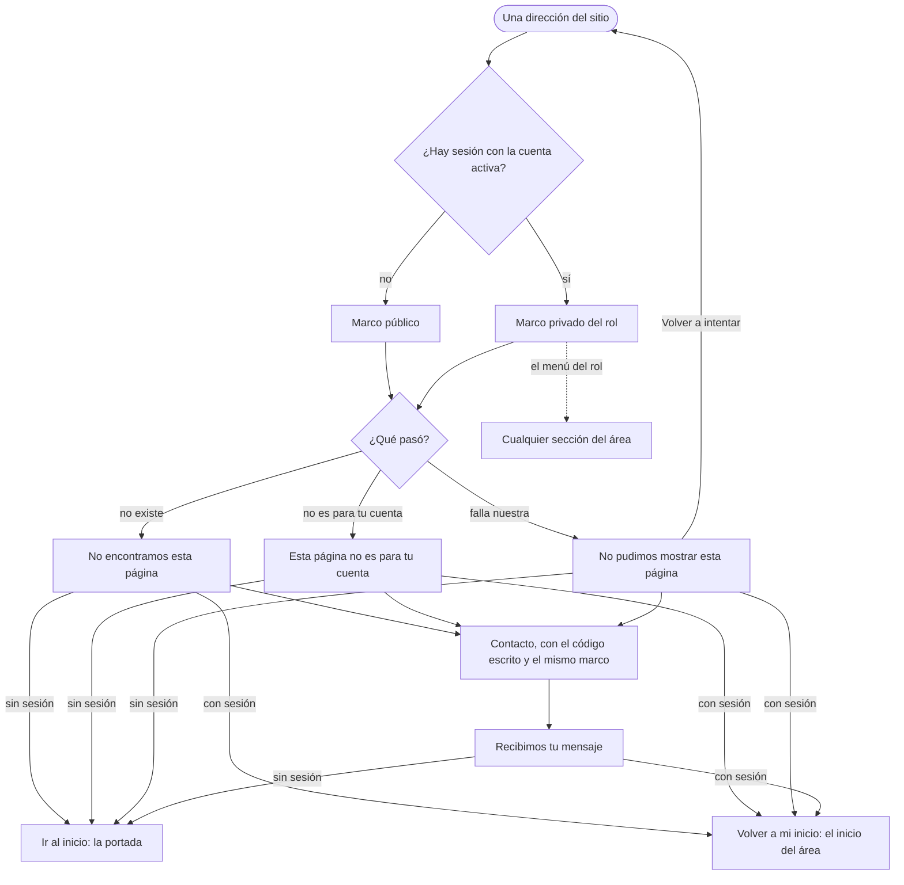

# Flujo: Páginas de error, en Raíces

> **Estado:** en revisión (cambio del marco con sesión) · **Fecha:** 2026-11-11 · **Aprobó:** usuario
> (2026-11-07, la ficha original); el cambio del marco con sesión es decisión del usuario del
> 2026-11-11 ([backlog de la revisión](../backlog-revision-2026-11-11.md), sección 3, "Páginas de
> error", y regla general 6) y espera su OK sobre esta ficha.
> Plantilla de la skill `ux-flujo`. F7 del [roadmap de vistas](../roadmap-vistas-enunciado.md):
> las páginas propias para 403, 404 y 5xx (RF-CL-08).
> **Cambio del 2026-11-11 (R11-05, lote `p0-errores`):** con la sesión iniciada, las páginas de error
> y Contacto usan el marco privado del rol (el menú y la cuenta de quien entró) y ofrecen "Volver a
> mi inicio". Sin sesión, el marco público de siempre. **Cambia la decisión del 2026-11-07** ("el
> marco de las públicas para las tres"): esa decisión queda registrada abajo, en la sección 9, como
> reemplazada. El motivo: con el marco público, quien ya había entrado veía "Ingresar / Crear una
> cuenta" y creía que se le había cerrado la sesión.

## 1. Para quién y para qué

| | |
|---|---|
| Quién | Cualquiera: alguien del público que siguió un enlace viejo; un donante, una organización o el equipo que llegó a una página que no es para su cuenta o que se topó con una falla nuestra, casi siempre en medio de una tarea y con la sesión iniciada |
| Tono | Para los errores: honesto, responsable, sereno ([tono según la pantalla](../tono-y-comunicacion.md#tono-según-la-pantalla)). Sin culpa para quien llegó, sin chistes y sin "¡Ups!" |
| Qué quiere lograr | "Entender qué pasó, ver que sigo en mi cuenta y volver a algo que funciona; si sigue fallando, poder avisar" |
| Dispositivo principal | Cualquiera; celular primero |
| Requerimientos | RF-CL-08 (403 "sin permiso"; 404 y 5xx con un mensaje amable y el `traceId` visible para soporte; el 401 lleva al login). RNF-UI-05 (error con próximo paso). RNF-CL-02 (sin JavaScript). Regla general 6 del backlog R11: con sesión iniciada, siempre se ve la cuenta |
| Datos que usa | Ninguno de negocio. El código de estado y el `traceId` del pedido (`TraceIdFiltro`, el mismo que viaja en `X-Trace-Id`). Con sesión, la cuenta y el área **del token** (`UsuarioActual.area()`), sin llamar a ninguna API (ver sección 4, "Lo que el marco privado no pide") |
| Boceto de E1 | No tiene |

## 2. Dónde está en el sitio

Fuera del menú: aparece en lugar de la página pedida, en la misma dirección y con el código de
estado real (404, 403 o 500/502/503), no con un 200.

**El marco depende de quién entró, no de la dirección pedida:**

| Quién | Marco | Menú | Acción de vuelta |
|---|---|---|---|
| Sin sesión | El de las públicas (`layout-publico`): navegación pública con "Ingresar" y "Crear una cuenta", y el pie | El público, sin sección marcada | "Ir al inicio" → la portada (`/`) |
| Con sesión y la cuenta activa (donante, organización o administración) | El privado del rol (`layout-privado`): la marca, el menú del rol, la campanita y la foto de la cuenta | El del área de la cuenta, **sin sección marcada** | "Volver a mi inicio" → el inicio del área (`/donante-inicio`, `/entidad-inicio` o `/admin-inicio`) |
| Con sesión, pero sin perfil completo o con la solicitud de la organización pendiente | El de las públicas, como hoy | El público | "Ir al inicio" → la portada |

- **El área es la de la cuenta, no la de la página.** Un donante que pide `/admin-donantes` y recibe
  el 403 ve su propio menú de donante, no el de administración.
- **Ninguna sección queda marcada como actual:** la página de error no es ninguna de ellas, y
  marcarla diría que se está donde no se está.
- **Las cuentas sin perfil o pendientes siguen con el marco público:** su menú privado todavía no las
  deja entrar (las lleva a completar el perfil o a "Recibimos la solicitud"), así que mostrarlo
  ofrecería salidas que no andan. Cuando la entidad pendiente pueda navegar lo público (lote
  `p0-pendiente`, R11-08), la portada ya es un destino que funciona.

Contacto ([ficha de Contacto](raices-contacto.md)) sigue la misma regla, porque es adonde lleva
"escribinos con este código": con sesión activa, el marco privado del rol; sin sesión, el público.
Su contenido no cambia (sección 4, "Contacto con sesión").

El 401 no tiene página: lleva a Ingresar (`ErroresHttp`), como hasta ahora.

## 3. Recorrido



Desvíos considerados:

- **Un formulario enviado que falla (5xx):** nadie sabe si se guardó. Se dice que se fije antes de
  repetirlo. "Volver a intentar" no reenvía el formulario: pide la misma dirección con GET, sin los
  datos (sin cambios respecto de la ficha original).
- **La falla es porque un servicio no responde:** la página de error con sesión no pide nada a
  ningún servicio para armarse (ni la cantidad sin leer de la campanita, ni el nombre a Donaciones).
  Si lo pidiera, la misma falla rompería también la página que la cuenta. Ver sección 4.
- **Algo falla al armar el marco privado** (por ejemplo, el token no trae área): se muestra el marco
  público, como hoy. Nunca una página en blanco ni la de Spring.
- **Un 403 de una página de otra área:** el menú es el del área de la cuenta; "Volver a mi inicio"
  lleva al inicio propio, que sí puede ver.
- **La sesión venció mientras miraba la página de error:** el menú privado lleva a una página
  privada, que pide ingresar de nuevo (el 401 de siempre). No es un caso nuevo.
- **Cerrar sesión desde la página de error:** el menú de la cuenta lo ofrece, como en cualquier
  pantalla privada; vuelve a la portada.
- **Sin JavaScript:** las páginas son HTML del servidor; el menú de la cuenta es un `<details>` y el
  "Más" de la administración, una ventana `popover`: andan sin él.

## 4. Pantallas

Una plantilla por código (`error/404.html`, `error/403.html`, `error/5xx.html`), con el contenido
compartido en `pagina-error.html`. El contenido es el mismo en los dos marcos; cambian el marco y la
acción de vuelta.

**Sin sesión (como hoy):**

```text
┌──────────────────────────────┐
│ DonaTrack  Entregas · Mapa · │  navegación pública
│ … · Ingresar · Crear cuenta  │
├──────────────────────────────┤
│ Error 404                    │  rótulo, para soporte
│ No encontramos esta *página* │
│ Puede que la dirección …     │
│ [ Ir al inicio ]             │
│ Código para soporte: a1b2…   │
│ Si llegaste desde un enlace… │  → Contacto con el código
│              (maceta)        │  decorativa
├──────────────────────────────┤
│ pie                          │
└──────────────────────────────┘
```

**Con sesión (nuevo):**

```text
┌──────────────────────────────┐
│ DonaTrack  Inicio · Mis …    │  menú del rol, sin sección marcada
│                 🔔  (foto)   │  campanita sin número · cuenta
├──────────────────────────────┤
│ Error 403                    │
│ Esta página no es para tu    │
│ *cuenta*                     │
│ La cuenta con la que …       │
│ [ Volver a mi inicio ]       │  al inicio del área
│ Código para soporte: a1b2…   │
│ Si creés que deberías …      │  → Contacto con el código, marco privado
│              (maceta)        │
├──────────────────────────────┤
│ pie                          │
└──────────────────────────────┘
  En el celular, el menú del rol es la barra inferior de siempre.
```

**5xx con sesión:** "Volver a intentar" (principal) y "Volver a mi inicio" (secundario), en ese
orden. Sin sesión: "Volver a intentar" e "Ir al inicio", como hoy.

- **El dibujo:** la maceta de reintentar (`/img/ilustraciones/reintentar.svg`, desde el 2026-11-08),
  decorativa (`alt=""`); el texto dice todo. Sin cambios.
- **El código:** el `traceId`, a la vista y seleccionable, con un enlace a Contacto con el código ya
  escrito. Sin cambios.
- **Disposición:** en pantalla grande, el texto a la izquierda y el dibujo a la derecha; en el
  celular, el dibujo debajo. La hoja `publico-error` se usa en los dos marcos; si alguna regla de
  la hoja depende de la cabecera pública, se ajusta para que el contenido se vea igual en los dos.

**Lo que el marco privado no pide:** la página de error con sesión se arma solo con lo que ya está
en la sesión (el área y la cuenta que da el token). No pide a ningún servicio la cantidad sin leer:
la campanita aparece **sin número** (lleva a Notificaciones igual). La cuenta usa lo que hoy da
`CuentasDelMenu`, que no llama a servicios; cuando el nombre de la persona llegue de Donaciones (lote
`p1-nombres`), en la página de error se usa el que ya esté en la sesión, o el rótulo del área si no
lo hay.

**Contacto con sesión** (`publico-contacto`, `publico-contacto-error`, `publico-contacto-enviado`):

- El marco privado del rol, sin sección marcada, igual que las páginas de error.
- El formulario, la lámina y los textos no cambian en este lote (ver sección 9, preguntas: el correo
  de la cuenta con login real).
- La página de enviado sin `?volver=`: con sesión, "Volver a mi inicio" en lugar de "Ir a la
  portada". Con `?volver=`, "Volver a …" de siempre.

**Cómo se ve en la maqueta** (para probar sin Keycloak):

- Errores: el área sale de la dirección pedida. `/donante-inicio?respuesta=403` muestra el 403 con el
  marco de donante; `/admin-inicio?respuesta=500`, el 5xx con el de administración;
  `/publico-mapa?respuesta=404` y `/no-existe`, con el marco público.
- Contacto: `?escenario=con-sesion` muestra el marco de donante (el escenario ya existe y oculta el
  correo); `&area=entidad` o `&area=admin` cambia el rol.

## 5. Estados

| Pantalla | Estado | Qué se ve | Texto |
|---|---|---|---|
| 404 | Sin sesión | Marco público; "Ir al inicio" | Ver Textos |
| 404 | Con sesión | Marco privado del rol; "Volver a mi inicio" | Ver Textos |
| 403 | Sin sesión | Marco público; "Ir al inicio" | Ver Textos |
| 403 | Con sesión | Marco privado del rol de la cuenta (no el de la página pedida); "Volver a mi inicio" | Ver Textos |
| 5xx | Sin sesión | Marco público; "Volver a intentar" e "Ir al inicio" | Ver Textos |
| 5xx | Con sesión | Marco privado; "Volver a intentar" y "Volver a mi inicio"; campanita sin número | Ver Textos |
| Las tres | Cuenta sin perfil o pendiente | Marco público; "Ir al inicio" | Como sin sesión |
| Las tres | No se pudo armar el marco privado | Marco público | Como sin sesión |
| Las tres | Sin código | Sin la línea del código; Contacto cambia de texto | Fila "Contacto sin código" de Textos |
| Las tres | Vacío, cargando, deshabilitado | No aplica: son la respuesta de un error | — |
| Contacto | Con sesión | Marco privado del rol; el formulario de siempre | Los de su ficha |
| Contacto enviado | Con sesión, sin `?volver=` | Marco privado; "Volver a mi inicio" | "Volver a mi inicio" |
| Contacto enviado | Sin sesión, sin `?volver=` | Marco público; "Ir a la portada" | Sin cambios |

## 6. Textos

| Elemento | 404 | 403 | 5xx |
|---|---|---|---|
| `title` | "Página no encontrada - DonaTrack" | "Sin permiso - DonaTrack" | "No pudimos mostrar la página - DonaTrack" |
| Rótulo | "Error 404" | "Error 403" | "Error 500" (el que llegó) |
| Título | "No encontramos esta *página*" | "Esta página no es para tu *cuenta*" | "No pudimos mostrar esta *página*" |
| Texto | "Puede que la dirección esté mal escrita o que la página ya no exista." | "La cuenta con la que entraste no puede ver esta página." | "Es un problema nuestro, no de lo que hiciste. Probá de nuevo en unos minutos. Si estabas enviando algo, fijate si quedó guardado antes de repetirlo." |
| Acción principal, sin sesión | "Ir al inicio" | "Ir al inicio" | "Volver a intentar" |
| Acción principal, con sesión | **"Volver a mi inicio"** | **"Volver a mi inicio"** | "Volver a intentar" |
| Otra salida, sin sesión | — | — | "Ir al inicio" |
| Otra salida, con sesión | — | — | **"Volver a mi inicio"** |
| Código | "Código para soporte: `a1b2c3d4e5f6`" | igual | igual |
| Contacto | "Si llegaste desde un enlace de DonaTrack, escribinos con este código." | "Si creés que deberías poder verla, escribinos con este código." | "Si sigue, escribinos con este código." |
| Contacto sin código | "Si llegaste desde un enlace de DonaTrack, escribinos y contanos desde dónde." | "Si creés que deberías poder verla, escribinos y contanos qué estabas buscando." | "Si sigue, escribinos y contanos qué estabas haciendo." |

- "Ir al inicio" lleva a la portada (`/`). "Volver a mi inicio" lleva al inicio del área de la cuenta
  (`Area.inicio()`: `/donante-inicio`, `/entidad-inicio`, `/admin-inicio`), directo, sin pasar por
  `/inicio`, para que ande igual en la maqueta.
- "Escribinos con este código" lleva a [Contacto](raices-contacto.md) con `?codigo=`, sin cambios.
- Los textos del contenido no cambian: solo se suma "Volver a mi inicio".

Filtro de tono: sin "¡Ups!" ni "lamentablemente"; el 5xx dice que es nuestro y qué hacer; ninguno
culpa a quien llegó; el número del error va como rótulo. "Volver a mi inicio" dice adónde lleva y que
es de la cuenta: confirma que la sesión sigue abierta sin tener que decirlo.

## 7. Accesibilidad

- Las zonas del marco que toque: saltar al contenido, `nav` ("Secciones"), `main` con un `h1` y
  `footer`. Los dos marcos ya las tienen.
- Ningún enlace del menú lleva `aria-current` en la página de error (no es ninguna sección).
- El rótulo con el número va antes del `h1`; el `h1` dice qué pasó.
- El código va en `code`, con su rótulo en texto.
- La campanita sin número se lee "Notificaciones" (el mismo `aria-label` de cuando no hay sin leer).
- Controles de al menos 48 × 48 px; el dibujo, decorativo.
- WCAG AA en 360, 1280 y 1920 px, en los dos marcos.

## 8. Revisión de usabilidad

**Patrones conocidos que sigue** ([criterios de la cátedra](../criterios-catedra-ux-ui.md),
secciones 4 y 5):

- **Barra superior** (*top app bar*) con la marca, la navegación y la cuenta en todas las páginas,
  también en las de error: el mismo armazón de las pantallas privadas.
- **Barra de navegación inferior** en el celular, con los destinos de primer nivel del rol: la de
  siempre, accesible también desde el error.
- **Volver:** el "atrás" del navegador sigue funcionando (la página de error está en la misma
  dirección y no redirige).
- Página de error con su próximo paso (RNF-UI-05) y el código para soporte, el patrón de error del
  sitio.

| # | Heurística | Cómo la cumple | Riesgo que queda |
|---|---|---|---|
| 1 | Visibilidad del estado | El título dice qué pasó y la cabecera muestra la cuenta: queda claro que la sesión sigue abierta | La campanita sin número puede hacer creer que no hay avisos nuevos (se acepta: no se pide nada a los servicios en un error) |
| 2 | Lenguaje del usuario | "No encontramos esta página", "Volver a mi inicio"; el número solo como rótulo | — |
| 3 | Control y libertad | Con sesión, el menú entero del rol, "Volver a mi inicio" y cerrar sesión; sin sesión, "Ir al inicio". Atrás del navegador | — |
| 4 | Consistencia | El mismo armazón que el resto del área privada; el mismo contenido de error en los dos marcos | "Volver a mi inicio" acá y "Ir a mi inicio" en la portada con sesión (lote `p1-portada`): son situaciones distintas (volver después de un error, ir desde la portada), se aceptan las dos |
| 5 | Prevención de errores | El 5xx pide fijarse antes de repetir un envío; el marco privado no se arma con llamadas que podrían fallar | — |
| 6 | Reconocer antes que recordar | El código ya va escrito al ir a Contacto; el menú del rol está a la vista | — |
| 7 | Flexibilidad | Volver a intentar, volver al inicio propio o ir a cualquier sección del menú | — |
| 8 | Diseño minimalista | Título, una frase, una acción y el código; el marco es el de siempre, no se suma nada | — |
| 9 | Recuperarse de errores | Qué pasó, qué hacer y a quién avisar, sin perder la sesión de vista | El 403 no dice con qué cuenta sí se ve (no se sabe) |
| 10 | Ayuda | Contacto con el código, en el mismo marco | — |

| Factor | Cómo lo cumple |
|---|---|
| Útil | Lleva de vuelta a algo que funciona: el inicio propio, no la portada |
| Usable | Una acción principal y una salida; el menú de siempre |
| Deseable | La maceta de reintentar, serena; el armazón conocido |
| Valioso | El código le sirve a soporte para encontrar la falla |
| Ubicable | La cabecera del rol arriba (o la barra inferior en el celular) |
| Accesible | Marco con zonas, `h1`, WCAG AA, nada depende de JavaScript |
| Creíble | Reconoce cuando la falla es nuestra y no parece que se cerró la sesión |

Qué conviene probar con personas reales: si alguien que se topa con un 5xx en medio de una tarea
entiende, al ver su cuenta arriba, que no perdió la sesión; y si usa "Volver a mi inicio" o el menú.

## 9. Decisiones y preguntas

Decisiones (usuario, 2026-11-11, backlog R11, sección 3 y regla 6):

- Con sesión, las páginas de error y Contacto muestran el encabezado de la cuenta y ofrecen "Volver a
  mi inicio". Sin sesión, como hasta ahora.

Decisiones (usuario, 2026-11-07), con su estado:

- ~~El marco de las públicas para las tres.~~ **Reemplazada el 2026-11-11** por la de arriba: queda
  solo para quien no tiene sesión (o la tiene sin perfil o pendiente).
- Un corte de suelo chico, con la raíz que no sigue. Reemplazado el 2026-11-08 por la maceta de
  reintentar (ilustración de diseño), ya construida.

Decisiones del agente (propuestas, 2026-11-11):

- El área del marco es la de la cuenta (del token), no la de la dirección pedida. En la maqueta, que
  no tiene token, sale de la dirección pedida.
- Ninguna sección del menú queda marcada en la página de error.
- Las cuentas sin perfil o con la solicitud pendiente siguen con el marco público: su menú privado
  no las deja pasar.
- La página de error con sesión no pide nada a los servicios: la campanita va sin número.
- Si el marco privado no se puede armar, el público, nunca una página en blanco.
- "Volver a mi inicio" va directo al inicio del área, no a `/inicio`.
- 5xx con sesión: "Volver a intentar" sigue siendo la principal; "Volver a mi inicio", la secundaria.
- En la maqueta, Contacto con sesión usa el marco de donante y `&area=` para los otros roles.

Decisiones del agente (2026-11-07), sin cambios:

- El número del error como rótulo, no como título.
- `?respuesta=404`, `403` y `500` en la maqueta, para verlas y probarlas.

Preguntas abiertas, para el equipo (no cambian este lote):

- Contacto con login real sigue pidiendo el correo aunque haya sesión: el "con sesión" que lo oculta
  existe solo en la maqueta (`?escenario=con-sesion`). Tomar el correo de la cuenta es otro cambio
  (va al backlog); este lote solo cambia el marco.
- El 401: sigue llevando a Ingresar.
