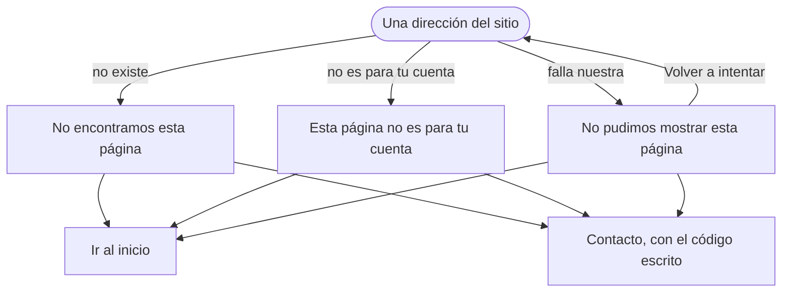

# Flujo: Páginas de error, en Raíces

> **Estado:** aprobado · **Fecha:** 2026-11-07 · **Aprobó:** usuario (2026-11-07)
> Plantilla de la skill `ux-flujo`. F7 del [roadmap de vistas](../roadmap-vistas-enunciado.md):
> las páginas propias para 403, 404 y 5xx (RF-CL-08). Hoy una dirección que no existe muestra la
> página de error de Spring (`SitioController`, `NO_EXISTE`).

## 1. Para quién y para qué

| | |
|---|---|
| Quién | Cualquiera: alguien del público que siguió un enlace viejo, un donante, una entidad o el equipo que llegó a una página que no es para su cuenta, o que se topó con una falla nuestra |
| Tono | Para los errores: honesto, responsable, sereno ([tono según la pantalla](../tono-y-comunicacion.md#tono-según-la-pantalla)). Sin culpa para quien llegó, sin chistes y sin "¡Ups!" |
| Qué quiere lograr | "Entender qué pasó y volver a algo que funciona; si sigue fallando, poder avisar" |
| Dispositivo principal | Cualquiera; celular primero |
| Requerimientos | RF-CL-08 (403 "sin permiso"; 404 y 5xx con un mensaje amable y el `traceId` visible para soporte; el 401 lleva al login). RNF-UI-05 (error con próximo paso). RNF-CL-02 (sin JavaScript) |
| Datos que usa | Ninguno de negocio. El código de estado y el `traceId` del request. Hueco: la propagación de `traceId` se decide al integrar el gateway ([`cliente-liviano/AGENTS.md`](../../../cliente-liviano/AGENTS.md)); en la maqueta, un código de ejemplo |
| Boceto de E1 | No tiene |

## 2. Dónde está en el sitio

Fuera del menú: aparece en lugar de la página pedida, en la misma dirección y con el código de
estado real (404, 403 o 500), no con un 200. Usa el marco de las públicas (la navegación pública y
el pie) para todas, también las privadas: funciona aunque no se sepa quién entró (usuario,
2026-11-07).

El 401 no tiene página: lleva al login cuando haya autenticación (fuera del plan sin auth,
[decisiones del plan](../roadmap-vistas-enunciado.md)).

## 3. Recorrido



Desvíos considerados:

- **Un formulario enviado que falla (5xx):** nadie sabe si se guardó. Se dice que se fije antes de
  repetirlo. "Volver a intentar" no reenvía el formulario: después de un GET recarga la misma
  dirección; después de un POST lleva a la página del formulario (la misma dirección, pedida con
  GET, sin los datos), que en el sitio es la pantalla que lo muestra.
- **Un enlace interno roto:** no debería pasar; el test del recorrido lo impide.
- **Sin JavaScript:** las tres páginas son HTML del servidor; nada depende de él.

## 4. Pantallas

Una plantilla por código, con la misma disposición:

```text
┌──────────────────────────────┐
│ navegación pública           │
│ Error 404                    │  rótulo, para soporte
│ No encontramos esta *página* │
│ Puede que la dirección …     │
│ ┌──────────────────────────┐ │
│ │  corte de suelo chico:   │ │  dibujo decorativo
│ │  la raíz que no sigue    │ │
│ └──────────────────────────┘ │
│ [ Ir al inicio ]             │
│ Código para soporte: a1b2…   │
│ Si sigue, escribinos         │
├──────────────────────────────┤
│ pie                          │
└──────────────────────────────┘
```

- **El dibujo:** el corte de suelo de la portada, en chico, con una raíz que baja y se corta antes
  de llegar, sin la punta que en la portada marca que llegó (usuario, 2026-11-07). Decorativo
  (`aria-hidden`); el texto dice todo. Se imprime y la raíz se traza una vez, como en la portada
  (las piezas del bloque pasos); el brote no se mece, y con "reducir movimiento", quieto.
- **El código:** el `traceId`, a la vista y seleccionable, con un enlace a Contacto con el código ya
  escrito.
- En pantalla grande, el texto a la izquierda y el dibujo a la derecha; en el celular, el dibujo
  debajo del texto.

## 5. Estados

En la maqueta: una dirección que no existe da el 404 (`/no-existe`); `?respuesta=404`, `403` y
`500` en cualquier pantalla del sitio responden con ese código y su página, y
`&escenario=sin-codigo` muestra el estado sin código.

| Pantalla | Estado | Qué se ve | Texto |
|---|---|---|---|
| 404 | Único | La página, con código 404 | Ver Textos |
| 403 | Único | La página, con código 403 | Ver Textos |
| 5xx | Único | La página, con el código que llegó (500, 502, 503) | Ver Textos |
| Las tres | Vacío, cargando, deshabilitado | No aplica: son la respuesta de un error | — |
| Las tres | Sin código | Si el `traceId` no llega, no se muestra la línea del código y Contacto cambia de texto | Fila "Contacto sin código" de Textos |

## 6. Textos

| Elemento | 404 | 403 | 5xx |
|---|---|---|---|
| `title` | "Página no encontrada - DonaTrack" | "Sin permiso - DonaTrack" | "No pudimos mostrar la página - DonaTrack" |
| Rótulo | "Error 404" | "Error 403" | "Error 500" (el que llegó) |
| Título | "No encontramos esta *página*" | "Esta página no es para tu *cuenta*" | "No pudimos mostrar esta *página*" |
| Texto | "Puede que la dirección esté mal escrita o que la página ya no exista." | "La cuenta con la que entraste no puede ver esta página." | "Es un problema nuestro, no de lo que hiciste. Probá de nuevo en unos minutos. Si estabas enviando algo, fijate si quedó guardado antes de repetirlo." |
| Acción principal | "Ir al inicio" | "Ir al inicio" | "Volver a intentar" |
| Otra salida | — | — | "Ir al inicio" |
| Código | "Código para soporte: `a1b2c3d4e5f6`" | igual | igual |
| Contacto | "Si llegaste desde un enlace de DonaTrack, escribinos con este código." | "Si creés que deberías poder verla, escribinos con este código." | "Si sigue, escribinos con este código." |
| Contacto sin código | "Si llegaste desde un enlace de DonaTrack, escribinos y contanos desde dónde." | "Si creés que deberías poder verla, escribinos y contanos qué estabas buscando." | "Si sigue, escribinos y contanos qué estabas haciendo." |

"Ir al inicio" lleva a la portada (`/`). "Escribinos con este código" lleva a
[Contacto](raices-contacto.md) con `?codigo=`.

Filtro de tono: sin "¡Ups!" ni "lamentablemente"; el 5xx dice que es nuestro y qué hacer; ninguno
culpa a quien llegó; el número del error va como rótulo, para soporte, no como título.

## 7. Accesibilidad

- Las zonas del marco público (saltar al contenido, `nav`, `main` con un `h1`, `footer`).
- El rótulo con el número va antes del `h1`, como en las otras pantallas; el `h1` dice qué pasó.
- El código va en `code`, con su rótulo en texto.
- Controles de al menos 48 × 48 px; el dibujo, `aria-hidden`.
- WCAG AA en los tres anchos.

## 8. Revisión de usabilidad

| # | Heurística | Cómo la cumple | Riesgo que queda |
|---|---|---|---|
| 1 | Visibilidad del estado | El título dice qué pasó; el rótulo, el número | — |
| 2 | Lenguaje del usuario | "No encontramos esta página"; el número solo como rótulo | — |
| 3 | Control y libertad | "Ir al inicio" siempre; Atrás del navegador | "Ir al inicio" lleva a la portada también a una entidad o un donante, por el marco público: se prueba si la buscan en su inicio. En el 403, la barra pública ofrece "Ingresar" aunque la persona ya entró: se prueba si confunde |
| 4 | Consistencia | El marco público y el patrón de error del sitio (código y Contacto) | — |
| 5 | Prevención de errores | El 5xx pide fijarse antes de repetir un envío | — |
| 6 | Reconocer antes que recordar | El código ya va escrito al ir a Contacto | — |
| 7 | Flexibilidad | Volver a intentar o ir al inicio | — |
| 8 | Diseño minimalista | Título, una frase, una acción y el código | — |
| 9 | Recuperarse de errores | Qué pasó, qué hacer y a quién avisar | El 403 no dice con qué cuenta sí se ve (no se sabe) |
| 10 | Ayuda | Contacto con el código | — |

| Factor | Cómo lo cumple |
|---|---|
| Útil | Lleva de vuelta a algo que funciona |
| Usable | Una acción principal y una salida |
| Deseable | El corte de suelo de Raíces, sereno |
| Valioso | El código le sirve a soporte para encontrar la falla |
| Ubicable | La navegación pública arriba |
| Accesible | Marco con zonas, `h1`, WCAG AA |
| Creíble | Reconoce cuando la falla es nuestra; no promete que se arregló |

Qué conviene probar con personas reales: si alguien que llega a un 404 desde un enlace viejo
encuentra lo que buscaba desde el inicio.

## 9. Decisiones y preguntas

Decisiones (usuario, 2026-11-07):

- El marco de las públicas para las tres.
- Un corte de suelo chico, con la raíz que no sigue.

Decisiones del agente (propuestas):

- El número del error como rótulo, no como título.
- `?respuesta=404`, `403` y `500` en la maqueta, para verlas y probarlas.
- La página sin dibujar queda solo para una sección del menú sin plantilla; ningún enlace del
  sitio lleva a ella (test del recorrido).

Preguntas abiertas, para el equipo (no cambian el prototipo):

- De dónde sale el `traceId` en el sistema (al integrar el gateway).
- El 401: a qué login lleva, cuando esté la autenticación.
