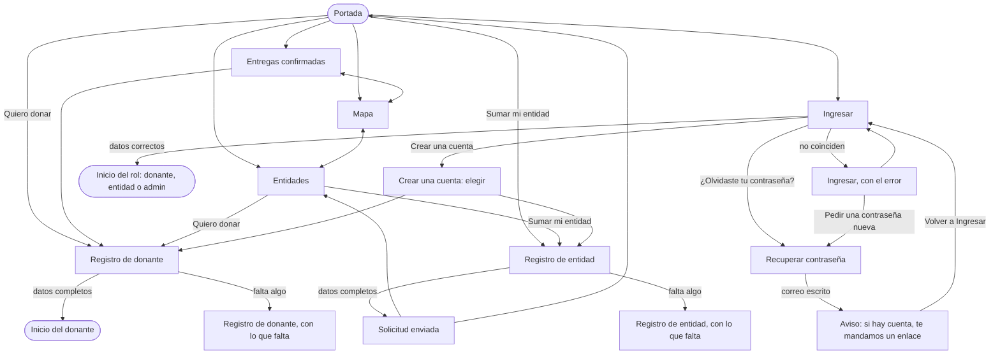
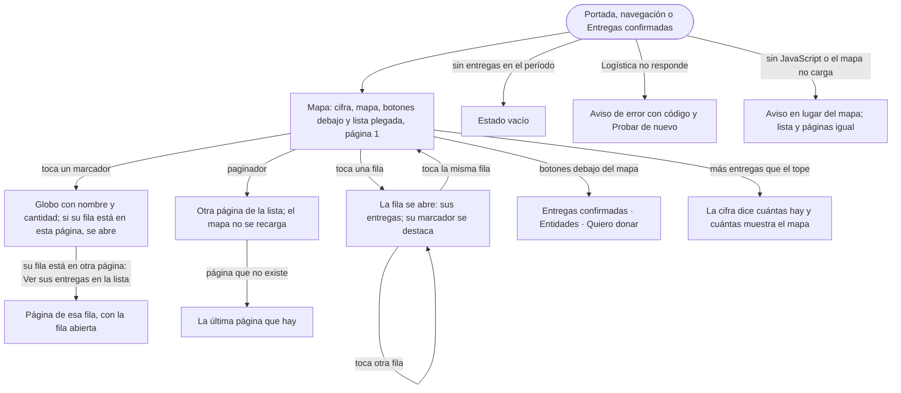

# Flujo: Público "entrar", en Raíces (sitio navegable A/B)

> **Estado:** aprobada: el usuario eligió el sitio A de la corrida A/B (2026-11-03), como
> preveía el plan · **Fecha:** 2026-11-02 · **Aprobó:** el usuario, 2026-11-03
> Plantilla de la skill `ux-flujo`. Ficha escrita para los dos sitios de la corrida A/B de Raíces:
> quedó A, en `/<pantalla>` (B se borró al elegir A, 2026-11-03)
> ([ADR aceptado](../../adr/cliente-liviano/20261103-una-sola-identidad-en-el-cliente-liviano.md)).
> Fija para quién es, el recorrido, los estados, los textos, los datos y los enlaces de salida.
> **No fija la composición ni la navegación visual:** eso lo decide cada sitio.
> Pantallas nuevas: `publico-donaciones`, `publico-mapa`, `publico-entidades`, `publico-ingresar`,
> `publico-registro`, `publico-registro-donante`, `publico-registro-entidad` y `publico-recuperar`
> (con `publico-recuperar-enviado`). Ya aprobadas y
> relacionadas: `publico-portada`, `publico-contacto` (con `-enviado` y `-error`) y
> `publico-legales` ([contacto](raices-contacto.md), [legales](raices-legales.md)).

## 1. Para quién y para qué

| | |
|---|---|
| Quién | Quien llega por primera vez: la persona de responsabilidad social de una empresa que evalúa donar (el foco de Raíces), una persona que quiere donar, alguien de una entidad que quiere sumarse. También quien ya tiene cuenta y viene a ingresar. Desde la computadora, en la oficina; la entidad, muchas veces desde el celular |
| Tono | Portada y páginas públicas: profesional, seguro, directo. Formularios: claro, útil, tranquilizador. Errores: honesto, responsable, sereno ([tono según la pantalla](../tono-y-comunicacion.md#tono-según-la-pantalla)) |
| Qué quiere lograr | "Ver qué llegó y adónde, saber quiénes piden y qué, y entrar o crear mi cuenta para donar o para sumar mi entidad" |
| Dispositivo principal | Ambos; la computadora primero para la empresa, el celular para la entidad |
| Requerimientos | RF-01 (destacadas del último mes con su foto, registro y login, legales). RF-02 (mapa de entregadas, detalle por marcador con fecha, categoría y foto; ubicación aproximada, D24). RF-03 (registro: el donante queda operativo al completar el perfil; la entidad, pendiente de aprobación). RF-04 (login de los tres roles; credenciales inválidas, error genérico). RF-22 (entidades activas con necesidades vigentes, sin datos de contacto). RF-AUTH-02 (Continuar con Google), RF-AUTH-05/06, RF-AUTH-13 (recuperar). RNF-AUTH-07 (bloqueo tras varios intentos) y RNF-AUTH-10 (respuestas que no revelan cuentas). RF-CL-06 (lista junto al mapa), RF-CL-07 (cuándo se actualizó). RNF-PRIV-01/03 |
| Datos que usa | Contadores: `GET /api/donaciones/contadores` (HB-02, PR #953). Destacadas: `GET /api/donaciones/destacadas` (HB-01, PR #954). Lo demás no existe para lo público todavía: HB-07 (mapa), HB-08, HB-15 y HB-18 (entidades y necesidades), HB-11 y HB-12 (perfil y aprobación), HB-20 (constancia de los legales), IdP (RF-04, D1 pendiente). En la maqueta: los datos de ejemplo de la sección 6.3, escritos en la plantilla como en la portada; de `SitioController`, los `estados` (`EstadoEntrega.ENTREGADA` para el sello) y la foto de ejemplo; de `Escenario`, los nombres `vacio`, `lento` y `error`. Los huecos, en [Huecos de backend](#huecos-de-backend) y en la lista de la corrida ([raices-ab-huecos-backend.md](raices-ab-huecos-backend.md)) |
| Boceto de E1 | Pág. 2 (Donaciones realizadas: mapa coloreado, galería en mosaico, "Unirse a la comunidad"), pág. 23 (mapas por región, detalle de una donación), pág. 4 (Iniciar sesión), pág. 5 (Registrarse: dos tarjetas) y pág. 11 (Registro de entidad). Entidades y necesidades no tiene boceto (D26) |

## 2. Dónde está en el sitio

Todo es público (sin sesión). Nivel 1: la portada. Nivel 2: Entregas confirmadas, Mapa,
Entidades, Ingresar y Crear una cuenta. Nivel 3: Registro de donante, Registro de entidad y
Recuperar la contraseña (desde Ingresar) ([mapa del sitio](../mapa-del-sitio.md), filas de Público). Nada queda a más de 3 niveles.

**Destinos de la navegación pública** (los mismos en todas las públicas, también en la portada;
cómo se ven lo decide cada sitio). Contacto y Términos y privacidad la llevan sin sección marcada
desde el pulido del 2026-11-03 (usuario): antes no la tenían y, en el celular, la marca era la
única salida.

| Destino | Pantalla | Nota |
|---|---|---|
| La marca | `publico-portada` | "DonaTrack, ir a la portada" |
| Entregas confirmadas | `publico-donaciones` | En el mapa del sitio, "Donaciones realizadas" (ver Decisiones) |
| Mapa | `publico-mapa` | |
| Entidades | `publico-entidades` | |
| Ingresar | `publico-ingresar` | |
| Crear una cuenta | `publico-registro` | |

La sección actual lleva `aria-current="page"`. El pie es el de las otras públicas ("Términos y
privacidad · Contacto"). Para que el recorrido salga de la portada, la portada suma esta
navegación; además, conviene que "Lo que viajó este mes" enlace a Entregas confirmadas ("Ver todas
las entregas confirmadas") y que el rótulo de la tierra enlace a Entidades ("Ver todas las
entidades y lo que piden"). Lo demás de la portada no cambia.

**Con la sesión iniciada** (R11-15, ficha [r11-p1-portada](r11-p1-portada.md), construida el
2026-11-12): los destinos son los mismos, salvo "Ingresar" y "Crear una cuenta", que se cambian por
"Ir a mi inicio" (o "Ver mi solicitud", con la solicitud pendiente) y la foto con el menú de la
cuenta. Esta ficha no se reescribe: el detalle está en esa.

## 3. Recorrido



Desvíos considerados:

- **Volver o cancelar:** la navegación pública y Atrás del navegador, en todas. Los formularios no
  guardan nada hasta enviarse; irse no deja nada a medias.
- **Filtro sin resultados:** en Mapa (una categoría sin entregas), en Entidades (una categoría que
  nadie pide o una búsqueda sin coincidencias). Cada uno dice qué no se encontró y ofrece "Ver
  todas".
- **Sin datos todavía:** Entregas confirmadas, Mapa y Entidades tienen su estado vacío
  (`?escenario=vacio`).
- **Error del servidor o sin conexión:** al cargar (Entregas confirmadas, Mapa, Entidades) y al
  enviar (Ingresar, los registros y Recuperar la contraseña). Lo escrito sigue en el formulario, salvo la contraseña.
- **Error de datos:** Ingresar dice "no coinciden" sin decir cuál de los dos datos falló (RF-04,
  RNF-AUTH-10); los registros, un resumen arriba con un enlace a cada campo.
- **Demasiados intentos** (RNF-AUTH-07): Ingresar dice que se pausaron los intentos por unos
  minutos.
- **Entidad en revisión** (RF-AUTH-06): si una entidad que todavía no se aprobó intenta ingresar,
  Ingresar le dice que está en revisión.
- **Sesión vencida** (RF-CL-02): Ingresar dice que la sesión se cerró; en el sistema, al ingresar
  vuelve a la pantalla donde estaba.
- **Sin permiso:** no aplica; todo es público.

**En la maqueta:** "Ingresar" lleva al inicio de cada rol con su cuenta de ejemplo (sección 6.3).
"¿Olvidaste tu contraseña?" lleva a Recuperar la contraseña de cada sitio
(`publico-recuperar`, con su aviso en `publico-recuperar-enviado`): lo público sin dibujar no tiene
página de "sin dibujar", así que el paso se dibuja (ver Decisiones).

## 4. Pantallas

Cada esquema dice **qué hay y en qué orden de importancia**, no dónde va. La composición, la
imagen de raíz del título (como mucho una por pantalla, [brief](../identidad/brief.md#voz))
y cómo se dibujan el mapa y los filtros los decide cada sitio.

### 4.1 Entregas confirmadas (`publico-donaciones`)

```text
Rótulo · Título · Bajada (qué se ve y qué no)
Período: [Última semana] [Último mes ●]          ← formulario get, ?periodo=semana
Cifra del período, con fechas · Actualizado …
┌ Entrega ───────────────────────────────┐ × 10
│ Foto (miniatura) · sello "Entrega       │
│ confirmada" · qué y cuánto · categoría  │
│ con su ícono · entidad y barrio · fecha │
│ [Ver la foto de la entrega]             │
└─────────────────────────────────────────┘
Salidas: Ver dónde llegaron, en el mapa · Quiero donar
```

La galería del boceto (pág. 2), sin el mapa: el mapa tiene su pantalla. La más reciente primero.
La foto grande se abre en la misma página (con JavaScript, un diálogo; sin él, un ancla a la foto
o la imagen sola), con el mismo texto que en la portada.

### 4.2 Mapa (`publico-mapa`)

> Desde R11-19 (2026-11-12, en revisión), la lista va plegada y paginada y los botones de salida,
> debajo del mapa: ver la [ampliación R11-19](#ampliación-r11-19-mapa-más-corto-lote-p1-mapa).

```text
Rótulo · Título · Bajada (ubicación aproximada)
Qué se donó: [Todas ●][Alimentos][Ropa][Muebles][Útiles escolares]   ← ?categoria=
Cifra: entregas y entidades del período · Actualizado …
El mapa (en el sistema, MapLibre; en la maqueta, un dibujo fijo):
  un punto por entidad, en su barrio; al tocarlo, el detalle
  de sus entregas (fecha, categoría, qué, foto)
La lista, con los mismos datos (RF-CL-06): entidad por entidad,
  con su barrio y sus entregas; cada una, "Ver la foto de la entrega"
Atribución de los datos del mapa (D21), solo en el sistema
Salidas: Ver las fotos de cada entrega · Ver las entidades y lo que piden · Quiero donar
```

El boceto (págs. 2 y 23) colorea un mapa mundial por cantidad y baja por regiones. Acá, un solo
mapa con un punto por entidad: DonaTrack trabaja en una ciudad y el acercamiento lo da MapLibre.
El detalle de cada marcador cumple RF-02 (fecha, categoría y foto). Cómo se dibuja el estilo del
mapa (por ejemplo, con la red de la portada) lo decide cada sitio; el dibujo de la maqueta es
`aria-hidden` y la lista dice todo.

### 4.3 Entidades (`publico-entidades`)

```text
Rótulo · Título · Bajada (qué es un pedido y qué pasa con lo que donás)
Buscar por nombre [          ] [Buscar]          ← ?q=
Qué piden: [Todo ●][Alimentos][Ropa][Muebles][Útiles escolares]   ← ?categoria=
Cifra: entidades con pedidos vigentes, de cuántas · Al …
┌ Entidad ───────────────────────────────┐ × 6
│ Ícono de lo que pide · qué es (Comedor) │
│ · nombre · barrio                       │
│ Pide: pedido por pedido (qué, cuánto    │
│ falta, hasta cuándo o si se repite, por │
│ qué). Más de 3: los demás plegados,     │
│ "Ver los 5 pedidos"                     │
│ Ver sus entregas en el mapa (si tiene)  │
└─────────────────────────────────────────┘
Salidas: Quiero donar · ¿Ya tenés cuenta? Ingresar · ¿Representás a una entidad? Sumar mi entidad
```

Sin boceto (D26). Sin datos de contacto ni dirección (RF-22, D24). No hay un botón para donar a
una entidad: la asignación la decide DonaTrack (RF-17), así que el llamado es uno solo, "Quiero
donar", y la bajada dice cómo se asigna.

### 4.4 Ingresar (`publico-ingresar`)

```text
Rótulo · Título · Bajada
Aviso del estado, si hay (error, en revisión, bloqueado, sesión vencida)
Correo electrónico [        ]
Contraseña         [        ] [Mostrar]
¿Olvidaste tu contraseña?
[Ingresar]
o
[Continuar con Google]
¿Primera vez? Crear una cuenta
── Solo en la maqueta ──
Cuentas de ejemplo: Distribuidora Ejemplo SA · Martina Ruiz · Comedor Barrio Ejemplo · Administración
```

Respecto del boceto (pág. 4): "Correo electrónico" en lugar de "Usuario" (el IdP usa el correo) y
cada campo con su etiqueta visible (el boceto usaba la ayuda como etiqueta y se perdía al
escribir). Se suma "Continuar con Google" (RF-AUTH-02).

### 4.5 Crear una cuenta (`publico-registro`)

```text
Rótulo · Título · Bajada
┌ Quiero donar, yo o mi empresa ─────┐  ┌ Represento a una entidad ──────────┐
│ Qué podés hacer (2 líneas)          │  │ Qué podés hacer (2 líneas)          │
│ Qué te pedimos                      │  │ Qué te pedimos · se revisa antes    │
│ [Crear mi cuenta de donante]        │  │ [Sumar mi entidad]                  │
└─────────────────────────────────────┘  └─────────────────────────────────────┘
¿Ya tenés cuenta? Ingresar
```

Las dos tarjetas del boceto (pág. 5), con "entidad" en lugar de "beneficiario" (tono: se nombra
por su rol).

### 4.6 Registro de donante (`publico-registro-donante`)

```text
Rótulo · Título · Bajada
Quién dona: [Una empresa u organización ●] [Una persona]     ← ?tipo=persona
Empresa: Nombre de la empresa · Rubro · Tu nombre y apellido
Persona: Nombre · Apellido
Correo electrónico · Contraseña [Mostrar]
Aviso del nombre visible
[ ] Leí y acepto los términos y la política de privacidad (versión 1)
[Crear mi cuenta]
¿Ya tenés cuenta? Ingresar · ¿Representás a una entidad? Sumar mi entidad
```

Sin boceto propio. La empresa va primero: es el foco de Raíces. La elección cambia los campos sin
JavaScript (dos direcciones, `publico-registro-donante` y `?tipo=persona`); con JavaScript, en el
lugar. Al crear la cuenta, en la maqueta, lleva al inicio del donante (`donante-inicio`, con la
cuenta de Distribuidora Ejemplo SA): el donante queda operativo al completar el perfil (RF-03).

### 4.7 Registro de entidad (`publico-registro-entidad`)

```text
Rótulo · Título · Bajada
Cómo sigue: 1 Completás la solicitud (estás acá) · 2 El equipo la revisa · 3 Publicás lo que necesitás
La entidad: Nombre · Qué es · Tipo de organización
Dirección de entrega: Calle · Altura · Código postal · Localidad · Provincia
Quién la representa: Nombre y apellido · Correo electrónico · Contraseña [Mostrar]
[ ] Leí y acepto los términos y la política de privacidad (versión 1)
[Enviar la solicitud]
¿Querés donar? Crear una cuenta de donante
```

**Solicitud enviada** (`publico-registro-entidad-enviada`): el sello "Solicitud recibida", qué pasa
ahora, cuánto suele tardar la revisión ("unos días hábiles", R11-08), que mientras tanto puede
recorrer lo público y el mismo "Cómo sigue" con el paso 2 como actual. Salidas: "Ver las entidades
y lo que piden" e "Ir a la portada". Con la cuenta pendiente, esas salidas y las demás pantallas
públicas se pueden navegar; lo privado lleva otra vez a esta pantalla (R11-08).

Respecto del boceto (pág. 11): en tres grupos con título, como pedía la nota del boceto ("conviene
partirlo en secciones claras"). Un solo representante, el que crea la cuenta; el rubro pasa a "Qué
es", una lista corta. El país no se pregunta: es Argentina.

**En el sitio real** (fuera de la maqueta), `publico-registro`, `publico-registro-donante` y
`publico-registro-entidad` son el paso "Completá tu perfil" de la cuenta creada en Keycloak (D11,
RI-AUTH-02). Sin sesión llevan a crear la cuenta; con sesión y sin perfil muestran el formulario
sin correo, contraseña ni salidas, con el rótulo "Completá tu perfil" y el botón "Guardar mi
perfil" (la entidad conserva "Enviar la solicitud"). Si Donaciones o Keycloak fallan, el aviso "No
pudimos guardar tu perfil" (o "No pudimos enviar la solicitud") conserva lo escrito. El nombre y
apellido de quien representa a la empresa o a la entidad pide al menos dos palabras.

**Ver y corregir la solicitud** (R11-41, 2026-11-12): con la cuenta pendiente, "Recibimos la
solicitud" suma "Lo que nos enviaste" y "Corregir los datos" lleva a
`publico-registro-entidad-corregir`. El diseño está en la ficha
[r11-p2-pendiente-solicitud](r11-p2-pendiente-solicitud.md), que amplía esta sección.

### 4.8 Recuperar la contraseña (`publico-recuperar`)

```text
Rótulo · Título · Bajada
Correo electrónico [        ]   (ayuda del navegador si falta o no es un correo)
[Mandame el enlace]
¿Te acordaste? Volver a Ingresar
── después de enviar (publico-recuperar-enviado) ──
Aviso: Si hay una cuenta con ese correo, te mandamos un enlace. · Revisá tu bandeja… · [Volver a Ingresar]
```

Se llega desde Ingresar ("¿Olvidaste tu contraseña?" y "Pedir una contraseña nueva", en el error
de datos y en el de demasiados intentos). Los mismos datos que la del primer prototipo: un correo y el enlace
(RF-AUTH-13: enlace de un solo uso con vencimiento; el mecanismo de envío y el plazo dependen de
D8, pendiente). El aviso de después es neutro: dice lo mismo haya o no una cuenta con ese correo
(RNF-AUTH-10). Es un formulario real (POST); el aviso es su propia pantalla, como en Contacto. Sin
boceto.

## 5. Estados

Los estados de la maqueta van en la misma pantalla con `?escenario=` (como la portada); los
resultados de un envío, en su propia pantalla (como Contacto).

| Pantalla | Estado | Qué se ve | Texto |
|---|---|---|---|
| Entregas confirmadas | Con datos | La cifra y las 10 entregas del último mes | Ver Textos |
| Entregas confirmadas | Última semana (`?periodo=semana`) | Las 5 entregas del 8 al 15 de octubre | "5 entregas confirmadas en la última semana, del 8 al 15 de octubre de 2026." |
| Entregas confirmadas | Vacío (`?escenario=vacio`) | El título y el aviso en lugar de la galería; sin cifra | "Todavía no hay entregas confirmadas en el último mes." · "Se cuentan cuando cada entidad confirma lo que recibe, con su foto." · "Ver las entidades y lo que piden" |
| Entregas confirmadas | Cargando (`?escenario=lento`) | El lugar de cada entrega, sin datos inventados | "Cargando las entregas confirmadas…" |
| Entregas confirmadas | Error del servidor (`?escenario=error`) | El aviso en lugar de la galería | "No pudimos cargar las entregas confirmadas." · "Es un problema nuestro. Probá de nuevo en unos minutos; si sigue, escribinos con este código." · "Código: a1b2c3d4e5f6" · "Volver a cargar" · "escribinos" lleva a Contacto con el código y el regreso (`?codigo=a1b2c3d4e5f6&volver=…`) |
| Entregas confirmadas | Foto que no carga | El texto alternativo en su lugar y los datos de la entrega | El `alt` de la foto |
| Mapa | Con datos | El mapa y la lista, 10 entregas en 5 entidades | Ver Textos |
| Mapa | Filtro (`?categoria=alimentos`, `ropa`, `muebles`) | El mapa y la lista, solo con esa categoría; la cifra cambia | "5 entregas de alimentos en 1 entidad …" (ver 6.3) |
| Mapa | Filtro sin resultados (`?categoria=escolares`) | El mapa sin puntos y el aviso en lugar de la lista | "Todavía no hay entregas de útiles escolares en el último mes." · "Cuando una entidad confirme una entrega de esta categoría, aparece en el mapa." · "Ver todas las categorías" |
| Mapa | Vacío (`?escenario=vacio`) | El mapa sin puntos y el aviso; sin filtro ni cifra | "Todavía no hay entregas confirmadas en el último mes." · "Se cuentan cuando cada entidad confirma lo que recibe." · "Ver las entidades y lo que piden" |
| Mapa | Cargando (`?escenario=lento`) | El lugar del mapa y de la lista | "Cargando el mapa de entregas…" |
| Mapa | Error del servidor (`?escenario=error`) | El aviso en lugar del mapa y la lista | "No pudimos cargar el mapa de entregas." · el mismo texto, código y botón de Entregas confirmadas |
| Mapa | Detalle de un punto | La entidad, su barrio y sus entregas, cada una con fecha, categoría y foto | "Comedor Barrio Ejemplo · Barrio Ejemplo · 6 entregas confirmadas" · "Lentejas secas, 10 kg · Alimentos · Entrega confirmada el 10 de octubre de 2026" · "Ver la foto de la entrega" · "Cerrar" |
| Entidades | Con datos | La cifra y las 6 entidades | Ver Textos |
| Entidades | Filtro (`?categoria=…`) | Solo las que piden algo de esa categoría, y de cada una solo esos pedidos | "2 entidades piden alimentos." |
| Entidades | Filtro sin resultados (`?q=biblioteca&categoria=alimentos`: en la maqueta cada categoría tiene al menos una entidad, así que se llega combinando búsqueda y filtro) | El aviso en lugar de la lista; el texto sigue en el buscador y la categoría, elegida | "Ninguna entidad con «biblioteca» en el nombre pide alimentos ahora." · "Probá con otra categoría o con otra parte del nombre." · "Ver todas". Con una categoría sola y sin búsqueda: "Ninguna entidad pide <categoría> ahora." · "Cuando una lo publique, aparece acá." |
| Entidades | Búsqueda (`?q=comedor`) | Las que tienen ese texto en el nombre | "1 entidad con «comedor» en el nombre." |
| Entidades | Búsqueda sin resultados (`?q=…` sin coincidencias) | El aviso en lugar de la lista; el texto sigue en el buscador | "No encontramos entidades con «<texto>» en el nombre." · "Probá con otra parte del nombre o sacá el filtro." · "Ver todas" |
| Entidades | Vacío (`?escenario=vacio`) | El aviso; sin buscador, filtro ni cifra | "Ninguna entidad tiene pedidos vigentes ahora." · "Cuando una publique lo que le hace falta, aparece acá." · "Sumar mi entidad" |
| Entidades | Cargando (`?escenario=lento`) | El lugar de cada entidad | "Cargando las entidades…" |
| Entidades | Error del servidor (`?escenario=error`) | El aviso en lugar de la lista | "No pudimos cargar las entidades." · el mismo texto, código y botón |
| Ingresar | Inicial | El formulario vacío y las cuentas de ejemplo | — |
| Ingresar | Ingresando (`?escenario=lento`) | El botón dice "Ingresando…" y queda desactivado | "Ingresando…" |
| Ingresar | Error de datos (`publico-ingresar-error`) | Aviso arriba, con el foco; los dos campos marcados, sin decir cuál falló | "No pudimos ingresar." · "El correo o la contraseña no coinciden. Revisalos y probá de nuevo, o pedí una contraseña nueva." · "Pedir una contraseña nueva" |
| Ingresar | Error del servidor (`?escenario=error`) | Aviso arriba; el correo sigue escrito | "No pudimos ingresar en este momento." · "Es un problema nuestro. Probá de nuevo en unos minutos; si sigue, escribinos con este código." · el código |
| Ingresar | Sin conexión (`?escenario=sin-conexion`) | Con JavaScript, aviso arriba; sin él, la página del navegador | "Se cortó la conexión." · "Revisá la señal y probá de nuevo." |
| Ingresar | Demasiados intentos (`?escenario=bloqueado`) | Aviso arriba; el botón sigue, el ingreso se rechaza hasta que pase la pausa | "Pausamos los intentos de ingreso." · "Hubo varios intentos con datos que no coinciden. Por seguridad, probá de nuevo en unos minutos o pedí una contraseña nueva." |
| Ingresar | Entidad en revisión (`?escenario=pendiente`) | Aviso arriba, sin formulario de por medio | "Tu entidad todavía está en revisión." · "El equipo de DonaTrack revisa cada entidad antes de sumarla. Te escribimos al correo de contacto cuando esté aprobada; desde ese día podés ingresar." · "Escribinos" (Contacto) · "Ir a la portada" |
| Ingresar | Sesión vencida (`?escenario=sesion-vencida`) | Aviso arriba, tranquilo | "Tu sesión se cerró." · "Pasó un tiempo sin actividad. Ingresá de nuevo y seguís donde estabas." |
| Crear una cuenta | Con datos | Las dos tarjetas | Ver Textos (no tiene datos que carguen) |
| Registro de donante | Empresa (por defecto) / Persona (`?tipo=persona`) | Los campos de cada uno | — |
| Registro de donante | Creando (`?escenario=lento`) | El botón dice "Creando tu cuenta…" y queda desactivado | "Creando tu cuenta…" |
| Registro de donante | Éxito | En la maqueta, el inicio del donante | En el sistema, el inicio da la bienvenida (lo define la ficha del donante) |
| Registro de donante | Error de datos (`publico-registro-donante-error`) | Resumen arriba con el foco y un enlace a cada campo; cada campo con su error; lo escrito sigue, salvo la contraseña | "Revisá tres cosas antes de crear tu cuenta" · "Falta el nombre de la empresa" · "El correo no parece completo: falta la @" · "Para crear tu cuenta, aceptá los términos y la política de privacidad" |
| Registro de donante | Error del servidor (`?escenario=error`) | Aviso arriba; lo escrito sigue, salvo la contraseña | "No pudimos crear tu cuenta." · "Es un problema nuestro: lo que escribiste sigue acá, salvo la contraseña. Probá de nuevo en unos minutos; si sigue, escribinos con este código." · el código |
| Registro de entidad | Enviando (`?escenario=lento`) | El botón dice "Enviando la solicitud…" y queda desactivado | "Enviando la solicitud…" |
| Registro de entidad | Error de datos (`publico-registro-entidad-error`) | Resumen arriba con el foco y enlaces; cada campo con su error | "Revisá dos cosas antes de enviar" · "Elegí qué es tu entidad" · "Falta la calle de la dirección de entrega" |
| Registro de entidad | Error del servidor (`?escenario=error`) | Aviso arriba; lo escrito sigue, salvo la contraseña | "No pudimos enviar la solicitud." · "Es un problema nuestro: lo que escribiste sigue acá, salvo la contraseña. Probá de nuevo en unos minutos; si sigue, escribinos con este código." · el código |
| Solicitud enviada | Éxito | El sello, qué pasa ahora y "Cómo sigue" con el paso 2 actual | Ver Textos |
| Recuperar la contraseña | Inicial | El campo de correo vacío y el botón | Ver Textos |
| Recuperar la contraseña | Enviando | En A, con JavaScript, el botón dice "Enviando…" y queda desactivado; B no carga JavaScript en lo público y no lo muestra | "Enviando…" |
| Recuperar la contraseña | Aviso enviado (`publico-recuperar-enviado`) | El aviso en lugar del formulario, con el foco; el mismo haya o no cuenta (RNF-AUTH-10) | "Si hay una cuenta con ese correo, te mandamos un enlace." · "Revisá tu bandeja de entrada: el enlace sirve una sola vez y por tiempo limitado." · "Volver a Ingresar" |
| Recuperar la contraseña | Error de datos | El aviso del navegador en el campo (`required` y `type="email"`), antes de enviar; no hay otro error de datos, porque el aviso no dice si el correo tiene cuenta | El del navegador |
| Recuperar la contraseña | Error del servidor | Aviso arriba; el correo sigue escrito. Se describe, no se dibuja en la maqueta | "No pudimos mandar el enlace en este momento." · "Es un problema nuestro. Probá de nuevo en unos minutos; si sigue, escribinos con este código." · el código |

Errores de un campo que el navegador ya evita: `required`, `type="email"` y `minlength` muestran
su aviso propio antes de enviar; las pantallas `-error` muestran el error que vuelve del servidor.

## 6. Textos

Los títulos llevan una parte en cursiva (la marca la decide cada sitio). Estados, cifras, acciones
y errores dicen lo mismo en A y en B, con estas palabras ([tono](../tono-y-comunicacion.md#la-voz-propia-de-la-identidad)).

### 6.1 Por pantalla

| Pantalla | Elemento | Texto | Nota |
|---|---|---|---|
| Entregas confirmadas | Rótulo y título | "Entregas confirmadas" · "Lo que ya llegó, con su foto" | "Llegó" lo respalda la bajada: lo confirmó la entidad |
| | Bajada | "Cada entrega la confirmó la entidad que la recibió, con la fecha y una foto de lo entregado. Mostramos qué se donó, a qué entidad llegó y cuándo; no mostramos quién donó." | Dice qué respalda la cifra y qué se oculta |
| | Período | "Período" · "Última semana" · "Último mes" · "Ver" | El botón, solo sin JavaScript |
| | Cifra | "10 entregas confirmadas en el último mes, del 16 de septiembre al 15 de octubre de 2026." · "Actualizado el 15 de octubre de 2026, 14:30." | Período, fuente y fecha |
| | Cada entrega | "Sillas, 6 unidades" · "Muebles" · "Escuela Ejemplo N.º 12 · Centro Ejemplo" · "Entrega confirmada el 14 de octubre de 2026" · "Ver la foto de la entrega" | El sello dice "Entrega confirmada", con su forma (tilde) |
| | Foto grande | "Escuela Ejemplo N.º 12 confirmó la entrega el 14 de octubre de 2026 y subió esta foto." · "Cerrar" | El mismo de la portada |
| | Salidas | "Ver dónde llegaron, en el mapa" · "Quiero donar" | |
| Mapa | Rótulo y título | "Mapa" · "Adónde llegaron las donaciones" | |
| | Bajada | "Cada punto es una entidad que confirmó entregas en el último mes. La ubicación es aproximada: mostramos el barrio, nunca la dirección." | RNF-PRIV-01, D24 |
| | Filtro | "Qué se donó" · "Todas" · "Alimentos" · "Ropa" · "Muebles" · "Útiles escolares" · "Filtrar" | "Filtrar", solo sin JavaScript |
| | Cifra | "10 entregas confirmadas en 5 entidades, del 16 de septiembre al 15 de octubre de 2026." · "Actualizado el 15 de octubre de 2026, 14:30." | |
| | Lista | "Entidad por entidad" · "Comedor Barrio Ejemplo · Barrio Ejemplo · 6 entregas confirmadas" · cada entrega: "Lentejas secas, 10 kg · Alimentos · 10 de octubre" · "Ver la foto de la entrega" | La lista es la alternativa completa al mapa |
| | Atribución (sistema) | "Mapa: © OpenStreetMap" | D21; en la maqueta no hay mapa de terceros |
| | Salidas | "Ver las fotos de cada entrega" · "Ver las entidades y lo que piden" · "Quiero donar" | |
| Entidades | Rótulo y título | "Entidades" · "Lo que piden las entidades" | La entidad actúa: pide |
| | Bajada | "Comedores, escuelas, hogares y otras entidades de la comunidad publican lo que les hace falta. Lo que donás se asigna a una entidad que lo pidió." | No promete elegir la entidad (RF-17) |
| | Buscar | "Buscar por nombre" · "Buscar" | Ayuda: "Por ejemplo: comedor." |
| | Filtro | "Qué piden" · "Todo" · "Alimentos" · "Ropa" · "Muebles" · "Útiles escolares" · "Filtrar" | |
| | Cifra | "6 entidades con pedidos vigentes, de las 46 que están en DonaTrack. Al 15 de octubre de 2026." | Las 46 son las de la portada |
| | Cada pedido | "Lentejas secas · Faltan 30 de 40 kg este mes · Se repite cada mes" · "Por qué: para el almuerzo de lunes a viernes." · en uno de una sola vez: "Aceite de girasol · Faltan 20 litros · Hasta el 20 de octubre" | Lo pendiente, pendiente: "faltan", no "recibió" |
| | Plegado | "Ver los 5 pedidos" · "Ver menos" | Solo si tiene más de 3 |
| | Enlace al mapa | "Ver sus entregas en el mapa" | Solo si confirmó entregas en el período (el club no) |
| | Salidas | "Quiero donar" · "¿Ya tenés cuenta? Ingresar" · "¿Representás a una entidad? Sumar mi entidad" | |
| Ingresar | Rótulo y título | "Ingresar" · "Entrá a tu cuenta" | |
| | Bajada | "Para seguir tus donaciones o las entregas de tu entidad." | |
| | Campos | "Correo electrónico" · "Contraseña" · "Mostrar" / "Ocultar" | "Mostrar", con JavaScript |
| | Enlaces | "¿Olvidaste tu contraseña?" · "¿Primera vez? Crear una cuenta" | |
| | Acciones | "Ingresar" · "o" · "Continuar con Google" | |
| | Cuentas de ejemplo | "Cuentas de ejemplo" · "Es un prototipo: no se guarda nada. Entrá con una cuenta de ejemplo." · "Distribuidora Ejemplo SA, empresa donante" · "Martina Ruiz, persona donante" · "Comedor Barrio Ejemplo, entidad" · "Administración" | Solo en la maqueta |
| Recuperar la contraseña | Rótulo y título | "Ingresar" · "Pedí una contraseña nueva" | El rótulo es la sección: se llega desde Ingresar |
| | Bajada | "Escribí el correo de tu cuenta y te mandamos un enlace para crear una contraseña nueva." | |
| | Campo y acción | "Correo electrónico" · "Mandame el enlace" | Verbo y resultado |
| | Salida | "¿Te acordaste? Volver a Ingresar" | |
| | Aviso enviado | "Si hay una cuenta con ese correo, te mandamos un enlace." · "Revisá tu bandeja de entrada: el enlace sirve una sola vez y por tiempo limitado." · "Volver a Ingresar" | No revela cuentas (RNF-AUTH-10) y no da por hecho un envío que puede no haber pasado |
| Crear una cuenta | Rótulo y título | "Crear una cuenta" · "¿Cómo querés sumarte?" | |
| | Bajada | "Según lo que elijas, te pedimos datos distintos." | |
| | Donante | "Quiero donar, yo o mi empresa" · "Registrás lo que donás y lo seguís hasta que la entidad confirma la entrega." · "Ves a qué entidad se asignó, en qué estado está y la foto de la entrega." · "Te pedimos tu correo, una contraseña y tu nombre o el de tu empresa." · "Crear mi cuenta de donante" | Los pasos de la lámina de la portada |
| | Entidad | "Represento a una entidad" · "Publicás lo que le hace falta a tu entidad y confirmás cada entrega con una foto." · "Te pedimos los datos de la entidad, una dirección de entrega y quién la representa. El equipo de DonaTrack la revisa antes de sumarla." · "Sumar mi entidad" | "Sumar mi entidad", como en la portada |
| | Salida | "¿Ya tenés cuenta? Ingresar" | |
| Registro de donante | Rótulo y título | "Crear una cuenta" · "Tu cuenta de donante" | |
| | Bajada | "Con tu cuenta seguís cada donación, desde que la registrás hasta que la entidad confirma la entrega." | |
| | Quién dona | "Quién dona" · "Una empresa u organización" · "Una persona" | |
| | Empresa | "Nombre de la empresa" (ayuda: "Lo ven las entidades que reciben lo que donás.") · "Tu nombre y apellido" (ayuda: "Quien usa la cuenta en nombre de la empresa.") | |
| | Persona | "Nombre" · "Apellido" | |
| | Correo | "Correo electrónico" · ayuda: "Para ingresar y para escribirte sobre tus donaciones. No lo mostramos a nadie." | Para qué se pide (RNF-UI-04) |
| | Contraseña | "Contraseña" · ayuda: "Al menos 8 caracteres." | Regla propuesta (ver Preguntas) |
| | Aviso del nombre | Empresa: "Las entidades que reciben lo que donás ven el nombre de tu empresa. Podés ocultarlo cuando quieras en Mi perfil." · Persona: "Las entidades que reciben lo que donás ven tu nombre. Podés ocultarlo cuando quieras en Mi perfil." | De la [ficha de legales](raices-legales.md) |
| | Casilla | "Leí y acepto los términos y la política de privacidad (versión 1)" | Con enlace a `publico-legales` |
| | Obligatorios y acción | "Todos los datos son obligatorios." · "Crear mi cuenta" | |
| | Salidas | "¿Ya tenés cuenta? Ingresar" · "¿Representás a una entidad? Sumar mi entidad" | |
| Registro de entidad | Rótulo y título | "Crear una cuenta" · "Sumá tu entidad" | |
| | Bajada | "Para comedores, merenderos, escuelas, hogares y otras organizaciones de la comunidad. El equipo de DonaTrack revisa cada solicitud antes de sumarla." | Sin plazo: no hay uno acordado |
| | Cómo sigue | "1. Completás la solicitud." ("Estás acá") · "2. El equipo la revisa." · "3. Publicás lo que le hace falta a tu entidad y confirmás lo que recibís." | |
| | La entidad | "Nombre de la entidad" (ayuda: "Como la conoce el barrio. Es público.") · "Qué es" ("Comedor", "Merendero", "Escuela", "Hogar", "Club", "Biblioteca", "Otra"; ayuda: "Lo ven los donantes junto al nombre.") · "Tipo de organización" ("Asociación civil u ONG", "Institución: escuela, club o biblioteca", "Organismo público"; ayuda: "Si dudás, elegí la más parecida: el equipo lo revisa.") | Empresa no se ofrece: una empresa no puede ser entidad (contrato de `/api/entidades`) |
| | Dirección de entrega | "Calle" · "Altura" · "Localidad" · "Provincia" · ayuda del grupo: "Acá llegan las entregas. En público mostramos solo el barrio, nunca la dirección." | Para qué se pide |
| | Quién la representa | "Nombre y apellido" · "Correo electrónico" (ayuda: "Para avisarte cuando la solicitud esté aprobada y para ingresar.") · "Contraseña" (ayuda: "Al menos 8 caracteres.") | |
| | Casilla y acción | La misma casilla · "Todos los datos son obligatorios." · "Enviar la solicitud" | |
| | Salida | "¿Querés donar? Crear una cuenta de donante" | |
| Solicitud enviada | Sello y título | "Solicitud recibida" · "Recibimos la solicitud de tu entidad" | |
| | Qué pasa ahora | "El equipo de DonaTrack la revisa antes de sumarla. La revisión suele llevar unos días hábiles. Te escribimos al correo que dejaste cuando esté aprobada; desde ese día podés ingresar y publicar lo que le hace falta a tu entidad." | R11-08 pide decir cuánto suele tardar: "unos días hábiles", sin cifra fija ni fecha, porque no hay un plazo acordado |
| | Mientras tanto | "Mientras tanto, podés recorrer el sitio: la portada, las entidades y lo que piden." | R11-08: la cuenta pendiente navega lo público |
| | Salidas | "Ver las entidades y lo que piden" · "Ir a la portada" | |

### 6.2 Ayudas por flujo crítico (RNF-UI-04)

Para Ingresar y los dos registros:

- [x] Cada campo tiene etiqueta visible.
- [x] El ejemplo de dato válido está donde se duda: la contraseña dice su largo; el buscador, un
  ejemplo.
- [x] Hay una pista de primer uso donde el flujo no es obvio: "Cómo sigue" en el registro de
  entidad; "Qué te pedimos" en Crear una cuenta.
- [x] Se explica para qué se piden los datos sensibles: el correo, la dirección (y qué se publica
  de ella) y el nombre visible.
- [x] Cada acción tiene su texto de éxito y su texto de error (sección 5).

### 6.3 Datos de maqueta

Sintéticos, escritos en la plantilla. Hoy es el jueves 15 de octubre de 2026 (el mismo día de la
portada). Período "último mes": del 16 de septiembre al 15 de octubre. "Última semana": del 8 al
15 de octubre.

**Entregas confirmadas** (Entregas confirmadas y Mapa), la más reciente primero:

| Qué y cuánto | Categoría | Entidad · barrio | Confirmada | Foto · texto alternativo |
|---|---|---|---|---|
| Sillas, 6 unidades | Muebles | Escuela Ejemplo N.º 12 · Centro Ejemplo | 14 de octubre | `img/raices/ejemplo-entrega-sillas.svg` · "Sillas apiladas en un aula" |
| Lentejas secas, 10 kg | Alimentos | Comedor Barrio Ejemplo · Barrio Ejemplo | 10 de octubre | `img/ejemplo-entrega.svg` · "Cajas con la donación junto a la puerta del comedor" |
| Arroz, 5 kg | Alimentos | Comedor Barrio Ejemplo · Barrio Ejemplo | 9 de octubre | ídem |
| Ropa de abrigo, 12 prendas | Ropa | Merendero Ejemplo Sur · Ejemplo Sur | 9 de octubre | `img/raices/ejemplo-entrega-ropa.svg` · "Bolsas con ropa de abrigo junto a la puerta del merendero" |
| Ropa de abrigo, 5 unidades | Ropa | Comedor Barrio Ejemplo · Barrio Ejemplo | 8 de octubre | ropa · "Bolsas con ropa de abrigo junto a la puerta del comedor" |
| Frazadas, 10 unidades | Ropa | Hogar Casa Ejemplo · Parque Ejemplo | 7 de octubre | ropa · "Bolsas con frazadas junto a la puerta del hogar" |
| Leche en polvo, 12 unidades | Alimentos | Comedor Barrio Ejemplo · Barrio Ejemplo | 6 de octubre | alimentos · ídem del comedor |
| Fideos secos, 8 kg | Alimentos | Comedor Barrio Ejemplo · Barrio Ejemplo | 5 de octubre | alimentos · ídem del comedor |
| Arroz, 10 kg | Alimentos | Comedor Barrio Ejemplo · Barrio Ejemplo | 2 de octubre | alimentos · ídem del comedor |
| Sillas, 4 unidades | Muebles | Biblioteca Popular Ejemplo · Villa Ejemplo | 22 de septiembre | `img/raices/ejemplo-entrega-sillas.svg` · "Sillas apiladas en la sala de lectura" |

Cuentas: 10 en el último mes, en 5 entidades (el Club no tiene); 5 en la última semana (las
primeras cinco). Por categoría: Alimentos 5 (todas del comedor: "5 entregas de alimentos en 1
entidad"), Ropa 3 (en 3 entidades), Muebles 2 (en 2 entidades), Útiles escolares 0. Coinciden con
el cuaderno de la portada (fideos, ropa del merendero y sillas) y con lo recibido en la [ficha de
Necesidades](raices-necesidades.md) (lentejas, arroz, leche y ropa de abrigo del comedor).

**Entidades con pedidos vigentes** (Entidades), en el orden de la portada:

| Entidad · qué es · barrio | Ícono | Pedidos (qué · cuánto falta · hasta cuándo · por qué) |
|---|---|---|
| Comedor Barrio Ejemplo · Comedor · Barrio Ejemplo | Alimentos | Lentejas secas · faltan 30 de 40 kg este mes · cada mes · para el almuerzo de lunes a viernes. Arroz · faltan 25 de 40 kg este mes · cada mes · para el almuerzo de lunes a viernes. Aceite de girasol · faltan 20 litros · hasta el 20 de octubre · para cocinar el almuerzo. Leche en polvo · faltan 12 de 24 unidades · hasta el 25 de octubre · para la merienda de los más chicos. Ropa de abrigo · faltan 25 de 30 unidades · hasta el 15 de noviembre · para las familias del barrio que perdieron ropa en el temporal del 3 de octubre |
| Escuela Ejemplo N.º 12 · Escuela · Centro Ejemplo | Muebles | Sillas · faltan 14 de 20 unidades · hasta el 30 de noviembre · para el aula nueva de primer grado. Útiles escolares · faltan 4 cajas · hasta el 30 de noviembre · para los chicos de primer grado |
| Merendero Ejemplo Sur · Merendero · Ejemplo Sur | Alimentos | Galletitas · faltan 10 de 20 kg este mes · cada mes · para la merienda de la tarde. Leche en polvo · faltan 20 unidades · hasta el 31 de octubre · para la merienda de la tarde |
| Hogar Casa Ejemplo · Hogar · Parque Ejemplo | Ropa | Frazadas · faltan 10 de 20 unidades · hasta el 15 de noviembre · para las camas del hogar |
| Club Ejemplo Norte · Club · Ejemplo Norte | Ropa | Camisetas deportivas · faltan 15 unidades · hasta el 30 de noviembre · para el equipo infantil de fútbol |
| Biblioteca Popular Ejemplo · Biblioteca · Villa Ejemplo | Muebles | Sillas · faltan 4 de 8 unidades · hasta el 31 de diciembre · para la sala de lectura infantil |

Por categoría: Alimentos 2 entidades (comedor y merendero), Ropa 3 (comedor, hogar y club), Muebles
2 (escuela y biblioteca), Útiles escolares 1 (escuela). Los pedidos del comedor son los de la [ficha de
Necesidades](raices-necesidades.md), sin el de fideos (lo publica la maqueta de esa ficha). El de
útiles de la escuela es la necesidad a la que se asignaron los útiles de Distribuidora Ejemplo SA
(`viaje-datos`, con problema, salen de nuevo el 17 de octubre): mientras no lleguen, siguen faltando.
**Es la única tabla de pedidos vigentes de la maqueta:** Entidades del donante
([ficha del donante](raices-donante-navegable.md)) muestra los mismos pedidos, con las mismas
cantidades y unidades.

**Cuentas de ejemplo** (Ingresar, de `SitioController`). Desde el 2026-11-07 (F5) son cuatro: la
segunda, "Martina Ruiz, persona donante", va a `donante-misiones?cuenta=persona`, y la de la empresa,
a `donante-inicio?cuenta=empresa` ([ficha de Misiones](raices-misiones.md#2-dónde-está-en-el-sitio)):

| Enlace | Lleva a | Cuenta |
|---|---|---|
| "Distribuidora Ejemplo SA, empresa donante" | `donante-inicio?cuenta=empresa` | Distribuidora Ejemplo SA · Empresa donante |
| "Martina Ruiz, persona donante" (desde 2026-11-07) | `donante-misiones?cuenta=persona` | Martina Ruiz · Persona donante |
| "Comedor Barrio Ejemplo, entidad" | `entidad-inicio` | Marta · Comedor Barrio Ejemplo |
| "Administración" | `admin-inicio` | Leo · Administración |

El botón "Ingresar" y "Continuar con Google" envían el formulario (`post`) a `donante-inicio`; el
registro de donante, también; el de entidad, a `publico-registro-entidad-enviada`. Las direcciones
llevan el prefijo del sitio (`/`).

### 6.4 Filtro de tono

- Lo confirmado dice qué lo respalda: "la confirmó la entidad … con una foto".
- Las cifras llevan período, alcance y fecha: "10 entregas confirmadas en el último mes, del 16 de
  septiembre al 15 de octubre de 2026. Actualizado …".
- Actividad no es impacto: la pantalla se llama "Entregas confirmadas", no "Donaciones realizadas"
  ni "impacto".
- Lo pendiente, pendiente: los pedidos dicen "faltan", y la entidad en revisión, "todavía está en
  revisión".
- Sin urgencia ni culpa: "Quiero donar", sin "ahora"; los pedidos no llevan cuenta regresiva (la
  fecha alcanza).
- Sin promesas que nadie fijó: ni "gratis", ni elegir la entidad. De la revisión se dice cuánto
  suele tardar ("unos días hábiles", R11-08), nunca una cifra ni una fecha.
- Las entidades actúan: piden, confirman, publican. Se nombran por su tipo y su nombre.
- La raíz, como mucho en un título por pantalla; nunca en botones, datos ni errores. Palabras que
  no van: "eco", "huella verde", "florecer", "regá", "cosechá", "sostenible" de adorno.

## 7. Accesibilidad

- Zonas: saltar al contenido, la cabecera con la navegación pública (`nav` con nombre, por
  ejemplo "Secciones"), el contenido (`main`) con un solo `h1`, y el pie con su `nav`.
- La sección actual de la navegación lleva `aria-current="page"`; también el período, el tipo de
  donante y la categoría elegidos, si son enlaces.
- Filtros y buscador: formularios `get` con `label` (o `fieldset` y `legend` en los grupos de
  opciones) y un botón que envía; funcionan sin JavaScript. Con JavaScript, la cifra que cambia se
  anuncia en una región `aria-live="polite"`.
- El mapa: el dibujo de la maqueta es `aria-hidden` y no recibe foco; la lista es la alternativa
  completa (RF-CL-06), en el mismo orden que el mapa. En el sistema, los marcadores de MapLibre se
  alcanzan con el teclado y su detalle es el mismo de la lista.
- Fotos: cada una con su `alt` (sección 6.3). La foto grande, en un `dialog` que recibe el foco,
  se cierra con Escape y devuelve el foco al enlace; sin JavaScript, el enlace lleva a la imagen.
- Formularios: cada campo con `label` y su ayuda en `aria-describedby`; `autocomplete` (`email`,
  `current-password`, `new-password`, `organization`, `given-name`, `family-name`, `name`,
  `address-line1`, `address-level2`, `address-level1`); el resumen de errores recibe el foco y
  enlaza a cada campo, que lleva `aria-invalid`. En Ingresar, el aviso describe a los dos campos
  sin decir cuál falló.
- "Mostrar" la contraseña: un botón con `aria-pressed`, solo con JavaScript; sin él, no aparece.
- Avisos de error, `role="alert"`; la solicitud enviada y "Ingresando…", `role="status"`.
- Los sellos ("Entrega confirmada", "Solicitud recibida") llevan texto; la forma y el color solo
  acompañan.
- Toque de 48 px, contraste AA y sin desborde entre 360 y 1920 px
  ([piso](../direccion-de-arte.md#el-piso-no-se-negocia)); con "reducir movimiento", sin animación.

## 8. Revisión de usabilidad

| # | Heurística | Cómo la cumple | Riesgo que queda |
|---|---|---|---|
| 1 | Visibilidad del estado | Cada lista dice su cifra con período y fecha de actualización; cargando, vacío y error con texto; "Ingresando…", "Creando tu cuenta…"; la entidad sabe en qué paso está ("Cómo sigue", "Tu entidad todavía está en revisión"); la solicitud enviada dice que la revisión suele llevar unos días hábiles (R11-08) | "Unos días hábiles" orienta, pero no es un plazo acordado (pregunta abierta 2) |
| 2 | Lenguaje del usuario | "Entregas confirmadas", "Lo que piden", "Quiero donar, yo o mi empresa", "Represento a una entidad"; "Qué es" en lugar de "rubro" y "Tipo de organización" con ejemplos en lugar de "tipo jurídico" | "Tipo de organización" puede seguir siendo dudoso para alguien de un comedor |
| 3 | Control y libertad | Navegación pública y Atrás siempre; los filtros se sacan con "Ver todas"; ante un error, lo escrito sigue (salvo la contraseña) | — |
| 4 | Consistencia | Las mismas categorías, íconos y "Ver la foto de la entrega" que la portada; los avisos de error con código como en Contacto y Necesidades; el resumen de errores de Contacto | Los dos sitios dibujan distinto; los textos y estados, iguales |
| 5 | Prevención de errores | `type="email"`, `required`, `minlength`; la contraseña se puede mostrar; "Empresa" no se ofrece a una entidad; el país no se pregunta | La regla de la contraseña es propuesta (D1) |
| 6 | Reconocer antes que recordar | Cada tarjeta de Crear una cuenta dice qué se pide; el aviso del nombre visible está junto a la casilla; la lista del mapa repite todo lo del dibujo | — |
| 7 | Flexibilidad | Quien ya tiene cuenta ingresa desde cualquier pública; "Continuar con Google"; filtros y búsqueda para quien busca algo puntual | — |
| 8 | Diseño minimalista | Una pregunta por pantalla (qué llegó, adónde, quién pide, entrar, sumarse); el registro de donante pide cuatro datos y la casilla | El registro de entidad sigue siendo largo (diez datos), aunque en tres grupos |
| 9 | Recuperarse de errores | Cada error dice qué pasó y qué hacer; el de ingresar ofrece pedir una contraseña nueva; el del servidor, un código para escribir | — |
| 10 | Ayuda | Ayudas cortas en cada campo dudoso; "Cómo sigue" en el registro de entidad | — |

Los 7 factores de la experiencia ([criterios de la cátedra](../criterios-catedra-ux-ui.md),
sección 2):

| Factor | Cómo lo cumple |
|---|---|
| Útil | Responde lo que pregunta quien evalúa: qué llegó, adónde y quiénes piden; y deja entrar o sumarse |
| Usable | Formularios cortos, en grupos, con etiquetas visibles; listas con filtros que andan sin JavaScript |
| Deseable | La identidad de Raíces (papel, tierra, sellos, la raíz en un título) con la libertad de cada sitio |
| Valioso | La empresa ve pruebas (fotos y fechas) antes de registrarse; la entidad ve que su pedido cuenta |
| Ubicable | Los mismos seis destinos en todas las públicas, también en la portada (en A, salvo Contacto y Términos, aprobadas: la marca lleva a la portada); nada a más de 3 niveles |
| Accesible | Lista junto al mapa, textos alternativos, errores enlazados, AA, Ley 26.653 |
| Creíble | Cada cifra con período y fuente; lo confirmado, con la foto de la entidad; la ubicación, aproximada y dicho; nada de quién donó en público |

Qué conviene probar con personas reales (la revisión heurística no reemplaza al test con
usuarios): si alguien de una empresa encuentra la prueba de que lo donado llegó sin registrarse; si
alguien de un comedor entiende "Tipo de organización" y "Qué es" sin ayuda; si se entiende que el
donante no elige la entidad.

## 9. Decisiones y preguntas

Decisiones tomadas (agente, propuestas; aprobadas con la ficha al elegir el sitio A, 2026-11-03):

- **Entregas confirmadas y Mapa, separadas** (la observación del mapa del sitio lo dejaba para este
  flujo): la galería responde "qué llegó" con la foto; el mapa, "adónde". Se enlazan entre sí.
- **"Entregas confirmadas" en lugar de "Donaciones realizadas"** en la navegación y el rótulo: la
  pantalla muestra entregas que la entidad confirmó (tono, "Actividad no es impacto"). La dirección
  sigue siendo `publico-donaciones`.
- **El período de la galería: última semana o último mes** (RF-01 pide el último mes; HB-01, el
  parámetro). "Último año", del boceto, queda afuera: no entra en una galería sin paginar.
- **El mapa muestra el último mes, filtrado por categoría,** con un punto por entidad en su barrio.
- **Entidades sin un botón por entidad:** la asignación la decide DonaTrack (RF-17); un solo
  "Quiero donar".
- **El registro de donante empieza por la empresa** y pide a la persona que usa la cuenta, que es
  la alternativa recomendada de D30 (pendiente).
- **El registro de entidad, en tres grupos y con un solo representante;** el resto se suma en Mi
  perfil.
- **En la maqueta, Ingresar lleva al inicio de cada rol** con su cuenta de ejemplo; el formulario y
  Google, al del donante.
- **"¿Olvidaste tu contraseña?" lleva a Recuperar la contraseña de cada sitio:** el controlador no
  muestra "sin dibujar" para lo público y el recorrido no sale del sitio, así que A y B dibujan el
  paso (un correo y el aviso que no dice si hay cuenta). Así no hay enlaces muertos ni salidas fuera
  del sitio (arreglo de la crítica en B y de la pre-auditoría en A, 2026-11-02).
- **Los estados de carga van con `?escenario=`; los resultados de un envío, en su pantalla** (como
  la portada y Contacto).

Desvíos del boceto, para la [bitácora](../bitacora.md) al cerrar la corrida: la galería sin el mapa
(pág. 2); un solo mapa con un punto por entidad en lugar del mapa mundial por regiones (págs. 2 y
23); correo en lugar de usuario y etiquetas visibles (pág. 4); "entidad" en lugar de
"beneficiario" (pág. 5); el registro de entidad en tres grupos, con un representante y "Qué es" en
lugar de rubro (pág. 11).

Preguntas abiertas (no frenan la maqueta; la ficha usa la opción indicada):

1. **Regla de la contraseña:** la fija el IdP (D1, pendiente). La ficha usa "Al menos 8
   caracteres".
2. **¿Cuánto tarda la revisión de una entidad?** No hay plazo acordado. R11-08 pide decir cuánto
   suele tardar: la ficha usa "unos días hábiles", sin cifra ni fecha. Si el equipo fija un
   plazo, el texto lo toma.
3. **Correo ya registrado al crear una cuenta:** decir que existe ayuda, pero revela cuentas
   (RNF-AUTH-10 lo pide para login y recuperación). La maqueta no lo dibuja.
4. **¿Cuánto dura el enlace para una contraseña nueva?** Depende de D8 (pendiente); RF-AUTH-13
   sugiere 30 minutos. Los textos no dan un plazo: dicen "por tiempo limitado".

Hallazgos, sin corregir en esta ficha:

- La portada dice "Octubre de 2026 · 3 entregas confirmadas y 1 en camino" en la planta, pero la
  [ficha de Necesidades](raices-necesidades.md) ya registra más entregas recibidas en octubre (y
  esta ficha las muestra). La planta habla de "este mes" sin decir que es una muestra.
- En `viaje-datos` y en Seguimiento del donante (aprobada), la escuela
  se llama "Escuela Ejemplo 12"; en la portada de Raíces, "Escuela Ejemplo N.º 12". Las tres fichas
  de la corrida usan "Escuela Ejemplo N.º 12"; lo demás se iguala al integrar.

## Huecos de backend

Datos que la maqueta inventa porque el backend no los da hoy. Son los de la lista de la corrida
([raices-ab-huecos-backend.md](raices-ab-huecos-backend.md)), copiados acá. Sin DTI ni ADR nuevos.

- Público · publico-donaciones · entregas confirmadas con foto de la última semana o el último mes, con DTO público sin el donante (HB-01) y foto legible en público (hoy las fotos son privadas con URL firmada, RNF-PRIV-03) · el endpoint es `GET /api/donaciones/destacadas` (PR #954); la maqueta usa 10 entregas sintéticas.
- Público · publico-donaciones, publico-mapa · fecha de la última actualización de los datos públicos · toda cifra dice cuándo se actualizó (tono, RF-CL-07); ningún endpoint la da; la maqueta dice "15 de octubre de 2026, 14:30".
- Público · publico-mapa · entregas confirmadas del período con barrio o coordenadas aproximadas, categoría, fecha y foto, filtrables por categoría (HB-07) · RF-02 y D24; la maqueta dibuja un mapa fijo con su lista.
- Público · publico-entidades · entidades activas con pedidos vigentes, barrio aproximado y "qué es", sin contacto, con búsqueda por nombre y filtro por categoría (HB-08, HB-15, HB-18) · RF-22; el "rubro" de JuridicaInputDTO es texto libre y el filtro y el ícono necesitan una lista fija (comedor, merendero, escuela, hogar, club, biblioteca, otra).
- Público · publico-entidades · total de entidades activas ("de las 46 que están en DonaTrack") (HB-02) · la misma cifra de la portada.
- Público · publico-entidades · si cada entidad confirmó entregas en el período, para enlazar "Ver sus entregas en el mapa" (el club no) · el listado de entidades no lo trae; obligaría a cruzarlo con las entregas del mapa (HB-07) · sitio B.
- Público · publico-ingresar · inicio de sesión con correo y contraseña y con Google (IdP, RF-04, D1 pendiente), bloqueo por intentos (RNF-AUTH-07) y el estado "entidad pendiente de aprobación" (HB-12) · la maqueta entra con tres cuentas de ejemplo.
- Público · publico-recuperar · pedido de enlace de un solo uso con vencimiento y respuesta neutra (RF-AUTH-13, RNF-AUTH-10) · no hay mecanismo de envío (D8 pendiente) ni IdP (D1); la maqueta va al aviso sin mandar nada.
- Público · publico-registro-donante · alta en el IdP y completar perfil (RI-AUTH-02, HB-11), constancia de los legales (HB-20) y quién ingresa por una empresa (D30 pendiente) · la maqueta pide el nombre de quien usa la cuenta y lleva al inicio del donante.
- Público · publico-registro-entidad · alta de la jurídica con dirección y un representante, en estado pendiente, y su aprobación (HB-12, RF-21) · RF-03; la maqueta lleva a la solicitud enviada.

### Textos de la conexión con la API

Pendiente de OK del usuario (corrida conexion-pantallas, 2026-11-10). Fuera de la maqueta, la
portada y Entregas confirmadas leen Donaciones (contadores, HB-02; destacadas, HB-01), que no trae
todo lo que dicen los textos de ejemplo:

| Pantalla | Elemento | Texto propuesto | Por qué |
|---|---|---|---|
| Portada | Tercera cifra | "Donantes con al menos una donación" (en lugar de "Donaciones en camino ahora") | Donaciones no cuenta las que están en camino; cuenta los donantes con donaciones |
| Portada | Cifras | "Entregas confirmadas" · "Entidades en el mapa", sin período | Los contadores no dicen desde cuándo cuentan |
| Entregas confirmadas | Texto alternativo de la foto | "Foto de <lo entregado> que subió <la entidad> al confirmar la entrega" | La destacada no trae la descripción de la foto |
| Entregas confirmadas | Lugar de cada entrega | Solo el nombre de la entidad, sin el barrio | La destacada no trae el barrio (HB-08, privacidad) |
| Entregas confirmadas | Período y fecha | "del <hace 30 días> al <hoy>" y "Actualizado el <día y hora del pedido>" | El período lo fija la ventana de las destacadas (30 y 7 días) |

Quedan fijos, sin conectar: "Lo que viajó este mes" de la portada y la fecha "Actualizado el …" de
las cifras viven en `componentes/huerta`, que es compartido. Entidades y el Mapa se conectaron en el
cierre de E6 (más abajo).

### Textos del cierre de E6: Entidades y necesidades

Pendiente de OK del usuario (cierre E6, 2026-11-11). Fuera de la maqueta, la pantalla lee los datos
públicos de Donaciones (`/api/entidades/publicas` y `/api/necesidades/publicas`) y no muestra lo que
esa API no trae (el HTML de la maqueta no cambia):

| Elemento | Texto propuesto | Por qué |
|---|---|---|
| Grupo de las entidades que no son de los cinco tipos | "Otras entidades" | El "rubro" es texto libre: lo que no dice comedor, merendero, escuela, biblioteca, hogar o club queda acá, para que ninguna entidad desaparezca |
| Lo que se pide | "Piden 40 kg" (con la unidad si hay sesión; sin ella, "Piden 40"), en lugar de "Faltan 30 de 40 kg este mes", y sin barra | La API no dice cuánto llegó (HB-18) |
| Cuándo se repite | "Se repite; este período termina el 30 de noviembre" (sin fecha, "Se repite"), en lugar de "Se repite cada mes" | La API da el fin del período, no cada cuánto se repite |
| Qué no se muestra | La misión, la emergencia, «Necesidades satisfechas» y su nota, el filtro «Emergencias», y el enlace "Ver sus entregas en el mapa" | La API pública no los trae (HB-08, HB-18) y no se sabe qué entidades tienen entregas |
| Categoría | Sin sesión, sin el filtro por categoría, sin los íconos ni los chips de categoría | Las subcategorías (con su categoría y su unidad) piden sesión |
| Aviso de lo que falta | "Todavía no mostramos cuánto de cada pedido ya llegó, ni la misión de cada entidad." (arriba de la lista) | Que quien mira sepa qué no está, en lugar de creer que no existe |
| Sin pedidos | La pantalla de "Ninguna entidad tiene necesidades vigentes ahora." | La lista vacía de la API |

### Textos del cierre de E6: Mapa

Pendiente de OK del usuario (cierre E6, 2026-11-11). Fuera de la maqueta, el Mapa lee el mapa
público de Logística (`/api/entregas/mapa`): el punto exacto de cada entrega confirmada (D24,
ADR-E6-07), la localidad, la provincia y la fecha. No trae qué entidad recibió, qué se entregó ni la
foto, y Donaciones no da el lugar, así que no se pueden cruzar. El HTML de la maqueta no cambia:

| Elemento | Texto propuesto | Por qué |
|---|---|---|
| Bajada | "Cada punto es un lugar donde se confirmaron entregas en el último mes. Mostramos la localidad, nunca la dirección." (en lugar de "Cada punto es una entidad… aproximada: mostramos el barrio…") | El punto es un lugar, no una entidad; las coordenadas son las exactas de D24 |
| Título de la lista | "Lugar por lugar" (en lugar de "Entidad por entidad") | Idem |
| Cifra | "12 entregas confirmadas en 5 lugares, del 11 de octubre al 10 de noviembre de 2026." | Idem; el período es la ventana de 30 días |
| Nombre de un lugar | La localidad de Logística y, debajo, la provincia; sin localidad, "Lugar sin nombre" | Logística no da el nombre de la entidad |
| Una entrega | "Entrega de 12,5 kg · 9 de noviembre"; sin peso, "Entrega confirmada" | No se sabe qué se entregó: solo el peso total |
| Texto de lectores del mapa | "Mapa de los lugares con entregas confirmadas. La lista de al lado tiene los mismos datos." | Idem |
| Qué no se muestra | El filtro "Qué se donó", los íconos de categoría, "Pide: …" en el globo y "Ver la foto de la entrega" | Logística no trae categoría ni foto; las fotos de cada entrega siguen en Entregas confirmadas |
| Aviso de lo que falta | "Todavía no mostramos qué entidad recibió cada entrega, qué se entregó ni su foto: las fotos están en Entregas confirmadas." (debajo de la cifra) | Que quien mira sepa qué no está, en lugar de creer que no existe |
| Sin entregas | El estado vacío de "Todavía no hay entregas confirmadas en el último mes." | La lista vacía de la API |

## Ampliación R11-19: Mapa más corto (lote `p1-mapa`)

> **Estado:** en revisión · **Fecha:** 2026-11-12 · **Aprobó:** el usuario, 2026-11-12 (opciones recomendadas, aprobación automática pedida por él) (usuario)
> Ficha de la skill `ux-flujo` para el lote `p1-mapa` del
> [backlog de la revisión del 2026-11-11](../backlog-revision-2026-11-11.md) (P1, ruta CONTRATO).
> La decisión del usuario ("Mapa público: botones debajo del mapa; lista plegada (entidad +
> cantidad) y paginada", sección 3 del backlog) ya está tomada: esta ampliación la baja a la
> pantalla, no la reabre. Reemplaza, solo para `publico-mapa`, la composición de la sección 4.2
> y lo que dicen del Mapa las secciones 5 a 7; los textos de la conexión con Logística
> ("Textos del cierre de E6: Mapa") siguen valiendo.

### 0. Qué pasa hoy (evidencia)

Leído en `ebe332642`. `[V]` es leído en el código; `[H]`, hipótesis.

| # | Hoy | Dónde |
|---|---|---|
| M1 | Los botones de salida ("Ver las fotos de cada entrega", "Ver las entidades y lo que piden", "Quiero donar") van después de la lista entera: con muchos lugares, quedan muy abajo `[V]` | `publico-mapa.html:150-157` |
| M2 | La lista muestra cada lugar abierto, con todas sus entregas, sin páginas `[V]` | `publico-mapa.html:85-128` |
| M3 | El cliente pide a Logística **todas** las entregas confirmadas de la historia y se queda con las de los últimos 30 días `[V]` | `PublicoMapaRest.java:59-66`, `LogisticaApi.java:43-44` |
| M4 | Logística lee todas las `ENTREGADA` de la base, sin período ni tope, y las devuelve en un arreglo `[V]` | `EntregasService.java:133-139`, `EntregasController.java:60-63` |
| M5 | Los marcadores salen de las fichas de la lista (`data-lat`, `data-lng` y su `<template data-mapa-globo>`): si la lista se pagina tal cual, el mapa mostraría solo los lugares de esa página `[V]` | `static/js/mapa.js:1-40`, `publico-mapa.html:89-101` |
| M6 | La fecha de la entrega confirmada es `hora_arribo`, que se fija al confirmar (`confirmarEntrega`) y tiene columna propia; el índice que hay es solo por `estado` `[V]` | `Entrega.java:216-229`, `V1__init_logistica.sql:88,191` |
| M7 | `mapa.js` y `mapa.css` también los usa el Seguimiento del donante (persona y empresa) `[V]` | `static/js/mapa.js:3-4` |

### 1. Para quién y para qué

| | |
|---|---|
| Quién | El mismo de la ficha (sección 1): sobre todo la persona de responsabilidad social de una empresa que evalúa donar, desde la computadora; también una persona que quiere donar o alguien de una entidad, muchas veces desde el celular |
| Tono | Página pública de información: claro, honesto con lo que falta, sin inflar cifras ([tono según la pantalla](../tono-y-comunicacion.md#tono-según-la-pantalla)) |
| Qué quiere lograr | "Ver de un vistazo adónde llegaron las donaciones y, si me interesa un lugar, qué recibió; y seguir hacia donar sin bajar toda la página" |
| Dispositivo principal | Los dos. En el celular, hoy es la página más larga del sitio público |
| Requerimientos | RF-02 (mapa de entregadas y detalle por marcador), RF-CL-06 (lista con los mismos datos junto al mapa), RF-CL-07 (la cifra dice período y cuándo se actualizó), RNF-CL-02 (sin JavaScript, igual funciona), reglas generales 1, 2 y 3 del backlog (nunca la lista completa; listado completo con páginas; un solo paginador) |
| Datos que usa | `GET /api/entregas/mapa` con período y tope (contrato en la sección 10). En la maqueta, `PublicoMapaMaqueta`, con un escenario más largo para ver las páginas (sección 9) |
| Boceto de E1 | Págs. 2 y 23, como en la sección 4.2 |

### 2. Dónde está en el sitio

Sin cambios: público, nivel 2 (portada → Mapa), en la navegación pública
([mapa del sitio](../mapa-del-sitio.md)). Las páginas de la lista no suman nivel: son la misma
pantalla con `?pagina=N`.

### 3. Recorrido



Desvíos considerados: volver (el "atrás" del navegador vuelve a la página anterior de la lista,
porque cada página tiene su dirección); error del servidor; sin conexión (el mismo aviso de error);
error al cambiar de página; sin JavaScript; el mapa no carga (el WebJar de MapLibre o los mosaicos
de OpenFreeMap no responden); página fuera de rango; más entregas que el tope. Sin permiso no
aplica: es público (una cuenta con la solicitud pendiente lo ve igual, R11-08).

### 4. Pantalla

Patrones conocidos ([criterios de la cátedra](../criterios-catedra-ux-ui.md), secciones 4 y 5):
la lista es una **lista con acordeón** (Material: *Expansion panel*, el componente `.plegable`
del catálogo) en la que tocar un ítem muestra su detalle en el lugar; el recorrido de la lista es
**paginado** (no desplazamiento sin fin: es contenido para recorrer y volver, regla 2); el mapa es
un **mapa con marcadores y globo**, como el de sucursales de cualquier comercio, con la lista como
alternativa.

**Computadora (desde 1100 px):** dos columnas, como hoy. A la izquierda, el mapa fijo al
desplazarse y, debajo de él, los botones; a la derecha, la lista plegada de 10 filas y su
paginador. Diez filas plegadas ocupan más o menos el alto del mapa (40 rem).

```text
┌────────────────────────────────────────────────────────────────────────┐
│ Mapa · Adónde llegaron las donaciones                                  │
│ Bajada (Mostramos la localidad, nunca la dirección.)                   │
│ 34 entregas confirmadas en 14 lugares, del 13 de octubre al 12 de      │
│ noviembre de 2026. · Actualizado el 12 de noviembre de 2026, 10:30.    │
│ Nota de lo que falta (texto chico)                                     │
├──────────────────────────────────┬─────────────────────────────────────┤
│ ┌──────────────────────────────┐ │ Lugar por lugar                     │
│ │                              │ │ ① Quilmes · 6 entregas       Ver ▾  │
│ │   MAPA (MapLibre)            │ │ ② La Plata · 4 entregas      Ver ▴  │
│ │   ① ② ③ … ⑭ (todos los       │ │   Buenos Aires                      │
│ │   lugares del período)       │ │   Entrega de 12,5 kg · 9 de nov.    │
│ │                              │ │   Entrega de 8 kg · 2 de nov.       │
│ └──────────────────────────────┘ │ ③ Lanús · 3 entregas         Ver ▾  │
│ Mapa: © OpenStreetMap            │ …                                   │
│ [Ver las fotos de cada entrega]  │ ⑩ Berazategui · 1 entrega    Ver ▾  │
│ [Ver las entidades y lo que      │                                     │
│  piden]          [Quiero donar]  │   « ‹ 1 2 › »                       │
└──────────────────────────────────┴─────────────────────────────────────┘
```

**Celular (360 px):** una columna. El título, la cifra, el mapa (más bajo que hoy: alrededor de
60 % del ancho, lo fija `mapa.css`), la atribución, los botones apilados ("Quiero donar" primero,
a lo ancho) y, después, la lista plegada con el paginador `‹ 1 de 2 ›`.

```text
┌──────────────────────────────┐
│ Mapa                         │
│ Adónde llegaron las          │
│ donaciones                   │
│ 34 entregas confirmadas en   │
│ 14 lugares, del 13 de oct. … │
│ Actualizado el …             │
│ ┌──────────────────────────┐ │
│ │ MAPA                     │ │
│ └──────────────────────────┘ │
│ Mapa: © OpenStreetMap        │
│ [       Quiero donar       ] │
│ [Ver las fotos de cada       │
│  entrega]                    │
│ [Ver las entidades y lo que  │
│  piden]                      │
│ Lugar por lugar              │
│ ① Quilmes · 6 entregas    ▾  │
│ ② La Plata · 4 entregas   ▾  │
│ …                            │
│        ‹ 1 de 2 ›            │
└──────────────────────────────┘
```

Cómo se comporta:

- **Fila plegada:** el número (el mismo del marcador), el nombre (la entidad en la maqueta; el
  lugar con los datos de Logística) y la cantidad de entregas confirmadas del período, más "Ver"
  con su flecha. Es un `<details class="plegable">`: se abre y se cierra sin JavaScript.
- **Una fila abierta por vez:** las filas comparten `name` (acordeón exclusivo); abrir otra cierra
  la anterior y la lista sigue corta. Donde el navegador no lo soporta, se pueden abrir varias: no
  se pierde nada.
- **Fila abierta:** el barrio o la provincia y sus entregas, como hoy (qué · categoría · día y, si
  hay foto, "Ver la foto de la entrega"). Al abrirla, o al pasar o enfocar la fila, su marcador se
  destaca y el mapa va hasta él (lo que ya hace `mapa.js`).
- **Tocar un marcador:** abre su globo (nombre, cantidad y "Ver sus entregas en la lista") y, si la
  fila está en la página que se ve, la abre. En la computadora la lista se desplaza hasta la fila
  dentro de su columna; en el celular la página no se mueve sola (el globo ofrece ir). Si la fila
  está en otra página, el enlace del globo lleva a esa página con la fila abierta.
- **El mapa muestra todos los lugares del período** (hasta el tope), no solo los de la página: sus
  puntos salen de una lista de puntos aparte, oculta, que arma el servidor con el número, el
  nombre, la página de cada uno y su globo (M5). La lista visible es la página.
- **Cambiar de página** reemplaza solo la lista (HTMX, con `?pagina=N` en la barra de
  direcciones); el mapa queda donde estaba, sin recargarse. Sin JavaScript, el enlace carga la
  página entera con esa dirección. El paginador conserva `?categoria=` (maqueta) y quita
  `?abierta=`.
- **Botones debajo del mapa** (M1): los tres de siempre; en la computadora quedan fijos con el mapa
  mientras se recorre la lista.
- **El orden de la lista** es el de hoy: primero el lugar con la entrega más reciente. Los números
  van de 1 al total y siguen de una página a otra (la página 2 empieza en 11).

Respecto de la sección 4.2 (aprobada el 2026-11-03): la lista deja de estar abierta y entera; los
botones suben a debajo del mapa; el mapa muestra todos los puntos aunque la lista se pagine. El
boceto no tenía lista; su desvío ya estaba anotado.

### 5. Estados

| Estado | Cómo se llega | Qué se ve | Texto |
|---|---|---|---|
| Con datos, una página | Hasta 10 lugares (la maqueta, tal cual) | Mapa, botones y lista plegada; sin paginador (con una sola página no se dibuja) | Cifra: "10 entregas confirmadas en 5 entidades, del 16 de septiembre al 15 de octubre de 2026." · "Actualizado el …" |
| Con datos, varias páginas | Más de 10 lugares (maqueta: `?escenario=muchas`) | Igual, con el paginador debajo de la lista | El paginador del sitio (regla 3): `« ‹ 1 2 › »`; en el celular, `‹ 1 de 2 ›` |
| Fila abierta | Tocar la fila, tocar su marcador o llegar con `?abierta=<clave>` | La fila abierta con sus entregas; el marcador destacado | "Barrio Ejemplo" · "Lentejas secas, 10 kg · Alimentos · 10 de octubre" · "Ver la foto de la entrega"; la flecha de "Ver" sube |
| Globo de un marcador | Tocar o enfocar un marcador | El globo, sobre el mapa | "Comedor Barrio Ejemplo" · "6 entregas confirmadas en el último mes" · "Ver sus entregas en la lista" |
| Más entregas que el tope | `X-Total-Count` mayor que lo recibido | La cifra con el total y lo que muestra el mapa; nada más cambia | "340 entregas confirmadas del 13 de octubre al 12 de noviembre de 2026. El mapa muestra las 200 más recientes, en 37 lugares." |
| Página fuera de rango | `?pagina=` mayor que las que hay, cero, negativa o que no es un número | La última página que hay (la primera, si no es un número) | Sin aviso: el paginador dice en qué página se está |
| Filtro sin resultados (maqueta) | `?categoria=escolares` | Como hoy | Como hoy (sección 5 de la ficha) |
| Vacío | Ninguna entrega en el período | Como hoy: el aviso, sin mapa, lista ni paginador; sin los botones de salida (el aviso trae el suyo) | "Todavía no hay entregas confirmadas en el último mes." · "Se cuentan cuando cada entidad confirma lo que recibe." · "Ver las entidades y lo que piden" |
| Cargando la pantalla | `?escenario=lento` | Como hoy: el lugar del mapa y de la lista | "Cargando el mapa de entregas…" |
| Cargando otra página | Tocar el paginador, con JavaScript | La lista queda a la vista, atenuada, con `aria-busy`; el mapa no cambia | Sin texto nuevo (el indicador del sitio) |
| Error del servidor o sin conexión | Logística no responde, responde con error o se pasa del límite de espera (R11-04) | Como hoy: el aviso en lugar del mapa y la lista | "No pudimos cargar el mapa de entregas." · "Es un problema nuestro. Probá de nuevo en unos minutos;" · el código de soporte · "Probar de nuevo" |
| Error al cambiar de página | Con JavaScript, la página pedida no llega | La lista que había sigue a la vista y, arriba de ella, un aviso | "No pudimos traer esta página de la lista." · "Probar de nuevo" (enlace a la dirección de esa página) |
| Sin JavaScript | El navegador no corre scripts | El aviso en lugar del mapa, los botones debajo del aviso, la lista plegada y el paginador con enlaces | "Para ver el mapa hace falta JavaScript. En la lista están los mismos lugares, con sus entregas." (en la maqueta, "las mismas entidades") |
| El mapa no carga | El WebJar o los mosaicos no responden | Igual que sin JavaScript | El mismo aviso |

### 6. Textos

| Elemento | Texto | Nota |
|---|---|---|
| Título de la lista | "Lugar por lugar" (datos de Logística) · "Entidad por entidad" (maqueta) | Sin cambios |
| Fila plegada | "1 · Quilmes · 6 entregas confirmadas" · con una: "1 entrega confirmada" · "Ver" | En el celular, si no entra, "6 entregas"; el nombre baja a un segundo renglón, nunca se corta con puntos suspensivos |
| Fila para lectores | "Quilmes, 6 entregas confirmadas. Número 1 en el mapa." | El `summary` lo dice en este orden; la flecha y "Ver" no se leen (el `details` ya anuncia si está abierto) |
| Globo | "Quilmes" · "Buenos Aires · 6 entregas confirmadas en el último mes" · "Ver sus entregas en la lista" | El enlace lleva a `?pagina=N&abierta=<clave>#entidad-<clave>` |
| Cifra, sin tope | "34 entregas confirmadas en 14 lugares, del 13 de octubre al 12 de noviembre de 2026." | Como hoy |
| Cifra, con tope | "340 entregas confirmadas del 13 de octubre al 12 de noviembre de 2026. El mapa muestra las 200 más recientes, en 37 lugares." | El total sale de `X-Total-Count`: un número, no una lista contada |
| Paginador | El del sitio (lote `p1-paginador`); su nombre: "Páginas de la lista del mapa" | Si al construir todavía no está, el provisorio (`paginador :: paginador(p)`), con el mismo nombre |
| Aviso al cambiar de página | "Página 2 de 4 de la lista." | Solo para lectores, en la región `aria-live` de la lista |
| Error al cambiar de página | "No pudimos traer esta página de la lista." · "Probar de nuevo" | Nuevo |
| Botones | "Quiero donar" (principal) · "Ver las fotos de cada entrega" · "Ver las entidades y lo que piden" | Sin cambios de texto: solo cambian de lugar |

Filtro de tono: la cifra dice período y fecha; cuando hay más que el tope, dice cuántas hay y
cuántas se muestran, sin esconder el recorte (pregunta 3); "entregas confirmadas", nunca
"donaciones", porque cuenta lo que la entidad confirmó (pregunta 7). "Entidad" sigue en los textos
de la maqueta: el cambio a "Organización" lo hace el lote `p1-nombres`, en todo el sitio a la vez.

### 7. Accesibilidad

- Orden del foco: navegación, título, cifra, el mapa (sus marcadores, como hoy), los botones, la
  lista (cada `summary` y, abierta, sus enlaces y botones) y el paginador. Los botones van antes de
  la lista en el código porque visualmente están antes.
- La lista sigue siendo la alternativa completa al mapa (RF-CL-06): todos los lugares están en
  alguna página, con el mismo número y los mismos datos del globo, y más (cada entrega). La lista
  de puntos que lee el mapa está oculta para todos (`hidden`): no se lee dos veces.
- Cada fila es `details`/`summary`: se abre con Enter o Espacio y el lector anuncia si está
  abierta; no hace falta `aria-expanded` a mano.
- Al cambiar de página con JavaScript, el foco va al título de la lista (`tabindex="-1"`) y la
  región `aria-live="polite"` dice "Página 2 de 4 de la lista." Sin JavaScript, la página carga
  entera, como cualquier enlace.
- Al llegar con `?abierta=` y `#entidad-<clave>`, la fila viene abierta desde el servidor y el
  ancla la lleva a la vista: funciona sin JavaScript.
- Tocar un marcador no mueve el foco a la lista: el foco queda en el marcador y el globo ofrece el
  enlace. Quien usa el teclado no salta de zona sin pedirlo.
- Blancos de toque de al menos 44 px: la fila plegada entera es el blanco; el paginador, el del
  sitio.
- Con "reducir movimiento", el mapa no se anima al ir a un marcador (como hoy).

### 8. Revisión de usabilidad

| # | Heurística | Cómo la cumple | Riesgo que queda |
|---|---|---|---|
| 1 | Visibilidad del estado | La cifra dice período, total y, si hay tope, cuántas muestra; el paginador dice en qué página se está; la fila abierta y su marcador se destacan juntos | Que no se note que el mapa tiene más puntos que la página de la lista |
| 2 | Lenguaje del usuario | "Lugar por lugar", "entregas confirmadas", "Ver"; nada de "registros" ni "resultados" | — |
| 3 | Control y libertad | La fila se cierra tocándola otra vez; cada página tiene su dirección y el "atrás" funciona | El acordeón exclusivo cierra una fila que alguien quería comparar con otra |
| 4 | Consistencia | El `.plegable` de Entidades de la portada y el paginador único del sitio; los botones con los textos de siempre | Hasta que exista el componente `paginas`, el paginador provisorio |
| 5 | Prevención de errores | Una página fuera de rango muestra la última que hay en lugar de una lista vacía | — |
| 6 | Reconocer antes que recordar | El mismo número en el marcador y en la fila; el globo dice el nombre y la cantidad sin abrir nada | Con muchos lugares, buscar uno por nombre obliga a recorrer páginas (pregunta abierta 2) |
| 7 | Flexibilidad | Se llega a un lugar por el mapa o por la lista; con teclado, por los marcadores o las filas | — |
| 8 | Diseño minimalista | Plegada, cada fila es una línea; los botones se ven sin bajar; la página del celular pasa de varias pantallas de entregas a una lista de 10 líneas | — |
| 9 | Recuperarse de errores | Error al cargar y al cambiar de página, con "Probar de nuevo" y la lista anterior a la vista | — |
| 10 | Ayuda | La bajada y la nota de lo que falta explican qué es cada punto y qué no se muestra | — |

Los 7 factores (Morville): **útil**, contesta "adónde llegó" y lleva a donar; **usable**, una línea
por lugar y un toque para el detalle; **deseable**, el mapa queda protagonista y la página no se
estira; **valioso**, los botones de salida a la vista sirven a quien evalúa donar; **ubicable**, el
número une marcador y fila, y cada página tiene su dirección; **accesible**, la lista paginada dice
todo lo del mapa y anda sin JavaScript; **creíble**, la cifra no esconde el tope.

Para probar con personas: si quien mira desde el celular entiende que el mapa tiene todos los
lugares aunque la lista muestre 10, y si se nota que tocar un marcador abre la fila de abajo.

### 9. Decisiones y preguntas

Decisiones de esta ampliación (agente; el usuario ya fijó el qué en la sección 3 del backlog):

- **10 filas por página.** Diez filas plegadas ocupan el alto del mapa en la computadora.
  Descartados 5 (demasiadas páginas para pocos lugares) y 20 (vuelve a estirar la página del
  celular).
- **El mapa muestra todos los lugares del período; la lista, una página.** Descartado que el mapa
  muestre solo los de la página: dejaría de contestar "adónde llegaron" y cada cambio de página
  movería todos los puntos.
- **Una fila abierta por vez** (acordeón exclusivo con `name`). Descartado abrir varias: la lista
  vuelve a crecer, que es lo que R11-19 quiere evitar.
- **Tocar un marcador abre la fila solo si está en la página que se ve; si no, el globo lleva a su
  página.** Descartado cambiar de página solo con tocar un marcador: la lista cambiaría sin que la
  persona lo pidiera.
- **`?abierta=<clave>`** para llegar con una fila abierta (desde el globo y, cuando exista, desde
  Entidades), porque el servidor no ve el `#`. Descartado depender de que el navegador abra un
  `details` al seguir un ancla: no todos lo hacen.
- **Página fuera de rango: la última que hay,** sin aviso. Descartados el 404 (suele ser un enlace
  viejo, no un error de quien lo usa) y la lista vacía.
- **La paginación de la lista la hace el cliente liviano en su servidor,** sobre los lugares que
  ya trajo para el mapa. No es una lista completa de un servicio: Logística devuelve solo el período
  y con tope (regla 1). Descartado pedir a Logística los lugares ya agrupados y paginados: el mapa
  igual necesita todos los puntos del período, y sería un segundo contrato.
- **Período y tope con `desde`, `hasta` y `limite`** (sección 10). Descartados `page` y `size` de
  los listados de Donaciones: el mapa no tiene página 2, pide el período de una vez.
- **Escenario `?escenario=muchas` en la maqueta,** con más de 10 lugares sintéticos, para ver el
  paginador. Los datos de ejemplo de siempre no cambian (otras fichas citan "10 entregas en 5
  entidades").

Para la [bitácora](../bitacora.md), al cerrar el lote: en el Mapa, la lista pasa a plegada y
paginada, y los botones de salida, a debajo del mapa (R11-19, usuario, 2026-11-11).

Preguntas abiertas (no frenan el lote; se usa la opción recomendada):

1. **"Entidad y cantidad" con los datos de Logística.** Logística no dice qué entidad recibió
   ("Textos del cierre de E6: Mapa"), así que con datos reales la fila dice el lugar y la cantidad.
   Recomendada: dejarlo así en este lote y anotar en el backlog que mostrar la entidad pide que el
   mapa público traiga la beneficiaria y cruzarla con las entidades públicas de Donaciones (toca la
   privacidad de D24). Alternativa: sumarlo ahora, fuera de la zona del lote.
2. **Buscar un lugar en la lista.** Con muchos lugares, encontrar uno obliga a recorrer páginas.
   Recomendada: sin buscador en este lote (no está en la decisión y el período es de un mes); si en
   la demo hay más de 3 páginas, va a P2.

### 10. Contrato: entregas del mapa por período y con tope

Ruta CONTRATO. Cambio **aditivo** sobre `GET /api/entregas/mapa`
([OpenAPI de Logística](../../arquitectura/contratos/openapi-logistica.yaml)), con el mismo criterio
que los listados de Donaciones de `p0-api-listados`: arreglo en el cuerpo y total en
`X-Total-Count`. Sin ADR nuevo: aplica la regla 1 del backlog y un patrón ya decidido (Gate A de
§9.1 de `AGENTS.md`: no hay decisión nueva).

| Parámetro | Tipo | Qué hace |
|---|---|---|
| `desde` | `date`, opcional | Primer día del período, inclusive, en hora de Argentina. Si falta, `hasta` menos 30 días |
| `hasta` | `date`, opcional | Último día del período, inclusive. Si falta, hoy |
| `limite` | entero, opcional | Cuántas entregas como máximo, de 1 a 500. Si falta, 200 |

| Respuesta | |
|---|---|
| Cuerpo | El arreglo de `EntregaMapaPublicoResponseDTO` de siempre, sin campos nuevos: las `ENTREGADA` con coordenadas cuya `hora_arribo` cae en el período, de la más reciente a la más vieja; a igual hora, por `idEntrega` |
| `X-Total-Count` | Cuántas cumplen el período, sin el tope: un conteo en la base, no la lista contada |
| 400 | `hasta` anterior a `desde`, una fecha que no se entiende o `limite` fuera de 1..500, con el error de validación del catálogo de Logística |
| Sin parámetros | Los últimos 30 días, hasta 200. Deja de devolver la historia entera: el único consumidor es el cliente liviano, que ya se quedaba con 30 días. Si `oasdiff` lo marca, se anota en `cambios-incompatibles-aceptados.txt` |

El período y el tope se resuelven en la consulta (no leer todas las `ENTREGADA` y filtrar en
memoria, M4), en los dos adaptadores de persistencia (Postgres y Mongo). En Postgres, la migración
siguiente de Logística (`V10`) suma el índice por `(estado, hora_arribo)`; en Mongo, el índice
compuesto equivalente en `EntregaDocument`. Una `ENTREGADA` sin `hora_arribo` (no debería haber: se
fija al confirmar, M6) no aparece en el mapa.

El cliente liviano (`PublicoMapaRest`) pide `desde` y `hasta` del último mes y `limite=200`, lee
`X-Total-Count` y deja de filtrar por fecha. Para paginar, la vista y el controlador del Mapa suman
la página, el total de páginas y la página de cada lugar; esos archivos (`PublicoMapaController`,
`PublicoMapaPuerto`, `PublicoMapaVista`, `PublicoMapaMaqueta`) no están en la lista del lote y se
tocan porque son imprescindibles para paginar. `mapa.js` y `mapa.css` también los usa el
Seguimiento del donante (M7): el cambio no puede romperlo, y la verificación visual mira también
esa pantalla.

Pruebas que pide el contrato: período por defecto y explícito, tope por defecto y explícito, orden,
`X-Total-Count` mayor que lo devuelto, los tres 400, una entrega fuera del período y una sin
coordenadas que no aparecen, en los dos adaptadores; en el cliente, que se pida con período y tope,
que la cifra con tope use el total del header y que una página fuera de rango muestre la última.


## Aprobación del diseño p1-mapa (2026-11-12)

Aprobado por el usuario de forma automática: pidió que, en P1 y P2, cada duda se resuelva con la opción recomendada por el diseñador, sin parada. Cada duda queda resuelta así:

1. Con datos reales, Logística no dice qué entidad recibió cada entrega, así que la fila muestra el lugar (localidad) y la cantidad, no la entidad. Recomiendo dejarlo así en este lote y anotar en el backlog que mostrar la entidad necesita que el mapa público traiga la beneficiaria y cruzarla con las entidades públicas de Donaciones, lo que toca la privacidad de D24. **Resuelto: la opción recomendada.**
2. No hay buscador en la lista, y con muchos lugares encontrar uno obliga a recorrer páginas. Recomiendo no sumarlo en este lote; si en la demo hay más de 3 páginas, que pase a P2. **Resuelto: la opción recomendada.**
3. Sin parámetros, el endpoint deja de devolver toda la historia y devuelve los últimos 30 días. Recomiendo aceptarlo, porque el único consumidor es el cliente liviano y ya filtraba 30 días. Si oasdiff lo marca, se anota en cambios-incompatibles-aceptados.txt. **Resuelto: la opción recomendada.**
