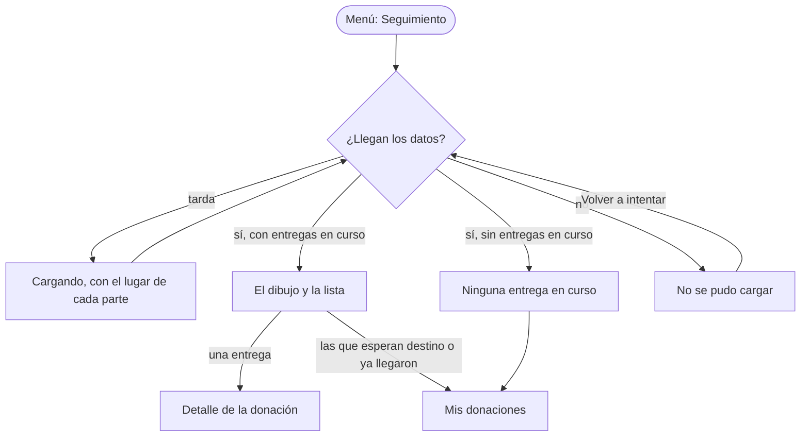

# Flujo: Seguir entregas del donante, en Raíces

> **Estado:** aprobado · **Fecha:** 2026-11-01 · **Aprobó:** usuario (2026-11-01)
> **Ajustada:** 2026-11-02, con la review de Sofía Deane: los codos de las líneas, redondeados
> (bitácora, "Las líneas de subte, con los codos redondeados").
> 2026-11-03, pulido: las cifras como leyenda del dibujo y el acceso a Notificaciones en la cabecera.
> Plantilla de la skill `ux-flujo`. Es la segunda pantalla de Raíces y la primera privada, en el sitio
> ([ADR aceptado](../../adr/cliente-liviano/20261103-una-sola-identidad-en-el-cliente-liviano.md)):
> `/donante-seguimiento`. Mantiene los datos del primer prototipo de esta pantalla.

## 1. Para quién y para qué

| | |
|---|---|
| Quién | La persona de responsabilidad social de una empresa que dona (en el ejemplo, Distribuidora Ejemplo SA). Mira desde la oficina, en la computadora; a veces, desde el celular, entre reuniones. Le rinde cuentas a su empresa y quiere poder mostrar dónde está cada donación |
| Tono | Seguimiento del donante: cálido, agradecido, participativo. Para la entrega con problema: honesto, responsable, sereno ([tono según la pantalla](../tono-y-comunicacion.md#tono-según-la-pantalla)) |
| Qué quiere lograr | "Ver dónde está cada entrega que todavía no llegó, cuándo se actualizó y qué pasa con la que se demoró" |
| Dispositivo principal | Ambos; la computadora primero |
| Requerimientos | RF-09 (mapa de sus entregas activas, con camión, posición y última actualización; solo las suyas). RF-CL-06 (al lado del dibujo, una lista con los mismos datos). RF-CL-07 (toda posición dice cuándo se actualizó) |
| Datos que usa | `GET /api/entregas/seguimiento/donaciones/{id}`, por donación. Huecos: HB-16 (todas las entregas activas de un donante en una llamada), HB-05 y HB-06 (posición del camión, siempre aproximada para el donante, RNF-PRIV-01/02). En la maqueta, los datos de ejemplo de `templates/viaje-datos.html` |
| Boceto de E1 | Página 19: un mapa con el recorrido punteado y marcadores |

## 2. Dónde está en el sitio

Inicio del donante → **Seguimiento** (nivel 2), desde el menú
([mapa del sitio](../mapa-del-sitio.md): Donante → Seguir entregas). Cada entrega lleva a su
detalle (nivel 3, `donante-donaciones-detalle`). El pie lleva a Mis donaciones.

Raíces todavía no tiene las otras pantallas del donante. El menú muestra todas las secciones que
tiene una empresa: Inicio, Mis donaciones, Entidades y Seguimiento. Incentivos no está: RF-07 lo
muestra solo al donante humano y lo oculta a la persona jurídica. Las secciones que faltan, y el
detalle de una entrega, abren una página corta de Raíces, con su menú, que dice que esa pantalla
todavía no está dibujada (decisión del usuario, 2026-11-01; desde 2026-11-03, sin enlace a otra
identidad).

## 3. Recorrido



Desvíos considerados:

- **Volver:** el menú y el botón Atrás del navegador; la pantalla no tiene nada a medio hacer.
- **Error del servidor o sin conexión:** el mismo estado de error, con "Volver a intentar".
- **Entrega con problema:** se muestra como una más, con lo que pasó y la nueva salida.
- **Dato viejo:** cada entrega dice su última noticia con fecha y hora; la de problema, del 11 de
  octubre, se ve vieja por su fecha, sin alarma.
- **Sin permiso:** en el sistema, la sesión del donante solo trae sus entregas (RF-09) y quien no
  inició sesión va a Ingresar. Si una entidad o un admin con sesión abre esta dirección, ve "Esta
  pantalla es para quienes donan." y "Ir a tu inicio". En la maqueta no se dibuja: cada rol tiene
  su propia dirección.

## 4. Pantallas

Una sola pantalla, con la estructura privada de Raíces (menú del donante y cuenta). Esquema en
pantalla grande (histórico: desde el 2026-11-03 el menú y la cuenta van en la cabecera verde
oscuro, arriba, y el contenido ocupa todo el ancho; ver la nota "Reemplazado" en la sección de
A/B):

```text
┌──────────────┬───────────────────────────────────────────────────────────┐
│ DonaTrack    │ Seguimiento                                               │
│              │ Tus entregas en curso                                     │
│ Inicio       │ 3 entregas en curso. Posiciones aproximadas.              │
│ Mis          │ Actualizado el 15 de octubre, 16:25.                      │
│ donaciones   │ ┌──────────┬──────────────┬────────────┬────────────────┐ │
│ Entidades    │ │ En camino│ Con problema │ Pendientes │ Esperan destino│ │
│ Seguimiento ●│ │    1     │      1       │     1      │       2 →      │ │
│              │ └──────────┴──────────────┴────────────┴────────────────┘ │
│              │ ┌─────────────────────────────────────────┐               │
│              │ │ El dibujo: del brote, al centro, sale   │               │
│              │ │ una línea de subte por entrega hasta la │               │
│              │ │ estación de su entidad, con su número y │               │
│              │ │ su nombre. En cada línea, el sello de   │               │
│              │ │ su estado; la que va en camino, el      │               │
│              │ │ camión donde va.                        │               │
│              │ └─────────────────────────────────────────┘               │
│              │ Entrega por entrega                                       │
│ Distribuidora│ ┌───────────────┐ ┌───────────────┐ ┌───────────────┐     │
│ Ejemplo SA   │ │ 1 Lentejas    │ │ 2 Útiles      │ │ 3 Leche en    │     │
│ Empresa      │ │ ▣ Alimentos   │ │ ▣ Útiles esc. │ │ ▣ Alimentos   │     │
│ donante      │ │ 15 kg para …  │ │ 2 cajas para …│ │ 6 kg para …   │     │
│              │ │ [En camino] … │ │ [Con problema]│ │ [Pendiente] … │     │
│              │ │ ●─●─●─◐─○     │ │ ●─●─●─!─○     │ │ ●─◌─○─○─○     │     │
│              │ │ última noticia│ │ última noticia│ │ última noticia│     │
│              │ └───────────────┘ └───────────────┘ └───────────────┘     │
│              │ Las que esperan destino … · Ver Mis donaciones            │
└──────────────┴───────────────────────────────────────────────────────────┘
```

- **Cifras por estado:** debajo de la bajada, un registro como el de la portada, con cuántas
  entregas hay en camino, con problema y pendientes, y aparte cuántas donaciones esperan destino,
  con enlace a Mis donaciones.
- **Orden:** la más avanzada primero: en camino, con problema y pendiente; dentro del mismo estado,
  la donación más reciente primero. El número de cada entrega sigue ese orden, en la lista y en el
  dibujo.
- **Cada tarjeta:** el número y el nombre, la categoría con su ícono y su nombre, la cantidad y la
  entidad, las cinco etapas de la donación con su fecha (en depósito, asignada, lista para
  entregar, en camino y entregada), el estado con su nota y la última noticia. La entrega con
  problema va en su lugar, como una más. Las etapas, en una barra de progreso (A/B 4); debajo, un
  solo renglón con el estado y su nota, que reemplaza al nombre de la etapa actual para no repetir
  el estado (usuario, 2026-11-01).
- **Lista y dibujo:** al pasar el mouse o el foco por una entrega de la lista, su línea en el dibujo
  queda llena y el resto se apaga, como la red de la portada.

En el celular y la tableta: la marca y la cuenta arriba, el título, el dibujo más chico y la lista
debajo; el menú, en una barra de navegación inferior fija en el celular y en la cabecera desde la
tableta (usuario, 2026-11-03). Es el patrón para 3 a 5 destinos de
primer nivel y queda al alcance del pulgar
([criterios de la cátedra](../criterios-catedra-ux-ui.md), secciones 4 y 5), así que no se
compara. El dibujo es una ayuda; la lista dice todo. En el celular, el dibujo queda chico, con los
números y sin los nombres, y las cifras van de a dos (usuario, 2026-11-01).

Qué cambia respecto del boceto de E1, y por qué:

- **En la maqueta, un dibujo; en el sistema, el mapa.** RF-09 pide un mapa y D21 eligió MapLibre
  para las pantallas con mapa. El boceto muestra un mapa geográfico con el recorrido punteado. En
  el prototipo de Raíces, como en el primer prototipo, el mapa se representa con un dibujo SVG fijo de las
  tres entregas del ejemplo: muestra cómo se verá el estilo propio del mapa de Raíces (cada
  recorrido, una raíz desde el depósito hasta su entidad, con el sello de su estado y el camión en
  su posición aproximada, RNF-PRIV-01/02 y HB-06). En el sistema, ese estilo se aplica a MapLibre,
  que se arma con los datos y aguanta cualquier cantidad de entregas. Queda en la bitácora.
- **Junto al dibujo, la lista con los mismos datos y el mismo número** (RF-CL-06), que en el boceto
  no está. Va debajo, una tarjeta por entrega (A/B 3).
- **Arriba, la última actualización** (RF-CL-07), que en el boceto no está.

## 5. Estados

En la maqueta, `?escenario=vacio`, `error` y `lento` (como la portada de Raíces).

| Pantalla | Estado | Qué se ve | Texto |
|---|---|---|---|
| Seguimiento | Con datos | Las cifras, el dibujo con las tres entregas en curso y la lista | Ver Textos |
| Seguimiento | Vacío | El título; en lugar de las cifras, el dibujo y la lista, un aviso con el brote solo, sin raíces | "Ninguna entrega en curso." · "Ningún camión está en camino con tus donaciones" · "Cuando a una donación se le asigne una entidad, vas a ver acá su camino y, cuando salga, por dónde va el camión." · "Ver Mis donaciones" |
| Seguimiento | Cargando | El título; el dibujo y la lista con su lugar reservado, sin datos inventados | "Cargando tus entregas en curso…" (en el sistema, en la región `#avisos`, que lo anuncia; en la maqueta llega con la página y no es región viva) |
| Seguimiento | Éxito | No aplica: es una pantalla de consulta, sin acciones que cambien algo | — |
| Seguimiento | Error de datos | No aplica: la pantalla no recibe datos del donante | — |
| Seguimiento | Error del servidor | El título; el banner de error en lugar del dibujo y la lista | "No pudimos cargar tus entregas en curso." · "Es un problema nuestro y no cambia el estado de tus donaciones. Probá de nuevo en unos minutos; si sigue, escribinos con este código." · el código de seguimiento (en la maqueta, `a1b2c3d4e5f6`, como en el primer prototipo) · "Volver a intentar" |
| Seguimiento | Sin permiso | No se dibuja en la maqueta (ver Desvíos) | "Esta pantalla es para quienes donan." · "Ir a tu inicio" |
| Seguimiento | Deshabilitado | No aplica: la pantalla no tiene controles que esperen un paso previo | — |
| Pantalla sin dibujar | — | El título de la sección y el aviso | "Esta pantalla todavía no está dibujada." |

## 6. Textos

Los de las entregas salen de los datos de ejemplo, los mismos que el primer prototipo. Los propios de esta
pantalla:

| Elemento | Texto | Nota |
|---|---|---|
| Rótulo de la sección | Seguimiento | El nombre del menú |
| Título | Tus entregas en curso | Sin imagen de raíz: la regla de Raíces deja como mucho una por pantalla, en el título grande, y acá el dibujo ya la tiene |
| Bajada | "Gracias por donar. 3 entregas en curso. Posiciones aproximadas, actualizadas hoy, 15 de octubre, a las 16:25." | Reconoce el aporte (tono del seguimiento del donante) y da la cifra con su fecha; "hoy" queda atado a una fecha, porque las notas de las entregas dicen "hoy"; "aproximadas" dice el límite del dato (RNF-PRIV) |
| Cifras | "En camino" · "Con problema" · "Pendientes" · "Esperan destino" (enlace a Mis donaciones), cada una con su número | Nombre accesible del registro: "Tus donaciones, por estado". La fecha de corte es la de la bajada, justo arriba. Cada estado lleva su sello, como en la lista |
| Título de la lista | Entrega por entrega | El primer prototipo decía "La hoja de ruta" |
| Categoría | El nombre de la categoría ("Alimentos", "Útiles escolares") con su ícono | El ícono, el mismo pictograma impreso del cuaderno de la portada; el nombre lo dice en texto |
| Etapas | "En depósito" · "Asignada" · "Lista para entregar" · "En camino" · "Entregada", cada una con su detalle ("13 de octubre", "Pendiente", "11 de octubre: no pudo llegar", "Nueva salida: 17 de octubre") | Del dato (`pasos`), los mismos que el detalle del primer prototipo. Nombre accesible: "Etapas de <nombre>" |
| Cada entrega | Nombre (enlace al detalle) · categoría · "6 kg para Merendero Ejemplo Sur" · estado + nota · etapas · última noticia | Del dato: "Asignada, espera el camión" y "Sale del depósito el 16 de octubre."; "Salió hoy a las 14:30" y "El camión va por la mitad del camino. Posición aproximada, actualizada hoy a las 16:25."; "No pudo llegar; sale de nuevo el 17 de octubre" y "El camino estaba cortado. Última noticia: 11 de octubre, 16:10." |
| Estados (sello y texto) | Pendiente · En camino · Con problema | Los de `EstadoEntrega`, siempre con texto y una forma, nunca solo con color. En el dibujo, el número de la entrega junto al sello |
| Pie de la lista | "Arroz largo fino y Zapatillas todavía esperan destino: aparecen acá cuando se les asigne una entidad. Las que ya llegaron, con la foto de la entidad, están en Mis donaciones." | el primer prototipo dice "aparecen en el mapa"; la foto dice qué respalda una entrega llegada |
| Enlace del pie | Ver Mis donaciones | El mismo del primer prototipo |
| En el dibujo | Depósito · el nombre de cada entidad | El dibujo es decorativo para el lector de pantalla (`aria-hidden`): la lista dice lo mismo |
| Cuenta | Distribuidora Ejemplo SA · Empresa donante | Empresa sintética (decisión del usuario, 2026-11-01). Las donaciones son las de Ana en el primer prototipo |

Ayudas por flujo crítico: no es un flujo crítico (no envía nada); la ayuda es la bajada, que dice
qué es aproximado y cuándo se actualizó.

Filtro de tono:

- Lo pendiente se dice pendiente: la leche "espera el camión", no "en camino".
- La entrega con problema dice qué pasó, qué se sabe (la fecha de la última noticia) y el próximo
  paso (la nueva salida), sin "lamentablemente" ni urgencia.
- Las cifras llevan fecha: "3 entregas en curso … Actualizado el 15 de octubre, 16:25."
- No se dice nada del efecto de la entrega: eso, si llega, va con la confirmación de la entidad.
- Palabras que no van (brief de Raíces): "eco", "huella verde", "florecer", "regá", "cosechá" y
  "sostenible" puesto de adorno.

## 7. Accesibilidad

- Zonas: el enlace para saltar al contenido, la navegación del donante (`nav` con nombre), el
  contenido (`main`) con un `h1` y la lista con su `h2`.
- Orden del foco: saltar al contenido, la marca, el menú, "Salir", "Esperan destino" en las cifras, cada entrega de la lista (su
  enlace al detalle) y "Ver Mis donaciones". El dibujo no recibe foco.
- El dibujo es `aria-hidden`; la lista es la alternativa completa (RF-CL-06), con el mismo número
  que el dibujo.
- La sección actual del menú lleva `aria-current="page"`.
- Los estados de carga y error se anuncian en la región `aria-live`.
- El estado de cada entrega es texto, con su forma (sello); el color solo acompaña.
- Las cifras son una lista de definiciones (`dl`) con nombre; el número no va solo.
- Las etapas son una lista ordenada (`ol`) con nombre; la etapa actual lleva
  `aria-current="step"` y cada una dice su detalle en texto, oculto a la vista y leído por el
  lector de pantalla.
- Con "reducir movimiento", el dibujo aparece entero, sin trazado.

## 8. Revisión de usabilidad

| # | Heurística | Cómo la cumple | Riesgo que queda |
|---|---|---|---|
| 1 | Visibilidad del estado | Cada entrega con su estado, su nota y su última noticia; arriba, cuándo se actualizó todo | El simulador de posición ya existe en Logística (HB-05, 2026-11-08), pero esta pantalla todavía no lo consume. "Actualizadas…" cambia al recargar la página: si se refresca sola depende de D22 (pendiente) |
| 2 | Lenguaje del usuario | Entrega, depósito, en camino, espera destino; sin códigos de seguimiento | — |
| 3 | Control y libertad | Solo consulta; menú y Atrás siempre disponibles | — |
| 4 | Consistencia | Los mismos estados, datos y enlaces que la pantalla del primer prototipo; el sello de estado de la portada de Raíces | No hay catálogo de componentes: el sello se compara a ojo con el de la portada |
| 5 | Prevención de errores | No hay acciones que cambien algo | — |
| 6 | Reconocer antes que recordar | El mismo número en el dibujo y en la lista; el nombre de la entidad en los dos | Con muchas entregas en curso el mapa se llena; en el sistema lo arma MapLibre con los datos y la lista sigue completa. El dibujo de la maqueta solo cubre las tres del ejemplo |
| 7 | Flexibilidad | Quien quiere el detalle entra desde la lista; quien quiere el panorama mira el dibujo | — |
| 8 | Diseño minimalista | Una sola pregunta por pantalla: dónde está cada entrega; lo que ya llegó o espera destino va a Mis donaciones | — |
| 9 | Recuperarse de errores | El error dice que las entregas no se afectan y ofrece volver a intentar | — |
| 10 | Ayuda | La bajada aclara qué es aproximado | — |

Los 7 factores de la experiencia ([criterios de la cátedra](../criterios-catedra-ux-ui.md),
sección 2):

| Factor | Cómo lo cumple |
|---|---|
| Útil | Cada parte responde dónde está cada entrega; lo que ya llegó o espera destino va a Mis donaciones |
| Usable | Una lista con enlaces y estados con texto; nada que aprender |
| Deseable | El dibujo de raíces y los sellos de Raíces, con la paleta de Raíces |
| Valioso | La empresa puede mostrar a quién llega cada donación y en qué estado está |
| Ubicable | Seguimiento es un destino del menú en todas las pantallas; la sección actual se destaca |
| Accesible | La lista es la alternativa al dibujo; los estados llevan forma y texto; WCAG AA y Ley 26.653 |
| Creíble | Cada dato dice su fecha y si es aproximado; la entrega con problema se muestra tal cual; lo confirmado remite a la foto de la entidad |

Qué conviene probar con personas reales (la revisión heurística no reemplaza al test con
usuarios): si una persona de una empresa entiende sin ayuda que el dibujo y la lista dicen lo
mismo, y si encuentra cuándo se actualizó la posición.

## 9. Decisiones y preguntas

Decisiones tomadas:

- La cuenta de ejemplo es una empresa, Distribuidora Ejemplo SA, con las donaciones de Ana
  (usuario, 2026-11-01).
- El menú muestra todas las secciones del donante; las que Raíces no dibujó abren un aviso
  (usuario, 2026-11-01).
- En la maqueta, un dibujo SVG que representa el estilo del mapa de Raíces (una raíz por entrega);
  en el sistema, ese estilo sobre MapLibre (D21). Agente, propuesto; bitácora 2026-11-01.
- Sin Incentivos en el menú de la empresa (RF-07).
- Los estados de la maqueta van en la misma pantalla con `?escenario=`, como la portada de Raíces
  (agente, propuesto).
- Rondas de preguntas (usuario, 2026-11-01), después de los A/B 2 y 3, porque la pantalla se veía
  vacía:
  - cifras por estado debajo de la bajada y, aparte, las que esperan destino, con enlace;
  - en cada tarjeta, las etapas y la categoría con su ícono; sin un registro de novedades, porque
    cada tarjeta ya dice su última noticia y el historial va en el detalle;
  - la entrega con problema, como una más, en su lugar;
  - la más avanzada primero;
  - en el celular, el dibujo chico arriba.

Partes que se deciden con A/B, en este orden:

1. La estructura privada de Raíces en pantalla grande. **Decidido (usuario, 2026-11-01):** una
   columna a la izquierda, abierta al entrar, que se puede plegar; en el celular, la barra inferior
   (bitácora, "Una columna a la izquierda que se puede plegar"). **Reemplazado (usuario,
   2026-11-03):** el menú va horizontal en la cabecera verde oscuro desde la tableta; abajo, solo
   en el celular (bitácora, "Sitio A elegido, con la cabecera, el menú y el pie de B").
2. El dibujo de las entregas: cómo se ven la raíz de cada entrega, su sello y el camión.
   **Decidido (usuario, 2026-11-01):** una red radial en espejo, como la de la portada. El brote va
   al centro y sale una línea de subte por entrega, con codos a 45°. Lo recorrido va impreso y lo
   que falta, hueco. El sello de estado es la estación donde está la entrega, y cada entidad, una
   estación con su número y su nombre debajo (bitácora, "Una red radial de subte, con el brote al
   centro"). **Ajustado (usuario, 2026-11-02, review de Sofía):** los codos a 45°, redondeados,
   también en la red de la portada y en la raíz de Recepción confirmada (A, la recomendada, contra
   raíces curvas sin codos).
3. La lista y su relación con el dibujo. **Decidido (usuario, 2026-11-01):** en pantalla grande,
   el dibujo arriba, más grande y con los nombres legibles, y debajo una tarjeta por entrega, con
   el mismo número (patrón: tarjetas). En el celular, lo mismo en una columna. Al pasar o enfocar
   una entrega, su línea queda llena y el resto se apaga (bitácora, "El dibujo arriba y una tarjeta
   por entrega debajo"). **Ajustado (usuario, 2026-11-03, pulido):** en pantalla grande, las
   cifras por estado pasan a la derecha del dibujo, en una columna, como su leyenda (bitácora,
   "Pulido del sitio del donante, pantalla por pantalla").
4. Cómo se dibujan las etapas en la tarjeta. **Decidido (usuario, 2026-11-01):** una barra de
   progreso, con los cinco sellos en fila y debajo la etapa actual con su detalle (bitácora, "Las
   etapas, una barra de progreso con la actual debajo"). Ajuste (usuario, 2026-11-01): debajo de
   la barra, el estado con su nota en un solo renglón (bitácora, "Un solo renglón de estado en la
   tarjeta").

Preguntas abiertas: ninguna.
