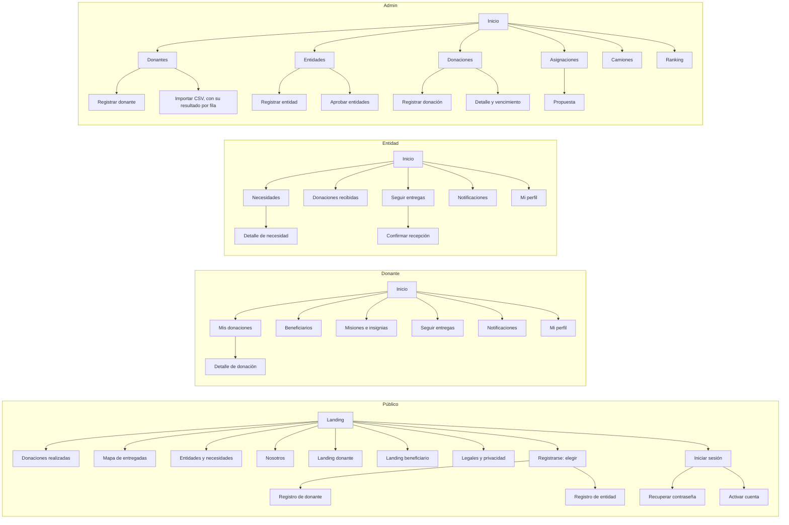

# Mapa del sitio

> UTN-FRBA — Diseño de Sistemas (2026) — Grupo 5
> **Versión 1 · 2026-10-30 · une el mapa de E1 con las pantallas de E6**

Fuentes: [`Mapa del Sitio.pdf`](../entregas/1/interfaz/Mapa%20del%20Sitio.pdf) de E1 y la tabla de pantallas de
[`requerimientos-e6.md` §6.2](../requerimientos/requerimientos-e6.md). Regla: ninguna función clave
queda a más de **3 niveles** (RNF-UI-02). El nivel 1 es el inicio de cada rol.

## Mapa

## Pantallas

| Pantalla | Rol | Nivel | Requerimiento | Boceto E1 | Origen |
|---|---|:-:|---|---|---|
| Landing | Público | 1 | RF-01 | pág. 1 | E1 |
| Donaciones realizadas | Público | 2 | RF-01 | pág. 2 | E1 |
| Mapa de entregadas | Público | 2 | RF-02 | págs. 2 y 23 | E1 |
| Entidades y necesidades | Público | 2 | RF-22 | — | E6 (D26) |
| Nosotros | Público | 2 | RF-01 | pág. 3 | E1 |
| Landing donante / beneficiario | Público | 2 | RF-01 | — | E1 (sin boceto) |
| Legales y privacidad | Público | 2 | RF-01 | pie de página | E6 |
| Iniciar sesión | Público | 2 | RF-04 | pág. 4 | E1 |
| Registrarse: elegir | Público | 2 | RF-03 | pág. 5 | E1 |
| Registro de donante / entidad | Público | 3 | RF-03 | pág. 11 (entidad) | E1 |
| Recuperar contraseña / Activar cuenta | Público | 3 | RF-AUTH | — | E6 |
| Inicio del donante | Donante | 1 | — | pág. 15 | E1 |
| Mis donaciones → detalle | Donante | 2 → 3 | RF-05 | pág. 16 | E1 |
| Beneficiarios | Donante | 2 | RF-06 | pág. 17 | E1 |
| Misiones e insignias | Donante humano | 2 | RF-07 | pág. 18 | E1 |
| Seguir entregas | Donante | 2 | RF-09 | pág. 19 | E1 |
| Notificaciones | Donante | 2 | RF-08 | pág. 6 | E1 |
| Mi perfil | Donante y entidad | 2 | RI-AUTH-02 | menú de usuario (pág. 14) | E6 |
| Inicio de la entidad | Entidad | 1 | — | pág. 24 | E1 |
| Necesidades → detalle | Entidad | 2 → 3 | RF-10 | págs. 26 y 29–31 | E1 |
| Donaciones recibidas | Entidad | 2 | RF-11 | pág. 27 | E1 |
| Seguir entregas → **Confirmar recepción** | Entidad | 2 → 3 | RF-14, **RF-12** | pág. 28 | E1 · **flujo piloto** |
| Notificaciones | Entidad | 2 | RF-13 | — | E1 |
| Inicio del admin | Admin | 1 | — | pág. 13 | E1 |
| Donantes → registrar donante | Admin | 2 → 3 | RF-15 | pág. 13 (menú) | E1 |
| Entidades → registrar entidad | Admin | 2 → 3 | RF-15 | pág. 13 (menú) | E1 |
| Entidades → aprobar entidades | Admin | 2 → 3 | RF-21 | — | E6 |
| Donaciones → registrar donación | Admin | 2 → 3 | RF-15 | pág. 13 (menú) | E1 |
| Donaciones → detalle y vencimiento | Admin | 2 → 3 | RF-16 | pág. 13 (menú) | E1 |
| Asignaciones → propuesta | Admin | 2 → 3 | RF-17 | — | E6 |
| Camiones | Admin | 2 | RF-18 | pág. 13 (menú) | E1 |
| Ranking | Admin | 2 | RF-19 | — | E6 |
| Donantes → importar CSV (resultado en la misma pantalla) | Admin | 2 → 3 | RF-20 | — | E6 |

## Observaciones para el diseño

- El admin tenía 9 secciones de nivel 2. Quedan 6 por tema, como el prototipo: registrar,
  importar y aprobar son acciones dentro de cada lista. El resultado de importar el CSV se muestra
  en la misma pantalla, para no pasar de 3 niveles
  ([bitácora, 2026-10-30](bitacora.md)).
- "Mapa de entregadas" y "Donaciones realizadas" comparten el mapa en los bocetos. Se decide al
  diseñar ese flujo si van juntas o separadas.
