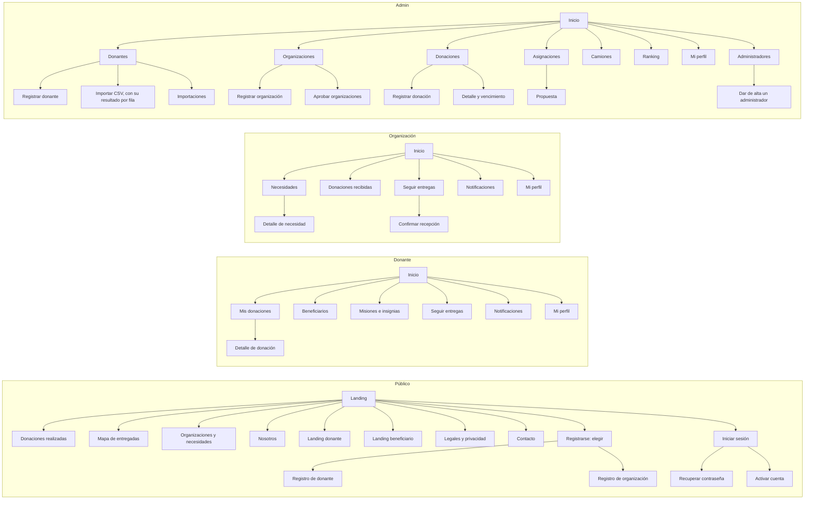

# Mapa del sitio

> UTN-FRBA — Diseño de Sistemas (2026) — Grupo 5
> **Versión 1.1 · 2026-11-12 (cierre de la oleada P1 de la revisión del 2026-11-11) · une el mapa de E1 con las pantallas de E6**

Fuentes: [`Mapa del Sitio.pdf`](../entregas/1/interfaz/Mapa%20del%20Sitio.pdf) de E1 y la tabla de pantallas de
[`requerimientos-e6.md` §6.2](../requerimientos/requerimientos-e6.md). Regla: ninguna función clave
queda a más de **3 niveles** (RNF-UI-02). El nivel 1 es el inicio de cada rol.

## Mapa

## Pantallas

| Pantalla | Rol | Nivel | Requerimiento | Boceto E1 | Origen |
|---|---|:-:|---|---|---|
| Landing | Público | 1 | RF-01 | pág. 1 | E1 |
| Donaciones realizadas | Público | 2 | RF-01 | pág. 2 | E1 |
| Mapa de entregadas | Público | 2 | RF-02 | págs. 2 y 23 | E1 |
| Organizaciones y necesidades | Público | 2 | RF-22 | — | E6 (D26) |
| Nosotros | Público | 2 | RF-01 | pág. 3 | E1 |
| Landing donante / beneficiario | Público | 2 | RF-01 | — | E1 (sin boceto) |
| Legales y privacidad | Público | 2 | RF-01 | pie de página | E6 |
| Contacto | Público | 2 | RF-01 (HB-21) | pie de página y avisos de error | E6 (Raíces, 2026-11-02) |
| Iniciar sesión | Público | 2 | RF-04 | pág. 4 | E1 |
| Registrarse: elegir | Público | 2 | RF-03 | pág. 5 | E1 |
| Registro de donante / organización | Público | 3 | RF-03 | pág. 11 (entidad) | E1 |
| Recuperar contraseña / Activar cuenta | Público | 3 | RF-AUTH | — | E6 |
| Inicio del donante | Donante | 1 | — | pág. 15 | E1 |
| Mis donaciones → detalle | Donante | 2 → 3 | RF-05 | pág. 16 | E1 |
| Beneficiarios (en el menú, "Organizaciones") | Donante | 2 | RF-06 | pág. 17 | E1 |
| Misiones e insignias | Donante humano | 2 | RF-07 | pág. 18 | E1 |
| Seguir entregas | Donante | 2 | RF-09 | pág. 19 | E1 |
| Notificaciones | Donante | 2 | RF-08 | pág. 6 | E1 |
| Mi perfil | Donante, organización y admin (el admin, desde R11-10) | 2 | RI-AUTH-02 | menú de usuario (pág. 14) | E6 |
| Inicio de la organización | Organización | 1 | — | pág. 24 | E1 |
| Necesidades → detalle | Organización | 2 → 3 | RF-10 | págs. 26 y 29–31 | E1 |
| Donaciones recibidas | Organización | 2 | RF-11 | pág. 27 | E1 |
| Seguir entregas → **Confirmar recepción** | Organización | 2 → 3 | RF-14, **RF-12** | pág. 28 | E1 · **flujo piloto** |
| Notificaciones | Organización | 2 | RF-13 | — | E1 |
| Inicio del admin | Admin | 1 | — | pág. 13 | E1 |
| Donantes → registrar donante | Admin | 2 → 3 | RF-15 | pág. 13 (menú) | E1 |
| Organizaciones → registrar organización | Admin | 2 → 3 | RF-15 | pág. 13 (menú) | E1 |
| Organizaciones → aprobar organizaciones | Admin | 2 → 3 | RF-21 | — | E6 |
| Donaciones → registrar donación | Admin | 2 → 3 | RF-15 | pág. 13 (menú) | E1 |
| Donaciones → detalle y vencimiento | Admin | 2 → 3 | RF-16 | pág. 13 (menú) | E1 |
| Asignaciones → propuesta | Admin | 2 → 3 | RF-17 | — | E6 |
| Camiones | Admin | 2 | RF-18 | pág. 13 (menú) | E1 |
| Ranking | Admin | 2 | RF-19 | — | E6 |
| Donantes → importar CSV (resultado en la misma pantalla) | Admin | 2 → 3 | RF-20 | — | E6 |
| Donantes → Importaciones (`/admin-importaciones`: en curso e históricas, con búsqueda y filtros) | Admin | 2 → 3 | RF-20 | [r11-p1-importaciones](flujos/r11-p1-importaciones.md) | E6 |
| Mi perfil del admin (`/admin-perfil`, desde el menú de la cuenta) | Admin | 2 | RI-AUTH-02, R11-10 | [r11-p1-admins](flujos/r11-p1-admins.md) | E6 (R11, P1) |
| Administradores → dar de alta (`/admin-administradores`, desde el menú de la cuenta; la ventana o, sin JavaScript, `/admin-administradores-nuevo`; el resultado con la contraseña provisoria, `/admin-administradores-alta`) | Admin | 2 → 3 | RF-AUTH-07, R11-10 | [r11-p1-admins](flujos/r11-p1-admins.md) | E6 (R11, P1) |

## Pantallas dibujadas (sitios A y B de la corrida del 2026-11-02)

El sitio dibuja el recorrido de los tres roles en la maqueta (`/<pantalla>`): es el sitio
**A** de la corrida, elegido por el usuario el 2026-11-03. El sitio B de la corrida (otra navegación y composición con el mismo ADN) se borró; su
evidencia queda en `evidencia/raices/ab-navegable/b/`. Las dibuja
con su ficha de flujo en [`flujos/raices-publico-navegable.md`](flujos/raices-publico-navegable.md),
[`raices-donante-navegable.md`](flujos/raices-donante-navegable.md) y
[`raices-entidad-navegable.md`](flujos/raices-entidad-navegable.md), aprobadas al elegir el
sitio A (usuario, 2026-11-03). Lo que falta de backend está en la ficha de cada recorrido.

La columna "En B" es histórica: describe el sitio B al cerrar la corrida, antes de borrarlo.

| Pantalla del mapa | En A | En B (histórico) |
|---|---|---|
| Landing, Donaciones realizadas, Mapa de entregadas, Entidades y necesidades | Dibujadas | Dibujadas, con la línea pública de navegación |
| Contacto, Legales y privacidad | Dibujadas | Dibujadas |
| Iniciar sesión, Registrarse: elegir, Registro de donante / entidad | Dibujadas | Dibujadas |
| Recuperar contraseña | Dibujada, con su aviso de enviado | Dibujada, con su aviso de enviado |
| Nosotros, Landing donante ("Para donantes"), Landing beneficiario ("Para entidades") y Activar cuenta (con pedir otro enlace) | Dibujadas (F6 del roadmap, 2026-11-07; [ficha](flujos/raices-conocer-y-activar.md)), enlazadas desde el pie y la portada | No están |
| Inicio, Mis donaciones → detalle, Beneficiarios (Entidades), Notificaciones, Mi perfil, Seguir entregas del donante | Dibujadas | Dibujadas |
| Misiones e insignias (Incentivos) | Dibujada para la cuenta persona (F5 del roadmap, 2026-11-07); RF-07 la oculta a la empresa | No está: RF-07 la oculta a la empresa |
| Inicio de la entidad, Necesidades, Donaciones recibidas, Notificaciones, Confirmar recepción | Dibujadas | Dibujadas |
| Llegó con un problema (desde Confirmar recepción) | Dibujada (F7 del roadmap, 2026-11-07; [ficha](flujos/raices-llego-con-un-problema.md)) | No está |
| Seguir entregas de la entidad (dibujo y lista) y Mi perfil de la entidad | Dibujadas (F5 del roadmap, 2026-11-07) | Dibujada |
| Inicio del admin | Dibujada, con el menú | Dibujada, con el menú |
| Donantes (registrar, importar CSV con su resultado) y Entidades (registrar, aprobar, pedir corrección, rechazar) del admin | Dibujadas (F2 del roadmap, 2026-11-07) | Dibujadas (F2 del roadmap, 2026-11-07) |
| Donaciones (registrar, detalle, marcar vencida) y Asignar donaciones (aprobar, descartar, correr la asignación) del admin | Dibujadas (F3 del roadmap, 2026-11-07) | Dibujadas (F3 del roadmap, 2026-11-07) |
| Camiones (agregar, deshabilitar, volver a habilitar) y Ranking (meses anteriores) del admin | Dibujadas (F4 del roadmap, 2026-11-07) | Dibujadas (F4 del roadmap, 2026-11-07) |
| Páginas de error 404, 403 y 5xx (fuera del menú; con el marco público y, desde R11-05, con el de la cuenta si hay sesión) | Dibujadas (F7 del roadmap, 2026-11-07; [ficha](flujos/raices-paginas-de-error.md)) | No están |

Lo público que no tiene plantilla no existe y muestra la página 404; lo privado que no tiene
plantilla muestra "sin dibujar". Desde F7 (2026-11-07) ningún enlace del sitio lleva a "sin
dibujar": lo comprueba `SitioControllerTest`. Hasta la oleada P1 la administración no tenía Mi
perfil; desde R11-10 (`p1-admins`, 2026-11-12) tiene Mi perfil y Administradores en el menú de la
cuenta, fuera del menú de secciones.

## Cambios de la revisión del 2026-11-11 (oleada P0, 2026-11-12)

Ninguna pantalla nueva ni ningún nivel más. Lo que cambia en el recorrido, del
[backlog de la revisión](backlog-revision-2026-11-11.md):

| Dónde | Qué cambia | Ítem |
|---|---|---|
| Donantes → Importar CSV | La subida lleva a "Importando" (`admin-donantes-importando`, nivel 3), que se actualiza sola, y al terminar a "Importación terminada" (`admin-donantes-importado`, con el resumen y las filas con error de a página) o a la de error. Se puede salir: en Donantes, una franja recuerda la importación hasta que se abre el resultado | R11-02 |
| Donantes, Donaciones y Entidades del admin | De a una página, con la búsqueda y los filtros en la dirección: el "atrás" del navegador vuelve a la página anterior | R11-01 |
| Inicio del donante persona → Mis donaciones | Cada mes del año muestra 3 donaciones y "Ver todas", que lleva a Mis donaciones de ese mes (`?mes=AAAA-MM`, nivel 2) | R11-06 |
| Inicio y Mi perfil del donante | Con login real, la persona ve los suyos (`persona/`) y la empresa los de la empresa | R11-06 |
| Misiones e insignias | En el menú solo de la persona. La empresa que entra por la dirección ve un aviso con "Ir a tu inicio" | R11-06, RF-07 |
| Páginas de error y Contacto | Con sesión activa, el encabezado y el menú del área de la cuenta; la salida es "Volver a mi inicio" (el inicio del área). Sin sesión, el marco público y "Ir al inicio" (la portada) | R11-05 |
| "Recibimos la solicitud" (entidad pendiente) | La cuenta con la solicitud pendiente puede ir a la portada, Entidades, Donaciones, el Mapa, Nosotros, Para donantes, Para entidades, Legales y Contacto. Lo privado, Ingresar, Crear una cuenta, Recuperar y Activar la siguen llevando a "Recibimos la solicitud" | R11-08 |

## Nombres visibles (oleada P1, lote `p1-nombres`)

Ninguna ruta cambia: `/donante-entidades`, `/admin-entidades`, `/publico-entidades` y las pantallas
`entidad-*` siguen igual. Cambia lo que se lee (R11-44, R11-45):

| Dónde | Antes | Ahora |
|---|---|---|
| Menú del donante y del admin, títulos y rótulos | Entidades | Organizaciones |
| Área de quien recibe (renglón debajo del nombre de la cuenta) | Entidad | Organización |
| Registro, landing y registro del admin | Entidad / entidad beneficiaria | Organización |
| Saludo y menú de la cuenta | El rol ("Donante", "Entidad", "Administración") | El nombre y apellido, la razón social o el nombre de quien administra; el rol, debajo |
| Tipo del donante persona jurídica (Donantes del admin, Mi perfil, registro) | Organización | Su tipo jurídico: Empresa, ONG, Institución o Gubernamental |

## Cambios de la oleada P1 (2026-11-12)

Dos pantallas nuevas del admin, ninguna a más de 3 niveles. Lo demás cambia dentro de pantallas que
ya estaban ([backlog de la revisión](backlog-revision-2026-11-11.md#estado-de-p1-al-cierre-de-la-oleada-2026-11-12)):

| Dónde | Qué cambia | Ítem |
|---|---|---|
| Menú de la cuenta del admin | "Mi perfil" (`/admin-perfil`) y "Administradores" (`/admin-administradores`, de a 10, con "Dar de alta un administrador"). No suman secciones al menú principal | R11-10 |
| Donantes del admin | Pestañas "Donantes · Importaciones"; Importaciones (`/admin-importaciones`) lleva al avance o al resultado de cada una, y el resultado ofrece descargar las filas con error | R11-20 |
| Todas las listas paginadas | El paginador `« ‹ 1 2 3 … 9 › »` (`‹ 3 de 9 ›` en el celular), que conserva la búsqueda y los filtros en la dirección | R11-11 |
| Organizaciones del donante | "Categoría" y "Ya doné" filtran todas las organizaciones en el servidor; al cambiar de página el filtro sigue | R11-12 |
| Notificaciones del donante y de la organización | De a 20, con búsqueda, categoría y orden en la dirección | R11-14 |
| Mapa de entregadas | Los botones de salida quedan debajo del mapa; la lista, plegada y de a 10 (`?pagina=` y `?abierta=`) | R11-19 |
| Asignar donaciones | Tres pestañas que son direcciones propias: Propuestas, Conflictos y Destino; se borraron las variantes A, B y C | R11-24 |
| Ranking | "Volver al último mes" cuando se mira un mes anterior | R11-23 |
| Portada y públicas con la sesión iniciada | La navegación pública sigue; "Ingresar" y "Crear una cuenta" se cambian por "Ir a mi inicio" (el inicio del área) y la foto con el menú de la cuenta. Con la solicitud pendiente, "Ver mi solicitud" (lleva a "Recibimos la solicitud"). Integrado después del cierre (`p1-portada`) | R11-15 |
El registro de actividad y las notificaciones del admin entran con sus lotes de P2.

## Observaciones para el diseño

- El admin tenía 9 secciones de nivel 2. Quedan 6 por tema, como el prototipo: registrar,
  importar y aprobar son acciones dentro de cada lista. El resultado de importar el CSV se muestra
  en la misma pantalla, para no pasar de 3 niveles
  ([bitácora, 2026-10-30](bitacora.md)).
- "Mapa de entregadas" y "Donaciones realizadas" comparten el mapa en los bocetos. Se decide al
  diseñar ese flujo si van juntas o separadas.
