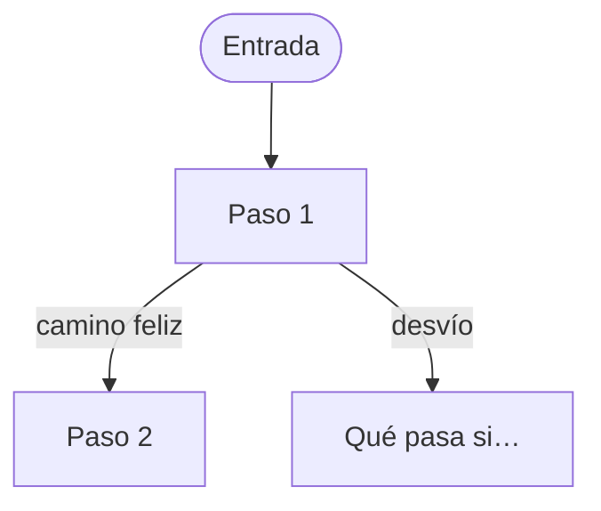

# Flujo: <nombre del flujo>

> **Estado:** borrador | en revisión | aprobado · **Fecha:** AAAA-MM-DD · **Aprobó:** <quién>
> Plantilla de la skill `ux-flujo`. Copiar a `docs/interfaz/flujos/<flujo>.md` y completar todo.

## 1. Para quién y para qué

| | |
|---|---|
| Quién | Rol y situación real (por ejemplo: "persona de la entidad que recibe el camión en la puerta, con el celular") |
| Qué quiere lograr | En una frase, con sus palabras |
| Dispositivo principal | Celular / escritorio / ambos |
| Requerimientos | RF-xx y su criterio de aceptación |
| Datos que usa | Endpoints o, si faltan, el hueco (HB-xx) |
| Boceto de E1 | Página, o "sin boceto" |

## 2. Dónde está en el sitio

Ruta desde el inicio del rol y nivel (máximo 3). Enlace al [mapa del sitio](../mapa-del-sitio.md).

## 3. Recorrido



Desvíos considerados: cancelar, volver, error de datos, error del servidor, sin conexión, sin
permiso.

## 4. Pantallas

Por pantalla: un esquema simple (texto o caja de dibujo) y qué cambia respecto del boceto de E1,
con su porqué.

```text
┌──────────────────────────────┐
│ Título                       │
│ [contenido principal]        │
│ [acción principal]           │
└──────────────────────────────┘
```

## 5. Estados

| Pantalla | Estado | Qué se ve | Texto |
|---|---|---|---|
| | Con datos | | |
| | Vacío | | |
| | Cargando | | |
| | Éxito | | |
| | Error de datos | | |
| | Error del servidor | | |
| | Sin permiso | | |

## 6. Textos

| Elemento | Texto | Nota |
|---|---|---|
| Título | | |
| Acción principal | | |
| Ayuda | | |

Ayudas por flujo crítico: copiar y completar la lista de
[patrones y textos](../patrones-y-microcopy.md#ayudas-por-flujo-crítico-rnf-ui-04).

## 7. Accesibilidad

Orden del foco, zonas de la página (encabezado, navegación, contenido), avisos que se leen solos
(`aria-live`) y alternativa al mapa si hay mapa.

## 8. Revisión de usabilidad

| # | Heurística | Cómo la cumple | Riesgo que queda |
|---|---|---|---|
| 1 | Visibilidad del estado | | |
| 2 | Lenguaje del usuario | | |
| 3 | Control y libertad | | |
| 4 | Consistencia | | |
| 5 | Prevención de errores | | |
| 6 | Reconocer antes que recordar | | |
| 7 | Flexibilidad | | |
| 8 | Diseño minimalista | | |
| 9 | Recuperarse de errores | | |
| 10 | Ayuda | | |

## 9. Decisiones y preguntas

- Decisiones tomadas (y su entrada en la [bitácora](../bitacora.md)).
- Preguntas abiertas para el usuario (como máximo 3 por ronda).
