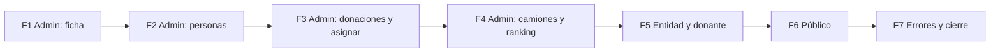

# Roadmap de las vistas que pide el enunciado

> UTN-FRBA — Diseño de Sistemas (2026) — Grupo 5
> **Versión 1 · 2026-11-07 · rama `E6_raices_calida`**

Qué vistas del enunciado de E6 faltan en la maqueta y en qué orden se terminan.

- Fuentes: los requerimientos de pantalla y la lista de pantallas de
  [`requerimientos-e6.md` §6.1 y §6.2](../requerimientos/requerimientos-e6.md), y el
  [mapa del sitio](mapa-del-sitio.md).
- El estado de cada vista es `[OBSERVED]`: sale de las plantillas de
  `cliente-liviano/src/main/resources/templates/` y del menú de `SitioController`, el 2026-11-07.
- Las fases, el orden y las decisiones son `[PROPOSED]`.

## Criterio de hecho

El roadmap está terminado cuando:

- cada pantalla de §6.2 tiene su plantilla, con estilo Raíces cálida, y cumple
  "Una pantalla está lista cuando" del [README](README.md#listo-para-entregar): estados, tono,
  sin JS en lo esencial, los 3 anchos y `revision-ui` sin bloqueantes;
- ningún enlace del sitio lleva a `sin-dibujar` (RQ-E6-07: se navega sin escribir URLs a mano);
- la tabla "Pantallas dibujadas" del [mapa del sitio](mapa-del-sitio.md) ya no tiene filas
  "Sin dibujar".

Quedan afuera:

- la autenticación real (Keycloak, PR 927);
- los datos reales de las APIs (RQ-E6-02 y RQ-E6-03), porque la maqueta usa datos de ejemplo;
- los huecos de backend (§8 de los requerimientos).

## Matriz: requerimiento → vista → estado

Estados: ✅ dibujada · 🟡 parcial · ❌ falta.

### Público

| Pantalla (§6.2) | RF | Plantilla | Estado |
|---|---|---|:-:|
| Landing | RF-01 | `publico-portada` | ✅ |
| Donaciones realizadas | RF-01 | `publico-donaciones` | ✅ |
| Mapa de entregadas | RF-02 | `publico-mapa` | ✅ |
| Entidades y necesidades | RF-22 | `publico-entidades` | ✅ |
| Legales y privacidad | RF-01 | `publico-legales` | ✅ |
| Contacto | RF-01 | `publico-contacto` (+ enviado, error) | ✅ |
| Iniciar sesión, con Google | RF-04, RQ-E6-05 | `publico-ingresar` (+ error) | ✅ |
| Registrarse: elegir, donante, entidad | RF-03 | `publico-registro*` | ✅ |
| Recuperar contraseña | RF-AUTH | `publico-recuperar` (+ enviado) | ✅ |
| **Nosotros** | RF-01 | — | ❌ |
| **Landing donante** | RF-01 | — | ❌ |
| **Landing beneficiario** | RF-01 | — | ❌ |
| **Activar cuenta** | RF-AUTH | — | ❌ |

### Donante

| Pantalla | RF | Plantilla | Estado |
|---|---|---|:-:|
| Inicio | — | `donante-inicio` | ✅ |
| Mis donaciones → detalle | RF-05 | `donante-donaciones`, `donante-donaciones-detalle` | ✅ |
| Beneficiarios (Entidades) | RF-06 | `donante-entidades` | ✅ |
| Seguir entregas | RF-09 | `donante-seguimiento` | ✅ |
| Notificaciones | RF-08 | `donante-notificaciones` | ✅ |
| Mi perfil | RI-AUTH-02 | `donante-perfil` | ✅ |
| **Misiones e insignias** | RF-07 | — | ❌ |

La cuenta de ejemplo del donante es una empresa (Distribuidora Ejemplo SA). RF-07 le oculta
Incentivos, así que hoy la pantalla no tiene desde dónde verse.

### Entidad

| Pantalla | RF | Plantilla | Estado |
|---|---|---|:-:|
| Inicio | — | `entidad-inicio` | ✅ |
| Necesidades → detalle | RF-10 | `entidad-necesidades` (detalle desplegado en la lista) | ✅ |
| Donaciones recibidas | RF-11 | `entidad-recibidas` | ✅ |
| Notificaciones | RF-13 | `entidad-notificaciones` | ✅ |
| Seguir entregas → Confirmar recepción | RF-14, RF-12 | `entidad-seguimiento-confirmar*`, `-sellada*` | 🟡 |
| **Mi perfil** | RI-AUTH-02 | — (el enlace lleva a `/entidad-perfil`) | ❌ |

Seguir entregas está 🟡 porque el menú lleva a `entidad-seguimiento` y esa plantilla no existe.
Falta el mapa con su lista (RF-14, RF-CL-06); el paso de confirmar ya está hecho.

### Admin

| Pantalla | RF | Plantilla | Estado |
|---|---|---|:-:|
| Inicio | — | `admin-inicio` | ✅ |
| Donantes → registrar donante · importar CSV con su resultado | RF-15, RF-20 | `admin-donantes` (+ importando, importado, importar-error), `admin-donantes-registrar` (+ error, registrado) | ✅ |
| Entidades → registrar entidad · aprobar entidades | RF-15, RF-21 | `admin-entidades` (+ aprobada, correccion, rechazada), `admin-entidades-registrar` (+ error, registrada) | ✅ |
| Donaciones → registrar donación · detalle y vencimiento | RF-15, RF-16 | `admin-donaciones`, `admin-donaciones-detalle` (+ vencida), `admin-donaciones-registrar` (+ error, registrada) | ✅ |
| Asignar donaciones → propuesta | RF-17 | `admin-asignaciones` (+ aprobada, descartada, error, corrida) | ✅ |
| **Camiones** | RF-18 | — | ❌ |
| **Ranking** | RF-19 | — | ❌ |

### Transversal

| Pantalla | Requerimiento | Estado |
|---|---|:-:|
| Páginas de error propias: 403 "sin permiso", 404 y 5xx con `traceId` (el 401 lleva al login) | RF-CL-08 | ❌ |

**Resumen:** de las 34 filas de la matriz, 24 están dibujadas, 1 está parcial y 9 faltan
(después de F3). De las que faltan, 2 son del admin. En ellas caen RF-18 y RF-19, que son
requerimientos mínimos del enunciado.

## Fases

Cada fase recorre el proceso del [README](README.md#el-proceso-en-6-pasos): primero la ficha
`ux-flujo`, que aprueba el usuario; después `vista-ui`, con la comprobación en los 3 anchos;
al final, `revision-ui`. Ninguna pantalla se construye sin su ficha aprobada
(`cliente-liviano/AGENTS.md`).

Las vistas nuevas usan los componentes de [`componentes.md`](componentes.md) y no pueden subir el
tope de clases de un solo uso del [backlog de migración](backlog-migracion-componentes.md).

El admin va primero: tiene 6 de los 20 requerimientos mínimos (RF-15 a RF-20) y además RF-21, que
es propio. Ninguna de sus secciones tiene vista; solo está el inicio.
Después, lo que falta de entidad y donante (RF-14 y RF-07), que también son requerimientos
mínimos. Lo público y los errores cierran, porque completan RF-01 y RF-CL-08 y no agregan un
requerimiento nuevo.

| Fase | Qué entrega | Tamaño `[INFERRED]` | Criterio de cierre |
|---|---|---|---|
| **F1** Ficha del admin ✅ hecha (2026-11-07, [ficha aprobada](flujos/raices-admin-navegable.md)) | Decisión 1 primero. Con la recomendada, `flujos/raices-admin-navegable.md` (nombre provisional): las 6 secciones y sus 7 acciones, estados y textos; las fichas aparte de importar CSV (resultado por fila, 20.000 filas sin bloquear la pantalla) y de asignar (propuesta de los algoritmos) | 1 tanda · 1 a 3 fichas | Fichas aprobadas por el usuario y PASS de `revision-ui` |
| **F2** Admin: personas ✅ hecha (2026-11-07) | Donantes (lista, registrar, importar CSV con su resultado) y Entidades (lista, registrar, aprobar) | 1 tanda · unas 6 plantillas + datos de ejemplo en el controller | Pantallas listas; el menú del admin no lleva a `sin-dibujar` en esas dos secciones |
| **F3** Admin: donaciones y asignar ✅ hecha (2026-11-07) | Donaciones (lista, registrar, detalle con "marcar vencida") y Asignar donaciones (ejecución y propuesta para aprobar) | 1 tanda · unas 5 plantillas | Ídem |
| **F4** Admin: camiones y ranking | Camiones (alta, cambio de estado, baja) y Ranking (último mes y meses anteriores) | 1 tanda · unas 3 plantillas | Ídem; todo el menú del admin dibujado |
| **F5** Entidad y donante | `entidad-seguimiento` (dibujo y lista de las entregas a recibir, con el enlace a confirmar), `entidad-perfil` y Misiones e insignias para un donante persona | 1 tanda · 3 plantillas · fichas: amplía `raices-entidad-navegable` (Seguir entregas, que hoy dice "sin dibujar") y `raices-mi-perfil` (hoy, solo del donante), y suma una ficha nueva de Misiones e insignias | Ningún enlace de donante ni de entidad lleva a `sin-dibujar` |
| **F6** Público | Nosotros, Landing donante, Landing beneficiario y Activar cuenta, enlazadas desde la portada, el pie o el ingreso | 1 tanda · 4 plantillas + 1 ficha | Las 4 pantallas listas y enlazadas |
| **F7** Errores y cierre | Páginas 403, 404 y 5xx; un test nuevo en `SitioControllerTest` que sigue todos los enlaces del sitio y falla si alguno lleva a `sin-dibujar` (hoy el test comprueba enlaces sueltos, no el recorrido completo); mapa del sitio y bitácora al día | 1 tanda · 3 plantillas + 1 test | Criterio de hecho de este roadmap cumplido |

Una tanda es una sesión de trabajo sin corte, con su revisión.
Cada fase cierra con un commit en `E6_raices_calida` y es un buen punto para cortar la sesión:
el handoff es este archivo, con la fase marcada como hecha.

## Decisiones para el usuario

Se piden al empezar la fase donde hacen falta, una por pregunta.

| # | Fase | Decisión | Recomendada |
|---|---|---|---|
| 1 | F1 | ¿Una sola ficha para el recorrido del admin, o una por sección? | **Decidida (usuario, 2026-11-07):** una sola ficha, CSV y asignar incluidos: [`raices-admin-navegable`](flujos/raices-admin-navegable.md) |
| 2 | F5 | ¿Cómo se ve Misiones e insignias, si la cuenta de ejemplo es una empresa? | Una segunda cuenta de ejemplo, de una persona, con el menú que suma Incentivos |
| 3 | F2 | ¿Importar CSV muestra el avance en la misma pantalla, o en una aparte? | **Decidida en la ficha aprobada (§4.1):** en la misma pantalla |

## Riesgos

- El PR 935 (`E6_raices_calida` → `E6_raices`) está en borrador. Las fases suman commits a ese PR
  `[OBSERVED]`. Si el usuario prefiere revisarlo aparte, las fases van en una rama nueva que salga
  de esta.
- Fuera de esta rama hay trabajo del backlog de migración a componentes, en las ramas `E6_adr_*`
  `[OBSERVED]`. Si se mergea antes, puede haber conflictos en `SitioController` y en `app.css`.
- Las vistas del admin muestran datos de ejemplo. Varios endpoints existen (RF-16 a RF-19 ✅ en
  §6.1), pero conectarlos queda afuera de este roadmap.
