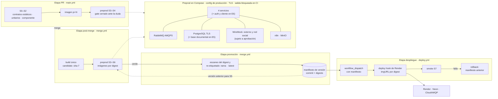

# Preprod fiel: arquitectura objetivo del entorno, el pipeline y la suite

> UTN-FRBA — Diseño de Sistemas (2026) — Grupo 5
> **Fase 2 de 3 · 2026-10-20 · borrador para revisar con el equipo**
> Fase 1: [criterio, estado y brechas](preprod-fiel.md). Fase 2: alternativas por brecha y arquitectura objetivo (este documento). Fase 3: [roadmap por entrega y ADR](preprod-fiel-roadmap.md).

## 0. Cómo leer este documento

- **Pregunta:** ¿qué arquitectura de entorno, pipeline y suite cierra las brechas B1–B12 de la [fase 1](preprod-fiel.md#5-brechas-priorizadas) dentro de las restricciones del proyecto?
- **Base relevada:** `origin/main` en `a808942c`, igual que la fase 1. Las referencias `archivo:línea` apuntan a ese commit.
- **Etiquetas** (AGENTS.md §3): `[OBSERVED]` · `[DOCUMENTED]` · `[INFERRED]` · `[PROPOSED]` · `[REJECTED]`. **Todo lo que este documento recomienda es `[PROPOSED]`:** nada existe todavía en el repositorio.
- **Fuera de alcance:** implementar. Este documento no cambia código, CI ni configuración, y no promueve ningún ADR (AGENTS.md §9.3).

## 1. Restricciones de diseño

| ID | Restricción | Fuente |
|---|---|---|
| R1 | La suite tiene que seguir corriendo con los scripts que usa la cátedra. Por eso el entorno integrado se orquesta con Docker Compose y no desde JUnit | `[DOCUMENTED]` en un ADR `proposed`: [ambientes efímeros con Testcontainers](../adr/20260906-estrategia-ambientes-efimeros-testcontainers-en-componentes.md), que descarta orquestar todo desde JUnit por OOM y por esa compatibilidad. También en [decisiones de diseño de QA](decisiones-diseno-auditoria-qa.md) |
| R2 | Runners gratuitos de GitHub: 2 vCPU y 7 GB de RAM | `[DOCUMENTED]` [decisiones de diseño de QA](decisiones-diseno-auditoria-qa.md) |
| R3 | Plan gratuito de Render: la instancia se suspende sin tráfico y el primer request tardó más de 60 s | `[DOCUMENTED]` [arquitectura-sistema.md §7](../entrega-4/arquitectura/arquitectura-sistema.md) |
| R4 | No se incorporan dependencias en `pom.xml` ni imágenes Docker sin aprobación previa. Este documento aplica la misma regla a las acciones y herramientas nuevas de CI, aunque AGENTS.md no las nombre | `[DOCUMENTED]` AGENTS.md §6 · la extensión a CI es `[PROPOSED]` |
| R5 | No se introducen canales de comunicación nuevos entre servicios sin ADR | `[DOCUMENTED]` AGENTS.md §4.2 |
| R6 | Datos sintéticos, sin PII ni credenciales en el repositorio | `[DOCUMENTED]` AGENTS.md §4.3 |
| R7 | E5 trae una base documental para Logística, E6 auth-service y cliente liviano, E7 observabilidad y seguridad | `[DOCUMENTED]` [enunciado](../entregas/Enunciado-TP-Anual-2026.pdf), págs. 25–28 |

## 2. Método de evaluación

Las alternativas de cada brecha se comparan con cinco criterios. Cada uno se califica de 1 a 5, y el puntaje es la suma de `peso × nota / 5`, sobre 100.

| ID | Criterio | Peso | Una nota de 5 significa… |
|---|---|:-:|---|
| C1 | **Cierra la brecha** | 35 | Lleva a 2 las propiedades P de la brecha y no deja verdes falsos |
| C2 | **Costo en la plataforma gratuita** | 20 | Entra en un runner de 7 GB (R2) y en las cuotas gratuitas de la nube, sin minutos de más |
| C3 | **Superficie de cambio** | 20 | Pocos archivos, sin dependencias ni imágenes nuevas (R4), sin tocar código de producción |
| C4 | **Feedback del PR** | 10 | No alarga el tiempo del pipeline de PR |
| C5 | **Paridad y compatibilidad** | 15 | El mismo comando corre local y en CI, y los scripts de la cátedra siguen andando (R1) |

**Regla eliminatoria:** una alternativa con C1 ≤ 2 se descarta sin importar su puntaje, y en la matriz figura como "eliminada". El status quo puro no aparece en las matrices: en las 12 brechas tiene C1 = 1.

Las notas son `[INFERRED]`: salen de la evidencia de la fase 1, no de mediciones. Cuando dos alternativas quedan a menos de 5 puntos, el texto dice qué medición o qué condición las desempataría.

**Pieza común de B4 y B5.** Hoy la suite corre en el host contra `localhost` (`BaseIT.java:12-19`, `main.yml:773-784`). No tiene cliente AMQP: `integration-tests/pom.xml:24-52` solo trae JUnit, RestAssured, Jackson, Awaitility y `swagger-request-validator`. Y RabbitMQ no publica puertos (`docker-compose.preprod.yml:173-185`) `[OBSERVED]`. Para consumir o publicar desde la suite hacen falta dos cosas:

- Un cliente AMQP en scope de test, por ejemplo `com.rabbitmq:amqp-client`, que requiere aprobación (R4).
- Publicar el puerto AMQP de preprod solo en `127.0.0.1`. Esto vuelve a abrir en parte el hallazgo V-06 de la revisión DevOps, limitado al loopback.

Las matrices de B4 y B5 ya cuentan esta pieza en C3. Con AMQPS (B3), el cliente de test tiene que confiar en el certificado autofirmado de la corrida. Se resuelve en la fase 3.

## 3. Alternativas por brecha

### B1 — Verdes falsos en el gate (P11, P1)

| Alternativa | C1 | C2 | C3 | C4 | C5 | Total |
|---|:-:|:-:|:-:|:-:|:-:|:-:|
| **A. Gate cerrado ante la duda** | 5 | 5 | 4 | 4 | 4 | **91** |
| B. Gate estricto en un job aparte, nocturno | 3 | 4 | 4 | 5 | 4 | 75 |
| C. Status quo con avisos en el resumen del job | 1 | 5 | 5 | 5 | 5 | 72 · eliminada |

**A (recomendada).** Cuatro cambios, uno por causa de verde falso:

1. Con una variable `PREPROD_STRICT=true`, que CI define, la verificación de disponibilidad de `BaseIT` falla en lugar de saltear (`BaseIT.java:35-53`). Sin la variable se comporta como hoy, para el uso local.
2. `report_test_failures.py` cuenta los tests salteados de los grupos requeridos como fallas, igual que ya hace con 0 tests (`--fail-on-zero-tests`, `main.yml:801`).
3. Un servicio **modificado en el PR** sin imagen `pr-<N>` falla el job. El respaldo con la imagen base (`main.yml:699-704`) queda solo para los servicios no modificados, que se resuelven por digest (B2).
4. `RepositoriosJpaTest` vuelve a Surefire (`pom.xml:138`) o se registra como deuda en `DEUDA_TECNICA.md` con su causa. Sonar pasa a requerido cuando el secreto existe y sigue opcional en los PR que no lo tienen (`main.yml:912`).

Implementa el ADR [protocolo de salida semántico y quality gate estricto](../adr/20260903-protocolo-salida-semantico-y-quality-gate-estricto.md) (`proposed`), que propone que un PR sin verificación empírica no pueda salir verde.

**B (descartada).** Deja el PR igual de permisivo y descubre el problema horas después, cuando el cambio ya está mergeado.

**C (eliminada por C1).** El check sigue verde y nadie está obligado a leer el aviso.

### B2 — Lo publicado no es lo validado, y el post-merge no se prueba (P1, P12)

| Alternativa | C1 | C2 | C3 | C4 | C5 | Total |
|---|:-:|:-:|:-:|:-:|:-:|:-:|
| **A. Preprod post-merge sobre el digest candidato y promoción por re-etiquetado** | 5 | 3 | 4 | 5 | 5 | **88** |
| B. Merge queue de GitHub | 5 | 3 | 3 | 3 | 5 | 80 |
| C. Re-etiquetar la imagen `pr-<N>` al mergear, con la rama obligada a estar al día | 3 | 5 | 4 | 2 | 5 | 76 |

**A (recomendada).** `merge.yml` construye una sola vez desde el commit integrado, como ya hace (`merge.yml:280-292`, "Build Once, Tag Many"), pero publica solo `:sha-<7>` como **candidato**. Después corre el preprod completo con todas las imágenes fijadas por digest, también las de los servicios que no cambiaron. Si pasa, **promueve** ese mismo digest a `:<rama>` y a `:latest` con `docker buildx imagetools create`, que re-etiqueta sin reconstruir. Cada promoción deja un **manifiesto de versión**: el commit y el digest de cada servicio. Ese manifiesto es la entrada de B3, B10 y del rollback.

- Hoy `:<rama>` y `:latest` se publican antes de cualquier preprod (`merge.yml:264-269`). Con A, solo llega a esos tags lo que pasó el preprod post-merge.
- Cierra el caso de dos PR verdes que rompen la base al combinarse: el preprod corre sobre el resultado del merge.
- Costo: el preprod corre dos veces por cambio, en el PR y después del merge. El PR no se alarga.

**B.** La merge queue valida el resultado combinado **antes** de integrar, que es más fuerte que A. Pero exige el evento `merge_group` en `main.yml` y reglas de rama nuevas, serializa los merges cerca de cada entrega, y su disponibilidad depende del tipo de cuenta del repositorio `[INFERRED]`, algo que no se verificó. Queda como evolución si A muestra roturas frecuentes de la base.

**C (descartada).** Solo es exacta si la rama estaba al día con la base en el último push. Obliga a rebasear en cada merge y no prueba el estado post-merge.

### B3 — La producción híbrida no está representada (P2, P3, P12)

| Alternativa | C1 | C2 | C3 | C4 | C5 | Total |
|---|:-:|:-:|:-:|:-:|:-:|:-:|
| **A. Propiedades de la nube emuladas en Compose y despliegue promovido con smoke** | 4 | 5 | 4 | 5 | 4 | **86** |
| B. Staging permanente en la nube con la suite híbrida post-merge | 5 | 2 | 2 | 4 | 3 | 68 |
| C. Entorno efímero en la nube por PR | 5 | 1 | 1 | 1 | 2 | 51 |

**A (recomendada).** Dos partes:

1. **Compose emula lo que distingue a la nube.** RabbitMQ con AMQPS y PostgreSQL con TLS, con certificados autofirmados que se generan en cada corrida, como ya se generan los secretos (`scripts/generar-env-db.sh`). Las versiones se fijan a las de Neon y CloudAMQP (B7). El arranque de Logística se mide con el mismo límite de memoria que la instancia de Render (B7).
2. **El despliegue sale del pipeline.** Un workflow nuevo, `deploy.yml`, se dispara a mano (`workflow_dispatch`) con un manifiesto de versión de B2. Llama al deploy hook de Render con el digest exacto. La documentación de Render describe dos cosas: servicios creados desde una imagen existente con credenciales del registro, y un deploy hook que acepta el parámetro `imgURL` con tag o digest ([Render: deploy hooks](https://render.com/docs/deploy-hooks), [Render: web services](https://render.com/docs/web-services)) `[DOCUMENTED]`. Después corre un smoke contra la URL pública: health, `/v3/api-docs` y un ciclo AMQP corto por CloudAMQP, con una espera que tolera el arranque en frío (R3). El rollback es el mismo workflow con el manifiesto anterior, y se ensaya una vez por entrega.

Hay tres puntos sin verificar, para la fase 3:

- `[INFERRED]` Que el plan gratuito de Render permita un servicio desde una imagen con deploy hook. La documentación no aclara qué límites del plan gratuito aplican.
- `[INFERRED]` Cómo construye Render hoy. El ADR dice "target `ci` o `local`" ([despliegue de Logística en PaaS](../adr/logistica-service/20261009-despliegue-de-logistica-en-paas-con-contenedores.md), Resultado, punto 1). Si construye desde el Dockerfile, la imagen desplegada tampoco es la de GHCR.
- `[INFERRED]` Si las imágenes de GHCR son públicas o necesitan credenciales para Render.

**B.** Es la más fiel: un segundo servicio gratuito en Render, una rama de Neon y una instancia o un vhost aparte en CloudAMQP, con `run-hybrid-tests.sh` después de cada merge. Pero triplica los secretos en CI, consume las cuotas gratuitas y depende del arranque en frío. Además, correr la suite híbrida en CI ya figura como alternativa descartada en el ADR [tolerancia al desorden](../adr/20261009-tolerancia-al-desorden-de-eventos-en-incentivos-y-consistencia-eventual-en-tests.md) (`proposed`, tabla de entorno: "Requiere secretos de CloudAMQP y Render en CI y depende del arranque en frío de Render"). Adoptarla pediría un ADR sucesor. Queda como evolución para E6–E7, si pasan más componentes a la nube.

**C (descartada).** No entra en las cuotas gratuitas, expondría secretos a cada PR y el arranque en frío solo ya supera un minuto por corrida.

### B4 — Contratos asíncronos sin validar (P7)

| Alternativa | C1 | C2 | C3 | C4 | C5 | Total |
|---|:-:|:-:|:-:|:-:|:-:|:-:|
| **A. Consumidor espía en la suite, REST en vivo para Donaciones y diff de OpenAPI** | 5 | 5 | 2 | 4 | 5 | **86** |
| B. Validación contra JSON Schema dentro del productor | 4 | 5 | 2 | 5 | 5 | 81 |

**A (recomendada).**

1. **Consumidor espía:** usa la pieza común de §2. Una utilidad de `integration-tests` declara una cola exclusiva y temporal, con binding `#` a cada exchange. Captura todo lo que se publica durante los flujos E2E y valida cada mensaje contra su JSON Schema de `docs/arquitectura/contratos/schemas/`. Así se reemplaza el test diferido que solo comprueba que el archivo exista (`ContractIT.java:262-271`). No es un canal nuevo entre servicios (R5): es un observador de test sobre la topología existente.
2. **Donaciones en vivo:** hoy la spec de Donaciones solo pasa la carga sintáctica (`ContractIT.java:72-77`). Los otros tres servicios ya se validan en vivo con `OpenApiValidationFilter` (por ejemplo, `ContractIT.java:92-93`). Donaciones pasa a validarse igual.
3. **Compatibilidad:** en el PR, un diff de las 4 specs OpenAPI y de los schemas contra la rama base marca como error los cambios incompatibles, como eliminar o renombrar campos (AGENTS.md §8.2).

A **extiende** la pista asíncrona del ADR [contratos OpenAPI, WireMock y esquemas AMQP](../adr/20260906-estrategia-contratos-openapi-wiremock-y-esquemas-amqp.md) (`proposed`). Ese ADR ubica la validación en la serialización y la deserialización, y dice que no necesita un broker activo (Resultado y Consecuencias). El consumidor espía, en cambio, valida en el broker, sobre el entorno integrado.

Usa `json-schema-validator`, que el ADR ya prevé en scope de test, aunque todavía no está en ningún `pom.xml` `[OBSERVED]`. Necesitan aprobación (R4) tres piezas:

- `json-schema-validator`.
- El cliente AMQP de la pieza común.
- La herramienta del diff de OpenAPI, que es nueva.

**B.** Detecta el error en el momento de publicar, pero mete los schemas en el código de producción y probablemente en `common-lib`. Eso es un cambio estructural que el [AGENTS de common-lib](../../common-lib/AGENTS.md) restringe.

**Pact y Spring Cloud Contract:** `[REJECTED]` en el mismo ADR de contratos. Pact, por el Pact Broker con su base, autenticación y webhooks, y por los métodos `@State` en los proveedores, una complejidad desproporcionada para el equipo. Spring Cloud Contract, por romper la compilación modular con `-pl`. No se reevalúan.

### B5 — Resiliencia sin probar en el entorno integrado (P8)

| Alternativa | C1 | C2 | C3 | C4 | C5 | Total |
|---|:-:|:-:|:-:|:-:|:-:|:-:|
| **A. Fallas con Docker y publicación directa al broker** | 4 | 5 | 4 | 5 | 4 | **86** |
| B. A más Toxiproxy | 5 | 4 | 2 | 5 | 4 | 81 |
| C. Herramientas de chaos engineering | 5 | 2 | 1 | 5 | 2 | 63 |

**A (recomendada).** Una clase `ResilienciaIT`, en el estrato post-merge (§5), cubre los casos de P8 sin imágenes nuevas. Para publicar en el broker usa la pieza común de §2: el cliente AMQP, que requiere aprobación, y el puerto en loopback.

- **Caídas:** `docker compose stop`, `pause` y `kill` sobre RabbitMQ, PostgreSQL y un servicio. Después verifica que el outbox reintenta y que no se pierden eventos.
- **Duplicados, desorden y mensajes malformados:** publica directamente en el exchange un evento con un id repetido, una secuencia en orden inverso (`donacion.segmentada` antes que `donante.registrado`, el caso del ADR de tolerancia al desorden) y un payload inválido.
- **Verificación:** idempotencia por el estado del consumidor. La llegada a la DLQ se comprueba con `rabbitmqctl list_queues` mediante `docker compose exec`. No se usa la API de management porque la imagen `rabbitmq:3.13-alpine` (`docker-compose.preprod.yml:175`) no habilita ese plugin `[INFERRED]`, y habilitarlo cambiaría la configuración del broker.

**B.** Agrega latencia y cortes parciales, lo que A no puede producir. Es la recomendación del ADR de tolerancia al desorden (`proposed`), sujeta a la aprobación de la imagen. Se suma a A cuando esa imagen se apruebe.

**C (descartada).** Pumba o Chaos Mesh agregan una herramienta para casos que Docker y Toxiproxy ya cubren.

### B6 — Cobertura funcional baja y sin aislamiento de datos (P6, P4)

| Alternativa | C1 | C2 | C3 | C4 | C5 | Total |
|---|:-:|:-:|:-:|:-:|:-:|:-:|
| **A. Matriz de cobertura desde OpenAPI y datos únicos por test** | 4 | 5 | 4 | 4 | 5 | **87** |
| B. Endpoints de reseteo en el perfil `preprod` | 4 | 5 | 2 | 5 | 4 | 78 |
| C. Stack nuevo por clase de test | 5 | 1 | 4 | 1 | 3 | 66 |

**A (recomendada).**

1. **Medir:** un filtro de RestAssured registra método y ruta de cada request de la suite, y un script los cruza con las operaciones de las 4 specs. Así la cobertura de P6 sale medida y deja de ser un conteo manual. El backlog se ordena por caso de uso del enunciado y por camino negativo (QA-GAP-05).
2. **Aislar:** cada test genera sus datos con un prefijo de corrida y UUID. Los tests que dependen de estado global, como el matching o el ranking mensual, corren en una ejecución de Failsafe aparte y secuencial.

**B (descartada).** Pone código de test en el JAR de producción y hace que la configuración de preprod difiera de la de producción, lo contrario de P3.

**C (descartada).** Multiplica el arranque del stack por el número de clases y no entra en los tiempos de un runner gratuito.

### B7 — Configuración que no es la de producción (P3)

| Alternativa | C1 | C2 | C3 | C4 | C5 | Total |
|---|:-:|:-:|:-:|:-:|:-:|:-:|
| **A. Configuración de producción en el gate, con una lista de desvíos permitidos** | 5 | 4 | 4 | 3 | 4 | **85** |
| B. Override rápido en el PR y configuración de producción en el post-merge | 4 | 4 | 4 | 5 | 4 | 82 |
| C. Un `application-preprod.properties` por servicio que copia producción | 3 | 5 | 3 | 4 | 4 | 73 |

**A (recomendada).**

- Preprod usa los valores de producción: el outbox a 10 s y no a 1 s (`docker-compose.preprod.yml:113`), y sin las opciones de JVM de arranque rápido (`:25,66,118,158`).
- Los desvíos permitidos se declaran en un archivo y un script verifica que no aparezcan otros. Los desvíos aceptables son endpoints, secretos, el seed sintético (`SEED_CATALOGO_ENABLED`) y el formato de logs.
- Cada contenedor tiene `mem_limit`, y el de Logística se iguala al de la instancia de Render `[INFERRED]`: el tamaño exacto del plan gratuito se verifica en la fase 3.
- Las imágenes de infraestructura se fijan por digest: `rabbitmq` (`:175`), `postgres` (`:218`) y `grafana/k6` (`:257`), con las versiones de Neon y CloudAMQP. Dependabot propone las actualizaciones. No existe `.github/dependabot.yml` `[OBSERVED]`, así que es configuración nueva y requiere aprobación (R4).

Hay un supuesto a medir: que los límites de memoria entren en 7 GB `[INFERRED]`. Son 4 servicios, más la base documental de E5 y auth de E6, más la infraestructura. Antes de fijar los límites hay que medir el pico con `docker stats` en una corrida real.

**B.** Mantiene rápido el PR y deja la fidelidad para el post-merge. Pasa a ser la recomendada si, medido, el preprod del PR con los valores de producción supera el tiempo que el equipo acepte. Hoy no hay medición: los 3 puntos de diferencia no deciden solos.

**C (descartada).** Duplica la configuración de producción en un segundo archivo, que con el tiempo se desvía.

### B8 — No funcionales y seguridad fuera del gate (P9)

| Alternativa | C1 | C2 | C3 | C4 | C5 | Total |
|---|:-:|:-:|:-:|:-:|:-:|:-:|
| **A. k6 post-merge con umbrales, revisión nativa de dependencias, escaneo de la imagen promovida y tests negativos de credenciales** | 4 | 4 | 3 | 5 | 4 | **78** |
| B. OWASP dependency-check en Maven y k6 en cada PR | 4 | 2 | 2 | 2 | 3 | 57 |

**A (recomendada).**

- **Rendimiento:** k6 corre en el estrato post-merge con los 2 scripts completos (hoy corre 1, `run-preprod-tests.sh:162-171`) y con umbrales de percentil, como prevé el ADR [migración a k6](../adr/20260906-migracion-pruebas-rendimiento-a-k6.md) (`proposed`). En un runner compartido los umbrales detectan regresiones grandes, no capacidad absoluta `[INFERRED]`.
- **Dependencias:** `actions/dependency-review-action` en el PR y alertas de Dependabot. Son nativos de GitHub y no tocan el `pom.xml`, pero hoy no existen: requieren aprobación (R4).
- **Imágenes:** un escaneo, por ejemplo con Trivy, del digest que se promueve (B2). Es una acción nueva y requiere aprobación (R4).
- **Autenticación:** ITs negativos de `X-API-Key` y `X-Actor` desde ahora. Desde E6, el mismo arnés recibe tokens del auth-service.

**B (descartada).** dependency-check descarga la base NVD en cada corrida, necesita una API key y suma un plugin al `pom.xml`. k6 en cada PR alarga el PR y da resultados ruidosos en runners compartidos.

E7 (observabilidad y seguridad) va a pedir decisiones propias de seguridad. Esta alternativa no las adelanta.

### B9 — Dependencia de internet y externos sin fallas inyectables (P5)

| Alternativa | C1 | C2 | C3 | C4 | C5 | Total |
|---|:-:|:-:|:-:|:-:|:-:|:-:|
| **A. Doble HTTP con WireMock en preprod y salida a internet bloqueada en CI** | 5 | 4 | 3 | 5 | 4 | **85** |
| B. Segunda instancia de Logística como `externo`, un endpoint interno en lugar de `httpbin.org` y el mismo bloqueo | 3 | 4 | 5 | 5 | 4 | 79 |

**A (recomendada).**

- Un contenedor WireMock reemplaza a `httpbin.org` en los dos workflows de n8n (`n8n/workflow-insignias.json:44`, `workflow-ranking-mensual.json:44`). Responde con el campo `url` que el nodo de validación espera (`workflow-insignias.json:94`).
- El mismo contenedor hace de proveedor `externo` que Donaciones configura en `localhost:8084`, con fallas por mapping: demora fija, 5xx y conexión cortada.
- **Bloqueo de salida a internet, solo en CI.** No se usa una red `internal: true`. Preprod tiene una sola red (`docker-compose.preprod.yml:264-266`), la suite llega por puertos publicados (`:12,50,99,141`), y `[INFERRED]` Docker no publica puertos de contenedores conectados solo a una red interna, algo que se confirma en la fase 3. En su lugar, CI agrega en el runner una regla en la cadena `DOCKER-USER` de iptables que descarta el tráfico de los contenedores hacia destinos fuera de las redes privadas. Si algo intenta salir, falla. `[INFERRED]` La regla exacta se prueba en la fase 3. En local no se aplica: es una garantía solo de CI, y por eso C5 = 4.
- WireMock ya es la herramienta de dobles del ADR de contratos (`proposed`). Usarlo como contenedor es aplicarla a otro caso, pero la imagen requiere aprobación (R4).

**B.** No suma imágenes: la demo ya usa una segunda instancia de la imagen de Logística como `externo` (`arquitectura-sistema.md:75,280`). Pero no permite inyectar fallas, que es la mitad de P5. **Condición de desempate:** si la imagen de WireMock no se aprueba, B pasa a ser la recomendada.

### B10 — Migraciones solo desde cero (P4)

| Alternativa | C1 | C2 | C3 | C4 | C5 | Total |
|---|:-:|:-:|:-:|:-:|:-:|:-:|
| **A. Prueba de actualización post-merge desde el manifiesto anterior** | 5 | 3 | 4 | 5 | 4 | **85** |
| B. Test de componente por migración con Testcontainers | 4 | 5 | 3 | 4 | 5 | 83 |
| C. `flyway validate` contra un volcado del esquema anterior | 2 | 5 | 4 | 4 | 5 | 73 · eliminada |

**A (recomendada).** El estrato post-merge sigue cinco pasos:

1. Levanta las imágenes del manifiesto anterior (B2), con volumen persistente.
2. Siembra datos sintéticos (R6).
3. Detiene los servicios.
4. Arranca los candidatos sobre el mismo volumen.
5. Verifica que la migración aplicó y corre el smoke.

No depende del motor de base, así que sirve igual para la base documental de Logística en E5. La herramienta de migraciones del ODM es una decisión de E5, fuera de este documento.

**B.** Detecta antes, en el PR, pero exige escribir un test por cada migración que transforma datos. Conviene como complemento en esas migraciones puntuales. **Medición de desempate:** contar cuántas migraciones transforman datos existentes en cada entrega. Si E5 trae varias, como es probable con el cambio de modelo de Logística y Donaciones `[INFERRED]`, B gana peso como complemento obligatorio.

**C (eliminada por C1).** Valida el esquema, no los datos existentes.

### B11 — La trazabilidad no se verifica de punta a punta (P10)

| Alternativa | C1 | C2 | C3 | C4 | C5 | Total |
|---|:-:|:-:|:-:|:-:|:-:|:-:|
| **A. Test de traza sobre los logs NDJSON y los headers AMQP** | 4 | 5 | 5 | 4 | 4 | **88** |
| B. OpenTelemetry Collector y Jaeger en preprod | 4 | 3 | 1 | 4 | 3 | 61 |

**A (recomendada).** `TrazaE2EIT` envía un request con un `X-Trace-Id` conocido y recorre un flujo que cruza HTTP y AMQP. Después comprueba dos cosas: que el mismo id aparece en el NDJSON de cada servicio del flujo, que preprod ya recolecta para `analyze_preprod_logs.py` (`main.yml:793-796`), y que va en los headers de los mensajes que capturó el consumidor espía de B4. Implementa el ADR [sistema unificado de trazabilidad](../adr/20260901-sistema-unificado-de-trazabilidad-y-observabilidad-distribuida.md) (`proposed`), sin dependencias más allá del cliente AMQP de B4.

C1 = 4 en las dos alternativas: cierran la verificación de la traza, pero no la exposición de métricas como en producción, que P10 también pide y que depende de E7 (§5.5).

**B.** Ese mismo ADR evaluó el "tracer pesado de terceros" (OpenTelemetry, Zipkin, Jaeger) y no lo eligió, por la complejidad operativa, la memoria en Compose y el riesgo de sobreingeniería. Se reevalúa en E7, que pide observabilidad (R7). Adelantarla agrega dos imágenes y una decisión que corresponde a esa entrega.

### B12 — Paridad local/CI y tiempos máximos (P11)

| Alternativa | C1 | C2 | C3 | C4 | C5 | Total |
|---|:-:|:-:|:-:|:-:|:-:|:-:|
| **A. Un solo punto de entrada con modos, y `timeout-minutes` en cada job** | 5 | 5 | 4 | 5 | 5 | **96** |
| B. Un task runner (Make o Taskfile) | 5 | 5 | 2 | 5 | 3 | 82 |
| C. Solo `timeout-minutes`, con las diferencias documentadas | 2 | 5 | 5 | 5 | 5 | 79 · eliminada |

**A (recomendada).**

- `run-preprod-tests.sh` pasa a ser el único punto de entrada, con dos modos: `--images ghcr|local` y `--target compose|hybrid`. CI lo invoca tal cual.
- `run-preprod-tests-stay.sh` y `run-hybrid-tests.sh` quedan como envoltorios con el mismo nombre y los mismos argumentos (R1).
- Cada job tiene `timeout-minutes`. El valor sale del p95 de las últimas corridas con un margen. Hoy no está medido, así que no se fija acá.

**B (descartada).** Suma una herramienta que no viene en Windows y obliga a la cátedra a cambiar de comando.

**C (eliminada por C1).** Las tres semánticas distintas siguen ahí.

## 4. Resumen de recomendaciones

| Brecha | Recomendada | Aprobación necesaria (R4) | ADR existente que implementa |
|:-:|---|---|---|
| B1 | Gate cerrado ante la duda | — | protocolo de salida semántico (`proposed`) |
| B2 | Preprod post-merge y promoción por digest | — | — (ver §6) |
| B3 | Nube emulada en Compose y despliegue promovido con smoke | — | despliegue de Logística en PaaS (`proposed`); ver §6 |
| B4 | Consumidor espía, REST en vivo y diff de OpenAPI | `json-schema-validator` (test), cliente AMQP (test) y la herramienta de diff. Cambio de compose: puerto AMQP en `127.0.0.1` | extiende el de contratos OpenAPI, WireMock y AMQP (`proposed`) |
| B5 | Fallas con Docker y publicación directa (después, Toxiproxy) | El cliente AMQP y el puerto de B4. Toxiproxy, en el segundo paso | tolerancia al desorden (`proposed`) |
| B6 | Matriz desde OpenAPI y datos únicos | — | — |
| B7 | Configuración de producción con desvíos declarados | Configuración de Dependabot | — |
| B8 | k6 post-merge, revisión de dependencias, escaneo de la imagen y tests de credenciales | `dependency-review-action`, alertas de Dependabot y la acción de escaneo de imágenes | migración a k6 (`proposed`) |
| B9 | WireMock en preprod y salida a internet bloqueada en CI | Imagen de WireMock | contratos (`proposed`) |
| B10 | Actualización desde el manifiesto anterior | — | — |
| B11 | Traza sobre NDJSON y headers AMQP | — (usa el cliente AMQP de B4) | trazabilidad unificada (`proposed`) |
| B12 | Un punto de entrada y tiempos máximos | — | — |

## 5. Arquitectura objetivo consolidada

### 5.1 Entorno preproductivo

Dos entornos con roles distintos. El de Compose valida en cada cambio. El de la nube es producción, y solo recibe artefactos ya validados.

| Capa | Compose (CI y local) | Nube (producción de referencia) |
|---|---|---|
| Servicios | Donaciones, Incentivos, Notificaciones y Logística, fijados por digest desde el manifiesto. Desde E6, auth-service y cliente liviano | Logística en Render, desde la imagen de GHCR por digest |
| Datos | PostgreSQL con TLS, versión de Neon y un schema por servicio. Desde E5, el motor documental de Logística con la versión del servicio gestionado que se elija | Neon. Desde E5, la base documental gestionada |
| Mensajería | RabbitMQ con AMQPS, versión de CloudAMQP | CloudAMQP |
| Apoyo | MinIO y n8n. WireMock como doble de `externo` y de la red social, y Toxiproxy, cuando se aprueben sus imágenes (sin WireMock, B9-B) | — |
| Red | Una red bridge. Servicios y n8n publican puertos y el AMQP queda en `127.0.0.1`. En CI, una regla `DOCKER-USER` bloquea la salida a internet | Internet pública con HTTPS |
| Recursos | `mem_limit` por contenedor; Logística, igual que Render | El plan de Render |
| Configuración | La de producción, más los desvíos declarados en una lista verificada | La de producción |

### 5.2 Etapas del pipeline

El preprod del PR y el del post-merge son **el mismo entorno**, con la misma configuración de producción (B7-A), TLS, digests y bloqueo de salida. Cambian dos cosas: qué imágenes se validan, `pr-<N>` o el candidato del commit integrado, y qué estratos corren, porque los más caros quedan en el post-merge.

| Etapa | Disparador | Qué hace | Resultado |
|---|---|---|---|
| **1. PR** (`main.yml`) | `pull_request` | Validaciones, build, unitarios, componente con Testcontainers, diff de contratos y revisión de dependencias. Construye la imagen `pr-<N>` y corre el preprod con los estratos S3 y S4 y el gate cerrado ante la duda | Check requerido para mergear |
| **2. Post-merge** (`merge.yml`) | `push` a `main` o `ENTREGA_*` | Construye una vez el candidato `:sha-<7>` desde el commit integrado. Corre el preprod con los estratos S3 a S6 y todas las imágenes fijadas por digest | Candidato validado o rechazado |
| **3. Promoción** (último job de `merge.yml`) | Post-merge en verde | Escanea el digest candidato. Lo re-etiqueta a `:<rama>` y `:latest` sin reconstruir, y publica el manifiesto de versión. Si el post-merge falla, no promueve: `:<rama>` sigue apuntando a la última versión validada | Manifiesto de versión promovido |
| **4. Despliegue** (`deploy.yml`, nuevo) | `workflow_dispatch` con un manifiesto promovido | Llama al deploy hook de Render con `imgURL` por digest y corre el smoke post-despliegue (S7). El rollback es el mismo workflow con el manifiesto anterior | Logística en Render en la versión validada |

### 5.3 Estratos de la suite

Se nombran S0–S7 para no confundirlos con las entregas E5–E7.

| Estrato | Qué valida | Herramienta | Etapa |
|---|---|---|---|
| S0 | Contratos estáticos y compatibilidad contra la base | `validate-contracts.js` y diff de OpenAPI | PR |
| S1 | Unitarios y reglas de arquitectura | JUnit, ArchUnit | PR |
| S2 | Componente con persistencia y broker reales | Testcontainers | PR |
| S3 | Smoke y contratos vivos, REST y AMQP | `SmokeIT`, `ContractIT` y el consumidor espía | PR y post-merge |
| S4 | Integración y E2E por caso de uso, con caminos negativos y traza | ITs de flujo y `TrazaE2EIT` | PR y post-merge |
| S5 | Resiliencia y actualización desde la versión anterior | `ResilienciaIT` y la prueba de actualización | Post-merge |
| S6 | Rendimiento y seguridad | k6 con umbrales y escaneo de la imagen | Post-merge |
| S7 | Smoke post-despliegue | Health, `/v3/api-docs` y un ciclo AMQP contra Render | Despliegue |

### 5.4 Diagrama

### 5.5 Puntaje esperado contra el criterio

Si se implementan todas las recomendadas, el puntaje proyectado es `[INFERRED]` **23 de 24**.

| Propiedad | Hoy | Objetivo | Qué queda abierto |
|---|:-:|:-:|---|
| P1 | 1 | 2 | — |
| P2 | 1 | 2 | Depende de sumar la base documental (E5) y auth y cliente (E6) cuando existan. El doble de `externo` cubre al componente que faltaba |
| P3 | 1 | 2 | — |
| P4 | 1 | 2 | — |
| P5 | 1 | 2 | — |
| P6 | 1 | 2 | Depende de cerrar el backlog que mida la matriz, no solo de construirla |
| P7 | 1 | 2 | — |
| P8 | 0 | 2 | — |
| P9 | 0 | 2 | — |
| P10 | 1 | 1 | Las métricas expuestas como en producción dependen de E7 |
| P11 | 1 | 2 | — |
| P12 | 0 | 2 | Depende de los tres puntos sin verificar de B3. La fase 3 resolvió uno (GHCR es público) y dejó los otros dos como precondiciones del ADR ([roadmap](preprod-fiel-roadmap.md), §1 y RM-01) |

## 6. Evaluación de ADR (AGENTS.md §9.1)

**Criterio para Gate A.** AGENTS.md §9.1 dice que no hay decisión nueva cuando la tarea implementa un ADR ya aceptado. Este documento extiende ese criterio a los ADR `proposed`: si la decisión ya está escrita en un ADR `proposed`, implementarla no pide un ADR más. Esa implementación lleva el riesgo que señala §9.3: si el revisor humano rechaza el ADR, puede hacer falta revertirla. Las filas que se apoyan en un ADR `proposed` lo dicen.

| Decisión | Gate A: ¿decisión nueva? | Gate B: ¿significativa? | Resultado |
|---|---|---|---|
| **Promoción por digest con preprod post-merge, y despliegue de Logística desde GHCR por deploy hook (B2, B3)** | **Sí.** Ningún ADR decide cómo se promueve un artefacto ni cómo se despliega. El ADR [pipeline unificado](../adr/20260426-pipeline-unificado-de-cicd-y-automatizacion-de-calidad.md) (`accepted`) cubre validación, Git Flow y GitHub Pages, no publicación ni despliegue `[OBSERVED]`. El ADR de despliegue en PaaS (`proposed`) no automatiza el despliegue y deja las credenciales solo en cada plataforma (Resultado, puntos 1 y 5). [arquitectura-sistema.md §7](../entrega-4/arquitectura/arquitectura-sistema.md) lo describe como manual | **Sí.** Alto costo de reversión (cambia qué tags representan producción). Implicancias de seguridad: el deploy hook es un secreto nuevo en GitHub. Trade-off deliberado entre fidelidad y minutos de CI | **ADR `proposed` para la fase 3.** Complementa al de despliegue en PaaS y puede reemplazar su punto 5. La relación la aprueba un humano (§9.3) |
| TLS, versiones de la nube, `mem_limit` y digests de infraestructura en Compose (B3, primera parte) | No: aplica al entorno de test la configuración que producción ya tiene (P3). No cambia ningún contrato ni la comunicación | — | Sin ADR |
| Gate cerrado ante la duda (B1) | No: implementa el ADR de protocolo de salida semántico (`proposed`) | — | Sin ADR |
| Consumidor espía y diff de contratos (B4) | Sí: extiende la pista asíncrona del ADR de contratos (`proposed`), que valida en la serialización y sin broker, a una validación en el broker | No: es una herramienta de test, reversible, que no cambia contratos, topología ni runtime. El puerto en loopback es un cambio del entorno de test | Sin ADR. Aprobación de dependencias y del cambio de compose (R4) |
| Fallas con Docker y Toxiproxy (B5) | No: Toxiproxy ya está en el ADR de tolerancia al desorden (`proposed`) | — | Sin ADR. Aprobación de la imagen |
| Datos únicos y matriz de cobertura (B6) | No: práctica de test con herramientas ya adoptadas (§9.2) | — | Sin ADR |
| Configuración de producción con desvíos declarados (B7) | Sí: política nueva del entorno de test | No: se revierte en un archivo y no cambia contratos, persistencia ni comunicación | Sin ADR. Se registrará en [decisiones de diseño de QA](decisiones-diseno-auditoria-qa.md) al implementarse (RM-11) |
| Escaneo de dependencias e imágenes (B8) | Sí: herramientas nuevas | No: son pasos de CI reversibles y no cambian el runtime. Las decisiones de seguridad de E7 sí pueden necesitar ADR | Sin ADR. Aprobación de las acciones y de Dependabot |
| WireMock como contenedor (B9) | No: aplica a otro caso la herramienta de dobles del ADR de contratos (`proposed`; §9.1, "un patrón existente a un nuevo caso") | — | Sin ADR. Aprobación de la imagen |
| Bloqueo de salida a internet en CI (B9) | Sí: ningún ADR lo decide | No: es un paso de CI reversible que no cambia contratos, comunicación ni runtime | Sin ADR |
| Prueba de actualización (B10), test de traza (B11) y punto de entrada único (B12) | No: prácticas de test que implementan decisiones existentes | — | Sin ADR |
| Staging permanente en la nube (B3, alternativa B) | Sí | Sí | No se recomienda ahora. Si se adopta en E6–E7, necesita un ADR sucesor del de tolerancia al desorden, que la descarta |

**Para la fase 3:** un único ADR `proposed`, *promoción de artefactos por digest y despliegue reproducible de Logística*. Antes de redactarlo hay que resolver los tres puntos sin verificar de B3. **Fase 3:** se resolvió uno, y los otros dos quedaron como precondiciones explícitas del ADR, a verificar en RM-01 ([roadmap](preprod-fiel-roadmap.md), §1).

## 7. Próxima fase

- **Fase 3 — Roadmap y decisiones:** hecha, en [preprod-fiel-roadmap.md](preprod-fiel-roadmap.md). Lo que se pedía:
  - Ordenar las recomendadas por entrega: E5, con la base documental; E6, con auth y cliente liviano; E7, con observabilidad y seguridad.
  - Pedir las aprobaciones de la §4.
  - Verificar los tres puntos abiertos de B3.
  - Medir dos cosas: el tiempo del preprod de PR, que desempata B7, y el pico de memoria, que fija los límites.
  - Redactar el ADR de la §6.
