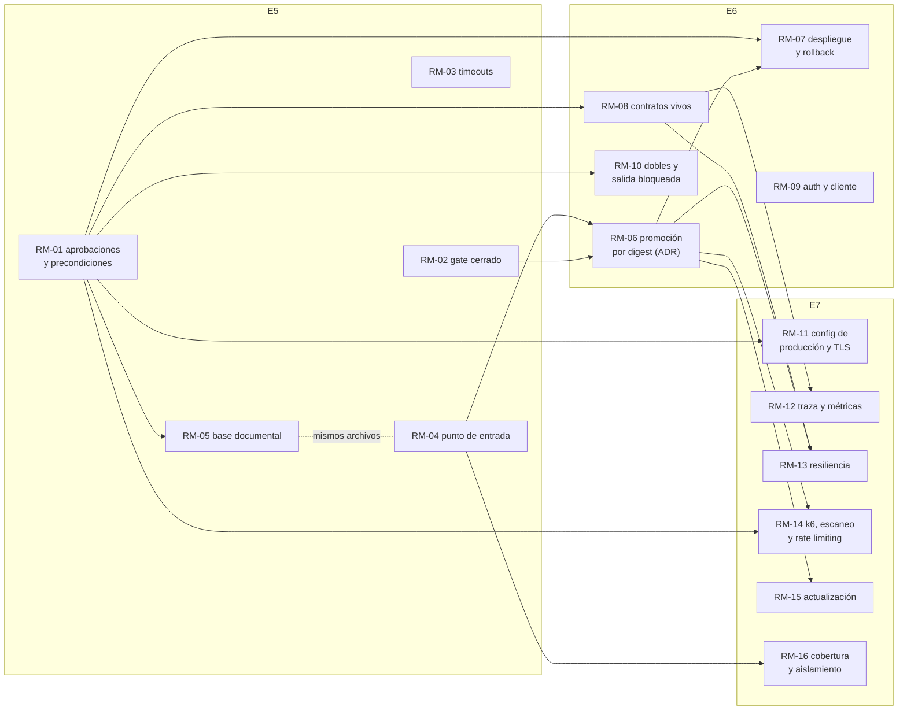

# Preprod fiel: roadmap por entrega y decisiones

> UTN-FRBA — Diseño de Sistemas (2026) — Grupo 5
> **Fase 3 de 3 · 2026-10-20 · rediseñada el 2026-10-28 por la [SPEC-05](../specs/active/SPEC-05-preprod-fiel-rediseno-y-rm01-rm08.md)**
> Fase 1: [criterio, estado y brechas](preprod-fiel.md). Fase 2: [arquitectura objetivo](preprod-fiel-arquitectura-objetivo.md). Fase 3: roadmap por entrega y ADR (este documento).

## Rediseño del 2026-10-28 y estado de implementación

La [SPEC-05](../specs/active/SPEC-05-preprod-fiel-rediseno-y-rm01-rm08.md) (`APPROVED_BY_USER`) cambió cinco cosas; las tablas de la §3 ya las reflejan:

| Decisión | Qué cambia |
|---|---|
| D1 | Base de datos por servicio en el mismo motor PostgreSQL: ítem nuevo **RM-19**, por ahora solo documentado ([ADR](../adr/20261028-base-de-datos-por-servicio-en-el-mismo-motor-postgresql.md), `accepted` el 2026-10-29) |
| D2 | MinIO por servicio a futuro: ítem nuevo **RM-20**, después de E7, sin código |
| D3 | RM-07 sin Render: ensayo del manifiesto en el runner, con smoke y rollback; Render como adaptador opcional ([ADR de promoción](../adr/20261020-promocion-de-artefactos-por-digest-y-despliegue-reproducible-de-logistica.md), revisado) |
| D4 | RM-08 con `amqp-client` + `networknt/json-schema-validator` y el puerto AMQP en `127.0.0.1` |
| D5 | Contratos: aviso en el PR, bloqueo en el post-merge y en el corte de `ENTREGA_x`; schemas de eventos abiertos ([ADR de política de contratos](../adr/20261028-politica-de-evolucion-de-contratos-entre-servicios.md), `accepted` el 2026-10-29) |

Estado en la rama `E5_preprod_fiel_rm08` (2026-10-28). `[VERIFIED]` = ejecutado en local; `[TESTS_NOT_EXECUTED_BY_EVALUATOR]` = depende de GitHub Actions y se valida en la primera corrida.

| Ítem | Estado | Evidencia |
|---|---|---|
| RM-01 | Bloqueado: es coordinación, lo abre el equipo | Issue con las aprobaciones pendientes de la §5 y las verificaciones en el panel de Render y de Neon (una base por servicio, D1) |
| RM-02 | Implementado | `[VERIFIED]` `ContractIT` con `PREPROD_STRICT=true` y el stack apagado falla; el reporte falla ante un salteado de un grupo requerido; `RepositoriosJpaTest` corre (6 tests) |
| RM-03 | Implementado | `[VERIFIED]` 18 de 18 jobs con `timeout-minutes`; medición en el commit del ítem |
| RM-04 | Implementado | `[VERIFIED]` `./run-preprod-tests.sh --images local`; `--images ghcr` en CI |
| RM-05 | Implementado | `[VERIFIED]` preprod en verde con `mongo:7.0` fijado por digest |
| RM-19 | Solo documentación | ADR `accepted` (2026-10-29); el código espera a `E4_donaciones_minio` y `E4_persistencia_donaciones` |
| RM-06 | Implementado | `[VERIFIED]` script de manifiesto (4 tests) y resolvedor por digest con los digests reales de `:entrega_5`; `[TESTS_NOT_EXECUTED_BY_EVALUATOR]` `preprod-post-merge` y `promote` |
| RM-07 | Implementado | `[VERIFIED]` la mecánica de `scripts/ensayo-despliegue.sh` en local (smoke 4/4 en los dos despliegues, con M y M-1 iguales: el rollback entre versiones distintas, con migraciones de por medio, no se ensayó en local); `[TESTS_NOT_EXECUTED_BY_EVALUATOR]` `deploy.yml`, que además corre recién cuando llegue a `main` (rama por defecto) |
| RM-08 | Implementado; encontró 3 defectos reales ([DTI-27](../adr/DEUDA_TECNICA.md#dti-27)), los 3 ítems resueltos en código (el 1 y el 2 con el productor que siempre envía el dato) | `[VERIFIED]` validador del espía, diff de OpenAPI (aviso y error) y `validate-contracts.js`; Donaciones validado en vivo (`ContractIT` 7/7, después de completar la spec de `/api/personas`); con `CONTRATOS_ESTRICTO=true` el E2E pasa 30/30 desde la corrección de los ítems 1 y 2 de DTI-27 (2026-10-29) |

## 0. Cómo leer este documento

- **Pregunta:** ¿en qué orden se implementan las alternativas recomendadas en la fase 2, entrega por entrega, y qué decisiones necesitan un ADR?
- **Base relevada:** `origin/main` en `a808942c`, igual que las fases 1 y 2. Las referencias `archivo:línea` apuntan a ese commit.
- **Etiquetas** (AGENTS.md §3): `[OBSERVED]` · `[DOCUMENTED]` · `[INFERRED]` · `[PROPOSED]` · `[VERIFIED]`. **Todo el roadmap es `[PROPOSED]`.** Los tamaños son conteos `[INFERRED]` sobre los archivos que hoy existen. No se estima tiempo.
- **Calendario** `[DOCUMENTED]` (borrador de requerimientos E5–E6, fuera del repo, §0): E5 Persistencia, 30/10 · E6 Interfaz y MVC, 13/11 · E7 Observabilidad y Seguridad, 27/11.
- **Desfase de la rama local:** la rama `E5_enunciado_tp_anual` está 26 commits detrás de `origin/main`. DTI-17 a DTI-22, la nota de auditoría del ADR de protocolo de salida y los ADRs de pipeline unificado y de tolerancia al desorden existen en `origin/main` y no en la copia local.
- **Fuera de alcance:** implementar, y las decisiones propias de cada entrega (el motor documental de E5, el diseño de auth de E6, la herramienta de métricas de E7). El roadmap dice dónde las necesita.

## 1. Qué se verificó en esta fase

La fase 2 dejó tres puntos sin verificar de B3 y dos mediciones pendientes (§7 de la fase 2).

| Punto | Resultado | Evidencia |
|---|---|---|
| ¿Render acepta un deploy hook con la imagen por digest? | **Sí.** El deploy hook acepta el parámetro `imgURL` con tag o digest. El resto de la URL debe coincidir con la imagen configurada en el servicio | `[DOCUMENTED]` [Render: deploying an image](https://render.com/docs/deploying-an-image), consultado el 2026-10-20 |
| ¿El plan gratuito permite un servicio desde una imagen? | **Sin confirmar.** La página del plan gratuito no lo incluye ni lo excluye | `[DOCUMENTED]` [Render: free](https://render.com/docs/free) no lo menciona. Queda como precondición de RM-07 (§3.2) |
| ¿Cómo construye Render hoy? | **Probablemente desde el Dockerfile, sin confirmar en el panel.** No hay `render.yaml` y la configuración está fuera del repo. El ADR de PaaS dice "target `ci` o `local`", y su Validación dice que `docker build … --target local` "construye la imagen que se despliega". El target `local` compila desde el código fuente | `[DOCUMENTED]` [ADR de PaaS](../adr/logistica-service/20261009-despliegue-de-logistica-en-paas-con-contenedores.md), Validación, punto 1. La configuración real del panel se verifica en RM-01 y es precondición de RM-07 |
| ¿Las imágenes de GHCR necesitan credenciales? | **No.** `ghcr.io/tsorren/donatrack-tp-dds/logistica-service:latest` se baja sin credenciales: token anónimo y manifiesto con HTTP 200 | `[VERIFIED]` 2026-10-20, `curl` al registro con token anónimo |
| Límites del plan gratuito de Render | 512 MB y 0,1 CPU. Se suspende tras 15 minutos sin tráfico y tarda cerca de un minuto en volver. Hay 750 horas por mes por workspace | `[DOCUMENTED]` [Render: free](https://render.com/docs/free) y la página de precios, consultados el 2026-10-20 |
| ¿Docker publica puertos de contenedores conectados solo a una red `internal`? | **Sin confirmar** en la documentación de Docker. El diseño de la fase 2 no depende de esto: usa la cadena `DOCKER-USER` | `[DOCUMENTED]` [Docker: iptables](https://docs.docker.com/engine/network/firewall-iptables/): `DOCKER-USER` es el lugar para las reglas propias, que se procesan antes que las de Docker. La regla exacta de salida se prueba en RM-10 |
| Tiempo del preprod de PR (desempata B7) | El job `preprod-validation` tardó entre 2 min 25 s y 3 min 19 s en 9 corridas exitosas, del 15 al 18 de octubre | `[OBSERVED]` API de GitHub Actions (`gh api .../actions/runs/<id>/jobs`), corridas de PR de `main.yml` |
| Pico de memoria del stack (fija `mem_limit`) | **Sin medir.** Requiere una corrida con `docker stats`. Queda dentro del criterio de hecho de RM-11 | — |

**Consecuencias para el diseño:**

- **B7:** con el preprod en unos 3 minutos, quitar los ajustes de velocidad no debería llevar el job a un tiempo inaceptable `[INFERRED]`. B7-A sigue siendo la recomendada. RM-11 mide el tiempo antes y después, y vuelve a B7-B si el job pasa de 10 minutos.
- **B3:** Render no necesita credenciales para bajar la imagen. Quedan dos precondiciones, que se verifican en el panel de Render (RM-01): que el servicio se pueda configurar desde una imagen en el plan gratuito, y cómo construye hoy.
- **`mem_limit` de Logística:** 512 MB, igual que el plan gratuito. El Dockerfile ya usa `-XX:MaxRAMPercentage=75.0`, unos 384 MB de heap, y preprod usa `-Xmx384m` (`docker-compose.preprod.yml:158`) `[OBSERVED]`.
- **AMQPS en el cliente de test** (pendiente de la fase 2, §2): el script que genera los certificados de la corrida también arma un truststore con `keytool`, que viene con el JDK, y la suite lo recibe por `-Djavax.net.ssl.trustStore`. No suma dependencias.

### 1.1 Correcciones a las fases 1 y 2

- **Fase 1, §6:** decía que la exclusión de `RepositoriosJpaTest` no estaba registrada como deuda. **Ya lo está:** es el ítem 8 de [DTI-16](../adr/DEUDA_TECNICA.md) `[OBSERVED]`. No se crea una entrada nueva.
- **Fase 1, P11:** en `origin/main`, el ADR de protocolo de salida tiene una nota de auditoría del 2026-10-14 que dice que persiste `|| true` en `main.yml:510`, `:744` y `:772`. En `a808942c` no hay `|| true` en `main.yml` ni en `run-preprod-tests.sh`, y el único `continue-on-error` está en `generate-diagrams` (`main.yml:513`) `[OBSERVED]`. La afirmación de la fase 1 se mantiene. La nota del ADR está desactualizada.

## 2. Cómo se ordenó

Cuatro reglas, en este orden:

1. **Que ninguna entrega haga retroceder una propiedad.** E5 cambia el motor de Logística y E6 suma dos componentes. Si preprod no los incorpora en la misma entrega, P2 baja. Esos ítems se marcan **Bloqueante**. También se marca **Bloqueante** la parte de un ítem que valida algo que el enunciado exige en esa entrega.
2. **Primero los verdes falsos.** Un gate que aprueba algo roto invalida todo lo que se construya encima (fase 1, §5).
3. **Las dependencias técnicas mandan.** La promoción por digest (RM-06) es la base del estrato post-merge, del despliegue, de la prueba de actualización y del escaneo de imágenes.
4. **Cada pieza va en la entrega que la pide.** Métricas, autorestart y rate limiting van en E7, porque el enunciado los pide ahí (pág. 28). TLS no lo pide el enunciado: lo pide P3, y va en E7 por afinidad con seguridad. Auth y Social-Login van en E6.

Las demás se marcan **Mejora**: suben el puntaje, pero si no entran en la entrega pasan a la siguiente sin que nada retroceda.

## 3. Roadmap

### 3.1 E5 — Gate honesto y base documental en preprod (hasta el 30/10)

| ID | Ítem | Tipo | Brechas | Propiedades | Dependencias | Tamaño | Hecho cuando… |
|---|---|---|---|---|---|---|---|
| RM-01 | **Pedido de aprobaciones y precondiciones en la nube** (rediseño D3 y D1: las preguntas de Render ya no bloquean) | Coordinación (desbloquea E6–E7) | Ninguna: es un ítem de coordinación | Ninguna directa; habilita RM-10, RM-11, RM-14, RM-18, RM-19 y el adaptador de Render de RM-07 | Ninguna | 1 issue (lo abre el equipo) con las piezas pendientes de la §5, 2 preguntas sobre el panel de Render y 1 sobre Neon | Cada pieza tiene registrada una decisión (aprobada o rechazada). Se sabe si Render construye desde el repo o desde una imagen, si el plan gratuito permite un servicio desde imagen y si Neon admite una base por servicio en el mismo proyecto (D1) |
| RM-02 | **Gate cerrado ante la duda** (B1-A) | Bloqueante | B1 | P11 (sigue en 1 hasta RM-04), P1 (sigue en 1 hasta RM-06) | Ninguna | 4 archivos: `BaseIT.java`, `report_test_failures.py`, `main.yml` y `pom.xml`. 1 caso nuevo en `scripts/tests/test_report_test_failures.py` | (1) Con `PREPROD_STRICT=true` y `/v3/api-docs` caído, `ContractIT` falla en lugar de saltearse. (2) Un XML de Failsafe con un test salteado de un grupo requerido hace que el script salga con un código distinto de 0. (3) Un PR que modifica un servicio sin imagen `pr-<N>` falla el job con `::error`. (4) Si existe `SONAR_TOKEN`, un quality gate de Sonar en rojo bloquea. (5) `RepositoriosJpaTest` corre en `mvn verify -pl notificaciones-service`. Si falla por una causa real, el ítem 8 de DTI-16 queda abierto con esa causa: nunca se vuelve a excluir para tener un build verde (AGENTS.md §4.3) |
| RM-03 | **Tiempo máximo por job** (B12-A, primera parte) | Mejora | B12 | P11 | Ninguna | 5 workflows, 18 jobs: `main.yml` 10, `merge.yml` 5, y 1 cada uno en `agent-governance.yml`, `deploy-pages.yml` y `pr-reminders.yml` | Los 18 jobs tienen `timeout-minutes`. Cada valor es al menos el doble del máximo de sus últimas 10 corridas exitosas, y la medición queda en el PR. Para `preprod-validation`, el máximo medido es 3 min 19 s (§1) |
| RM-04 | **Punto de entrada único** (B12-A, segunda parte) | Mejora | B12 | **P11 1 → 2** (con RM-02 y RM-03) | Conviene hacerlo junto con RM-05: los dos tocan el script y la espera de salud | 5 archivos: `run-preprod-tests.sh` con `--images ghcr\|local` y `--target compose\|hybrid`, los envoltorios `run-preprod-tests-stay.sh` y `run-hybrid-tests.sh`, el paso de preprod de `main.yml` y la guía `docs/testing/integration-tests.md` | CI invoca `run-preprod-tests.sh --images ghcr`. Local, el mismo comando con `--images local` corre los mismos grupos con los mismos criterios de falla. Los dos envoltorios conservan su nombre y sus argumentos (R1) |
| RM-05 | **Base documental de Logística en preprod** | Bloqueante | Ninguna: evita una brecha nueva | P2 se mantiene en 1 (no sube; evita que baje). Sin este ítem, Logística no arranca en preprod | Elección del motor y del ODM en E5 (ADR-E5-A del borrador de requerimientos E5–E6, fuera del repo, §1) y aprobación de la imagen (R4) | 3 o 4 archivos: `docker-compose.preprod.yml` (1 servicio y las variables de Logística), `scripts/generar-env-db.sh` (credenciales generadas), `run-preprod-tests.sh` (espera de salud) y, si espera ahí, `main.yml` | `preprod-validation` en verde con Logística sobre la base documental. La imagen está fijada por digest y tiene la versión del servicio gestionado elegido. `LogisticaIntegrationIT` y el E2E corren sin salteados (lo garantiza RM-02) |

| RM-19 | **Base de datos por servicio en el mismo motor** (D1 de la SPEC-05) | Mejora | Ninguna: endurece el aislamiento | P4 (aislamiento de datos) | [ADR](../adr/20261028-base-de-datos-por-servicio-en-el-mismo-motor-postgresql.md) `proposed`; que mergeen `E4_donaciones_minio` y `E4_persistencia_donaciones`, que tocan los mismos archivos; RM-01 (Neon) | Unos 11 archivos: `persistencia/init-db/*`, 3 composes, 3 `application-postgres.properties`, 4 tests de Testcontainers con sus copias del script y `persistencia/README.md` | Cada servicio se conecta a `/<servicio>?currentSchema=<servicio>`; el rol de un servicio no puede conectarse a la base de otro; Flyway, los tests de Testcontainers y el preprod quedan en verde. **En esta entrega, solo documentado** (decisión del usuario) |

**Por qué B10 no va en E5.** En E5 no hay una versión anterior desde la cual migrar. Donaciones persiste por primera vez y Logística cambia de motor `[DOCUMENTED]` (borrador, §1). La prueba de actualización tiene sentido a partir de que exista una versión promovida con el nuevo modelo.

**Puntaje al cerrar E5:** `[INFERRED]` **10 de 24** (P11 sube a 2). El valor de E5 está en dos cosas que no suben el puntaje: P2 no retrocede, y el gate deja de dar verdes falsos justo cuando cambia el modelo de datos.

### 3.2 E6 — Lo validado es lo que se publica, y auth en preprod (hasta el 13/11)

| ID | Ítem | Tipo | Brechas | Propiedades | Dependencias | Tamaño | Hecho cuando… |
|---|---|---|---|---|---|---|---|
| RM-06 | **Promoción por digest con preprod post-merge** (B2-A) | Mejora (base de RM-07, RM-13, RM-14 y RM-15) | B2 | **P1 1 → 2**, **P12 0 → 1** | ADR [promoción por digest](../adr/20261020-promocion-de-artefactos-por-digest-y-despliegue-reproducible-de-logistica.md) (`proposed`). RM-02 y RM-04 | 2 workflows. En `merge.yml`: `docker-publish` publica solo `:sha-<7>`, y se suman 2 jobs (`preprod-post-merge` y `promote`). En `main.yml`: los servicios no modificados se resuelven por digest desde el último manifiesto. 1 script que genera y lee el manifiesto | (1) Después de un merge, los digests de `:<rama>` y `:latest` son iguales al de `:sha-<7>` validado: se compara con `docker buildx imagetools inspect`. (2) En un ensayo con un IT roto, el post-merge falla y `:<rama>` sigue apuntando al digest anterior. (3) Cada promoción publica un manifiesto con el commit y el digest de cada servicio |
| RM-07 | **Despliegue reproducible con smoke y rollback** (B3-A, segunda parte; rediseñado por D3: sin Render) | Mejora | B3 | **P12 1 → 2** | RM-06 (manifiesto). Render es opcional: solo si existe el secreto `RENDER_DEPLOY_HOOK_LOGISTICA` | 1 workflow nuevo, `deploy.yml` (ensayo y Render opcional), y 1 script, `scripts/ensayo-despliegue.sh` | (1) `deploy.yml` levanta en el runner el stack con los digests del manifiesto M. (2) El smoke recibe `UP` en `/actuator/health` dentro de una espera que tolera el arranque en frío (R3), responde `/v3/api-docs` y pasa el grupo `smoke`. (3) Despliega M-1 encima y su smoke da verde (rollback ensayado en cada corrida). (4) Sin el secreto de Render, avisa y no falla |
| RM-08 | **Contratos vivos** (B4-A; diseño A de D4 y política de D5) | Mejora | B4 | **P7 1 → 2** | Aprobados por el usuario (2026-10-28): `com.networknt:json-schema-validator` y `com.rabbitmq:amqp-client` (test), la imagen `tufin/oasdiff` y el puerto AMQP en `127.0.0.1`. Hasta RM-11 el espía usa AMQP sin TLS. [ADR de política de contratos](../adr/20261028-politica-de-evolucion-de-contratos-entre-servicios.md) `proposed` | `integration-tests/pom.xml` (2 dependencias de test), consumidor espía y validador, `ContractIT.java`, el E2E, `docker-compose.preprod.yml` (puerto en loopback), `main.yml` y `merge.yml` (diff de OpenAPI), 15 schemas `evento-*` abiertos, `scripts/validate-contracts.js` y `.github/CODEOWNERS`. Reemplaza el test diferido de `ContractIT` | (1) Cada mensaje capturado durante el E2E valida contra su schema, y un tipo de mensaje sin schema es una violación. (2) Donaciones se valida en vivo con `OpenApiValidationFilter`, como los otros 3 servicios. (3) En un PR de prueba que elimina un campo de una spec, el diff marca el cambio incompatible. **D5:** (1) y (3) avisan en el PR y fallan en el post-merge y en el corte de entrega |
| RM-09 | **Auth y cliente liviano en preprod, con tests de credenciales** (B8-A, parte de auth) | Bloqueante (P2 bajaría con 2 componentes nuevos fuera de preprod) | B8 (parte) | **P9 0 → 1** | Que existan `auth-service` y `cliente-liviano` (trabajo funcional de E6). El diseño de auth de E6 | 3 o 4 archivos: `docker-compose.preprod.yml` (2 servicios), `main.yml` y `merge.yml` si el descubrimiento de servicios no los incluye solo, y 1 clase nueva `SeguridadIT` con unos 6 tests: sin `X-API-Key`, con `X-Actor` inválido, sin token, token vencido, rol insuficiente y token válido | Preprod levanta los 6 servicios. `SeguridadIT` corre en un grupo requerido, sin salteados, y los casos negativos devuelven 401 o 403 según el contrato |
| RM-10 | **Dobles HTTP y salida a internet bloqueada en CI** (B9-A) | Bloqueante si auth usa un proveedor externo de Social-Login. Mejora en otro caso | B9 | **P5 1 → 2**, **P2 1 → 2** (con RM-05 y RM-09) | Aprobación de la imagen de WireMock (RM-01, §5). Sin ella se aplica B9-B y P5 queda en 1 | 5 o 6 archivos: `docker-compose.preprod.yml` (1 servicio y la URL de `externo` para Donaciones), 1 carpeta de mappings con unos 3 archivos (`externo`, el reemplazo de `httpbin.org` y el doble del proveedor de identidad), los 2 workflows de n8n, `n8n/README.md` y `main.yml` (regla `DOCKER-USER`). 1 IT de fallas del proveedor `externo` | (1) Ningún workflow de `n8n/` (`*.json`) referencia `httpbin.org`, y `n8n/README.md` describe el doble. (2) Con la regla activa, un `wget` a internet desde un contenedor falla, y preprod da verde. (3) El IT de fallas inyecta demora y 5xx en `externo` y verifica la respuesta esperada de Donaciones. (4) El login de prueba usa el doble del proveedor de identidad, sin salir a internet |

**Puntaje al cerrar E6:** `[INFERRED]` **17 de 24.** Suben a 2 P1, P2, P5, P7 y P12, y P9 sube a 1. Si falla la precondición de Render, son 16.

### 3.3 E7 — Observabilidad, seguridad y resiliencia (hasta el 27/11)

| ID | Ítem | Tipo | Brechas | Propiedades | Dependencias | Tamaño | Hecho cuando… |
|---|---|---|---|---|---|---|---|
| RM-11 | **Configuración de producción en el gate, con TLS** (B7-A y B3-A, primera parte) | Mejora | B7, B3 | **P3 1 → 2** | Aprobación de la configuración de Dependabot (RM-01, §5). Medir el pico de memoria con los 6 servicios de E6 | Unos 9 archivos: `docker-compose.preprod.yml` (outbox, opciones de JVM ×4, `mem_limit`, 3 digests, puertos TLS), 2 configuraciones de TLS (RabbitMQ y PostgreSQL), 1 script de certificados y truststore (o una extensión de `generar-env-db.sh`), 1 lista de desvíos permitidos, 1 script que la verifica, `.github/dependabot.yml`, `main.yml` y `merge.yml` | (1) El script de desvíos sale con 0 y falla si se agrega un desvío no declarado. (2) RabbitMQ solo acepta AMQPS y PostgreSQL exige TLS, y los servicios se conectan así. (3) El pico de `docker stats` queda registrado, la suma de `mem_limit` entra en el runner de 7 GB con margen y Logística tiene 512 MB. (4) El tiempo de `preprod-validation` queda medido contra la línea base de 2:25–3:19 |
| RM-12 | **Traza de punta a punta y métricas expuestas** (B11-A y E7) | Bloqueante (E7 pide trazas y métricas) | B11 | **P10 1 → 2** | RM-08 (consumidor espía). El ítem 7 de DTI-16 resuelto: hoy la traza AMQP es solo de ida, así que el test va a fallar con razón hasta que se corrija. La decisión de E7 sobre métricas, que puede pedir su propio ADR (§4) | 3 archivos: 1 clase nueva `TrazaE2EIT` con 2 tests (cadena HTTP y cadena AMQP), 1 lector del NDJSON recolectado y `docker-compose.preprod.yml` (exposición de métricas igual que producción) | (1) El mismo `X-Trace-Id` aparece en el NDJSON de cada servicio del flujo y en los headers de cada mensaje capturado. (2) El endpoint de métricas responde en preprod con la configuración de producción y el smoke lo comprueba |
| RM-13 | **Resiliencia en el entorno integrado, con autorestart** (B5-A y E7) | Bloqueante para la parte de autorestart (E7 la pide). Mejora para el resto | B5 | **P8 0 → 2** | RM-06 (estrato post-merge) y RM-08 (cliente AMQP y puerto). Los ítems 3 y 4 de DTI-16 y DTI-22 (en `origin/main`) resueltos: sin ellos, los casos de Incentivos fallan con razón y no se deshabilitan | 2 archivos: 1 clase nueva `ResilienciaIT` con unos 6 tests (broker caído con outbox, base caída, servicio matado y reiniciado por la política de restart, duplicado, desorden y mensaje malformado a la DLQ) y `merge.yml` (estrato S5) | `ResilienciaIT` corre en el post-merge con los 6 casos en verde y ninguno salteado. La llegada a la DLQ se verifica con `rabbitmqctl list_queues` |
| RM-14 | **Rendimiento y seguridad en el gate, con rate limiting** (B8-A, resto, y E7) | Bloqueante para la parte de rate limiting (E7 la pide) | B8 | **P9 1 → 2** | RM-06 (digest a escanear y estrato post-merge). Aprobación de `dependency-review-action`, de las alertas de Dependabot y de la acción de escaneo de imágenes (RM-01, §5). El rate limiting de E7 | 4 o 5 archivos: `merge.yml` (k6 y escaneo), `main.yml` (revisión de dependencias), los 2 scripts de k6 con umbrales y 1 test de rate limiting | (1) k6 corre los 2 scripts en el post-merge y falla si se supera un umbral de percentil. (2) Un ensayo con una imagen que tiene una vulnerabilidad `CRITICAL` con corrección disponible bloquea la promoción. Ese es el umbral por defecto; si el equipo fija otro en RM-01, el ensayo usa ese. (3) Un PR de prueba que suma una dependencia vulnerable falla la revisión. (4) Por encima del límite, la API responde 429 |
| RM-15 | **Actualización desde la versión anterior, con volumen sintético** (B10-A) | Mejora | B10 | P4 (2 con RM-16) | RM-06 (manifiesto anterior: el de E6 promovido) | 2 o 3 archivos: `merge.yml` (paso S5), 1 script de actualización y 1 generador de datos sintéticos con volumen configurable | El post-merge levanta el manifiesto anterior, siembra N registros (con N suficiente para que los endpoints paginados tengan al menos 2 páginas), detiene, arranca los candidatos sobre el mismo volumen, verifica la migración aplicada (`flyway_schema_history` o su equivalente en el ODM) y corre el smoke |
| RM-16 | **Cobertura medida y aislamiento de datos** (B6-A) | Mejora | B6 | **P4 1 → 2** (con RM-15). P6 sigue en 1 | RM-04 | 4 archivos: 1 filtro de RestAssured, 1 script que cruza las requests con las specs, `BaseIT.java` (prefijo de corrida y UUID) y `integration-tests/pom.xml` (una segunda ejecución de Failsafe, secuencial, para los tests de estado global) | (1) Cada corrida publica el porcentaje de operaciones de las specs ejercitadas. (2) Los tests de matching y ranking corren en la ejecución secuencial. (3) Dos corridas seguidas sobre el mismo stack dan el mismo resultado |

**Para no retroceder en E7:** el web service gRPC o GraphQL que pide el enunciado (pág. 28) entra en S0 y S3, con su `.proto` o su schema GraphQL y un chequeo de compatibilidad. Si no entra, P7 baja a 1. Tamaño `[INFERRED]`: 1 archivo de contrato (`.proto` o schema), 1 test de contrato en `ContractIT` y 1 paso de compatibilidad en `main.yml`. Hecho cuando el test valida el web service en vivo y el paso marca error ante un cambio incompatible. **El 23 de E7 supone este punto.**

**Puntaje al cerrar E7:** `[INFERRED]` **23 de 24.** Suben a 2 P3, P4, P8, P9 y P10. Queda P6.

### 3.4 Después de E7

| ID | Ítem | Brechas | Propiedades | Dependencias | Tamaño | Hecho cuando… |
|---|---|---|---|---|---|---|
| RM-17 | **Backlog de cobertura** medido por RM-16, por caso de uso y por camino negativo (QA-GAP-05) | B6 | **P6 1 → 2** | RM-16 (la matriz que mide el backlog) | 1 clase IT por flujo sin cubrir. Piso `[INFERRED]`: unas 64 operaciones sin ejercitar (fase 1, P6); el número exacto de clases sale de la matriz de RM-16 | Cada caso de uso del enunciado y cada operación de las specs tiene un escenario feliz y uno negativo contra el entorno, según el reporte de RM-16 |
| RM-20 | **MinIO por servicio** (D2 de la SPEC-05) | Ninguna: endurece el aislamiento de objetos | P4 | RM-19 aprobado (mismo criterio en otro almacén, sin ADR propio) | Sin código hasta después de E7. Mientras tanto, cada servicio tiene su usuario y sus buckets (llega con `E4_donaciones_minio`) | Cada servicio usa su propia instancia de MinIO, con su endpoint y sus credenciales |
| RM-18 | **Toxiproxy** (B5-B): latencia y cortes parciales | B5 | P8 sigue en 2; suma latencia y cortes parciales | RM-13 y la aprobación de la imagen (RM-01) | 3 archivos: `docker-compose.preprod.yml` (1 servicio y el ruteo de RabbitMQ y PostgreSQL por el proxy), `ResilienciaIT` (unos 2 tests) y 1 configuración de proxies | Con 2 s de latencia en el broker, el outbox entrega todos los eventos y `ResilienciaIT` da verde |

Evoluciones condicionadas, sin ítem: la merge queue de GitHub (B2-B), solo si el post-merge muestra roturas frecuentes de la base, y el staging permanente en la nube (B3-B), solo si más componentes pasan a la nube y con un ADR sucesor del de tolerancia al desorden, que la descarta.

**Puntaje final:** `[INFERRED]` **24 de 24**, sujeto a las aprobaciones de la §5 y a la precondición de Render.

## 4. Proyección del puntaje

| Propiedad | Hoy | E5 | E6 | E7 | Después | Ítem que la sube |
|---|:-:|:-:|:-:|:-:|:-:|---|
| P1 Artefacto idéntico | 1 | 1 | **2** | 2 | 2 | RM-06 |
| P2 Topología completa | 1 | 1 | **2** | 2 | 2 | RM-05 (sostiene), RM-09, RM-10 |
| P3 Configuración y plataforma | 1 | 1 | 1 | **2** | 2 | RM-11 |
| P4 Datos y esquema | 1 | 1 | 1 | **2** | 2 | RM-15, RM-16 |
| P5 Dependencias externas | 1 | 1 | **2** | 2 | 2 | RM-10 |
| P6 Cobertura funcional | 1 | 1 | 1 | 1 | **2** | RM-17 |
| P7 Contratos vivos | 1 | 1 | **2** | 2 | 2 | RM-08 |
| P8 Resiliencia | 0 | 0 | 0 | **2** | 2 | RM-13 |
| P9 No funcionales y seguridad | 0 | 0 | **1** | **2** | 2 | RM-09, RM-14 |
| P10 Observabilidad | 1 | 1 | 1 | **2** | 2 | RM-12 |
| P11 Gate honesto | 1 | **2** | 2 | 2 | 2 | RM-02, RM-03, RM-04 |
| P12 Promoción y despliegue | 0 | 0 | **2** | 2 | 2 | RM-06, RM-07 |
| **Total (de 24)** | **9** | **10** | **17** | **23** | **24** | |

La fase 2 proyectaba 23 con P10 en 1 y P6 en 2 (§5.5). Acá P10 llega a 2 en E7, porque las métricas son parte de esa entrega. P6 queda para después, porque depende de cerrar un backlog que recién RM-16 mide.

**Riesgo de retroceso** `[INFERRED]`: si RM-05 no entra en E5, Logística no arranca en preprod, el job falla y la tentación es saltear `LogisticaIntegrationIT` o el E2E. RM-02 hace que eso no pase en silencio.

## 5. Dependencias y aprobaciones

Piezas que requieren aprobación (R4 de la fase 2), con el ítem que las necesita:

| Pieza | Tipo | Ítem | Si se rechaza |
|---|---|---|---|
| Imagen del motor documental | Imagen Docker | RM-05 | **Resuelta:** `mongo:7.0`, fijada por digest (RM-05) |
| `json-schema-validator` | Dependencia de test | RM-08 | **Aprobada** (2026-10-28): `com.networknt:json-schema-validator` (draft 2020-12) |
| Cliente AMQP (`com.rabbitmq:amqp-client`) | Dependencia de test | RM-08, RM-12, RM-13 | **Aprobada** (2026-10-28) |
| Puerto AMQP en `127.0.0.1` | Cambio de compose | RM-08 | **Aprobado** (2026-10-28) |
| Herramienta de diff de OpenAPI | Herramienta de CI | RM-08 | **Aprobada** (2026-10-28): imagen `tufin/oasdiff`, fijada por digest |
| Imagen de WireMock | Imagen Docker | RM-10 | Se aplica B9-B y P5 queda en 1 |
| Configuración de Dependabot | Configuración de GitHub | RM-11, RM-14 | Los digests se actualizan a mano |
| `actions/dependency-review-action` | Acción de CI | RM-14 | P9 queda en 1 |
| Acción de escaneo de imágenes (por ejemplo, Trivy) | Acción de CI | RM-14 | P9 queda en 1 |
| Imagen de Toxiproxy | Imagen Docker | RM-18 | P8 queda en 2 sin latencia ni cortes parciales |

## 6. Decisiones de ADR (AGENTS.md §9.1)

Se revisó cada decisión candidata de la [§6 de la fase 2](preprod-fiel-arquitectura-objetivo.md#6-evaluación-de-adr-agentsmd-91) con la evidencia nueva de la §1. Se usa el mismo criterio de Gate A: si la decisión ya está escrita en un ADR `proposed`, implementarla no pide otro, con el riesgo de rollback de §9.3.

| Decisión | Gate A | Gate B | Resultado de la fase 3 |
|---|---|---|---|
| Promoción por digest con preprod post-merge, y despliegue de Logística desde GHCR por deploy hook (RM-06, RM-07) | Sí. Ningún ADR decide qué tags representan producción ni cómo se despliega | Sí. Alto costo de reversión, un secreto nuevo en GitHub y un trade-off entre fidelidad y minutos de CI | **ADR `proposed` redactado:** [promoción de artefactos por digest y despliegue reproducible de Logística](../adr/20261020-promocion-de-artefactos-por-digest-y-despliegue-reproducible-de-logistica.md). Registrado como deuda en DTI-24 |
| TLS, versiones de la nube, `mem_limit` y digests (RM-11) | No | — | Sin ADR. Confirmado |
| Gate cerrado ante la duda (RM-02) | No: implementa el ADR de [protocolo de salida semántico](../adr/20260903-protocolo-salida-semantico-y-quality-gate-estricto.md) (`proposed`) | — | Sin ADR. **El desvío entre ese ADR y el código se registra como DTI-25**, que hoy no figuraba en el índice de deuda |
| Consumidor espía y diff de contratos (RM-08) | Sí | No | Sin ADR. Confirmado |
| Fallas con Docker y Toxiproxy (RM-13, RM-18) | No | — | Sin ADR. Confirmado |
| Datos únicos y matriz de cobertura (RM-16) | No | — | Sin ADR. Confirmado |
| Configuración de producción con desvíos declarados (RM-11) | Sí | No | Sin ADR. Confirmado |
| Escaneo de dependencias e imágenes (RM-14) | Sí | No | Sin ADR. Confirmado |
| Base de datos por servicio en el mismo motor (RM-19, D1 de la SPEC-05) | Sí | Sí: cambia la estrategia de persistencia | **ADR `accepted` (2026-10-29):** [base por servicio](../adr/20261028-base-de-datos-por-servicio-en-el-mismo-motor-postgresql.md); reemplaza al de multi-schema, que queda `superseded`. Deuda: DTI-26 |
| Política de evolución de contratos (RM-08, D5 de la SPEC-05) | Sí | Sí: integración entre servicios y trade-off entre fricción y protección | **ADR `accepted` (2026-10-29):** [política de contratos](../adr/20261028-politica-de-evolucion-de-contratos-entre-servicios.md) |
| Despliegue sin Render (RM-07, D3 de la SPEC-05) | No: revisa un ADR `proposed` sin publicar | — | Se revisó el [ADR de promoción](../adr/20261020-promocion-de-artefactos-por-digest-y-despliegue-reproducible-de-logistica.md) (alternativa 2D) |
| WireMock como contenedor (RM-10) | No | — | Sin ADR. Confirmado |
| Bloqueo de salida a internet en CI (RM-10) | Sí | No | Sin ADR. Confirmado |
| Truststore generado para el cliente de test con AMQPS (§1) | No: detalle del entorno de test, con una herramienta del JDK | — | Sin ADR |
| Prueba de actualización, test de traza y punto de entrada único (RM-15, RM-12, RM-04) | No | — | Sin ADR. Confirmado |
| Staging permanente en la nube (B3-B) | Sí | Sí | No se adopta. Si se adopta después de E7, pide un ADR sucesor |

**Decisiones que este roadmap necesita y que corresponden a otras entregas:**

- **E5:** motor documental y ODM de Logística (ADR-E5-A del borrador). RM-05 depende de ella.
- **E6:** diseño de auth-service y del Social-Login. RM-09 y RM-10 dependen de ella. Si auth usa un proveedor externo de identidad, preprod necesita su doble.
- **E7:** herramienta de métricas y de trazas. El ADR de [trazabilidad unificada](../adr/20260901-sistema-unificado-de-trazabilidad-y-observabilidad-distribuida.md) (`proposed`) descartó el tracer pesado de terceros. Si E7 lo adopta, necesita un ADR sucesor. RM-12 depende de ella.

**Deuda técnica registrada en [`DEUDA_TECNICA.md`](../adr/DEUDA_TECNICA.md):**

- **DTI-24:** lo publicado no es lo validado y el despliegue no se reproduce desde el repo (ADR nuevo, `not-started`).
- **DTI-25:** el gate de preprod todavía da verdes falsos (ADR de protocolo de salida, `proposed`).
- La exclusión de `RepositoriosJpaTest` **ya estaba registrada** en el ítem 8 de DTI-16 (§1.1). No se duplica.

## 7. Riesgos y decisiones pendientes

| Riesgo o decisión | Efecto | Quién decide |
|---|---|---|
| El plan gratuito de Render no permite un servicio desde imagen | Con D3, P12 llega a 2 por el ensayo del manifiesto en el runner; solo el adaptador de Render queda sin usar | Equipo, con lo que muestre el panel (RM-01) |
| El enunciado de E5 exige un schema por servicio | RM-19 se rechaza o se difiere: el enunciado manda (AGENTS.md §2) | Equipo, leyendo el enunciado de E5 |
| E5 y E6 tienen mucho trabajo funcional | Las mejoras se corren a la entrega siguiente. Los ítems bloqueantes no | Equipo, entrega por entrega |
| RM-12 y RM-13 fallan hasta que se corrijan DTI-16 (ítems 3, 4 y 7) y DTI-22 (en `origin/main`) | Los tests están en rojo por un defecto real. No se deshabilitan (AGENTS.md §4.3) | Equipo: corregir antes o en el mismo PR |
| La política exacta del escaneo de imágenes | Qué severidad bloquea la promoción | Equipo (RM-14) |
| Dónde se guarda el manifiesto de versión | Un artefacto del workflow vence a los 90 días por defecto, que alcanza para el curso `[INFERRED]` | ADR de promoción (opción por defecto: artefacto) |
| Aprobar el ADR de promoción | Si se rechaza, RM-06 y RM-07 se revierten, y con ellos el estrato post-merge del que dependen RM-13, RM-14 y RM-15 | Revisor humano (AGENTS.md §9.3) |

## 8. Cierre del análisis

Las tres fases están completas:

| Fase | Documento | Qué deja |
|---|---|---|
| 1 | [preprod-fiel.md](preprod-fiel.md) | Criterio P1–P12, estado en 9 de 24 y brechas B1–B12 |
| 2 | [preprod-fiel-arquitectura-objetivo.md](preprod-fiel-arquitectura-objetivo.md) | Alternativas ponderadas por brecha y arquitectura objetivo |
| 3 | Este documento | Roadmap RM-01 a RM-18, proyección a 24 de 24, 1 ADR `proposed` y 2 entradas de deuda |

**Siguiente paso:** abrir el issue de RM-01 con las 10 piezas de la §5 y las 2 preguntas sobre Render.
